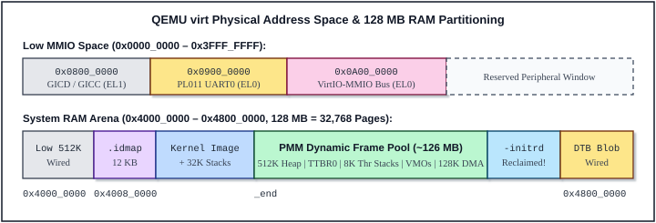

# A Heavily Commented ABOS Microkernel Source Code

**ABOS Version 1.0 (Lesson 20 Complete Edition) — ARMv8-A AArch64 Capability Microkernel**

**Author:** Liping Liu (`lipingliu@google.com`)  
**Date:** 2026-10-29


---

<div align="center">


### *“RTFSC – Read The F\*\*king Source Code :)!”*
— *Linus Benedict Torvalds*

</div>

---

## Abstract

This book provides an exhaustive, line-by-line architectural and source-code commentary on **ABOS** (ARM Bare-metal Operating System, Version 1.0 / Lesson 20 Complete Edition) — a two-layer, capability-based, 4-core SMP ARMv8-A (AArch64) microkernel operating system inspired by Google's Fuchsia Zircon architecture and modeled in structure and spirit after Dr. Zhao Jiong's classic *A Heavily Commented Linux Kernel Source Code*.

Every single source file, header file, assembly routine, linker script, build Makefile, and image-packaging tool in `lesson_20/` (58 files, 9,526 lines in total) is reproduced verbatim with numbered lines and interleaved explanation blocks covering hardware register protocols, SMP synchronization invariants, 4-level page-table management, capability rights enforcement, asynchronous port/channel IPC, and user-space server design.

**Copyright Statement:** © 2026 by Liping Liu (`lipingliu@google.com`). Prepared for OS learners, systems engineers, and microkernel researchers.

---

## Table of Contents

- **[Preface](#preface)**
  - [The Main Goal of This Book](#the-main-goal-of-this-book)
  - [Features of This Book](#features-of-this-book)
  - [Monolithic Kernels vs. Capability Microkernels](#monolithic-kernels-vs-capability-microkernels)
  - [The Importance and Necessity of Reading the Complete Code](#the-importance-and-necessity-of-reading-the-complete-code)
  - [Why Choose ABOS Lesson 20 (~9,526 Lines) to Read?](#why-choose-abos-lesson-20-9-526-lines-to-read)
  - [Basic Knowledge Required by This Book](#basic-knowledge-required-by-this-book)
  - [Sign-off](#sign-off)
- **[1 Overview](#1-overview)**
  - [1.1 From UNIX and Early Microkernels to Fuchsia Zircon and ABOS](#1-1-from-unix-and-early-microkernels-to-fuchsia-zircon-and-abos)
  - [1.2 Evolution Across ABOS Lessons 00–20](#1-2-evolution-across-abos-lessons-00-20)
  - [1.3 Guide to the Chapters of This Book](#1-3-guide-to-the-chapters-of-this-book)
  - [1.4 Summary](#1-4-summary)
- **[2 QEMU virt Hardware Platform and System Structure](#2-qemu-virt-hardware-platform-and-system-structure)**
  - [2.1 Virtual Machine Composition](#2-1-virtual-machine-composition)
  - [2.2 Physical Memory and MMIO Address Map](#2-2-physical-memory-and-mmio-address-map)
  - [2.3 Flattened Device Tree (DTB) and BOOTFS RAM Disk Handoff](#2-3-flattened-device-tree-dtb-and-bootfs-ram-disk-handoff)
  - [2.4 Peripheral Controllers](#2-4-peripheral-controllers)
  - [2.5 Summary](#2-5-summary)
- **[3 Kernel Programming Language, Toolchain and Build Environment](#3-kernel-programming-language-toolchain-and-build-environment)**
  - [3.1 GNU AArch64 Assembler (gas) Syntax and Directives](#3-1-gnu-aarch64-assembler-gas-syntax-and-directives)
  - [3.2 Freestanding C11 and GCC Extensions in ABOS](#3-2-freestanding-c11-and-gcc-extensions-in-abos)
  - [3.3 AAPCS64 Calling Convention and C/Assembly Interworking](#3-3-aapcs64-calling-convention-and-c-assembly-interworking)
  - [3.4 ELF64 Object Format, Linker Scripts and Flat Binary Images](#3-4-elf64-object-format-linker-scripts-and-flat-binary-images)
  - [3.5 Hierarchical Make Build System](#3-5-hierarchical-make-build-system)
  - [3.6 Summary](#3-6-summary)
- **[4 ARMv8-A Privilege Levels, Virtual Memory and SMP Programming](#4-armv8-a-privilege-levels-virtual-memory-and-smp-programming)**
  - [4.1 Core ARMv8-A System Registers and Instructions](#4-1-core-armv8-a-system-registers-and-instructions)
  - [4.2 Exception Levels (EL0–EL3) and Privilege Transitions](#4-2-exception-levels-el0-el3-and-privilege-transitions)
  - [4.3 4 KB Granule Page Tables, ASIDs and Cache/TLB Coherency](#4-3-4-kb-granule-page-tables-asids-and-cache-tlb-coherency)
  - [4.4 Exception Vector Table, Trap Frames, Demand Paging and Fault Isolation](#4-4-exception-vector-table-trap-frames-demand-paging-and-fault-isolation)
  - [4.5 Multi-Core SMP Synchronization and Lock Ordering](#4-5-multi-core-smp-synchronization-and-lock-ordering)
  - [4.6 Summary](#4-6-summary)
- **[5 ABOS Microkernel Architecture](#5-abos-microkernel-architecture)**
  - [5.1 Two-Layer Microkernel Architecture: LK Core and Zircon Capability Layer](#5-1-two-layer-microkernel-architecture-lk-core-and-zircon-capability-layer)
  - [5.2 Microkernel Module Structure and Interdependence](#5-2-microkernel-module-structure-and-interdependence)
  - [5.3 Physical and Virtual Memory Management (`PMM`, `Heap`, `VmAspace`, `VMO`, `VMAR`)](#5-3-physical-and-virtual-memory-management-pmm-heap-vmaspace-vmo-vmar)
  - [5.4 Hardware Interrupt Routing and `EL0` Driver Forwarding](#5-4-hardware-interrupt-routing-and-el0-driver-forwarding)
  - [5.5 System Call Interface and User-Pointer Validation](#5-5-system-call-interface-and-user-pointer-validation)
  - [5.6 Timekeeping and Preemptive SMP Round-Robin Scheduling](#5-6-timekeeping-and-preemptive-smp-round-robin-scheduling)
  - [5.7 Capability Object Model, Signals, Ports and Channel IPC](#5-7-capability-object-model-signals-ports-and-channel-ipc)
  - [5.8 How Stacks Work in ABOS](#5-8-how-stacks-work-in-abos)
  - [5.9 `BOOTFS` RAM Disk and POSIX USTAR Disk Storage Model](#5-9-bootfs-ram-disk-and-posix-ustar-disk-storage-model)
  - [5.10 Complete Directory Tree and 58-File Source Inventory](#5-10-complete-directory-tree-and-58-file-source-inventory)
  - [5.11 End-to-End Walkthrough: Launching `calc.bin` from the Shell](#5-11-end-to-end-walkthrough-launching-calc-bin-from-the-shell)
  - [5.12 Summary](#5-12-summary)
- **[6 Booting System and Higher-Half Trampoline](#6-booting-system-and-higher-half-trampoline)**
  - [6.1 Main Functions](#6-1-main-functions)
  - [6.2 `linker.ld`](#6-2-linker-ld)
  - [6.3 `kernel/core/start.S`](#6-3-kernel-core-start-s)
  - [6.4 `kernel/core/dtb.c`](#6-4-kernel-core-dtb-c)
  - [6.5 Summary](#6-5-summary)
- **[7 System Initialization (`lk_main` and Early Console)](#7-system-initialization-lk-main-and-early-console)**
  - [7.1 Main Functions](#7-1-main-functions)
  - [7.2 `kernel/core/main.c`](#7-2-kernel-core-main-c)
  - [7.3 `kernel/dev/debuglog.c`](#7-3-kernel-dev-debuglog-c)
  - [7.4 Summary](#7-4-summary)
- **[8 Exceptions, Interrupts, Timer and SMP Scheduler](#8-exceptions-interrupts-timer-and-smp-scheduler)**
  - [8.1 Main Functions](#8-1-main-functions)
  - [8.2 `kernel/core/exceptions.S`](#8-2-kernel-core-exceptions-s)
  - [8.3 `kernel/core/exceptions_c.c`](#8-3-kernel-core-exceptions-c-c)
  - [8.4 `kernel/dev/gic.c`](#8-4-kernel-dev-gic-c)
  - [8.5 `kernel/dev/timer.c`](#8-5-kernel-dev-timer-c)
  - [8.6 `kernel/core/switch.S`](#8-6-kernel-core-switch-s)
  - [8.7 `kernel/core/uspace_entry.S`](#8-7-kernel-core-uspace-entry-s)
  - [8.8 `kernel/core/thread.c`](#8-8-kernel-core-thread-c)
  - [8.9 `kernel/core/wait.c`](#8-9-kernel-core-wait-c)
  - [8.10 Summary](#8-10-summary)
- **[9 Memory Management (PMM, Heap and MMU)](#9-memory-management-pmm-heap-and-mmu)**
  - [9.1 Main Functionalities](#9-1-main-functionalities)
  - [9.2 `kernel/mm/pmm.c`](#9-2-kernel-mm-pmm-c)
  - [9.3 `kernel/mm/heap.c`](#9-3-kernel-mm-heap-c)
  - [9.4 `kernel/mm/mmu.c`](#9-4-kernel-mm-mmu-c)
  - [9.5 Summary](#9-5-summary)
- **[10 Capability Objects, IPC and Virtual Memory Dispatchers (object.c)](#10-capability-objects-ipc-and-virtual-memory-dispatchers-object-c)**
  - [10.1 Main Functions and Object Subsystem Architecture](#10-1-main-functions-and-object-subsystem-architecture)
  - [10.2 Base Object Lifecycle, StateTracker and Synchronous Wait](#10-2-base-object-lifecycle-statetracker-and-synchronous-wait)
  - [10.3 Process Lifetime, Handle Encoding and Capability Table Operations](#10-3-process-lifetime-handle-encoding-and-capability-table-operations)
  - [10.4 LogDispatcher, EventDispatcher and Peered EventPairDispatcher](#10-4-logdispatcher-eventdispatcher-and-peered-eventpairdispatcher)
  - [10.5 PortDispatcher and Asynchronous Signal Observers](#10-5-portdispatcher-and-asynchronous-signal-observers)
  - [10.6 Capability Handle Transfer and Peered ChannelDispatcher](#10-6-capability-handle-transfer-and-peered-channeldispatcher)
  - [10.7 VmObjectDispatcher (VMO), VmAddressRegionDispatcher (VMAR) and Demand Paging](#10-7-vmobjectdispatcher-vmo-vmaddressregiondispatcher-vmar-and-demand-paging)
  - [10.8 JobDispatcher, ThreadDispatcher and User Process Spawning](#10-8-jobdispatcher-threaddispatcher-and-user-process-spawning)
  - [10.9 Driver DDK Objects: ResourceDispatcher, Physical/Contiguous VMOs and InterruptDispatcher](#10-9-driver-ddk-objects-resourcedispatcher-physical-contiguous-vmos-and-interruptdispatcher)
  - [10.10 Task and Address-Space Introspection Engine (ps and vmaps)](#10-10-task-and-address-space-introspection-engine-ps-and-vmaps)
  - [10.11 Summary](#10-11-summary)
- **[11 System Call Layer and User-Pointer Validation (syscalls.c)](#11-system-call-layer-and-user-pointer-validation-syscalls-c)**
  - [11.1 Main Functions and Boundary Security](#11-1-main-functions-and-boundary-security)
  - [11.2 User-Pointer Validation (copy_from_user and copy_to_user)](#11-2-user-pointer-validation-copy-from-user-and-copy-to-user)
  - [11.3 Handle, DebugLog, Signal, Port and Channel Syscalls](#11-3-handle-debuglog-signal-port-and-channel-syscalls)
  - [11.4 VMO, VMAR, Task, Driver DDK and Introspection Syscalls](#11-4-vmo-vmar-task-driver-ddk-and-introspection-syscalls)
  - [11.5 Process Termination (ab_process_exit_current) and syscall_dispatch](#11-5-process-termination-ab-process-exit-current-and-syscall-dispatch)
  - [11.6 Summary](#11-6-summary)
- **[12 Kernel and Shared Header Files (include/)](#12-kernel-and-shared-header-files-include)**
  - [12.1 Overview of Files in include/](#12-1-overview-of-files-in-include)
  - [12.2 include/spinlock.h](#12-2-include-spinlock-h)
  - [12.3 include/debuglog.h](#12-3-include-debuglog-h)
  - [12.4 include/dtb.h](#12-4-include-dtb-h)
  - [12.5 include/exceptions.h](#12-5-include-exceptions-h)
  - [12.6 include/gic.h](#12-6-include-gic-h)
  - [12.7 include/timer.h](#12-7-include-timer-h)
  - [12.8 include/pmm.h](#12-8-include-pmm-h)
  - [12.9 include/heap.h](#12-9-include-heap-h)
  - [12.10 include/mmu.h](#12-10-include-mmu-h)
  - [12.11 include/thread.h](#12-11-include-thread-h)
  - [12.12 include/wait.h](#12-12-include-wait-h)
  - [12.13 include/object.h](#12-13-include-object-h)
  - [12.14 include/syscalls.h](#12-14-include-syscalls-h)
  - [12.15 include/ipc_proto.h](#12-15-include-ipc-proto-h)
  - [12.16 Summary](#12-16-summary)
- **[13 User-Space Linker Script, C Runtime and Library (ulibc)](#13-user-space-linker-script-c-runtime-and-library-ulibc)**
  - [13.1 Main Functions](#13-1-main-functions)
  - [13.2 user/link.ld](#13-2-user-link-ld)
  - [13.3 user/ulibc/crt0.S](#13-3-user-ulibc-crt0-s)
  - [13.4 user/ulibc/ulibc.h](#13-4-user-ulibc-ulibc-h)
  - [13.5 user/ulibc/crt_env.c](#13-5-user-ulibc-crt-env-c)
  - [13.6 user/ulibc/ulibc.c](#13-6-user-ulibc-ulibc-c)
  - [13.7 Summary](#13-7-summary)
- **[14 Root Bootstrap Process and EL0 Device Driver Servers](#14-root-bootstrap-process-and-el0-device-driver-servers)**
  - [14.1 Main Functions](#14-1-main-functions)
  - [14.2 user/userboot/userboot.c](#14-2-user-userboot-userboot-c)
  - [14.3 user/drivers/console_srv.c](#14-3-user-drivers-console-srv-c)
  - [14.4 user/drivers/fs_srv.c](#14-4-user-drivers-fs-srv-c)
  - [14.5 Summary](#14-5-summary)
- **[15 Interactive Shells and Standalone User Applications](#15-interactive-shells-and-standalone-user-applications)**
  - [15.1 Main Functions](#15-1-main-functions)
  - [15.2 user/shell/shell.c](#15-2-user-shell-shell-c)
  - [15.3 user/apps/calc.c](#15-3-user-apps-calc-c)
  - [15.4 Summary](#15-4-summary)
- **[16 Building and Packaging the Operating System](#16-building-and-packaging-the-operating-system)**
  - [16.1 Main Functions and Build DAG](#16-1-main-functions-and-build-dag)
  - [16.2 Toolchain Setup and Root Build Configuration](#16-2-toolchain-setup-and-root-build-configuration)
  - [16.3 Kernel Subdirectory Makefiles](#16-3-kernel-subdirectory-makefiles)
  - [16.4 User-Space Subdirectory Makefiles](#16-4-user-space-subdirectory-makefiles)
  - [16.5 Final Image Packaging and USTAR Archive Builders](#16-5-final-image-packaging-and-ustar-archive-builders)
  - [16.6 Summary](#16-6-summary)
- **[17 Experimental Environment, Running in QEMU and GDB Debugging](#17-experimental-environment-running-in-qemu-and-gdb-debugging)**
  - [17.1 QEMU virt Simulation Environment and Hardware Flags](#17-1-qemu-virt-simulation-environment-and-hardware-flags)
  - [17.2 Building and Running ABOS (Annotated Boot Transcript)](#17-2-building-and-running-abos-annotated-boot-transcript)
  - [17.3 Interactive Introspection Labs (caps, ps, vmaps, VT Switching, cat, calc)](#17-3-interactive-introspection-labs-caps-ps-vmaps-vt-switching-cat-calc)
  - [17.4 Inspecting Binary Artifacts and Disassembly](#17-4-inspecting-binary-artifacts-and-disassembly)
  - [17.5 Source-Level Debugging with QEMU (-s -S) and gdb-multiarch](#17-5-source-level-debugging-with-qemu-s-s-and-gdb-multiarch)
  - [17.6 Hands-On Kernel & User-Space Hacking Exercises](#17-6-hands-on-kernel-user-space-hacking-exercises)
  - [17.7 Summary](#17-7-summary)
- **[References](#references)**
- **[Appendix](#appendix)**
  - [A1 Complete ABOS System Call Table (1–34)](#a1-complete-abos-system-call-table-1-34)
  - [A2 Handle Encoding, Capability Rights, Object Signals and Error Codes](#a2-handle-encoding-capability-rights-object-signals-and-error-codes)
  - [A3 ARMv8-A Exception Syndrome (ESR_EL1) and 4 KB PTE Bitfield Quick Reference](#a3-armv8-a-exception-syndrome-esr-el1-and-4-kb-pte-bitfield-quick-reference)
  - [A4 Terminal Control Characters, VT Hotkeys and CSI Escape Sequences](#a4-terminal-control-characters-vt-hotkeys-and-csi-escape-sequences)

---

# Preface

Operating system kernels sit at the exact intersection of computer architecture and software engineering. Every time an application allocates memory, exchanges a message with a system service, renders characters to a terminal, or reads sectors from a storage device, an intricate choreography unfolds across hardware privilege boundaries, Memory Management Units (MMUs), interrupt controllers, caches, and kernel data structures. Yet for generations of systems programmers and students, bridging the chasm between textbook operating system theory and real-world kernel source code has remained stubbornly difficult—especially in the domain of **modern 64-bit Symmetric Multiprocessing (SMP) capability-based microkernels**.

More than two decades ago, Dr. Zhao Jiong published his landmark work, *"A Heavily Commented Linux Kernel Source Code"* (*Linux 内核完全注释*), which guided hundreds of thousands of engineers line by line through every assembly instruction, C function, header file, and Makefile of Linus Torvalds's classic `Linux 0.12` kernel (~19,000 lines on 32-bit Intel 80386). By refusing to omit "boring" glue code or hide hardware subtleties behind hand-waving abstractions, that book proved a timeless pedagogical truth: **once you have read one complete, self-contained, working operating system kernel from its first reset instruction to its interactive user-space shell, no larger operating system will ever feel opaque or mysterious again.**

This book brings that exact cover-to-cover, line-by-line annotation tradition into the modern era of **64-bit ARM (`AArch64` / `ARMv8-A`) multi-core processors** and **object-capability microkernel architecture**. Its subject is **ABOS (Lesson 20)**—a complete, compilable, bootable 4-core SMP capability microkernel operating system modeled directly after **Google Fuchsia's Zircon kernel**, written in clean freestanding C11 and GNU AArch64 assembly across **58 source and build files totaling exactly 9,526 lines**.

---

## The Main Goal of This Book

The primary goal of this book is to help readers achieve **complete, end-to-end mastery** of both **ARMv8-A 64-bit multi-core system programming** and **Zircon-style capability microkernel design** by dissecting every single file and line of ABOS Lesson 20.

Specifically, after working through this book, the reader will understand from first principles and concrete code:

1. **How a 64-bit ARM multi-core machine boots from bare metal to higher-half virtual memory**: Dropping from `EL2` to `EL1h`, building early 1 GB block page tables (`.idmap`), enabling the `MMU` alongside instruction and data caches (`SCTLR_EL1`), waking secondary Cortex-A53 cores via `PSCI_CPU_ON` (`HVC #0`), and parsing the hardware Flattened Device Tree (`DTB`) and `BOOTFS` initial RAM disk.
2. **How a two-layer Zircon-inspired microkernel is structured internally**: Separating the low-level **LK (Little Kernel) hardware and scheduling substrate** (physical frame arenas, kernel heap, 3-level `TTBR0_EL1` user page tables with hardware ASIDs, preemptive SMP round-robin scheduling, and blocking `wait_queue_t` / `event_t` primitives) from the high-level **Zircon Object & Capability layer** (`ab_object_t` dispatchers, generation-tagged capability handles, bitmask rights, `StateTracker` signal observers, asynchronous `Port` packet queues, `Channel` message-and-handle transfer, and `VMO` / `VMAR` demand-paged shared memory).
3. **How user-space bootstrapping, `EL0` device drivers, filesystems, virtual terminals, and shells collaborate without in-kernel drivers**: Watching `lk_main` hand root capabilities over a `Channel` to `userboot`, which unpacks `bootfs.tar` in `EL0` and launches standalone user-space servers—`console-srv.bin` (driving the PL011 UART on SPI IRQ 33 and multiplexing 4 virtual terminals `tty0..tty3` on a `Port`), `fs-srv.bin` (driving VirtIO-Blk DMA rings in `EL0` via `Resource`, contiguous DMA `VMO`, and `Interrupt` capabilities), four isolated `abos-shell` instances, and on-demand disk applications such as `calc.bin`.

Rather than stopping at architectural block diagrams, we trace every bit of every hardware register (`TCR_EL1`, `MAIR_EL1`, `ESR_EL1`, `FAR_EL1`, `GICD`/`GICC`, `CNTP_TVAL_EL0`), every spinlock acquisition order, every cache and TLB maintenance barrier (`tlbi vae1is`, `dc cvau`, `ic ialluis`), and every capability handle lifecycle transition (`ref_count` vs. `handle_count`).

---

## Features of This Book

Existing operating system literature generally falls into two extremes:

- **Conceptual OS textbooks** explain scheduling policies, page replacement algorithms, and access-control matrices in abstract pseudocode, leaving readers unsure how `SP_EL0` switches to `SP_EL1` on an `SVC #0` trap, how a level-triggered device IRQ is masked before waking an `EL0` driver thread, or how a linker script separates virtual execution addresses (`VMA`) from physical load addresses (`LMA`).
- **Production open-source kernels** have grown far beyond what an individual engineer can read end-to-end. Modern Linux exceeds **30 million lines of code** across dozens of architectures and legacy subsystems; even Google Fuchsia's production **Zircon** kernel spans **over 350,000 lines of heavily templated C++** (`fbl::RefPtr`, `ktl`, lock-dep template metaprogramming, FIDL/vDSO code generators, and multi-board platform trees).

This book bridges the gap between those two extremes with four defining features:

1. **100% Complete Source Code Coverage (Zero Omissions)**: Part II of this book reproduces and annotates all **58 files (9,526 lines)** of ABOS Lesson 20—including every kernel `.S` and `.c` file, every header in `include/`, both linker scripts (`linker.ld` and `user/link.ld`), every `EL0` C runtime file (`crt0.S`, `crt_env.c`, `ulibc.c`), `userboot`, both `EL0` device driver servers (`console_srv.c`, `fs_srv.c`), the interactive shell (`shell.c`), `calc.c`, the Python image packagers, and the hierarchical Makefiles.
2. **Faithful Zircon Architecture in Transparent Freestanding C**: ABOS translates Zircon's C++ `Dispatcher` class hierarchy into crystal-clear C structures (`ab_object_t` base header, explicit `on_zero_handles` and `destroy` hooks, explicit `ref_count` and `handle_count`, and explicit `spin_lock_irqsave` critical sections). There is zero hidden C++ constructor/destructor magic, zero operator overloading, and zero macro obfuscation.
3. **Structured ECLK Pedagogical Format**: Modeled directly on Dr. Zhao Jiong's classic structure, Part I (Chapters 1–5) builds a solid foundation in history, QEMU `virt` hardware, the GNU AArch64 toolchain, ARMv8-A system architecture, and ABOS's global design. Part II (Chapters 6–16) dissects each subsystem module with functional overviews, line-numbered verbatim listings interleaved with author commentary, and post-code deep dives. Part III (Chapter 17 and Appendices) provides a hands-on QEMU + `gdb-multiarch` source-level debugging laboratory and complete quick-reference tables.
4. **Immediate Hands-On Reproducibility**: With a single command (`make run`), ABOS Lesson 20 compiles from scratch in under two seconds on any Linux or macOS host and boots a 4-core Cortex-A53 virtual machine in QEMU with four live virtual terminals (`tty0..tty3`), real DMA block I/O, and live Zircon-style task/VM introspection (`ps`, `vmaps`, `caps`).

---

## Monolithic Kernels vs. Capability Microkernels

For half a century, operating system architecture has been shaped by a fundamental design tension: **what belongs inside the privileged kernel mode (`EL1`), and how is authority granted to software?**

In a **classic monolithic kernel**—exemplified by UNIX, BSD, Linux, and ABOS's companion sister project **AAOS**—the privileged `EL1` kernel binary incorporates process scheduling, virtual memory, filesystems, block storage drivers, TTY line disciplines, and networking stacks into a single shared kernel address space. User processes invoke ambient-authority POSIX system calls (`open("/dev/sda", ...)`, `read(fd, ...)`, `write(fd, ...)`), and access control is mediated by global namespaces (file paths, UIDs/GIDs). Monolithic kernels enjoy low-latency in-kernel function calls, but they pay a steep price in **Trusted Computing Base (TCB) size** and **fault containment**: a single out-of-bounds pointer write or use-after-free bug inside a third-party device driver or filesystem parser executes with full `EL1` privilege and compromises the entire machine.

A **capability-based microkernel**—pioneered conceptually by Dennis and Van Horn (1966), refined for high-performance IPC by Jochen Liedtke's **L4** family and **seL4**, and brought to modern consumer and embedded scale by **Google Fuchsia's Zircon**—radically inverts both choices:

| Architectural Dimension | Monolithic Kernel (UNIX / Linux / AAOS) | Capability Microkernel (Fuchsia Zircon / ABOS) |
| :--- | :--- | :--- |
| **Privileged `EL1` TCB Scope** | Scheduler, VM, VFS, filesystems, block/TTY/net drivers all run in `EL1`. | **Minimal `EL1` core**: Only scheduling, VM (`VMO`/`VMAR`), IPC (`Channel`/`Port`/`Event`), and hardware brokering (`Resource`/`Interrupt`). |
| **Device Drivers & Filesystems** | Compiled into `EL1` or loaded as privileged kernel modules (`.ko`). | Run as **unprivileged `EL0` user-space server processes** (`console-srv.bin`, `fs-srv.bin`) isolated in private `TTBR0_EL1` page tables. |
| **Authority & Naming Model** | **Ambient authority**: Any process can attempt to open global paths or device nodes based on UID/GID. | **Object-capability model**: Zero global object namespace. A process can act **only** on unforgeable `ab_handle_t` capabilities explicitly transferred into its private handle table. |
| **Permission Granularity** | Coarse file mode bits (`rwx`) or broad `CAP_SYS_ADMIN` flags. | Fine-grained per-handle **Rights bitmask** (`AB_RIGHT_READ`, `WRITE`, `MAP`, `EXECUTE`, `DUPLICATE`, `TRANSFER`, `MANAGE_PROCESS`) monotonically attenuated on duplication. |
| **Inter-Component Communication** | Direct C function calls across subsystems in shared `EL1` memory. | Small control messages + capability handle transfer over **`Channel`s**, paired with **zero-copy shared `VMO`s** and **`Port`** event loops. |
| **Fault Isolation** | A null-pointer dereference in a UART or block driver triggers an `EL1` kernel panic. | An unhandled fault in an `EL0` process triggers `ab_process_exit_current(-1)`, terminating only that process while `EL1` and sibling processes keep running. |

Studying ABOS allows you to see that a capability microkernel does not merely "move code to user space"—it replaces global state with explicit **capability graphs**. For instance, `abos-shell` in Lesson 20 holds five handles (`DebugLog`, its own `VMAR`, a `console-srv` `Channel`, an `fs-srv` `Channel`, and a `Job` handle), and **zero** `Resource` or `Interrupt` capabilities; it is architecturally impossible for the shell or `calc.bin` to touch physical MMIO addresses or claim hardware IRQs, even without a single UID check in the kernel.

---

## The Importance and Necessity of Reading the Complete Code

In the systems community, the maxim **RTFSC** (*"Read The F\*cking Source Code"*) exists for a profound reason: prose descriptions necessarily compress away edge cases, invariants, and cross-module interactions, whereas source code cannot lie. Yet *how* one reads kernel source code matters just as much as *whether* one reads it.

Many learners attempt to study a large operating system by reading isolated snippets—say, the 40 lines of `context_switch` or a single `page_fault` handler—in isolation. That approach inevitably leads to the classic **"blind men and the elephant"** dilemma:

- Without reading `linker.ld` and `start.S`, you cannot see why subtracting `KERNEL_PHYSMAP_OFFSET` (`0xFFFFFFFF40000000`) converts a kernel stack pointer back into a physical page frame address in `thread_reap_dead()`.
- Without reading `exceptions.S` alongside `uspace_entry.S` and `thread.c`, you cannot see how a newly spawned thread starts on its `context_switch_frame_t` via `ret` into `initial_thread_trampoline()`, drops to `EL0` via `eret` in `arm64_uspace_entry()`, and later traps back into `EL1` via `SVC #0` pushing a 288-byte `iframe_t` onto the *exact same* 8 KB kernel stack.
- Without reading `object.c` alongside `console_srv.c`, `fs_srv.c`, and `shell.c`, you cannot appreciate why `ab_object_t` maintains **two separate counters** (`ref_count` for kernel memory lifetime and `handle_count` for user-space handle lifetime), or how closing the last handle on one end of a `Channel` asserts `AB_SIGNAL_PEER_CLOSED` on the peer endpoint and wakes a `Port` loop in `fs-srv`.
- Without reading `image/Makefile`, `user/link.ld`, and `userboot.c`, the boundary between compile-time linking (`0x20000000`), bootloader `initrd` handoff (`bootfs.tar`), and runtime `VMO`/`VMAR` mapping remains magical rather than mechanical.

Reading a **complete** operating system from top to bottom dissolves all of those boundaries at once. Every symbol defined in one file is consumed in another file a few chapters away; nothing is swept behind an unexamined black box.

---

## Why Choose ABOS Lesson 20 (~9,526 Lines) to Read?

Choosing the right codebase for a complete source-code walkthrough requires a delicate balance: if the kernel is too toy-like (e.g., a 1,000-line cooperative single-core demo), it omits the very mechanisms—SMP spinlocks, ASID-tagged multi-level page tables, lazy demand paging, capability rights, asynchronous `Port` multiplexing, DMA block drivers, and standalone user-space servers—that define real operating systems. Conversely, if the kernel is hundreds of thousands or millions of lines long, no human reader can hold the whole system in working memory.

Table 0-1 compares ABOS Lesson 20 against classic educational and production kernels:

| Operating System / Version | Target Architecture | Kernel Paradigm | Language | Approx. Source Scale | Suitability for Complete Line-by-Line Study |
| :--- | :--- | :--- | :--- | :--- | :--- |
| **UNIX V6** (Lions' Commentary, 1976) | 16-bit PDP-11 | Monolithic | Pre-ANSI C & PDP-11 ASM | ~9,000 lines | Historic masterpiece, but targets obsolete 16-bit single-core hardware without modern MMUs or capabilities. |
| **Linux 0.12** (Zhao Jiong ECLK, 1992) | 32-bit x86 (i386) | Monolithic | C89 & x86 GAS/as86 | ~19,500 lines | Gold standard for classic x86 monolithic UNIX internals, but single-core 32-bit segmented x86. |
| **xv6-riscv** (MIT 6.1810) | 64-bit RISC-V | Monolithic | Freestanding C & RV64 ASM | ~9,000 lines | Excellent compact SMP monolithic UNIX teaching OS, but not ARMv8-A and not a capability microkernel. |
| **Fuchsia Zircon** (Production) | AArch64 / x86-64 / RISC-V | Capability Microkernel | Modern C++20 & ASM | ~350,000+ lines | Industrial reference for capability microkernels, but far too large and C++-heavy for a single-volume complete code walkthrough. |
| **Linux 6.x** (Production) | 20+ Architectures | Monolithic (+ Modules) | GNU C11 & ASM | >30,000,000 lines | Impossible to read completely; studied only one subsystem slice at a time. |
| **ABOS Lesson 20** (*This Book*) | **64-bit ARMv8-A (4-Core SMP)** | **Zircon-Style Capability Microkernel** | **Freestanding C11 & AArch64 GAS** | **9,526 lines (58 files)** | **Sweet spot**: Complete 4-core SMP `EL1` microkernel + `userboot` + `EL0` UART/VT server + `EL0` VirtIO-Blk/TAR server + 4 shells + `ps`/`vmaps` + `calc` app, readable cover-to-cover in a single book! |

At **9,526 lines across 58 files** (~5,826 lines of `EL1` kernel, headers, and linker/build scripts, plus ~2,338 lines of `EL0` runtime, servers, shells, and apps, and ~1,362 lines of shared interface headers and image tooling), ABOS Lesson 20 is half the size of `Linux 0.12` while implementing a genuinely modern 64-bit multi-core capability microkernel ecosystem. One dedicated month of evening reading—with QEMU and GDB open alongside the text—is sufficient to master every line in the repository.

---

## Basic Knowledge Required by This Book

To gain the maximum benefit from this book, readers should be comfortable with the following foundational topics (Chapters 2, 3, and 4 also review every ABOS-specific detail before Part II begins):

1. **C Programming at the Systems Level**: Pointers, pointer arithmetic, fixed-width integer types (`uint64_t`, `uintptr_t`), bitwise shifts and masks, structs, function pointers, `volatile` memory accesses, and basic data structures (singly/doubly linked lists and ring buffers).
2. **Computer Organization & Assembly Concepts**: CPU registers, program counter (`PC`), stack pointer (`SP`), stack frames, hardware interrupts vs. synchronous traps, physical vs. virtual addresses, and caches/TLBs. Prior familiarity with any assembly language (x86, RISC-V, MIPS, or ARM) is helpful; Chapters 3 and 4 introduce every AArch64 instruction and system register used in ABOS.
3. **Command-Line Development on Linux or macOS**: Running `make`, inspecting binaries with `objdump`/`readelf`/`nm`, and basic familiarity with terminal sessions.

### Recommended Companion References

Readers who wish to consult primary hardware specifications or explore the broader lineage behind ABOS will find the following works invaluable:

- **Zhao Jiong (赵炯)**, *A Heavily Commented Linux Kernel Source Code (Linux 内核完全注释, V5.0)* — The pedagogical inspiration for the structure and annotation style of this book.
- **ARM Limited**, *Arm Architecture Reference Manual for A-profile Architecture (ARM DDI 0487)* and *ARM Cortex-A Series Programmer's Guide for ARMv8-A* — Authoritative references for `EL0..EL3`, `VBAR_EL1`, Stage-1 VMSAv8-64 page tables, and AArch64 instructions.
- **Google Fuchsia Project**, *Zircon Kernel Concepts & System Call Documentation* (`docs/concepts.md`, `docs/handles.md`, `docs/rights.md`, `docs/signals.md`, `docs/userboot.md`) — Architectural documentation of the production Zircon kernel after which ABOS is modeled.
- **Jochen Liedtke**, *"On μ-Kernel Construction"* (SOSP 1995) and **Dennis & Van Horn**, *"Programming Semantics for Multiprogrammed Computations"* (CACM 1966) — Seminal papers on second-generation microkernels and capability-based protection.

---

## Sign-off

Writing an operating system from a blank assembly file up to a self-hosting multi-server microkernel—and then documenting every line of it—is an immensely rewarding journey. My hope is that ABOS Lesson 20 serves as a clear, welcoming glass box: small enough to hold completely in your head, yet faithful enough to modern industrial systems that when you subsequently open the Fuchsia Zircon, seL4, or Linux ARM64 source trees, you immediately recognize old friends on every page.

Every effort has been made to verify all line numbers, register bitfields, memory addresses, and behavioral descriptions directly against the runnable ABOS Lesson 20 source tree. Feedback, questions, and bug reports are always warmly welcomed.

<div align="right">

**Liping Liu**  
lipingliu@google.com  
October 2026

</div>

---

# 1 Overview

Before plunging into hardware register maps and line-by-line assembly and C annotations, it helps to step back and view the historical and architectural landscape from which **ABOS** emerged. Why did operating systems evolve from monolithic kernels toward second- and third-generation capability microkernels? How did Google Fuchsia's **Zircon** combine an embedded real-time kernel core (**LK**) with a capability object layer? And how did ABOS grow systematically across twenty incremental lessons (`Lesson 00` through `Lesson 20`) into the 9,526-line multi-server operating system dissected in this book?

This chapter answers those three questions and provides a complete roadmap to Parts I, II, and III of the text.

---

## 1.1 From UNIX and Early Microkernels to Fuchsia Zircon and ABOS

### 1.1.1 The Monolithic UNIX Heritage (1969–Present)

In 1969, Ken Thompson and Dennis Ritchie created **UNIX** at Bell Labs on a PDP-7 and shortly thereafter rewrote it in C on the PDP-11. UNIX unified files, devices, and pipes behind a remarkably clean abstraction—*"everything is a file descriptor"*—backed by a single privileged kernel binary containing process creation (`fork`/`exec`), memory management, the filesystem, block buffer caches, and character/terminal drivers.

That monolithic architecture powered four decades of computing triumphs, from **BSD** and commercial UNIX workstations to **Linux** (started by Linus Torvalds in 1991 on an Intel 80386 PC) and mobile platforms such as Android. When hardware had tens of kilobytes or a few megabytes of RAM and a single slow CPU core, placing filesystems and device drivers inside the kernel avoided expensive address-space switches.

Yet as hardware scaled to multi-gigahertz multi-core SoCs running dozens of untrusted peripherals, network protocols, and sandboxed applications, two structural weaknesses of classic monolithic kernels grew increasingly acute:

1. **Unbounded Privileged Attack Surface**: Device drivers and filesystems account for the vast majority of kernel code—and the vast majority of memory-safety vulnerabilities—yet execute in `EL1` (or x86 Ring 0) with unrestricted access to all physical RAM.
2. **Ambient Authority**: In classic POSIX systems, any process running under a given user ID inherits broad ambient authority over the global filesystem tree, process table, and `/dev` nodes, making least-privilege sandboxing complex bolt-on policy work (`chroot`, `seccomp`, `namespaces`, `SELinux`) rather than an intrinsic property of the kernel's object model.

### 1.1.2 First-, Second-, and Third-Generation Microkernels

To shrink the privileged kernel to a minimal, auditable core, researchers explored **microkernel** designs across three distinct generations:

- **First-Generation Microkernels (Late 1980s — Mach, Chorus, early MINIX)**: Systems like CMU's **Mach** moved filesystems, networking, and POSIX personalities into user-space servers. However, Mach's heavy, general-purpose virtual-memory copy-on-write IPC and coarse abstractions suffered severe TLB/cache footprints and context-switch overhead, giving early microkernels an undeserved reputation for being inherently slow.
- **Second-Generation Microkernels (Mid-1990s — Liedtke's L4, QNX)**: In 1995, Jochen Liedtke demonstrated with **L4** that IPC slowness was an implementation artifact of Mach, not a law of microkernels. By formulating the famous **minimality principle**—*a concept is tolerated inside the microkernel only if moving it outside the kernel, i.e., permitting competing implementations, would prevent the implementation of the system's required functionality*—L4 reduced IPC latency by more than an order of magnitude through lean, register-oriented message passing and tight architecture-specific engineering.
- **Third-Generation Capability Microkernels (2000s–Present — EROS/Coyotos, seL4, Fuchsia Zircon)**: Building on L4's performance lessons, third-generation microkernels integrated **object-capability security** directly into kernel naming and IPC. Every kernel resource (memory object, address space, thread, IPC endpoint, interrupt line) is accessed exclusively via unforgeable **capabilities** (handles) stored in kernel-protected per-process tables. **seL4** achieved formal mathematical verification in ~10,000 lines of C, while **Google Fuchsia's Zircon** engineered a practical, developer-friendly capability microkernel tailored for modern multi-core ARM64 and x86-64 devices.

### 1.1.3 Google Fuchsia's Zircon: The Two-Layer `LK + Dispatcher` Design

Unlike academic microkernels that require user space to manually manage raw hardware page frames (`Untyped` memory retyping in seL4), **Zircon** strikes a pragmatic engineering balance designed for rich, dynamic multi-process systems. Internally, Zircon is built in **two cleanly separated layers**:

1. **Bottom Layer — LK (Little Kernel)**: Originally created by Travis Geiselbrecht as a compact SMP embedded kernel, LK provides architecture bringup (`start.S`, `exceptions.S`), physical memory arenas (`PMM`), hardware page tables (`VmAspace`), preemptive kernel threads (`thread_t`), spinlocks, and blocking synchronization (`wait_queue_t`, `event_t`).
2. **Top Layer — Zircon Object & Capability Layer**: Built directly atop LK, every user-visible resource is a reference-counted **`Dispatcher`** object identified by a globally unique 64-bit **KOID** (`zx_koid_t`), tracked via per-process **Handle Tables** with fine-grained **Rights** (`zx_rights_t`), observed asynchronously via **`StateTracker` Signals** and **`Port`s**, and shared across isolated processes via **`Channel`s** (which transfer both bytes and handles!) and **`VMO`s / `VMAR`s** (zero-copy demand-paged shared memory).

### 1.1.4 The Birth of ABOS

Prior to ABOS, the author developed **AAOS**—a step-by-step monolithic Unix-style AArch64 teaching kernel where VirtIO-Blk, TAR filesystem parsing, and TTY console handling lived inside `EL1`. **ABOS** (*AArch64 Capability-Based Operating System*) was created as AAOS's microkernel counterpart: a ground-up, freestanding C11 and AArch64 assembly implementation of Zircon's exact `LK + Dispatcher` architecture on a 4-core QEMU `virt` Cortex-A53 machine.

By expressing Zircon's core ideas—`ab_object_t` dispatchers, generation-checked capability handles, `StateTracker` signal observers, `Port` event multiplexing, `Channel` capability transfer, `VMO`/`VMAR` lazy paging, `Resource`/`Interrupt` `EL0` device drivers, `userboot` + `BOOTFS` bootstrapping, 4 virtual terminals, and `ps`/`vmaps` introspection—in **9,526 lines of crystal-clear C and assembly**, ABOS makes modern capability microkernels completely accessible from first instruction to interactive shell.

---

## 1.2 Evolution Across ABOS Lessons 00–20

ABOS was developed incrementally across **21 self-contained lessons** (`lesson_00` through `lesson_20`), organized into **three architectural phases** that mirror how a real capability microkernel is brought up on new silicon:

- **Phase 1: Streamlined LK Hardware & Kernel Core (`Lessons 01–06`)** — Bare-metal `EL2 → EL1` drop, 4-core PSCI SMP bringup, `VBAR_EL1` trap frames, GICv2, ARM Generic Timer, DTB parsing, `PMM` page allocator, 512 KB kernel heap, higher-half `TTBR1_EL1` + per-process `TTBR0_EL1` MMU with ASIDs, preemptive SMP `thread_t` scheduling, and blocking `wait_queue_t` / `event_t` primitives.
- **Phase 2: Zircon Object, Capability & IPC Layer (`Lessons 07–11`)** — `ab_object_t` (`Dispatcher`), 64-bit KOIDs, generation-tagged per-process Handle Tables, capability Rights bitmasks, `EL0` transition & `SVC #0` syscalls, `StateTracker` signal observers, `Event` & `EventPair`, `Port` asynchronous packet queues, `Channel` message + handle transfer, and `VMO` / `VMAR` shared memory with lazy page-fault allocation.
- **Phase 3: User-Space Bootstrapping, `EL0` Drivers, Multi-VT Servers & `BOOTFS` (`Lessons 12–20`)** — `Job` / `Process` / `Thread` task lifecycle, `userboot` bootstrapping, `Resource` + physical MMIO `VMO` + contiguous DMA `VMO` + `Interrupt` objects, moving UART and VirtIO-Blk + TAR FS completely into `EL0`, standalone `calc` app, strict `kernel/` vs. `user/` layout, Zircon-style `ps` & `vmaps` diagnostics, 4 `Port`-multiplexed Virtual Terminals (`tty0..tty3`), hierarchical Makefiles with shared `user/link.ld`, and finally **Lesson 20**: standalone `EL0` system servers (`console-srv.bin`, `fs-srv.bin`, `shell.bin`) loaded from a DTB-discovered **`BOOTFS` (`-initrd bootfs.tar`) VMO** with automatic `initrd` page reclamation and `SYS_VMAR_UNMAP`.


Table 1-1 summarizes all 21 lessons in the ABOS curriculum, showing the exact progression of subsystems, source file counts, and lines of code culminating in Lesson 20:

| Lesson | Phase | Milestone Title | Key Subsystems & Mechanisms Introduced | Files | Total LOC |
| :--- | :--- | :--- | :--- | ---: | ---: |
| **00** | Prep | Architecture, Zircon Study Guide & Toolchain Setup | Monolithic vs. capability microkernel roadmap, `LK + Dispatcher` model, toolchain verification. | 1 | 43 |
| **01** | Phase 1 (LK Core) | Bare-Metal Boot, `EL2 → EL1` Transition & SMP `lk_main` | `start.S`, early PL011 spinlock-serialized `dprintf`, `PSCI_CPU_ON` (`HVC #0`) waking all 4 Cortex-A53 cores. | 7 | 656 |
| **02** | Phase 1 (LK Core) | Exception Vectors (`VBAR_EL1`), `iframe_t`, GICv2 & Generic Timer | 16-slot `VBAR_EL1` table, 288-byte `iframe_t` save/restore, `GICD`/`GICC` setup, 100 Hz PPI 30 timer ticks. | 14 | 1,034 |
| **03** | Phase 1 (LK Core) | Device Tree (`DTB`) Handoff, `PMM` Arena & Kernel Heap | Big-endian FDT parser (`dtb.c`), `vm_page_t[32768]` frame allocator (`pmm.c`), 512 KB `kmalloc`/`kfree` heap (`heap.c`). | 20 | 1,596 |
| **04** | Phase 1 (LK Core) | Higher-Half Kernel (`physmap` & `periphmap`) & `VmAspace` | `.idmap` trampoline to `0xFFFFFFFF80083000+`, `TTBR1_EL1` 1 GB blocks, `TTBR0_EL1` `L1→L2→L3` 4 KB tables & ASIDs. | 22 | 1,833 |
| **05** | Phase 1 (LK Core) | LK Kernel Threads (`thread_t`), Context Switch & Scheduler | 8 KB per-thread kernel stacks, `arm64_context_switch` (`switch.S`), fair 4-core SMP preemptive round-robin scheduler. | 25 | 2,209 |
| **06** | Phase 1 (LK Core) | LK Blocking Synchronization: `wait_queue_t` & `event_t` | Sleep-waiting queues with nanosecond deadlines (`wait.c`), `event_wait_deadline` and `event_signal` without busy-spinning. | 27 | 2,408 |
| **07** | Phase 2 (Zircon Caps) | Kernel Objects (`Dispatcher`), KOIDs, Handles, Rights & `EL0` | `ab_object_t`, 64-bit KOIDs, 64-slot gen-tagged Handle Table, `ab_rights_t` checks, `arm64_uspace_entry`, first `SVC #0` syscalls. | 32 | 3,118 |
| **08** | Phase 2 (Zircon Caps) | Object Signals, `StateTracker`, `WaitOne`, `Event` & `EventPair` | `ab_state_tracker_t` observer lists, `SYS_OBJECT_WAIT_ONE`, peered `EventPair` with automatic `AB_SIGNAL_PEER_CLOSED`. | 32 | 3,415 |
| **09** | Phase 2 (Zircon Caps) | Asynchronous Event Notification with `Port` Objects | `PortDispatcher` 32-packet ring queue, one-shot `SYS_OBJECT_WAIT_ASYNC`, single-thread `SYS_PORT_WAIT` event loops. | 32 | 3,723 |
| **10** | Phase 2 (Zircon Caps) | Message-Passing IPC: `Channel` & Capability Transfer | Peered `ChannelDispatcher`, 256-byte + 8-handle `ab_message_packet_t`, atomic cross-process handle move (`AB_RIGHT_TRANSFER`). | 32 | 4,219 |
| **11** | Phase 2 (Zircon Caps) | Shared Memory IPC: `VMO`, `VMAR` & Demand Paging | `VmObjectDispatcher`, `VmAddressRegionDispatcher` (`0x10000000..0x40000000`), lazy `EL0` translation-fault page commit, `EL0` fault isolation. | 32 | 4,605 |
| **12** | Phase 3 (EL0 OS) | Tasks (`Job`, `Process`, `Thread`) & `userboot` Bootstrapping | `JobDispatcher`, `SYS_PROCESS_CREATE`, `SYS_THREAD_CREATE`, `SYS_PROCESS_START`, `EL0` `userboot` with bootstrap `Channel`. | 32 | 4,887 |
| **13** | Phase 3 (EL0 OS) | User-Space Device Drivers (`Resource`, DMA `VMO` & `Interrupt`) | `ResourceDispatcher`, `SYS_VMO_CREATE_PHYSICAL`, `SYS_VMO_CREATE_CONTIG`, `InterruptDispatcher` GIC mask-and-wake forwarding. | 32 | 5,298 |
| **14** | Phase 3 (EL0 OS) | Complete Capability Microkernel OS (`EL0` UART, FS & Shell) | Multi-process `EL0` user space: `userboot` wires `console_srv`, `fs_srv` (VirtIO-Blk + TAR), and interactive `shell` over `Channel`s. | 33 | 5,730 |
| **15** | Phase 3 (EL0 OS) | Standalone Disk Application (`calc.bin`) & User C Runtime | `crt0.S` + `ulibc`, compiling standalone `calc.bin` into `disk.img`, loading via `FS_OP_OPEN_VMO` and spawning at `0x20000000`. | 35 | 6,081 |
| **16** | Phase 3 (EL0 OS) | Strict `EL1` (`kernel/`) vs. `EL0` (`user/`) Source Tree Separation | Clean physical directory partitioning (`include/`, `kernel/{core,mm,dev}`, `user/{ulibc,userboot,drivers,shell,apps}`, `image/`). | 45 | 6,591 |
| **17** | Phase 3 (EL0 OS) | Zircon-Style Task (`ps`) & Address-Space (`vmaps`) Diagnostics | `SYS_OBJECT_SET_NAME`, `SYS_JOB_GET_PS_INFO` (`Job → Process → Thread` tree, `PSS`, handle counts), `SYS_PROCESS_GET_MAPS` (`/A`, `/R`, `M`). | 45 | 7,397 |
| **18** | Phase 3 (EL0 OS) | 4 Virtual Terminals (`tty0..tty3`) with `Port` Multiplexing | Concurrent `abos-shell-0..3`, per-VT screen history & 512B RX rings, `ESC`/CSI/Ctrl hotkey parser with 25 ms `Port` timeout. | 45 | 7,745 |
| **19** | Phase 3 (EL0 OS) | Hierarchical Subdirectory Makefiles & Common `user/link.ld` | Shared `config.mk`, recursive per-module `Makefile`s, unified `user/link.ld` `@ 0x20000000`, `crt_env.c` `AB_PA_*` startup handle tags. | 57 | 7,985 |
| **20** | **Phase 3 (Capstone)** | **Standalone `EL0` System Servers via Zircon-Style `BOOTFS`** | **True microkernel image split (`kernel.img` = `EL1` + `userboot` only; `-initrd bootfs.tar` = standalone `console-srv.bin`, `fs-srv.bin`, `shell.bin`), DTB `initrd` reclamation, `34 SYS_VMAR_UNMAP`, 128 KB VirtIO DMA cache.** | **58** | **9,526** |

Notice how **Lesson 20** completes the microkernel architectural arc: in earlier lessons, `console_srv` and `fs_srv` were still compiled alongside `userboot` for convenience, whereas in Lesson 20 `kernel.img` contains **only** the `EL1` microkernel and the tiny `userboot` loader. All system servers (`console-srv.bin`, `fs-srv.bin`) and `shell.bin` are genuine standalone `EL0` binaries linked with `user/link.ld` at virtual address `0x20000000`, packaged into `image/bootfs.tar`, handed to the kernel via QEMU's `-initrd` and DTB `/chosen` node, wrapped in the `"bootfs.tar"` `VMO` (with the bootloader's physical `initrd` pages immediately reclaimed into the `PMM` free pool!), and unmapped via `SYS_VMAR_UNMAP` as soon as `userboot` finishes spawning them.

---

## 1.3 Guide to the Chapters of This Book

Following the time-tested blueprint of Dr. Zhao Jiong's *"A Heavily Commented Linux Kernel Source Code"*, this book is organized into **three parts** comprising **17 chapters and reference appendices**:

### Part I: Foundations and System Architecture (Chapters 1–5)

Part I equips the reader with every piece of hardware, compiler/linker, CPU architecture, and global software context needed so that no line in Part II ever feels mysterious:

- **Chapter 1 (`Overview`)** traces the evolution from monolithic UNIX to Zircon and ABOS, surveys Lessons 00–20, and maps out the book.
- **Chapter 2 (`QEMU virt Hardware Platform and System Structure`)** details the 4-core Cortex-A53 QEMU `virt` board, PSCI power control, the physical MMIO and 128 MB RAM map, Flattened Device Tree (`DTB`) and `initrd` `BOOTFS` handoff, and the register interfaces of GICv2, the ARM Generic Physical Timer, PrimeCell PL011 UART0, and Legacy VirtIO-MMIO Block DMA.
- **Chapter 3 (`Kernel Programming Language, Toolchain and Build Environment`)** covers GNU AArch64 assembler (`gas`) directives, freestanding C11 flags (including why `-mgeneral-regs-only` is vital in `EL1`), inline assembly constraints, the `AAPCS64` ABI, `ELF64` linker scripts (`linker.ld` vs. `user/link.ld`), `objcopy` flat binaries, POSIX USTAR archives, and the recursive `Makefile` build tree.
- **Chapter 4 (`ARMv8-A Privilege Levels, Virtual Memory and SMP Programming`)** examines `EL0..EL3` privilege transitions, system registers (`SCTLR_EL1`, `TCR_EL1`, `MAIR_EL1`, `ESR_EL1`, `FAR_EL1`), split `TTBR1_EL1` / `TTBR0_EL1` 4 KB page tables, hardware ASIDs, TLB/cache maintenance, the 16-slot `VBAR_EL1` exception vector table, demand paging, `EL0` fault isolation, exclusive `ldaxr`/`stxr`/`stlr` spinlocks, and ABOS's strict lock-ordering hierarchy.
- **Chapter 5 (`ABOS Microkernel Architecture`)** synthesizes the global design of ABOS Lesson 20: the two-layer `LK + Zircon` structure, inter-module dependencies, memory subsystems, IRQ forwarding, all 34 system calls, SMP scheduling, the capability object/handle/`StateTracker`/`Port`/`Channel` model, the three hardware stack regimes, `BOOTFS`/USTAR storage, the complete 58-file inventory, and an end-to-end trace of launching `calc.bin`.

### Part II: Complete Source Code Dissection (Chapters 6–16)

Part II presents **verbatim, line-numbered listings interleaved with detailed commentary** for all **58 files (9,526 lines)** of `lesson_20/`, ordered from hardware reset upward to user-space servers and applications:

- **Chapter 6 (`Build System, Linker Scripts, Image Packaging and Boot Trampoline`)** — Top-level `Makefile`, `config.mk`, `install_tools.sh`, `linker.ld`, `image/Makefile`, `image/make_bootfs.py`, `image/make_tar_disk.py`, and `kernel/core/start.S`.
- **Chapter 7 (`Kernel Initialization and Device Tree Handoff`)** — `kernel/Makefile`, `kernel/core/Makefile`, `kernel/core/main.c` (`lk_main`, `psci_cpu_on`, `arm64_secondary_entry`, `BOOTFS` VMO creation, and `userboot` launch), and `kernel/core/dtb.c`.
- **Chapter 8 (`Exception Vectors, Interrupt Controller, Generic Timer and Early DebugLog`)** — `kernel/core/exceptions.S`, `kernel/core/exceptions_c.c`, `kernel/core/uspace_entry.S`, `kernel/dev/Makefile`, `kernel/dev/gic.c`, `kernel/dev/timer.c`, and `kernel/dev/debuglog.c`.
- **Chapter 9 (`Preemptive SMP Thread Scheduler, Context Switch and Wait Queues`)** — `kernel/core/thread.c`, `kernel/core/switch.S`, and `kernel/core/wait.c`.
- **Chapter 10 (`Capability Object Model, Handles, Signals, Ports and Channel IPC`)** — First half of `kernel/core/object.c`: KOIDs, `ab_object_t` reference/handle counting, `StateTracker`, handle table encode/decode/lookup, `DebugLog`, `Event`, `EventPair`, `PortDispatcher`, and `ChannelDispatcher` capability transfer.
- **Chapter 11 (`Virtual Memory Objects, Address Regions, Tasks, Driver DDK and Diagnostics`)** — Second half of `kernel/core/object.c`: `VMO` & `VMAR` mapping/unmapping/demand paging, `Job`/`Process`/`Thread` dispatchers, `Resource` & `Interrupt` dispatchers, and `ps`/`vmaps` introspection engines.
- **Chapter 12 (`System Call Boundary and User Memory Copy Validation`)** — Complete annotation of `kernel/core/syscalls.c` (`copy_from_user`, `copy_to_user`, `ab_process_exit_current`, and all 34 syscall handlers).
- **Chapter 13 (`Physical Memory Arena, Kernel Heap and 3-Level MMU Page Tables`)** — `kernel/mm/Makefile`, `kernel/mm/pmm.c`, `kernel/mm/heap.c`, and `kernel/mm/mmu.c`.
- **Chapter 14 (`Shared Kernel, Capability and IPC Header Files`)** — All 14 header files in `include/` (`spinlock.h`, `pmm.h`, `mmu.h`, `heap.h`, `dtb.h`, `gic.h`, `timer.h`, `debuglog.h`, `exceptions.h`, `thread.h`, `wait.h`, `object.h`, `syscalls.h`, and `ipc_proto.h`).
- **Chapter 15 (`User-Space Linker Script, C Runtime, ulibc and userboot`)** — `user/Makefile`, `user/link.ld`, `user/ulibc/Makefile`, `crt0.S`, `crt_env.c`, `ulibc.h`, `ulibc.c`, `user/userboot/Makefile`, and `userboot.c`.
- **Chapter 16 (`Standalone EL0 System Servers, Interactive Shells and User Applications`)** — `user/drivers/Makefile`, `console_srv.c`, `fs_srv.c`, `user/shell/Makefile`, `shell.c`, `user/apps/Makefile`, and `calc.c`.

### Part III: Hands-On Debugging Laboratory and Appendices (Chapter 17 & Appendices)

- **Chapter 17 (`Building, Running and Debugging ABOS in QEMU and GDB`)** walks step-by-step through building ABOS, inspecting `ELF` sections and page tables in the QEMU monitor, attaching `gdb-multiarch` across the `.idmap → higher-half EL1 → EL0 @ 0x20000000` symbol boundaries, and running interactive capability/fault-isolation experiments.
- **Appendices** provide consolidated quick-reference tables for AArch64 instructions and system registers, all 34 ABOS system calls, capability rights and signals, and key global symbols.

### Suggested Reading Strategies

- **First Pass (Architectural Flow)**: Read Chapters 1–5 sequentially, then follow the runtime boot-to-shell spine through Chapters 6 (`start.S`), 7 (`main.c`), 8 (`exceptions.S`), 10–11 (`object.c`), 15 (`userboot.c`), and 16 (`console_srv.c`, `fs_srv.c`, `shell.c`).
- **Second Pass (Subsystem Mastery & GDB Experiments)**: Study every line of Chapters 6–16 alongside live `make run` and GDB sessions from Chapter 17, setting breakpoints at `_start`, `lk_main`, `syscall_dispatch`, `ab_channel_write`, and `0x20000000`.

---

## 1.4 Summary

Operating system design has evolved from single-address-space monolithic UNIX kernels to capability-based microkernels that isolate device drivers, filesystems, and user services inside unprivileged `EL0` processes connected by explicit capability handles. Modeling Google Fuchsia's two-layer **Zircon (`LK + Dispatcher`)** architecture in 9,526 lines of clean freestanding C11 and AArch64 assembly across 58 files, **ABOS Lesson 20** provides a complete, runnable, modern 4-core SMP capability microkernel OS whose entire source code can be mastered cover to cover. In Chapter 2, we examine the concrete virtual hardware platform on which ABOS executes: the 4-core ARMv8-A QEMU `virt` machine.

---

# 2 QEMU virt Hardware Platform and System Structure

Just as Dr. Zhao Jiong's commentary on `Linux 0.12` began by examining the IBM PC/AT motherboard—its 8259A Programmable Interrupt Controller, 8253 Programmable Interval Timer, 16550A UART, and Western Digital hard-disk controller—understanding an ARM64 operating system requires an exact mental model of the hardware board on which it executes.

Instead of locking learners to a proprietary physical development board whose SoC BootROM and undocumented vendor peripherals obscure the core kernel, **ABOS** targets the industry-standard **QEMU `virt` AArch64 virtual machine** (`qemu-system-aarch64 -M virt`). Every component on the QEMU `virt` board is an architectural standard defined by ARM Limited or OASIS: ARM Cortex-A53 ARMv8-A SMP cores, ARM PSCI power management, the ARM Generic Interrupt Controller v2 (`GICv2`), the ARMv8 Generic Timer, the ARM PrimeCell `PL011` UART, the `Flattened Device Tree` (`DTB`), and the `VirtIO-MMIO` block storage bus. The exact same drivers and boot protocol used on QEMU `virt` carry directly over to KVM cloud virtual machines and server/embedded ARMv8 platforms.

This chapter dissects the virtual machine topology, physical memory and MMIO layout, DTB/`initrd` boot handoff, and peripheral register interfaces used throughout ABOS Lesson 20.

---

## 2.1 Virtual Machine Composition

When you execute `make run` in `lesson_20/Makefile`, the build system launches QEMU with the following command line:

```bash
qemu-system-aarch64 -M virt -cpu cortex-a53 -smp 4 \
    -kernel image/kernel.img \
    -initrd image/bootfs.tar \
    -nographic -serial mon:stdio \
    -drive file=image/disk.img,format=raw,if=none,id=hd0 \
    -device virtio-blk-device,drive=hd0
```

Each flag configures a foundational piece of the hardware platform:

| QEMU Argument | Emulated Hardware Element | Role in ABOS Lesson 20 |
| :--- | :--- | :--- |
| `-M virt` | Generic ARMv8-A virtual motherboard | Instantiates standard MMIO buses (`0x00000000..0x3FFFFFFF`), 128 MB default DRAM starting at `0x40000000`, GICv2, PL011 UART0, VirtIO-MMIO slots, PSCI firmware, and auto-generated DTB. |
| `-cpu cortex-a53` | 64-bit ARMv8-A in-order core | Implements AArch64 state, `EL0`/`EL1` (and `EL2` if enabled), Stage-1 VMSAv8-64 MMU with 4 KB granules and 16-bit ASIDs, 64-byte cache lines, and ARMv8 Generic Timer. |
| `-smp 4` | 4-way Symmetric Multiprocessor | Creates four homogeneous Cortex-A53 cores (`MPIDR_EL1.Aff0 = 0, 1, 2, 3`) sharing inner-shareable coherent physical RAM and GICv2 Distributor (`GICD`). |
| `-kernel image/kernel.img` | Built-in ARM64 boot firmware | Loads raw flat binary `kernel.img` at physical address **`0x40080000`** (`BASE_PA + 512 KB`) and starts CPU 0 in `EL1h` with MMU disabled and `x0 = dtb_paddr`. |
| `-initrd image/bootfs.tar` | Initial RAM Disk (`BOOTFS`) | Loads `bootfs.tar` into physical RAM and records its `[start, end)` physical addresses in the DTB `/chosen` node (`linux,initrd-start` and `linux,initrd-end`). |
| `-nographic -serial mon:stdio` | Serial console multiplexing | Connects `PL011 UART0` (`PA 0x09000000`) directly to the host terminal's standard input/output (with `Ctrl+A x` / `Ctrl+A c` routed to QEMU's monitor). |
| `-drive ... -device virtio-blk-device` | VirtIO-MMIO Block Disk | Attaches the 1 MB USTAR disk image `image/disk.img` (2,048 × 512-byte sectors) to a VirtIO-MMIO transport slot (`0x0A000000 + slot × 0x200`). |

### 2.1.1 SMP CPU Topology and the ARM64 Boot Protocol

On a 4-core QEMU `virt` system, each processor identifies itself by reading the **Multiprocessor Affinity Register (`MPIDR_EL1`)**:

```c
static inline uint32_t arch_curr_cpu_num(void) {
    uint64_t mpidr;
    __asm__ volatile("mrs %0, mpidr_el1" : "=r"(mpidr));
    return (uint32_t)(mpidr & 0xFF); /* Aff0[7:0] -> CPU ID 0, 1, 2, or 3 */
}
```

Following the standard ARM64 Linux kernel boot protocol implemented by QEMU's built-in firmware when `-kernel` is passed a raw flat binary:

1. **Primary Core (`CPU 0`)** powers on at physical address **`0x40080000`** (`_start` in `kernel/core/start.S`) in **`EL1h`** (or `EL2h` if `-M virt,virtualization=on` is passed—which `start.S` handles seamlessly by dropping to `EL1h`). Interrupts (`DAIF`) are masked, the `MMU` and caches are disabled (`SCTLR_EL1.M = 0`), and general-purpose register **`x0`** holds the 4 KB-aligned physical address of the **Flattened Device Tree (`DTB`)** blob in RAM.
2. **Secondary Cores (`CPU 1`, `CPU 2`, `CPU 3`)** do **not** jump simultaneously into `_start` at power-on. Instead, QEMU holds them powered off inside its emulated **Power State Coordination Interface (PSCI)** firmware until `CPU 0` has initialized the `MMU` page tables, physical memory manager, heap, and `GICv2` distributor.

### 2.1.2 Secondary Core Wakeup via `PSCI_CPU_ON` (`HVC #0`)

ARM's **PSCI (DEN 0022)** standardizes multi-core power control so operating systems do not need board-specific SoC power-controller drivers. On QEMU `virt` (with `secure=off` by default), PSCI calls use the **Hypervisor Call (`HVC #0`)** conduit following the ARM **SMC Calling Convention (`SMCCC`)**:

- **`x0` = Function ID `0xC4000003` (`PSCI_0_2_FN64_CPU_ON`)**:
  - Bit `[31] = 1` (Fast Call), Bit `[30] = 1` (SMC64 / HVC64 64-bit register convention), Bits `[29:24] = 4` (Standard Secure Service Call), Bits `[15:0] = 0x0003` (`CPU_ON`).
- **`x1` = `target_cpu`**: Target `MPIDR` affinity value (`1`, `2`, or `3`).
- **`x2` = `entry_point_address`**: Physical address at which the awakened CPU begins executing with its MMU off—in ABOS (`kernel/core/main.c`), CPU 0 passes `(uintptr_t)_start` (`0x40080000`, since `_start` resides in `.idmap.text` whose symbol value equals its physical address!).
- **`x3` = `context_id`**: Opaque 64-bit value placed into `x0` of the awakened core (`0` in ABOS).

When QEMU handles `hvc #0` for `PSCI_CPU_ON`, the target core starts at `_start` (`0x40080000`), detects `mpidr & 0xFF != 0`, loads the already-built `idmap_table` and `kernel_table`, turns on its own `MMU` and caches, sets up its own 8 KB stack (`_stack_top - cpu_id × 8192`), and enters `arm64_secondary_entry(cpu_num)`.

---

## 2.2 Physical Memory and MMIO Address Map

On the QEMU `virt` board, the 64-bit physical address space is cleanly split at the **1 GB boundary (`0x40000000`)**:

- **`0x0000_0000 .. 0x3FFF_FFFF` (Lower 1 GB)**: Reserved exclusively for **Memory-Mapped I/O (MMIO)** peripheral control registers and platform flash/PCI windows. Memory accesses here have hardware side effects and must **never** be cached or speculatively reordered (`Device-nGnRnE`).
- **`0x4000_0000 .. 0x47FF_FFFF` (Default 128 MB DRAM Arena)**: Normal coherent system RAM (`32,768` frames × `4,096` bytes), cacheable with Inner-Shareable Write-Back Write-Allocate (`Normal WBWA`) attributes.



Table 2-1 documents every physical address region used by ABOS Lesson 20, how it is mapped into virtual memory, and which software component owns it:

| Physical Address Range | Size | Hardware / Memory Region | PMM Page State | Owner & Virtual Mapping in ABOS Lesson 20 |
| :--- | :--- | :--- | :--- | :--- |
| `0x0800_0000 .. 0x0800_FFFF` | 64 KB | **GICv2 Distributor (`GICD`)** | Device MMIO (outside RAM) | **`EL1` Kernel** via Periphmap `0xFFFFFFFFC8000000` (`include/gic.h`). |
| `0x0801_0000 .. 0x0801_FFFF` | 64 KB | **GICv2 CPU Interface (`GICC`)** | Device MMIO (outside RAM) | **`EL1` Kernel** via Periphmap `0xFFFFFFFFC8010000` (banked per CPU). |
| `0x0900_0000 .. 0x0900_0FFF` | 4 KB | **PrimeCell PL011 UART0** (SPI IRQ 33) | Device MMIO (outside RAM) | Early **`EL1` DebugLog** (`0xFFFFFFFFC9000000`) **+** **`EL0` `console-srv`** via Physical `VMO` mapped at `0x10000000`. |
| `0x0A00_0000 .. 0x0A00_3FFF` | 16 KB | **VirtIO-MMIO Bus** (32 × `0x200` slots, SPIs `48..79`) | Device MMIO (outside RAM) | **`EL0` `fs-srv`** via Physical `VMO` (`"virtio-blk-mmio"`) mapped at `0x10000000`. |
| `0x4000_0000 .. 0x4007_FFFF` | 512 KB | Low DRAM below ARM64 kernel load offset | `VM_PAGE_STATE_WIRED` | Reserved by ARM64 boot convention below `0x40080000`; kept wired in `pmm_init()`. |
| `0x4008_0000 .. 0x4008_2FFF` | 12 KB (3 pages) | **`.idmap` Trampoline** (`start.S` + `idmap_table` + `kernel_table`) | `VM_PAGE_STATE_WIRED` | Executed at `PA == VA` during MMU enable; holds permanent `TTBR1` L1 `kernel_table`. |
| `0x4008_3000 .. _end_pa` | ~116 KB | **Kernel Image** (`.text`, `.rodata`, `.data`, `.bss`, 32 KB boot stacks) | `VM_PAGE_STATE_WIRED` | **`EL1` Kernel** executing in Higher-Half VA `0xFFFFFFFF80083000+` (`linker.ld`). |
| `_end_pa .. 0x47FF_FFFF` | ~126 MB | **Dynamic PMM Frame Pool** (`page_array[32768]`) | `FREE` → `HEAP` / `MMU` / `ALLOC` / `OBJECT` | Dynamically allocated for the 512 KB heap, `TTBR0` L1/L2/L3 tables, 8 KB thread stacks, `VMO`s, 24 KB `EL0` stacks, and 128 KB VirtIO DMA ring/cache. |
| `initrd_start .. initrd_end` | ~60 KB | **QEMU `-initrd` (`image/bootfs.tar`)** | `WIRED` → **`FREE` (Reclaimed!)** | Placed by QEMU at `~0x44000000`; copied into `"bootfs.tar"` `VMO` in `lk_main()`, then freed back to PMM via `pmm_free_wired_range()`! |
| `dtb_paddr .. +dtb_size` | ~1 MB (`totalsize`) | **Flattened Device Tree (`DTB`)** | `VM_PAGE_STATE_WIRED` | Placed by QEMU after `initrd` (`~0x44100000`); parsed via kernel Physmap in `dtb_parse()` and kept wired. |

Observe the elegance of how ABOS handles the **`-initrd` (`bootfs.tar`)** physical pages during boot:

1. Before `pmm_init()` runs, `dtb_parse()` extracts `[initrd_start, initrd_end)` from `/chosen`.
2. `pmm_init()` initially marks those physical frames `VM_PAGE_STATE_WIRED` so that `heap_init()` (which immediately allocates 128 contiguous frames = 512 KB) and `ab_vmo_dispatcher_create()` **cannot accidentally overwrite `bootfs.tar` in place**!
3. Once `lk_main()` copies `bootfs.tar` into the kernel-managed `bootfs_vmo` (`ab_vmo_write`), it calls `pmm_free_wired_range(boot_info.initrd_start, boot_info.initrd_end)` (`main.c:102`), returning 100% of the bootloader's temporary RAM disk pages to the `PMM` free list before `userboot` even starts.

---

## 2.3 Flattened Device Tree (DTB) and BOOTFS RAM Disk Handoff

Unlike x86 PCs that historically queried BIOS `INT 0x15, EAX=0xE820` or ACPI tables to discover RAM, ARM64 platforms pass a binary **Flattened Device Tree (`FDT` / `DTB`)** whose physical address is delivered in register **`x0`** to `_start`. `start.S` saves `x0` into callee-saved register **`x20`** (`mov x20, x0`) while building page tables and clearing `.bss`, and then passes `x20` as the `uint64_t dtb_paddr` argument to `lk_main(dtb_paddr)`.

### 2.3.1 Binary Layout of an FDT Blob (`struct fdt_header`)

Every integer inside a Flattened Device Tree is stored in **big-endian (network) byte order**, whereas Cortex-A53 runs in **little-endian** mode. Therefore, `kernel/core/dtb.c` converts every 32-bit word via `be32_to_cpu()`. An FDT blob begins with a 40-byte header (`include/dtb.h`):

```
Offset  Field               Endian   Description
------  ------------------  -------  -------------------------------------------------------
0x00    magic               BE32     Must equal FDT_MAGIC = 0xD00DFEED
0x04    totalsize           BE32     Total byte length of the entire DTB blob
0x08    off_dt_struct       BE32     Byte offset from header to the Structure Block
0x0C    off_dt_strings      BE32     Byte offset from header to the Strings Block
0x10    off_mem_rsvmap      BE32     Byte offset to the Memory Reservation Block
0x14    version             BE32     FDT format version (typically 17)
0x18    last_comp_version   BE32     Lowest backward-compatible FDT version (typically 16)
0x1C    boot_cpuid_phys     BE32     Physical CPU ID of the boot processor (0)
0x20    size_dt_strings     BE32     Byte length of the Strings Block
0x24    size_dt_struct      BE32     Byte length of the Structure Block
```

### 2.3.2 Structure Block Lexical Tokens and Tree Depth

Starting at `dtb_va + off_dt_struct`, the **Structure Block** encodes the hardware device tree as a linear stream of 4-byte-aligned big-endian tokens (`dtb.c:8-12`):

| Token Constant | Value | Binary Payload Following Token |
| :--- | :--- | :--- |
| `FDT_BEGIN_NODE` | `0x00000001` | Null-terminated ASCII node name (e.g., `""` for root `/` at `depth=1`, `"memory@40000000"` or `"chosen"` at `depth=2`), padded with zeros to the next 4-byte boundary. |
| `FDT_END_NODE` | `0x00000002` | None; closes the current node and decrements `node_depth`. |
| `FDT_PROP` | `0x00000003` | Two `BE32` integers `(len, nameoff)` followed by `len` raw property bytes (padded to 4 bytes). The property's ASCII name resides at `strings_base + nameoff`. |
| `FDT_NOP` | `0x00000004` | None; ignored padding token. |
| `FDT_END` | `0x00000009` | None; marks the end of the Structure Block. |

### 2.3.3 Discovering DRAM (`/memory`) and BOOTFS (`/chosen`)

When QEMU `-M virt` boots with `-m 128M` (default) and `-initrd image/bootfs.tar`, it synthesizes two top-level child nodes (`node_depth == 2`) that `dtb_parse()` (`dtb.c:41-140`) inspects:

1. **`/memory@40000000` (`reg` property)**:
   On QEMU `virt`, `#address-cells = 2` and `#size-cells = 2`, so `reg` contains four 32-bit big-endian cells (`16` bytes):
   - `ram_base = (cells[0] << 32) | cells[1]` → `0x00000000_40000000`
   - `ram_size = (cells[2] << 32) | cells[3]` → `0x00000000_08000000` (`128 MB`)
2. **`/chosen` (`linux,initrd-start` and `linux,initrd-end` properties)**:
   Whenever `-initrd image/bootfs.tar` is passed on the QEMU command line, QEMU copies `bootfs.tar` into guest RAM and injects `linux,initrd-start` and `linux,initrd-end` (either 4-byte `u32` or 8-byte `u64` cells depending on QEMU version—`dtb.c:101-113` handles both!) into `/chosen`.

> **Design Note — FDT vs. Zircon ZBI**: Production Fuchsia bootloaders translate board-specific DTBs or UEFI tables into a flat container format called the **Zircon Boot Image (`ZBI`)**, which bundles the kernel item alongside a `ZBI_TYPE_STORAGE_BOOTFS` RAM disk item. Using QEMU's native DTB `/chosen` `initrd` handoff gives ABOS the exact same clean `BOOTFS VMO` architecture without requiring a custom UEFI bootloader stage!

---

## 2.4 Peripheral Controllers

ABOS interacts with four standard hardware peripheral controllers: **two inside `EL1`** (GICv2 and the ARM Generic Physical Timer, which drive preemptive scheduling and interrupt brokering) and **two completely inside unprivileged `EL0` driver processes** (PL011 UART0 in `console-srv` and VirtIO-MMIO Block in `fs-srv`, plus early spinlock-protected polled UART output in `EL1` `debuglog.c`).

### 2.4.1 ARM Generic Interrupt Controller v2 (`GICv2`)

In a multi-core ARMv8 system, external device interrupt wires do not connect directly to a single CPU's `IRQ` pin. Instead, an **ARM GICv2** controller splits interrupt management into two MMIO blocks:

1. **Distributor (`GICD` at `PA 0x08000000`, `VA 0xFFFFFFFFC8000000`)**: A single system-wide unit shared by all 4 CPUs. It prioritizes interrupt sources, enables or masks individual IRQ lines, and routes Shared Peripheral Interrupts to target CPUs.
2. **CPU Interface (`GICC` at `PA 0x08010000`, `VA 0xFFFFFFFFC8010000`)**: **Banked per CPU core**—when CPU 0, 1, 2, or 3 reads or writes `0xFFFFFFFFC8010000`, the hardware automatically accesses that specific core's private `GICC` register bank!

#### GICv2 Interrupt ID Numbering (`0 .. 1019`)

GICv2 partitions hardware Interrupt IDs (`INTID`) into three architectural ranges:

| INTID Range | Category | Banking | Usage in ABOS Lesson 20 |
| :--- | :--- | :--- | :--- |
| **`0 .. 15`** | **SGI** (Software Generated Interrupts) | Banked per CPU | Reserved for inter-processor interrupts (IPIs). |
| **`16 .. 31`** | **PPI** (Private Peripheral Interrupts) | Banked per CPU | **`INTID 30`** = Non-Secure Physical Timer (`CNTP`), firing independently at 100 Hz on each of the 4 cores! |
| **`32 .. 1019`** | **SPI** (Shared Peripheral Interrupts) | Global (shared) | **`INTID 33`** = PL011 UART0 (`console-srv`); **`INTID 48 + slot`** = VirtIO-MMIO devices (`fs-srv`). Routed to CPU 0 via `GICD_ITARGETSR`. |
| **`1020 .. 1023`** | Special / Spurious IDs | Per-acknowledge | **`1023`** returned by `GICC_IAR` when no pending interrupt of sufficient priority remains (`exceptions_c.c:76` ignores `irq >= 1020`). |

#### GICv2 Register Map Used in ABOS (`include/gic.h`, `kernel/dev/gic.c`)

| Register | Offset | Block | Width | Function in ABOS |
| :--- | :--- | :--- | :--- | :--- |
| `GICD_CTLR` | `+0x000` | `GICD` | 32-bit | Distributor Control: `gic_dist_init()` writes `0`, issues `dsb sy`, then writes `1` to enable global interrupt forwarding. |
| `GICD_TYPER` | `+0x004` | `GICD` | 32-bit | Interrupt Controller Type Register (reports number of supported SPI lines and CPU interfaces). |
| `GICD_ISENABLER[n]` | `+0x100 + 4n` | `GICD` | 32-bit | **Interrupt Set-Enable**: Writing `1 << (id % 32)` to `GICD_ISENABLER[id / 32]` unmasks interrupt `id` (write-`0` has no effect!). |
| `GICD_ICENABLER[n]` | `+0x180 + 4n` | `GICD` | 32-bit | **Interrupt Clear-Enable**: Writing `1 << (id % 32)` to `GICD_ICENABLER[id / 32]` masks interrupt `id`—crucial for masking level-triggered `EL0` SPIs until `sys_interrupt_ack()`! |
| `GICD_IPRIORITYR[n]` | `+0x400 + 4n` | `GICD` | 32-bit | 8-bit priority byte per interrupt (default `0x00` = highest priority, accepted whenever `GICC_PMR = 0xFF`). |
| `GICD_ITARGETSR[n]` | `+0x800 + 4n` | `GICD` | 32-bit | 8-bit CPU target bitmask per SPI (`4` interrupts per 32-bit word). For `id >= 32`, `gic_enable_interrupt()` sets byte `id % 4` to `0x01` (CPU 0). |
| `GICC_CTLR` | `+0x0000` | `GICC` | 32-bit | Per-CPU Interface Control: `gic_cpu_init()` writes `1` on every core to enable IRQ signaling to that core. |
| `GICC_PMR` | `+0x0004` | `GICC` | 32-bit | Priority Mask Register: Set to `0xFF` so all priority levels `0x00..0xFE` are accepted. |
| `GICC_IAR` | `+0x000C` | `GICC` | 32-bit | **Interrupt Acknowledge**: Reading transitions the highest-priority pending IRQ from *Pending* to *Active* and returns `INTID` in bits `[9:0]`. |
| `GICC_EOIR` | `+0x0010` | `GICC` | 32-bit | **End of Interrupt**: Writing the exact `iar` value read from `GICC_IAR` deactivates the interrupt in the GIC state machine. |

---

### 2.4.2 ARMv8 Generic Physical Timer (PPI 30)

Every Cortex-A53 core contains an architectural **Generic Timer** fed by a system-wide monotonic counter running at a constant frequency (`62.5 MHz` = `62,500,000` ticks/sec, i.e., `16 ns` per tick on QEMU `virt`). Unlike MMIO peripherals, the Generic Timer is programmed via fast internal **System Registers** (`MSR`/`MRS`) and signals **PPI `INTID 30`** (`TIMER_ARCH_PHYS_IRQ`) privately on each core:

| System Register | Access | Description & Usage in `kernel/dev/timer.c` and `ulibc.c` |
| :--- | :--- | :--- |
| `CNTFRQ_EL0` | `EL1`/`EL0` RO | Counter-timer Frequency in Hz (`62,500,000` on QEMU `virt`). Divided by `100` (`tick_hz`) to compute `timer_interval_cnt = 625,000` ticks (`10 ms`). |
| `CNTPCT_EL0` | `EL1`/`EL0` RO | 64-bit Physical Count value. Read by `current_time_ns()` in `EL1` and directly by `ulibc_clock_get_monotonic()` in `EL0` **without a syscall**! |
| `CNTKCTL_EL1` | `EL1` RW | Kernel Control Register: `timer_init_percpu()` sets bit `0` (`EL0PCTEN = 1`) on every CPU so `EL0` processes (`console-srv`'s 25 ms `ESC` timer!) can read `CNTPCT_EL0` directly without trapping. |
| `CNTP_TVAL_EL0` | `EL1` RW | 32-bit signed TimerValue countdown register. Writing `timer_interval_cnt` sets `CVAL = CNTPCT_EL0 + interval` and **de-asserts the current timer IRQ line**! |
| `CNTP_CTL_EL0` | `EL1` RW | Physical Timer Control: Bit `0` (`ENABLE = 1`), Bit `1` (`IMASK = 0`), Bit `2` (`ISTATUS` RO). Writing `1` arms the per-CPU timer. |

Notice why `timer_irq_handler()` writes `msr cntp_tval_el0, timer_interval_cnt` *before* `gic_end_interrupt(iar)` runs: the ARM Generic Timer output is **level-sensitive** (`CNTP_CTL_EL0.ISTATUS == 1` while `CNTPCT_EL0 >= CVAL`). Advancing `CVAL` into the future via `CNTP_TVAL_EL0` immediately drops the level-sensitive timer line so the CPU does not re-enter the IRQ vector upon `GICC_EOIR`.

---

### 2.4.3 ARM PrimeCell PL011 UART0 (`0x09000000`, SPI 33)

The **PL011** is ARM's standard AMBA PrimeCell Universal Asynchronous Receiver/Transmitter, located at physical address **`0x09000000`** (`4 KB` window) and wired to **SPI `INTID 33`**. In ABOS Lesson 20, `EL1` `debuglog.c` uses polled TX (`UART_DR` / `UART_FR`) for `[kernel]` diagnostic messages, while `EL0` `console-srv` maps `0x09000000` into user space via `sys_vmo_create_physical` and drives interrupt-driven RX + multi-VT TX completely from `EL0`!

| Register | Offset | Key Bits & Masks | Role in `debuglog.c` & `user/drivers/console_srv.c` |
| :--- | :--- | :--- | :--- |
| `UART_DR` | `+0x000` | `[7:0]` Data byte | Writing pushes a byte into the 16-byte TX FIFO; reading pops the oldest received byte from the 16-byte RX FIFO. |
| `UART_FR` | `+0x018` | `RXFE` (`1<<4`), `TXFF` (`1<<5`) | Flag Register (RO): `TXFF == 1` means TX FIFO is full (busy-wait before TX); `RXFE == 1` means RX FIFO is empty (stop draining RX). |
| `UART_LCR_H` | `+0x02C` | `FEN` (`1<<4`), `WLEN8` (`3<<5`) | Line Control: `console-srv` writes `WLEN8 \| FEN` (`0x70`) to enable **8-bit words** and **16-byte hardware TX/RX FIFOs** (preventing dropped bytes on multi-byte `CSI` escape paste bursts!). |
| `UART_IMSC` | `+0x038` | `RXIM` (`1<<4`), `RTIM` (`1<<6`) | Interrupt Mask Set/Clear: `console-srv` enables both **RX FIFO threshold (`RXIM`)** and **RX receive timeout (`RTIM`)** so even a single keystroke (which doesn't fill the FIFO threshold) triggers SPI 33! |
| `UART_ICR` | `+0x044` | `RXIC` (`1<<4`), `RTIC` (`1<<6`) | Interrupt Clear (WO): Writing `RXIM \| RTIM` clears latched UART interrupt conditions after draining `UART_DR`. |

---

### 2.4.4 VirtIO-MMIO Legacy Block Device (`0x0A000000`, SPI `48+`)

QEMU `virt` exposes **32 VirtIO-MMIO transport slots** starting at physical address **`0x0A000000`**, spaced `0x200` (`512`) bytes apart (`0x0A000000 .. 0x0A003FFF` = `16 KB` = `4` pages), wired to **SPI `INTID 48 .. 79`** (`dev_irq = 48 + slot`). By default, `-device virtio-blk-device` exposes the **Legacy (v1) VirtIO-MMIO** interface (`VERSION == 1`), driven entirely in `EL0` by `user/drivers/fs_srv.c`.

#### 1. VirtIO-MMIO Control Registers (`fs_srv.c:10-24`)

| Register | Offset | R/W | Description & Initialization Sequence in `fs-srv` |
| :--- | :--- | :--- | :--- |
| `MAGIC_VALUE` | `+0x000` | RO | Must read `0x74726976` (little-endian ASCII `"virt"`). |
| `VERSION` | `+0x004` | RO | Legacy VirtIO-MMIO version (`1`). |
| `DEVICE_ID` | `+0x008` | RO | Device type: `0` = empty slot, **`2` = Block Device (`virtio-blk`)**. |
| `GUEST_FEATURES` | `+0x020` | WO | Negotiated feature bits (`0` in `fs-srv` for basic sector read/write). |
| `GUEST_PAGE_SIZE` | `+0x028` | WO | Legacy v1 page size (`4096`), used by hardware to convert `QUEUE_PFN` into a physical address (`PFN × 4096`). |
| `QUEUE_SEL` | `+0x030` | WO | Selects Virtqueue index (`0` = the single request queue of `virtio-blk`). |
| `QUEUE_NUM` | `+0x038` | WO | Sets Virtqueue ring length (`VIRTIO_RING_SIZE = 16` descriptors). |
| `QUEUE_ALIGN` | `+0x03C` | WO | Legacy v1 Used Ring alignment (`4096` bytes). |
| `QUEUE_PFN` | `+0x040` | RW | Physical Page Frame Number (`dma_pa >> 12`) of the contiguous Virtqueue memory region! |
| `QUEUE_NOTIFY` | `+0x050` | WO | Doorbell register: writing `0` notifies QEMU that new descriptors are available in Queue `0`. |
| `INTERRUPT_STAT` | `+0x060` | RO | Bit `0` = Used Buffer Notification (DMA transfer complete). |
| `INTERRUPT_ACK` | `+0x064` | WO | Writing the value read from `INTERRUPT_STAT` de-asserts the device's level-triggered SPI wire! |
| `STATUS` | `+0x070` | RW | Device status state machine: write `0` (Reset) → `1\|2` (`ACKNOWLEDGE \| DRIVER`) → configure queue → `1\|2\|4` (`DRIVER_OK`). |
| `CONFIG` | `+0x100` | RO | Device-specific config: for `virtio-blk`, bytes `+0x100..+0x107` hold the 64-bit `capacity` in 512-byte sectors (`2,048` sectors = `1 MB` for `disk.img`). |

#### 2. Split Virtqueue DMA Layout and 3-Descriptor Block Request Chain

Because QEMU's emulated DMA engine accesses guest memory by **physical address**, `fs-srv` allocates a **32-page (`128 KB`) physically contiguous DMA VMO** via `sys_vmo_create_contiguous(res_h, 32 * 4096, &dma_vmo, &dma_pa)` and partitions it cleanly:

```
Contiguous 128 KB DMA Buffer (dma_pa .. dma_pa + 0x20000):
+-------------------------------------------------------------------------+
| Page 0 (dma_pa + 0x0000):                                               |
|   - virtq_desc_t  desc[16]  (16 * 16B = 256 bytes @ offset 0x000)       |
|   - virtq_avail_t avail     (flags, idx, ring[16] @ offset 0x100)       |
|-------------------------------------------------------------------------|
| Page 1 (dma_pa + 0x1000, aligned to QUEUE_ALIGN = 4096):                |
|   - virtq_used_t  used      (device writes completed descriptor IDs)    |
|-------------------------------------------------------------------------|
| Page 2 (dma_pa + 0x2000):                                               |
|   - virtio_blk_req_t req    (16B: type=0 READ, reserved=0, sector=0)    |
|   - uint8_t req_status      (1B @ +64: initialized 0xFF -> 0x00 on OK)  |
|-------------------------------------------------------------------------|
| Pages 3..31 (dma_pa + 0x3000 .. +0x1FFFF, 29 pages = 116 KB):           |
|   - uint8_t tar_cache[118784] (232 * 512-byte USTAR disk sectors!)      |
+-------------------------------------------------------------------------+
```

Every VirtIO block transaction requires a **three-descriptor chain** linked via `VIRTQ_DESC_F_NEXT (1)` and device-writable `VIRTQ_DESC_F_WRITE (2)`:

1. **`desc[0]` (Driver → Device, `16` bytes, `flags = NEXT`)**: Points to `virtio_blk_req_t` (`type = 0` `VIRTIO_blk_T_IN`, `sector = 0`), `next = 1`.
2. **`desc[1]` (Device → Driver, `116 KB`, `flags = NEXT | WRITE`)**: Points to `tar_cache` (`dma_pa + 3 × 4096`), `next = 2`.
3. **`desc[2]` (Device → Driver, `1` byte, `flags = WRITE`)**: Points to `req_status` (`dma_pa + 2 × 4096 + 64`), where QEMU writes `0` (`VIRTIO_BLK_S_OK`) when DMA completes.

After publishing `avail->ring[0] = 0`, issuing `dsb sy`, incrementing `avail->idx = 1`, issuing `dsb sy`, and ringing `QUEUE_NOTIFY = 0`, `fs-srv` sleeps in `sys_interrupt_wait(irq_h)` without burning a single CPU cycle until SPI `48 + slot` wakes it!

---

## 2.5 Summary

The QEMU `virt` platform provides a clean, standards-based 4-core ARMv8-A SMP machine: MMIO peripherals occupy `0x00000000..0x3FFFFFFF` while 128 MB of RAM begins at `0x40000000`. CPU 0 boots at `0x40080000` with `x0` pointing to a big-endian Flattened Device Tree (`DTB`) that describes both system RAM and the `-initrd` `BOOTFS` archive (`bootfs.tar`), and wakes CPUs `1..3` via `PSCI_CPU_ON` (`HVC #0`). Only `GICv2` and the per-CPU `Generic Timer` (`PPI 30`) remain managed by the `EL1` microkernel; both `PL011 UART0` (`SPI 33`) and `VirtIO-MMIO Block` (`SPI 48+` with 128 KB contiguous DMA) are delegated via capabilities to unprivileged `EL0` server processes. Next, Chapter 3 examines the GNU AArch64 compiler, assembler, ABI, linker scripts, and build system that turn ABOS's source files into bootable binary images.

---

# 3 Kernel Programming Language, Toolchain and Build Environment

An operating system kernel cannot rely on a host operating system's C standard library, dynamic linker, stack-setup runtime, or `POSIX` system calls—because the kernel *is* the lowest-level software responsible for creating address spaces and stacks in the first place. Even small compiler or linker subtleties—such as the compiler silently emitting a 128-bit `SIMD` register spill inside an `EL1` interrupt handler, reordering an MMIO register write across a spinlock boundary, or placing a boot trampoline at a virtual address when the `MMU` is still turned off—will crash a bare-metal multi-core machine instantaneously.

In *"A Heavily Commented Linux Kernel Source Code"*, Chapter 3 introduced `as86`, GNU `gas` AT&T x86 syntax, GCC inline assembly, `a.out` object files, and `Linux 0.12`'s `Makefile` hierarchy. This chapter provides the modern 64-bit ARM counterpart for **ABOS Lesson 20**: GNU AArch64 assembler (`gas`) syntax, freestanding C11 compilation flags and GCC inline assembly extensions, the **AAPCS64** procedure call standard, **ELF64** dual-linker-script relocation (`linker.ld` vs. `user/link.ld`), flat binary extraction + `USTAR` packaging, and ABOS's recursive `Makefile` build architecture.

---

## 3.1 GNU AArch64 Assembler (gas) Syntax and Directives

ABOS Lesson 20 contains **five assembly source files** totaling **445 lines**:

1. `kernel/core/start.S` (179 lines) — Bare-metal `.idmap` boot trampoline, `EL2 → EL1h` transition, early 1 GB block page tables, MMU/cache activation, `.bss` zeroing, and per-CPU stack initialization.
2. `kernel/core/exceptions.S` (130 lines) — 2 KB-aligned `VBAR_EL1` exception vector table and `regsave` / `regrestore` macros for the 288-byte `iframe_t` trap frame.
3. `kernel/core/switch.S` (42 lines) — `arm64_context_switch()` saving and restoring the 112-byte `context_switch_frame_t` across kernel stacks.
4. `kernel/core/uspace_entry.S` (50 lines) — `arm64_uspace_entry()` zeroing general-purpose registers to prevent kernel data leaks and entering `EL0t` via `eret`.
5. `user/ulibc/crt0.S` (44 lines) — Standalone `EL0` user-space entry `_start` at `0x20000000`, zeroing user `.bss`, calling `__ulibc_init()` and `main()`, and invoking `sys_process_exit()`.

Notice that every assembly file uses the **uppercase `.S` extension** rather than lowercase `.s`. When invoked via `aarch64-linux-gnu-gcc -c foo.S` (`config.mk:62-64`), GCC runs the **C Preprocessor (`cpp`)** prior to `gas`, enabling `#define` constants (such as `#define IFRAME_SIZE 288` in `exceptions.S`) and C-style `/* ... */` block comments.

### 3.1.1 AArch64 Instruction Syntax Conventions

Unlike x86 AT&T syntax (where `movl %eax, %ebx` moves left-to-right), standard **ARM64 (`AArch64`) assembly** places the **destination register on the left** for data-processing and load instructions (`op dst, src1, src2`), and the **value register on the left** for store instructions (`str src_reg, [base_addr, #offset]`):

```asm
mov     x20, x0                 /* x20 = x0 (64-bit register move) */
sub     x10, x10, x9, lsl #13   /* x10 = x10 - (x9 << 13) [8 KB per CPU] */
stp     x0,  x1,  [sp, #16]     /* Store Pair: Mem[sp+16]=x0, Mem[sp+24]=x1 */
stp     xzr, xzr, [x10], #16    /* Post-index: Mem[x10..x10+15]=0; x10 += 16 */
ldp     x29, x30, [sp, #96]     /* Load Pair:  x29=Mem[sp+96], x30=Mem[sp+104] */
```

Every general-purpose register can be referenced either as a **64-bit X-register (`x0..x30`)** or as its **lower 32-bit W-register (`w0..w30`)**. Writing to any `wN` register architectural-automatically **zero-extends** bits `[63:32]` of `xN`! Register 31 has two context-sensitive encodings: **`xzr`/`wzr`** (hardwired zero register in arithmetic/load/store value positions) versus **`sp`/`wsp`** (stack pointer in base-address and explicit `SP` arithmetic instructions).

### 3.1.2 Essential `gas` Assembler Directives Used in ABOS

| Directive | Example in ABOS | Meaning & Pitfalls to Watch For |
| :--- | :--- | :--- |
| `.section name, "flags"` | `.section .idmap.text, "ax"` | Switches output section; `"a"` = allocatable in memory, `"x"` = executable, `"w"` = writable. |
| `.global sym` | `.global arm64_context_switch` | Exports `sym` in the `ELF` symbol table so C files and linker scripts can bind to it. |
| `.type sym, %function` | `.type _start, %function` | Marks symbol type `STT_FUNC` in `ELF` metadata (`crt0.S:15`) for clean GDB disassembly. |
| `.equ NAME, expr` | `.equ MAIR_VALUE, 0xFF00` | Defines an assembly-time symbolic constant (`start.S:8-12`). |
| `.balign bytes` | `.balign 4096` | Pads location counter to an **exact byte multiple** (`4096` bytes for page tables in `start.S:130`). |
| `.align power` | `.align 11` / `.align 7` | **Critical ARM `gas` rule**: On AArch64, `.align N` aligns to **`2^N` bytes**, NOT `N` bytes! Thus `.align 11` = `2¹¹ = 2,048` bytes (`VBAR_EL1` table alignment in `exceptions.S:66`), and `.align 7` = `2⁷ = 128` bytes (`0x80` vector slot stride in `exceptions.S:70-91`). |
| `.word val` / `.space N` | `.space 4096` | Emits a 32-bit integer (`.word 0`) or reserves `N` zero-initialized bytes (`.space 4096`). |
| `.macro name, args` | `.macro regsave, flags` | Defines a parameterized assembly macro expanded inline up to `.endm` (`exceptions.S:10-35`). |

### 3.1.3 Local Labels (`1:` / `1b` / `1f`) and `adr` vs. `ldr x0, =sym`

Two addressing idioms in `start.S` deserve special attention because misunderstanding them causes immediate bare-metal boot crashes:

1. **Numeric Local Labels (`1:`, `1b`, `1f`) vs. `.L` Local Labels**:
   - Labels prefixed with `.L` (such as `.Ldrop_el2` or `.Lbss_loop`) are file-local symbols omitted from the final `ELF` symbol table.
   - Single-digit numeric labels (`1:`, `2:`, `3:`) can be reused repeatedly inside the same file or macro: `b 1b` branches to the nearest preceding (`backward`) `1:` label, while `b.hs 2f` branches to the nearest following (`forward`) `2:` label (`crt0.S:24-29`).
2. **PC-Relative `adr` vs. Literal-Pool `ldr x0, =sym` During MMU Transition**:
   - **`adr x0, idmap_table` (`start.S:54, 102`)** adds a signed 21-bit PC-relative offset (`±1 MB`) to the *current hardware `PC`*. When CPU 0 is executing at physical address `0x400800xx` with the `MMU` off, `adr` produces the **true physical address** (`0x40081000`) required by `TTBR0_EL1` and `TTBR1_EL1`!
   - **`ldr x0, =high_kernel_entry` (`start.S:122`)** loads a 64-bit constant from a PC-relative literal pool filled by the linker with the symbol's **linked Virtual Memory Address (`VMA`)**—namely `0xFFFFFFFF80083xxx`! Executing `ldr x0, =high_kernel_entry` followed by `br x0` right after setting `SCTLR_EL1.M = 1` is the exact trampoline jump that transitions `PC` from low physical identity space (`TTBR0_EL1`) into higher-half kernel virtual space (`TTBR1_EL1`).

---

## 3.2 Freestanding C11 and GCC Extensions in ABOS

In `lesson_20/config.mk` (lines 50–52), both the `EL1` microkernel and all `EL0` programs are compiled with the following explicit flags:

```makefile
CFLAGS := -O0 -Wall -Wextra -nostdlib -nostartfiles -ffreestanding \
          -mcpu=cortex-a53 -mgeneral-regs-only -fno-pie -fno-pic -g \
          -I$(INC_DIR) -I$(ULIBC_DIR)
```

Every flag here serves a deliberate architectural purpose:

| Compiler Flag | Architectural Purpose |
| :--- | :--- |
| `-ffreestanding` | Instructs GCC that no hosted C library exists; only freestanding headers (`<stdint.h>`, `<stddef.h>`, `<stdarg.h>`) provided by the compiler itself are used, and `main()` has no special hosted assumptions. |
| `-nostdlib -nostartfiles` | Prevents the linker from pulling in glibc/newlib `crt1.o`, `libc.so`, or `libgcc` host startup glue; ABOS supplies `start.S` (for `EL1`) and `user/ulibc/crt0.S` + `libulibc.a` (for `EL0`). |
| **`-mgeneral-regs-only`** | **Crucial kernel safety flag**: Forbids GCC from generating floating-point or 128-bit NEON/SIMD instructions (`q0..q31` / `v0..v31`) for `memcpy`, struct zeroing, or `va_list` varargs! |
| `-fno-pie -fno-pic` | Disables Position-Independent Code and Global Offset Tables (`.got`), ensuring deterministic absolute/PC-relative addressing at `0xFFFFFFFF80083000+` (`EL1`) and `0x20000000` (`EL0`). |
| `-mcpu=cortex-a53` | Tunes instruction selection and valid system-register encodings for ARMv8.0-A Cortex-A53. |
| `-O0 -g -Wall -Wextra` | Preserves a 1-to-1 correspondence between C lines and machine instructions for effortless GDB single-stepping (`Chapter 17`), while enforcing strict compiler warnings. |

### 3.2.1 Why `-mgeneral-regs-only` Prevents Silent Trap Corruption

Why is `-mgeneral-regs-only` mandatory in an AArch64 kernel? Without `-mgeneral-regs-only`, GCC routinely optimizes struct assignments (`ab_port_packet_t pkt = {0};` or `va_start` in `dprintf()`) by emitting 128-bit `stp q0, q1, [...]` NEON vector instructions. Look back at `exceptions.S`: to keep syscalls and timer interrupts fast, `regsave` saves **only the 31 general-purpose registers (`x0..x30`)** (`288` bytes), *not* the thirty-two 128-bit `v0..v31` SIMD registers (`512` additional bytes). If an `EL1` IRQ or syscall handler silently used `q0`, it would clobber whatever `EL0` user calculation was in `q0`! Passing `-mgeneral-regs-only` guarantees at compile time that C code never touches `v0..v31`. (Meanwhile, `start.S:45-46` still sets `CPACR_EL1.FPEN = 0b11` so `EL0` user apps are free to use hardware FP/SIMD if desired.)

### 3.2.2 `volatile`, Layout Attributes, and `__atomic_*` Builtins

ABOS uses three essential C/GCC low-level mechanisms across hardware and SMP boundaries:

1. **`volatile` for MMIO & Cross-CPU Shared Flags**: Casting an MMIO address such as `(*(volatile uint32_t *)(GICD_BASE + 0x100))` tells the compiler that every read or write has observable hardware side effects—the compiler must emit an actual `ldr wN` or `str wN` instruction in program order and must never hoist, sink, or dead-store-eliminate the access.
2. **Type Attributes (`__attribute__((packed))` and `__attribute__((aligned(N)))`)**:
   - In `user/drivers/fs_srv.c` (lines 31–61), DMA descriptors (`virtq_desc_t`, `virtq_avail_t`, `virtio_blk_req_t`) and `tar_header_t` carry `__attribute__((packed))` so their byte offsets match the exact VirtIO and POSIX USTAR wire specifications with zero compiler padding.
   - In `kernel/mm/mmu.c` (`empty_ttbr0_l1`) and `heap.c` (`heap_block_t`), `__attribute__((aligned(4096)))` and `__attribute__((aligned(16)))` enforce hardware page-table and `AAPCS64` alignment invariants.
3. **GCC C11-Style Atomic Builtins**: For lock-free reference counting and cross-CPU signaling—such as `__atomic_fetch_add(&obj->ref_count, 1, __ATOMIC_SEQ_CST)` in `object.c` and `__atomic_load_n(&secondary_cpu_ready_count, __ATOMIC_ACQUIRE)` in `main.c`—GCC emits architectural ARMv8 load-acquire / store-release atomic loops automatically.

### 3.2.3 GCC Extended Inline Assembly (`__asm__ volatile`)

Whenever C code must read/write ARMv8 system registers (`MRS`/`MSR`), issue barriers (`DSB`/`ISB`), flush TLBs (`TLBI`), or execute `SVC #0` / `HVC #0`, ABOS uses GCC extended inline assembly:

```
__asm__ volatile (
    "assembler template"
    : output operands      /* optional */
    : input operands       /* optional */
    : clobbered resources  /* optional */
);
```

Consider the exclusive spinlock acquisition in `include/spinlock.h` (lines 57–66):

```c
__asm__ volatile(
    "sevl\n"
    "1: wfe\n"
    "ldaxr %[temp], [%[lock]]\n"
    "cbnz  %[temp], 1b\n"
    "stxr  %w[temp], %[val], [%[lock]]\n"
    "cbnz  %w[temp], 1b\n"
    : [temp] "=&r"(temp)
    : [lock] "r"(&lock->value), [val] "r"(val)
    : "cc", "memory");
```

Let us decode every constraint and modifier in this snippet:

- **`volatile`**: Forbids GCC from deleting or moving the assembly block even if its output variables appear unused.
- **`[temp] "=&r"(temp)`**: Named output operand `[temp]`. `"=r"` selects any general-purpose register; the **`&` ("earlyclobber")** modifier is critical! Because `temp` is written by `ldaxr` *before* input registers `[lock]` and `[val]` are read for the final time by `stxr`, `"=&r"` forbids GCC from allocating `temp` to the same physical register as `lock` or `val`!
- **`%w[temp]` vs. `%[temp]`**: On AArch64, `stxr` requires a **32-bit status destination register (`wN`)** (`0` = store succeeded, `1` = exclusive monitor lost). Prefixing `%w[...]` emits `wN` (e.g., `w2`), whereas `%[...]` emits the 64-bit `xN` (`x2`).
- **Explicit Register Binding (`register uint64_t x0 __asm__("x0")`)**: Used in `psci_cpu_on()` (`main.c:31-35`) and `__ab_syscall4()` (`ulibc.c:5-17`) where hardware/ABI protocols mandate exact physical registers (`x0..x3` and `x8`) across `hvc #0` or `svc #0`.
- **Clobber List (`"cc", "memory")`**: `"cc"` informs GCC that condition flags (`NZCV`) were modified; `"memory"` acts as a **compiler-level memory barrier**, forcing GCC to flush cached register values to RAM before the asm block and reload memory variables afterward.

---

## 3.3 AAPCS64 Calling Convention and C/Assembly Interworking

Every boundary between C and assembly in ABOS—`_start → lk_main`, `exceptions.S → arm64_sync_exception`, `sched_reschedule_locked → arm64_context_switch`, `user_thread_trampoline → arm64_uspace_entry`, and `crt0.S → __ulibc_init → main`—is governed by ARM's **Procedure Call Standard for the Arm 64-bit Architecture (`AAPCS64`)**.

Table 3-1 lists all 32 architectural registers and their exact roles in `AAPCS64` and ABOS:

| Register(s) | 32-bit View | AAPCS64 Role | Callee-Saved? | Specific Usage in ABOS Lesson 20 |
| :--- | :--- | :--- | :---: | :--- |
| **`x0 .. x7`** | `w0 .. w7` | Argument registers 1–8 & return values (`x0..x1`) | No (Caller) | Function arguments; `x0..x3` pass up to 4 ABOS syscall args; `x0` returns `ab_status_t`. |
| **`x8`** | `w8` | Indirect result location register | No (Caller) | **ABOS Syscall Number (`SYS_*`, `1..34`)** across `svc #0` (`syscalls.c:1049`). |
| **`x9 .. x15`** | `w9 .. w15` | Temporary scratch registers | No (Caller) | Used freely as scratch temps inside `start.S`, `exceptions.S`, and `switch.S`. |
| **`x16, x17`** | `w16, w17` | Intra-procedure-call scratch (`IP0`, `IP1`) | No (Caller) | Reserved for linker veneers / PLT stubs. |
| **`x18`** | `w18` | Platform Register | No (in Linux/ELF) | Saved in `iframe_t` across traps; zeroed on `EL0` entry. |
| **`x19 .. x28`** | `w19 .. w28` | **Callee-saved variables** | **Yes** | Preserved across calls! `start.S` stores `dtb_paddr` in `x20`; `crt0.S` stores `boot_ch` in `x19`; `switch.S` saves `x19..x28`. |
| **`x29` (`fp`)** | `w29` | Frame Pointer | **Yes** | Points to current stack frame record; saved in `switch.S`. |
| **`x30` (`lr`)** | `w30` | **Link Register** | **Yes** (by non-leaf) | Written with return PC (`PC + 4`) by `bl <func>`; consumed by `ret` (`br x30`). |
| **`sp`** | `wsp` | Hardware Stack Pointer (`SP_EL0` / `SP_EL1`) | **Yes** | **Must be 16-byte aligned (`SP % 16 == 0`) whenever used as a memory base!** |
| **`xzr`** | `wzr` | Hardwired Zero Register | N/A | Reads as `0`; discards writes (`stp xzr, xzr, ...` zeroes 16 bytes in one cycle). |

### 3.3.1 The Hardware 16-Byte Stack Alignment Rule

Unlike x86-64 (where 16-byte `RSP` alignment is merely a software ABI rule for SSE instructions), **ARMv8-A enforces 16-byte stack pointer alignment in silicon** (`SCTLR_EL1.SA` and `SCTLR_EL1.SA0`). If `sp` is not a multiple of 16 (`(sp & 0xF) != 0`) at the instant any load or store uses `sp` as its base register (`stp x29, x30, [sp, #-16]!`), the CPU immediately triggers a synchronous **SP Alignment Fault (`EC = 0x26`)**!

Look at how ABOS upholds this hardware invariant everywhere:
- `IFRAME_SIZE` in `exceptions.S` is **`288` bytes** (`18 × 16` bytes — `include/exceptions.h` explicitly includes `uint64_t pad` at offset `280` to round `280 → 288`!).
- `context_switch_frame_t` in `switch.S` is **`112` bytes** (`7 × 16` bytes: `tpidr_el0`, `tpidrro_el0`, `x19..x30`).
- Every boot stack (`_stack_top - cpu × 8192`), kernel thread stack (`sp_top & ~15ULL`), and `EL0` user stack (`0x00806000`) begins on a 4,096-byte page boundary (a multiple of 16).

### 3.3.2 Why `switch.S` Saves 112 Bytes While `exceptions.S` Saves 288 Bytes

Comparing `switch.S` and `exceptions.S` highlights the power of `AAPCS64`:
- **`arm64_context_switch(&prev->kernel_sp, next->kernel_sp)`** is invoked via a **synchronous C function call (`bl arm64_context_switch`)**. By `AAPCS64`, the calling C function (`sched_reschedule_locked`) has *already* saved any live caller-saved registers (`x0..x18`) it cares about! Therefore, `switch.S` only needs to push the **callee-saved registers (`x19..x30`) plus user TLS registers (`tpidr_el0`, `tpidrro_el0`)**—just **14 × 8 = 112 bytes**!
- Conversely, **an asynchronous hardware IRQ or `EL0` trap (`exceptions.S`)** can strike between *any* two instructions when `x0..x18` and `NZCV` flags (`SPSR_EL1`) are all live. Hence `regsave` must preserve **every** general-purpose register (`x0..x30`), `sp_el0`, `elr_el1`, `spsr_el1`, and `mdscr_el1` (**288 bytes**).

---

## 3.4 ELF64 Object Format, Linker Scripts and Flat Binary Images

Each `.c` or `.S` file compiles into a relocatable **`ELF64` (`Executable and Linkable Format`, `EM_AARCH64`)** `.o` object file containing four primary sections:

- **`.text`**: Executable machine instructions (`SHF_ALLOC | SHF_EXECINSTR`).
- **`.rodata`**: Read-only constants and string literals (`SHF_ALLOC`).
- **`.data`**: Initialized writable global/static variables (`SHF_ALLOC | SHF_WRITE`).
- **`.bss`**: Zero-initialized global/static variables (`SHT_NOBITS`, occupies **zero bytes** on disk in `.img`/`.bin` until cleared at runtime!).

### 3.4.1 Kernel Linker Script (`linker.ld`): Separating `VMA` and `LMA`

During boot, QEMU loads `image/kernel.img` as a contiguous flat byte stream starting at **physical address `0x40080000`**, yet once `start.S` enables the `MMU`, all kernel C functions must execute at **Higher-Half Virtual Addresses `0xFFFFFFFF80083000+`**. `lesson_20/linker.ld` solves this cleanly by separating each section's **Virtual Memory Address (`VMA`)** from its **Load Memory Address (`LMA`)** via the `AT(...)` directive:

```
Physical Load Address (LMA in RAM)             Linked Virtual Address (VMA in ELF)
----------------------------------             -----------------------------------
0x4008_0000  [ .idmap (12 KB: start.S +   ] -> 0x0000_0000_4008_0000  (VMA == LMA!)
             [  idmap_table + kernel_tbl) ]
0x4008_3000  [ .text   (EL1 code + uboot) ] -> 0xFFFF_FFFF_8008_3000  (AT 0x40083000)
0x4009_xxxx  [ .rodata (strings/const)    ] -> 0xFFFF_FFFF_8009_xxxx  (contiguous LMA)
0x4009_yyyy  [ .data   (initialized vars) ] -> 0xFFFF_FFFF_8009_yyyy  (contiguous LMA)
(NOBITS)     [ .bss + 32 KB Boot Stacks   ] -> 0xFFFF_FFFF_8009_zzzz .. _end
```

Because `.text` specifies `AT(ADDR(.idmap) + SIZEOF(.idmap))` (`0x40083000`) while `.` was advanced by `KERNEL_VA_OFF` (`0xFFFFFFFF40000000`), `objcopy -O binary kernel.elf kernel.img` emits a compact ~100 KB flat image with **zero multi-gigabyte gap** between `.idmap` and `.text`!

### 3.4.2 Shared User-Space Linker Script (`user/link.ld`)

Every standalone `EL0` server, shell, and application (`console-srv.bin`, `fs-srv.bin`, `shell.bin`, `calc.bin`) is linked with `lesson_20/user/link.ld` at **`USER_APP_BASE = 0x20000000`**:

1. `KEEP(*(.text._start))` places `_start` from `user/ulibc/crt0.S` at the **very first instruction (`0x20000000`)**, so jumping to `0x20000000` after mapping a `.bin` file into a `VMO`/`VMAR` always enters `_start` without needing an in-kernel ELF header parser!
2. Look closely at lines 45–47 of `user/link.ld`:
   ```ld
   .app_end ALIGN(8) : {
       LONG(0x0)
   }
   ```
   **Why is `.app_end` emitting a 4-byte `LONG(0x0)` *after* `.bss`?** Because `.bss` is `SHT_NOBITS`! Normally, `objcopy -O binary` strips trailing `SHT_NOBITS` sections from the output `.bin` file—which would cause the loader (`userboot` or `shell`) to allocate a `VMO` covering `.text/.rodata/.data` *without* allocating pages for `.bss`! Placing the 4-byte allocated `.app_end` section immediately after `__bss_end` forces `objcopy -O binary` to pad the `.bin` file across the entire `.bss` span so the mapped `VMO` automatically covers every global buffer (such as `console-srv`'s `vt_state_t` arrays)!

### 3.4.3 POSIX USTAR Archive Format (`bootfs.tar` and `disk.img`)

Both `image/bootfs.tar` (created by `image/make_bootfs.py`) and `image/disk.img` (created by `image/make_tar_disk.py`, padded to `1 MB`) use the standard **POSIX.1-1988 `USTAR` (`tarfile.USTAR_FORMAT`)** archive layout—a sequence of **512-byte blocks** requiring zero complex inode indirection:

```
+-------------------------------------------------------------------------+
| 512-Byte USTAR Header Block (tar_header_t):                             |
|   [0..99]    name[100]   : Null-terminated ASCII filename ("calc.bin")  |
|   [100..123] mode/uid/gid: ASCII octal permissions & IDs                |
|   [124..135] size[12]    : File size in ASCII OCTAL (parsed by oct2uint)|
|   [257..262] magic[6]    : "ustar\0"                                    |
+-------------------------------------------------------------------------+
| File Payload Sectors: ceil(file_size / 512) * 512 bytes                 |
+-------------------------------------------------------------------------+
| ... Next USTAR Entry ...                                                |
+-------------------------------------------------------------------------+
| End-of-Archive Marker: Two consecutive 512-byte all-zero blocks         |
+-------------------------------------------------------------------------+
```

Both `userboot.c` (walking `bootfs.tar` mapped in memory) and `fs_srv.c` (walking `tar_cache` DMA-read from `disk.img`) step from entry to entry with the 3-line formula `off += 512 + ((fsz + 511U) & ~511U)` until `th->name[0] == '\0'`.

---

## 3.5 Hierarchical Make Build System

Starting in Lesson 19 and perfected in Lesson 20, ABOS organizes its build into a clean, modular **12-Makefile hierarchy** rooted at `config.mk` and the top-level `Makefile`:

```
Makefile (top-level: check-tools -> kernel -> user -> image -> run)
  ├── config.mk (auto-detects CROSS_COMPILE & QEMU; defines CFLAGS & %.o rules)
  ├── kernel/Makefile
  │     ├── kernel/core/Makefile    -> start.o, exceptions.o, switch.o, uspace_entry.o,
  │     │                              dtb.o, exceptions_c.o, wait.o, thread.o,
  │     │                              object.o, syscalls.o, main.o
  │     ├── kernel/mm/Makefile      -> pmm.o, heap.o, mmu.o
  │     └── kernel/dev/Makefile     -> debuglog.o, gic.o, timer.o
  ├── user/Makefile
  │     ├── user/ulibc/Makefile     -> crt0.o, crt_env.o, ulibc.o -> libulibc.a
  │     ├── user/userboot/Makefile  -> userboot.o (only EL0 loader embedded in kernel.img)
  │     ├── user/drivers/Makefile   -> image/console-srv.bin, image/fs-srv.bin (@ 0x20000000)
  │     ├── user/shell/Makefile     -> image/shell.bin (@ 0x20000000)
  │     └── user/apps/Makefile      -> image/calc.bin (@ 0x20000000)
  └── image/Makefile
        ├── [1] Links EL1 kernel/*.o + userboot.o + ulibc.o -> kernel.elf -> image/kernel.img
        ├── [2] Runs make_bootfs.py   (console-srv.bin, fs-srv.bin, shell.bin) -> image/bootfs.tar
        └── [3] Runs make_tar_disk.py (motd.txt, zircon.txt, calc.bin)         -> image/disk.img
```

Two practical engineering details make this build system effortless across machines:
1. **Automatic Toolchain Discovery (`config.mk:12-28` & `install_tools.sh`)**: `config.mk` probes `aarch64-linux-gnu-gcc` (standard on Debian/Ubuntu/Fedora), `aarch64-elf-gcc` (Homebrew on macOS), and local prebuilt Zircon toolchains automatically; running `./install_tools.sh` installs all prerequisites in one step on Debian/Ubuntu, Fedora, Arch, or macOS.
2. **True Architectural Artifact Isolation (`image/Makefile`)**: Notice that `console_srv.o`, `fs_srv.o`, `shell.o`, and `calc.o` are **never** passed to `$(KERNEL_ELF)`! `kernel.img` contains solely the `EL1` microkernel plus `userboot`; system servers live exclusively inside `bootfs.tar`, and user files/apps live exclusively inside `disk.img`.

---

## 3.6 Summary

ABOS Lesson 20 is built with standard, transparent GNU tools: `gas` for the 445 lines of hardware entry/exit assembly, freestanding C11 with `-mgeneral-regs-only` to guarantee SIMD-free `EL1` trap safety, GCC extended inline assembly for ARMv8 system registers and atomic spinlocks, `AAPCS64` with strict 16-byte hardware stack alignment, two clean linker scripts (`linker.ld` higher-half `VMA`/`LMA` vs. `user/link.ld` `@ 0x20000000`), and POSIX `USTAR` archives orchestrated by a modular recursive `Makefile` tree. With the toolchain in hand, Chapter 4 dives into the ARMv8-A processor architecture itself: privilege levels, Stage-1 4 KB page tables, ASIDs, exception vectors, and multi-core SMP synchronization.

---

# 4 ARMv8-A Privilege Levels, Virtual Memory and SMP Programming

In Dr. Zhao Jiong's *"A Heavily Commented Linux Kernel Source Code"*, Chapter 4 famously demystified Intel 80386 Protected Mode—Global and Local Descriptor Tables (`GDT`/`LDT`), Task State Segments (`TSS`), Interrupt Gates (`IDT`), two-level `CR3` paging, and Ring 0 ↔ Ring 3 privilege transitions—because every line of `head.s`, `traps.c`, `sched.c`, and `memory.c` directly manipulated those hardware structures.

On modern 64-bit ARM (**ARMv8-A** in **AArch64** execution state), the architecture is far cleaner: x86's legacy segment descriptors and hardware `TSS` gates are completely gone, replaced by orthogonal **Exception Levels (`EL0–EL3`)**, dual virtual address space base registers (`TTBR0_EL1` and `TTBR1_EL1`), hardware **Address Space Identifiers (`ASID`s)**, a uniform 16-slot **Exception Vector Table (`VBAR_EL1`)**, and load-acquire / store-release atomic primitives designed from the ground up for weakly-ordered multi-core **Symmetric Multiprocessing (`SMP`)**.

This chapter explains every ARMv8-A architectural mechanism exercised by ABOS Lesson 20, linking each register bitfield and instruction sequence directly to the kernel source files you will read in Part II.

---

## 4.1 Core ARMv8-A System Registers and Instructions

In AArch64, control over privilege state, virtual memory translation, exception handling, caches, and timers is exposed through named **System Registers** rather than memory-mapped addresses or special I/O ports. General-purpose loads and stores (`ldr`/`str`) cannot touch system registers; instead, software uses two dedicated privileged instructions:

```asm
mrs     x0, sctlr_el1       /* Move to general Register from System register */
msr     sctlr_el1, x0       /* Move to System register from general Register */
```

Notice the **`_ELn` suffix** on every system register name (`_EL0`, `_EL1`, `_EL2`, `_EL3`): that suffix specifies the **minimum hardware Exception Level** permitted to access the register directly (unless explicitly delegated, as `CNTKCTL_EL1.EL0PCTEN` delegates `CNTPCT_EL0` reads to `EL0`). Attempting to execute `mrs x0, sctlr_el1` while in unprivileged `EL0` immediately triggers a synchronous illegal-execution trap into `EL1`!

Table 4-1 summarizes all core ARMv8-A system registers read or programmed across ABOS Lesson 20:

| System Register | Width | Role & Concrete Value / Usage in ABOS Lesson 20 |
| :--- | :--- | :--- |
| **`CurrentEL`** | 64-bit | Bits `[3:2]` report current Exception Level (`0..3`). Checked in `start.S:22` (`arch_boot_get_el()`). |
| **`DAIF`** | 64-bit | Interrupt mask bits `[9:6]`: `D`ebug (`9`), `A`sync SError (`8`), **`I`RQ (`7`)**, `F`IQ (`6`). `msr daifset, #2` masks IRQs; `msr daifclr, #2` enables IRQs (`spinlock.h:34-51`). |
| **`SP_EL0` / `SP_EL1`** | 64-bit | Banked stack pointers for user mode (`EL0`) and kernel mode (`EL1`). Saved/restored in `exceptions.S` and `uspace_entry.S`. |
| **`ELR_EL1`** | 64-bit | **Exception Link Register**: Holds preferred return `PC` upon exception entry; loaded into `PC` by `eret`. |
| **`SPSR_EL1`** | 64-bit | **Saved Program Status Register**: Captures `NZCV` flags, `DAIF` masks, and origin `EL`/`SP` mode (`M[3:0]`); restored into `PSTATE` by `eret`. |
| **`ESR_EL1`** | 64-bit | **Exception Syndrome Register**: Encodes Exception Class `EC = [31:26]` (`0x15`=`SVC`, `0x20`=Inst Abort, `0x24`=Data Abort) and `ISS = [24:0]` (`exceptions_c.c:23-24`). |
| **`FAR_EL1`** | 64-bit | **Fault Address Register**: Captures the exact 64-bit faulting virtual address on Instruction or Data Aborts (`exceptions_c.c:26`). |
| **`VBAR_EL1`** | 64-bit | **Vector Base Address Register**: Base VA (2 KB-aligned) of the 16-entry `EL1` exception vector table (`arm64_el1_exception_base` in `start.S:145`). |
| **`MAIR_EL1`** | 64-bit | **Memory Attribute Indirection Register**: Set to **`0x000000000000FF00`** (`Attr0 = 0x00` `Device-nGnRnE`, `Attr1 = 0xFF` `Normal Inner/Outer WBWA`). |
| **`TCR_EL1`** | 64-bit | **Translation Control Register**: Set to **`0x00000010B5213521`** (`T0SZ=33`, `T1SZ=33`, 4 KB granules, Inner-Shareable WBWA, 16-bit ASIDs enabled). |
| **`TTBR0_EL1`** | 64-bit | **Translation Table Base Register 0**: Per-process user L1 table PA `[47:12]` + 16-bit `ASID` `[63:48]` (`vmm_switch_aspace()` in `mmu.c:264`). |
| **`TTBR1_EL1`** | 64-bit | **Translation Table Base Register 1**: Global higher-half kernel L1 table PA (`kernel_table` in `start.S:105`); never switched on syscalls or context switches. |
| **`SCTLR_EL1`** | 64-bit | **System Control Register**: Read-modify-written in `start.S:114-118` to set **`M` (`1<<0`)**, **`C` (`1<<2`)**, and **`I` (`1<<12`)**, turning on the MMU, D-cache, and I-cache while preserving architectural `RES1` bits. |
| **`ID_AA64MMFR0_EL1`** | 64-bit | Memory Model Feature Register 0: Bits `[7:4]` (`ASIDBits`) == `0b0010` confirms 16-bit ASID support (`start.S:95-99`). |
| **`CPACR_EL1`** | 64-bit | Architectural Feature Access Control: Bits `[21:20]` (`FPEN = 0b11`) disable FP/SIMD traps (`start.S:45-46`). |
| **`MPIDR_EL1`** | 64-bit | Multiprocessor Affinity Register: Bits `[7:0]` (`Aff0`) identify CPU core `0, 1, 2, 3` (`arch_curr_cpu_num()`). |
| **`TPIDR_EL0` / `TPIDRRO_EL0`** | 64-bit | User Thread-Local Storage (`TLS`) pointer registers; preserved per thread across `arm64_context_switch` (`switch.S:14-16, 32-34`). (ARMv8 also provides `TPIDR_EL1` for kernel per-CPU state; ABOS indexes `current_threads[arch_curr_cpu_num()]` directly via `MPIDR_EL1`.) |
| **`MDSCR_EL1`** | 64-bit | Monitor Debug System Control Register: Saved/restored in `iframe_t` (`exceptions.S:31, 44`) and cleared on `EL0` entry (`uspace_entry.S:18`). |

### Decoding `MAIR_EL1` (`0xFF00`) and `TCR_EL1` (`0x10B5213521`)

Two system registers initialized in `kernel/core/start.S` govern every virtual memory access in ABOS:

1. **`MAIR_EL1 = 0x000000000000FF00`**:
   ARMv8 Stage-1 page table entries do not encode cacheability rules directly; instead, each PTE holds a 3-bit index (`AttrIndx[4:2]`) into an 8-slot byte table inside `MAIR_EL1`:
   - **Slot 0 (`MAIR_EL1[7:0] = 0x00`, `PTE_ATTR_DEVICE`)**: **Device-nGnRnE** (*non-Gathering, non-Reordering, no Early Write Acknowledgement*)—the strictest MMIO ordering mode, used for `GICD`, `GICC`, `PL011 UART`, and `VirtIO-MMIO` registers.
   - **Slot 1 (`MAIR_EL1[15:8] = 0xFF`, `PTE_ATTR_NORMAL`)**: **Normal Memory, Outer & Inner Write-Back Non-transient Read/Write-Allocate (`0b1111_1111`)**—full L1/L2 cache speed with hardware cache coherency across all 4 SMP cores, used for all RAM code, stacks, heap, and `VMO`s.

2. **`TCR_EL1 = 0x00000010B5213521`** (`0xB5213521 | (1ULL << 36)`):
   Every nibble of `0x10B5213521` configures the geometry of `TTBR0_EL1` and `TTBR1_EL1`:
   - **`T0SZ` (`[5:0] = 0x21 = 33`)**: User `TTBR0_EL1` virtual space spans `2⁶⁴⁻³³ = 2³¹ = 2 GB` (`0x00000000_00000000 .. 0x00000000_7FFFFFFF`).
   - **`IRGN0`/`ORGN0` (`[9:8]=0b01`, `[11:10]=0b01`) & `SH0` (`[13:12]=0b11`)**: Hardware page-table walks for `TTBR0` use Inner-Shareable Write-Back Write-Allocate caches.
   - **`TG0` (`[15:14] = 0b00`)**: **4 KB page granule** for `TTBR0_EL1`.
   - **`T1SZ` (`[21:16] = 0x21 = 33`)**: Kernel `TTBR1_EL1` higher-half virtual space spans the top `2³¹ = 2 GB` (`0xFFFFFFFF_80000000 .. 0xFFFFFFFF_FFFFFFFF`).
   - **`A1` (`[22] = 0`)**: Selects `TTBR0_EL1[63:48]` (not `TTBR1_EL1`) as the active hardware ASID source.
   - **`IRGN1`/`ORGN1` (`[25:24]=0b01`, `[27:26]=0b01`) & `SH1` (`[29:28]=0b11`)**: Hardware page-table walks for `TTBR1` are also Inner-Shareable WBWA cached.
   - **`TG1` (`[31:30] = 0b10`)**: **4 KB page granule** for `TTBR1_EL1`! *(Note a classic ARMv8 encoding subtlety: `4 KB` is encoded as `0b00` in `TG0` but as `0b10` in `TG1`, which is why the upper 16-bit halfword is `0xB521` while the lower halfword is `0x3521`!)*
   - **`IPS` (`[34:32] = 0b000`)**: 32-bit (`4 GB`) physical address range.
   - **`AS` (`[36] = 1`)**: Enables full 16-bit ASIDs (`[63:48]`).

---

## 4.2 Exception Levels (EL0–EL3) and Privilege Transitions

ARMv8-A defines four hierarchical **Exception Levels** (`EL0` least privileged through `EL3` most privileged) together with two stack-pointer selection suffixes at `EL1..EL3`:

- **`t` ("thread" stack, `PSTATE.SPSel = 0`)**: Uses `SP_EL0` as the active `sp` register (`EL0` *always* runs in **`EL0t`**).
- **`h` ("handler" stack, `PSTATE.SPSel = 1`)**: Uses the target level's own dedicated stack pointer `SP_ELx` (`EL1` kernel code in ABOS *always* runs in **`EL1h`**, using `SP_EL1` so a corrupt or unmapped user `SP_EL0` can never crash the kernel!).

A fundamental rule of ARMv8-A is that **privilege can never change silently**:
- Moving to a **higher (or equal) Exception Level** (`EL0t → EL1h`) happens *only* by taking a **synchronous exception** (`SVC #0`, page fault, illegal instruction) or an **asynchronous interrupt** (`IRQ`, `FIQ`, `SError`).
- Moving to a **lower (or equal) Exception Level** (`EL2h → EL1h` or `EL1h → EL0t`) happens *only* by executing the **`eret` (`Exception Return`)** instruction, which atomically copies `ELR_ELx → PC` and `SPSR_ELx → PSTATE`.

ABOS executes three privilege-transition patterns across its lifecycle:

### 1. Boot-Time Drop from `EL2` to `EL1h` (`kernel/core/start.S:21-42`)

If QEMU is started with `virtualization=on` (or on physical boards where U-Boot hands off in `EL2`), `_start` detects `CurrentEL == 2` and executes `.Ldrop_el2`:
1. Sets `CNTHCTL_EL2 |= 3` (`EL1PCTEN | EL1PCEN`) and `CNTVOFF_EL2 = 0` so `EL1` and `EL0` have unrestricted access to the physical counter and timer.
2. Writes `CPTR_EL2 = 0x33FF` (disabling `EL2` coprocessor/FP traps) and **`HCR_EL2 = (1 << 31)` (`RW = 1`)**, instructing the CPU that `EL1` executes in **64-bit AArch64** mode rather than 32-bit AArch32.
3. Programs **`SPSR_EL2 = 0x3C5`**: bits `[9:6] = 0b1111` (`D, A, I, F` all masked) and bits `[3:0] = 0b0101` (**`EL1h`**).
4. Loads the physical address of `.Lin_el1_pa` into `ELR_EL2` (`adr x0, .Lin_el1_pa`) and executes **`eret`**, landing cleanly in `EL1h`.

### 2. First Entry into Unprivileged `EL0t` (`kernel/core/uspace_entry.S:12-50`)

When a newly created user process (`userboot`, `console-srv`, `fs-srv`, `shell`, or `calc`) starts its initial thread, `user_thread_trampoline()` invokes `arm64_uspace_entry(arg0, arg1, entry_pc, user_sp, kstack_top)`:
1. Sets `SP_EL1` (`mov sp, x4`) to the empty top of the thread's 8 KB kernel stack (`kstack_top`), ready for future traps.
2. Sets `SP_EL0` (`msr sp_el0, x3`) to `0x00806000` (top of the process's 24 KB `EL0` user stack).
3. Sets `ELR_EL1` (`msr elr_el1, x2`) to `entry_pc` (`0x20000000` for standalone apps, or `userboot_entry` UVA).
4. Sets **`SPSR_EL1 = 0`**: `M[3:0] = 0b0000` (**`EL0t`**) and `DAIF = 0b0000` (**all hardware interrupts unmasked** while user space runs!).
5. Explicitly zeroes `x2..x30` (`mov xN, xzr`) while keeping `(arg0, arg1)` in `(x0, x1)` so **zero kernel pointers or secret values leak into `EL0`**, then executes **`eret`**.

### 3. Trapping from `EL0t` into `EL1h` and Returning (`exceptions.S`)

Whenever an `EL0t` thread executes `svc #0`, faults on a demand-paged `VMO`, or is interrupted by a timer/device `IRQ`, the Cortex-A53 hardware performs five atomic actions in a single cycle:
1. Saves the faulting instruction's `PC` (or `PC + 4` for `SVC #0`) into **`ELR_EL1`**.
2. Saves current `PSTATE` (`EL0t`, `NZCV` flags, unmasked `DAIF`) into **`SPSR_EL1`**.
3. Records the trap cause in **`ESR_EL1`** (and faulting VA in **`FAR_EL1`** for aborts).
4. Switches privilege to **`EL1h`**, masks `PSTATE.I = 1` (disabling further IRQs on entry), and switches `sp` from `SP_EL0` to the thread's **`SP_EL1`**.
5. Branches to `VBAR_EL1 + 0x400` (`EL0` Sync) or `VBAR_EL1 + 0x480` (`EL0` IRQ). When kernel processing completes, `regrestore` executes **`eret`**, reversing all five steps atomically!

---

## 4.3 4 KB Granule Page Tables, ASIDs and Cache/TLB Coherency

With `T0SZ = 33` and `T1SZ = 33` (`31` active virtual address bits = `2 GB` per half) and a **4 KB page granule**, ARMv8-A bypasses Level 0 and performs a **3-level page-table walk (`Level 1 → Level 2 → Level 3`)**. Hardware inspects bits `[63:31]` of every virtual address to choose the root table automatically:

- **`VA[63:31] == 0x00000000` (`0x00000000_00000000 .. 0x00000000_7FFFFFFF`)**: Walked via **`TTBR0_EL1`** (per-process user space).
- **`VA[63:31] == 0x1FFFFFFFF` (`0xFFFFFFFF_80000000 .. 0xFFFFFFFF_FFFFFFFF`)**: Walked via **`TTBR1_EL1`** (global kernel space).
- **Any other bit pattern in `[63:31]`**: Non-canonical "guard gap" → immediate **Address Translation Fault** without even consulting memory!


### 4.3.1 Virtual Address Bit Slicing (`L1 → L2 → L3`)

For any 31-bit offset within either `TTBR0_EL1` or `TTBR1_EL1`, the MMU slices `vaddr[30:0]` into three table indices plus a 12-bit byte offset (`mmu.c:147-149`):

```
 63                  31   30   29        21   20        12   11          0
+----------------------+------+--------------+--------------+--------------+
| All 0s (TTBR0: User) |  L1  |   L2 Index   |   L3 Index   | Page Offset  |
| All 1s (TTBR1: Kern) | [0..1|   [0..511]   |   [0..511]   |  [0..4095]   |
+----------------------+------+--------------+--------------+--------------+
                         1 bit     9 bits         9 bits        12 bits
                       (1 GB/e)   (2 MB/e)       (4 KB/e)      (4 KB page)
```

- **Kernel `TTBR1_EL1` (`kernel_table` in `start.S:64-73`)**: Terminates right at **Level 1** using two **1 GB Block Descriptors** (`bits [1:0] = 0b01`):
  - `kernel_table[0]` (`VA 0xFFFFFFFF_80000000 .. BFFFFFFF`) → `PA 0x40000000` (**Physmap**: Normal WBWA, Global `nG=0`, `EL1`-only).
  - `kernel_table[1]` (`VA 0xFFFFFFFF_C0000000 .. FFFFFFFF`) → `PA 0x00000000` (**Periphmap**: `Device-nGnRnE`, `PXN | UXN`, Global `nG=0`, `EL1`-only).
  Using 1 GB block mappings means the entire 128 MB kernel RAM physmap and MMIO periphmap consume just **two TLB entries** across the whole system and **never suffer kernel page faults**!
- **User `TTBR0_EL1` (`vm_aspace_t` in `kernel/mm/mmu.c`)**: Uses full **Level 1 Table → Level 2 Table → Level 3 4 KB Page Descriptors** (`bits [1:0] = 0b11` at every level), giving per-4 KB permission control (`READ`, `WRITE`, `EXECUTE`, `DEVICE`) and fine-grained `VMAR` mapping/unmapping.

### 4.3.2 64-Bit ARMv8 Stage-1 L3 Page Descriptor Bitfield

Every 64-bit `pte_t` written into an L3 table by `flags_to_pte()` (`include/mmu.h:40-53`, `kernel/mm/mmu.c:104-132`) has the exact architectural layout shown below:

```
 63    55  54   53  52  48 47                    12  11  10  9  8  7  6   5   4      2  1  0
+--------+-----+---+------+------------------------+----+---+----+-----+----+----------+----+
| Ign/SW | UXN |PXN| RES0 | Output PA [47:12] (4K) | nG |AF | SH | AP  | NS | AttrIndx |Type|
+--------+-----+---+------+------------------------+----+---+----+-----+----+----------+----+
           1b   1b              36 bits              1b  1b   2b   2b    1b    3 bits    2b
```

| Bit(s) | Macro in `mmu.h` | Meaning & Security Role in ABOS |
| :--- | :--- | :--- |
| **`[0]`** | `PTE_VALID` (`1<<0`) | `1` = Valid descriptor; `0` = Unmapped (triggers Translation Fault for demand paging or crash isolation!). |
| **`[1]`** | `PTE_TABLE` / `PTE_PAGE` (`1<<1`) | At L1/L2: `0` = 1GB/2MB Block, `1` = Next-level Table pointer. At L3: **must be `1`** (`0b11`) for a valid 4 KB page! |
| **`[4:2]`** | `PTE_ATTR_DEVICE` (`0<<2`) / `NORMAL` (`1<<2`) | Selects `MAIR_EL1` slot `0` (`Device-nGnRnE`) or slot `1` (`Normal WBWA`). |
| **`[7:6]`** | `PTE_AP_USER` (`1<<6`), `PTE_AP_RO` (`1<<7`) | Access Permissions: `00` = `EL1` RW only; `01` = `EL1/EL0` RW; `10` = `EL1` RO only; `11` = `EL1/EL0` RO. |
| **`[9:8]`** | `PTE_SH_INNER` (`3<<8`) | `0b11` = Inner Shareable across all 4 Cortex-A53 cores. |
| **`[10]`** | `PTE_AF` (`1<<10`) | Access Flag: Always set to `1` by ABOS so first access does not take a redundant Access Flag fault. |
| **`[11]`** | `PTE_NG` (`1<<11`) | **Non-Global**: `0` for `TTBR1` kernel mappings (shared across all ASIDs); **`1` for all `TTBR0` user mappings** (tagged in TLB with current `ASID`!). |
| **`[47:12]`** | `PTE_ADDR_MASK` | 4 KB-aligned physical frame address (`paddr & 0x0000FFFFFFFFF000ULL`). |
| **`[53]`** | `PTE_PXN` (`1<<53`) | **Privileged Execute Never**: **Always set to `1` on every user page (`mmu.c:116`)** (ARM's equivalent of x86 `SMEP`), preventing `EL1` from ever executing `EL0` memory! |
| **`[54]`** | `PTE_UXN` (`1<<54`) | **Unprivileged Execute Never**: Set to `1` on stacks, heaps, data, and MMIO (`W^X` / DEP protection); cleared (`0`) *only* when `MMU_FLAG_PERM_EXECUTE` is granted. |

### 4.3.3 Hardware ASIDs (`1..255`) and Zero-Flush Context Switching

Without **Address Space Identifiers (`ASID`s)**, switching `TTBR0_EL1` from Process A (`console-srv`) to Process B (`fs-srv`)—both of which link their code at `VA 0x20000000`!—would require flushing the entire TLB on every context switch, destroying IPC performance in a microkernel.

ABOS eliminates context-switch TLB flushes completely (`kernel/mm/mmu.c:50-75, 264-275`):
1. `ASID 0` is reserved for the all-zero `empty_ttbr0_l1` table loaded whenever a CPU runs a pure kernel or `idle` thread.
2. Each user process allocates a unique hardware `ASID` in `1..255` via `ab_alloc_asid()` and marks every user PTE with `PTE_NG = 1`.
3. `vmm_switch_aspace(next->aspace)` simply packs `(uint64_t)aspace->asid << 48 | aspace->ttbr0_phys` into `TTBR0_EL1` followed by `isb`—**zero `tlbi` instructions run during `sched_reschedule_locked()`!**
4. Inner-Shareable TLB invalidations (`dsb ishst` → `tlbi ...` → `dsb ish` → `isb`, broadcasting automatically across all 4 cores!) are issued **only** when modifying or tearing down mappings:
   - `tlbi vae1is, operand` (`tlb_flush_page`): Flushes a single `(ASID, VA >> 12)` page across all cores upon `vmm_map_page` or `vmm_unmap_page`.
   - `tlbi aside1is, operand` (`tlb_flush_asid`): Flushes all entries belonging to one `ASID` when `ab_alloc_asid` / `ab_free_asid` recycles a destroyed process's ASID.

### 4.3.4 Harvard I-Cache / D-Cache Coherency (`sync_icache_page`)

ARMv8-A implements a **modified Harvard cache hierarchy**: the L1 **Data Cache (`D-cache`)** and L1 **Instruction Cache (`I-cache`)** are **not hardware-coherent with each other**! When `ab_vmo_write()` copies `calc.bin`'s machine instructions into a physical frame via the kernel Physmap, those instruction bytes sit dirty inside the CPU's `D-cache` while the `I-cache` may still hold stale zeros or prior code at that physical address.

Therefore, whenever `vmm_map_page()` maps a page with `MMU_FLAG_PERM_EXECUTE`, it calls `sync_icache_page(paddr)` (`mmu.c:37-48`):
1. Loops over the 4 KB page in 64-byte cache-line steps executing **`dc cvau, kva`** (*Data Cache Clean by VA to Point of Unification*), pushing dirty `D-cache` lines out to unified L2/RAM.
2. Executes **`dsb ish`** to wait for all cache cleans to complete across the Inner-Shareable domain.
3. Executes **`ic ialluis`** (*Instruction Cache Invalidate All to PoU, Inner Shareable*), invalidating stale `I-cache` lines on **all 4 cores**, followed by **`dsb ish`** and **`isb`**.

---

## 4.4 Exception Vector Table, Trap Frames, Demand Paging and Fault Isolation

Unlike x86's array of 8-byte/16-byte pointer descriptors (`IDT`), ARMv8-A's `VBAR_EL1` points directly to a **2 KB (`0x800` byte) block of executable instructions** divided into **16 slots of 128 bytes (`0x80`, up to 32 instructions) each**, grouped by **4 exception origins × 4 exception types**:


Table 4-2 shows the complete 16-slot layout implemented in `kernel/core/exceptions.S` (lines 68–92):

| Offset | Exception Origin Group | Type | Label in `exceptions.S` | C Handler Dispatched |
| :--- | :--- | :--- | :--- | :--- |
| `0x000` | Current `EL1` with `SP_EL0` (`EL1t`, unused) | Synchronous | `.Lel1_sync` | `arm64_sync_exception(sp, 0, esr)` |
| `0x080` | Current `EL1` with `SP_EL0` (`EL1t`, unused) | `IRQ` | `.Lel1_irq` | `arm64_irq_exception(sp, 0)` |
| `0x100` | Current `EL1` with `SP_EL0` (`EL1t`, unused) | `FIQ` | `.Lel1_unhandled` | Kernel panic dump + `wfe` |
| `0x180` | Current `EL1` with `SP_EL0` (`EL1t`, unused) | `SError` | `.Lel1_unhandled` | Kernel panic dump + `wfe` |
| **`0x200`** | **Current `EL1` with `SP_EL1` (`EL1h` Kernel)** | **Synchronous** | **`.Lel1_sync`** | `arm64_sync_exception(sp, 0, esr)` |
| **`0x280`** | **Current `EL1` with `SP_EL1` (`EL1h` Kernel)** | **`IRQ`** | **`.Lel1_irq`** | `arm64_irq_exception(sp, 0)` |
| `0x300` | Current `EL1` with `SP_EL1` (`EL1h` Kernel) | `FIQ` | `.Lel1_unhandled` | Kernel panic dump + `wfe` |
| `0x380` | Current `EL1` with `SP_EL1` (`EL1h` Kernel) | `SError` | `.Lel1_unhandled` | Kernel panic dump + `wfe` |
| **`0x400`** | **Lower `EL0` using AArch64 (`EL0t` User)** | **Synchronous** | **`.Lel0_sync`** | `arm64_sync_exception(sp, LOWER_EL, esr)` |
| **`0x480`** | **Lower `EL0` using AArch64 (`EL0t` User)** | **`IRQ`** | **`.Lel0_irq`** | `arm64_irq_exception(sp, LOWER_EL)` |
| `0x500` | Lower `EL0` using AArch64 (`EL0t` User) | `FIQ` | `.Lel1_unhandled` | Kernel panic dump + `wfe` |
| `0x580` | Lower `EL0` using AArch64 (`EL0t` User) | `SError` | `.Lel1_unhandled` | Kernel panic dump + `wfe` |
| `0x600..0x780` | Lower `EL0` using AArch32 (4 slots) | Sync/IRQ/FIQ/SErr | `.Lel1_unhandled` | Kernel panic dump + `wfe` |

### 4.4.1 The 288-Byte `iframe_t` Trap Frame

On entry to `.Lel0_sync`, `.Lel0_irq`, `.Lel1_sync`, or `.Lel1_irq`, the `regsave` macro decrements `SP_EL1` by `288` bytes (`18 × 16`) and constructs an `iframe_t` (`include/exceptions.h`) directly on the interrupted thread's kernel stack:

```
SP_EL1 + 280 : pad       (xzr — maintains strict 16-byte stack alignment)
SP_EL1 + 272 : mdscr     (mdscr_el1)
SP_EL1 + 264 : spsr      (spsr_el1 — saved PSTATE)
SP_EL1 + 256 : elr       (elr_el1  — saved return PC)
SP_EL1 + 248 : usp       (sp_el0   — user stack pointer)
SP_EL1 + 240 : lr        (x30)
SP_EL1 + 000 : r[0..29]  (x0 .. x29; frame->r[8]=sys_num, frame->r[0]=arg0 / return val!)
```

Passing `mov x0, sp` hands C code a direct `iframe_t *` pointer: reading `frame->r[0..3]` and `frame->r[8]` reads the user's registers, and writing `frame->r[0] = (uint64_t)(int64_t)ret` deposits the syscall return value right into the slot that `regrestore` will pop back into `x0`!

### 4.4.2 Synchronous Dispatch: `SVC #0`, Lazy VMO Demand Paging, and Fault Isolation

Inside `arm64_sync_exception()` (`kernel/core/exceptions_c.c:22-68`), the kernel extracts `ec = (esr >> 26) & 0x3F` and `iss = esr & 0x1FFFFFF`:

1. **System Call (`ec == 0x15` from `LOWER_EL`)**:
   Observe lines 30–32 of `exceptions_c.c`:
   ```c
   arch_enable_ints();
   syscall_dispatch(iframe);
   arch_disable_ints();
   ```
   **Why does the kernel unmask interrupts during `syscall_dispatch`?** Because microkernel system calls such as `sys_port_wait`, `sys_object_wait_one`, `sys_interrupt_wait`, and `sys_nanosleep` *block* waiting for timer ticks or hardware SPIs! Re-enabling interrupts while in `EL1h` (which safely takes nested IRQs via vector `+0x280` `.Lel1_irq`) keeps the entire microkernel preemptible and responsive, then masks IRQs again right before `regrestore` touches `ELR_EL1` and `SPSR_EL1` (so a nested IRQ cannot overwrite `ELR_EL1` mid-restore!).
2. **Lazy VMO Demand Paging (`ec == 0x20` Instruction Abort or `ec == 0x24` Data Abort)**:
   When an anonymous `VMO` is created (`sys_vmo_create`) and mapped into a `VMAR` (`sys_vmar_map`), uncommitted pages initially have `paddrs[idx] == 0` and no L3 PTE installed. On the user thread's first touch, the MMU raises an L1/L2/L3 **Translation Fault** (`FSC = iss & 0x3F` in `0x05..0x07`, tested via `(fsc & 0x3CU) == 0x04U`). `arm64_sync_exception()` reads the faulting virtual address from **`FAR_EL1`**, extracts `is_write = (ec == 0x24) && ((iss >> 6) & 1)` (`ISS.WnR`), and calls `ab_process_handle_page_fault()`. If `FAR_EL1` falls inside an active `VMAR` mapping whose `vm_perms` permit the access, the kernel allocates a zeroed 4 KB frame on demand, installs the L3 PTE, and returns `0`—so `eret` **re-executes the exact faulting `EL0` instruction seamlessly**!
3. **`EL0` Fault Isolation (`exceptions_c.c:51-60`)**:
   If `ab_process_handle_page_fault()` fails (e.g., `NULL` pointer dereference at `0x0`, write to a read-only `"bootfs.tar"` mapping, or illegal instruction in `EL0`) and `ARM64_EXCEPTION_FLAG_LOWER_EL` is set, the kernel logs `[EXCEPTION] Terminating faulting EL0 process ...` and invokes **`ab_process_exit_current(-1)`**—cleanly reclaiming the crashed process's address space, handles, and threads while the kernel and all other `EL0` servers and shells continue running unharmed! Only an unhandled fault originating inside `EL1` itself (`LOWER_EL == 0`) triggers `[PANIC]`.

---

## 4.5 Multi-Core SMP Synchronization and Lock Ordering

On a 4-core ARMv8-A SMP processor, two pitfalls threaten naive kernel code: **weak memory ordering** (Cortex-A53/ARMv8 permits out-of-order visibility of loads and stores to different Normal memory addresses unless ordered by barriers or acquire/release instructions) and **concurrent race conditions / deadlocks** across CPUs and local interrupt handlers.

### 4.5.1 Exclusive Monitor Spinlocks (`ldaxr` / `stxr` / `stlr` + `wfe`)

`include/spinlock.h` implements `arch_spin_lock()` and `arch_spin_unlock()` using ARMv8.0-A's **Global Exclusive Monitor** and hardware event-wait power saving:

```c
static inline void arch_spin_lock(spin_lock_t *lock) {
    uint64_t val = (uint64_t)arch_curr_cpu_num() + 1; /* 1..4 = owning CPU + 1 */
    uint64_t temp;
    __asm__ volatile(
        "sevl\n"                        /* Set local event latch so first wfe doesn't sleep! */
        "1: wfe\n"                      /* Sleep in low-power state until exclusive line clears */
        "ldaxr %[temp], [%[lock]]\n"    /* Load-Acquire Exclusive: mark cache line + acquire barrier */
        "cbnz  %[temp], 1b\n"           /* Non-zero? Another CPU holds lock -> loop back to wfe */
        "stxr  %w[temp], %[val], [%[lock]]\n" /* Store-Exclusive: write cpu+1 if monitor intact */
        "cbnz  %w[temp], 1b\n"           /* temp != 0? Lost race to peer CPU -> retry! */
        : [temp] "=&r"(temp)
        : [lock] "r"(&lock->value), [val] "r"(val)
        : "cc", "memory");
}

static inline void arch_spin_unlock(spin_lock_t *lock) {
    __asm__ volatile("stlr xzr, [%0]" :: "r"(&lock->value) : "memory");
}
```

Three architectural subtleties make this 10-line spinlock rock-solid:
1. **Why `sevl` + `wfe` + `stlr` work together without explicit `sev`**: Clearing the Global Exclusive Monitor via `stlr xzr, [lock]` on the unlocking CPU **architecturally generates a wake-up event** to every peer CPU waiting in `wfe` on that cache line—saving bus bandwidth and host CPU power compared to tight `ldr` spin-polling! Priming the local event register with `sevl` (*Send Event Local*) ensures the very first `wfe` falls straight through without sleeping when the lock is uncontended.
2. **One-Way Acquire / Release Memory Ordering**: **`ldaxr`** (*Load-Acquire Exclusive*) guarantees no memory read or write *inside* the critical section can be hoisted before lock acquisition; **`stlr`** (*Store-Release*) guarantees every memory write *inside* the critical section is globally visible to all Inner-Shareable cores before `lock->value` becomes `0`.
3. **Why `spin_lock_irqsave` Masks Local IRQs**: Suppose CPU 0 acquires `st->lock` (or `sched_lock`) with IRQs enabled, and before releasing it, hardware SPI 33 or Timer PPI 30 fires on CPU 0! The IRQ handler on CPU 0 would call `state_tracker_update_signals()` (or `thread_timer_tick()`) and spin forever waiting for CPU 0 itself to release the lock! Wrapping every shared spinlock in `spin_lock_irqsave(&lock, &irqstate)` saves `DAIF` and masks `PSTATE.I` *before* acquiring the spinlock, eliminating same-CPU interrupt self-deadlocks completely.

### 4.5.2 ARMv8 Memory and Synchronization Barriers

| Instruction | Full Name | When ABOS Uses It |
| :--- | :--- | :--- |
| **`dmb ish`** | Data Memory Barrier (Inner Shareable) | Orders Normal memory accesses across all 4 cores without stalling non-memory pipeline execution. |
| **`dsb ishst` / `dsb ish`** | Data Synchronization Barrier | Stalls until all preceding stores (`ishst`) or all loads/stores/cache/TLB maintenance ops (`ish`) complete across all 4 cores (`mmu.c:20-23, 43-45`). |
| **`dsb sy`** | Full-System Data Sync Barrier | Orders Device MMIO writes (`GICD_CTLR` in `gic.c`, `avail->idx` before `QUEUE_NOTIFY` DMA doorbell in `fs_srv.c:248-251`). |
| **`isb`** | Instruction Synchronization Barrier | Flushes the CPU instruction fetch pipeline so preceding `MSR` changes (`SCTLR_EL1`, `VBAR_EL1`, `TTBR0_EL1`, `tlbi`, `ic`) take effect immediately on the very next instruction! |

### 4.5.3 ABOS Kernel Lock-Ordering Hierarchy (Deadlock-Free DAG)

When multiple spinlocks exist in an SMP kernel, deadlock (`CPU 0` holds Lock A waiting for Lock B while `CPU 1` holds Lock B waiting for Lock A) is prevented if and only if **every code path acquires nested locks in a strict partial order (a Directed Acyclic Graph)**. Across `object.c`, `syscalls.c`, `thread.c`, and `mmu.c`, ABOS enforces the following four-tier lock hierarchy:

```
Tier 1 (Top-Level Registry):
   g_job_lock (Job -> Process table)        g_peer_lock (acquired & released BEFORE endpoint locks!)
         |                                                (never held across peer->lock!)
         +--------------------+
         v                    v
Tier 2 (Per-Process / Endpoint Containers):
   proc->vmar_lock      proc->handle_lock      Channel / EventPair endpoint lock (self->lock / peer->lock)
         |                                                              |
         +--------------------+                                         v
         v                    v                                   Tier 3 (Signal & Port Routing):
Tier 3 (Backing Memory & Page Tables):                              obj->state_tracker.lock (st->lock)
   vmo->lock            aspace->lock                                    |
         \                    /                                   +-----+-----+
          v                  v                                    v           v
Tier 4 (Leaf Allocator, Scheduler & Hardware Locks — NEVER call upward!):
   pmm_lock      g_asid_lock      port->lock -> sched_lock      heap_lock      dlog_lock
```

Notice two crucial anti-deadlock patterns visible right in `kernel/core/object.c`:
1. **No `AB-BA` Peer Lock Deadlock on Channels/EventPairs**: If `ch0` locked `ch0->lock` then `ch1->lock` while `ch1` locked `ch1->lock` then `ch0->lock`, two threads writing simultaneously in opposite directions would deadlock! Instead, `ab_channel_write()` (`object.c:839-842`) briefly acquires `g_peer_lock`, increments `peer`'s `ref_count`, **releases `g_peer_lock`**, and then acquires *only* `peer->lock` (`peer->lock → st->lock → port->lock → sched_lock`). No code path ever holds two channel endpoint locks at the same time!
2. **Strict Leaf Locks**: `pmm_lock`, `g_asid_lock`, `sched_lock`, `heap_lock`, and `dlog_lock` sit at the bottom leaves of the DAG and never acquire object, VMAR, or handle locks.

---

## 4.6 Summary

ARMv8-A provides an exceptionally clean hardware foundation for a capability microkernel: `EL1h` and `EL0t` isolate kernel and user execution stacks (`SP_EL1` vs. `SP_EL0`); `TTBR1_EL1` 1 GB blocks keep the kernel permanently mapped in the higher half while `TTBR0_EL1` 3-level 4 KB tables with hardware `ASID`s (`1..255`) isolate user processes with zero context-switch TLB flushes; `VBAR_EL1` routes `SVC #0` syscalls, lazy `VMO` demand-page faults, `EL0` crash isolation, and hardware IRQs through a uniform 288-byte `iframe_t`; and `ldaxr`/`stxr`/`stlr` spinlocks paired with a strict 4-tier lock DAG synchronize all four Cortex-A53 cores without races or deadlocks. Chapter 5 now brings these hardware primitives together to present the complete software architecture of ABOS Lesson 20.

---

# 5 ABOS Microkernel Architecture

In Chapters 2, 3, and 4, we examined the three pillars beneath ABOS: the 4-core QEMU `virt` hardware board, the GNU AArch64 freestanding build environment, and the ARMv8-A privilege, virtual-memory, exception, and SMP synchronization mechanisms. In this chapter—the capstone of Part I—we assemble those pieces into the complete software architecture of **ABOS Lesson 20**.

Modeled directly after Chapter 5 of Dr. Zhao Jiong's *"A Heavily Commented Linux Kernel Source Code"*, this chapter provides a bird's-eye blueprint of the entire 9,526-line operating system: its two-layer `LK + Zircon` design, inter-module dependency structure, physical and virtual memory subsystems, user-space interrupt forwarding, all 34 capability system calls, preemptive SMP scheduling, the capability object and IPC engine, the three hardware stack regimes, the dual `BOOTFS` + VirtIO `USTAR` storage tiers, the complete 58-file source inventory, and an end-to-end trace of launching `calc.bin` from an interactive shell.

---

## 5.1 Two-Layer Microkernel Architecture: LK Core and Zircon Capability Layer

Following Google Fuchsia's **Zircon** kernel (`zx_and_lk.md`), ABOS is organized vertically into **two privileged `EL1` kernel layers** supporting an ecosystem of **isolated, unprivileged `EL0` user-space processes**:


1. **`EL1` Layer 1 — The LK (Little Kernel) Hardware & Scheduling Core**:
   Implemented across `kernel/core/{start.S, dtb.c, exceptions.S, exceptions_c.c, switch.S, uspace_entry.S, thread.c, wait.c}`, `kernel/mm/{pmm.c, heap.c, mmu.c}`, and `kernel/dev/{gic.c, timer.c, debuglog.c}`. Layer 1 knows **nothing** about capability handles, channels, or user processes as high-level objects; its sole job is to manage physical RAM frames, kernel heap blocks, `TTBR1`/`TTBR0` hardware page tables with `ASID`s, GICv2 interrupts, 100 Hz per-CPU timer ticks, preemptive `thread_t` context switches across all 4 Cortex-A53 cores, and blocking `wait_queue_t` / `event_t` synchronization.
2. **`EL1` Layer 2 — The Zircon Object & Capability Layer**:
   Implemented across `kernel/core/object.c` (2,030 lines) and `kernel/core/syscalls.c` (1,219 lines). Layer 2 wraps every system resource in a reference-counted **`ab_object_t`** (`Dispatcher`), enforces unforgeable generation-tagged **Handles** (`ab_handle_t`) and bitmask **Rights** (`ab_rights_t`) at the 34-syscall boundary, tracks object signals via **`StateTracker`**, multiplexes asynchronous events through **`Port`s**, transfers messages and capabilities across processes via **`Channel`s**, manages zero-copy shared memory via **`VMO`s** and **`VMAR`s**, and brokers hardware access to user-space drivers via **`Resource`** and **`Interrupt`** capabilities.
3. **Unprivileged `EL0` User Space (`user/`)**:
   Contains **zero** ambient kernel privilege. At boot, `lk_main()` spawns **`userboot`** (`PID 1` equivalent), handing it five bootstrap capabilities over a `Channel`. `userboot` maps the `"bootfs.tar"` `VMO` and spawns the standalone system servers—**`console-srv.bin`** (PL011 UART driver + 4 Virtual Terminals `tty0..tty3`), **`fs-srv.bin`** (VirtIO-Blk DMA driver + USTAR filesystem server), and **four concurrent `shell.bin` processes** (`abos-shell-0..3`)—which in turn dynamically load and spawn user applications such as **`calc.bin`** from the VirtIO disk.

---

## 5.2 Microkernel Module Structure and Interdependence

In a monolithic kernel like `Linux 0.12`, the Virtual File System, block device drivers, and character TTY drivers live inside the kernel and call directly into the kernel scheduler and buffer cache. In ABOS, device drivers and filesystems live in `EL0`, yet the core kernel subsystems exhibit an equally clear web of structural dependencies, illustrated in Figure 5-2:


Let us examine the five functional pillars in Figure 5-2 and why each arrow exists:

1. **SMP Thread Scheduling (`thread.c`, `switch.S`, `wait.c`) — The Central Hub**:
   Every other subsystem depends on the scheduler to block threads (`wait_queue_block`) when waiting for IPC messages, timer deadlines, or hardware interrupts, and to wake them (`wait_queue_wake_one` / `wake_all`) when events complete. Conversely, the scheduler depends on **Memory Management** (`pmm_alloc_contiguous` for 8 KB kernel stacks, `kzalloc` for `thread_t` structs, and `vmm_switch_aspace` to switch `TTBR0_EL1` + `ASID` during `sched_reschedule_locked()`).
2. **Memory Management (`pmm.c`, `heap.c`, `mmu.c`, plus `VMO`/`VMAR` in `object.c`)**:
   Supplies physical 4 KB frames to page tables, kernel stacks, `VMO` payloads, and contiguous DMA buffers; supplies `kmalloc`/`kzalloc` blocks for all kernel objects and in-flight `ab_message_packet_t` datagrams; and services lazy `EL0` translation faults.
3. **Capability & IPC Layer (`object.c`, `syscalls.c`)**:
   Depends bidirectionally on **Memory Management** (allocating `Dispatcher` structs from the heap and backing `VMO`/`VMAR` zero-copy shared memory with `PMM` frames and `mmu.c` PTEs) and calls into **SMP Thread Scheduling** whenever `StateTracker` wakes synchronous `WaitOne` or asynchronous `Port` waiters via `event_signal()`.
4. **`GICv2` & Architectural Timer (`gic.c`, `timer.c`, `exceptions.S`, `exceptions_c.c`)**:
   Drives **SMP Thread Scheduling** on every 10 ms `PPI 30` tick (`thread_timer_tick()` + `thread_preempt()`) and forwards external device `SPI`s (`33` for UART, `48+` for VirtIO-Blk) by masking the GIC line and signaling `InterruptDispatcher` objects for **`EL0` Driver Servers**.
5. **`EL0` Driver Servers (`console_srv.c`, `fs_srv.c`)**:
   Interact with hardware MMIO and DMA memory mapped via `Resource`-gated **Memory Management** (`sys_vmo_create_physical`, `sys_vmo_create_contiguous`), sleep on hardware interrupts via **SMP Thread Scheduling** (`sys_interrupt_wait` / `sys_port_wait`), and serve client shells via the **Capability & IPC Layer**.

---

## 5.3 Physical and Virtual Memory Management (`PMM`, `Heap`, `VmAspace`, `VMO`, `VMAR`)

ABOS manages memory across five cleanly layered abstractions:

### 1. Physical Memory Manager (`kernel/mm/pmm.c`)

The 128 MB DRAM arena (`0x40000000 .. 0x48000000`) is partitioned into `32,768` frames of `4,096` bytes (`PAGE_SIZE`), tracked by `static vm_page_t page_array[32768]`. Every frame carries an explicit Zircon-style state tag (`VM_PAGE_STATE_FREE`, `ALLOC`, `OBJECT`, `WIRED`, `HEAP`, `MMU`, `IPC`):
- **Single-frame allocation (`pmm_alloc_page`)** pops `free_list_head` in **`O(1)` constant time** and zeroes the 4 KB frame immediately via `paddr_to_physmap(pa)` so stale data never leaks between processes.
- **Contiguous multi-frame allocation (`pmm_alloc_contiguous`)** scans `page_array[]` for `count` adjacent `FREE` frames—used for 2-page (8 KB) kernel thread stacks, the 128-page (512 KB) kernel heap, and `fs-srv`'s 32-page (128 KB) VirtIO DMA arena.
- **Bootloader RAM reclamation (`pmm_free_wired_range`)** converts wired `-initrd` (`bootfs.tar`) physical frames into `FREE` frames as soon as `lk_main()` copies `bootfs.tar` into its `VMO`.

### 2. Kernel Heap Allocator (`kernel/mm/heap.c`)

`heap_init()` reserves **`HEAP_INITIAL_PAGES = 128` contiguous pages (`512 KB`)** in `VM_PAGE_STATE_HEAP` and manages them as a spinlock-protected (`heap_lock`), 16-byte-aligned singly-linked list of `heap_block_t` headers (`magic = 0xAB054EA9U`). `kmalloc()` / `kzalloc()` split oversized free blocks on allocation, while `kfree()` validates `HEAP_MAGIC` (catching heap corruption or double-free bugs immediately) and coalesces adjacent free blocks in a linear pass to prevent fragmentation as processes, channels, observers, and message packets come and go.

### 3. Hardware Address Spaces (`VmAspace` — `kernel/mm/mmu.c`)

Each user process owns a `vm_aspace_t` wrapping a 3-level (`L1 → L2 → L3`) `TTBR0_EL1` page table covering `0x00001000 .. 0x7FFFFFFF` (`USER_ASPACE_BASE .. +USER_ASPACE_SIZE`, leaving page `0x0` permanently unmapped to catch `NULL` dereferences) and a unique hardware `ASID` (`1..255`).

### 4. Virtual Memory Objects (`VMO` — `ab_vmo_dispatcher_t`)

A **VMO** represents a logical array of up to **`VMO_MAX_PAGES = 128` pages (`512 KB`)** decoupled from any single process's page table. ABOS supports three distinct VMO classes:

| VMO Class | Creation Syscall | Backing Pages | Typical Usage in ABOS Lesson 20 |
| :--- | :--- | :--- | :--- |
| **Anonymous RAM VMO** | `SYS_VMO_CREATE` | Committed eagerly by `sys_vmo_write` or lazily on `EL0` page fault (`VM_PAGE_STATE_OBJECT`). | `"bootfs.tar"`, executable `.bin` images, `FS_OP_OPEN_VMO` file payloads, shared memory buffers. |
| **Physical MMIO VMO** | `SYS_VMO_CREATE_PHYSICAL` (requires `Resource` cap) | Device physical frames (`is_physical = 1`); mapped with `PTE_ATTR_DEVICE \| PXN \| UXN`, never freed to PMM! | `"pl011-uart-mmio"` (`0x09000000`, 4 KB) in `console-srv`; `"virtio-blk-mmio"` (`0x0A000000`, 16 KB) in `fs-srv`. |
| **Contiguous DMA VMO** | `SYS_VMO_CREATE_CONTIG` (requires `Resource` cap) | `pmm_alloc_contiguous()` RAM frames; returns both `vmo_out` and physical base `paddr_out`. | `"virtio-blk-dma"` (`32` pages = `128 KB` contiguous DMA ring + 232-sector TAR cache) in `fs-srv`. |

### 5. Virtual Memory Address Regions (`VMAR` — `ab_vmar_dispatcher_t`)

Every user process receives a **Root VMAR** spanning **`0x10000000 .. 0x40000000` (`768 MB`)** with up to `MAX_VMAR_MAPPINGS = 16` active `ab_vmar_mapping_t` slots protected by `proc->vmar_lock`:
- **Fixed-Offset Mapping (`vmar_offset != 0`)**: Used when spawning any standalone `.bin` executable (`vmar_offset = 0x10000000` → `map_va = 0x10000000 + 0x10000000 = 0x20000000`, matching `user/link.ld`!).
- **Dynamic First-Fit Mapping (`vmar_offset == 0`)**: Scans `[0x10000000, 0x40000000)` with 4 KB guard gaps (`vmar_range_overlaps_locked`) to place `bootfs.tar`, `pl011-uart-mmio`, `virtio-blk-mmio`, `virtio-blk-dma`, or temporary `cat <file>` mappings automatically.
- **Unmapping (`34 SYS_VMAR_UNMAP`)**: `ab_vmar_unmap()` clears all L3 PTEs across the range, broadcasts `tlbi vae1is`, deactivates the `ab_vmar_mapping_t` slot so the virtual address range can be reused infinitely (e.g., running `cat motd.txt` hundreds of times in `shell`!), and calls `ab_object_release(&vmo->base)`.

---

## 5.4 Hardware Interrupt Routing and `EL0` Driver Forwarding

How can a device driver run in unprivileged `EL0` user space when hardware interrupts always trap into `EL1`? ABOS implements Zircon's exact **mask-signal-acknowledge** protocol (`exceptions_c.c:70-86` and `object.c:1684-1732`):

```
[Hardware Device (PL011 SPI 33 or VirtIO SPI 48+) Asserts Level-Sensitive IRQ Line]
       |
       v
1. EL1 Trap (.Lel0_irq / .Lel1_irq -> arm64_irq_exception):
   - Reads GICC_IAR -> obtains irq_num (e.g., 33).
   - Calls ab_interrupt_dispatch_hw_irq(33):
       (a) IMMEDIATELY masks IRQ 33 in GICD (gic_disable_interrupt(33))!
           (Without this mask, returning to EL0 while UART_DR is still non-empty
            would re-trigger IRQ 33 infinitely before console-srv executes 1 instruction!)
       (b) Signals intr->irq_event (waking synchronous sys_interrupt_wait in fs-srv)
           AND asserts AB_SIGNAL_SIGNALED on intr->base (queuing a Port packet for console-srv!).
   - Writes GICC_EOIR (gic_end_interrupt) and calls thread_preempt().
       |
       v
2. EL0 Driver Process (console-srv on Port OR fs-srv in sys_interrupt_wait) Wakes Up:
   - Services device MMIO registers directly in EL0 (drains UART_DR + writes UART_ICR,
     or writes VIRTIO_MMIO_INTERRUPT_ACK) so the device drops its physical interrupt wire.
   - Calls sys_interrupt_ack(irq_h) -> clears AB_SIGNAL_SIGNALED and unmasks IRQ 33 in GICD!
```

---

## 5.5 System Call Interface and User-Pointer Validation

User-space code invokes the microkernel exclusively through `user/ulibc/ulibc.c`'s `__ab_syscall4(num, a0, a1, a2, a3)`, which places the syscall number in **`x8`**, up to four 64-bit parameters in **`x0..x3`** (packing 5+-parameter calls into compact `*_args_t` structs in user memory), executes **`svc #0`**, and receives `ab_status_t` in **`x0`**.

### 5.5.1 Safe User Memory Copy (`copy_from_user` & `copy_to_user`)

A microkernel must never blindly dereference a user-supplied pointer in `EL1`: a buggy or malicious `EL0` program could pass `NULL`, a kernel address (`0xFFFFFFFF80083000`), an unmapped address, a read-only `VMO` address as an output buffer, or a `Device-nGnRnE` MMIO pointer! In `kernel/core/syscalls.c` (lines 13–118), **every** user buffer transfer goes through `copy_from_user()` and `copy_to_user()`, which walk page-by-page and enforce four checks via `resolve_user_page()`:

1. **Address-Space & Overflow Bounds**: Verifies `[uaddr, uaddr + len)` lies strictly within `[0x00001000, 0x80000000)` without 64-bit wraparound.
2. **Demand-Page Resolution**: If a page belongs to a valid lazy `VMAR` mapping not yet faulted in, triggers `ab_process_handle_page_fault()` transparently!
3. **PTE Permission Enforcement**: Requires `PTE_AP_USER`, and for `copy_to_user()` rejects `PTE_AP_RO` (`AB_ERR_ACCESS_DENIED`).
4. **Device MMIO Rejection**: Requires `(pte & (7ULL << 2)) == PTE_ATTR_NORMAL` and `pa` inside normal DRAM (`0x40000000 .. 0x80000000`), preventing user space from tricking the kernel into reading/writing device MMIO registers on its behalf, then copies safely via `paddr_to_physmap(pa)`.

### 5.5.2 Complete Table of All 34 ABOS System Calls

Table 5-1 catalogs all **34 system calls** defined in `include/syscalls.h` and dispatched in `kernel/core/syscalls.c`:

| # | Syscall Constant | Category | Required Handle & Rights | Functional Summary |
|---:|:---|:---|:---|:---|
| `1` | `SYS_HANDLE_CLOSE` | Handles | Any valid `ab_handle_t` | Removes handle from caller's table, increments slot `generation`, decrements `handle_count` & `ref_count`. |
| `2` | `SYS_HANDLE_DUPLICATE` | Handles | `AB_RIGHT_DUPLICATE` | Creates a second handle to the same object with equal (`AB_RIGHT_SAME_RIGHTS`) or attenuated rights. |
| `3` | `SYS_OBJECT_GET_INFO` | Introspect | `AB_RIGHT_INSPECT` | Returns `ab_handle_basic_info_t` (`koid`, `related_koid`, `type`, `rights`, `handle_count`). |
| `4` | `SYS_DEBUGLOG_WRITE` | DebugLog | `LOG` + `AB_RIGHT_WRITE` | Writes a formatted diagnostic line (up to 256 B) to the spinlock-serialized kernel debug log. |
| `5` | `SYS_PROCESS_EXIT` | Tasks | *(Current process)* | Tears down caller's `TTBR0`, unmaps `VMAR`s, closes all handles, asserts `TASK_TERMINATED`, exits thread. |
| `6` | `SYS_NANOSLEEP` | Time | *(None)* | Places calling thread into `THREAD_SLEEPING` for `delay_ns` nanoseconds via `thread_sleep_ns()`. |
| `7` | `SYS_EVENT_CREATE` | Signals | *(None)* | Allocates a solo `EventDispatcher` (`AB_OBJ_TYPE_EVENT`) and returns its handle. |
| `8` | `SYS_EVENTPAIR_CREATE` | Signals | *(None)* | Allocates two peered `EventPairDispatcher` endpoints (`related_koid` cross-linked) and returns `h0, h1`. |
| `9` | `SYS_OBJECT_SIGNAL` | Signals | `AB_RIGHT_SIGNAL` | Clears/sets `AB_USER_SIGNAL_0..3` (and `SIGNALED` on `Event`) on the target object's `StateTracker`. |
| `10` | `SYS_OBJECT_SIGNAL_PEER` | Signals | `EVENTPAIR`/`CHANNEL` + `SIGNAL_PEER` | Clears/sets `AB_USER_SIGNAL_0..3` on the entangled peer endpoint's `StateTracker`. |
| `11` | `SYS_OBJECT_WAIT_ONE` | Signals | `AB_RIGHT_WAIT` | Blocks until any signal in `watched_signals` is active on `handle` or `deadline_ns` expires. |
| `12` | `SYS_PORT_CREATE` | Ports | *(None)* | Creates a `PortDispatcher` with a 32-slot `ab_port_packet_t` ring buffer. |
| `13` | `SYS_PORT_QUEUE` | Ports | `PORT` + `AB_RIGHT_WRITE` | Manually enqueues a user `ab_port_packet_t` (`AB_PKT_TYPE_USER`) into a `Port`. |
| `14` | `SYS_PORT_WAIT` | Ports | `PORT` + `AB_RIGHT_READ` | Dequeues the next packet from a `Port`, blocking until one arrives or `deadline_ns` expires. |
| `15` | `SYS_OBJECT_WAIT_ASYNC` | Ports | `obj: WAIT`, `port: WRITE` | Registers a one-shot async observer on `obj` that posts `AB_PKT_TYPE_SIGNAL_ONE` (`key`) to `port`. |
| `16` | `SYS_CHANNEL_CREATE` | Channels | *(None)* | Creates two entangled `ChannelDispatcher` endpoints and installs `out0, out1` in caller's table. |
| `17` | `SYS_CHANNEL_WRITE` | Channels | `CHANNEL: WRITE`, `h[i]: TRANSFER` | Enqueues up to `256` bytes + `8` detached capability handles onto the peer channel's FIFO queue. |
| `18` | `SYS_CHANNEL_READ` | Channels | `CHANNEL` + `AB_RIGHT_READ` | Dequeues oldest `ab_message_packet_t` and installs transferred handles into receiver's handle table. |
| `19` | `SYS_VMO_CREATE` | VM | *(None)* | Creates an anonymous `VmObjectDispatcher` rounded up to 4 KB pages (up to `128` pages = `512 KB`). |
| `20` | `SYS_VMO_READ` | VM | `VMO` + `AB_RIGHT_READ` | Copies `[offset, offset+len)` from a `VMO`'s physical pages (reading zeros for uncommitted pages) to user buffer. |
| `21` | `SYS_VMO_WRITE` | VM | `VMO` + `AB_RIGHT_WRITE` | Commits backing pages as needed and copies `len` bytes from user buffer into the `VMO`. |
| `22` | `SYS_VMAR_MAP` | VM | `VMAR: MAP`, `VMO: MAP + R/W/X` | Maps a `VMO` slice into target `VMAR` (at `base_va + offset` or dynamic first-fit) and populates PTEs. |
| `23` | `SYS_PROCESS_CREATE` | Tasks | `JOB` + `MANAGE_PROCESS` | Allocates a child `ab_process_t` (with fresh `ASID` & `TTBR0`) and its Root `VMAR`, returning both handles. |
| `24` | `SYS_THREAD_CREATE` | Tasks | `PROCESS` + `MANAGE_THREAD` | Allocates an `ab_thread_dispatcher_t` bound to target process (`MAX_THREADS_PER_PROCESS = 8`). |
| `25` | `SYS_PROCESS_START` | Tasks | `PROC: WRITE`, `THR: WRITE`, `arg: TRANSFER` | Transfers bootstrap `arg_handle` into slot `0` of child process, spawns 8 KB kernel thread, enters `EL0` at `entry_pc`. |
| `26` | `SYS_VMO_CREATE_PHYSICAL` | Driver DDK | `RESOURCE` + `AB_RIGHT_WRITE` | Wraps device MMIO physical range `[paddr, paddr+size)` (`< 0x40000000`) in a `Device-nGnRnE` `VMO`. |
| `27` | `SYS_VMO_CREATE_CONTIG` | Driver DDK | `RESOURCE` + `AB_RIGHT_WRITE` | Allocates physically contiguous RAM frames in a `VMO` and returns both handle and physical `dma_pa`. |
| `28` | `SYS_INTERRUPT_CREATE` | Driver DDK | `RESOURCE` + `AB_RIGHT_READ` | Binds hardware SPI `irq_num` (`>= 32`) to an `InterruptDispatcher` and unmasks it at `GICD`. |
| `29` | `SYS_INTERRUPT_WAIT` | Driver DDK | `INTERRUPT` + `AB_RIGHT_WAIT` | Blocks caller on `intr->irq_event` until hardware `irq_num` fires. |
| `30` | `SYS_INTERRUPT_ACK` | Driver DDK | `INTERRUPT` + `AB_RIGHT_WRITE` | Clears `AB_SIGNAL_SIGNALED` on the interrupt object and re-enables (unmasks) `irq_num` at `GICD`. |
| `31` | `SYS_OBJECT_SET_NAME` | Introspect | `VMO`/`PROC`/`JOB` + `SET_PROPERTY` | Assigns a human-readable 31-char diagnostic name (e.g., `"bootfs.tar"`, `"virtio-blk-dma"`) visible in `ps`/`vmaps`. |
| `32` | `SYS_JOB_GET_PS_INFO` | Introspect | `JOB` + `AB_RIGHT_INSPECT` | Snapshots `Job → Process → Thread` tree, `ASID`s, `PSS`/`Private`/`Shared` KB, and per-type handle counts. |
| `33` | `SYS_PROCESS_GET_MAPS` | Introspect | `JOB` + `AB_RIGHT_INSPECT` | Snapshots target process's `VmAspace` (`/A`), Root `VMAR` (`/R`), and `VMO` mappings (`M`) with PA & committed pages. |
| `34` | `SYS_VMAR_UNMAP` | VM | `VMAR` + `AB_RIGHT_WRITE` | Unmaps `[addr, addr+len)` from target `VMAR`, flushes TLB (`tlbi vae1is`), and releases `VMO` reference. |

---

## 5.6 Timekeeping and Preemptive SMP Round-Robin Scheduling

### 1. Overflow-Safe Nanosecond Monotonic Clock (`kernel/dev/timer.c`)

At boot, CPU 0 reads `CNTFRQ_EL0` (`62,500,000 Hz` on QEMU `virt`) and arms every CPU's physical timer (`PPI 30`) at **`100 Hz` (`10 ms` quantum)**. Whenever kernel or user code queries `current_time_ns()` (`timer.c:44-51`), ABOS splits `pct / freq` into whole seconds and remainder ticks *before* multiplying by `1,000,000,000`:

```c
uint64_t secs = pct / timer_freq_hz;
uint64_t rem  = pct % timer_freq_hz;
return secs * 1000000000ULL + (rem * 1000000000ULL) / timer_freq_hz;
```

Splitting `secs` and `rem` guarantees `rem * 10⁹ < 6.25 × 10¹⁶ << 2⁶⁴`, preventing 64-bit integer overflow for centuries of uptime!

### 2. Fair 4-Core SMP Scheduler and Dead-Stack Reaping (`kernel/core/thread.c`)

ABOS maintains up to `MAX_THREADS = 64` dynamic `thread_t` slots in `thread_table[]` plus 4 per-CPU `idle_threads[0..3]`, protected by `sched_lock`:
- **Timer Tick Wakeup (`thread_timer_tick`)**: Every 10 ms on each CPU, checks `thread_table[]` for `THREAD_SLEEPING` or timed `THREAD_BLOCKED` threads whose `wake_time_ns <= now`, unlinks timed-out waiters from their `wait_queue_t` with `AB_ERR_TIMED_OUT`, transitions them to `THREAD_READY`, and sets `need_resched[cpu] = 1`.
- **Fair Round-Robin Selection (`sched_reschedule_locked`)**: Scans circularly starting at `(start_idx + 1) % MAX_THREADS` so one CPU-bound thread can never starve higher-numbered slots, respecting optional `pinned_cpu` affinity and falling back to `idle_threads[cpu]` (`wfi` power-saving loop) when no `THREAD_READY` work exists.
- **Safe Cross-CPU Stack Reclamation (`thread_reap_dead`)**: A dying thread (`thread_exit`) **cannot free its own 8 KB kernel stack while still executing on `SP_EL1`!** Instead, it marks `state = THREAD_DEATH` and switches away. Later, `thread_reap_dead()` (called from every CPU's `idle` loop and `thread_create()`) checks that a `THREAD_DEATH` + `detached` thread is **not still present in `current_threads[0..3]`** on any peer CPU before freeing its 2 physical stack frames and `thread_t` struct!

---

## 5.7 Capability Object Model, Signals, Ports and Channel IPC

### 1. Dual Reference Counting (`ref_count` vs. `handle_count`)

Every one of ABOS's 13 object types (`PROCESS`, `THREAD`, `VMO`, `CHANNEL`, `EVENT`, `EVENTPAIR`, `PORT`, `INTERRUPT`, `RESOURCE`, `LOG`, `JOB`, `VMAR`) begins with `ab_object_t` (`include/object.h:138-147`), stamped with a monotonically increasing 64-bit **`koid`** (starting at `1024`; `1` = `AB_KOID_KERNEL`) and **two distinct atomic counters**:

- **`handle_count`**: Number of open user-space handles (plus in-flight `Channel` message attachments) referencing this object. When `handle_count` transitions `1 → 0`, the kernel invokes **`obj->on_zero_handles(obj)`**—for example, detaching a `Channel` or `EventPair` from its peer and asserting **`AB_SIGNAL_PEER_CLOSED`** on the surviving peer even if a kernel pointer still holds a temporary `ref_count`!
- **`ref_count`**: Total lifetime references (every open handle + `VMAR` mappings + `Job`/parent pointers + temporary syscall references). Only when `ref_count` transitions `1 → 0` does `ab_object_release()` invoke **`obj->destroy(obj)`** and `kfree(obj)`.

### 2. Generation-Tagged Capability Handles (`make_handle_value`)

User space never sees `ab_object_t *` addresses. Instead, each `ab_process_t` owns a private 64-slot `handles[]` array (`object.h:149-155`), and `make_handle_value(slot, gen)` encodes a 32-bit `ab_handle_t` token:

```
 31      28  27      24  23                      8  7            0
+----------+-----------+--------------------------+--------------+
| 0x5 (4b) |  0x0 (4b) | 16-bit Generation Count  | Slot [0..63] |
+----------+-----------+--------------------------+--------------+
```

When a process closes slot `3` (`0x50000103`), `handle_close()` increments `entry->generation` (`1 → 2`). Even if a subsequent `sys_event_create()` immediately reuses slot `3`, its new handle is `0x50000203`—any stale `0x50000103` bug in user code immediately fails `decode_handle_value` generation matching with **`AB_ERR_BAD_HANDLE`**!

### 3. `StateTracker`, `Port` Multiplexing, and `Channel` Capability Transfer

- **`StateTracker` + `Port`**: Every `ab_object_t` embeds an `ab_state_tracker_t`. When signals change (`state_tracker_update_signals`), synchronous `WaitOne` observers wake via LK `event_signal(&obs->event)`, while asynchronous `Port` observers (`sys_object_wait_async`) automatically post an `ab_port_packet_t` into a 32-slot `PortDispatcher` ring buffer. For example, `console-srv` binds `uart_irq_h` (`key = 100`, backed by PL011's 16-byte hardware FIFO) and all 4 shell channels (`key = 0..3`, backed by 512-byte per-VT RX rings and 1 KB screen history buffers) onto **one single `Port`**, using a **25 ms `sys_port_wait` deadline** (`ESC_TIMEOUT_NS`) to disambiguate standalone `ESC` (`tty3` switch) from `Alt+0..3` / `CSI` escape sequences!
- **`Channel` Capability Transfer & `ab_proc_args_t`**: Writing handles into a `Channel` (`sys_channel_write`) atomically **moves** authority across isolated processes: `handle_take_for_transfer()` verifies `AB_RIGHT_TRANSFER`, clears the sender's slot (incrementing its `generation`!), and parks `(ab_object_t *, ab_rights_t)` inside `ab_message_packet_t` until `sys_channel_read()` installs fresh handles into the receiver's handle table (rolling back cleanly if the receiver's table is full). Standardizing startup capability wiring, `userboot` and `shell` send an `ab_proc_args_t` header (`magic = 0x41425041` `"ABPA"`, `handle_types[8]` tagged with `AB_PA_LOG`, `AB_PA_VMAR_ROOT`, `AB_PA_CONSOLE`, `AB_PA_FS`, `AB_PA_JOB_DEFAULT`, `AB_PA_RESOURCE`, `AB_PA_CHANNEL_SRV`) over each new child's bootstrap channel (`crt_env.c`).

---

## 5.8 How Stacks Work in ABOS

Tracking active stack pointers across boot, threads, traps, and user mode is essential when reading kernel code. ABOS employs **three distinct stack regimes**, shown side-by-side in Figure 5-3:


1. **Per-CPU Boot / Idle Stack (`SP_EL1`, `8 KB × 4 = 32 KB` static in `.bss`)**:
   Reserved between `_boot_stacks_bottom` and `_stack_top` in `linker.ld`. Initialized in `start.S:150-155` as `SP = _stack_top - (cpu_id << 13)`. Runs `lk_main()` on CPU 0 and `arm64_secondary_entry()` on CPUs 1–3, then permanently serves as each core's `idle_threads[cpu]` stack (`thread_become_idle()`), where `thread_reap_dead()` safely frees dead threads' dynamic stacks.
2. **Per-Thread Kernel Stack (`SP_EL1`, `8 KB = 2` contiguous PMM pages in Physmap)**:
   Allocated in `thread_create()` (`VM_PAGE_STATE_ALLOC`). Holds `context_switch_frame_t` (`112` bytes) while switched out in `switch.S`, and receives the `288`-byte `iframe_t` automatically whenever the CPU traps from `EL0t` into `EL1h` on `SVC #0`, a page fault, or an `IRQ`.
3. **Per-Process User Stack (`SP_EL0`, `24 KB = 6` PMM pages at `VA 0x00800000 .. 0x00806000`)**:
   Allocated lazily on thread startup in `user_thread_trampoline()` (`object.c:1509-1526`) and mapped `USER | READ | WRITE | PXN | UXN` (non-executable, with unmapped space below `0x00800000` to catch stack overflow!). Freed in `process_destroy()`.

---

## 5.9 `BOOTFS` RAM Disk and POSIX USTAR Disk Storage Model

ABOS Lesson 20 cleanly separates **boot-critical system servers** from **persistent disk files and user applications** across two POSIX `USTAR` storage tiers:

| Storage Tier | Build Artifact & QEMU Flag | How Discovered & Accessed | Files Packaged Inside |
| :--- | :--- | :--- | :--- |
| **1. `BOOTFS` Initial RAM Disk** | `image/bootfs.tar` (`-initrd image/bootfs.tar`) | Discovered by `dtb_parse()` (`/chosen` `linux,initrd-*`); copied by `lk_main` into `"bootfs.tar"` `VMO` (`initrd` PA pages immediately freed to `PMM`!); mapped RO by `userboot` to spawn servers, then unmapped (`SYS_VMAR_UNMAP`) & closed so VMO pages free too! | `console-srv.bin`, `fs-srv.bin`, `shell.bin` (all linked with `user/link.ld` `@ 0x20000000`). |
| **2. VirtIO Block Disk** | `image/disk.img` (`1 MB`, `-device virtio-blk-device`) | Driven in `EL0` by `fs-srv` using a `32`-page (`128 KB`) contiguous DMA VMO (`3` meta pages + `29` cache pages = **`116 KB` = `232` sectors** cached via DMA read); served over `Channel`s as `VMO`s (`FS_OP_OPEN_VMO`). | `motd.txt`, `zircon.txt`, `calc.bin` (linked with `user/link.ld` `@ 0x20000000`). |

---

## 5.10 Complete Directory Tree and 58-File Source Inventory

The entire ABOS Lesson 20 operating system resides in `lesson_20/` across **58 source and build files totaling 9,526 lines**:

```
lesson_20/ (58 files, 9,526 lines total)
├── Makefile, config.mk, install_tools.sh, linker.ld         (4 root build/link files)
├── image/                                                   (3 packaging files)
│   ├── Makefile, make_bootfs.py, make_tar_disk.py
├── include/                                                 (14 shared C header files)
│   ├── debuglog.h, dtb.h, exceptions.h, gic.h, heap.h, ipc_proto.h, mmu.h,
│   └── object.h, pmm.h, spinlock.h, syscalls.h, thread.h, timer.h, wait.h
├── kernel/                                                  (21 EL1 microkernel files)
│   ├── Makefile
│   ├── core/ (Makefile, start.S, dtb.c, exceptions.S, exceptions_c.c, uspace_entry.S,
│   │          switch.S, thread.c, wait.c, object.c, syscalls.c, main.c)
│   ├── dev/  (Makefile, debuglog.c, gic.c, timer.c)
│   └── mm/   (Makefile, pmm.c, heap.c, mmu.c)
└── user/                                                    (16 EL0 user-space files)
    ├── Makefile, link.ld
    ├── ulibc/    (Makefile, crt0.S, crt_env.c, ulibc.h, ulibc.c)
    ├── userboot/ (Makefile, userboot.c)
    ├── drivers/  (Makefile, console_srv.c, fs_srv.c)
    ├── shell/    (Makefile, shell.c)
    └── apps/     (Makefile, calc.c)
```

Table 5-2 inventories all 58 files with exact line counts and the Part II chapter where each file is annotated line by line:

| Subsystem Group | Files (Line Counts) | Files | Lines | Part II Chapter |
| :--- | :--- | ---: | ---: | :--- |
| **Root Build, Linker & Image Packagers** | `Makefile` (67), `config.mk` (64), `install_tools.sh` (69), `linker.ld` (71), `image/Makefile` (59), `image/make_bootfs.py` (19), `image/make_tar_disk.py` (39) | 7 | 388 | Chapter 6 |
| **Boot Trampoline, Init & DTB** | `kernel/core/start.S` (179), `kernel/Makefile` (19), `kernel/core/Makefile` (17), `kernel/core/main.c` (151), `kernel/core/dtb.c` (140) | 5 | 506 | Chapters 6–7 |
| **Exceptions, GICv2, Timer & DebugLog** | `kernel/core/exceptions.S` (130), `exceptions_c.c` (86), `uspace_entry.S` (50), `kernel/dev/Makefile` (16), `gic.c` (48), `timer.c` (51), `debuglog.c` (134) | 7 | 515 | Chapter 8 |
| **SMP Scheduler & Wait Queues** | `kernel/core/thread.c` (317), `kernel/core/switch.S` (42), `kernel/core/wait.c` (151) | 3 | 510 | Chapter 9 |
| **Zircon Object & Capability Engine** | `kernel/core/object.c` (2,030 — split across solo/IPC objects & VM/Task/DDK/Diagnostics) | 1 | 2,030 | Chapters 10–11 |
| **System Call Dispatch & User Copy** | `kernel/core/syscalls.c` (1,219) | 1 | 1,219 | Chapter 12 |
| **PMM, Kernel Heap & 3-Level MMU** | `kernel/mm/Makefile` (16), `kernel/mm/pmm.c` (229), `kernel/mm/heap.c` (131), `kernel/mm/mmu.c` (295) | 4 | 671 | Chapter 13 |
| **Shared Kernel & IPC Headers** | `debuglog.h` (23), `dtb.h` (35), `exceptions.h` (34), `gic.h` (32), `heap.h` (19), `ipc_proto.h` (58), `mmu.h` (84), `object.h` (590), `pmm.h` (48), `spinlock.h` (83), `syscalls.h` (53), `thread.h` (90), `timer.h` (21), `wait.h` (43) | 14 | 1,213 | Chapter 14 |
| **`EL0` C Runtime, `ulibc` & `userboot`** | `user/Makefile` (22), `user/link.ld` (54), `user/ulibc/Makefile` (20), `crt0.S` (44), `crt_env.c` (122), `ulibc.h` (125), `ulibc.c` (534), `user/userboot/Makefile` (16), `userboot.c` (214) | 9 | 1,151 | Chapter 15 |
| **Standalone `EL0` Servers, Shell & App** | `user/drivers/Makefile` (36), `console_srv.c` (401), `fs_srv.c` (304), `user/shell/Makefile` (32), `shell.c` (443), `user/apps/Makefile` (37), `calc.c` (70) | 7 | 1,323 | Chapter 16 |
| **Grand Total (`ABOS Lesson 20`)** | **Complete 4-Core AArch64 SMP Capability Microkernel OS** | **58** | **9,526** | **Chapters 6–16** |

---

## 5.11 End-to-End Walkthrough: Launching `calc.bin` from the Shell

To see every subsystem of ABOS Lesson 20 working in concert before we read the code line by line, let us trace what happens from the moment you type `calc` and press `Enter` at the `abos[tty0]$ ` prompt:

1. **`EL0` UART Interrupt & `Port` Delivery (`console-srv → abos-shell-0`)**:
   Pressing `Enter` asserts SPI `IRQ 33`. `arm64_irq_exception()` masks `IRQ 33` at `GICD` and posts a `Port` packet (`key = 100`) to `console-srv`. `console-srv` wakes from `sys_port_wait()`, drains `'c','a','l','c','\r'` from `UART_DR`, sends `"calc"` in a `CON_OP_READ_LINE` reply over `abos-shell-0`'s channel, and calls `sys_interrupt_ack(uart_irq_h)`.
2. **Fetching `calc.bin` as a `VMO` Capability (`abos-shell-0 ↔ fs-srv`)**:
   `abos-shell-0` (`shell.c:356-372`) writes an `FS_OP_OPEN_VMO` request for `"calc.bin"` onto `fs_ch` and blocks in `sys_object_wait_one(fs_ch, AB_SIGNAL_READABLE)`. `fs-srv` wakes on its `Port`, locates `"calc.bin"` inside its DMA-populated `tar_cache`, creates a fresh `VMO` (`sys_vmo_create`), copies `calc.bin`'s flat binary into it (`sys_vmo_write`), duplicates the handle with `READ | WRITE | MAP | EXECUTE | TRANSFER | INSPECT`, and **transfers the `VMO` handle** back to `abos-shell-0` via `sys_channel_write`!
3. **Creating the Child Process & Mapping `0x20000000` (`shell.c:374-396`)**:
   `abos-shell-0` calls `sys_process_create(job_h, "calc.bin", &calc_proc, &calc_vmar)`—allocating a new `ASID` and `TTBR0_EL1` L1 page table—and calls `sys_vmar_map(calc_vmar, 0x10000000, bin_vmo_h, 0, map_sz, READ | WRITE | EXECUTE, &entry_va)`. Inside `EL1`, `ab_vmar_map()` computes `0x10000000 + 0x10000000 = 0x20000000`, installs L3 PTEs in `calc.bin`'s page table, and executes `sync_icache_page()` (`dc cvau` + `ic ialluis`) so all 4 cores' I-caches see the freshly loaded instructions.
4. **Bootstrap Capability Wiring & Entering `EL0` (`shell.c:398-428` → `uspace_entry.S`)**:
   `abos-shell-0` creates a thread (`sys_thread_create`) and bootstrap channel (`p_ch`, `c_ch`), duplicates **only** its `DebugLog` (`AB_PA_LOG`) and `Console` (`AB_PA_CONSOLE`) handles into `p_ch` (granting `calc.bin` **zero** filesystem, job, or hardware `Resource` capabilities!), calls `sys_process_start(calc_proc, calc_thr, 0x20000000, 0, c_ch, 0)`, and sleeps on `sys_object_wait_one(calc_proc, AB_SIGNAL_TASK_TERMINATED)`. On a free Cortex-A53 core, `user_thread_trampoline()` switches `TTBR0_EL1` to `calc.bin`'s `ASID`, maps its 24 KB `EL0` stack at `0x00800000..0x00806000`, zeroes `x2..x30` in `arm64_uspace_entry()`, and executes **`eret`** into `EL0t` at `0x20000000` with `x0 = 0x50000100` (`c_ch`).
5. **`crt0.S` → `main()` → `sys_process_exit(0)` & Full Reclamation**:
   `_start` (`crt0.S`) zeroes `.bss`, calls `__ulibc_init(c_ch)` to unpack `AB_PA_LOG` and `AB_PA_CONSOLE`, and calls `main()` (`calc.c`), which exchanges `printf` / `u_gets` messages directly with `console-srv` on the active VT. When `main()` returns `0`, `crt0.S` invokes `sys_process_exit(0)`, tearing down `calc.bin`'s mappings and handles and asserting `AB_SIGNAL_TASK_TERMINATED`—waking `abos-shell-0`, which closes `calc_proc` (freeing its 24 KB stack, page tables, and `ASID`) and prints the next `abos[tty0]$ ` prompt with zero leaked bytes!

---

## 5.12 Summary

With Part I complete, no part of ABOS Lesson 20 remains a black box: we have seen how the two-layer `LK + Zircon` microkernel partitions hardware mechanics from capability policy, how physical frames, `VMO`s, `VMAR`s, `Port`s, `Channel`s, `Resource`s, `Interrupt`s, and the three stack regimes interlock across all 58 source files (`9,526` lines), and how user-space servers and applications execute from `BOOTFS` and VirtIO disk with complete capability isolation. Turn the page to **Part II (Chapter 6)**, where our line-by-line source code dissection begins at the very first build rule and reset instruction of ABOS!

---

# 6 Booting System and Higher-Half Trampoline

Every operating system kernel faces an architectural bootstrap paradox on power-up: the kernel binary is compiled and linked to run at privileged virtual addresses in the upper half of the 64-bit address space, yet the ARMv8-A processor comes out of reset with its Memory Management Unit (MMU) disabled, fetching instructions strictly by physical address. Bridging this gap cleanly — across four symmetric multiprocessing (SMP) cores while preserving hardware discovery metadata passed by the platform bootloader — is the responsibility of ABOS's boot subsystem.

This chapter examines the three files that carry ABOS from the first instruction fetched at physical address `0x40080000` into Higher-Half C execution with a parsed hardware memory map:
1. **`linker.ld`** (*Program 6-1*): Partitions the kernel ELF into a 12 KB physical identity-mapped trampoline (`.idmap`) followed by Higher-Half sections (`.text`, `.rodata`, `.data`, `.bss`, and four 8 KB per-CPU boot stacks) whose physical Load Memory Addresses remain contiguous inside `image/kernel.img`.
2. **`kernel/core/start.S`** (*Program 6-2*): Drops from EL2 to EL1h if necessary, enables FP/SIMD, constructs dual 1 GB Level-1 bootstrap page tables (`idmap_table` and `kernel_table`), activates the MMU plus L1/L2 instruction and data caches on all CPUs, leaps across the 64-bit virtual address chasm to `high_kernel_entry`, installs `VBAR_EL1`, sets up per-CPU stacks, zeroes `.bss`, and branches to `lk_main()`.
3. **`kernel/core/dtb.c`** (*Program 6-3*): Walks the big-endian Flattened Device Tree (FDT) blob directly through the Higher-Half `Physmap` window to discover physical DRAM capacity and the physical coordinates of the `bootfs.tar` RAM disk before the physical memory allocator (`pmm.c`) initializes.

---

## 6.1 Main Functions

### Distribution of Build Artifacts and Boot Handoff

Before tracing the first assembly instruction, it is helpful to see what artifacts QEMU loads into memory when `make run` launches the 4-core Cortex-A53 virtual machine:

```bash
qemu-system-aarch64 -M virt -cpu cortex-a53 -smp 4 \
    -kernel image/kernel.img -initrd image/bootfs.tar \
    -nographic -serial mon:stdio \
    -drive file=image/disk.img,format=raw,if=none,id=hd0 \
    -device virtio-blk-device,drive=hd0
```


As illustrated in **Figure 6-1**, the ABOS build system (`lesson_20/Makefile` and `image/Makefile`) partitions the operating system into three cleanly decoupled binary artifacts, mirroring Google Zircon's separation between the microkernel, `BOOTFS`, and block-storage filesystems:

1. **`image/kernel.img` (Loaded via `-kernel` at PA `0x40080000`)**: Contains only the EL1 microkernel (`.idmap` trampoline + Higher-Half `.text`/`.rodata`/`.data`) and the tiny embedded `userboot` root loader. Uninitialized `.bss` arrays and the four 8 KB per-CPU boot stacks occupy the physical frames immediately above `.data` up to `_end`.
2. **`image/bootfs.tar` (Loaded via `-initrd`, typically at PA `0x44000000`)**: A standard POSIX USTAR archive packaging the standalone EL0 system servers (`console-srv.bin`, `fs-srv.bin`, and `shell.bin`, each linked at user VA `0x20000000`). QEMU places `bootfs.tar` into physical RAM and records its exact `[initrd_start, initrd_end)` physical range inside the `/chosen` node of the Flattened Device Tree.
3. **`image/disk.img` (Attached via `-drive` / `virtio-blk-device`)**: A 64 KB raw disk image containing user text files (`motd.txt`, `zircon.txt`) and on-demand EL0 applications (`calc.bin`). The microkernel never touches `disk.img` at all; once `userboot` spawns `fs-srv.bin` in EL0, `fs-srv` drives the VirtIO-Blk MMIO transport directly using DMA and Physical VMO capabilities.

When QEMU finishes placing `kernel.img`, `bootfs.tar`, and its dynamically generated Flattened Device Tree (DTB) into physical RAM (`[0x40000000 .. 0x48000000)`), it holds Secondary CPUs 1..3 powered off under PSCI control and starts **CPU 0** at `_start` (`PA 0x40080000`) with:
- MMU disabled (`SCTLR_EL1.M == 0`), caches disabled (`C == 0`, `I == 0`), interrupts masked (`DAIF = 0b1111`).
- General-purpose register **`x0`** holding `dtb_paddr`, the 64-bit physical address of the DTB header (`struct fdt_header`).

### The `.idmap` Physical Trampoline to Higher-Half VA Jump

Why can't `start.S` simply load `TTBR1_EL1` with `kernel_table`, set `SCTLR_EL1.M = 1`, and jump to `lk_main`? Consider what happens in the processor pipeline on the exact instruction that turns on the MMU:

```text
  PA / Low VA (TTBR0_EL1)                      Higher-Half VA (TTBR1_EL1)
  0x0000_0000_4008_0000                        0xFFFF_FFFF_8008_3000
  +-----------------------------+              +-----------------------------+
  | .idmap.text (_start)        |              | .text (high_kernel_entry,   |
  |   118: msr sctlr_el1, x0    |              |        lk_main, ...)        |
  |   119: isb                  |              +-----------------------------+
  |   122: ldr x0, =high_entry  |              | .rodata / .data / .bss      |
  |   123: br  x0  -------------+------------->| Per-CPU Boot Stacks         |
  +-----------------------------+              +-----------------------------+
```

When CPU 0 executes `msr sctlr_el1, x0` (line 118 of `start.S`) followed by `isb` (line 119), the Program Counter (`PC`) still holds a low address around `0x0000_0000_4008_01xx`. On the cycle after `isb`, the instruction fetch unit translates `0x0000_0000_4008_01xx` through **`TTBR0_EL1`** (because bit 63 of `PC` is `0`) to fetch `ldr x0, =high_kernel_entry` and `br x0`! If `TTBR0_EL1` did not contain an identity mapping (`VA == PA`) for `0x40000000..0x7FFFFFFF`, the CPU would immediately suffer a synchronous Instruction Abort while trying to fetch the branch instruction, double-faulting before `VBAR_EL1` is even installed.

ABOS solves this cleanly with two 4 KB Level-1 page tables in `.idmap.data`:

| Page Table | Hardware Register | Slot `[0]` Mapping | Slot `[1]` Mapping | `PTE_NG` (Bit 11) | Lifecycle |
| :--- | :--- | :--- | :--- | :--- | :--- |
| **`idmap_table`** | `TTBR0_EL1` (boot) | `VA 0x00000000` → `PA 0x00000000` (1 GB Device) | `VA 0x40000000` → `PA 0x40000000` (1 GB RAM) | **`1` (Non-Global, ASID 0)** | Temporary: replaced as soon as `vmm_switch_aspace()` runs |
| **`kernel_table`** | `TTBR1_EL1` (permanent) | `VA 0xFFFFFFFF80000000` → `PA 0x40000000` (`Physmap`) | `VA 0xFFFFFFFFC0000000` → `PA 0x00000000` (`Periphmap`) | **`0` (Global, all ASIDs)** | Permanent across entire uptime on all 4 CPUs |

Notice the asymmetric use of the ARMv8 **Non-Global (`nG`, bit 11)** attribute:
- **`idmap_table` sets `PTE_NG_BIT` (`nG = 1`)**: Any TLB entry cached while executing lines 119–123 in `.idmap.text` is tagged with `ASID = 0`. When `sched_reschedule_locked()` or `user_thread_trampoline()` later switches `TTBR0_EL1` to an EL0 process (`ASID = 1..255`), the hardware MMU ignores those `ASID 0` bootstrap TLB entries completely — even if no TLB flush is issued during context switches!
- **`kernel_table` omits `PTE_NG_BIT` (`nG = 0`)**: Higher-Half kernel `Physmap` (`0xFFFFFFFF80000000`, Normal WBWA RAM) and `Periphmap` (`0xFFFFFFFFC0000000`, Device-nGnRnE MMIO) entries are **Global** across all ASIDs, keeping kernel memory and interrupt controller registers hot in the TLB across every syscall and context switch while remaining inaccessible to EL0 (`AP[1] == 0`).

> [!IMPORTANT]
> **How to Read the Heavily Commented Source Listings (Chapters 6–13)**
>
> Following the exact convention of Dr. Zhao Jiong's *A Heavily Commented Linux Kernel Source Code*, every `Program X-Y` block in Part II reproduces **100% of the original, unmodified lines** of the corresponding file in `lesson_20/`:
> - **Numbered lines** (`   1 | ...`, `   2 | ...`) are the verbatim original source code, with exact 1-based line numbers for cross-referencing across chapters.
> - **Un-numbered lines** prefixed with `////` (in C files and `.ld` linker scripts) or `##` (in `.S` assembly files) are the **author's added commentary**, inserted immediately above the code block or statement they explain.

---

## 6.2 `linker.ld`

### 6.2.1 Functional Description

`lesson_20/linker.ld` controls how `aarch64-linux-gnu-ld` combines compiled kernel object files (`start.o`, `main.o`, `exceptions.o`, `thread.o`, `pmm.o`, `mmu.o`, `object.o`, `syscalls.o`, and the embedded `userboot.o`) into `kernel.elf`, from which `aarch64-linux-gnu-objcopy -O binary` extracts the flat loadable image `image/kernel.img`.

The linker script solves two structural problems simultaneously:
1. **Split VMA / Contiguous LMA Addressing**: Code inside `.idmap` must be linked at physical addresses (`0x40080000 .. 0x40082FFF`) because it executes before `SCTLR_EL1.M` is enabled, whereas all C functions and global variables in `.text`, `.rodata`, `.data`, and `.bss` must be linked at Higher-Half virtual addresses (`0xFFFFFFFF80083000+`). Using `.text : AT(ADDR(.idmap) + SIZEOF(.idmap))`, `linker.ld` shifts the Virtual Memory Address (VMA) up by `KERNEL_VA_OFF` (`0xFFFFFFFF40000000`) while keeping the physical Load Memory Address (LMA) contiguous at `0x40083000`.
2. **Page-Aligned Section Boundaries & Static SMP Boot Stacks**: Every section boundary (`_text_start`, `_text_end`, `_rodata_start`, `_rodata_end`, `_data_start`, `_data_end`, `_bss_start`, `_bss_end`, `_boot_stacks_bottom`, `_stack_top`, `_end`) is aligned to `4096` bytes (`PAGE_SIZE`). At the tail of `.bss`, `linker.ld` carves out `4 × 8192 = 32,768` bytes for the four per-CPU EL1 boot/idle stacks and exports `_end` so `pmm_init()` knows the exact physical ceiling of wired kernel memory.

| Section / Symbol Range | VMA (Virtual Address) | LMA (Physical Load Address) | Emitted in `kernel.img`? | Purpose |
| :--- | :--- | :--- | :---: | :--- |
| `.idmap` (`.idmap.text` + `.idmap.data`) | `0x00000000_40080000` | `0x40080000` (12 KB) | Yes | Physical entry `_start`, `idmap_table`, `kernel_table` |
| `.text` (`_text_start .. _text_end`) | `0xFFFFFFFF_80083000+` | `0x40083000+` | Yes | Higher-Half EL1 code + embedded `userboot` code |
| `.rodata` (`_rodata_start .. _rodata_end`) | Follows `_text_end` | Contiguous PA | Yes | Format strings, `const` tables, `userboot` rodata |
| `.data` (`_data_start .. _data_end`) | Follows `_rodata_end` | Contiguous PA | Yes | Non-zero initialized kernel globals |
| `.bss` (`_bss_start .. _bss_end`) | Follows `_data_end` | Contiguous PA (`NOLOAD`) | No | Zeroed by CPU 0 in `start.S` (`page_array`, tables) |
| Boot Stacks (`_boot_stacks_bottom .. _stack_top`) | Follows `_bss_end` | Contiguous PA (`NOLOAD`) | No | `4 × 8 KB` per-CPU EL1 boot & idle thread stacks |
| `_end` | Page-aligned end | `physmap_to_paddr(_end)` | No | First free physical frame candidate for `pmm_init()` |

### 6.2.2 Heavily Commented Source Code
#### Program 6-1: `lesson_20/linker.ld`

<!-- ECLK_CODE_LISTING file="lesson_20/linker.ld" start="1" end="71" total="71" -->
```ld
       //// linker.ld defines the complete virtual and physical memory layout of the EL1
       //// microkernel image (image/kernel.img). In ABOS Lesson 20, the kernel uses a
       //// classic Higher-Half split-address architecture modeled after Zircon and ARM64
       //// Linux:
       //// - QEMU's -kernel loader deposits the flat binary image into physical RAM at 0x40080000 with the MMU turned off.
       //// - The first 12 KB (.idmap) are linked at VMA == LMA == 0x40080000 so the CPU can fetch instructions and build bootstrap page tables using physical addresses.
       //// - Every subsequent section (.text, .rodata, .data, .bss, and per-CPU boot stacks) is linked at a Higher-Half Virtual Memory Address (VMA >= 0xFFFFFFFF80083000) translated via TTBR1_EL1, while its Load Memory Address (LMA) remains packed contiguously right behind .idmap in physical RAM.
   1 | /* =========================================================================
   2 |  * linker.ld - ABOS Lesson 04+ Higher-Half Kernel Linker Script
   3 |  * Physical load address: 0x40080000
   4 |  * Kernel virtual base  : 0xFFFFFFFF80080000 (PA + 0xFFFFFFFF40000000)
   5 |  * ========================================================================= */
   6 | 
       //// Declare the output ELF architecture as 64-bit ARM (aarch64) and designate
       //// _start (defined in kernel/core/start.S inside .idmap.text) as the ELF entry
       //// symbol. When inspecting kernel.elf with readelf -h or gdb, ENTRY(_start) sets
       //// e_entry = 0x40080000.
   7 | OUTPUT_ARCH(aarch64)
   8 | ENTRY(_start)
   9 | 
       //// Define the two foundational address constants of ABOS's Higher-Half memory
       //// map:
       //// - BASE_PA = 0x40000000 (1 GB): Base physical address of DRAM on the QEMU 'virt' machine.
       //// - KERNEL_VA_OFF = 0xFFFFFFFF40000000: Constant additive displacement between any physical RAM address in [0x40000000, 0x80000000) and its kernel Higher-Half Physmap virtual address. Because 64-bit unsigned addition wraps modulo 2^64:
       ////     0x0000000040000000 + 0xFFFFFFFF40000000 = 0xFFFFFFFF80000000
       ////   This choice makes paddr_to_physmap(pa) and physmap_to_paddr(va) in include/mmu.h single-instruction constant add/subtract operations with zero table lookups.
  10 | BASE_PA       = 0x40000000;
  11 | KERNEL_VA_OFF = 0xFFFFFFFF40000000;
  12 | 
  13 | SECTIONS
  14 | {
  15 |     /* Physical entry trampoline (.idmap) loaded at 0x40080000 */
       //// Set the initial location counter ('.') to physical address 0x40080000 (BASE_PA
       //// + 512 KB). Leaving the bottom 512 KB of DRAM [0x40000000 .. 0x40080000)
       //// untouched follows the standard ARM64 Linux/QEMU Image boot convention,
       //// reserving room at the start of RAM and aligning the kernel load base cleanly.
  16 |     . = 0x40080000;
  17 | 
       //// The .idmap output section houses the physical entry trampoline that bridges
       //// MMU-off execution to Higher-Half virtual execution:
       //// - KEEP(*(.idmap.text)) retains _start, EL2->EL1 drop logic, page-table construction, and SCTLR_EL1 MMU activation (~250 bytes of machine code). KEEP() prevents the linker from garbage-collecting bootstrap sections if --gc-sections is enabled.
       //// - KEEP(*(.idmap.data)) holds the 4-byte mmu_tables_ready synchronization flag, padded to a 4 KB page boundary, followed by two 4 KB Level-1 page tables: idmap_table (4096 B) and kernel_table (4096 B).
       //// - Altogether, SIZEOF(.idmap) = 4096 + 4096 + 4096 = 12288 bytes (0x3000 = 12 KB), occupying physical pages 0x40080000..0x40082FFF.
  18 |     .idmap : {
  19 |         KEEP(*(.idmap.text))
  20 |         KEEP(*(.idmap.data))
  21 |         . = ALIGN(4096);
  22 |     }
  23 | 
  24 |     /* Advance location counter to Higher-Half Virtual Address (TTBR1_EL1) */
       //// Leap the VMA location counter ('.') across the 64-bit canonical address gap
       //// into Higher-Half TTBR1_EL1 space!
       //// - VMA becomes 0xFFFFFFFF40000000 + 0x40080000 + 0x3000 = 0xFFFFFFFF80083000.
       //// - __code_start records the exact virtual start of the Higher-Half kernel code segment.
  25 |     . = KERNEL_VA_OFF + 0x40080000 + SIZEOF(.idmap);
  26 |     __code_start = .;
  27 | 
       //// Critical VMA-vs-LMA decoupling via the AT(...) attribute:
       //// - Without AT(...), advancing '.' to 0xFFFFFFFF80083000 would also advance the physical Load Memory Address (LMA), causing 'objcopy -O binary' to attempt writing a ~16-exabyte sparse file spanning 0x40083000 to 0xFFFFFFFF80083000!
       //// - AT(ADDR(.idmap) + SIZEOF(.idmap)) pins .text's LMA to 0x40083000 — immediately adjacent to .idmap in kernel.img and in physical RAM — while keeping all symbol addresses (_text_start, lk_main, high_kernel_entry, arm64_el1_exception_base) at 0xFFFFFFFF80083000+.
       //// - Every subsequent output section (.rodata, .data, .bss) omits AT() and therefore inherits this exact (VMA - LMA = KERNEL_VA_OFF) offset automatically under GNU ld rules.
       //// - ALIGN(4096) rounds _text_end up to a 4 KB page boundary so section boundaries align cleanly with hardware MMU pages.
  28 |     .text : AT(ADDR(.idmap) + SIZEOF(.idmap)) {
  29 |         _text_start = .;
  30 |         *(.text .text.*)
  31 |         . = ALIGN(4096);
  32 |         _text_end = .;
  33 |     }
  34 | 
       //// Read-only data section (.rodata): stores string literals (such as dprintf
       //// format strings), switch jump tables, and const lookup tables. Note that in
       //// ABOS, the tiny embedded 'userboot' bootstrap program
       //// (user/userboot/userboot.c) is also compiled into the kernel ELF so its code
       //// and read-only constants reside inside [_text_start, _rodata_end); when lk_main
       //// spawns userboot, user_thread_trampoline() maps physical frames [_text_start ..
       //// _rodata_end) read+execute into userboot's TTBR0_EL1 address space via
       //// USER_KVA_TO_UVA().
  35 |     .rodata : {
  36 |         _rodata_start = .;
  37 |         *(.rodata .rodata.*)
  38 |         . = ALIGN(4096);
  39 |         _rodata_end = .;
  40 |     }
  41 | 
       //// Initialized read-write data section (.data): holds global and static C
       //// variables with non-zero compile-time initializers, rounded up to a 4 KB page
       //// boundary at _data_end. This is the final section emitted as actual bytes into
       //// image/kernel.img by objcopy.
  42 |     .data : {
  43 |         _data_start = .;
  44 |         *(.data .data.*)
  45 |         . = ALIGN(4096);
  46 |         _data_end = .;
  47 |     }
  48 | 
       //// Uninitialized zero-filled data section (.bss): holds static kernel arrays and
       //// zero-initialized globals — most notably page_array[32768] (512 KB in pmm.c),
       //// empty_ttbr0_l1[512] (4 KB in mmu.c), thread_table, idle_threads, and
       //// g_irq_table.
       //// - *(COMMON) captures tentative C definitions if compiled without -fno-common.
       //// - Because both _bss_start (after page-aligned _data_end) and _bss_end (via ALIGN(4096)) are 4096-byte aligned, (_bss_end - _bss_start) is guaranteed to be an exact multiple of 16 bytes, allowing start.S to zero .bss safely with unrolled 16-byte 'stp xzr, xzr, [x10], #16' instructions without a byte-tail loop.
  49 |     .bss : {
  50 |         _bss_start = .;
  51 |         *(.bss .bss.*)
  52 |         *(COMMON)
  53 |         . = ALIGN(4096);
  54 |         _bss_end = .;
  55 |     }
  56 | 
  57 |     /* Per-CPU 8KB kernel stacks in Higher-Half VA */
       //// Reserve 32 KB (4 CPUs * 8192 bytes) of statically wired Higher-Half
       //// virtual/physical memory for the per-CPU EL1 boot and idle thread stacks:
       ////   +-----------------------------------------------+ <- _stack_top (CPU 0 initial SP)
       ////   | CPU 0 Boot / Idle Stack (8 KB = 2 pages)      |
       ////   +-----------------------------------------------+ <- _stack_top - 8192 (CPU 1 SP)
       ////   | CPU 1 Boot / Idle Stack (8 KB = 2 pages)      |
       ////   +-----------------------------------------------+ <- _stack_top - 16384 (CPU 2 SP)
       ////   | CPU 2 Boot / Idle Stack (8 KB = 2 pages)      |
       ////   +-----------------------------------------------+ <- _stack_top - 24576 (CPU 3 SP)
       ////   | CPU 3 Boot / Idle Stack (8 KB = 2 pages)      |
       ////   +-----------------------------------------------+ <- _boot_stacks_bottom
       //// Because ARM64 uses a Full-Descending stack, CPU k initializes SP = _stack_top
       //// - (k << 13). Note that these stacks are intentionally placed AFTER _bss_end so
       //// that CPU 0's .bss zeroing loop in start.S cannot clobber any stack frames.
  58 |     . = ALIGN(4096);
  59 |     _boot_stacks_bottom = .;
  60 |     . += 8192 * 4;
  61 |     _stack_top = .;
  62 | 
       //// _end marks the first page-aligned Higher-Half virtual address after the entire
       //// static kernel image (including .bss and all four boot stacks). In lk_main()
       //// (Program 7-1), physmap_to_paddr(_end) is passed as kernel_end_pa to
       //// pmm_init(), which marks every physical page below _end as VM_PAGE_STATE_WIRED
       //// so the physical page allocator never hands out kernel code, data, .bss, or
       //// boot stacks.
  63 |     . = ALIGN(4096);
  64 |     _end = .;
  65 | 
       //// Discard non-runtime ELF metadata sections (.comment compiler version strings,
       //// .note.gnu.build-id / .note.gnu.property, and DWARF C++ exception unwind tables
       //// .eh_frame*) to keep kernel.elf and kernel.img compact and deterministic.
  66 |     /DISCARD/ : {
  67 |         *(.comment)
  68 |         *(.note*)
  69 |         *(.eh_frame*)
  70 |     }
  71 | }
```
### 6.2.3 Technical Notes

1. **Why `KERNEL_VA_OFF` Is `0xFFFFFFFF40000000` Rather Than `0xFFFFFFFF80000000`**:
   On QEMU's ARM64 `virt` machine, the bottom 1 GB of physical address space (`0x00000000 .. 0x3FFFFFFF`) is occupied by boot flash, GICv2, PL011 UART, RTC, VirtIO MMIO transports, and PCIe windows; physical DRAM begins at `BASE_PA = 0x40000000`. Because `kernel_table[0]` maps virtual base `0xFFFFFFFF80000000` to physical base `0x40000000`, any physical RAM address `PA` has Higher-Half virtual address:
   `VA = 0xFFFFFFFF80000000 + (PA - 0x40000000) = PA + 0xFFFFFFFF40000000`
   Defining `KERNEL_VA_OFF = 0xFFFFFFFF40000000` in `linker.ld` and `KERNEL_PHYSMAP_OFFSET = 0xFFFFFFFF40000000ULL` in `include/mmu.h` unifies the kernel's linked image address space with its linear `Physmap` window — a key simplification compared to architectures that maintain separate `KERNEL_BASE` and `PHYSMAP_BASE` mappings.

2. **How GNU `ld` Propagates the VMA-to-LMA Offset Across Downstream Sections**:
   Notice that only `.text` (line 28) specifies an explicit `AT(ADDR(.idmap) + SIZEOF(.idmap))` clause, whereas `.rodata` (line 35), `.data` (line 42), and `.bss` (line 49) omit `AT(...)`. According to the GNU Linker specification for `SECTIONS`, whenever an output section omits `AT()` and no memory region change occurs, `ld` preserves the exact `(VMA - LMA)` difference of the preceding section as long as the VMA location counter advances monotonically. Consequently, `readelf -l kernel.elf` shows `VirtAddr = PhysAddr + 0xFFFFFFFF40000000` uniformly across `.text`, `.rodata`, `.data`, and `.bss`, allowing `objcopy -O binary` to emit a compact ~100 KB `kernel.img` with zero holes.

3. **Comparison with Production Zircon (`zircon/kernel/kernel.ld`)**:
   Production Zircon links the kernel as a relocatable PIE-like Higher-Half image (`KERNEL_ASPACE_BASE = 0xFFFF000000000000` on 48-bit ARM64) and applies dynamic KASLR slide relocations in `boot-mmu.cc` before entering `lk_main`. ABOS intentionally uses a fixed 2 GB `TTBR1_EL1` window (`0xFFFFFFFF80000000`, analogous to x86-64's `-mcmodel=kernel` top-2GB layout) so every symbol address in `objdump -d kernel.elf` matches runtime crash dumps (`ELR_EL1`, `FAR_EL1`) byte-for-byte during study and debugging.

---

## 6.3 `kernel/core/start.S`

### 6.3.1 Functional Description

`kernel/core/start.S` is the sole assembly bootstrap file of the microkernel. It executes in two distinct phases separated by a 64-bit indirect branch (`br x0` at line 123):

```text
  [Phase 1: .idmap.text @ PA 0x40080000, MMU Off -> Trampoline]
       |
       +-- Save x0 (dtb_paddr) -> x20
       +-- Check CurrentEL: if EL2, configure HCR_EL2/CNTHCTL_EL2/SPSR_EL2 & eret -> EL1h
       +-- Enable FP/SIMD (CPACR_EL1.FPEN = 0b11) + isb
       +-- Read MPIDR_EL1 & 0xFF (cpu_id):
       |     * CPU 0   : Write idmap_table[0..1] (nG=1) & kernel_table[0..1] (Global),
       |                 dsb ish -> mmu_tables_ready = 1 -> dsb ish + sev
       |     * CPU 1..3: Wait on mmu_tables_ready (wfe loop)
       +-- Program MAIR_EL1, TCR_EL1 (+ 16-bit ASID if supported), TTBR0_EL1, TTBR1_EL1
       +-- Flush local TLBs (tlbi vmalle1) & I-cache (ic iallu) + dsb ish + isb
       +-- Set SCTLR_EL1.{M, C, I} = 1 + isb  (MMU & caches now LIVE via idmap_table!)
       +-- ldr x0, =high_kernel_entry ; br x0
       |
       v
  [Phase 2: .text @ Higher-Half VA 0xFFFFFFFF80083xxx via TTBR1_EL1]
       |
       +-- Install VBAR_EL1 = arm64_el1_exception_base + isb
       +-- Set per-CPU 8 KB stack: SP = _stack_top - (cpu_id << 13)
       +-- Branch by cpu_id:
             * CPU 0   : Zero [_bss_start .. _bss_end) -> dsb ish -> lk_main(x20)
             * CPU 1..3: arm64_secondary_entry(cpu_id)
```

To understand lines 8–12 and 54–72 thoroughly, examine the exact 64-bit Stage-1 Level-1 Block Descriptor layout defined by the ARMv8-A Architecture Reference Manual (for `4 KB` granule, `T0SZ/T1SZ = 33`):

| Bits | Field | `PTE_DEVICE` (`0x0060000000000401`) | `PTE_RAM` (`0x0000000000000705`) | Architectural Meaning |
| :--- | :--- | :---: | :---: | :--- |
| `[0]` | `VALID` | `1` | `1` | Descriptor is valid |
| `[1]` | `TYPE` | `0` | `0` | `0` = 1 GB Block descriptor (`1` = Table pointer!) |
| `[4:2]` | `AttrIndx` | `0` (`Attr0`) | `1` (`Attr1`) | Indexes `MAIR_EL1`: `0` = Device-nGnRnE, `1` = Normal WBWA |
| `[7:6]` | `AP[2:1]` | `0b00` | `0b00` | EL1 Read/Write, EL0 No Access |
| `[9:8]` | `SH[1:0]` | `0b00` | `0b11` | Inner Shareable (`0b11`) for Normal SMP RAM |
| `[10]` | `AF` | `1` | `1` | Access Flag pre-set so hardware never raises AF faults |
| `[11]` | `nG` | `1` in `idmap`, `0` in `kernel` | `1` in `idmap`, `0` in `kernel` | `1` = ASID-tagged (`idmap_table`), `0` = Global (`kernel_table`) |
| `[47:30]` | `OutputAddr` | `0x00000000` | `0x40000000` | 1 GB-aligned physical block base address |
| `[53]` | `PXN` | `1` | `0` | Privileged Execute Never (forbids EL1 fetch from MMIO) |
| `[54]` | `UXN` | `1` | `0` | Unprivileged Execute Never (EL0 already blocked by `AP`) |

### 6.3.2 Heavily Commented Source Code
#### Program 6-2: `lesson_20/kernel/core/start.S`

<!-- ECLK_CODE_LISTING file="lesson_20/kernel/core/start.S" start="1" end="179" total="179" -->
```asm
       ## kernel/core/start.S is the assembly entry point of the ABOS microkernel. Every
       ## CPU core in the 4-core SMP cluster begins execution at _start:
       ## - CPU 0 enters _start directly from QEMU's built-in bootloader at power-on with x0 = physical address of the Flattened Device Tree (DTB).
       ## - CPUs 1..3 enter _start later when CPU 0 invokes psci_cpu_on(cpu, (uintptr_t)_start) via HVC #0 inside lk_main() (Chapter 7).
       ## In fewer than 180 lines, start.S normalizes the Exception Level to EL1h,
       ## enables FP/SIMD, builds the bootstrap 1 GB block page tables, activates the
       ## MMU + I/D caches on all cores, pivots execution across the 64-bit Higher-Half
       ## virtual address boundary, sets up VBAR_EL1 and per-CPU stacks, clears .bss,
       ## and hands off to C.
   1 | /* =========================================================================
   2 |  * start.S - ABOS Lesson 04: Physical Trampoline (.idmap) -> Higher-Half VA
   3 |  * References:
   4 |  *   - zircon_org/kernel/arch/arm64/start.S
   5 |  *   - AAOS/lesson_10/kernel/boot_pa.S
   6 |  * ========================================================================= */
   7 | 
       ## Hardware MMU configuration constants programmed into MAIR_EL1 and TCR_EL1:
       ## - MAIR_VALUE = 0x000000000000FF00 configures two Memory Attribute Indirection Register slots:
       ##   * Attr0 (bits [7:0]  = 0x00): Device-nGnRnE (non-Gathering, non-Reordering, no Early Write Acknowledgement) — mandatory for strongly ordered MMIO registers like PL011 UART, GICv2, and VirtIO-Blk so loads/stores are never speculated, merged, or reordered.
       ##   * Attr1 (bits [15:8] = 0xFF): Normal Memory, Inner & Outer Write-Back Non-Transient, Read-Allocate & Write-Allocate — full hardware cache performance with Inner-Shareable SMP cache coherence across CPUs 0..3.
       ## - TCR_VALUE = 0x00000000B5213521 configures Translation Control Register (EL1) symmetrically for both TTBR0_EL1 (low VAs) and TTBR1_EL1 (high VAs):
       ##   * T0SZ = 33 (bits [5:0]   = 0x21): 2^(64-33) = 2 GB TTBR0_EL1 range [0x00000000_00000000 .. 0x00000000_7FFFFFFF].
       ##   * IRGN0/ORGN0 = 0b01/0b01 (bits [9:8],[11:10]): Inner/Outer Write-Back Write-Allocate page-table walks.
       ##   * SH0 = 0b11 (bits [13:12]): Inner Shareable page-table walks.
       ##   * TG0 = 0b00 (bits [15:14]): 4 KB translation granule for TTBR0_EL1.
       ##   * T1SZ = 33 (bits [21:16] = 0x21): 2 GB TTBR1_EL1 range [0xFFFFFFFF_80000000 .. 0xFFFFFFFF_FFFFFFFF].
       ##   * A1 = 0 (bit 22): TTBR0_EL1 (not TTBR1_EL1) defines the active hardware ASID!
       ##   * IRGN1/ORGN1 = 0b01/0b01, SH1 = 0b11, TG1 = 0b10 (bits [31:30] = 4 KB granule for TTBR1_EL1; note ARMv8 encodes 4 KB differently in TG1=0b10 vs TG0=0b00!).
       ##   * IPS = 0b010 (bits [34:32]): 40-bit Intermediate Physical Address size (1 TB PA space).
   8 | .equ MAIR_VALUE, 0x000000000000FF00 /* Attr0=Device-nGnRnE, Attr1=Normal-WBWA */
   9 | .equ TCR_VALUE,  0x00000000B5213521 /* T0SZ=33, T1SZ=33 (2GB), 4KB granules, ISH WBWA */
       ## Bootstrap Level-1 Block Descriptor templates (each covering 1 GB = 2^30 bytes
       ## because with T0SZ=T1SZ=33 and 4 KB granules, translation begins directly at
       ## Level 1):
       ## - 0x401 = (1 << 10) | (1 << 0): sets AF (Access Flag, bit 10, preventing synchronous Access Flag faults on first touch) and VALID (bit 0 = 1), while leaving bit 1 = 0 (encoding an L1 Block descriptor rather than an L1 Table pointer!).
       ## - PTE_NG_BIT (bit 11): Non-Global flag. Placed on temporary TTBR0 idmap_table entries so their TLB entries are tagged with ASID 0 instead of becoming Global TLB entries that would pollute EL0 user address spaces (ASIDs 1..255).
       ## - PTE_DEVICE: selects AttrIdx 0 (0 << 2 = Device-nGnRnE) and sets both PXN (bit 53, Privileged Execute Never) and UXN (bit 54, Unprivileged Execute Never) so the CPU never speculatively fetches instructions from MMIO space!
       ## - PTE_RAM: selects AttrIdx 1 (1 << 2 = Normal WBWA) and SH = 0b11 (3 << 8 = Inner Shareable) for coherent SMP caching and executable kernel text.
  10 | .equ PTE_NG_BIT, (1 << 11)          /* Non-Global bit for temporary TTBR0 idmap entries */
  11 | .equ PTE_DEVICE, (0x401 | (0 << 2) | (1 << 53) | (1 << 54)) /* 1GB Block, Device, AF, PXN, UXN */
  12 | .equ PTE_RAM,    (0x401 | (1 << 2) | (3 << 8))              /* 1GB Block, Normal, AF, ISH */
  13 | 
       ## Place the bootstrap trampoline inside .idmap.text ("ax" = allocatable,
       ## executable), linked at physical address 0x40080000.
       ## On entry to _start on CPU 0, QEMU passes the physical address of the Flattened
       ## Device Tree (dtb_paddr) in x0 per the ARM64 boot protocol. Moving x0 into x20
       ## preserves it across the entire bootstrap sequence (x20 is untouched until line
       ## 169). On secondary CPUs 1..3 woken by PSCI_CPU_ON, x0 contains context_id (0),
       ## and x20 is unused because secondary cores branch to arm64_secondary_entry
       ## instead of lk_main.
  14 | .section .idmap.text, "ax"
  15 | .global _start
  16 | 
  17 | _start:
  18 |     /* Save DTB physical address in callee-saved x20 on CPU 0 */
  19 |     mov     x20, x0
  20 | 
       ## Check the current Exception Level via CurrentEL (bits [3:2] encode EL: 1 =
       ## EL1, 2 = EL2, 3 = EL3):
       ## - Standard QEMU '-M virt' without virtualization flags boots directly in EL1h (x0 == 1), taking the branch to .Lin_el1_pa.
       ## - If booted with '-M virt,virtualization=on' or on real hardware/U-Boot entering at Hypervisor mode (EL2, x0 == 2), ABOS gracefully drops from EL2 down to EL1h at .Ldrop_el2.
  21 |     /* Ensure we are in EL1h */
  22 |     mrs     x0, CurrentEL
  23 |     lsr     x0, x0, #2
  24 |     and     x0, x0, #3
  25 |     cmp     x0, #2
  26 |     b.eq    .Ldrop_el2
  27 |     b       .Lin_el1_pa
  28 | 
       ## EL2 -> EL1h privilege drop sequence (.Ldrop_el2):
       ## - CNTHCTL_EL2 |= 0b11 (EL1PCTEN | EL1PCEN): permits EL1 and EL0 (subject to CNTKCTL_EL1) to access the physical counter and physical timer registers without trapping back to EL2.
       ## - CNTVOFF_EL2 = 0: zeroes the virtual counter offset so physical and virtual time match.
       ## - CPTR_EL2 = 0x33FF: clears TFP (bit 10) while writing architectural RES1 bits so FP/SIMD instructions at EL1/EL0 do not trap to EL2.
       ## - HCR_EL2 = (1 << 31) (HCR_EL2.RW = 1): configures EL1 execution state as 64-bit AArch64 (rather than 32-bit AArch32).
       ## - SPSR_EL2 = 0x3C5 = (0b1111 << 6) | 0b0101: masks Debug (D), SError (A), IRQ (I), and FIQ (F) exceptions upon arrival in EL1, and selects mode 0b0101 = EL1h (EL1 using dedicated stack pointer SP_EL1).
       ## - ELR_EL2 = PC-relative physical address of .Lin_el1_pa; 'eret' atomically switches the processor into EL1h at .Lin_el1_pa.
  29 | .Ldrop_el2:
  30 |     mrs     x0, cnthctl_el2
  31 |     orr     x0, x0, #3
  32 |     msr     cnthctl_el2, x0
  33 |     msr     cntvoff_el2, xzr
  34 |     mov     x0, #0x33FF
  35 |     msr     cptr_el2, x0
  36 |     mov     x0, #(1 << 31)
  37 |     msr     hcr_el2, x0
  38 |     mov     x0, #0x3C5
  39 |     msr     spsr_el2, x0
  40 |     adr     x0, .Lin_el1_pa
  41 |     msr     elr_el2, x0
  42 |     eret
  43 | 
       ## Now guaranteed to be executing in EL1h with MMU off and interrupts masked:
       ## Enable Floating-Point and Advanced SIMD (NEON) access for both EL1 and EL0 by
       ## setting CPACR_EL1.FPEN (bits [21:20]) = 0b11, followed by an Instruction
       ## Synchronization Barrier (isb). Even though kernel C code avoids floating-point
       ## math, AArch64 GCC routinely emits 128-bit SIMD registers (q0..q31) for struct
       ## zeroing/copying and variadic function prologues (such as dprintf unless
       ## -mgeneral-regs-only is forced everywhere), and EL0 user binaries freely use
       ## FP/NEON.
  44 | .Lin_el1_pa:
  45 |     mov     x0, #(3 << 20)
  46 |     msr     cpacr_el1, x0
  47 |     isb
  48 | 
       ## Read MPIDR_EL1 (Multiprocessor Affinity Register) and mask Aff0 (bits [7:0])
       ## to obtain the hardware CPU index (0..3 on QEMU '-smp 4'):
       ## - CPU 0 (x9 == 0) falls through to construct the shared bootstrap page tables in .idmap.data.
       ## - Secondary CPUs 1..3 (x9 != 0) branch to .Lsecondary_wait_mmu so they never race against CPU 0 writing idmap_table and kernel_table.
  49 |     mrs     x9, mpidr_el1
  50 |     and     x9, x9, #0xFF
  51 |     cbnz    x9, .Lsecondary_wait_mmu
  52 | 
       ## CPU 0 populates idmap_table (loaded into TTBR0_EL1 during boot):
       ## Notice the mandatory use of PC-relative 'adr x0, idmap_table' rather than 'ldr
       ## x0, =idmap_table' (though idmap_table is in .idmap.data where VMA==LMA, 'adr'
       ## computes the physical address directly from the current physical PC):
       ## - idmap_table[0] maps VA [0x00000000 .. 0x3FFFFFFF] -> PA [0x00000000 .. 0x3FFFFFFF] (1 GB Device-nGnRnE, Non-Global).
       ## - idmap_table[1] maps VA [0x40000000 .. 0x7FFFFFFF] -> PA [0x40000000 .. 0x7FFFFFFF] (1 GB Normal WBWA RAM, Non-Global).
       ## Entry [1] is the life-raft that keeps physical PC 0x40080xxx valid for the two
       ## instructions between 'msr sctlr_el1' (line 118) and 'br x0' (line 123)!
  53 |     /* Primary CPU builds initial 1GB block page tables in .idmap.data */
  54 |     adr     x0, idmap_table
  55 |     /* idmap_table[0]: VA 0x00000000 -> PA 0x00000000 (Device, Non-Global) */
  56 |     ldr     x2, =(PTE_DEVICE | PTE_NG_BIT)
  57 |     str     x2, [x0, #0]
  58 |     /* idmap_table[1]: VA 0x40000000 -> PA 0x40000000 (RAM, Non-Global) */
  59 |     ldr     x1, =0x40000000
  60 |     ldr     x2, =(PTE_RAM | PTE_NG_BIT)
  61 |     orr     x2, x1, x2
  62 |     str     x2, [x0, #8]
  63 | 
       ## CPU 0 populates kernel_table (permanently installed in TTBR1_EL1 on every
       ## CPU):
       ## With T1SZ = 33, TTBR1_EL1 translates the top 2 GB of the 64-bit virtual
       ## address space [0xFFFFFFFF_80000000 .. 0xFFFFFFFF_FFFFFFFF], indexed by bit 30
       ## of the virtual address:
       ##   +-----------------+-------------------------------+-------------------------------+
       ##   | L1 Entry        | Higher-Half Virtual Range     | Physical Range & Attributes   |
       ##   +-----------------+-------------------------------+-------------------------------+
       ##   | kernel_table[0] | 0xFFFFFFFF_80000000 .. BFFFFFFF | PA 0x40000000 (1GB Normal RAM)|
       ##   | kernel_table[1] | 0xFFFFFFFF_C0000000 .. FFFFFFFF | PA 0x00000000 (1GB Device I/O)|
       ##   +-----------------+-------------------------------+-------------------------------+
       ## Crucially, PTE_NG_BIT is OMITTED here: kernel_table entries are Global (nG ==
       ## 0), so kernel Physmap and Periphmap TLB entries remain resident across all
       ## user-space ASID switches without ever needing a TLB reload!
  64 |     adr     x0, kernel_table
  65 |     /* kernel_table[0]: VA 0xFFFFFFFF80000000 -> PA 0x40000000 (Physmap RAM) */
  66 |     ldr     x1, =0x40000000
  67 |     ldr     x2, =PTE_RAM
  68 |     orr     x2, x1, x2
  69 |     str     x2, [x0, #0]
  70 |     /* kernel_table[1]: VA 0xFFFFFFFFC0000000 -> PA 0x00000000 (Periphmap MMIO) */
  71 |     ldr     x2, =PTE_DEVICE
  72 |     str     x2, [x0, #8]
  73 | 
       ## SMP memory-ordering handshake publishing the bootstrap page tables:
       ## 1. The first 'dsb ish' guarantees all four 64-bit PTE stores into idmap_table
       ## and kernel_table have drained from CPU 0's write buffer to the Inner-Shareable
       ## coherency domain BEFORE mmu_tables_ready becomes 1.
       ## 2. 'str w2, [x1]' sets mmu_tables_ready = 1.
       ## 3. The second 'dsb ish' + 'sev' (Send Event) wakes any secondary CPU waiting
       ## in 'wfe' at .Lsecondary_wait_mmu.
  74 |     dsb     ish
  75 |     adr     x1, mmu_tables_ready
  76 |     mov     w2, #1
  77 |     str     w2, [x1]
  78 |     dsb     ish
  79 |     sev
  80 |     b       .Lenable_mmu
  81 | 
       ## Secondary CPU synchronization gate (.Lsecondary_wait_mmu):
       ## If a platform boots all cores simultaneously at reset (spin-table style), CPUs
       ## 1..3 sleep here in low-power Wait-For-Event ('wfe') until CPU 0 sets
       ## mmu_tables_ready = 1. When CPUs 1..3 are woken later via PSCI_CPU_ON in
       ## lk_main(), mmu_tables_ready is already 1 in coherent RAM, so 'cbnz w2,
       ## .Lenable_mmu' succeeds on the first iteration.
  82 | .Lsecondary_wait_mmu:
  83 |     adr     x1, mmu_tables_ready
  84 | 1:  ldr     w2, [x1]
  85 |     cbnz    w2, .Lenable_mmu
  86 |     wfe
  87 |     b       1b
  88 | 
       ## Configure MAIR_EL1 and TCR_EL1 on the current CPU (.Lenable_mmu — executed by
       ## CPU 0 and every secondary CPU):
       ## Lines 95-100 inspect ID_AA64MMFR0_EL1.ASIDBits (bits [7:4]) via 'ubfx x1, x1,
       ## #4, #4':
       ## - Value 0b0000 indicates 8-bit hardware ASIDs; value 0b0010 (2) indicates 16-bit hardware ASIDs.
       ## - If 16-bit ASIDs are supported by the CPU core, bit 36 (TCR_EL1.AS) is ORed into TCR_EL1 so hardware recognizes the full 16-bit ASID field in TTBR0_EL1[63:48]. (ABOS's ASID allocator in mmu.c caps MAX_ASIDS at 256, making it seamlessly compatible with both 8-bit and 16-bit ARMv8 implementations.)
  89 | .Lenable_mmu:
  90 |     ldr     x0, =MAIR_VALUE
  91 |     msr     mair_el1, x0
  92 | 
  93 |     ldr     x0, =TCR_VALUE
  94 |     /* Enable 16-bit ASIDs (TCR_EL1.AS = bit 36) if supported by the CPU */
  95 |     mrs     x1, id_aa64mmfr0_el1
  96 |     ubfx    x1, x1, #4, #4
  97 |     cmp     x1, #2
  98 |     b.ne    1f
  99 |     orr     x0, x0, #(1 << 36)
 100 | 1:  msr     tcr_el1, x0
 101 | 
       ## Install both root page-table physical addresses and sanitize local TLB /
       ## I-cache state before turning on translation:
       ## - TTBR0_EL1 <- physical address of idmap_table (ASID = 0 in bits [63:48]).
       ## - TTBR1_EL1 <- physical address of kernel_table.
       ## - 'tlbi vmalle1' invalidates all unlocked Stage-1 EL1/EL0 TLB entries on the local core, and 'ic iallu' flushes the local instruction cache to PoU, followed by 'dsb ish' + 'isb' so no stale power-on entries survive.
 102 |     adr     x0, idmap_table
 103 |     msr     ttbr0_el1, x0
 104 |     adr     x0, kernel_table
 105 |     msr     ttbr1_el1, x0
 106 |     isb
 107 | 
 108 |     tlbi    vmalle1
 109 |     ic      iallu
 110 |     dsb     ish
 111 |     isb
 112 | 
       ## Activate the ARMv8 MMU, Data/Unified Cache, and Instruction Cache
       ## simultaneously!
       ## Reading SCTLR_EL1 first preserves architectural RES1 bits required by
       ## Cortex-A53/ARMv8-A, then sets:
       ## - Bit 0  (SCTLR_EL1.M): Enable Stage-1 EL1&0 MMU address translation.
       ## - Bit 2  (SCTLR_EL1.C): Enable EL1&0 data and unified caches.
       ## - Bit 12 (SCTLR_EL1.I): Enable EL1&0 instruction caches.
       ## The trailing 'isb' flushes the CPU pipeline and refetches the next instruction
       ## ('ldr x0, =high_kernel_entry') THROUGH the newly enabled MMU! Because PC is
       ## ~0x400801xx, the MMU translates that fetch via TTBR0_EL1 -> idmap_table[1] ->
       ## PA 0x400801xx without faulting.
 113 |     /* Enable MMU + Data Cache + Instruction Cache (preserving RES1 bits) */
 114 |     mrs     x0, sctlr_el1
 115 |     orr     x0, x0, #(1 << 0)   /* SCTLR_EL1.M: MMU enable */
 116 |     orr     x0, x0, #(1 << 2)   /* SCTLR_EL1.C: Data/unified cache enable */
 117 |     orr     x0, x0, #(1 << 12)  /* SCTLR_EL1.I: Instruction cache enable */
 118 |     msr     sctlr_el1, x0
 119 |     isb
 120 | 
       ## The Higher-Half Trampoline Jump:
       ## - 'ldr x0, =high_kernel_entry' loads the 64-bit linked VMA of high_kernel_entry (0xFFFFFFFF80083xxx, resolved by the linker in .text) from the literal pool at the end of .idmap.text.
       ## - 'br x0' performs an absolute indirect branch into the upper half of the 64-bit address space. From the very next cycle onward, instruction fetches have bits [63:31] = all 1s and are translated exclusively via TTBR1_EL1 (kernel_table)!
 121 |     /* Branch to Higher-Half virtual address of high_kernel_entry */
 122 |     ldr     x0, =high_kernel_entry
 123 |     br      x0
 124 | 
       ## The .idmap.data section (linked at physical addresses right after
       ## .idmap.text):
       ## - mmu_tables_ready: 32-bit synchronization flag initialized to 0 in the binary image.
       ## - .balign 4096: ARMv8 requires a 4 KB granule translation table to be aligned to its own size (4096 bytes) in physical memory so bits [11:0] of TTBR0_EL1 / TTBR1_EL1 are zero.
       ## - idmap_table and kernel_table: two 4096-byte (512 * 8-byte PTE) Level-1 tables zero-initialized in the image.
 125 | .section .idmap.data, "aw"
 126 | .balign 4
 127 | mmu_tables_ready:
 128 |     .word 0
 129 | 
 130 | .balign 4096
 131 | .global idmap_table
 132 | idmap_table:
 133 |     .space 4096
 134 | .global kernel_table
 135 | kernel_table:
 136 |     .space 4096
 137 | 
       ## high_kernel_entry: The first instructions executed in Higher-Half Virtual
       ## Address space (.section .text, VMA 0xFFFFFFFF80083xxx):
       ## First, install the EL1 Exception Vector Base Address Register (VBAR_EL1) with
       ## the 2 KB-aligned Higher-Half virtual address of arm64_el1_exception_base
       ## (defined in kernel/core/exceptions.S, Program 8-1), followed by 'isb' so any
       ## subsequent synchronous exception or IRQ vectors cleanly into Higher-Half
       ## kernel text.
 138 | /* =========================================================================
 139 |  * Higher-Half Kernel Entry (executes at 0xFFFFFFFF8008xxxx via TTBR1_EL1)
 140 |  * ========================================================================= */
 141 | .section .text
 142 | .global high_kernel_entry
 143 | high_kernel_entry:
 144 |     /* Install VBAR_EL1 at its Higher-Half Virtual Address */
 145 |     ldr     x0, =arm64_el1_exception_base
 146 |     msr     vbar_el1, x0
 147 |     isb
 148 | 
       ## Carve out a dedicated 8 KB (2^13 = 8192 bytes) Higher-Half kernel stack for
       ## the calling CPU:
       ## - Extract CPU ID k = MPIDR_EL1 & 0xFF into x9 (0, 1, 2, or 3).
       ## - Compute x10 = _stack_top - (x9 << 13):
       ##   * CPU 0 -> _stack_top
       ##   * CPU 1 -> _stack_top - 8 KB
       ##   * CPU 2 -> _stack_top - 16 KB
       ##   * CPU 3 -> _stack_top - 24 KB
       ## - Initialize SP (which aliases SP_EL1 because SPSR selected EL1h!) to x10.
       ## - Secondary CPUs (x9 != 0) immediately branch to .Lhigh_secondary on line 173 so they do NOT re-zero .bss!
 149 |     /* Set up per-CPU 8KB stack in Higher-Half VA */
 150 |     mrs     x9, mpidr_el1
 151 |     and     x9, x9, #0xFF
 152 |     ldr     x10, =_stack_top
 153 |     sub     x10, x10, x9, lsl #13
 154 |     mov     sp, x10
 155 | 
 156 |     cbnz    x9, .Lhigh_secondary
 157 | 
       ## CPU 0 zeroes the entire .bss section in Higher-Half virtual memory before any
       ## C code executes:
       ## - Loops from _bss_start (x10) to _bss_end (x11), storing 16 zero bytes per iteration via post-indexed 'stp xzr, xzr, [x10], #16'.
       ## - Because SCTLR_EL1.C (D-cache) is already enabled on Normal WBWA memory, this 512+ KB zeroing pass runs at full L1 cache bandwidth rather than uncached DRAM speed!
 158 |     /* CPU 0: Clear .bss in Higher-Half VA */
 159 |     ldr     x10, =_bss_start
 160 |     ldr     x11, =_bss_end
 161 | .Lbss_loop:
 162 |     cmp     x10, x11
 163 |     b.ge    .Lbss_done
 164 |     stp     xzr, xzr, [x10], #16
 165 |     b       .Lbss_loop
 166 | 
       ## Final C handoff on CPU 0:
       ## - 'dsb ish' ensures zeroed .bss globals are globally visible across the Inner-Shareable domain.
       ## - 'mov x0, x20' restores the DTB physical address saved at line 19 into AAPCS64 argument register 0.
       ## - 'bl lk_main' transfers control to kernel/core/main.c (Program 7-1).
 167 | .Lbss_done:
 168 |     dsb     ish
 169 |     mov     x0, x20             /* Pass DTB physical address in x0 */
 170 |     bl      lk_main
 171 |     b       .Lhalt
 172 | 
       ## Secondary CPU C handoff (.Lhigh_secondary) and terminal halt loop (.Lhalt):
       ## - CPUs 1..3 pass their hardware CPU index (x9 -> x0) into arm64_secondary_entry(uint32_t cpu_num) in kernel/core/main.c.
       ## - Neither lk_main() nor arm64_secondary_entry() ever returns (both end in thread_become_idle()), so .Lhalt is a defensive low-power WFE trap.
 173 | .Lhigh_secondary:
 174 |     mov     x0, x9
 175 |     bl      arm64_secondary_entry
 176 | 
 177 | .Lhalt:
 178 |     wfe
 179 |     b       .Lhalt
```
### 6.3.3 Technical Notes

1. **PC-Relative `adr` vs Literal-Pool `ldr x0, =sym` Before and At the Jump**:
   In AArch64 assembly, `adr Rd, label` encodes a signed 21-bit PC-relative offset (`PC ± 1 MB`), whereas `ldr Rd, =label` embeds the link-time 64-bit VMA of `label` in a literal pool and loads that absolute constant. Inside `.idmap.text`, `idmap_table`, `kernel_table`, and `mmu_tables_ready` reside within 12 KB of `_start`, so `adr` computes their true runtime physical addresses effortlessly. By contrast, at line 122 (`ldr x0, =high_kernel_entry`), `high_kernel_entry` lies ~16 exabytes away in virtual space (`0xFFFFFFFF80083xxx`), far beyond `adr`/`b` range — which is precisely why loading the 64-bit VMA from a literal pool into `x0` and executing `br x0` is the canonical ARM64 trampoline idiom.

2. **Why Secondary CPUs Reuse `_start` Cleanly via PSCI**:
   When `lk_main()` wakes CPUs 1, 2, and 3 via `psci_cpu_on(cpu, (uintptr_t)_start)` (Chapter 7), QEMU's PSCI emulator starts each secondary core at physical address `0x40080000` with its MMU and caches disabled — the exact same hardware reset state as CPU 0! Because `start.S` gates page-table writes (`cbnz x9, .Lsecondary_wait_mmu` on line 51) and `.bss` zeroing (`cbnz x9, .Lhigh_secondary` on line 156) on `MPIDR_EL1 & 0xFF == 0`, secondary cores share 100% of the EL2-drop, `CPACR_EL1`, `MAIR_EL1`/`TCR_EL1`/`TTBR1_EL1`/`SCTLR_EL1` activation, `VBAR_EL1`, and per-CPU stack calculation code without duplicating a separate secondary trampoline.

3. **Why `SCTLR_EL1.C` Must Only Be Enabled After Coherent `MAIR_EL1` + `SH = Inner Shareable` Setup**:
   In ARMv8-A SMP systems, hardware cache-coherency snooping (and exclusive monitor instructions `ldaxr`/`stxr` used by ABOS's `spin_lock_t` in `include/spinlock.h`!) ONLY operates on memory regions marked **Normal** and **Inner Shareable** (`SH = 0b11`) with the MMU and Data Cache (`SCTLR_EL1.M` and `SCTLR_EL1.C`) turned on. Attempting `ldaxr`/`stxr` before `start.S` enables the MMU + D-cache would trigger an architectural Alignment/Exclusive fault on real Cortex-A silicon — which is why `start.S` uses plain `ldr`/`str` + `dsb ish` + `wfe`/`sev` for `mmu_tables_ready` before `SCTLR_EL1` is enabled, and spinlocks (`dlog_lock`, `sched_lock`, `pmm_lock`) are only touched after entering `lk_main()`.

---

## 6.4 `kernel/core/dtb.c`

### 6.4.1 Functional Description

Once `start.S` transitions CPU 0 into Higher-Half virtual space and calls `lk_main(dtb_paddr)`, the kernel needs to discover how much physical DRAM exists on the machine and where QEMU placed the `bootfs.tar` RAM disk. On x86 PCs, early bootloaders provide E820/UEFI memory maps; on ARM64 platforms without UEFI ACPI tables, the universal hardware description mechanism is the **Flattened Device Tree (FDT)** blob (`dtb_paddr`).

`kernel/core/dtb.c` implements `dtb_parse(uint64_t dtb_paddr, boot_info_t *out_info)`. Because `start.S` already mapped the entire 1 GB physical RAM window `[0x40000000 .. 0x80000000)` at Higher-Half `Physmap` `[0xFFFFFFFF80000000 .. 0xFFFFFFFFBFFFFFFF)`, `dtb_parse()` converts `dtb_paddr` into a directly dereferenceable kernel virtual pointer via `paddr_to_physmap(dtb_paddr)` with zero dynamic page mapping or heap allocation!

```text
  Flattened Device Tree Traversal in dtb_parse()
  ==============================================
  Root "/" (node_depth = 1)
   |
   +-- "cpus" (node_depth = 2, ignored)
   |     +-- "cpu@0" .. "cpu@3" (node_depth = 3, ignored)
   |
   +-- "memory@40000000" (node_depth = 2 -> in_memory_node = 1)
   |     +-- FDT_PROP "reg" (16 bytes = 4 big-endian cells)
   |           => out_info->ram_base = 0x40000000
   |           => out_info->ram_size = 0x08000000 (128 MB, or -m <size> passed to QEMU)
   |
   +-- "chosen" (node_depth = 2 -> in_chosen_node = 1)
         +-- FDT_PROP "linux,initrd-start" => out_info->initrd_start (e.g. 0x44000000)
         +-- FDT_PROP "linux,initrd-end"   => out_info->initrd_end   (e.g. 0x44012800)
```

The output structure `boot_info_t` (defined in `include/dtb.h`) packages six fields for `lk_main()` and `pmm_init()`:

| Field | Type | Typical QEMU Value | Consumer in Kernel |
| :--- | :--- | :--- | :--- |
| `ram_base` | `uint64_t` | `0x40000000` | `pmm_init()` (`arena_base`) |
| `ram_size` | `uint64_t` | `0x08000000` (128 MB) | `pmm_init()` (`arena_num_pages = ram_size / 4096`) |
| `dtb_paddr` | `uint64_t` | `0x48000000` or `0x44000000` | `pmm_init()` (marked `VM_PAGE_STATE_WIRED`) |
| `dtb_size` | `uint32_t` | `~65,536`–`1,048,576` B | `pmm_init()` (`dtb_end` calculation) |
| `initrd_start` | `uint64_t` | `0x44000000` | `pmm_init()` (wired), `lk_main()` (copied to `bootfs_vmo`, then freed!) |
| `initrd_end` | `uint64_t` | `initrd_start + sizeof(bootfs.tar)` | `pmm_init()` & `lk_main()` (`bootfs_sz = initrd_end - initrd_start`) |

### 6.4.2 Heavily Commented Source Code
#### Program 6-3: `lesson_20/kernel/core/dtb.c`

<!-- ECLK_CODE_LISTING file="lesson_20/kernel/core/dtb.c" start="1" end="140" total="140" -->
```c
       //// kernel/core/dtb.c implements a self-contained, zero-allocation Flattened
       //// Device Tree (FDT / Devicetree v0.4) binary parser. Instead of hardcoding RAM
       //// size or initrd addresses, ABOS inspects the hardware DTB blob synthesized in
       //// RAM by QEMU '-M virt' and passed via x0 -> lk_main(dtb_paddr) to discover:
       //// 1. Physical DRAM base address and total byte capacity (/memory@40000000 ->
       //// 'reg').
       //// 2. Physical start and end addresses of the BOOTFS USTAR RAM disk (/chosen ->
       //// 'linux,initrd-start' and 'linux,initrd-end') loaded by QEMU's '-initrd
       //// image/bootfs.tar' flag.
       //// 3. The DTB's own physical footprint [dtb_paddr .. dtb_paddr + dtb_size) so
       //// pmm_init() can protect both the DTB and the initrd from physical page
       //// allocation!
   1 | /* =========================================================================
   2 |  * dtb.c - Flattened Device Tree Parser via Higher-Half Physmap
   3 |  * ========================================================================= */
   4 | #include "dtb.h"
   5 | #include "mmu.h"
   6 | #include "debuglog.h"
   7 | 
       //// Lexical token constants of the FDT Structure Block (Devicetree Specification
       //// v0.4, Section 5.4.1). Every token in the Structure Block is a 32-bit
       //// big-endian integer aligned on a 4-byte boundary:
       //// - FDT_BEGIN_NODE (0x1): Starts a child node; followed immediately by a NUL-terminated node name string padded with zeroes to a 4-byte boundary.
       //// - FDT_END_NODE   (0x2): Closes the current node scope (no payload).
       //// - FDT_PROP       (0x3): Defines a key-value property; followed by two big-endian uint32_t fields (len, nameoff) and 'len' raw value bytes padded to a 4-byte boundary.
       //// - FDT_NOP        (0x4): Padding no-op token ignored by parsers.
       //// - FDT_END        (0x9): Marks the end of the entire Structure Block.
   8 | #define FDT_BEGIN_NODE 0x00000001U
   9 | #define FDT_END_NODE   0x00000002U
  10 | #define FDT_PROP       0x00000003U
  11 | #define FDT_NOP        0x00000004U
  12 | #define FDT_END        0x00000009U
  13 | 
       //// be32_to_cpu(): Unconditional 32-bit big-endian to little-endian byte swap. By
       //// historical Open Firmware / PowerPC convention, every integer inside a
       //// Flattened Device Tree header, token stream, and cell array is stored in
       //// big-endian byte order, whereas AArch64 ABOS executes in little-endian mode
       //// (SCTLR_EL1.EE == 0, SCTLR_EL1.E0E == 0).
  14 | static uint32_t be32_to_cpu(uint32_t be) {
  15 |     return ((be & 0xFF000000U) >> 24) |
  16 |            ((be & 0x00FF0000U) >> 8)  |
  17 |            ((be & 0x0000FF00U) << 8)  |
  18 |            ((be & 0x000000FFU) << 24);
  19 | }
  20 | 
       //// Minimal freestanding string helpers (str_eq and str_starts_with) avoiding any
       //// dependency on libc <string.h> inside the microkernel:
       //// - str_eq() performs exact NUL-terminated string comparison for property names ("reg", "linux,initrd-start", "linux,initrd-end").
       //// - str_starts_with() performs prefix matching for node names! Prefix matching is essential because Devicetree node names carry '@<unit-address>' suffixes — for example, QEMU names the DRAM node "memory@40000000" rather than bare "memory".
  21 | static int str_eq(const char *a, const char *b) {
  22 |     while (*a && *b) {
  23 |         if (*a != *b) return 0;
  24 |         a++;
  25 |         b++;
  26 |     }
  27 |     return *a == *b;
  28 | }
  29 | 
  30 | static int str_starts_with(const char *s, const char *prefix) {
  31 |     while (*prefix) {
  32 |         if (*s++ != *prefix++) return 0;
  33 |     }
  34 |     return 1;
  35 | }
  36 | 
       //// align4(): Rounds a virtual address pointer up to the next 4-byte boundary ((p
       //// + 3) & ~3). Both node name strings after FDT_BEGIN_NODE and arbitrary-length
       //// byte payloads after FDT_PROP are 0-padded to 32-bit alignment in the FDT
       //// binary format.
  37 | static uintptr_t align4(uintptr_t p) {
  38 |     return (p + 3U) & ~((uintptr_t)3U);
  39 | }
  40 | 
       //// dtb_parse() initializes *out_info with conservative QEMU 'virt' defaults (128
       //// MB RAM at 0x40000000, no initrd) BEFORE touching memory. If a test harness
       //// boots kernel.img directly without supplying a valid DTB in x0, ABOS degrades
       //// gracefully rather than dereferencing a wild pointer.
  41 | int dtb_parse(uint64_t dtb_paddr, boot_info_t *out_info) {
  42 |     out_info->ram_base     = 0x40000000ULL;
  43 |     out_info->ram_size     = 0x08000000ULL;
  44 |     out_info->dtb_paddr    = dtb_paddr;
  45 |     out_info->dtb_size     = 0;
  46 |     out_info->initrd_start = 0;
  47 |     out_info->initrd_end   = 0;
  48 | 
       //// Guard check ensuring dtb_paddr falls inside the 1 GB physical RAM window
       //// [0x40000000 .. 0x80000000) covered by kernel_table[0] in start.S. Because only
       //// that 1 GB RAM window is mapped into the Higher-Half Physmap
       //// [0xFFFFFFFF80000000 .. 0xFFFFFFFFBFFFFFFF), any physical address outside
       //// [0x40000000, 0x80000000) would cause a synchronous EL1 Data Abort if converted
       //// via paddr_to_physmap() and dereferenced.
  49 |     if (dtb_paddr < 0x40000000ULL || dtb_paddr >= 0x80000000ULL) {
  50 |         dprintf(INFO, "[dtb] Using default 128MB RAM arena\n");
  51 |         return -1;
  52 |     }
  53 | 
       //// Translate dtb_paddr into its Higher-Half Physmap virtual address (PA +
       //// 0xFFFFFFFF40000000) and verify the 32-bit big-endian FDT magic number
       //// FDT_MAGIC (0xd00dfeed, defined in include/dtb.h).
  54 |     uintptr_t dtb_va = (uintptr_t)paddr_to_physmap(dtb_paddr);
  55 |     const struct fdt_header *hdr = (const struct fdt_header *)dtb_va;
  56 |     if (be32_to_cpu(hdr->magic) != FDT_MAGIC) {
  57 |         dprintf(INFO, "[dtb] Invalid FDT magic at PA %p\n", (void *)dtb_paddr);
  58 |         return -1;
  59 |     }
  60 | 
       //// Decode the geometry of the Structure Block and Strings Block from struct
       //// fdt_header:
       ////   +---------------------------+ <- dtb_va
       ////   | struct fdt_header (40 B)  |   magic = 0xd00dfeed, totalsize = dtb_size
       ////   +---------------------------+ <- dtb_va + off_mem_rsvmap
       ////   | Memory Reservation Block  |
       ////   +---------------------------+ <- struct_ptr = dtb_va + off_dt_struct
       ////   | Structure Block           |   size = size_dt_struct (tokens + node names + props)
       ////   +---------------------------+ <- strings_base = dtb_va + off_dt_strings
       ////   | Strings Block             |   size = size_dt_strings (deduplicated prop names)
       ////   +---------------------------+ <- dtb_va + totalsize
  61 |     out_info->dtb_size = be32_to_cpu(hdr->totalsize);
  62 |     uint32_t dt_strings_sz = be32_to_cpu(hdr->size_dt_strings);
  63 |     uintptr_t struct_ptr   = dtb_va + be32_to_cpu(hdr->off_dt_struct);
  64 |     uintptr_t struct_end   = struct_ptr + be32_to_cpu(hdr->size_dt_struct);
  65 |     uintptr_t strings_base = dtb_va + be32_to_cpu(hdr->off_dt_strings);
  66 | 
       //// Track lexical tree depth with three integer state variables (no recursion or
       //// heap allocation!):
       //// - Before scanning, node_depth == 0.
       //// - The root node '/' (empty name "") increments node_depth to 1.
       //// - Direct children of '/' — such as '/memory@40000000', '/chosen', '/cpus', and '/pl011@90000000' — sit at node_depth == 2. Restricting matches to node_depth == 2 ensures sub-nodes deeper in the tree (e.g., '/cpus/cpu@0') cannot shadow top-level '/memory' or '/chosen' properties.
  67 |     int node_depth     = 0;
  68 |     int in_memory_node = 0;
  69 |     int in_chosen_node = 0;
  70 | 
  71 |     while (struct_ptr + 4 <= struct_end) {
  72 |         uint32_t token = be32_to_cpu(*(const uint32_t *)struct_ptr);
  73 |         struct_ptr += 4;
  74 | 
       //// Handle FDT_BEGIN_NODE:
       //// 1. Increment node_depth.
       //// 2. Read the inline NUL-terminated node name at struct_ptr. If this node is a
       //// direct child of root (node_depth == 2), latch whether we have entered a
       //// 'memory*' or 'chosen*' subtree.
       //// 3. Scan forward bounded by struct_end to find the terminating '\0', then
       //// advance struct_ptr past the NUL byte and align up to 4 bytes via align4().
  75 |         if (token == FDT_BEGIN_NODE) {
  76 |             node_depth++;
  77 |             const char *name = (const char *)struct_ptr;
  78 |             if (node_depth == 2) {
  79 |                 in_memory_node = str_starts_with(name, "memory");
  80 |                 in_chosen_node = str_starts_with(name, "chosen");
  81 |             }
  82 |             uintptr_t len = 0;
  83 |             while (struct_ptr + len < struct_end && name[len] != '\0') len++;
  84 |             struct_ptr = align4(struct_ptr + len + 1);
       //// Handle FDT_PROP:
       //// Each property begins with an 8-byte header:
       //// - len: byte length of the property value payload (may be 0 for boolean properties).
       //// - nameoff: byte offset into the Strings Block where the NUL-terminated property key string lives.
       //// Lines 86 and 90 perform strict bounds checks against struct_end, and line 92
       //// verifies nameoff < dt_strings_sz so a malformed FDT blob cannot trick the
       //// kernel into out-of-bounds memory reads.
  85 |         } else if (token == FDT_PROP) {
  86 |             if (struct_ptr + 8 > struct_end) break;
  87 |             uint32_t len     = be32_to_cpu(*(const uint32_t *)struct_ptr);
  88 |             uint32_t nameoff = be32_to_cpu(*(const uint32_t *)(struct_ptr + 4));
  89 |             struct_ptr += 8;
  90 |             if (struct_ptr + len > struct_end) break;
  91 | 
  92 |             if (nameoff < dt_strings_sz && node_depth == 2) {
  93 |                 const uint32_t *cells = (const uint32_t *)struct_ptr;
  94 |                 const char *prop_name = (const char *)(strings_base + nameoff);
  95 | 
       //// Extract physical RAM geometry from '/memory@...' -> 'reg':
       //// On QEMU 'virt', the root node specifies #address-cells = <2> and #size-cells =
       //// <2>, so each entry in 'reg' consists of four 32-bit big-endian cells (16 bytes
       //// total):
       //// - cells[0..1]: 64-bit physical base address (0x00000000_40000000).
       //// - cells[2..3]: 64-bit byte size (e.g., 0x00000000_08000000 = 128 MB default QEMU RAM).
  96 |                 if (in_memory_node && str_eq(prop_name, "reg") && len >= 16) {
  97 |                     uint64_t base = ((uint64_t)be32_to_cpu(cells[0]) << 32) | be32_to_cpu(cells[1]);
  98 |                     uint64_t size = ((uint64_t)be32_to_cpu(cells[2]) << 32) | be32_to_cpu(cells[3]);
  99 |                     out_info->ram_base = base;
 100 |                     out_info->ram_size = size;
       //// Extract BOOTFS RAM disk physical boundaries from '/chosen' ->
       //// 'linux,initrd-start' and 'linux,initrd-end':
       //// When QEMU launches with '-initrd image/bootfs.tar', it loads bootfs.tar into
       //// physical RAM (typically at 0x44000000) and injects these two properties into
       //// the '/chosen' node. Notice the defensive support for both 8-byte (two 32-bit
       //// cells, standard on 64-bit QEMU) and 4-byte (single 32-bit cell, used by some
       //// older U-Boot/QEMU builds) integer property encodings!
 101 |                 } else if (in_chosen_node && str_eq(prop_name, "linux,initrd-start")) {
 102 |                     if (len >= 8) {
 103 |                         out_info->initrd_start = ((uint64_t)be32_to_cpu(cells[0]) << 32) | be32_to_cpu(cells[1]);
 104 |                     } else if (len == 4) {
 105 |                         out_info->initrd_start = (uint64_t)be32_to_cpu(cells[0]);
 106 |                     }
 107 |                 } else if (in_chosen_node && str_eq(prop_name, "linux,initrd-end")) {
 108 |                     if (len >= 8) {
 109 |                         out_info->initrd_end = ((uint64_t)be32_to_cpu(cells[0]) << 32) | be32_to_cpu(cells[1]);
 110 |                     } else if (len == 4) {
 111 |                         out_info->initrd_end = (uint64_t)be32_to_cpu(cells[0]);
 112 |                     }
 113 |                 }
 114 |             }
 115 |             struct_ptr = align4(struct_ptr + len);
       //// Handle closing and control tokens:
       //// - FDT_END_NODE: when exiting a depth-2 node, clear in_memory_node and in_chosen_node before decrementing node_depth.
       //// - FDT_NOP: skip and continue scanning.
       //// - FDT_END: clean termination of the Structure Block token stream.
 116 |         } else if (token == FDT_END_NODE) {
 117 |             if (node_depth == 2) {
 118 |                 in_memory_node = 0;
 119 |                 in_chosen_node = 0;
 120 |             }
 121 |             if (node_depth > 0) node_depth--;
 122 |         } else if (token == FDT_NOP) {
 123 |             continue;
 124 |         } else if (token == FDT_END) {
 125 |             break;
 126 |         }
 127 |     }
 128 | 
       //// Log the discovered physical memory arena and BOOTFS initrd coordinates over
       //// the early PL011 debug console. Returning 0 hands a populated boot_info_t back
       //// to lk_main(), which immediately feeds those physical ranges into pmm_init().
 129 |     dprintf(INFO, "[dtb] FDT at PA %p (VA %p, %u B): RAM %p .. %p (%lu MB)\n",
 130 |             (void *)dtb_paddr, (void *)dtb_va, out_info->dtb_size,
 131 |             (void *)out_info->ram_base,
 132 |             (void *)(out_info->ram_base + out_info->ram_size),
 133 |             out_info->ram_size / (1024 * 1024));
 134 |     if (out_info->initrd_end > out_info->initrd_start) {
 135 |         dprintf(INFO, "[dtb] Initrd (BOOTFS) at PA %p .. %p (%lu B)\n",
 136 |                 (void *)out_info->initrd_start, (void *)out_info->initrd_end,
 137 |                 out_info->initrd_end - out_info->initrd_start);
 138 |     }
 139 |     return 0;
 140 | }
```
### 6.4.3 Technical Notes

1. **Solving the Early Boot Memory Allocator Chicken-and-Egg Problem**:
   Notice why `dtb_parse()` is written as a non-recursive, stack-only single-pass scanner: at the moment `lk_main()` calls `dtb_parse()`, neither `pmm_init()` nor `heap_init()` (`kmalloc`) has run yet! If `pmm_init()` ran *before* `dtb_parse()`, `pmm_init()` would mark the physical pages holding the DTB and `bootfs.tar` as `VM_PAGE_STATE_FREE`, and `heap_init()` or `ab_vmo_dispatcher_create()` could immediately allocate and zero-fill (`zero_page_physmap`) the very pages containing `bootfs.tar` before `lk_main()` copied them! Running `dtb_parse()` first over the static 1 GB `Physmap` window breaks this circular dependency cleanly.

2. **Unaligned 32-Bit Reads vs Guaranteed 4-Byte FDT Alignment**:
   In `dtb.c`, `*(const uint32_t *)struct_ptr` (lines 72, 87, 88) and `cells[0..3]` (lines 97–111) read 32-bit integers directly from `struct_ptr`. Is this guaranteed never to fault for misalignment on ARM64? Yes, for two independent reasons:
   - The Devicetree Specification mandates that `off_dt_struct` and every token and property payload jump (enforced via `align4()` on lines 84 and 115) are 4-byte aligned relative to `dtb_paddr` (which QEMU aligns to at least 8 bytes / 2 MB).
   - Furthermore, `dtb_va` lies inside `kernel_table[0]`, which is mapped as **Normal WBWA** memory (`Attr1`), and ARMv8 Normal memory supports hardware unaligned accesses natively (unlike Device-nGnRnE memory, which faults on unaligned accesses).

3. **Zircon ZBI vs QEMU FDT `/chosen` Handoff**:
   In production Fuchsia/Zircon (`physboot`), the early boot shim parses the platform's Firmware/FDT/ACPI tables in physical mode and normalizes them into a uniform **Zircon Boot Image (ZBI)** container (`ZBI_TYPE_MEM_CONFIG` + `ZBI_TYPE_STORAGE_BOOTFS`), handing the ZBI VMO to `lk_main` and `userboot`. ABOS achieves the exact same architectural end-state — an immutable read-only `bootfs.tar` VMO delivered over a bootstrap Channel to `userboot` — while directly speaking QEMU's native `-kernel` + `-initrd` FDT `/chosen` protocol so standard `qemu-system-aarch64` can boot ABOS with zero custom firmware shims.

---

## 6.5 Summary

Chapter 6 traced ABOS from power-on reset to Higher-Half virtual memory readiness:
- **`linker.ld`** separates the 12 KB physical trampoline (`.idmap` at `0x40080000`) from the Higher-Half microkernel image (`0xFFFFFFFF80083000+`) using `AT(...)` so `kernel.img` remains physically contiguous while all C symbols live in `TTBR1_EL1` space.
- **`kernel/core/start.S`** normalizes execution to `EL1h`, enables FP/SIMD, builds Non-Global `idmap_table` (`TTBR0_EL1`) and Global `kernel_table` (`TTBR1_EL1` `Physmap` + `Periphmap`), turns on the MMU and caches across all CPUs, leaps into Higher-Half `.text`, configures `VBAR_EL1` and per-CPU 8 KB stacks, zeroes `.bss`, and dispatches CPU 0 to `lk_main(dtb_paddr)` and CPUs 1..3 to `arm64_secondary_entry()`.
- **`kernel/core/dtb.c`** parses the big-endian Flattened Device Tree via `paddr_to_physmap(dtb_paddr)` to extract DRAM bounds and the `bootfs.tar` initrd physical range into `boot_info_t`.

With virtual addressing active and hardware topology discovered, Chapter 7 follows CPU 0 into `lk_main()` (`kernel/core/main.c`) and the SMP-safe early console (`kernel/dev/debuglog.c`) to bring all four cores online and launch `userboot` in EL0 user space.

---

# 7 System Initialization (`lk_main` and Early Console)

Once `kernel/core/start.S` enables the ARMv8 MMU, activates the instruction and data caches, installs `VBAR_EL1`, sets up CPU 0's Higher-Half stack, and clears `.bss`, control transfers to C at `lk_main(uint64_t dtb_paddr)` in `kernel/core/main.c`. Like `init/main.c` (`start_kernel()`) in the Linux kernel — or `zircon/kernel/top/main.cc` (`lk_main()`) in Google's Zircon microkernel — this file is the grand junction where every subsystem of the microkernel comes to life in a deterministic, deadlock-free sequence.

Unlike a monolithic kernel, however, `lk_main()` does **not** mount block filesystems, initialize VirtIO storage queues, or run a command interpreter inside EL1. True to microkernel principles, ABOS's `lk_main()` brings up only the minimal hardware mechanisms (MMU, PMM, Heap, GICv2, 100 Hz Timer, and 4-core SMP scheduling), packages the `bootfs.tar` RAM disk into an immutable Virtual Memory Object (`bootfs_vmo`), synthesizes the root capability tree (`root_job`, `root_log`, `root_res`), and hands those capabilities across an IPC Channel to **`userboot`** — the first unprivileged EL0 process.

This chapter provides a complete line-by-line walkthrough of the two files that drive system initialization and early diagnostic output:
1. **`kernel/core/main.c`** (*Program 7-1*, 151 lines): Implements `psci_cpu_on()`, `arm64_secondary_entry()`, and `lk_main()`, orchestrating 4-core SMP bring-up, `bootfs.tar` VMO materialization + initrd physical page reclamation, and the capability handoff to `userboot`.
2. **`kernel/dev/debuglog.c`** (*Program 7-2*, 134 lines): Implements the Higher-Half `Periphmap` PL011 UART0 driver and the SMP/IRQ-safe `dprintf()` formatter used from line 1 of `lk_main()` through kernel panic diagnostics.

---

## 7.1 Main Functions

### Staged 4-Core SMP Initialization & EL0 Bootstrap Architecture


**Figure 7-1** captures the end-to-end handover from CPU 0's entry into `lk_main()` across the EL1→EL0 privilege boundary into `userboot` and the standalone system servers. Every initialization call in `lk_main()` is ordered to satisfy strict hardware and data-structure preconditions:

| Stage | Functions Invoked on CPU 0 (`lk_main`) | Precondition Satisfied / Architectural Effect |
| :---: | :--- | :--- |
| **1** | `dlog_init_early()`, `thread_init_early()` | `dlog_lock` and `current_threads[0..3]` (`idle_threads`) valid before first `dprintf()` |
| **2** | `mmu_init()`, `dtb_parse()`, `pmm_init()`, `heap_init()` | ASID 0 reserved; FDT scanned via `Physmap`; RAM arena wired/freed; 512 KB `kmalloc` heap ready |
| **3** | `gic_dist_init()`, `gic_cpu_init()`, `timer_init_percpu(100)` | Global GICv2 Distributor + CPU 0 interface + 100 Hz PPI 30 armed (`PSTATE.I` still masked!) |
| **4** | `psci_cpu_on(1..3, _start)` + `wfe` on `secondary_cpu_ready_count` | CPUs 1..3 run `start.S` → `arm64_secondary_entry()` → `thread_become_idle()` with IRQs live |
| **5** | `ab_{job,log,resource}_dispatcher_create()`, `bootfs_vmo` + `pmm_free_wired_range()` | Root capabilities minted; `bootfs.tar` copied into VMO; raw `-initrd` frames reclaimed to PMM |
| **6** | Spawn `userboot_proc`, `ab_channel_write(ch0, boot_h[5])`, `ab_process_start_user()` | 5 root capabilities queued on `ch1`; kernel drops local refs; `userboot-main` enters `READY` |
| **7** | `arch_enable_ints()`, wait for `ub_thr` `THREAD_DEATH`, `thread_become_idle()` | CPU 0 enables IRQs, schedules user threads alongside CPUs 1..3, and idles in `wfi` |

### PSCI Secondary CPU Wakeup and SMP Barrier Synchronization

On modern ARMv8 platforms (and QEMU `-M virt -smp 4`), secondary cores do not race blindly into bootloader code at power-on; instead, platform firmware holds CPUs 1..3 in a powered-off state until the primary OS kernel explicitly requests their activation via the **Power State Coordination Interface (PSCI)**.

In `main.c`, CPU 0 wakes each secondary core *only after* `pmm_init()`, `heap_init()`, and `gic_dist_init()` have completed on CPU 0. This ordering eliminates an entire class of early-boot races: by the time CPUs 1..3 reach `arm64_secondary_entry()`, the global GIC Distributor (`GICD_CTLR`), the physical page allocator, the kernel heap, and `idle_threads[1..3]` are already 100% initialized! Each secondary core initializes only its **banked per-CPU hardware** (`gic_cpu_init()` and `timer_init_percpu(100)`), increments `secondary_cpu_ready_count` with sequential consistency, broadcasts `sev`, and enters `thread_become_idle()`.

### `bootfs.tar` VMO Materialization and Zero-Waste Initrd Reclamation

In Lesson 20, the standalone EL0 binaries (`console-srv.bin`, `fs-srv.bin`, and `shell.bin`) are NOT linked into `kernel.img`. Instead, QEMU loads `image/bootfs.tar` into physical RAM via `-initrd`. `lk_main()` converts this raw bootloader memory image into a first-class capability-governed **Virtual Memory Object (`bootfs_vmo`)** in three steps:
1. During `pmm_init()`, the physical pages `[initrd_start, initrd_end)` are marked `VM_PAGE_STATE_WIRED` so neither `heap_init()` nor `ab_vmo_dispatcher_create()` can allocate over them.
2. `lk_main()` creates `bootfs_vmo`, names it `"bootfs.tar"`, and calls `ab_vmo_write(bootfs_vmo, paddr_to_physmap(initrd_start), 0, bootfs_sz)` to populate `VM_PAGE_STATE_OBJECT` pages managed by the VMO reference counter.
3. Immediately afterward (line 102), `lk_main()` calls `pmm_free_wired_range(boot_info.initrd_start, boot_info.initrd_end)`, returning every page of the raw bootloader initrd buffer back to `VM_PAGE_STATE_FREE`. Later, once `userboot` finishes spawning all system servers in EL0 and closes its `bootfs_h` handle (`userboot.c`), even `bootfs_vmo`'s own `OBJECT` pages are freed automatically!

---

## 7.2 `kernel/core/main.c`

### 7.2.1 Functional Description

`kernel/core/main.c` defines three functions (`psci_cpu_on`, `arm64_secondary_entry`, and `lk_main`) that bridge bare-metal kernel bring-up to capability-based user space.

Pay special attention to the **Bootstrap Capability Protocol** constructed in lines 106–139. Unlike UNIX `init` (which inherits open file descriptors `0, 1, 2` and ambient `uid == 0` root privileges), `userboot` starts in EL0 with **zero ambient authority** — its only connection to the outside world is a single handle (`ch1_h`) passed in register `x0`. Waiting inside `ch1_h`'s incoming message queue is a single 8-byte payload (`bootfs_sz_msg`) accompanied by **five transferred capability handles**:

| `boot_h` Index | Kernel Object | Handle Rights Granted to `userboot` | How `userboot` Uses / Delegates It |
| :---: | :--- | :--- | :--- |
| `boot_h[0]` | `root_job` (`AB_OBJ_TYPE_JOB`) | `AB_RIGHTS_DEFAULT_JOB` (includes `MANAGE_PROCESS`) | Spawns `console-srv`, `fs-srv`, `shell-0..3`; delegates to shells for `ps`/`vmaps`/`calc` |
| `boot_h[1]` | `root_log` (`AB_OBJ_TYPE_LOG`) | `AB_RIGHTS_DEFAULT_LOG` (`BASIC \| WRITE`) | Writes `[userboot]` logs; duplicates to `console-srv` and `fs-srv` |
| `boot_h[2]` | `root_res` (`AB_OBJ_TYPE_RESOURCE`) | `AB_RIGHTS_DEFAULT_RESOURCE` | Duplicated **only** to `console-srv` (UART MMIO/IRQ 33) and `fs-srv` (VirtIO MMIO/DMA); **withheld from shells!** |
| `boot_h[3]` | `ub_vmar` (`AB_OBJ_TYPE_VMAR`) | `AB_RIGHTS_DEFAULT_VMAR` | Maps `bootfs.tar` VMO read-only at `0x10000000` in `userboot`'s own address space, then unmaps it |
| `boot_h[4]` | `bootfs_vmo` (`AB_OBJ_TYPE_VMO`) | `AB_RIGHTS_BASIC \| READ \| MAP` (**no `WRITE`!**) | Parses USTAR headers in EL0 to extract `console-srv.bin`, `fs-srv.bin`, and `shell.bin`, then closes handle |

Equally important is the **reference-count hygiene** on lines 129–139 (`ab_object_release`). In ABOS's object model (Chapter 10), every `ab_object_t` tracks two atomic counters:
- `handle_count`: number of open user-space handles pointing to the object (or in-flight inside a Channel message packet).
- `ref_count`: total lifetime references (kernel C pointers + open/in-flight handles + parent/child links).

When `lk_main()` creates `root_job`, `bootfs_vmo`, `ch0`, `ch1`, etc., each `*_create()` call returns a pointer with `ref_count == 1, handle_count == 0`. Allocating a handle (`handle_alloc`) increments both to `ref_count == 2, handle_count == 1` (and `ab_channel_write` moves that handle reference into the queued `ab_message_packet_t` without dropping `ref_count` or `handle_count`). By calling `ab_object_release()` on lines 129–135 and 139, `lk_main()` drops its initial kernel C pointer reference (`ref_count` goes `2 -> 1`), transferring **100% of object lifetime ownership** to user space!

### 7.2.2 Heavily Commented Source Code
#### Program 7-1: `lesson_20/kernel/core/main.c`

<!-- ECLK_CODE_LISTING file="lesson_20/kernel/core/main.c" start="1" end="151" total="151" -->
```c
       //// kernel/core/main.c is the central initialization coordinator of the ABOS
       //// microkernel — directly analogous to zircon/kernel/top/main.cc (lk_main,
       //// inherited from Travis Geiselbrecht's Little Kernel) combined with
       //// zircon/kernel/lib/userabi/userboot.cc. Once start.S has enabled the
       //// Higher-Half MMU and zeroed .bss on CPU 0, lk_main() executes a strictly
       //// ordered bring-up sequence that transforms four bare ARMv8 cores into a
       //// capability-secure microkernel running standalone EL0 system servers.
   1 | /* =========================================================================
   2 |  * kernel/core/main.c - ABOS Lesson 20: Zircon-Style BOOTFS & Standalone Servers
   3 |  *
   4 |  * Initializes MMU, DTB, PMM, Heap, GICv2, Generic Timer, and Root Kernel
   5 |  * Objects (Job, Log, Resource, and BOOTFS VMO), then transitions to EL0
   6 |  * 'userboot' to load standalone console-srv.bin, fs-srv.bin, and shell.bin.
   7 |  * ========================================================================= */
       //// Include every subsystem interface touched during kernel bring-up: early UART
       //// logging, SMP spinlocks, trap handling, GICv2 + Generic Timer, DTB discovery,
       //// 3-tier memory management (PMM, Heap, MMU), preemptive threading/wait queues,
       //// Zircon-style Kernel Object Dispatchers, syscalls, and the userboot bootstrap
       //// protocol.
   8 | #include <stdint.h>
   9 | #include "debuglog.h"
  10 | #include "spinlock.h"
  11 | #include "exceptions.h"
  12 | #include "gic.h"
  13 | #include "timer.h"
  14 | #include "dtb.h"
  15 | #include "pmm.h"
  16 | #include "heap.h"
  17 | #include "mmu.h"
  18 | #include "thread.h"
  19 | #include "wait.h"
  20 | #include "object.h"
  21 | #include "syscalls.h"
  22 | #include "ipc_proto.h"
  23 | 
       //// Two external linker/assembly symbols with deliberately different address
       //// spaces, plus the SMP barrier counter:
       //// - _end[]: Exported at the end of linker.ld (line 64) at its Higher-Half VMA (0xFFFFFFFF801xxxxx). Passing physmap_to_paddr(_end) to pmm_init() tells the physical page allocator where static kernel memory + per-CPU boot stacks end in physical RAM.
       //// - _start(): Defined in start.S inside .idmap.text (VMA == LMA == 0x40080000). Because PSCI_CPU_ON starts secondary cores with their MMUs disabled, (uintptr_t)_start supplies the exact physical entry address 0x40080000!
       //// - secondary_cpu_ready_count: Atomically incremented by each secondary CPU (1, 2, 3) once its local GIC interface and 100 Hz timer are live.
  24 | extern char _end[];
  25 | extern void _start(void);
  26 | 
  27 | static volatile uint32_t secondary_cpu_ready_count = 0;
  28 | 
       //// psci_cpu_on(): Wakes a powered-off secondary Cortex-A53 core using ARM's Power
       //// State Coordination Interface (PSCI v0.2+, DEN0022D) over the SMC Calling
       //// Convention (SMCCC):
       //// - x0 = 0xC4000003UL: 64-bit Fast Call Function ID for PSCI_CPU_ON_SMC64 (bit 31 = 1 Fast Call, bit 30 = 1 64-bit convention, bits [29:24] = 4 Standard Secure Service, bits [15:0] = 0x0003 CPU_ON).
       //// - x1 = core_id: Target MPIDR affinity value (1, 2, or 3).
       //// - x2 = entry_point: Physical address (0x40080000 = _start) where the target core begins executing in EL1h/EL2 with MMU disabled.
       //// - x3 = 0: Opaque context_id placed into x0 of the waking core.
       //// - 'hvc #0' traps into QEMU's built-in virtual PSCI firmware handler (which operates at the hypervisor conduit when QEMU '-M virt' runs without EL3 secure world firmware) and returns 0 (PSCI_SUCCESS) in x0.
  29 | /* Issue PSCI_CPU_ON (0xC4000003) via HVC #0 to wake secondary cores */
  30 | static int psci_cpu_on(uint64_t core_id, uintptr_t entry_point) {
  31 |     register uint64_t x0 __asm__("x0") = 0xC4000003UL;
  32 |     register uint64_t x1 __asm__("x1") = core_id;
  33 |     register uint64_t x2 __asm__("x2") = (uint64_t)entry_point;
  34 |     register uint64_t x3 __asm__("x3") = 0;
  35 |     __asm__ volatile("hvc #0" : "+r"(x0), "+r"(x1), "+r"(x2), "+r"(x3) :: "memory");
  36 |     return (int)x0;
  37 | }
  38 | 
       //// arm64_secondary_entry(): C entry point for Secondary CPUs 1, 2, and 3 (invoked
       //// from .Lhigh_secondary in start.S after each core has enabled its MMU,
       //// installed VBAR_EL1, and switched to its dedicated 8 KB stack):
       //// 1. thread_secondary_cpu_init(): Binds current_threads[cpu_num] =
       //// &idle_threads[cpu_num].
       //// 2. gic_cpu_init(): Enables this core's banked GICv2 CPU Interface (GICC_PMR =
       //// 0xFF, GICC_CTLR = 1) at 0xFFFFFFFFC8010000.
       //// 3. timer_init_percpu(100): Programs this core's private ARMv8 physical timer
       //// for 100 Hz (10 ms) ticks and unmasks banked PPI 30 in GICD_ISENABLER[0].
       //// 4. Atomically increments secondary_cpu_ready_count (__ATOMIC_SEQ_CST) and
       //// executes 'sev' to wake CPU 0 out of its 'wfe' barrier loop on line 77.
       //// 5. Calls thread_become_idle(), which unmasks local IRQs ('msr daifclr, #2')
       //// and immediately makes this CPU eligible to pick up READY user/kernel threads
       //// from thread_table!
  39 | void arm64_secondary_entry(uint32_t cpu_num) {
  40 |     thread_secondary_cpu_init();
  41 |     gic_cpu_init();
  42 |     timer_init_percpu(100);
  43 |     dprintf(INFO, "[cpu %u] secondary scheduler active (EL%u)\n",
  44 |             cpu_num, arch_boot_get_el());
  45 |     __atomic_fetch_add(&secondary_cpu_ready_count, 1, __ATOMIC_SEQ_CST);
  46 |     __asm__ volatile("sev");
  47 |     thread_become_idle();
  48 | }
  49 | 
       //// lk_main(uint64_t dtb_paddr): Primary bootstrap sequence on CPU 0.
       //// Notice the ordering of lines 51-52 BEFORE the very first dprintf():
       //// - dlog_init_early() zeroes dlog_lock.value so spin_lock_irqsave(&dlog_lock, ...) inside dprintf() cannot hang on uninitialized state.
       //// - thread_init_early() populates idle_threads[0..3] and current_threads[0..3] so get_current_thread() is immediately valid on CPU 0.
  50 | void lk_main(uint64_t dtb_paddr) {
  51 |     dlog_init_early();
  52 |     thread_init_early();
  53 | 
  54 |     dprintf(INFO, "\n==================================================================\n");
  55 |     dprintf(INFO, "Welcome to ABOS (Zircon-Style Microkernel)\n");
  56 |     dprintf(INFO, "Lesson 20: Standalone EL0 System Servers via Zircon-Style BOOTFS\n");
  57 |     dprintf(INFO, "==================================================================\n");
  58 | 
       //// Stage 2 — Bring up the three-tier memory subsystem in strict dependency order:
       //// 1. mmu_init(): Reserves ASID 0 for kernel/idle threads and logs active
       //// SCTLR_EL1/TCR_EL1/TTBR1_EL1 registers.
       //// 2. dtb_parse(dtb_paddr, &boot_info): Walks the FDT via Physmap to learn RAM
       //// size, DTB bounds, and QEMU's '-initrd image/bootfs.tar' physical range
       //// [initrd_start, initrd_end).
       //// 3. pmm_init(...): Initializes page_array[] across physical RAM, marking
       //// [0x40000000 .. _end), the DTB, and the initrd as VM_PAGE_STATE_WIRED so none
       //// of them can be overwritten, and links all remaining frames onto the free list.
       //// 4. heap_init(): Allocates 128 contiguous pages (512 KB) from PMM to initialize
       //// kmalloc() / kzalloc() / kfree().
  59 |     mmu_init();
  60 |     boot_info_t boot_info;
  61 |     dtb_parse(dtb_paddr, &boot_info);
  62 |     pmm_init(boot_info.ram_base, boot_info.ram_size, physmap_to_paddr(_end),
  63 |              boot_info.dtb_paddr, boot_info.dtb_size,
  64 |              boot_info.initrd_start, boot_info.initrd_end);
  65 |     heap_init();
  66 | 
       //// Stage 3 — Initialize interrupt routing and timekeeping on CPU 0:
       //// - gic_dist_init() resets and enables the global GICv2 Distributor (run ONCE by CPU 0).
       //// - gic_cpu_init() enables CPU 0's local banked GIC CPU Interface.
       //// - timer_init_percpu(100) arms CPU 0's 100 Hz monotonic tick on PPI 30.
       //// Crucially, CPU 0's PSTATE.I bit is STILL masked (from start.S), so no timer
       //// IRQ actually vectors on CPU 0 until arch_enable_ints() at line 141 — allowing
       //// CPU 0 to finish constructing root objects and userboot without preemption
       //// races.
  67 |     gic_dist_init();
  68 |     gic_cpu_init();
  69 |     timer_init_percpu(100);
  70 | 
       //// Stage 4 — Symmetric Multiprocessing (SMP) bring-up of CPUs 1..3:
       //// CPU 0 loops over cpu = 1, 2, 3 issuing psci_cpu_on(cpu, (uintptr_t)_start),
       //// then waits in a low-power 'wfe' loop using an acquire-load (__ATOMIC_ACQUIRE)
       //// on secondary_cpu_ready_count until all 3 secondary cores have completed
       //// arm64_secondary_entry(). Pairing CPU 1..3's __ATOMIC_SEQ_CST increment + 'sev'
       //// (lines 45-46) with CPU 0's __ATOMIC_ACQUIRE load + 'wfe' guarantees zero lost
       //// wakeups and full memory visibility across all four cores.
  71 |     dprintf(INFO, "[smp] Booting secondary CPUs (1..%u) via PSCI_CPU_ON...\n",
  72 |             SMP_MAX_CPUS - 1);
  73 |     for (uint32_t cpu = 1; cpu < SMP_MAX_CPUS; cpu++) {
  74 |         psci_cpu_on(cpu, (uintptr_t)_start);
  75 |     }
  76 |     while (__atomic_load_n(&secondary_cpu_ready_count, __ATOMIC_ACQUIRE) < (SMP_MAX_CPUS - 1)) {
  77 |         __asm__ volatile("wfe");
  78 |     }
  79 |     dprintf(INFO, "[smp] All %u CPUs online and scheduling in EL1!\n", SMP_MAX_CPUS);
  80 | 
       //// Stage 5a — Mint the three sovereign Root Kernel Capabilities (modeled after
       //// Zircon's root JobDispatcher, DebugLogDispatcher, and root ResourceDispatcher):
       //// - root_job (koid=2): Top of the ABOS task tree; authorizes process creation and 'ps'/'vmaps' system introspection.
       //// - root_log (koid=3): Authorizes EL0 processes to write structured diagnostic lines via sys_debuglog_write.
       //// - root_res (koid=4): Sovereign hardware driver authority required by sys_vmo_create_physical, sys_vmo_create_contiguous (VirtIO DMA), and sys_interrupt_create (UART IRQ 33). Regular apps like shell.bin and calc.bin NEVER receive root_res!
  81 |     ab_object_t *root_job = NULL, *root_log = NULL, *root_res = NULL;
  82 |     ab_job_dispatcher_create(&root_job);
  83 |     ab_log_dispatcher_create(0, &root_log);
  84 |     ab_resource_dispatcher_create(0, &root_res);
  85 | 
       //// Stage 5b — Materialize the Zircon-style BOOTFS VMO and reclaim raw initrd RAM:
       //// 1. Verify QEMU supplied '-initrd image/bootfs.tar' (initrd_end >
       //// initrd_start); panic with an actionable message if missing.
       //// 2. Convert boot_info.initrd_start to its Higher-Half Physmap virtual address
       //// (bootfs_kva) and allocate a page-backed VMO (bootfs_vmo) of bootfs_sz bytes,
       //// naming it "bootfs.tar" for 'vmaps' diagnostics.
       //// 3. ab_vmo_write(bootfs_vmo, bootfs_kva, 0, bootfs_sz) allocates fresh
       //// VM_PAGE_STATE_OBJECT physical pages inside bootfs_vmo and copies the USTAR
       //// archive into them.
       //// 4. pmm_free_wired_range(boot_info.initrd_start, boot_info.initrd_end)
       //// immediately un-wires the bootloader's original initrd physical pages and
       //// returns them to the PMM FREE pool! Zero kilobytes of physical RAM are wasted
       //// holding duplicate copies of bootfs.tar.
  86 |     /* Create BOOTFS VMO from the QEMU -initrd RAM disk discovered via DTB */
  87 |     if (boot_info.initrd_end <= boot_info.initrd_start) {
  88 |         dprintf(CRITICAL, "[bootfs] PANIC: No BOOTFS initrd found in DTB! Pass -initrd image/bootfs.tar to QEMU.\n");
  89 |         for (;;) __asm__ volatile("wfe");
  90 |     }
  91 |     size_t bootfs_sz = (size_t)(boot_info.initrd_end - boot_info.initrd_start);
  92 |     const void *bootfs_kva = paddr_to_physmap(boot_info.initrd_start);
  93 |     ab_object_t *bootfs_vmo = NULL;
  94 |     if (ab_vmo_dispatcher_create(bootfs_sz, 0, &bootfs_vmo) != AB_OK || !bootfs_vmo) {
  95 |         dprintf(CRITICAL, "[bootfs] PANIC: Failed to create BOOTFS VMO (%lu bytes)!\n",
  96 |                 (unsigned long)bootfs_sz);
  97 |         for (;;) __asm__ volatile("wfe");
  98 |     }
  99 |     ab_object_set_name(bootfs_vmo, "bootfs.tar", 10);
 100 |     ab_vmo_write(bootfs_vmo, bootfs_kva, 0, bootfs_sz);
 101 |     /* Reclaim the bootloader initrd physical pages now that BOOTFS is in its VMO */
 102 |     pmm_free_wired_range(boot_info.initrd_start, boot_info.initrd_end);
 103 |     dprintf(INFO, "[bootfs] Created BOOTFS VMO (koid=%lu, %lu bytes from initrd PA %p) for userboot\n",
 104 |             bootfs_vmo->koid, (unsigned long)bootfs_sz, (void *)boot_info.initrd_start);
 105 | 
       //// Stage 6a — Construct the 'userboot' EL0 root bootstrap process (PID 1
       //// equivalent):
       //// - ab_process_create_kernel("userboot", ab_alloc_asid()) allocates userboot_proc along with its own 3-level TTBR0_EL1 address space (VmAspace) and hardware ASID 1.
       //// - ab_job_add_process() attaches userboot_proc under root_job so 'ps' displays the complete task hierarchy.
       //// - ab_vmar_dispatcher_create() creates userboot's root Virtual Memory Address Region [0x10000000 .. 0x40000000).
       //// - ab_thread_dispatcher_create() creates the initial ThreadDispatcher ("userboot-main").
       //// - ab_channel_dispatcher_create(&ch0, &ch1) creates the entangled bidirectional bootstrap IPC channel pair: kernel writes into ch0, and userboot reads from ch1!
 106 |     ab_process_t *userboot_proc = ab_process_create_kernel("userboot", ab_alloc_asid());
 107 |     ab_job_add_process((ab_job_dispatcher_t *)root_job, userboot_proc);
 108 |     ab_object_t *ub_vmar = NULL;
 109 |     ab_vmar_dispatcher_create(userboot_proc, &ub_vmar);
 110 |     ab_object_t *ub_thr = NULL;
 111 |     ab_thread_dispatcher_create(userboot_proc, "userboot-main", &ub_thr);
 112 | 
 113 |     ab_object_t *ch0 = NULL, *ch1 = NULL;
 114 |     ab_channel_dispatcher_create(&ch0, &ch1);
 115 | 
       //// Stage 6b — Enforce Principle of Least Privilege on handles minted into
       //// userboot_proc:
       //// Look closely at bootfs_ro_rights on line 116:
       ////   AB_RIGHTS_BASIC | AB_RIGHT_READ | AB_RIGHT_MAP  (AB_RIGHT_WRITE is intentionally OMITTED!)
       //// Even userboot — the first process in user space — receives only READ + MAP +
       //// DUPLICATE/TRANSFER rights to bootfs_vmo, making it architecturally impossible
       //// for any EL0 component to corrupt the shared system server binaries!
       //// Lines 118-123 install 6 handles into userboot_proc's handle table:
       //// - job_h, log_h, res_h, ub_vmar_h, bootfs_h: staged temporarily so ab_channel_write() can package them into the bootstrap channel message.
       //// - ch1_h: remains in userboot_proc's handle table and is passed directly to userboot_entry(ch1_h) in register x0!
 116 |     ab_rights_t bootfs_ro_rights = AB_RIGHTS_BASIC | AB_RIGHT_READ | AB_RIGHT_MAP;
 117 |     ab_handle_t job_h = 0, log_h = 0, res_h = 0, ub_vmar_h = 0, bootfs_h = 0, ch1_h = 0;
 118 |     handle_alloc(userboot_proc, root_job,   AB_RIGHTS_DEFAULT_JOB,      &job_h);
 119 |     handle_alloc(userboot_proc, root_log,   AB_RIGHTS_DEFAULT_LOG,      &log_h);
 120 |     handle_alloc(userboot_proc, root_res,   AB_RIGHTS_DEFAULT_RESOURCE, &res_h);
 121 |     handle_alloc(userboot_proc, ub_vmar,    AB_RIGHTS_DEFAULT_VMAR,     &ub_vmar_h);
 122 |     handle_alloc(userboot_proc, bootfs_vmo, bootfs_ro_rights,           &bootfs_h);
 123 |     handle_alloc(userboot_proc, ch1,        AB_RIGHTS_DEFAULT_CHANNEL,  &ch1_h);
 124 | 
       //// Stage 6c — Enqueue the 5-handle bootstrap message onto userboot's channel:
       //// Calling ab_channel_write(userboot_proc, ch0, &bootfs_sz_msg,
       //// sizeof(bootfs_sz_msg), boot_h, 5) performs a genuine capability transfer:
       //// - It atomically removes job_h, log_h, res_h, ub_vmar_h, and bootfs_h from userboot_proc's handle table (via handle_take_for_transfer) and parks their underlying Dispatcher pointers + rights masks inside an ab_message_packet_t queued on peer endpoint ch1, alongside the 8-byte bootfs_sz_msg payload.
       //// - When userboot starts in EL0 and invokes sys_channel_read(ch1_h, ...), those 5 capabilities are reinstalled cleanly into userboot's handle table in exact index order [0..4]!
 125 |     ab_handle_t boot_h[5] = { job_h, log_h, res_h, ub_vmar_h, bootfs_h };
 126 |     uint64_t bootfs_sz_msg = (uint64_t)bootfs_sz;
 127 |     ab_channel_write(userboot_proc, ch0, &bootfs_sz_msg, sizeof(bootfs_sz_msg), boot_h, 5);
 128 | 
       //// Drop all 7 temporary kernel-side C pointer references (ref_count--):
       //// When each Dispatcher was created on lines 82-114, its ref_count started at 1
       //// (for the kernel C pointer). Installing handles incremented ref_count (and
       //// handle_count) a second time. Releasing these 7 kernel pointers here ensures
       //// that once user-space processes eventually close their handles (for example,
       //// when userboot unmaps and closes bootfs_vmo after spawning console-srv, fs-srv,
       //// and shell!), ref_count drops to 0 and the kernel reclaims the underlying
       //// memory automatically!
       //// Notice also that releasing ch0 (which had 0 user handles) destroys endpoint
       //// ch0 and asserts AB_SIGNAL_PEER_CLOSED alongside AB_SIGNAL_READABLE on ch1 —
       //// matching Zircon's exact one-shot bootstrap channel semantics.
 129 |     ab_object_release(root_job);
 130 |     ab_object_release(root_log);
 131 |     ab_object_release(root_res);
 132 |     ab_object_release(ub_vmar);
 133 |     ab_object_release(bootfs_vmo);
 134 |     ab_object_release(ch0);
 135 |     ab_object_release(ch1);
 136 | 
       //// Launch userboot in EL0 user mode!
       //// - USER_KVA_TO_UVA(userboot_entry) subtracts 0xFFFFFFFF80000000 from userboot_entry's Higher-Half address, yielding its low TTBR0_EL1 virtual address (< 0x20000000).
       //// - Passing caller_proc = NULL tells ab_process_start_user() that ch1_h is already installed in userboot_proc's handle table (no cross-process handle move needed) and places ch1_h into userboot's initial x0 argument register.
       //// - Line 139 releases lk_main's local reference to userboot_proc (root_job and ub_thr still hold references while userboot runs).
 137 |     ab_process_start_user(NULL, userboot_proc, (ab_thread_dispatcher_t *)ub_thr,
 138 |                           USER_KVA_TO_UVA(userboot_entry), 0, ch1_h, 0);
 139 |     ab_object_release(&userboot_proc->base);
 140 | 
       //// Stage 7 — Enable interrupts on CPU 0 and supervise system lifecycle:
       //// - arch_enable_ints() clears PSTATE.I ('msr daifclr, #2'), allowing the 100 Hz timer tick and peripheral IRQs to run on CPU 0.
       //// - While userboot-main (ub_thr) remains alive (waiting in EL0 for shell/server termination), CPU 0 yields the scheduler and sleeps in low-power Wait-For-Interrupt ('wfi') whenever no READY threads need CPU 0.
       //// - If all shells exit / shut down and userboot terminates (kthread->state == THREAD_DEATH), CPU 0 releases ub_thr (detaching its kernel thread for reaping), prints the completion banner, and permanently joins CPUs 1..3 in thread_become_idle().
 141 |     arch_enable_ints();
 142 |     while (((ab_thread_dispatcher_t *)ub_thr)->kthread &&
 143 |            ((ab_thread_dispatcher_t *)ub_thr)->kthread->state != THREAD_DEATH) {
 144 |         thread_yield();
 145 |         __asm__ volatile("wfi");
 146 |     }
 147 |     ab_object_release(ub_thr);
 148 | 
 149 |     dprintf(INFO, "[lk_main] ABOS Lesson 20 complete!\n");
 150 |     thread_become_idle();
 151 | }
```
### 7.2.3 Technical Notes

1. **Why `psci_cpu_on()` Uses `hvc #0` Rather Than `smc #0` on QEMU `virt`**:
   According to ARM's PSCI and SMCCC specifications, an OS running in Non-Secure EL1 invokes PSCI services either via `smc #0` (Secure Monitor Call, trapping to EL3 Trusted Firmware-A when `secure=on` is present) or via `hvc #0` (Hypervisor Call, when booted under a hypervisor or QEMU's default `virt` machine where EL2/EL3 firmware is emulated directly by QEMU). If you inspect QEMU's generated FDT `/psci` node (`method = "hvc"`), QEMU configures `hvc #0` as the standard PSCI conduit whenever `-M virt` is invoked without `-M secure=on`. Notice also the explicit GCC register-asm bindings (`register uint64_t x0 __asm__("x0") = ...`) on lines 31–35: this guarantees the compiler places the four SMCCC arguments in `x0..x3` even at `-O0` or `-O2` without an external assembly stub.

2. **Why `userboot` Executes Embedded Code via `USER_KVA_TO_UVA(userboot_entry)`**:
   How does the very first EL0 process (`userboot`) get loaded without putting an ELF/USTAR loader inside the EL1 kernel? ABOS borrows Zircon's classic `userboot` bootstrap trick (`zircon/kernel/lib/userabi/userboot`):
   - `user/userboot/userboot.c` is compiled as position-independent/self-contained C code using only `svc #0` syscalls and linked into the kernel binary inside `[_text_start, _rodata_end)`.
   - Its kernel symbol `userboot_entry` has a Higher-Half VMA `0xFFFFFFFF8008xxxx`, which is unacceptable in EL0 (where only `TTBR0_EL1` addresses `< 0x80000000` are accessible).
   - `USER_KVA_TO_UVA(kva)` subtracts `0xFFFFFFFF80000000ULL`, yielding low user VA `0x0008xxxx`. Inside `user_thread_trampoline()` (`kernel/core/object.c` lines 1503–1510), when `td->user_entry < 0x20000000ULL` (true *only* for `userboot`; all standalone `.bin` servers link at `0x20000000`!), the kernel maps physical frames `[_text_start .. _rodata_end)` into `userboot`'s `VmAspace` with `USER | READ | EXECUTE` permissions (**never `WRITE`**!). Every subsequent process (`console-srv`, `fs-srv`, `shell`, `calc`) is loaded purely in EL0 by `userboot` or `shell` into fresh private VMOs at `0x20000000`, with zero kernel code mapped into their address spaces!

3. **Why CPU 0 Keeps Interrupts Masked Until Line 141 (`arch_enable_ints`)**:
   Observe that `timer_init_percpu(100)` runs on CPU 0 at line 69, yet `arch_enable_ints()` is deferred until line 141 — *after* `ab_process_start_user()` has placed `userboot-main` onto the scheduler run queue! Meanwhile, Secondary CPUs 1..3 already enabled their interrupts inside `thread_become_idle()` at line 47. Deferring `arch_enable_ints()` on CPU 0 guarantees that `lk_main()` executes deterministically on its boot stack without timer preemption while setting up root capabilities; in fact, on a 4-core machine, one of CPUs 1..3 often picks up `userboot-main` and begins executing EL0 `userboot` within microseconds of `thread_resume(kt)` inside `ab_process_start_user()` on line 137!

---

## 7.3 `kernel/dev/debuglog.c`

### 7.3.1 Functional Description

`kernel/dev/debuglog.c` provides ABOS's lowest-level text output engine. Because it relies solely on the static 1 GB Higher-Half `Periphmap` block descriptor installed by `start.S` (`kernel_table[1]`: `VA 0xFFFFFFFFC0000000 -> PA 0x00000000`), `debuglog.c` requires **no dynamic page tables, no PMM pages, no heap memory, and no interrupts**. It works identically at line 54 of `lk_main()`, inside `arm64_secondary_entry()` across 4 concurrent CPUs, inside demand-paging fault handlers, and inside terminal `[PANIC]` dumps when the kernel has halted.

```text
  Caller (CPU 0..3 in EL1 or sys_debuglog_write)
       |
       v
  dprintf(level, fmt, ...)
       |-- if (level > KERNEL_LOG_LEVEL) return;
       |-- spin_lock_irqsave(&dlog_lock, &state)   [Masks DAIF.I + acquires ticket/exclusives]
       |-- Parse %s, %c, %d/%ld, %u/%lu, %x/%lx, %p
       |     +-- print_int / print_uint (24-byte stack buffer, zero heap!)
       |           +-- uart_putc(c)
       |                 |-- if (c == '
') poll TXFF -> UART_DR = '
'
       |                 +-- poll (UART_FR & UART_FR_TXFF) -> UART_DR = c
       +-- spin_lock_irqrestore(&dlog_lock, state) [Releases lock + restores prior DAIF]
```

The hardware interface targets the ARM PrimeCell **PL011 UART0** controller wired at physical address `0x09000000` on QEMU's `virt` board:

| Macro | Virtual Address | Offset | Width | Hardware Role |
| :--- | :--- | :---: | :---: | :--- |
| `PL011_UART0_VA` | `0xFFFFFFFFC9000000` | — | — | Base VA (`KERNEL_PERIPHMAP_OFFSET + 0x09000000`) |
| `UART_DR` | `0xFFFFFFFFC9000000` | `+0x00` | 32-bit | Data Register (`bits[7:0]` = TX/RX byte) |
| `UART_FR` | `0xFFFFFFFFC9000018` | `+0x18` | 32-bit | Flag Register (`bit 5` = `TXFF`, Transmit FIFO Full) |

Note why `debuglog.c` does not need to program baud-rate divisors (`UARTIBRD`/`UARTFBRD`) or line control (`UARTLCR_H`) in `dlog_init_early()`: QEMU's `-M virt` machine initializes PL011 UART0 out of reset with TX and RX enabled in 8N1 FIFO mode, ready to accept writes to `UART_DR` immediately.

### 7.3.2 Heavily Commented Source Code
#### Program 7-2: `lesson_20/kernel/dev/debuglog.c`

<!-- ECLK_CODE_LISTING file="lesson_20/kernel/dev/debuglog.c" start="1" end="134" total="134" -->
```c
       //// kernel/dev/debuglog.c implements ABOS's early and runtime kernel diagnostic
       //// console over the ARM PrimeCell PL011 UART0 peripheral. It serves two callers
       //// throughout system lifetime:
       //// 1. EL1 kernel subsystems calling dprintf(level, fmt, ...) during boot, demand
       //// paging, fault isolation, or kernel panics.
       //// 2. EL0 user processes invoking sys_debuglog_write(log_handle, buf, len)
       //// (backed by a LogDispatcher capability) for atomic line logging.
   1 | /* =========================================================================
   2 |  * debuglog.c - Higher-Half Periphmap PL011 UART & Interrupt-Safe dprintf
   3 |  * ========================================================================= */
   4 | #include "debuglog.h"
   5 | #include "spinlock.h"
   6 | #include "mmu.h"
   7 | #include <stdarg.h>
   8 | 
       //// Map PL011 UART0 registers via the Higher-Half Periphmap window established by
       //// kernel_table[1] in start.S:
       //// - Physical address on QEMU 'virt': 0x09000000.
       //// - Virtual address: KERNEL_PERIPHMAP_OFFSET (0xFFFFFFFFC0000000) + 0x09000000 = 0xFFFFFFFFC9000000 (mapped as 1 GB Device-nGnRnE, PXN, UXN).
       //// - UART_DR (+0x00, Data Register): Writing bits [7:0] pushes one byte into the 16/32-byte hardware TX FIFO.
       //// - UART_FR (+0x18, Flag Register): Bit 5 (UART_FR_TXFF = 1 << 5) reads as 1 when the hardware Transmit FIFO is full and 0 when space is available.
       //// Note the mandatory 'volatile' qualifier so the C compiler never elides,
       //// caches, or reorders MMIO register reads/writes.
   9 | #define PL011_UART0_VA   (KERNEL_PERIPHMAP_OFFSET + 0x09000000ULL)
  10 | #define UART_DR          (*(volatile uint32_t *)(PL011_UART0_VA + 0x00))
  11 | #define UART_FR          (*(volatile uint32_t *)(PL011_UART0_VA + 0x18))
  12 | #define UART_FR_TXFF     (1U << 5)
  13 | 
       //// Global IRQ-safe spinlock serializing multi-core console output:
       //// Without dlog_lock, concurrent dprintf() calls from CPUs 0, 1, 2, and 3 during
       //// SMP bring-up or preemptive scheduling would interleave character-by-character
       //// on the serial port (e.g., '[cpu [cpu 1] 2] sec...'). dlog_init_early()
       //// explicitly resets dlog_lock.value = 0 at the top of lk_main().
  14 | static spin_lock_t dlog_lock = SPIN_LOCK_INITIAL_VALUE;
  15 | 
  16 | void dlog_init_early(void) {
  17 |     dlog_lock.value = 0;
  18 | }
  19 | 
       //// uart_putc(): Polled single-character transmit routine.
       //// - Standard UNIX/C strings end lines with LF ('\n', 0x0A), whereas raw serial terminals (including QEMU '-serial mon:stdio' in raw mode) require CRLF ('\r\n', 0x0D 0x0A) to return the cursor to column 0 before advancing down one row. Lines 21-24 automatically inject '\r' ahead of every '\n'.
       //// - Each byte write busy-waits on (UART_FR & UART_FR_TXFF) so no character is ever dropped even on slow physical baud rates.
  20 | void uart_putc(char c) {
  21 |     if (c == '\n') {
  22 |         while (UART_FR & UART_FR_TXFF) { }
  23 |         UART_DR = '\r';
  24 |     }
  25 |     while (UART_FR & UART_FR_TXFF) { }
  26 |     UART_DR = (uint32_t)c;
  27 | }
  28 | 
       //// uart_puts(): Emits a NUL-terminated C string sequentially through uart_putc().
       //// Note that callers requiring multi-CPU atomicity (such as dprintf and
       //// sys_debuglog_write) acquire dlog_lock around the entire message rather than
       //// per character.
  29 | void uart_puts(const char *s) {
  30 |     while (*s) {
  31 |         uart_putc(*s++);
  32 |     }
  33 | }
  34 | 
       //// print_uint(): Converts an unsigned 64-bit integer into ASCII in base 10 or
       //// base 16 with minimum field width and padding character, using zero heap
       //// memory:
       //// - Why 24 bytes for 'char buf[24]'? The maximum 64-bit unsigned value (UINT64_MAX = 18,446,744,073,709,551,615) requires 20 decimal digits (or 16 hex digits), fitting comfortably inside 24 stack bytes.
       //// - Modulo/division extracts digits least-significant-first into buf[0..i-1], appends 'pad' characters ('0' or ' ') up to 'width', and then flushes buf[--i] in reverse (most-significant-first) order.
  35 | static void print_uint(uint64_t val, int base, int width, char pad) {
  36 |     char buf[24];
  37 |     const char *digits = "0123456789abcdef";
  38 |     int i = 0;
  39 | 
  40 |     if (val == 0) {
  41 |         buf[i++] = '0';
  42 |     } else {
  43 |         while (val > 0) {
  44 |             buf[i++] = digits[val % (uint64_t)base];
  45 |             val /= (uint64_t)base;
  46 |         }
  47 |     }
  48 |     while (i < width) {
  49 |         buf[i++] = pad;
  50 |     }
  51 |     while (i > 0) {
  52 |         uart_putc(buf[--i]);
  53 |     }
  54 | }
  55 | 
       //// print_int(): Formats a signed 64-bit integer in base 10.
       //// Notice the subtle unsigned subtraction idiom on line 59:
       ////   0ULL - (uint64_t)val
       //// In C, writing '-val' when val == INT64_MIN (-9223372036854775808) triggers
       //// Undefined Behavior (signed integer overflow, because +9223372036854775808
       //// cannot be represented in int64_t!). Casting val to uint64_t and computing
       //// '0ULL - (uint64_t)val' performs well-defined modulo-2^64 arithmetic, yielding
       //// the exact unsigned magnitude 0x8000000000000000ULL (9223372036854775808)
       //// cleanly.
  56 | static void print_int(int64_t val) {
  57 |     if (val < 0) {
  58 |         uart_putc('-');
  59 |         print_uint(0ULL - (uint64_t)val, 10, 0, ' ');
  60 |     } else {
  61 |         print_uint((uint64_t)val, 10, 0, ' ');
  62 |     }
  63 | }
  64 | 
       //// dprintf(int level, const char *fmt, ...): Zircon-style leveled kernel printf.
       //// - Log levels in include/debuglog.h: CRITICAL (0), ALWAYS (0), INFO (1), SPEW (2). Any call with level > KERNEL_LOG_LEVEL returns immediately before touching va_start or acquiring dlog_lock.
       //// - CRITICAL SMP + IRQ INVARIANT (lines 72-73): dprintf() MUST use spin_lock_irqsave(&dlog_lock, &state) rather than bare arch_spin_lock(&dlog_lock)! Suppose CPU 0 held dlog_lock with interrupts enabled, and the 100 Hz timer IRQ or a synchronous exception fired on CPU 0 whose handler also called dprintf(): CPU 0 would spin forever waiting for itself to release dlog_lock! Masking local IRQs in DAIF before acquiring dlog_lock eliminates same-CPU re-entrancy deadlock completely.
  65 | void dprintf(int level, const char *fmt, ...) {
  66 |     if (level > KERNEL_LOG_LEVEL) {
  67 |         return;
  68 |     }
  69 |     va_list args;
  70 |     va_start(args, fmt);
  71 | 
  72 |     spin_lock_saved_state_t state;
  73 |     spin_lock_irqsave(&dlog_lock, &state);
  74 | 
       //// Format string parser loop:
       //// - Ordinary characters (fmt[0] != '%') stream straight to uart_putc().
       //// - After consuming '%', lines 82-86 check for an optional 'l' length modifier (is_long = 1), supporting both 32-bit (%d, %i, %u, %x) and 64-bit (%ld, %li, %lu, %lx) integer arguments seamlessly on LP64 AArch64 (where sizeof(long) == sizeof(uint64_t) == 8).
  75 |     while (*fmt) {
  76 |         if (*fmt != '%') {
  77 |             uart_putc(*fmt++);
  78 |             continue;
  79 |         }
  80 |         fmt++;
  81 | 
  82 |         int is_long = 0;
  83 |         if (*fmt == 'l') {
  84 |             is_long = 1;
  85 |             fmt++;
  86 |         }
  87 | 
       //// Format specifier dispatch table:
       //// - '%s': Prints string pointer, substituting "(null)" if the caller passed NULL so a debug print never triggers an EL1 Data Abort!
       //// - '%c': Extracts 'int' from va_arg (because C's default argument promotions widen char/short variadic arguments to 'int') before casting back to char.
       //// - '%d' / '%i': Signed decimal (int64_t if is_long, else 32-bit int sign-extended to int64_t).
       //// - '%u': Unsigned decimal (uint64_t if is_long, else 32-bit unsigned int).
       //// - '%x': Lowercase unpadded hexadecimal.
       //// - '%p': Pointer formatted canonically as "0x" followed by 16 zero-padded hex digits (e.g., 0xffffffff80083000), making kernel Higher-Half vs EL0 user addresses visually unmistakable in boot logs and crash dumps.
       //// - '%%' & default: Escaped literal percent or verbatim unknown '%<char>' passthrough.
  88 |         switch (*fmt) {
  89 |             case 's': {
  90 |                 const char *s = va_arg(args, const char *);
  91 |                 uart_puts(s ? s : "(null)");
  92 |                 break;
  93 |             }
  94 |             case 'c': {
  95 |                 char c = (char)va_arg(args, int);
  96 |                 uart_putc(c);
  97 |                 break;
  98 |             }
  99 |             case 'd':
 100 |             case 'i': {
 101 |                 int64_t v = is_long ? va_arg(args, int64_t) : va_arg(args, int);
 102 |                 print_int(v);
 103 |                 break;
 104 |             }
 105 |             case 'u': {
 106 |                 uint64_t v = is_long ? va_arg(args, uint64_t) : va_arg(args, unsigned int);
 107 |                 print_uint(v, 10, 0, ' ');
 108 |                 break;
 109 |             }
 110 |             case 'x': {
 111 |                 uint64_t v = is_long ? va_arg(args, uint64_t) : va_arg(args, unsigned int);
 112 |                 print_uint(v, 16, 0, ' ');
 113 |                 break;
 114 |             }
 115 |             case 'p': {
 116 |                 uint64_t v = (uint64_t)(uintptr_t)va_arg(args, void *);
 117 |                 uart_puts("0x");
 118 |                 print_uint(v, 16, 16, '0');
 119 |                 break;
 120 |             }
 121 |             case '%':
 122 |                 uart_putc('%');
 123 |                 break;
 124 |             default:
 125 |                 uart_putc('%');
 126 |                 uart_putc(*fmt);
 127 |                 break;
 128 |         }
 129 |         fmt++;
 130 |     }
 131 | 
       //// Release dlog_lock and restore the caller's exact prior interrupt mask (DAIF)
       //// via spin_lock_irqrestore(). Because spin_lock_irqsave saved DAIF rather than
       //// blindly re-enabling interrupts on unlock, calling dprintf() early in lk_main()
       //// (while interrupts are still intentionally masked!) leaves PSTATE.I masked on
       //// return.
 132 |     spin_lock_irqrestore(&dlog_lock, state);
 133 |     va_end(args);
 134 | }
```
### 7.3.3 Technical Notes

1. **Coexistence of EL1 `debuglog.c` and EL0 `console-srv` on PL011 UART0**:
   In Lesson 20, both the kernel (`debuglog.c`) and the user-space Console Server (`user/drivers/console_srv.c`, mapped via `sys_vmo_create_physical` at `PA 0x09000000`) access PL011 UART0. How do they coexist cleanly without corrupting hardware state?
   - **Receive path (RX + IRQ 33)** belongs **100% exclusively to EL0 `console-srv`**: the kernel never reads `UART_DR`, never touches `UARTIMSC` / `UARTICR`, and routes SPI 33 straight through `ab_interrupt_dispatch_hw_irq(33)` to `console-srv`'s `InterruptDispatcher`.
   - **Transmit path (TX)** uses stateless `UART_FR_TXFF` polling before writing `UART_DR`. Kernel `dprintf()` (and `sys_debuglog_write()`) emits atomic diagnostic lines under `dlog_lock` primarily during boot, page faults, or crash isolation, while interactive shell I/O flows over IPC channels through `console-srv`.

2. **Why `spin_lock_irqsave` Is Mandatory for Any Lock Reachable from Exception/IRQ Context**:
   `dlog_lock` illustrates one of the golden rules of SMP kernel programming (emphasized heavily in both Linux's `printk` design and Zircon's `SpinLock`): *any spinlock that might be acquired inside an interrupt or synchronous fault handler MUST always be acquired with local interrupts disabled (`spin_lock_irqsave`) everywhere it is taken in thread context*. In ABOS:
   - Normal syscall/thread paths call `dprintf(INFO, ...)` (for example, `ab_process_handle_page_fault` logging `[vmm-fault]`).
   - Synchronous fault paths (`arm64_sync_exception`) and panic paths call `dprintf(CRITICAL, ...)`.
   Because `spin_lock_irqsave` saves `DAIF` and executes `msr daifset, #2` *before* spinning on `ldaxr`/`stxr`, a timer interrupt can never preempt a CPU holding `dlog_lock`, bounding lock hold time and making same-CPU lock recursion impossible by construction (barring synchronous faults *inside* `dprintf` itself, which `debuglog.c` avoids by guarding `NULL` `%s` pointers and using bounded 24-byte stack buffers).

3. **Comparison with Production Zircon's Two-Stage `dlog` Ring Buffer**:
   On virtualized QEMU, writing to `UART_DR` traps to host memory/chardev I/O in nanoseconds, so polling `UART_FR_TXFF` under `dlog_lock` has negligible latency. On physical silicon running a 115,200-baud UART (~87 microseconds per byte, or ~7 milliseconds for an 80-character line!), holding an IRQ-disabled spinlock across polled UART transmission would delay timer and device interrupts for milliseconds. Production Zircon (`zircon/kernel/lib/debuglog`) solves this by decoupling formatting from UART hardware: `dprintf()` formats into a 128 KB lock-protected in-RAM ring buffer (`DLog`) in sub-microsecond time and signals a low-priority `dlog-notifier` thread (and user-space `svchost`/`archivist` readers via `zx_debuglog_read`), only falling back to direct polled `platform_pputc()` during early boot or `PANIC` bypass mode.

---

## 7.4 Summary

Chapter 7 examined how ABOS transitions from bare-metal single-core execution into a 4-core capability-driven microkernel:
- **`kernel/core/main.c`** (`lk_main`) brings up the early console, idle threads, MMU, FDT parser, PMM, Heap, GICv2, and 100 Hz Generic Timer; wakes Secondary CPUs 1..3 via `PSCI_CPU_ON` (`0xC4000003`); copies `bootfs.tar` into an immutable `bootfs_vmo` and immediately reclaims the bootloader's raw initrd frames via `pmm_free_wired_range()`; transfers the 5 root capabilities (`root_job`, `root_log`, `root_res`, `ub_vmar`, read-only `bootfs_vmo`) into `userboot`'s bootstrap channel; and launches `userboot` in EL0.
- **`kernel/dev/debuglog.c`** drives PL011 UART0 through the Higher-Half `Periphmap` (`0xFFFFFFFFC9000000`) and provides an allocation-free, `INT64_MIN`-safe, SMP/IRQ-serialized `dprintf()` engine.

Now that all four CPUs are online and `userboot` has been queued for execution, how does the hardware enter and exit EL1 on system calls, page faults, and 100 Hz timer interrupts, and how do the four CPUs context-switch and synchronize threads? Chapter 8 dissects the complete exception, interrupt, timer, context-switch, scheduler, and wait-queue machinery line by line.

---

# 8 Exceptions, Interrupts, Timer and SMP Scheduler

A microkernel spends most of its active lifetime responding to transitions across the hardware exception boundary: an unprivileged EL0 server invokes `svc #0` to transfer a capability over a Channel, a newly spawned application faults on an uncommitted Virtual Memory Object (VMO) page, a user keystroke asserts PL011 UART IRQ 33, or the 100 Hz ARMv8 Generic Timer fires on all four Cortex-A53 cores to enforce preemptive round-robin time-slicing.

In ABOS, these mechanisms are implemented across **eight tightly cohesive files** totaling 875 lines of assembly and C:
1. **`kernel/core/exceptions.S`** (*Program 8-1*, 130 lines): The 2 KB-aligned `VBAR_EL1` exception vector table and symmetrical `regsave` / `regrestore` macros constructing 288-byte `iframe_t` trap frames.
2. **`kernel/core/exceptions_c.c`** (*Program 8-2*, 86 lines): Synchronous trap decoding (`SVC` syscalls, VMO demand paging on `EC 0x20`/`0x24`, EL0 crash isolation vs EL1 panic) and GICv2 IRQ dispatch + preemption.
3. **`kernel/dev/gic.c`** (*Program 8-3*, 48 lines): ARM GICv2 Distributor (`GICD_*`) and banked per-CPU Interface (`GICC_*`) driver over the Higher-Half `Periphmap`.
4. **`kernel/dev/timer.c`** (*Program 8-4*, 51 lines): Per-CPU 100 Hz ARMv8 Physical Timer (`PPI 30`) and overflow-safe 64-bit monotonic clock `current_time_ns()`.
5. **`kernel/core/switch.S`** (*Program 8-5*, 42 lines): Synchronous AAPCS64 kernel-stack switcher `arm64_context_switch()` saving 112-byte `context_switch_frame_t` records.
6. **`kernel/core/uspace_entry.S`** (*Program 8-6*, 50 lines): Register-scrubbing privilege drop (`eret` into `EL0t`) launching new user threads.
7. **`kernel/core/thread.c`** (*Program 8-7*, 317 lines): 4-core SMP preemptive round-robin scheduler, thread creation/exit, lazy `TTBR0_EL1` switching, and SMP-safe deferred thread reaping.
8. **`kernel/core/wait.c`** (*Program 8-8*, 151 lines): Allocation-free intrusive FIFO `wait_queue_t` and dual-mode `event_t` primitives.

---

## 8.1 Main Functions

### The Two-Frame Kernel Stack Architecture (`iframe_t` vs `context_switch_frame_t`)

The single most important mental model for understanding Chapters 8 and 10 is how **two distinct register frames** nest on a user thread's 8 KB EL1 kernel stack (`thread_t.stack_base .. stack_base + 8192`) whenever an EL0 thread traps into the kernel and blocks (e.g., inside `sys_port_wait`) or is preempted by a timer IRQ:

```text
  8 KB Per-Thread EL1 Kernel Stack (Full-Descending, 16-Byte Aligned)
  ===================================================================
  stack_base + 8192 (kstack_top) -> +---------------------------------------+
                                    | iframe_t (288 bytes, exceptions.S)    |
                                    |  * Saved at EL0 -> EL1 trap/IRQ entry |
                                    |  * x0..x29, x30(lr), sp_el0(usp),     |
                                    |    elr_el1, spsr_el1, mdscr_el1, pad  |
                   sp at C entry -> +---------------------------------------+
                                    | C Activation Frames (exceptions_c.c,  |
                                    |  syscall_dispatch / arm64_irq_exc,    |
                                    |  thread_yield / wait_queue_block,     |
                                    |  sched_reschedule_locked)             |
                                    +---------------------------------------+
               thread->kernel_sp -> | context_switch_frame_t (112 bytes,    |
                                    |  switch.S: arm64_context_switch)      |
                                    |  * tpidr_el0, tpidrro_el0             |
                                    |  * x19..x29, x30 (return into sched)  |
                                    +---------------------------------------+
                                    | Unused stack space (~7.4 KB free)     |
                      stack_base -> +---------------------------------------+
```

Why split CPU state across `iframe_t` (288 bytes) and `context_switch_frame_t` (112 bytes) instead of copying registers into `thread_t`?
1. **Zero Redundant Register Saves on Context Switch**: When an EL0 thread is interrupted asynchronously, `regsave` in `exceptions.S` already saved all 31 user general-purpose registers plus `SP_EL0`, `ELR_EL1`, and `SPSR_EL1` into `iframe_t` at the top of its kernel stack. Later, if the kernel decides to block or preempt that thread inside C code, `arm64_context_switch()` in `switch.S` only needs to push the **12 AAPCS64 callee-saved registers (`x19..x30`) plus the 2 TLS registers (`tpidr_el0`, `tpidrro_el0`)** — 112 bytes total!
2. **Preemptible Blocking Syscalls**: Because `arm64_sync_exception()` re-enables interrupts (`arch_enable_ints()`) around `syscall_dispatch(iframe)`, a thread blocked inside `sys_channel_read()` or preempted mid-syscall can even take a nested EL1 timer IRQ (which pushes a *second* `iframe_t` deeper on the same 8 KB stack!), switch to another thread via `context_switch_frame_t`, migrate to a different CPU core when woken, unwind its C frames back to `.Lel0_sync`, and `eret` cleanly to EL0!

### End-to-End Interrupt, Preemption, and Synchronization Pipeline

| Subsystem File | Hardware / Software Interface | Key SMP & Architectural Invariants |
| :--- | :--- | :--- |
| `exceptions.S` | `VBAR_EL1` (2 KB aligned, 16 × 128 B slots) | Saves `sp_el0`, `elr_el1`, `spsr_el1` per-thread so nested IRQs and migrations never clobber return state |
| `exceptions_c.c` | `ESR_EL1`, `FAR_EL1` | Re-enables IRQs during EL0 `SVC`; demand-pages `FSC 0x04..0x07`; calls `GICC_EOIR` *before* `thread_preempt()` |
| `gic.c` | `GICD_*` (`+0x08000000`), `GICC_*` (`+0x08010000`) | Uses atomic write-1-to-set/clear (`ISENABLER`/`ICENABLER`); routes SPIs (`>= 32`) to CPU 0 |
| `timer.c` | `CNTP_TVAL_EL0`, `CNTPCT_EL0` (`PPI 30`) | Reloads `CNTP_TVAL_EL0` inside handler to de-assert level-sensitive PPI 30; splits `secs`/`rem` to avoid overflow |
| `switch.S` | `SP_EL1`, `tpidr_el0`, `x19..x30` | Pivots stacks in 1 instruction (`mov sp, x1`); launches new threads via `frame->lr = initial_thread_trampoline` |
| `uspace_entry.S` | `SP_EL1`, `SP_EL0`, `ELR_EL1`, `SPSR_EL1` | Resets `SP_EL1` to `kstack_top`, sets `SPSR_EL1 = 0` (`EL0t`, IRQs live), zeroes `x2..x30` before `eret` |
| `thread.c` | `sched_lock`, `thread_table[64]`, `idle_threads[4]` | Cross-thread `sched_lock` handoff; verifies `!on_cpu` across all 4 cores before reaping dead thread stacks |
| `wait.c` | `wait_queue_t`, `event_t` | Shares `sched_lock` with scheduler to prevent lost wakeups; supports sticky broadcast and `AUTOUNSIGNAL` modes |

---

## 8.2 `kernel/core/exceptions.S`

### 8.2.1 Functional Description

When an exception or interrupt occurs in AArch64, the processor hardware performs four actions atomically before fetching the first instruction of the vector handler:
1. Saves the return address into **`ELR_EL1`** (for `SVC`, `PC + 4`; for synchronous faults and asynchronous IRQs, the exact unexecuted `PC`).
2. Copies the current `PSTATE` (`NZCV`, `DAIF`, execution state, and source Exception Level) into **`SPSR_EL1`**.
3. Records the trap cause in **`ESR_EL1`** (and faulting virtual address in **`FAR_EL1`** for memory aborts — note asynchronous IRQs do *not* modify `ESR_EL1` or `FAR_EL1`).
4. Switches to **EL1h** (selecting `SP_EL1`), sets `PSTATE.{D,A,I,F} = 0b1111` (masking further interrupts!), and branches to `VBAR_EL1 + group_offset + type_offset`.

ARMv8 divides the 2048-byte (`0x800`) vector table into **4 origin groups × 4 exception types**, giving each of the 16 entries exactly `128 bytes` (`32` four-byte instructions):

| Vector Offset | Origin Group | Sync (`+0x000`) | IRQ (`+0x080`) | FIQ (`+0x100`) | SError (`+0x180`) |
| :---: | :--- | :--- | :--- | :--- | :--- |
| `0x000..0x1FF` | Current EL with `SP_EL0` (`EL1t`) | `.Lel1_sync` | `.Lel1_irq` | `.Lel1_unhandled` | `.Lel1_unhandled` |
| `0x200..0x3FF` | Current EL with `SP_ELx` (`EL1h`) | `.Lel1_sync` | `.Lel1_irq` | `.Lel1_unhandled` | `.Lel1_unhandled` |
| `0x400..0x5FF` | Lower EL (`EL0`), AArch64 | **`.Lel0_sync`** | **`.Lel0_irq`** | `.Lel1_unhandled` | `.Lel1_unhandled` |
| `0x600..0x7FF` | Lower EL (`EL0`), AArch32 | `.Lel1_unhandled` | `.Lel1_unhandled` | `.Lel1_unhandled` | `.Lel1_unhandled` |

Because `regsave` + C call + `regrestore` exceeds 32 instructions, each 128-byte slot in `arm64_el1_exception_base` contains a single `b .L<handler>` jump to the out-of-line bodies immediately following the table.

### 8.2.2 Heavily Commented Source Code
#### Program 8-1: `lesson_20/kernel/core/exceptions.S`

<!-- ECLK_CODE_LISTING file="lesson_20/kernel/core/exceptions.S" start="1" end="130" total="130" -->
```asm
       ## kernel/core/exceptions.S defines the AArch64 EL1 Exception Vector Table
       ## (installed into VBAR_EL1 at line 146 of start.S) together with the symmetrical
       ## regsave and regrestore assembly macros. Every synchronous trap (EL0 'svc #0'
       ## system call, VMO demand-paging translation fault, or crash) and every
       ## asynchronous hardware IRQ (100 Hz Generic Timer PPI 30 or PL011 UART SPI 33)
       ## enters and exits the microkernel through this 130-line file.
   1 | /* =========================================================================
   2 |  * exceptions.S - EL1 Exception Vector Table & iframe_t Save/Restore Macros
   3 |  * References:
   4 |  *   - zircon_org/kernel/arch/arm64/exceptions.S
   5 |  * ========================================================================= */
   6 | 
       ## Constants shared with include/exceptions.h:
       ## - ARM64_EXCEPTION_FLAG_LOWER_EL (0x1): Passed as exception_flags (w1) to C handlers when the trap originated in unprivileged EL0 user space rather than EL1 kernel space.
       ## - IFRAME_SIZE (288 bytes = 18 * 16 bytes): Exact byte size of struct arm64_iframe (iframe_t). Because 288 is an exact multiple of 16, subtracting/adding IFRAME_SIZE preserves AArch64's mandatory 16-byte hardware SP_EL1 alignment (SCTLR_EL1.SA).
   7 | #define ARM64_EXCEPTION_FLAG_LOWER_EL 0x1
   8 | #define IFRAME_SIZE 288
   9 | 
       ## regsave macro: Allocates 288 bytes on the current thread's EL1 kernel stack
       ## (SP_EL1, selected automatically by hardware upon exception entry into EL1h)
       ## and snapshots general-purpose registers x0..x29 in fifteen 16-byte Store-Pair
       ## (stp) instructions at offsets 0..239. Even if the interrupted context was
       ## running in EL0, hardware has already banked SP to SP_EL1 before executing the
       ## first instruction of the vector slot, so untrusted user SP_EL0 is never
       ## dereferenced here!
  10 | .macro regsave, flags
  11 |     sub     sp, sp, #IFRAME_SIZE
  12 |     stp     x0,  x1,  [sp, #(16 * 0)]
  13 |     stp     x2,  x3,  [sp, #(16 * 1)]
  14 |     stp     x4,  x5,  [sp, #(16 * 2)]
  15 |     stp     x6,  x7,  [sp, #(16 * 3)]
  16 |     stp     x8,  x9,  [sp, #(16 * 4)]
  17 |     stp     x10, x11, [sp, #(16 * 5)]
  18 |     stp     x12, x13, [sp, #(16 * 6)]
  19 |     stp     x14, x15, [sp, #(16 * 7)]
  20 |     stp     x16, x17, [sp, #(16 * 8)]
  21 |     stp     x18, x19, [sp, #(16 * 9)]
  22 |     stp     x20, x21, [sp, #(16 * 10)]
  23 |     stp     x22, x23, [sp, #(16 * 11)]
  24 |     stp     x24, x25, [sp, #(16 * 12)]
  25 |     stp     x26, x27, [sp, #(16 * 13)]
  26 |     stp     x28, x29, [sp, #(16 * 14)]
  27 | 
       ## Save x30 (LR) plus the four critical banked exception/user state registers
       ## into the top 48 bytes (offsets 240..287) of iframe_t:
       ## - sp_el0    (offset 248): User-mode stack pointer! Saving sp_el0 inside the per-thread iframe_t is mandatory in a preemptive kernel: if Thread A traps from EL0 and blocks or is preempted by Thread B, Thread B will overwrite the hardware sp_el0 register with its own user stack pointer.
       ## - elr_el1   (offset 256): Exception Link Register (faulting PC for aborts/IRQs, or PC + 4 after 'svc #0' for syscalls). Must be saved per-thread because blocking syscalls re-enable IRQs at line 30 of exceptions_c.c, allowing nested timer IRQs to overwrite hardware ELR_EL1!
       ## - spsr_el1  (offset 264): Saved Program Status Register (interrupted PSTATE: NZCV condition flags, DAIF interrupt masks, and M[3:0] target exception level EL0t vs EL1h).
       ## - mdscr_el1 (offset 272): Monitor Debug System Control Register (saved alongside xzr 8-byte alignment pad at offset 280, matching Zircon's arm64_iframe_long).
  28 |     mrs     x9,  sp_el0
  29 |     mrs     x10, elr_el1
  30 |     mrs     x11, spsr_el1
  31 |     mrs     x12, mdscr_el1
  32 |     stp     x30, x9,  [sp, #(16 * 15)]
  33 |     stp     x10, x11, [sp, #(16 * 16)]
  34 |     stp     x12, xzr, [sp, #(16 * 17)]
  35 | .endm
  36 | 
       ## regrestore macro: Exact mirror image of regsave executed immediately before
       ## returning from the exception.
       ## 1. Reloads x30 and restores sp_el0, elr_el1, spsr_el1, and mdscr_el1 using
       ## scratch registers x9..x12 BEFORE restoring x9..x12 themselves on lines 50-51!
       ## 2. Reloads x0..x29 from offsets 0..239 (note: for an EL0 system call,
       ## syscall_dispatch() wrote the syscall return status into iframe->r[0], so line
       ## 46 loads that return value directly into hardware x0!).
       ## 3. Deallocates the 288-byte iframe ('add sp, sp, #IFRAME_SIZE') and executes
       ## 'eret', atomically copying ELR_EL1 -> PC and SPSR_EL1 -> PSTATE.
  37 | .macro regrestore
  38 |     ldp     x30, x9,  [sp, #(16 * 15)]
  39 |     ldp     x10, x11, [sp, #(16 * 16)]
  40 |     ldp     x12, xzr, [sp, #(16 * 17)]
  41 |     msr     sp_el0,    x9
  42 |     msr     elr_el1,   x10
  43 |     msr     spsr_el1,  x11
  44 |     msr     mdscr_el1, x12
  45 | 
  46 |     ldp     x0,  x1,  [sp, #(16 * 0)]
  47 |     ldp     x2,  x3,  [sp, #(16 * 1)]
  48 |     ldp     x4,  x5,  [sp, #(16 * 2)]
  49 |     ldp     x6,  x7,  [sp, #(16 * 3)]
  50 |     ldp     x8,  x9,  [sp, #(16 * 4)]
  51 |     ldp     x10, x11, [sp, #(16 * 5)]
  52 |     ldp     x12, x13, [sp, #(16 * 6)]
  53 |     ldp     x14, x15, [sp, #(16 * 7)]
  54 |     ldp     x16, x17, [sp, #(16 * 8)]
  55 |     ldp     x18, x19, [sp, #(16 * 9)]
  56 |     ldp     x20, x21, [sp, #(16 * 10)]
  57 |     ldp     x22, x23, [sp, #(16 * 11)]
  58 |     ldp     x24, x25, [sp, #(16 * 12)]
  59 |     ldp     x26, x27, [sp, #(16 * 13)]
  60 |     ldp     x28, x29, [sp, #(16 * 14)]
  61 |     add     sp, sp, #IFRAME_SIZE
  62 |     eret
  63 | .endm
  64 | 
       ## Place arm64_el1_exception_base in .text aligned to 2^11 = 2048 bytes (0x800).
       ## ARMv8-A hardware clears bits [10:0] of VBAR_EL1 as RES0 and computes vector
       ## entry addresses by ORing a 4-bit slot index shifted by 7 (slot * 0x80) into
       ## VBAR_EL1[63:11]. Misaligning this symbol to anything smaller than 2 KB would
       ## silently corrupt vector dispatch!
  65 | .section .text
  66 | .align 11
  67 | .global arm64_el1_exception_base
  68 | arm64_el1_exception_base:
       ## Group 0 (Offsets 0x000..0x180) — Exceptions taken from Current EL (EL1) while
       ## using SP_EL0 (EL1t). ABOS always runs EL1 in EL1h mode (using dedicated
       ## SP_EL1), so these four 128-byte ('.align 7' = 2^7 = 128) slots are defensive
       ## fallbacks routing Sync/IRQ to .Lel1_sync/.Lel1_irq and FIQ/SError to
       ## .Lel1_unhandled.
  69 |     /* Current EL with SP_EL0 */
  70 |     .align 7; b .Lel1_sync
  71 |     .align 7; b .Lel1_irq
  72 |     .align 7; b .Lel1_unhandled
  73 |     .align 7; b .Lel1_unhandled
  74 | 
       ## Group 1 (Offsets 0x200..0x380) — Exceptions taken from Current EL (EL1) while
       ## using SP_ELx (EL1h):
       ## - Slot +0x200 (.Lel1_sync): Kernel-mode synchronous traps (e.g., an unhandled kernel NULL pointer dereference -> [PANIC] diagnostic dump).
       ## - Slot +0x280 (.Lel1_irq): Kernel-mode hardware IRQs! Fired whenever a 100 Hz timer tick or UART IRQ arrives while a CPU is idle in thread_become_idle()'s 'wfi' instruction or executing inside syscall_dispatch() with interrupts enabled.
  75 |     /* Current EL with SP_ELx (Kernel mode exceptions & IRQs) */
  76 |     .align 7; b .Lel1_sync
  77 |     .align 7; b .Lel1_irq
  78 |     .align 7; b .Lel1_unhandled
  79 |     .align 7; b .Lel1_unhandled
  80 | 
       ## Group 2 (Offsets 0x400..0x580) — Exceptions taken from a Lower EL (EL0 user
       ## space) running 64-bit AArch64:
       ## - Slot +0x400 (.Lel0_sync): Every 'svc #0' system call, every VMO lazy demand-paging translation fault (Instruction/Data Abort), and any user-space segmentation/alignment crash enters here!
       ## - Slot +0x480 (.Lel0_irq): Preemptive timer ticks and peripheral IRQs arriving while a CPU is executing EL0 application or system-server code.
  81 |     /* Lower EL using AArch64 (User mode EL0 syscalls, faults & IRQs) */
  82 |     .align 7; b .Lel0_sync
  83 |     .align 7; b .Lel0_irq
  84 |     .align 7; b .Lel1_unhandled
  85 |     .align 7; b .Lel1_unhandled
  86 | 
       ## Group 3 (Offsets 0x600..0x780) — Exceptions taken from a Lower EL running
       ## 32-bit AArch32. ABOS is a pure 64-bit AArch64 microkernel, so all four AArch32
       ## slots route to .Lel1_unhandled.
  87 |     /* Lower EL using AArch32 */
  88 |     .align 7; b .Lel1_unhandled
  89 |     .align 7; b .Lel1_unhandled
  90 |     .align 7; b .Lel1_unhandled
  91 |     .align 7; b .Lel1_unhandled
  92 | 
       ## .Lel1_sync: Out-of-line body for EL1 synchronous exceptions (placed after the
       ## 2 KB vector table because each inline vector slot holds at most 32
       ## instructions = 128 bytes, whereas regsave + call + regrestore is 40+
       ## instructions!). Passes x0 = &iframe (sp), w1 = 0 (kernel origin), and x2 =
       ## esr_el1 to arm64_sync_exception().
  93 | .Lel1_sync:
  94 |     regsave 0
  95 |     mov     x0, sp
  96 |     mov     w1, #0
  97 |     mrs     x2, esr_el1
  98 |     bl      arm64_sync_exception
  99 |     regrestore
 100 | 
       ## .Lel1_irq: Out-of-line body for EL1 hardware IRQs. Saves iframe_t, passes x0 =
       ## sp and w1 = 0 to arm64_irq_exception(), and restores the interrupted EL1
       ## context (potentially after thread_preempt() switched to another thread and
       ## later switched back!).
 101 | .Lel1_irq:
 102 |     regsave 0
 103 |     mov     x0, sp
 104 |     mov     w1, #0
 105 |     bl      arm64_irq_exception
 106 |     regrestore
 107 | 
       ## .Lel0_sync: Out-of-line body for EL0 synchronous exceptions. Passes w1 =
       ## ARM64_EXCEPTION_FLAG_LOWER_EL (0x1) so arm64_sync_exception() knows the trap
       ## came from unprivileged user mode — authorizing 'svc #0' dispatch and isolating
       ## fatal faults to the offending user process rather than panicking the kernel.
 108 | .Lel0_sync:
 109 |     regsave ARM64_EXCEPTION_FLAG_LOWER_EL
 110 |     mov     x0, sp
 111 |     mov     w1, #ARM64_EXCEPTION_FLAG_LOWER_EL
 112 |     mrs     x2, esr_el1
 113 |     bl      arm64_sync_exception
 114 |     regrestore
 115 | 
       ## .Lel0_irq: Out-of-line body for EL0 hardware IRQs. Identical to .Lel1_irq
       ## except w1 = ARM64_EXCEPTION_FLAG_LOWER_EL. Note that ARMv8 hardware
       ## automatically masks PSTATE.I upon vectoring here, so interrupts remain
       ## disabled throughout regsave, GIC acknowledge/EOI, and regrestore unless
       ## explicitly unmasked.
 116 | .Lel0_irq:
 117 |     regsave ARM64_EXCEPTION_FLAG_LOWER_EL
 118 |     mov     x0, sp
 119 |     mov     w1, #ARM64_EXCEPTION_FLAG_LOWER_EL
 120 |     bl      arm64_irq_exception
 121 |     regrestore
 122 | 
       ## .Lel1_unhandled: Catch-all handler for FIQ, SError, and unexpected AArch32
       ## vectors. Snapshots registers into an iframe_t and invokes
       ## arm64_sync_exception(..., 0, esr_el1) to print a full crash register dump
       ## before halting the core in a low-power WFE loop.
 123 | .Lel1_unhandled:
 124 |     regsave 0
 125 |     mov     x0, sp
 126 |     mov     w1, #0
 127 |     mrs     x2, esr_el1
 128 |     bl      arm64_sync_exception
 129 | 1:  wfe
 130 |     b       1b
```
### 8.2.3 Technical Notes

1. **Why `regrestore` Reloads System Registers *Before* `x8..x13`**:
   Look at the carefully chosen instruction order in `regrestore` (lines 38–51): `ldp x30, x9`, `ldp x10, x11`, `ldp x12, xzr` use `x9..x12` as temporary staging registers to execute `msr sp_el0, x9`, `msr elr_el1, x10`, `msr spsr_el1, x11`, and `msr mdscr_el1, x12`. Only *after* those four `msr` instructions complete do lines 50–51 reload the interrupted thread's true `x8..x13` values from `[sp, #64]` and `[sp, #80]`. Notice also line 40: `ldp x12, xzr, [sp, #(16 * 17)]` loads the 8-byte alignment pad into the architectural zero register `xzr`, discarding it cleanly in a single paired load without wasting another scratch register!

2. **Why `SP_EL1` Corruption Is Impossible Even If EL0 Sets `SP = 0xDEADBEEF`**:
   Beginners coming from older architectures sometimes worry: *"What if a buggy or malicious EL0 program sets `sp` to an unmapped address or `0xFFFFFFFF80080000` and executes `svc #0`?"* Because `start.S` configured `SPSR` to run the kernel in **EL1h** (`M[0] == 1`, Handler mode using dedicated `SP_EL1`), EL0's `sp` instruction modifies **only `SP_EL0`**. When `svc #0` traps to EL1h, hardware switches the `sp` alias to the current kernel thread's trusted Higher-Half `SP_EL1` (`kstack_top`), while the untrusted user pointer sits inertly inside system register `sp_el0` (`iframe->usp`).

3. **Comparison with Zircon (`zircon/kernel/arch/arm64/exceptions.S`)**:
   Zircon distinguishes `arm64_iframe_long` (full 30 GPRs saved on synchronous exceptions and lower-EL entries) from `arm64_iframe_short` (saving only caller-saved `x0..x18` + `x29, x30` on kernel-mode IRQs where AAPCS64 guarantees the C IRQ handler preserves `x19..x28`). ABOS uses the uniform 288-byte `iframe_t` across all vectors so `dump_iframe()` and debugger inspection have a single canonical frame layout everywhere.

---

## 8.3 `kernel/core/exceptions_c.c`

### 8.3.1 Functional Description

`kernel/core/exceptions_c.c` implements the C policy layer atop `exceptions.S`:

```text
  arm64_sync_exception(iframe, flags, esr)
   |-- Read FAR_EL1; extract EC = esr[31:26], ISS = esr[24:0]
   |
   |-- [1] EC == 0x15 (SVC64) && LOWER_EL?
   |         +-- arch_enable_ints() -> syscall_dispatch(iframe) -> arch_disable_ints() -> return
   |
   |-- [2] EC == 0x20 (Inst Abort) or 0x24 (Data Abort) && FSC in 0x04..0x07 (Translation Fault)?
   |         +-- ab_process_handle_page_fault(proc, far, is_write, is_exec) == 0? -> return (retry!)
   |
   |-- [3] flags & LOWER_EL? (Unhandled User Fault: NULL deref, RO write, bad PC)
   |         +-- Log [EXCEPTION] + dump_iframe -> arch_enable_ints() -> ab_process_exit_current(-1)
   |
   +-- [4] Otherwise (Unhandled EL1 Kernel Fault)
             +-- Log [PANIC] + dump_iframe -> halt CPU in wfe loop
```

And for hardware interrupts:

```text
  arm64_irq_exception(iframe, flags)
   |-- iar = gic_acknowledge_interrupt() ; irq = iar & 0x3FF
   |-- if (irq >= 1020) return;  (Spurious GIC ID 1023)
   |-- if (irq == 30) timer_irq_handler()
   |   else           ab_interrupt_dispatch_hw_irq(irq)
   |-- gic_end_interrupt(iar)    (Drop GIC active priority FIRST!)
   +-- thread_preempt()          (Yield if need_resched[cpu] == 1)
```

### 8.3.2 Heavily Commented Source Code
#### Program 8-2: `lesson_20/kernel/core/exceptions_c.c`

<!-- ECLK_CODE_LISTING file="lesson_20/kernel/core/exceptions_c.c" start="1" end="86" total="86" -->
```c
       //// kernel/core/exceptions_c.c is the C-level trap and interrupt dispatcher
       //// invoked by exceptions.S. In just 86 lines, it implements four foundational
       //// microkernel mechanisms:
       //// 1. EL0 system call entry with preemptible/blocking IRQ enablement.
       //// 2. Transparent VMO lazy demand paging on EL0 Instruction and Data Translation
       //// Faults.
       //// 3. Fault isolation: terminating a crashing EL0 process cleanly while keeping
       //// the kernel and sibling servers alive.
       //// 4. GICv2 hardware interrupt dispatch (routing PPI 30 to the scheduler timer
       //// and peripheral SPIs to user-space InterruptDispatchers) followed by preemptive
       //// rescheduling.
   1 | /* =========================================================================
   2 |  * exceptions_c.c - Exception, Syscall & VMO Demand-Paging Handler
   3 |  * ========================================================================= */
   4 | #include "exceptions.h"
   5 | #include "debuglog.h"
   6 | #include "spinlock.h"
   7 | #include "gic.h"
   8 | #include "timer.h"
   9 | #include "thread.h"
  10 | #include "object.h"
  11 | #include "syscalls.h"
  12 | 
       //// dump_iframe(): Diagnostic crash printer emitting the faulting CPU number,
       //// argument/return registers x0..x3, faulting PC (elr), saved processor state
       //// (spsr), and user stack pointer (usp = sp_el0) at CRITICAL priority.
  13 | void dump_iframe(const iframe_t *iframe) {
  14 |     dprintf(CRITICAL, "iframe %p (CPU %u):\n", (void *)iframe, arch_curr_cpu_num());
  15 |     dprintf(CRITICAL, " x0  %p  x1  %p  x2  %p  x3  %p\n",
  16 |             (void *)iframe->r[0], (void *)iframe->r[1],
  17 |             (void *)iframe->r[2], (void *)iframe->r[3]);
  18 |     dprintf(CRITICAL, " elr %p  spsr 0x%lx  usp %p\n",
  19 |             (void *)iframe->elr, iframe->spsr, (void *)iframe->usp);
  20 | }
  21 | 
       //// arm64_sync_exception(): Decodes the ARMv8 Exception Syndrome Register
       //// (ESR_EL1) and reads the Fault Address Register (FAR_EL1):
       //// - ec (bits [31:26], 6-bit Exception Class): Identifies the exact cause of the synchronous trap (e.g., 0x15 = AArch64 SVC, 0x20 = Lower-EL Instruction Abort, 0x21 = Same-EL Instruction Abort, 0x24 = Lower-EL Data Abort, 0x25 = Same-EL Data Abort).
       //// - iss (bits [24:0], 25-bit Instruction Specific Syndrome): Carries fault status codes (FSC), read/write direction (WnR), or the immediate operand of 'svc #imm'.
       //// - far_el1: Holds the exact 64-bit faulting virtual address on Instruction/Data/PC-alignment aborts.
  22 | void arm64_sync_exception(iframe_t *iframe, uint32_t exception_flags, uint32_t esr) {
  23 |     uint32_t ec  = (esr >> 26) & 0x3F;
  24 |     uint32_t iss = esr & 0x1FFFFFF;
  25 |     uint64_t far;
  26 |     __asm__ volatile("mrs %0, far_el1" : "=r"(far));
  27 | 
       //// Fast Path 1 — System Call Dispatch (EC == 0x15 from EL0):
       //// When an EL0 thread executes 'svc #0', hardware advances ELR_EL1 to the
       //// instruction AFTER 'svc #0' and vectors here with PSTATE.I (IRQs) masked.
       //// Look closely at the three-line bracket on lines 30-32:
       ////   arch_enable_ints();
       ////   syscall_dispatch(iframe);
       ////   arch_disable_ints();
       //// Why re-enable interrupts across syscall_dispatch(), and why MUST we disable
       //// them again before returning?
       //// - Enabling IRQs allows blocking syscalls (sys_channel_read/wait, sys_port_wait, sys_interrupt_wait, sys_nanosleep) to receive timer wakeups and hardware UART/VirtIO interrupts even on a single core!
       //// - Disabling IRQs before returning to exceptions.S protects regrestore (lines 38-62 of Program 8-1): once regrestore loads ELR_EL1 and SPSR_EL1 into hardware registers prior to 'eret', taking a nested EL1 IRQ before 'eret' executes would clobber ELR_EL1/SPSR_EL1!
  28 |     /* EC 0x15 = SVC instruction from AArch64 (System Call) */
  29 |     if (ec == 0x15 && (exception_flags & ARM64_EXCEPTION_FLAG_LOWER_EL)) {
  30 |         arch_enable_ints();
  31 |         syscall_dispatch(iframe);
  32 |         arch_disable_ints();
  33 |         return;
  34 |     }
  35 | 
       //// Fast Path 2 — Lazy VMO Demand Paging (EC == 0x20 Instruction Abort from EL0,
       //// or EC == 0x24 Data Abort from EL0):
       //// When ab_vmar_map() maps a freshly created VMO whose pages have not yet been
       //// committed, it records the VMAR mapping metadata without populating hardware
       //// PTEs. The first time EL0 reads, writes, or fetches an instruction from that
       //// virtual page, the MMU raises EC 0x24 or 0x20 with FAR_EL1 = faulting user VA.
  36 |     /* EC 0x20 (Instruction Abort) / 0x24 (Data Abort) from EL0 -> VMO demand paging! */
  37 |     if (ec == 0x24 || ec == 0x20) {
  38 |         uint32_t fsc = iss & 0x3FU;
  39 |         /* Only demand-page on L1/L2/L3 Translation Faults (FSC 0x05..0x07) */
       //// Filter the 6-bit Fault Status Code (FSC = ISS[5:0]) with '(fsc & 0x3CU) ==
       //// 0x04U':
       //// In ARMv8-A, Translation Faults have binary encodings:
       //// - 0x04 (0b000100): Level 0 Translation Fault
       //// - 0x05 (0b000101): Level 1 Translation Fault
       //// - 0x06 (0b000110): Level 2 Translation Fault
       //// - 0x07 (0b000111): Level 3 Translation Fault
       //// Masking bits [5:2] against 0x04 matches ALL four levels of Translation Faults
       //// while rejecting Permission Faults (0x0D..0x0F, e.g., an illegal write to a
       //// read-only BOOTFS page!).
       //// - Line 41 extracts ISS.WnR (bit 6, Write-not-Read) on Data Aborts so ab_process_handle_page_fault() verifies AB_VM_PERM_WRITE before allocating and mapping a physical frame!
       //// - When ab_process_handle_page_fault() returns 0, returning from arm64_sync_exception() runs regrestore + 'eret' back to the exact faulting ELR_EL1 instruction, which now retries and succeeds transparently!
  40 |         if ((fsc & 0x3CU) == 0x04U) {
  41 |             int is_write = (ec == 0x24 && ((iss >> 6) & 1U)) ? 1 : 0;
  42 |             int is_exec  = (ec == 0x20) ? 1 : 0;
  43 |             ab_process_t *proc = get_current_process();
  44 |             if (proc && ab_process_handle_page_fault(proc, (vaddr_t)far, is_write, is_exec) == 0) {
  45 |                 return;
  46 |             }
  47 |         }
  48 |     }
  49 | 
       //// Fault Isolation Path — Unhandled Exception in EL0 User Space:
       //// If an EL0 process dereferences NULL (0x0), writes to read-only memory
       //// (Permission Fault), executes an undefined instruction, or jumps to an unmapped
       //// address outside any VMAR region, ABOS enforces microkernel fault isolation:
       //// - Logs the crashing process name, KOID, CPU, ESR_EL1, FAR_EL1, and iframe registers.
       //// - Re-enables local interrupts (line 58, required before entering process teardown / scheduler!) and calls ab_process_exit_current(-1), which destroys only the faulting process's handles/address space, signals AB_SIGNAL_TASK_TERMINATED to its supervisor, and switches the CPU to the next runnable thread. The kernel and all other EL0 servers continue running unscathed!
  50 |     /* Isolate EL0 crashes: terminate only the faulting user process, keep kernel alive! */
  51 |     if (exception_flags & ARM64_EXCEPTION_FLAG_LOWER_EL) {
  52 |         ab_process_t *proc = get_current_process();
  53 |         dprintf(CRITICAL, "\n[EXCEPTION] Terminating faulting EL0 process '%s' (koid=%lu) on CPU %u!\n",
  54 |                 proc ? proc->name : "unknown", proc ? proc->base.koid : 0UL, arch_curr_cpu_num());
  55 |         dprintf(CRITICAL, "  ESR=0x%x (EC=0x%x, ISS=0x%x) FAR=%p\n",
  56 |                 esr, ec, iss, (void *)far);
  57 |         dump_iframe(iframe);
  58 |         arch_enable_ints();
  59 |         ab_process_exit_current(-1);
  60 |     }
  61 | 
       //// Terminal Kernel Panic Path — Unhandled Synchronous Exception in EL1 Kernel
       //// Mode:
       //// Unlike EL0 faults, an unhandled exception inside privileged EL1 kernel code
       //// indicates a kernel bug (corrupted pointer or invariant violation). ABOS prints
       //// a [PANIC] diagnostic with ESR_EL1, FAR_EL1, and iframe registers, then halts
       //// the faulting core in an infinite WFE loop.
  62 |     dprintf(CRITICAL, "\n[PANIC] Unhandled EL1 Kernel Sync Exception on CPU %u!\n",
  63 |             arch_curr_cpu_num());
  64 |     dprintf(CRITICAL, "  ESR=0x%x (EC=0x%x, ISS=0x%x) FAR=%p\n",
  65 |             esr, ec, iss, (void *)far);
  66 |     dump_iframe(iframe);
  67 |     for (;;) __asm__ volatile("wfe");
  68 | }
  69 | 
       //// arm64_irq_exception(): Asynchronous hardware interrupt entry point (called
       //// from both .Lel1_irq and .Lel0_irq with PSTATE.I masked by hardware).
  70 | void arm64_irq_exception(iframe_t *iframe, uint32_t exception_flags) {
  71 |     (void)iframe;
  72 |     (void)exception_flags;
  73 | 
       //// Acknowledge the highest-priority pending interrupt from the local CPU's banked
       //// GICv2 CPU Interface:
       //// - Reading GICC_IAR (gic_acknowledge_interrupt) atomically transitions the interrupt from Pending to Active in the GIC state machine and returns the 10-bit Interrupt ID in bits [9:0] (plus source CPUID in bits [12:10] for SGIs).
       //// - Interrupt IDs 1020..1023 (notably 1023 = 0x3FF) indicate a Spurious Interrupt (e.g., level de-asserted or claimed by another core just before IAR read); per the GICv2 spec, spurious IDs require NO EOIR write and return immediately.
  74 |     uint32_t iar = gic_acknowledge_interrupt();
  75 |     uint32_t irq = iar & 0x3FF;
  76 |     if (irq >= 1020) return;
  77 | 
       //// Two-way microkernel IRQ routing:
       //// - IRQ 30 (TIMER_ARCH_PHYS_IRQ, banked per-CPU Private Peripheral Interrupt): Handled inside EL1 by timer_irq_handler() to advance monotonic ticks, wake sleeping/timed-out threads, and set need_resched[cpu] = 1.
       //// - Any other IRQ (such as PL011 UART0 SPI 33): Forwarded to ab_interrupt_dispatch_hw_irq(irq) (defined in kernel/core/object.c), which masks the SPI at the GIC Distributor and signals the bound EL0 driver's InterruptDispatcher event so user-space 'console-srv' wakes up to service the hardware!
  78 |     if (irq == TIMER_ARCH_PHYS_IRQ) {
  79 |         timer_irq_handler();
  80 |     } else {
  81 |         ab_interrupt_dispatch_hw_irq(irq);
  82 |     }
  83 | 
       //// CRITICAL ORDERING INVARIANT — gic_end_interrupt(iar) MUST precede
       //// thread_preempt():
       //// 1. Writing 'iar' to GICC_EOIR drops the local GIC CPU Interface's Running
       //// Priority back to idle so new timer/device interrupts can be delivered on this
       //// CPU.
       //// 2. Only AFTER completing GIC EOI does thread_preempt() check need_resched[cpu]
       //// and potentially context-switch away via thread_yield()! If thread_preempt()
       //// switched away BEFORE writing GICC_EOIR, the GIC CPU interface on this core
       //// would stay stuck at active interrupt priority, deaf to all further timer ticks
       //// until the preempted thread eventually ran again!
  84 |     gic_end_interrupt(iar);
  85 |     thread_preempt();
  86 | }
```
### 8.3.3 Technical Notes

1. **Why Kernel `copy_from_user()` Never Triggers EL1 Demand Paging (`EC == 0x25` vs `0x24`)**:
   Look closely at line 37: `if (ec == 0x24 || ec == 0x20)`. In ARMv8-A, `EC == 0x24` is a Data Abort *from a Lower Exception Level (EL0)*, whereas a Data Abort occurring inside EL1 triggers `EC == 0x25`! Does ABOS ever directly dereference raw user pointers from EL1? **No!** As you will see in Chapter 11 (`syscalls.c`), `copy_from_user()` and `copy_to_user()` translate user virtual addresses in software via `vmm_resolve_vaddr()` (and invoke `ab_process_handle_page_fault()` explicitly if a VMO page has not been faulted in yet!), copying bytes strictly through the kernel's trusted Higher-Half `Physmap`. Thus EL1 never touches `TTBR0_EL1` directly, eliminating `PAN`/`SMAP` bypass hazards by design.

2. **Why `arch_enable_ints()` Is Called Before `ab_process_exit_current(-1)` on Line 58**:
   When an EL0 process faults (say, dereferencing `0x0`), the CPU enters `.Lel0_sync` with `PSTATE.I = 1` (IRQs masked). Inside `ab_process_exit_current(-1)`, the kernel closes all handles of the dying process, marks its threads `THREAD_DEATH`, and calls `thread_exit(-1)` — which never returns to `arm64_sync_exception()`! Calling `arch_enable_ints()` beforehand ensures clean interrupt state during teardown (and `spin_lock_irqsave` inside `thread_exit` -> `sched_reschedule_locked` preserves the exact handoff invariant expected by the next scheduled thread).

---

## 8.4 `kernel/dev/gic.c`

### 8.4.1 Functional Description

ARMv8-A separates interrupt routing from the CPU core into the **Generic Interrupt Controller (GIC)**. QEMU's default `-M virt` platform instantiates a **GICv2** controller split into two MMIO register blocks mapped via ABOS's Higher-Half `Periphmap` (`0xFFFFFFFFC0000000 + PA`):

1. **Distributor (`GICD_*` at `PA 0x08000000` / `VA 0xFFFFFFFFC8000000`)**: Global state shared by all 4 CPUs (except registers `0..31` for SGIs/PPIs, which are banked per accessing CPU). Controls per-interrupt enable/disable bits and target CPU affinity masks.
2. **CPU Interface (`GICC_*` at `PA 0x08010000` / `VA 0xFFFFFFFFC8010000`)**: Hardware-banked per CPU core. Tracks the core's priority mask (`GICC_PMR`), acknowledges the highest-priority pending interrupt (`GICC_IAR`), and completes interrupt servicing (`GICC_EOIR`).

| Interrupt ID Range | GIC Category | Banked per CPU? | Usage in ABOS Lesson 20 |
| :---: | :--- | :---: | :--- |
| `0 .. 15` | **SGI** (Software Generated Interrupt) | Yes | Reserved for inter-processor IPIs |
| `16 .. 31` | **PPI** (Private Peripheral Interrupt) | Yes | **ID 30**: ARMv8 Non-Secure Physical Timer (100 Hz on CPUs 0..3) |
| `32 .. 1019` | **SPI** (Shared Peripheral Interrupt) | No (Global) | **ID 33**: PL011 UART0 RX interrupt routed to EL0 `console-srv` |
| `1020 .. 1023` | **Special / Spurious** | — | **ID 1023**: Spurious interrupt (no pending IRQ at `IAR` read) |

### 8.4.2 Heavily Commented Source Code
#### Program 8-3: `lesson_20/kernel/dev/gic.c`

<!-- ECLK_CODE_LISTING file="lesson_20/kernel/dev/gic.c" start="1" end="48" total="48" -->
```c
       //// kernel/dev/gic.c is a concise 48-line driver for the ARM Generic Interrupt
       //// Controller v2 (GIC-400 on QEMU 'virt'). All MMIO accesses go through the
       //// Higher-Half Periphmap virtual addresses defined in include/gic.h:
       //// - GICD_BASE = 0xFFFFFFFFC8000000 (PA 0x08000000: Global Distributor shared across all 4 CPUs).
       //// - GICC_BASE = 0xFFFFFFFFC8010000 (PA 0x08010000: Banked CPU Interface — every CPU reading/writing this exact same address accesses its own private GICC hardware registers!).
   1 | /* =========================================================================
   2 |  * gic.c - ARM GICv2 Driver Implementation
   3 |  * ========================================================================= */
   4 | #include "gic.h"
   5 | 
       //// gic_dist_init(): Called ONCE by CPU 0 in lk_main() before waking secondary
       //// cores.
       //// 1. Writes 0 to GICD_CTLR (+0x000) to disable interrupt forwarding cleanly,
       //// followed by a full-system Data Synchronization Barrier ('dsb sy').
       //// 2. Writes 1 to GICD_CTLR (EnableGrp0 = 1) to enable forwarding of pending
       //// interrupts from the Distributor to CPU Interfaces, followed by 'dsb sy' so the
       //// enable completes before CPU 0 proceeds.
   6 | void gic_dist_init(void) {
   7 |     GICD_CTLR = 0;
   8 |     __asm__ volatile("dsb sy" ::: "memory");
   9 |     GICD_CTLR = 1;
  10 |     __asm__ volatile("dsb sy" ::: "memory");
  11 | }
  12 | 
       //// gic_cpu_init(): Called on EVERY CPU core (CPU 0 in lk_main(), CPUs 1..3 in
       //// arm64_secondary_entry()).
       //// - GICC_PMR (+0x004, Priority Mask Register) = 0xFF: Sets the priority filter threshold to the lowest possible numerical priority (255), allowing interrupts of any priority 0x00..0xFE to interrupt this core. (Leaving PMR at its reset value 0x00 would block all interrupts!)
       //// - GICC_CTLR (+0x000, CPU Interface Control Register) = 1: Enables signaling of interrupts from this core's CPU interface to the Cortex-A53 IRQ input pin.
  13 | void gic_cpu_init(void) {
  14 |     /* Accept all priority levels (0xFF) and enable Group 0/1 delivery */
  15 |     GICC_PMR  = 0xFF;
  16 |     GICC_CTLR = 1;
  17 |     __asm__ volatile("dsb sy" ::: "memory");
  18 | }
  19 | 
       //// gic_enable_interrupt(uint32_t int_id): Unmasks interrupt ID 'int_id' in the
       //// Distributor.
       //// GICD_ISENABLER (+0x100) is an array of 32-bit Write-1-to-Set registers (1 bit
       //// per interrupt ID: register int_id / 32, bit int_id % 32). Writing a 1 bit
       //// unmasks that interrupt; writing 0 bits has no effect — eliminating any need
       //// for a spinlock around read-modify-write on GICD_ISENABLER! Note also that
       //// GICD_ISENABLER[0] (IDs 0..31, SGIs and PPIs like Timer IRQ 30) is
       //// hardware-banked per CPU, so each CPU calling timer_init_percpu() unmasks its
       //// own private PPI 30.
  20 | void gic_enable_interrupt(uint32_t int_id) {
  21 |     uint32_t reg = int_id / 32;
  22 |     uint32_t bit = int_id % 32;
  23 |     GICD_ISENABLER[reg] = (1U << bit);
  24 | 
       //// Configure CPU routing in GICD_ITARGETSR (+0x800) for Shared Peripheral
       //// Interrupts (SPIs, int_id >= 32, such as UART0 IRQ 33):
       //// - SGIs/PPIs (IDs 0..31) are hardwired to the local CPU, so GICD_ITARGETSR[0..7] are read-only.
       //// - For SPIs (int_id >= 32), each 32-bit GICD_ITARGETSR[int_id / 4] holds four 8-bit CPU target bitmasks. Clearing the byte for (int_id % 4) and setting bit 0 (0x01) routes external SPIs deterministically to CPU 0.
  25 |     /* Route SPIs (ID >= 32) to CPU 0 by default */
  26 |     if (int_id >= 32) {
  27 |         uint32_t target_reg   = int_id / 4;
  28 |         uint32_t target_shift = (int_id % 4) * 8;
  29 |         uint32_t val = GICD_ITARGETSR[target_reg];
  30 |         val &= ~(0xFFU << target_shift);
  31 |         val |=  (0x01U << target_shift);
  32 |         GICD_ITARGETSR[target_reg] = val;
  33 |     }
  34 | }
  35 | 
       //// gic_disable_interrupt(uint32_t int_id): Masks interrupt ID 'int_id' via
       //// GICD_ICENABLER (+0x180, Write-1-to-Clear). Called inside
       //// ab_interrupt_dispatch_hw_irq() immediately when a level-triggered user-space
       //// SPI (like UART0 IRQ 33) fires, preventing an infiniteEL1 interrupt storm while
       //// the EL0 driver ('console-srv') wakes up to drain the hardware FIFO; EL0 later
       //// unmasks it via sys_interrupt_ack() -> gic_enable_interrupt().
  36 | void gic_disable_interrupt(uint32_t int_id) {
  37 |     uint32_t reg = int_id / 32;
  38 |     uint32_t bit = int_id % 32;
  39 |     GICD_ICENABLER[reg] = (1U << bit);
  40 | }
  41 | 
       //// gic_acknowledge_interrupt(): Reads banked GICC_IAR (+0x00C) to claim the
       //// highest-priority pending interrupt on the calling CPU.
  42 | uint32_t gic_acknowledge_interrupt(void) {
  43 |     return GICC_IAR;
  44 | }
  45 | 
       //// gic_end_interrupt(uint32_t iar): Writes the exact 32-bit value originally read
       //// from GICC_IAR into banked GICC_EOIR (+0x010) to signal End-Of-Interrupt
       //// completion (priority drop + deactivation).
  46 | void gic_end_interrupt(uint32_t iar) {
  47 |     GICC_EOIR = iar;
  48 | }
```
### 8.4.3 Technical Notes

1. **Level-Triggered Peripheral SPIs in User-Space Microkernel Drivers**:
   On QEMU `virt`, PL011 UART0 IRQ 33 is **level-sensitive**: its interrupt wire stays asserted as long as unread characters sit in the UART RX FIFO. In a monolithic kernel, the kernel ISR reads `UART_DR` before writing `GICC_EOIR`. In a microkernel where the UART driver lives in unprivileged EL0 (`console-srv`), the kernel *cannot* touch `UART_DR`! Instead, ABOS uses the classic microkernel **Mask-Signal-EOI-Ack** lifecycle:
   - EL1 `ab_interrupt_dispatch_hw_irq(33)` calls `gic_disable_interrupt(33)` (`GICD_ICENABLER`), signals `console-srv`'s `irq_event`, and `arm64_irq_exception` writes `GICC_EOIR`. Because ID 33 is now masked in the Distributor, the CPU does not re-trap!
   - EL0 `console-srv` wakes from `sys_interrupt_wait()`, drains `UART_DR`, clears `UARTICR`, and calls `sys_interrupt_ack()` — which invokes `gic_enable_interrupt(33)` (`GICD_ISENABLER`) to re-arm the interrupt cleanly!

2. **Why `GICC_EOIR` Must Receive the Raw Unmasked `iar` Word**:
   Notice in `exceptions_c.c` (lines 74–84) that `irq = iar & 0x3FF` extracts the 10-bit interrupt number for C logic, yet `gic_end_interrupt(iar)` writes the **entire unmodified 32-bit `iar`** back to `GICC_EOIR`. For SGIs (`ID 0..15`), bits `[12:10]` of `GICC_IAR` identify the originating CPU core, and the GICv2 architecture requires `GICC_EOIR[12:10]` to match `GICC_IAR[12:10]` identically or the SGI remains stuck in the Active state!

---

## 8.5 `kernel/dev/timer.c`

### 8.5.1 Functional Description

Every ARMv8-A core contains an architected **Generic Timer** driven by a system-wide, constant-frequency monotonic counter (`CNTPCT_EL0`) operating at `CNTFRQ_EL0` Hz (`62.5 MHz` on QEMU `virt`). Unlike legacy external PIT/HPET chips, the Generic Timer comparators sit directly inside each CPU core as system registers (`CNTP_TVAL_EL0`, `CNTP_CVAL_EL0`, `CNTP_CTL_EL0`) wired to banked GIC Private Peripheral Interrupt **PPI 30**.

| System Register | Access | Width | Role in `timer.c` |
| :--- | :---: | :---: | :--- |
| `CNTFRQ_EL0` | RO | 64/32-bit | Reports system counter frequency in Hz (`62,500,000` on QEMU `virt`) |
| `CNTPCT_EL0` | RO | 64-bit | Monotonic physical tick count since reset; read by `current_time_ns()` |
| `CNTKCTL_EL1` | RW | 64-bit | Bit 0 (`EL0PCTEN = 1`) grants EL0 direct trap-free read access to `CNTPCT_EL0` |
| `CNTP_TVAL_EL0` | RW | 32-bit signed | Countdown value; writing `N` sets `CVAL = CNTPCT + N` and clears `ISTATUS` |
| `CNTP_CTL_EL0` | RW | 64-bit | Bit 0 (`ENABLE`), Bit 1 (`IMASK`), Bit 2 (`ISTATUS` comparator fired) |

### 8.5.2 Heavily Commented Source Code
#### Program 8-4: `lesson_20/kernel/dev/timer.c`

<!-- ECLK_CODE_LISTING file="lesson_20/kernel/dev/timer.c" start="1" end="51" total="51" -->
```c
       //// kernel/dev/timer.c drives the ARMv8 Generic Timer (Architected Physical Timer)
       //// on every CPU core to provide two essential services:
       //// 1. A periodic 100 Hz (10 ms quantum) per-CPU interrupt (PPI 30) that wakes
       //// sleeping/timed-out threads and triggers preemptive round-robin context
       //// switches.
       //// 2. A lockless, high-resolution monotonic nanosecond clock current_time_ns()
       //// (ab_time_t, modeled after Zircon's zx_clock_get_monotonic()).
   1 | /* =========================================================================
   2 |  * timer.c - ARMv8 Generic Timer Driving the LK Preemptive Scheduler
   3 |  * ========================================================================= */
   4 | #include "timer.h"
   5 | #include "gic.h"
   6 | #include "spinlock.h"
   7 | #include "debuglog.h"
   8 | #include "thread.h"
   9 | 
       //// Module-level timekeeping state:
       //// - timer_freq_hz: Hardware counter frequency read once on CPU 0 from CNTFRQ_EL0 (62,500,000 Hz = 62.5 MHz on QEMU 'virt', i.e., 16 ns per tick).
       //// - timer_interval_cnt: Number of counter ticks per scheduler quantum (62,500,000 / 100 = 625,000 ticks = 10.0 ms).
       //// - cpu_timer_ticks[SMP_MAX_CPUS]: Per-CPU tick counters (cache-separated per CPU index; each CPU increments only its own slot).
  10 | static uint64_t timer_freq_hz = 0;
  11 | static uint64_t timer_interval_cnt = 0;
  12 | static volatile uint64_t cpu_timer_ticks[SMP_MAX_CPUS] = {0};
  13 | 
       //// timer_init_percpu(uint32_t tick_hz): Executed on CPU 0 in lk_main() and on
       //// CPUs 1..3 in arm64_secondary_entry() with tick_hz = 100.
       //// Reads the system counter frequency from CNTFRQ_EL0 (populated by firmware/QEMU
       //// at reset).
  14 | void timer_init_percpu(uint32_t tick_hz) {
  15 |     uint32_t cpu = arch_curr_cpu_num();
  16 |     uint64_t freq;
  17 |     __asm__ volatile("mrs %0, cntfrq_el0" : "=r"(freq));
  18 | 
       //// CPU 0 records timer_freq_hz and computes timer_interval_cnt = freq / tick_hz
       //// before waking CPUs 1..3 via PSCI, so secondary cores see the initialized
       //// interval immediately.
  19 |     if (cpu == 0) {
  20 |         timer_freq_hz = freq;
  21 |         timer_interval_cnt = freq / tick_hz;
  22 |     }
  23 | 
       //// Program the current CPU's private Generic Timer control registers:
       //// - CNTKCTL_EL1 = 1 (bit 0 = EL0PCTEN): Permits unprivileged EL0 user-space code to execute 'mrs xN, cntpct_el0' and 'mrs xN, cntfrq_el0' directly without trapping to EL1 (the hardware foundation for vDSO clock reads in Zircon!).
       //// - CNTP_TVAL_EL0 = timer_interval_cnt: Loads the 32-bit signed countdown TimerValue register; hardware automatically sets CNTP_CVAL_EL0 = CNTPCT_EL0 + timer_interval_cnt.
       //// - CNTP_CTL_EL0 = 1 (bit 0 ENABLE = 1, bit 1 IMASK = 0): Enables the physical timer comparator and unmasks its interrupt output wire.
       //// - 'isb' ensures the system register writes take effect before unmasking the GIC line.
  24 |     __asm__ volatile("msr cntkctl_el1, %0" :: "r"(1UL)); /* Allow EL0 to read cntpct_el0 */
  25 |     __asm__ volatile("msr cntp_tval_el0, %0" :: "r"(timer_interval_cnt));
  26 |     __asm__ volatile("msr cntp_ctl_el0, %0"  :: "r"(1UL));
  27 |     __asm__ volatile("isb");
  28 | 
       //// Unmask Private Peripheral Interrupt 30 (TIMER_ARCH_PHYS_IRQ = 30, ARM's
       //// Non-Secure EL1 Physical Timer PPI on QEMU 'virt') in the local CPU's banked
       //// GICD_ISENABLER[0].
  29 |     gic_enable_interrupt(TIMER_ARCH_PHYS_IRQ);
  30 | }
  31 | 
       //// timer_irq_handler(): Invoked from arm64_irq_exception() every 10 ms on each
       //// CPU when PPI 30 fires.
       //// - Writing timer_interval_cnt to CNTP_TVAL_EL0 advances CNTP_CVAL_EL0 into the future, which IMMEDIATELY clears CNTP_CTL_EL0.ISTATUS and de-asserts the level-sensitive PPI 30 interrupt wire! (If CNTP_TVAL_EL0 were not reloaded before GICC_EOIR, the level-sensitive PPI 30 line would remain asserted and re-interrupt the CPU endlessly on the very next instruction!)
       //// - Increments cpu_timer_ticks[cpu] and calls thread_timer_tick() in thread.c.
  32 | void timer_irq_handler(void) {
  33 |     uint32_t cpu = arch_curr_cpu_num();
  34 |     __asm__ volatile("msr cntp_tval_el0, %0" :: "r"(timer_interval_cnt));
  35 |     cpu_timer_ticks[cpu]++;
  36 |     thread_timer_tick();
  37 | }
  38 | 
       //// timer_get_ticks(): Safe bounds-checked accessor returning total timer
       //// interrupts serviced by 'cpu'.
  39 | uint64_t timer_get_ticks(uint32_t cpu) {
  40 |     if (cpu >= SMP_MAX_CPUS) return 0;
  41 |     return cpu_timer_ticks[cpu];
  42 | }
  43 | 
       //// current_time_ns(): Converts the 64-bit monotonic hardware counter CNTPCT_EL0
       //// into nanoseconds since boot WITHOUT overflowing uint64_t!
       //// Why split into quotient (secs = pct / freq) and remainder (rem = pct % freq)
       //// instead of writing '(pct * 1000000000ULL) / timer_freq_hz'?
       //// At 62.5 MHz, naive 'pct * 10^9' overflows 2^64 (1.84 * 10^19) after just 295
       //// seconds (~4.9 minutes) — and on a 1 GHz counter it overflows in 18.4 seconds!
       //// By splitting secs and rem (where rem < freq, so rem * 10^9 < 6.25 * 10^16 <<
       //// 2^64), current_time_ns() remains exact and overflow-free for 584 years!
  44 | ab_time_t current_time_ns(void) {
  45 |     uint64_t pct;
  46 |     __asm__ volatile("mrs %0, cntpct_el0" : "=r"(pct));
  47 |     if (timer_freq_hz == 0) return 0;
  48 |     uint64_t secs = pct / timer_freq_hz;
  49 |     uint64_t rem  = pct % timer_freq_hz;
  50 |     return secs * 1000000000ULL + (rem * 1000000000ULL) / timer_freq_hz;
  51 | }
```
### 8.5.3 Technical Notes

1. **Countdown `CNTP_TVAL_EL0` vs Absolute `CNTP_CVAL_EL0` Drift Behavior**:
   Writing `CNTP_TVAL_EL0 = timer_interval_cnt` inside `timer_irq_handler()` schedules the next interrupt at `CNTPCT_EL0_now + timer_interval_cnt` (`10 ms` from when the handler ran). Because ABOS measures all wall-clock sleeps (`thread_sleep_ns`, `sys_nanosleep`, `event_wait_deadline`) against the hardware free-running counter `current_time_ns()` (`CNTPCT_EL0`) rather than counting `cpu_timer_ticks`, small IRQ delivery latencies in `CNTP_TVAL_EL0` never accumulate into monotonic clock drift!

2. **Independent Per-CPU Tick Streams in 4-Core SMP**:
   Because `timer_init_percpu(100)` runs on all four CPUs (`0..3`), all four cores receive independent 100 Hz PPI 30 interrupts. Even if CPU 0 is busy running a compute-bound EL0 task (`calc.bin`) while CPUs 1..3 run shells and servers, every CPU independently preempts its own running thread every 10 ms (`need_resched[cpu] = 1`).

---

## 8.6 `kernel/core/switch.S`

### 8.6.1 Functional Description

`kernel/core/switch.S` is the 42-line heart of thread context switching in ABOS. Called exclusively from `sched_reschedule_locked()` (`thread.c` line 242) with `sched_lock` held and local interrupts disabled, `arm64_context_switch(vaddr_t *old_sp, vaddr_t new_sp)` freezes the calling kernel execution stream onto its current stack, saves `SP` into `prev->kernel_sp`, loads `next->kernel_sp` into `SP`, restores `next`'s non-volatile state, and executes `ret` to resume `next`.

| Stack Offset | Register Pair | `context_switch_frame_t` Field | Purpose |
| :---: | :--- | :--- | :--- |
| `[sp, #0]` | `x9, x10` (`tpidr_el0`, `tpidrro_el0`) | `tpidr_el0`, `tpidrro_el0` | Per-thread EL0 TLS base pointers |
| `[sp, #16]` | `x19, x20` | `r19`, `r20` | AAPCS64 callee-saved GPRs |
| `[sp, #32]` | `x21, x22` | `r21`, `r22` | AAPCS64 callee-saved GPRs |
| `[sp, #48]` | `x23, x24` | `r23`, `r24` | AAPCS64 callee-saved GPRs |
| `[sp, #64]` | `x25, x26` | `r25`, `r26` | AAPCS64 callee-saved GPRs |
| `[sp, #80]` | `x27, x28` | `r27`, `r28` | AAPCS64 callee-saved GPRs |
| `[sp, #96]` | `x29, x30` | `r29` (FP), `lr` (Return PC) | Frame pointer & resume PC (`112 B` total) |

### 8.6.2 Heavily Commented Source Code
#### Program 8-5: `lesson_20/kernel/core/switch.S`

<!-- ECLK_CODE_LISTING file="lesson_20/kernel/core/switch.S" start="1" end="42" total="42" -->
```asm
       ## kernel/core/switch.S implements arm64_context_switch(vaddr_t *old_sp, vaddr_t
       ## new_sp), modeled directly after Zircon's zircon/kernel/arch/arm64/asm.S.
       ## Unlike exceptions.S (which saves ALL 31 general-purpose registers because an
       ## asynchronous IRQ or trap can strike at any instruction), arm64_context_switch
       ## is a synchronous C-callable function invoked exclusively from
       ## sched_reschedule_locked() in thread.c.
   1 | /* =========================================================================
   2 |  * switch.S - Zircon-Style AArch64 Context Switch (arm64_context_switch)
   3 |  * References:
   4 |  *   - zircon_org/kernel/arch/arm64/asm.S (arm64_context_switch)
   5 |  * ========================================================================= */
   6 | 
   7 | .section .text
   8 | .global arm64_context_switch
   9 | 
       ## C prototype: void arm64_context_switch(vaddr_t *old_sp /* x0 */, vaddr_t
       ## new_sp /* x1 */);
       ## Per the ARM64 Procedure Call Standard (AAPCS64):
       ## - Registers x0..x18 are caller-saved (volatile): the C compiler already spilled any live values in x0..x18 onto the caller's stack frame before emitting 'bl arm64_context_switch'.
       ## - Registers x19..x28, x29 (Frame Pointer), and x30 (Link Register / return PC) are callee-saved (non-volatile) and MUST be preserved across the call.
  10 | /* void arm64_context_switch(vaddr_t *old_sp, vaddr_t new_sp); */
  11 | arm64_context_switch:
  12 |     /* Save callee-saved registers + tpidr_el0/tpidrro_el0 (14 * 8 = 112 bytes) */
       ## Carve a 112-byte (14 * 8 bytes = 7 * 16-byte pairs) context_switch_frame_t on
       ## the outgoing thread's EL1 kernel stack and save the two EL0 Thread-Local
       ## Storage (TLS) system registers:
       ## - tpidr_el0   (read/write EL0 thread pointer used by C runtimes / pthreads).
       ## - tpidrro_el0 (read-only EL0 thread pointer).
       ## Saving these two system registers here ensures per-thread TLS isolation across
       ## user threads without bloating every IRQ's iframe_t.
  13 |     sub     sp, sp, #112
  14 |     mrs     x9,  tpidr_el0
  15 |     mrs     x10, tpidrro_el0
  16 |     stp     x9,  x10, [sp, #(16 * 0)]
       ## Save callee-saved general-purpose registers x19..x28, frame pointer x29, and
       ## return address x30 (LR) into offsets 16..111 of context_switch_frame_t. Note
       ## how exact offsets [sp, #0] .. [sp, #96] match the C struct fields (tpidr_el0,
       ## tpidrro_el0, r19..r29, lr) of context_switch_frame_t in include/thread.h
       ## byte-for-byte!
  17 |     stp     x19, x20, [sp, #(16 * 1)]
  18 |     stp     x21, x22, [sp, #(16 * 2)]
  19 |     stp     x23, x24, [sp, #(16 * 3)]
  20 |     stp     x25, x26, [sp, #(16 * 4)]
  21 |     stp     x27, x28, [sp, #(16 * 5)]
  22 |     stp     x29, x30, [sp, #(16 * 6)]
  23 | 
       ## Snapshot the outgoing thread's current EL1 stack pointer (sp) into *old_sp
       ## (i.e., prev->kernel_sp). At this exact instruction, the outgoing thread's
       ## complete execution state is frozen cleanly on its own 8 KB kernel stack.
  24 |     /* Store old stack pointer into *old_sp (x0) */
  25 |     mov     x9, sp
  26 |     str     x9, [x0]
  27 | 
       ## THE STACK PIVOT ('mov sp, x1'):
       ## In a single cycle, replacing SP with new_sp (next->kernel_sp) switches
       ## execution from the outgoing thread's kernel stack to the incoming thread's
       ## kernel stack! From line 32 onward, we are restoring the incoming thread.
  28 |     /* Load new stack pointer from new_sp (x1) */
  29 |     mov     sp, x1
  30 | 
       ## Pop tpidr_el0, tpidrro_el0, x19..x29, and x30 (LR) from the incoming thread's
       ## context_switch_frame_t:
       ## - If 'next' was previously preempted or blocked inside sched_reschedule_locked(), its saved x30 points right back to line 243 of thread.c (the instruction after 'bl arm64_context_switch').
       ## - If 'next' is a brand-new thread created by thread_create(), thread_create() seeded frame->lr = initial_thread_trampoline (line 153 of thread.c)!
  31 |     /* Restore callee-saved registers + tpidr_el0/tpidrro_el0 */
  32 |     ldp     x9,  x10, [sp, #(16 * 0)]
  33 |     msr     tpidr_el0,   x9
  34 |     msr     tpidrro_el0, x10
  35 |     ldp     x19, x20, [sp, #(16 * 1)]
  36 |     ldp     x21, x22, [sp, #(16 * 2)]
  37 |     ldp     x23, x24, [sp, #(16 * 3)]
  38 |     ldp     x25, x26, [sp, #(16 * 4)]
  39 |     ldp     x27, x28, [sp, #(16 * 5)]
  40 |     ldp     x29, x30, [sp, #(16 * 6)]
       ## Deallocate the 112-byte context_switch_frame_t ('add sp, sp, #112') and
       ## execute 'ret' (branching to x30), seamlessly resuming the incoming thread!
  41 |     add     sp, sp, #112
  42 |     ret
```
### 8.6.3 Technical Notes

1. **Why `arm64_context_switch` Does Not Need an Explicit `dsb` or `isb` Instruction**:
   When switching between two threads in the **same** address space (or two kernel threads), both stacks live in Normal Inner-Shareable WBWA memory (`Physmap`), and `sched_lock`'s `ldaxr` / `stlr` instructions in the caller already provide full acquire-release SMP memory ordering across cores! When switching to a thread in a **different** user `VmAspace`, `sched_reschedule_locked()` calls `vmm_switch_aspace(next->aspace)` immediately beforehand (line 239 of `thread.c`), which executes `msr ttbr0_el1, %0` followed by `isb`.

---

## 8.7 `kernel/core/uspace_entry.S`

### 8.7.1 Functional Description

How does a brand-new user process (`userboot`, `console-srv`, `fs-srv`, `shell`, or `calc`) execute its very first EL0 instruction when it has never trapped *into* the kernel before (and therefore has no `iframe_t` on its stack)?

When `ab_process_start_user()` (`object.c`) starts a user thread, it creates a kernel thread whose entry routine is `user_thread_trampoline()`. That C function switches `TTBR0_EL1` to the target process's `VmAspace`, allocates and maps the 24 KB EL0 user stack `[0x00800000 .. 0x00806000)`, and calls `arm64_uspace_entry(arg0, arg1, user_entry, user_sp, kstack_top)` in `kernel/core/uspace_entry.S`. `arm64_uspace_entry` rewinds `SP_EL1` to `kstack_top`, loads `SP_EL0`, `ELR_EL1`, and `SPSR_EL1 = 0`, zeroes `x2..x30`, and executes `eret` to enter EL0 cleanly.

### 8.7.2 Heavily Commented Source Code
#### Program 8-6: `lesson_20/kernel/core/uspace_entry.S`

<!-- ECLK_CODE_LISTING file="lesson_20/kernel/core/uspace_entry.S" start="1" end="50" total="50" -->
```asm
       ## kernel/core/uspace_entry.S implements the one-way privilege transition from
       ## EL1 kernel mode down into unprivileged EL0 user mode when starting a new user
       ## thread (called from user_thread_trampoline() in kernel/core/object.c).
   1 | /* =========================================================================
   2 |  * uspace_entry.S - Enter EL0 User Space from Kernel Thread
   3 |  * Reference: zircon_org/kernel/arch/arm64/uspace_entry.S
   4 |  * ========================================================================= */
   5 | 
   6 | .section .text
   7 | .global arm64_uspace_entry
   8 | 
       ## Five AAPCS64 register arguments passed from user_thread_trampoline():
       ## - x0 = arg1: Initial first argument to EL0 _start / userboot_entry (e.g., bootstrap channel handle ch1_h or processargs channel handle!).
       ## - x1 = arg2: Initial second argument (0 in Lesson 20, reserved for stack/vDSO cookie).
       ## - x2 = pc: User-space virtual entry address (USER_KVA_TO_UVA(userboot_entry) for userboot, or 0x20000000 for standalone servers/apps).
       ## - x3 = user_sp: Top of the newly mapped 24 KB EL0 user stack (0x00806000).
       ## - x4 = kstack_top: Top of this thread's 8 KB EL1 kernel stack ((stack_base + 8192) & ~15).
   9 | /* void arm64_uspace_entry(uintptr_t arg1, uintptr_t arg2, uintptr_t pc,
  10 |  *                         uintptr_t user_sp, vaddr_t kstack_top);
  11 |  */
  12 | arm64_uspace_entry:
       ## Reset the current EL1 stack pointer (SP_EL1) all the way back to kstack_top!
       ## Because user_thread_trampoline() will NEVER be returned to, discarding its C
       ## stack frames reclaims 100% of the 8 KB kernel stack for future EL0->EL1
       ## syscalls and IRQs taken by this user thread.
  13 |     mov     sp, x4              /* Set EL1 kernel stack pointer */
       ## Program the user-mode stack pointer (SP_EL0 <- x3) and exception return PC
       ## (ELR_EL1 <- x2).
  14 |     msr     sp_el0, x3          /* Set EL0 user stack pointer */
  15 |     msr     elr_el1, x2         /* Set EL0 entry PC */
       ## Construct SPSR_EL1 = 0x0 and clear MDSCR_EL1:
       ## Why is SPSR_EL1 = 0 the exact encoding we want for user mode?
       ## - Bits [3:0] (M[3:0]) = 0b0000: Selects AArch64 Exception Level 0 using SP_EL0 (EL0t)!
       ## - Bit 4 (M[4]) = 0: AArch64 execution state (not AArch32).
       ## - Bits [9:6] (D, A, I, F) = 0b0000: Unmasks Debug, SError, IRQ, and FIQ exceptions atomically the instant 'eret' lands in EL0!
       ## - Bits [31:28] (NZCV) = 0b0000: Clean condition flags.
  16 |     mov     x9, #0              /* SPSR_EL1 = 0 (EL0t, IRQs enabled) */
  17 |     msr     spsr_el1, x9
  18 |     msr     mdscr_el1, xzr
  19 | 
       ## Security Hygiene — Scrub every general-purpose register from x2 through x30 to
       ## zero (xzr), leaving ONLY intentional ABI arguments x0 (arg1) and x1 (arg2)
       ## intact!
       ## Without lines 21-49, residual Higher-Half kernel pointers (0xFFFFFFFF80xxxxxx)
       ## sitting in caller/callee registers from user_thread_trampoline() would leak
       ## directly into untrusted EL0 registers at process startup (an
       ## information-disclosure vulnerability class mitigated identically in Zircon's
       ## arm64_uspace_entry).
  20 |     /* Zero all general-purpose registers (except arg1=x0, arg2=x1) to avoid leaking kernel state */
  21 |     mov     x2,  xzr
  22 |     mov     x3,  xzr
  23 |     mov     x4,  xzr
  24 |     mov     x5,  xzr
  25 |     mov     x6,  xzr
  26 |     mov     x7,  xzr
  27 |     mov     x8,  xzr
  28 |     mov     x9,  xzr
  29 |     mov     x10, xzr
  30 |     mov     x11, xzr
  31 |     mov     x12, xzr
  32 |     mov     x13, xzr
  33 |     mov     x14, xzr
  34 |     mov     x15, xzr
  35 |     mov     x16, xzr
  36 |     mov     x17, xzr
  37 |     mov     x18, xzr
  38 |     mov     x19, xzr
  39 |     mov     x20, xzr
  40 |     mov     x21, xzr
  41 |     mov     x22, xzr
  42 |     mov     x23, xzr
  43 |     mov     x24, xzr
  44 |     mov     x25, xzr
  45 |     mov     x26, xzr
  46 |     mov     x27, xzr
  47 |     mov     x28, xzr
  48 |     mov     x29, xzr
  49 |     mov     x30, xzr
       ## Execute 'eret': Hardware atomically drops privilege from EL1h to EL0t,
       ## switches the active stack pointer selector from SP_EL1 to SP_EL0 (0x00806000),
       ## unmasks interrupts (SPSR_EL1 = 0), and fetches the first user instruction at
       ## PC = ELR_EL1!
  50 |     eret
```
### 8.7.3 Technical Notes

1. **Why `SPSR_EL1 = 0` Automatically Enables Interrupts Upon Reaching EL0**:
   Notice that `user_thread_trampoline()` runs in EL1 with interrupts enabled (from `initial_thread_trampoline()`), and even if interrupts were masked prior to `arm64_uspace_entry`, writing `0` to `SPSR_EL1` clears bits `[9:6]` (`DAIF = 0b0000`). In ARMv8-A, EL0 cannot execute `msr daifset`/`daifclr` (doing so traps unless `SCTLR_EL1.UMA` is set, which ABOS leaves `0` so untrusted EL0 code can **never** disable hardware interrupts or starve the 100 Hz preemptive timer!).

---

## 8.8 `kernel/core/thread.c`

### 8.8.1 Functional Description

`kernel/core/thread.c` is the SMP scheduling engine of ABOS. Every thread in the system — whether a pure EL1 kernel worker or the backing execution context (`uthr->kthread`) of an EL0 user thread — is represented by a `thread_t` structure (defined in `include/thread.h`) moving through six well-defined states:

```text
                       thread_create()
                             |
                             v
                     +----------------+
                     | THREAD_INITIAL |
                     +----------------+
                             | thread_resume()
                             v
            +--------> +--------------+ <-------------------------+
            |          | THREAD_READY |                           |
  Preempt / |          +--------------+                           | event_signal() /
  Yield     |                | sched_reschedule_locked()          | timer wakeup /
            |                v                                    | timeout
            |         +----------------+                          |
            +-------- | THREAD_RUNNING | -------------------------+
                      +----------------+    thread_sleep_ns() /
                             |              wait_queue_block_locked()
               thread_exit() |              -> THREAD_SLEEPING / THREAD_BLOCKED
                             v
                     +----------------+
                     |  THREAD_DEATH  | ---> thread_reap_dead() frees 8KB stack & struct
                     +----------------+      (once detached == 1 && !on_cpu across CPUs 0..3)
```

### 8.8.2 Heavily Commented Source Code
#### Program 8-7: `lesson_20/kernel/core/thread.c`

<!-- ECLK_CODE_LISTING file="lesson_20/kernel/core/thread.c" start="1" end="317" total="317" -->
```c
       //// kernel/core/thread.c implements ABOS's symmetric multiprocessing (SMP)
       //// preemptive round-robin thread scheduler, modeled after Little Kernel (LK) and
       //// Zircon's thread/scheduler core. All 4 Cortex-A53 CPUs share a single global
       //// thread table protected by an IRQ-safe spinlock (sched_lock), allowing unpinned
       //// kernel and EL0 user threads to migrate fluidly across idle cores while
       //// supporting per-CPU pinning for idle threads and real-time tests.
   1 | /* =========================================================================
   2 |  * thread.c - LK Threading & SMP Preemptive Round-Robin Scheduler
   3 |  * References:
   4 |  *   - zircon_org/kernel/kernel/thread.cpp
   5 |  *   - zircon_org/kernel/kernel/sched.cpp
   6 |  *   - zircon_org/kernel/arch/arm64/thread.cpp
   7 |  * ========================================================================= */
   8 | #include "thread.h"
   9 | #include "wait.h"
  10 | #include "spinlock.h"
  11 | #include "heap.h"
  12 | #include "pmm.h"
  13 | #include "debuglog.h"
  14 | 
       //// Global SMP scheduler state (zero-initialized in .bss, configured in
       //// thread_init_early()):
       //// - sched_lock: Single fine-grained IRQ-disabling spinlock serializing all thread state transitions, wait_queue operations, and thread_table updates across CPUs 0..3.
       //// - thread_table[MAX_THREADS]: Flat table of up to 64 active non-idle kernel/user threads.
       //// - current_threads[SMP_MAX_CPUS]: Tracks the thread_t currently executing on each CPU (0..3).
       //// - idle_threads[SMP_MAX_CPUS]: Statically allocated per-CPU idle thread descriptors (tid = 0) whose stacks are the 8 KB boot stacks carved in linker.ld!
       //// - need_resched[SMP_MAX_CPUS]: Per-CPU preemption flag set by thread_timer_tick() (in IRQ context) and consumed by thread_preempt() just before returning from arm64_irq_exception().
       //// - next_tid: Monotonically increasing kernel thread ID counter starting at 1.
  15 | static spin_lock_t sched_lock = SPIN_LOCK_INITIAL_VALUE;
  16 | static thread_t *thread_table[MAX_THREADS];
  17 | static thread_t *current_threads[SMP_MAX_CPUS];
  18 | static thread_t  idle_threads[SMP_MAX_CPUS];
  19 | static volatile int need_resched[SMP_MAX_CPUS];
  20 | static uint32_t next_tid = 1;
  21 | 
       //// copy_name(): Safe bounded string copy guaranteeing NUL termination inside
       //// thread_t.name[32] without pulling in libc strncpy/strlcpy.
  22 | static void copy_name(char *dst, const char *src, size_t max) {
  23 |     size_t i = 0;
  24 |     while (src && src[i] && i + 1 < max) {
  25 |         dst[i] = src[i];
  26 |         i++;
  27 |     }
  28 |     dst[i] = '\0';
  29 | }
  30 | 
       //// sched_lock_acquire() and sched_lock_release(): Exported wrappers around
       //// spin_lock_irqsave(&sched_lock, ...) and spin_lock_irqrestore(&sched_lock, ...)
       //// used by wait_queue_t and event_t in wait.c so thread blocking and waking
       //// execute atomically with scheduler state transitions.
  31 | void sched_lock_acquire(uint64_t *irqstate_out) {
  32 |     spin_lock_irqsave(&sched_lock, irqstate_out);
  33 | }
  34 | 
  35 | void sched_lock_release(uint64_t irqstate) {
  36 |     spin_lock_irqrestore(&sched_lock, irqstate);
  37 | }
  38 | 
       //// get_current_thread(): Returns the thread_t running on the calling CPU via
       //// MPIDR_EL1 & 0xFF. Note that callers running with interrupts enabled must be
       //// aware they could migrate across CPUs unless pinned or holding an IRQ-saving
       //// spinlock; inside syscalls and traps, current_threads[cpu] always identifies
       //// the calling thread because migration only happens when the thread itself
       //// enters sched_reschedule_locked()!
  39 | thread_t *get_current_thread(void) {
  40 |     return current_threads[arch_curr_cpu_num()];
  41 | }
  42 | 
       //// initial_thread_trampoline(): The synthetic birth routine of every thread
       //// created by thread_create()!
       //// STUDY LINES 45-46 CAREFULLY — this is one of the most famous invariants in OS
       //// kernel design:
       ////   arch_spin_unlock(&sched_lock);
       ////   arch_enable_ints();
       //// Why does a brand-new thread unlock sched_lock when it never called
       //// spin_lock_irqsave(&sched_lock)?
       //// Because the PREVIOUS thread on this CPU acquired sched_lock (with IRQs masked)
       //// inside thread_yield() / wait_queue_block_locked() BEFORE calling
       //// sched_reschedule_locked() -> arm64_context_switch()! When arm64_context_switch
       //// pivoted SP to this new thread's synthetic frame and executed 'ret', control
       //// jumped straight to initial_thread_trampoline() instead of returning to
       //// sched_reschedule_locked()! Releasing sched_lock and enabling IRQs here
       //// completes the cross-thread lock handoff cleanly before invoking
       //// cur->entry(cur->arg) and terminating via thread_exit(ret).
  43 | static void initial_thread_trampoline(void) {
  44 |     /* Release sched_lock held across arm64_context_switch and enable IRQs */
  45 |     arch_spin_unlock(&sched_lock);
  46 |     arch_enable_ints();
  47 | 
  48 |     thread_t *cur = get_current_thread();
  49 |     int ret = 0;
  50 |     if (cur && cur->entry) {
  51 |         ret = cur->entry(cur->arg);
  52 |     }
  53 |     thread_exit(ret);
  54 | }
  55 | 
       //// thread_init_early(): Called at line 52 of lk_main() on CPU 0 before secondary
       //// CPUs wake.
       //// Clears thread_table[] and initializes idle_threads[0..3]:
       //// - Notice idle_threads[] are NOT placed into thread_table[]! Instead, sched_reschedule_locked() selects &idle_threads[cpu] explicitly as the per-CPU fallback whenever no THREAD_READY thread in thread_table[] can run on 'cpu'.
       //// - Setting idle->aspace = NULL ensures switching to an idle thread points TTBR0_EL1 at empty_ttbr0_l1.
  56 | void thread_init_early(void) {
  57 |     for (int i = 0; i < MAX_THREADS; i++) {
  58 |         thread_table[i] = NULL;
  59 |     }
  60 |     for (uint32_t cpu = 0; cpu < SMP_MAX_CPUS; cpu++) {
  61 |         thread_t *idle = &idle_threads[cpu];
  62 |         idle->tid        = 0;
  63 |         copy_name(idle->name, "idle", sizeof(idle->name));
  64 |         idle->state      = THREAD_RUNNING;
  65 |         idle->pinned_cpu = (int)cpu;
  66 |         idle->aspace     = NULL;
  67 |         current_threads[cpu] = idle;
  68 |         need_resched[cpu]    = 0;
  69 |     }
  70 | }
  71 | 
       //// thread_secondary_cpu_init(): Ensures current_threads[cpu] points to
       //// &idle_threads[cpu] when a secondary CPU enters arm64_secondary_entry().
  72 | void thread_secondary_cpu_init(void) {
  73 |     uint32_t cpu = arch_curr_cpu_num();
  74 |     current_threads[cpu] = &idle_threads[cpu];
  75 | }
  76 | 
       //// thread_detach(): Marks a thread eligible for automatic kernel stack and struct
       //// reclamation once it enters THREAD_DEATH.
       //// - Pure kernel threads start with detached = 1 (line 143).
       //// - User threads created by ab_process_start_user() start with detached = 0 (owned by their ab_thread_dispatcher_t) so the dispatcher can inspect thread state until all handles to the Thread/Process close; thread_dispatcher_destroy() then calls thread_detach(td->kthread) to sever process_obj/thread_obj pointers and set detached = 1!
  77 | void thread_detach(thread_t *t) {
  78 |     if (!t) return;
  79 |     uint64_t irqstate;
  80 |     spin_lock_irqsave(&sched_lock, &irqstate);
  81 |     t->thread_obj  = NULL;
  82 |     t->process_obj = NULL;
  83 |     t->detached    = 1;
  84 |     spin_lock_irqrestore(&sched_lock, irqstate);
  85 | }
  86 | 
       //// thread_reap_dead(): Deferred garbage collector for exited detached threads,
       //// invoked from every CPU's idle loop (line 313) and opportunistically at the top
       //// of thread_create() (line 123).
  87 | void thread_reap_dead(void) {
  88 |     for (;;) {
  89 |         thread_t *victim = NULL;
  90 |         uint64_t irqstate;
  91 |         spin_lock_irqsave(&sched_lock, &irqstate);
  92 | 
  93 |         for (int i = 0; i < MAX_THREADS; i++) {
  94 |             thread_t *t = thread_table[i];
  95 |             if (!t || t->state != THREAD_DEATH || !t->detached) continue;
  96 | 
       //// SUBTLE 4-CORE SMP SAFETY CHECK ('on_cpu' scan across current_threads[0..3]):
       //// Suppose Thread T on CPU 2 calls thread_exit() (line 270): under sched_lock, T
       //// sets cur->state = THREAD_DEATH and calls sched_reschedule_locked(). Inside
       //// sched_reschedule_locked(), CPU 2 updates current_threads[2] = next BEFORE
       //// calling arm64_context_switch(), while STILL holding sched_lock until 'next'
       //// releases sched_lock after switching stacks!
       //// Even so, verifying 'current_threads[c] != t' across all 4 CPUs under
       //// sched_lock guarantees that 't' is neither designated as any CPU's active
       //// thread nor executing on its kernel stack — making it 100% safe to free
       //// victim->stack_base!
  97 |             int on_cpu = 0;
  98 |             for (uint32_t c = 0; c < SMP_MAX_CPUS; c++) {
  99 |                 if (current_threads[c] == t) {
 100 |                     on_cpu = 1;
 101 |                     break;
 102 |                 }
 103 |             }
 104 |             if (!on_cpu) {
 105 |                 thread_table[i] = NULL;
 106 |                 victim = t;
 107 |                 break;
 108 |             }
 109 |         }
 110 | 
       //// Lock-Order Discipline: Drop sched_lock BEFORE calling pmm_free_page() and
       //// kfree(victim)!
       //// Acquiring pmm_lock or heap_lock while holding sched_lock would lengthen
       //// IRQ-disabled scheduler critical sections across all 4 CPUs and risk AB-BA lock
       //// inversions. By unlinking one 'victim' from thread_table[i] = NULL under
       //// sched_lock and freeing its 8 KB physical stack + heap struct outside the lock
       //// in a loop, reclamation is O(1)-lock-hold-time and deadlock-free.
 111 |         spin_lock_irqrestore(&sched_lock, irqstate);
 112 |         if (!victim) break;
 113 | 
 114 |         paddr_t stack_pa = physmap_to_paddr((const void *)victim->stack_base);
 115 |         for (size_t off = 0; off < victim->stack_size; off += PAGE_SIZE) {
 116 |             pmm_free_page(stack_pa + off);
 117 |         }
 118 |         kfree(victim);
 119 |     }
 120 | }
 121 | 
       //// thread_create(): Allocates a new kernel thread control block and an 8 KB
       //// (THREAD_STACK_SIZE = 2 * 4096 B) physically contiguous kernel stack from PMM
       //// (tagged VM_PAGE_STATE_ALLOC) mapped via Higher-Half Physmap.
 122 | thread_t *thread_create(const char *name, thread_start_routine entry, void *arg) {
 123 |     thread_reap_dead();
 124 | 
 125 |     thread_t *t = (thread_t *)kzalloc(sizeof(thread_t));
 126 |     if (!t) return NULL;
 127 | 
 128 |     paddr_t stack_pa = 0;
 129 |     if (!pmm_alloc_contiguous(THREAD_STACK_SIZE / PAGE_SIZE, VM_PAGE_STATE_ALLOC, &stack_pa)) {
 130 |         kfree(t);
 131 |         return NULL;
 132 |     }
 133 | 
       //// Initialize thread metadata:
       //// - state = THREAD_INITIAL: The thread will NOT be scheduled by any CPU until its creator explicitly calls thread_resume(t).
       //// - pinned_cpu = -1: Eligible to run on any of CPUs 0..3 by default.
       //// - detached = 1: Reaped automatically on exit unless overridden (as ab_process_start_user does for user threads).
 134 |     t->stack_base  = (vaddr_t)paddr_to_physmap(stack_pa);
 135 |     t->stack_size  = THREAD_STACK_SIZE;
 136 |     t->entry       = entry;
 137 |     t->arg         = arg;
 138 |     t->state       = THREAD_INITIAL;
 139 |     t->pinned_cpu  = -1;
 140 |     t->aspace      = NULL;
 141 |     t->blocking_wq = NULL;
 142 |     t->wait_next   = NULL;
 143 |     t->detached    = 1;
 144 |     copy_name(t->name, name ? name : "kthread", sizeof(t->name));
 145 | 
       //// Forge the initial 112-byte context_switch_frame_t at the top of the 8 KB
       //// stack:
       ////   +-----------------------------------------+ <- stack_base + 8192 (sp_top, 16B aligned)
       ////   | context_switch_frame_t (112 bytes)      |
       ////   |   tpidr_el0 = 0, tpidrro_el0 = 0        |
       ////   |   r19 .. r29 = 0                        |
       ////   |   lr = initial_thread_trampoline        |
       ////   +-----------------------------------------+ <- t->kernel_sp = sp_top - 112
       ////   |   (~8080 bytes of free stack downward)  |
       ////   +-----------------------------------------+ <- stack_base
       //// Zeroing the frame and setting frame->lr = initial_thread_trampoline makes a
       //// brand-new thread indistinguishable to arm64_context_switch() from an existing
       //// suspended thread!
 146 |     /* Set up initial context_switch_frame_t at the top of the 8KB stack */
 147 |     vaddr_t sp_top = (t->stack_base + t->stack_size) & ~15ULL;
 148 |     context_switch_frame_t *frame =
 149 |         (context_switch_frame_t *)(sp_top - sizeof(context_switch_frame_t));
 150 |     for (size_t i = 0; i < sizeof(*frame) / sizeof(uint64_t); i++) {
 151 |         ((uint64_t *)frame)[i] = 0;
 152 |     }
 153 |     frame->lr = (uint64_t)(uintptr_t)initial_thread_trampoline;
 154 |     t->kernel_sp = (vaddr_t)frame;
 155 | 
       //// Register the thread in thread_table[] under sched_lock. If all 64 slots are
       //// occupied (!placed), cleanly roll back both the 2 PMM stack pages and the
       //// kzalloc'd thread_t so no memory leaks.
 156 |     uint64_t irqstate;
 157 |     spin_lock_irqsave(&sched_lock, &irqstate);
 158 |     t->tid = next_tid++;
 159 |     int placed = 0;
 160 |     for (int i = 0; i < MAX_THREADS; i++) {
 161 |         if (thread_table[i] == NULL) {
 162 |             thread_table[i] = t;
 163 |             placed = 1;
 164 |             break;
 165 |         }
 166 |     }
 167 |     spin_lock_irqrestore(&sched_lock, irqstate);
 168 | 
 169 |     if (!placed) {
 170 |         for (size_t off = 0; off < THREAD_STACK_SIZE; off += PAGE_SIZE) {
 171 |             pmm_free_page(stack_pa + off);
 172 |         }
 173 |         kfree(t);
 174 |         return NULL;
 175 |     }
 176 |     return t;
 177 | }
 178 | 
       //// thread_set_pinned_cpu() & thread_resume():
       //// thread_resume() transitions a thread from INITIAL, BLOCKED, or SLEEPING to
       //// THREAD_READY under sched_lock, then executes 'sev' (Send Event) to wake any
       //// idle cores sleeping in 'wfe'/'wfi' so an idle secondary CPU can pick up the
       //// newly runnable thread immediately rather than waiting up to 10 ms for its next
       //// timer tick!
 179 | void thread_set_pinned_cpu(thread_t *t, int cpu) {
 180 |     if (t) t->pinned_cpu = cpu;
 181 | }
 182 | 
 183 | void thread_resume(thread_t *t) {
 184 |     if (!t) return;
 185 |     uint64_t irqstate;
 186 |     spin_lock_irqsave(&sched_lock, &irqstate);
 187 |     if (t->state == THREAD_INITIAL || t->state == THREAD_BLOCKED || t->state == THREAD_SLEEPING) {
 188 |         t->state = THREAD_READY;
 189 |     }
 190 |     spin_lock_irqrestore(&sched_lock, irqstate);
 191 |     __asm__ volatile("sev");
 192 | }
 193 | 
 194 | /* Must be called with sched_lock held and IRQs disabled */
       //// sched_reschedule_locked(): Core SMP Round-Robin scheduling algorithm (caller
       //// MUST hold sched_lock with local IRQs disabled!).
       //// First, locate 'prev' inside thread_table[] and set start_idx = (i + 1) %
       //// MAX_THREADS. Starting the search one slot AFTER the outgoing thread guarantees
       //// strict O(MAX_THREADS) round-robin fairness so low-index slots never starve
       //// higher-index slots!
 195 | void sched_reschedule_locked(void) {
 196 |     uint32_t cpu = arch_curr_cpu_num();
 197 |     thread_t *prev = current_threads[cpu];
 198 |     thread_t *next = NULL;
 199 | 
 200 |     /* Find the current thread's index in thread_table for round-robin fairness */
 201 |     int start_idx = 0;
 202 |     for (int i = 0; i < MAX_THREADS; i++) {
 203 |         if (thread_table[i] == prev) {
 204 |             start_idx = (i + 1) % MAX_THREADS;
 205 |             break;
 206 |         }
 207 |     }
 208 | 
       //// Scan circularly across all 64 slots for the first candidate satisfying:
       //// 1. cand->state == THREAD_READY (note: a thread currently running on ANOTHER
       //// CPU has state == THREAD_RUNNING, so two CPUs can NEVER simultaneously pick the
       //// same thread!).
       //// 2. CPU affinity match: cand->pinned_cpu == -1 (unpinned) OR cand->pinned_cpu
       //// == cpu.
 209 |     for (int step = 0; step < MAX_THREADS; step++) {
 210 |         int idx = (start_idx + step) % MAX_THREADS;
 211 |         thread_t *cand = thread_table[idx];
 212 |         if (!cand) continue;
 213 |         if (cand->state == THREAD_READY &&
 214 |             (cand->pinned_cpu == -1 || cand->pinned_cpu == (int)cpu)) {
 215 |             next = cand;
 216 |             break;
 217 |         }
 218 |     }
 219 | 
       //// Handle the case where NO other THREAD_READY candidate exists for this CPU:
       //// - If 'prev' was merely yielding/preempting (prev->state == THREAD_RUNNING), keep running 'prev' with zero context-switch overhead!
       //// - If 'prev' is blocking, sleeping, or exiting (prev->state != THREAD_RUNNING), fall back to this core's dedicated &idle_threads[cpu].
 220 |     if (!next) {
 221 |         if (prev->state == THREAD_RUNNING) {
 222 |             return; /* Keep running prev */
 223 |         }
 224 |         next = &idle_threads[cpu];
 225 |     }
 226 | 
 227 |     if (next == prev) {
 228 |         next->state = THREAD_RUNNING;
 229 |         return;
 230 |     }
       //// Commit the context switch on 'cpu':
       //// 1. Demote prev from THREAD_RUNNING to THREAD_READY (ONLY if it was still
       //// THREAD_RUNNING — preserving BLOCKED, SLEEPING, or DEATH states!).
       //// 2. Promote next to THREAD_RUNNING and record current_threads[cpu] = next.
       //// 3. Lazy MMU Address-Space Switch: Only rewrite TTBR0_EL1 via
       //// vmm_switch_aspace(next->aspace) when prev->aspace != next->aspace (avoiding
       //// unnecessary 'msr ttbr0_el1' + 'isb' pipeline flushes when switching between
       //// two threads of the same process or two kernel/idle threads!).
       //// 4. Invoke arm64_context_switch(&prev->kernel_sp, next->kernel_sp). When 'prev'
       //// is eventually scheduled again (possibly on a DIFFERENT CPU if unpinned!),
       //// arm64_context_switch returns right here at line 243.
 231 | 
 232 |     if (prev->state == THREAD_RUNNING) {
 233 |         prev->state = THREAD_READY;
 234 |     }
 235 |     next->state = THREAD_RUNNING;
 236 |     current_threads[cpu] = next;
 237 | 
 238 |     if (prev->aspace != next->aspace) {
 239 |         vmm_switch_aspace(next->aspace);
 240 |     }
 241 | 
 242 |     arm64_context_switch(&prev->kernel_sp, next->kernel_sp);
 243 | }
 244 | 
       //// thread_yield() & thread_preempt():
       //// - thread_yield(): Voluntary reschedule point acquiring sched_lock with IRQs saved and calling sched_reschedule_locked().
       //// - thread_preempt(): Involuntary preemption hook called at line 85 of exceptions_c.c at the end of every hardware IRQ. If thread_timer_tick() set need_resched[cpu] = 1, clears the flag and yields the CPU.
 245 | void thread_yield(void) {
 246 |     uint64_t irqstate;
 247 |     spin_lock_irqsave(&sched_lock, &irqstate);
 248 |     sched_reschedule_locked();
 249 |     spin_lock_irqrestore(&sched_lock, irqstate);
 250 | }
 251 | 
 252 | void thread_preempt(void) {
 253 |     uint32_t cpu = arch_curr_cpu_num();
 254 |     if (need_resched[cpu]) {
 255 |         need_resched[cpu] = 0;
 256 |         thread_yield();
 257 |     }
 258 | }
 259 | 
       //// thread_sleep_ns() & thread_exit():
       //// - thread_sleep_ns(): Computes absolute monotonic wakeup deadline (current_time_ns() + delay_ns), transitions cur->state = THREAD_SLEEPING, and yields the CPU under sched_lock. Powers sys_nanosleep().
       //// - thread_exit(): Records retcode, marks cur->state = THREAD_DEATH, and calls sched_reschedule_locked(), which never returns to a dead thread; the trailing 'wfi' loop satisfies compiler noreturn analysis.
 260 | void thread_sleep_ns(ab_time_t delay_ns) {
 261 |     uint64_t irqstate;
 262 |     spin_lock_irqsave(&sched_lock, &irqstate);
 263 |     thread_t *cur = get_current_thread();
 264 |     cur->wake_time_ns = current_time_ns() + delay_ns;
 265 |     cur->state = THREAD_SLEEPING;
 266 |     sched_reschedule_locked();
 267 |     spin_lock_irqrestore(&sched_lock, irqstate);
 268 | }
 269 | 
 270 | void thread_exit(int retcode) {
 271 |     uint64_t irqstate;
 272 |     spin_lock_irqsave(&sched_lock, &irqstate);
 273 |     thread_t *cur = get_current_thread();
 274 |     cur->retcode = retcode;
 275 |     cur->state   = THREAD_DEATH;
 276 |     sched_reschedule_locked();
 277 |     spin_lock_irqrestore(&sched_lock, irqstate);
 278 |     for (;;) __asm__ volatile("wfi");
 279 | }
 280 | 
       //// thread_timer_tick(): Called at 100 Hz on EVERY CPU from timer_irq_handler().
       //// Acquires sched_lock and performs two vital time-driven duties:
       //// 1. Wakes any THREAD_SLEEPING thread whose wake_time_ns <= now (setting state =
       //// THREAD_READY + 'sev').
       //// 2. Wakes any timed THREAD_BLOCKED wait-queue thread whose non-zero deadline
       //// wake_time_ns <= now: removes it from t->blocking_wq while holding sched_lock,
       //// clears wake_time_ns, sets t->wait_status = AB_ERR_TIMED_OUT, and marks it
       //// THREAD_READY!
       //// Finally, sets need_resched[cpu] = 1 so the current CPU preempts its running
       //// thread upon exiting the timer IRQ.
 281 | void thread_timer_tick(void) {
 282 |     uint32_t cpu = arch_curr_cpu_num();
 283 |     ab_time_t now = current_time_ns();
 284 | 
 285 |     uint64_t irqstate;
 286 |     spin_lock_irqsave(&sched_lock, &irqstate);
 287 | 
 288 |     for (int i = 0; i < MAX_THREADS; i++) {
 289 |         thread_t *t = thread_table[i];
 290 |         if (!t) continue;
 291 |         if (t->state == THREAD_SLEEPING && now >= t->wake_time_ns) {
 292 |             t->state = THREAD_READY;
 293 |             __asm__ volatile("sev");
 294 |         } else if (t->state == THREAD_BLOCKED && t->wake_time_ns != 0 && now >= t->wake_time_ns) {
 295 |             /* Timed wait_queue wakeup (used in Lesson 06+) */
 296 |             if (t->blocking_wq) {
 297 |                 wait_queue_remove_thread_locked(t->blocking_wq, t);
 298 |             }
 299 |             t->wake_time_ns = 0;
 300 |             t->wait_status  = AB_ERR_TIMED_OUT;
 301 |             t->state        = THREAD_READY;
 302 |             __asm__ volatile("sev");
 303 |         }
 304 |     }
 305 | 
 306 |     need_resched[cpu] = 1;
 307 |     spin_lock_irqrestore(&sched_lock, irqstate);
 308 | }
 309 | 
       //// thread_become_idle(): Terminal execution loop of all four CPUs' idle threads
       //// (CPUs 1..3 enter from arm64_secondary_entry(); CPU 0 enters at the end of
       //// lk_main()).
       //// Unmasks local IRQs, reaps any dead detached threads, yields to any runnable
       //// work, and executes 'wfi' (Wait For Interrupt) to halt the Cortex-A53 clock
       //// until the next GIC interrupt or 'sev' wakeup arrives.
 310 | void thread_become_idle(void) {
 311 |     arch_enable_ints();
 312 |     for (;;) {
 313 |         thread_reap_dead();
 314 |         thread_yield();
 315 |         __asm__ volatile("wfi");
 316 |     }
 317 | }
```
### 8.8.3 Technical Notes

1. **Tracing the Cross-Thread `sched_lock` Handoff Across Two Different CPUs**:
   To appreciate why `sched_lock` is subtle in an SMP kernel, trace what happens when Thread A (running on CPU 0) blocks in `event_wait_deadline()`, and later CPU 2 wakes Thread A via `event_signal()`:
   - On **CPU 0**, Thread A calls `sched_lock_acquire(&irqstate_A)` (saving `DAIF_A` on Thread A's stack and locking `sched_lock`) -> `sched_reschedule_locked()` -> `arm64_context_switch(&A->kernel_sp, B->kernel_sp)`.
   - Thread B resumes on **CPU 0** at line 243 of `thread.c`, returns from `sched_reschedule_locked()` to *Thread B's* caller (say, `thread_yield()`), and calls `spin_lock_irqrestore(&sched_lock, irqstate_B)` — unlocking `sched_lock` and restoring *Thread B's* saved `DAIF_B`!
   - Later, **CPU 2** marks Thread A `THREAD_READY`. Suppose **CPU 1** is idle and picks up Thread A inside `thread_yield()`: CPU 1 acquires `sched_lock` (saving `irqstate_idle1`) and switches to Thread A!
   - Thread A now wakes up at line 243 **on CPU 1** (having gone to sleep on CPU 0!), unwinds to `event_wait_deadline()`, and calls `sched_lock_release(irqstate_A)` — unlocking the `sched_lock` that CPU 1 acquired, and restoring Thread A's original `DAIF_A`! Because `DAIF` only encodes interrupt mask bits (which are CPU-agnostic), migrating across CPUs mid-switch works seamlessly!

2. **Why `idle_threads[cpu]` Never Contends on `thread_table[]`**:
   Keeping `idle_threads[0..3]` in a dedicated per-CPU array outside `thread_table[]` ensures two crucial properties: (a) an idle thread can never be accidentally stolen by another CPU, and (b) all 64 slots of `thread_table[]` remain available for real kernel and user threads.

---

## 8.9 `kernel/core/wait.c`

### 8.9.1 Functional Description

Busy-waiting wastes CPU cycles and deadlocks single-core priority chains; every microkernel IPC primitive needs a way to put threads to sleep with zero CPU consumption until either a capability signal arrives or a nanosecond deadline expires. `kernel/core/wait.c` provides two layered building blocks:

1. **`wait_queue_t`**: An intrusive FIFO queue (`head`, `tail`, `count`) threading directly through `thread_t.wait_next`. All `_locked` operations execute under `sched_lock`, guaranteeing atomicity with `thread_timer_tick()` timeouts.
2. **`event_t`**: Wraps a `wait_queue_t` with a boolean `signaled` latch and `flags` (`0` for sticky broadcast wakeup, or `EVENT_FLAG_AUTOUNSIGNAL` for single-waiter semaphore consumption).

| Consumer in ABOS (`object.c`) | Primitive & Mode | Why That Mode Is Chosen |
| :--- | :--- | :--- |
| `ab_wait_observer_t.event` (`sys_object_wait_one`) | `event_t` (`flags = 0`, sticky) | Observer lives on the stack of one waiting thread; sticky signal avoids lost wakeups |
| `ab_port_dispatcher_t.readable_event` (`sys_port_wait`) | `event_t` (`EVENT_FLAG_AUTOUNSIGNAL`) | Wakes one worker per queued packet; re-signaled if `port->count > 0` remains |
| `ab_interrupt_dispatcher_t.irq_event` (`sys_interrupt_wait`) | `event_t` (`EVENT_FLAG_AUTOUNSIGNAL`) | Consumes exactly one hardware IRQ trigger per `sys_interrupt_wait()` call |

### 8.9.2 Heavily Commented Source Code
#### Program 8-8: `lesson_20/kernel/core/wait.c`

<!-- ECLK_CODE_LISTING file="lesson_20/kernel/core/wait.c" start="1" end="151" total="151" -->
```c
       //// kernel/core/wait.c implements ABOS's two foundational blocking synchronization
       //// primitives — wait_queue_t and event_t — modeled directly after Zircon's
       //// WaitQueue and Event (zircon/kernel/kernel/{wait,event}.cpp). Every
       //// higher-level blocking operation in the microkernel (sys_object_wait_one via
       //// StateTracker, sys_port_wait on PortDispatcher, and sys_interrupt_wait on
       //// InterruptDispatcher) ultimately sleeps and wakes through these 151 lines.
   1 | /* =========================================================================
   2 |  * wait.c - LK Wait Queues (wait_queue_t) & Events (event_t) Implementation
   3 |  * References:
   4 |  *   - zircon_org/kernel/kernel/wait.cpp
   5 |  *   - zircon_org/kernel/kernel/event.cpp
   6 |  * ========================================================================= */
   7 | #include "wait.h"
   8 | #include "spinlock.h"
   9 | #include "debuglog.h"
  10 | 
       //// wait_queue_init(): Initializes an empty O(1) FIFO queue (head = NULL, tail =
       //// NULL, count = 0). Because wait_queue_t threads nodes intrusively through
       //// thread_t.wait_next, blocking a thread NEVER allocates heap memory and can
       //// never fail with ENOMEM!
  11 | void wait_queue_init(wait_queue_t *wq) {
  12 |     wq->head  = NULL;
  13 |     wq->tail  = NULL;
  14 |     wq->count = 0;
  15 | }
  16 | 
       //// wait_queue_remove_thread_locked(): Unlinks a specific 'target' thread from
       //// 'wq' (caller MUST hold sched_lock!).
       //// Used in two scenarios:
       //// 1. Timer timeout inside thread_timer_tick() (thread.c line 297) when a thread
       //// blocked with a finite deadline expires before the event is signaled.
       //// 2. Defensive post-wakeup cleanup at line 66 of wait_queue_block_locked().
       //// Maintains head, tail, count, wait_next, and blocking_wq invariants across
       //// head, middle, and tail removals.
  17 | void wait_queue_remove_thread_locked(wait_queue_t *wq, thread_t *target) {
  18 |     if (!wq || !target) return;
  19 |     thread_t *prev = NULL;
  20 |     thread_t *curr = wq->head;
  21 |     while (curr) {
  22 |         if (curr == target) {
  23 |             if (prev) {
  24 |                 prev->wait_next = curr->wait_next;
  25 |             } else {
  26 |                 wq->head = curr->wait_next;
  27 |             }
  28 |             if (wq->tail == curr) {
  29 |                 wq->tail = prev;
  30 |             }
  31 |             curr->wait_next   = NULL;
  32 |             curr->blocking_wq = NULL;
  33 |             if (wq->count > 0) wq->count--;
  34 |             return;
  35 |         }
  36 |         prev = curr;
  37 |         curr = curr->wait_next;
  38 |     }
  39 |     target->blocking_wq = NULL;
  40 | }
  41 | 
       //// wait_queue_block_locked(wait_queue_t *wq, ab_time_t deadline_ns): Atomically
       //// places the calling thread to sleep on 'wq' (caller MUST hold sched_lock with
       //// IRQs disabled!).
       //// - deadline_ns == 0 (AB_TIME_INFINITE) means wait forever; otherwise lines 45-47 check whether the deadline has ALREADY passed before sleeping, returning AB_ERR_TIMED_OUT immediately.
       //// - Initializes wait_status = AB_OK, records deadline_ns and blocking_wq, sets cur->state = THREAD_BLOCKED, and appends 'cur' to the tail of 'wq' in O(1) time for strict FIFO wakeup order.
  42 | int wait_queue_block_locked(wait_queue_t *wq, ab_time_t deadline_ns) {
  43 |     thread_t *cur = get_current_thread();
  44 | 
  45 |     if (deadline_ns != 0 && current_time_ns() >= deadline_ns) {
  46 |         return AB_ERR_TIMED_OUT;
  47 |     }
  48 | 
  49 |     cur->wait_status  = AB_OK;
  50 |     cur->wake_time_ns = deadline_ns;
  51 |     cur->blocking_wq  = wq;
  52 |     cur->wait_next    = NULL;
  53 |     cur->state        = THREAD_BLOCKED;
  54 | 
  55 |     if (wq->tail) {
  56 |         wq->tail->wait_next = cur;
  57 |         wq->tail = cur;
  58 |     } else {
  59 |         wq->head = wq->tail = cur;
  60 |     }
  61 |     wq->count++;
  62 | 
       //// Context-switch away while holding sched_lock!
       //// sched_reschedule_locked() suspends 'cur' and switches this CPU to another
       //// thread. 'cur' stays frozen at line 63 until EITHER:
       //// - A signaler calls wait_queue_wake_one/all_locked(wq, status), setting cur->wait_status = status (e.g., AB_OK or AB_ERR_CANCELED); OR
       //// - thread_timer_tick() observes now >= cur->wake_time_ns, unlinks 'cur', and sets cur->wait_status = AB_ERR_TIMED_OUT.
       //// When 'cur' resumes here (still holding sched_lock!), line 66 ensures 'cur' is
       //// unlinked from 'wq' in all cases and returns cur->wait_status.
  63 |     sched_reschedule_locked();
  64 | 
  65 |     /* If woken by timer timeout, ensure we are removed from wq */
  66 |     wait_queue_remove_thread_locked(wq, cur);
  67 |     return cur->wait_status;
  68 | }
  69 | 
       //// wait_queue_wake_one_locked(): Pops the oldest waiter from wq->head in O(1)
       //// time (FIFO order), clears its wait-queue links and timeout deadline, writes
       //// wait_status into t->wait_status, transitions t->state = THREAD_READY, executes
       //// 'sev' so an idle SMP core wakes immediately to run 't', and returns 1 (or 0 if
       //// the queue was empty).
  70 | int wait_queue_wake_one_locked(wait_queue_t *wq, int wait_status) {
  71 |     while (wq->head) {
  72 |         thread_t *t = wq->head;
  73 |         wq->head = t->wait_next;
  74 |         if (!wq->head) wq->tail = NULL;
  75 |         t->wait_next   = NULL;
  76 |         t->blocking_wq = NULL;
  77 |         if (wq->count > 0) wq->count--;
  78 | 
  79 |         if (t->state == THREAD_BLOCKED) {
  80 |             t->wait_status  = wait_status;
  81 |             t->wake_time_ns = 0;
  82 |             t->state        = THREAD_READY;
  83 |             __asm__ volatile("sev");
  84 |             return 1;
  85 |         }
  86 |     }
  87 |     return 0;
  88 | }
  89 | 
       //// wait_queue_wake_all_locked(): Repeatedly invokes wait_queue_wake_one_locked()
       //// until the queue is empty, returning the total count of woken threads. Used by
       //// broadcast events and object teardown (which wakes waiters with AB_ERR_CANCELED
       //// / PEER_CLOSED).
  90 | int wait_queue_wake_all_locked(wait_queue_t *wq, int wait_status) {
  91 |     int woken = 0;
  92 |     while (wait_queue_wake_one_locked(wq, wait_status)) {
  93 |         woken++;
  94 |     }
  95 |     return woken;
  96 | }
  97 | 
       //// event_init(): Initializes a kernel event_t in either:
       //// - Manual-reset / sticky broadcast mode (flags == 0): Once signaled, e->signaled stays 1 and wakes ALL current and future waiters until event_unsignal() is called (used by ab_wait_observer_t in StateTracker).
       //// - Auto-unsignal / binary-semaphore mode (flags == EVENT_FLAG_AUTOUNSIGNAL): Each event_signal() releases at most ONE waiter and automatically consumes the signal (used by PortDispatcher's readable_event and InterruptDispatcher's irq_event!).
  98 | void event_init(event_t *e, int initial, uint32_t flags) {
  99 |     e->signaled = initial ? 1 : 0;
 100 |     e->flags    = flags;
 101 |     wait_queue_init(&e->wait);
 102 | }
 103 | 
       //// event_wait_deadline() & event_wait():
       //// Acquires sched_lock (disabling local IRQs) to check e->signaled and enqueue
       //// onto e->wait ATOMICALLY — completely eliminating the classic 'lost wakeup'
       //// race where an IRQ or remote CPU signals an event between checking a flag and
       //// going to sleep!
       //// - Fast path (e->signaled != 0): Returns AB_OK immediately without context-switching (clearing e->signaled = 0 if EVENT_FLAG_AUTOUNSIGNAL is set).
       //// - Slow path (e->signaled == 0): Sleeps via wait_queue_block_locked(&e->wait, deadline_ns).
 104 | int event_wait_deadline(event_t *e, ab_time_t deadline_ns) {
 105 |     uint64_t irqstate;
 106 |     sched_lock_acquire(&irqstate);
 107 | 
 108 |     int ret = AB_OK;
 109 |     if (e->signaled) {
 110 |         if (e->flags & EVENT_FLAG_AUTOUNSIGNAL) {
 111 |             e->signaled = 0;
 112 |         }
 113 |     } else {
 114 |         ret = wait_queue_block_locked(&e->wait, deadline_ns);
 115 |     }
 116 | 
 117 |     sched_lock_release(irqstate);
 118 |     return ret;
 119 | }
 120 | 
 121 | int event_wait(event_t *e) {
 122 |     return event_wait_deadline(e, 0);
 123 | }
 124 | 
       //// event_signal(): Signals event 'e' safely from either thread context OR
       //// hardware IRQ context (such as ab_interrupt_dispatch_hw_irq() when UART IRQ 33
       //// fires!):
       //// Look closely at the subtle difference between the two modes when !e->signaled:
       //// - EVENT_FLAG_AUTOUNSIGNAL (lines 131-135): Calls wait_queue_wake_one_locked() FIRST. If a thread was already waiting (woken == 1), that single thread consumes the signal directly so e->signaled stays 0! Only if NO thread was waiting (woken == 0) does e->signaled become 1 so the next future caller of event_wait() consumes it without blocking.
       //// - Standard broadcast mode (lines 137-138): Sets e->signaled = 1 sticky and wakes ALL currently blocked threads via wait_queue_wake_all_locked().
 125 | int event_signal(event_t *e) {
 126 |     uint64_t irqstate;
 127 |     sched_lock_acquire(&irqstate);
 128 | 
 129 |     int woken = 0;
 130 |     if (!e->signaled) {
 131 |         if (e->flags & EVENT_FLAG_AUTOUNSIGNAL) {
 132 |             woken = wait_queue_wake_one_locked(&e->wait, AB_OK);
 133 |             if (woken == 0) {
 134 |                 e->signaled = 1;
 135 |             }
 136 |         } else {
 137 |             e->signaled = 1;
 138 |             woken = wait_queue_wake_all_locked(&e->wait, AB_OK);
 139 |         }
 140 |     }
 141 | 
 142 |     sched_lock_release(irqstate);
 143 |     return woken;
 144 | }
 145 | 
       //// event_unsignal(): Explicitly resets e->signaled = 0 under sched_lock.
 146 | void event_unsignal(event_t *e) {
 147 |     uint64_t irqstate;
 148 |     sched_lock_acquire(&irqstate);
 149 |     e->signaled = 0;
 150 |     sched_lock_release(irqstate);
 151 | }
```
### 8.9.3 Technical Notes

1. **Why Timeout Cleanup Runs in Both `thread_timer_tick()` and `wait_queue_block_locked()`**:
   Look at line 297 of `thread.c` (`wait_queue_remove_thread_locked(t->blocking_wq, t)`) and line 66 of `wait.c` (`wait_queue_remove_thread_locked(wq, cur)`). When a timer expires, `thread_timer_tick()` unlinks `t` immediately under `sched_lock` (setting `t->blocking_wq = NULL`) so a concurrent `event_signal()` arriving *before* `t` actually gets scheduled onto a CPU will NOT mistake `t` for an active waiter and waste an `EVENT_FLAG_AUTOUNSIGNAL` wakeup on a thread that already timed out! Line 66 in `wait.c` is an inexpensive idempotent safety belt (since `wq->head` is normally empty or short, and if already removed, `cur` is no longer in `wq`).

2. **Comparison with Zircon's `OwnedWaitQueue` and Priority Inheritance**:
   Production Zircon (`zircon/kernel/kernel/owned_wait_queue.cc`) extends `WaitQueue` with `OwnedWaitQueue` to propagate scheduler priority/deadline profiles from blocked client threads to the server thread owning a channel call or futex (preventing Mars Pathfinder-style priority inversion). Because ABOS uses uniform equal-priority 10 ms round-robin scheduling across all threads, every runnable server thread is guaranteed bounded CPU service within at most `(N_runnable / 4) × 10 ms`.

---

## 8.10 Summary

Chapter 8 traced the complete trap, interrupt, timekeeping, context-switch, and SMP scheduling machinery of ABOS:
- **`exceptions.S`** & **`exceptions_c.c`** catch all EL0/EL1 traps and IRQs in 288-byte `iframe_t` frames, dispatch preemptible system calls, service lazy VMO demand-paging faults transparently, isolate crashing EL0 processes, and route hardware interrupts through GIC EOI into preemptive rescheduling.
- **`gic.c`** & **`timer.c`** drive the GICv2 controller and per-CPU 100 Hz ARMv8 Generic Timer (`PPI 30`), supplying both user-space driver SPI routing and overflow-safe monotonic nanosecond timekeeping (`current_time_ns()`).
- **`switch.S`** & **`uspace_entry.S`** pivot kernel stacks in 112-byte `context_switch_frame_t` records and drop new user threads cleanly into `EL0t` with scrubbed registers.
- **`thread.c`** & **`wait.c`** multiplex up to 64 kernel and user threads fairly across 4 SMP cores under `sched_lock`, reap exited detached thread stacks safely across cores, and provide race-free timed `wait_queue_t` and `event_t` synchronization.

Every kernel stack allocated by `thread_create()`, every `thread_t` allocated by `kzalloc()`, and every lazy user page faulted in by `arm64_sync_exception()` relies on ABOS's three-tier memory management subsystem. Chapter 9 dissects `pmm.c`, `heap.c`, and `mmu.c` in complete line-by-line detail.

---

# 9 Memory Management (PMM, Heap and MMU)

In a capability-based microkernel like Zircon or ABOS, memory management has a remarkably clean separation of concerns: policy-rich abstractions such as Virtual Memory Objects (`ab_vmo_dispatcher_t`), Virtual Memory Address Regions (`ab_vmar_dispatcher_t`), and lazy demand-paging fault handlers live in the object layer (Chapter 10), while `kernel/mm/` provides the **three-tier hardware and allocation substrate** beneath them.

Every file in `kernel/mm/` exploits the foundational architectural decision made in Chapter 6 (`start.S` and `linker.ld`): because the entire 1 GB physical RAM window `[0x40000000 .. 0x80000000)` is permanently mapped into Higher-Half `TTBR1_EL1` virtual space (`Physmap` at `0xFFFFFFFF80000000 .. 0xFFFFFFFFBFFFFFFF`), converting between any physical RAM frame and a kernel-dereferenceable pointer (`paddr_to_physmap` / `physmap_to_paddr`) costs a single 64-bit constant addition or subtraction. Zero temporary `kmap()` windows or recursive page-table slots are ever needed!

This chapter examines all three files of `kernel/mm/` line by line (655 lines total):
1. **`kernel/mm/pmm.c`** (*Program 9-1*, 229 lines): Manages the 32,768 physical 4 KB frames of the 128 MB RAM arena (`vm_page_t`), tracking explicit Zircon-style ownership states (`FREE`, `WIRED`, `HEAP`, `MMU`, `OBJECT`, `ALLOC`, `IPC`), serving O(1) single-page and contiguous multi-page allocations, scrubbing pages outside the lock, and reclaiming `bootfs.tar`'s bootloader pages.
2. **`kernel/mm/heap.c`** (*Program 9-2*, 131 lines): Carves a 512 KB contiguous `Physmap` pool into 16-byte-aligned variable-size kernel heap blocks (`kmalloc`, `kzalloc`, `kfree`) with `0xAB054EA9` canary validation, block splitting, and single-pass multi-block coalescing.
3. **`kernel/mm/mmu.c`** (*Program 9-3*, 295 lines): Implements per-process 3-level (`L1 -> L2 -> L3`) `TTBR0_EL1` page tables (`vm_aspace_t`), hardware ASID management (`1..255`), Inner-Shareable SMP TLB shootdowns (`tlbi vae1is` / `tlbi aside1is`), and Harvard D/I-cache coherence (`dc cvau` + `ic ialluis`).

---

## 9.1 Main Functionalities

### Architecture of the Three-Tier Memory Subsystem

```text
  +-------------------------------------------------------------------------+
  |       Kernel Object & Task Layer (Chapter 10: object.c, thread.c)       |
  |  VMO / VMAR Dispatchers  |  Process / Channel / Port  |  8KB K-Stacks   |
  +--------------------------+----------------------------+-----------------+
               |                            |                      |
               | pmm_alloc_page(OBJECT)     | kzalloc / kfree      |
               | vmm_map_page / unmap       v                      |
               |             +----------------------------+        |
               |             |   Tier 2: Kernel Heap      |        |
               |             |     (kernel/mm/heap.c)     |        |
               |             |  512 KB First-Fit + Canary |        |
               |             +----------------------------+        |
               v                            | 128 contig pages     | 2 contig
  +--------------------------+              | (STATE_HEAP)         | (ALLOC)
  |  Tier 3: User VmAspace   |              |                      |
  |    (kernel/mm/mmu.c)     |              |                      |
  |  TTBR0 L1->L2->L3 + ASID |              |                      |
  +--------------------------+              |                      |
               | pmm_alloc_page(STATE_MMU)  |                      |
               v                            v                      v
  +-------------------------------------------------------------------------+
  |               Tier 1: Physical Memory Manager (pmm.c)                   |
  |     page_array[32768] (128 MB Arena) + Higher-Half Physmap Zeroing      |
  +-------------------------------------------------------------------------+
```

### Physical Page State Accounting Across ABOS

Modeling Zircon's `k pmm` diagnostic accounting (`vm_page_state_t` in `include/pmm.h`), every single 4 KB page frame in physical RAM belongs to exactly one state at any instant:

| `vm_page_state_t` | Allocated By | Backing Purpose | Freed When |
| :--- | :--- | :--- | :--- |
| `VM_PAGE_STATE_FREE` | `pmm_init` / `pmm_free_*` | Available on `free_list_head` | Popped on next allocation |
| `VM_PAGE_STATE_WIRED` | `pmm_init` | Kernel image/stacks + FDT (+ initrd until `lk_main` line 102) | Never (except `pmm_free_wired_range` on initrd!) |
| `VM_PAGE_STATE_HEAP` | `heap_init` (`128` pages) | 512 KB kernel `kmalloc`/`kzalloc` pool | Permanent kernel pool |
| `VM_PAGE_STATE_ALLOC` | `thread_create` (`2` pages) | 8 KB per-thread EL1 kernel stack | `thread_reap_dead()` on detached `THREAD_DEATH` |
| `VM_PAGE_STATE_MMU` | `vmm_create_user_aspace` / `vmm_map_page` | Per-process `TTBR0_EL1` L1, L2, and L3 page-table frames | `vmm_destroy_aspace()` on process destruction |
| `VM_PAGE_STATE_OBJECT` | `ab_vmo_*` / `user_thread_trampoline` | User VMO code/data/DMA frames & 24 KB EL0 user stacks | `vmo_destroy()` / `process_destroy()` |
| `VM_PAGE_STATE_IPC` | Reserved | Zero-copy page-loaned IPC payloads | On IPC consumption |

### Dual-TTBR Virtual Address Space Map (`TCR_EL1.T0SZ = 33, T1SZ = 33`)

With `T0SZ = 33` and `T1SZ = 33`, ARMv8 splits the 64-bit virtual address space into a **2 GB per-process lower window** (`TTBR0_EL1`, ASID-tagged) and a **2 GB global kernel upper window** (`TTBR1_EL1`):

| Virtual Address Range | Active Table | Size | Granularity | Permissions & Role |
| :--- | :--- | :---: | :---: | :--- |
| `0x00000000_00000000 .. 00000FFF` | `TTBR0_EL1` | 4 KB | Unmapped | **NULL Guard Page** (`USER_ASPACE_BASE = 0x1000`) |
| `0x00000000_00083000 .. 0009xxxx` | `TTBR0_EL1` | ~64 KB | 4 KB (L3) | Mapped `USER\|RO\|EXEC` **only** in `userboot` |
| `0x00000000_00800000 .. 00805FFF` | `TTBR0_EL1` | 24 KB | 4 KB (L3) | Default EL0 User Stack (`6 × 4 KB`, `USER\|RW\|UXN`) |
| `0x00000000_10000000 .. 3FFFFFFF` | `TTBR0_EL1` | 768 MB | 4 KB (L3) | Root VMAR dynamic/fixed mappings (`0x20000000` `.bin` base!) |
| `0x00000000_40000000 .. 7FFFFFFF` | `TTBR0_EL1` | 1 GB | 4 KB (L3) | Upper half of `USER_ASPACE_SIZE` (`l1[1]`) |
| `0xFFFFFFFF_80000000 .. BFFFFFFF` | `TTBR1_EL1` | 1 GB | 1 GB Block | **Kernel `Physmap`** (`PA 0x40000000..0x7FFFFFFF`, Normal WBWA) |
| `0xFFFFFFFF_C0000000 .. FFFFFFFF` | `TTBR1_EL1` | 1 GB | 1 GB Block | **Kernel `Periphmap`** (`PA 0x00000000..0x3FFFFFFF`, Device-nGnRnE) |

---

## 9.2 `kernel/mm/pmm.c`

### 9.2.1 Functional Description

`kernel/mm/pmm.c` manages physical RAM at `4096`-byte page granularity using a flat metadata array `vm_page_t page_array[PMM_MAX_PAGES]` (`32,768` entries covering `128 MB` from `arena_base = 0x40000000` to `0x48000000`).

Examine the compact 16-byte layout of `vm_page_t` (defined in `include/pmm.h`):

```text
  struct vm_page (16 bytes total per 4 KB physical frame -> 0.39% RAM overhead!)
  +-----------------------------------+-------------------+-------+-----------+-------+
  |            paddr (8 B)            | next_free_idx(4B) | state | pin_count | flags |
  |     0x00000000_40000000 + i*4K    |  0..32767 or -1U  | (1 B) |   (1 B)   | (2 B) |
  +-----------------------------------+-------------------+-------+-----------+-------+
```

Because `next_free_idx` threads the free list directly through `page_array[]` using 32-bit indices:
- **`pmm_alloc_page()`** pops `free_list_head` in **O(1)** constant time (~10 instructions under `pmm_lock`), drops `pmm_lock`, and zeroes the frame through `Physmap`.
- **`pmm_free_page()`** computes `idx = (paddr - arena_base) / PAGE_SIZE` in **O(1)** constant time, guards against double-free and wired-page corruption, and pushes `idx` onto `free_list_head`.
- **`pmm_alloc_contiguous(count)`** scans `page_array[]` for `count` adjacent `FREE` frames, marks them allocated, rebuilds `free_list_head` cleanly, and zeroes all `count` frames outside `pmm_lock`.

### 9.2.2 Heavily Commented Source Code
#### Program 9-1: `lesson_20/kernel/mm/pmm.c`

<!-- ECLK_CODE_LISTING file="lesson_20/kernel/mm/pmm.c" start="1" end="229" total="229" -->
```c
       //// kernel/mm/pmm.c implements ABOS's Physical Memory Manager (PMM), modeled
       //// directly after Google Zircon's PmmArena and vm_page_t page-frame database
       //// (zircon/kernel/vm/pmm_arena.cc). Every 4 KB physical page frame in DRAM is
       //// represented by a 16-byte vm_page_t descriptor in page_array[] and classified
       //// into one of seven explicit ownership states so not a single page of RAM goes
       //// unaccounted for.
   1 | /* =========================================================================
   2 |  * pmm.c - Zircon-Style PMM Using Higher-Half Physmap
   3 |  * ========================================================================= */
   4 | #include "pmm.h"
   5 | #include "mmu.h"
   6 | #include "spinlock.h"
   7 | #include "debuglog.h"
   8 | 
       //// PMM arena globals (residing in .bss, protected by IRQ-safe pmm_lock):
       //// - PMM_INVALID_IDX (0xFFFFFFFFU): Sentinel terminating the index-based singly linked free list (analogous to NULL, using 32-bit array indices instead of 64-bit pointers to cut vm_page_t size in half!).
       //// - arena_base: Base physical address of DRAM discovered via DTB (0x40000000 on QEMU 'virt').
       //// - arena_num_pages: Total 4 KB frames managed (32,768 pages for 128 MB RAM).
       //// - free_list_head / free_page_count: Head index and live length of the O(1) free-page stack.
       //// - page_array[PMM_MAX_PAGES]: Static metadata array (32,768 * 16 bytes = 512 KB in .bss).
   9 | #define PMM_INVALID_IDX 0xFFFFFFFFU
  10 | 
  11 | static spin_lock_t pmm_lock = SPIN_LOCK_INITIAL_VALUE;
  12 | static paddr_t arena_base = 0;
  13 | static uint32_t arena_num_pages = 0;
  14 | static uint32_t free_list_head = PMM_INVALID_IDX;
  15 | static uint32_t free_page_count = 0;
  16 | static vm_page_t page_array[PMM_MAX_PAGES];
  17 | 
       //// vm_page_state_name(): Maps each vm_page_state_t enum constant (include/pmm.h)
       //// to a human-readable label for diagnostics:
       //// - FREE:   Unallocated frame on free_list_head.
       //// - ALLOC:  General kernel contiguous allocations (8 KB kernel thread stacks in thread.c).
       //// - OBJECT: Backing pages of Virtual Memory Objects (VMOs: bootfs.tar, ELF/bin code, user stacks, VirtIO DMA buffers).
       //// - WIRED:  Permanently pinned boot/kernel frames ([0x40000000 .. _end), DTB, and bootfs initrd prior to reclamation).
       //// - HEAP:   Backing pages of the 512 KB kmalloc/kfree pool (heap.c).
       //// - MMU:    Hardware Stage-1 L1/L2/L3 page-table frames allocated by mmu.c.
       //// - IPC:    Reserved state tag for zero-copy IPC buffers.
  18 | const char *vm_page_state_name(vm_page_state_t state) {
  19 |     switch (state) {
  20 |         case VM_PAGE_STATE_FREE:   return "FREE";
  21 |         case VM_PAGE_STATE_ALLOC:  return "ALLOC";
  22 |         case VM_PAGE_STATE_OBJECT: return "OBJECT(VMO)";
  23 |         case VM_PAGE_STATE_WIRED:  return "WIRED";
  24 |         case VM_PAGE_STATE_HEAP:   return "HEAP";
  25 |         case VM_PAGE_STATE_MMU:    return "MMU";
  26 |         case VM_PAGE_STATE_IPC:    return "IPC";
  27 |         default:                   return "UNKNOWN";
  28 |     }
  29 | }
  30 | 
       //// zero_page_physmap(paddr_t pa): Scrubs an entire 4096-byte physical page to
       //// zero through its Higher-Half Physmap virtual address (PA + 0xFFFFFFFF40000000)
       //// using 512 back-to-back 64-bit stores. Because start.S mapped the entire 1 GB
       //// RAM arena into the Physmap with Normal WBWA caching, scrubbing a physical page
       //// requires ZERO temporary PTE mappings or TLB flushes!
  31 | static void zero_page_physmap(paddr_t pa) {
  32 |     uint64_t *p = (uint64_t *)paddr_to_physmap(pa);
  33 |     for (size_t i = 0; i < PAGE_SIZE / sizeof(uint64_t); i++) {
  34 |         p[i] = 0;
  35 |     }
  36 | }
  37 | 
       //// pmm_init(): Initializes the physical page arena using the hardware topology
       //// discovered by dtb_parse() and the kernel's linked _end symbol. Clamps total
       //// pages at PMM_MAX_PAGES (32,768 frames = 128 MB) so page_array[] can never
       //// overflow even if QEMU is launched with '-m 512M'.
  38 | void pmm_init(paddr_t ram_base, uint64_t ram_size, paddr_t kernel_end_pa,
  39 |               paddr_t dtb_pa, uint32_t dtb_size,
  40 |               paddr_t initrd_start, paddr_t initrd_end) {
  41 |     arena_base = ram_base;
  42 |     uint64_t pages = ram_size / PAGE_SIZE;
  43 |     if (pages > PMM_MAX_PAGES) pages = PMM_MAX_PAGES;
  44 |     arena_num_pages = (uint32_t)pages;
  45 |     free_list_head  = PMM_INVALID_IDX;
  46 |     free_page_count = 0;
  47 | 
       //// Compute conservative 4 KB page-aligned boundaries for the three non-free
       //// regions in physical RAM:
       //// - aligned_kern_end: Rounds kernel_end_pa UP to the next 4 KB boundary (covering [0x40000000 .. _end), which includes the 512 KB boot gap, .idmap, .text, .rodata, .data, .bss, and the four 8 KB boot stacks).
       //// - [dtb_start .. dtb_end): Rounds dtb_pa DOWN and (dtb_pa + dtb_size) UP so a DTB straddling two pages wires both pages completely.
       //// - [rd_start .. rd_end): Rounds initrd_start DOWN and initrd_end UP to protect every byte of QEMU's '-initrd image/bootfs.tar' until lk_main() copies it into bootfs_vmo!
  48 |     paddr_t aligned_kern_end = (kernel_end_pa + PAGE_SIZE - 1) & ~(PAGE_SIZE - 1);
  49 |     paddr_t dtb_start = dtb_pa & ~(PAGE_SIZE - 1);
  50 |     paddr_t dtb_end   = (dtb_pa + dtb_size + PAGE_SIZE - 1) & ~(PAGE_SIZE - 1);
  51 |     paddr_t rd_start  = initrd_start & ~(PAGE_SIZE - 1);
  52 |     paddr_t rd_end    = (initrd_end + PAGE_SIZE - 1) & ~(PAGE_SIZE - 1);
  53 | 
       //// Why iterate BACKWARD from (arena_num_pages - 1) down to 0?
       //// Because pushing each free frame onto the front of free_list_head
       //// ('page_array[i].next_free_idx = free_list_head; free_list_head = i;') in
       //// descending order leaves free_list_head pointing to the LOWEST free physical
       //// frame (aligned_kern_end) with next_free_idx links ascending monotonically
       //// (page k -> page k+1 -> page k+2 ...)! Early boot allocations therefore draw
       //// predictably from low physical addresses upward.
  54 |     for (int32_t i = (int32_t)arena_num_pages - 1; i >= 0; i--) {
  55 |         paddr_t pa = arena_base + (paddr_t)i * PAGE_SIZE;
  56 |         page_array[i].paddr     = pa;
  57 |         page_array[i].pin_count = 0;
  58 |         page_array[i].flags     = 0;
  59 | 
       //// Classify each physical frame i:
       //// - Any frame overlapping [0x40000000 .. aligned_kern_end), the DTB, or the initrd is marked VM_PAGE_STATE_WIRED with next_free_idx = PMM_INVALID_IDX.
       //// - Every other frame is marked VM_PAGE_STATE_FREE and prepended onto free_list_head.
  60 |         int is_dtb    = (dtb_size > 0 && pa >= dtb_start && pa < dtb_end);
  61 |         int is_initrd = (initrd_end > initrd_start && pa >= rd_start && pa < rd_end);
  62 |         if (pa < aligned_kern_end || is_dtb || is_initrd) {
  63 |             page_array[i].state         = VM_PAGE_STATE_WIRED;
  64 |             page_array[i].next_free_idx = PMM_INVALID_IDX;
  65 |         } else {
  66 |             page_array[i].state         = VM_PAGE_STATE_FREE;
  67 |             page_array[i].next_free_idx = free_list_head;
  68 |             free_list_head              = (uint32_t)i;
  69 |             free_page_count++;
  70 |         }
  71 |     }
  72 | 
       //// Print initial arena summary over UART0 (typically ~32,768 total pages:
       //// ~32,500+ FREE and ~200+ WIRED before initrd reclamation).
  73 |     dprintf(INFO, "[pmm] Arena initialized: base=%p pages=%u (%u free, %u wired)\n",
  74 |             (void *)arena_base, arena_num_pages,
  75 |             free_page_count, arena_num_pages - free_page_count);
  76 | }
  77 | 
       //// pmm_alloc_page(vm_page_state_t state, paddr_t *out_paddr): O(1) single-frame
       //// allocator used heavily by VMO demand paging (VM_PAGE_STATE_OBJECT) and MMU
       //// L1/L2/L3 page-table growth (VM_PAGE_STATE_MMU).
       //// Pops free_list_head atomically under spin_lock_irqsave(&pmm_lock, &irqstate),
       //// stamps the caller's ownership 'state', resets pin_count = 0, and decrements
       //// free_page_count.
  78 | vm_page_t *pmm_alloc_page(vm_page_state_t state, paddr_t *out_paddr) {
  79 |     spin_lock_saved_state_t irqstate;
  80 |     spin_lock_irqsave(&pmm_lock, &irqstate);
  81 | 
  82 |     if (free_list_head == PMM_INVALID_IDX) {
  83 |         spin_lock_irqrestore(&pmm_lock, irqstate);
  84 |         return NULL;
  85 |     }
  86 | 
  87 |     uint32_t idx = free_list_head;
  88 |     vm_page_t *page = &page_array[idx];
  89 |     free_list_head = page->next_free_idx;
  90 |     page->next_free_idx = PMM_INVALID_IDX;
  91 |     page->state = (uint8_t)state;
  92 |     page->pin_count = 0;
  93 |     free_page_count--;
  94 | 
       //// CRITICAL SMP SCALABILITY & SECURITY DESIGN:
       //// 1. Release pmm_lock FIRST (line 95), THEN call zero_page_physmap(page->paddr)
       //// (line 97)! Zeroing 4096 bytes takes ~64 cacheline writes; doing that outside
       //// pmm_lock keeps the IRQ-disabled critical section down to ~10 instructions so
       //// all 4 CPUs can fault in VMO pages concurrently without lock contention!
       //// 2. Zeroing EVERY freshly allocated page unconditionally inside the PMM
       //// guarantees that freed user/kernel data from an exited process can NEVER leak
       //// into a newly allocated VMO page or page table of another process!
  95 |     spin_lock_irqrestore(&pmm_lock, irqstate);
  96 | 
  97 |     zero_page_physmap(page->paddr);
  98 |     if (out_paddr) *out_paddr = page->paddr;
  99 |     return page;
 100 | }
 101 | 
       //// pmm_alloc_contiguous(size_t count, vm_page_state_t state, paddr_t *out_paddr):
       //// Physically contiguous multi-page allocator required by three callers:
       //// 1. thread_create() in thread.c: 2 contiguous pages (8 KB kernel stack).
       //// 2. heap_init() in heap.c: 128 contiguous pages (512 KB kernel heap pool).
       //// 3. ab_vmo_create_contiguous() in object.c: 32 contiguous pages (128 KB DMA
       //// buffer for user-space VirtIO-Blk 'fs-srv', since QEMU's VirtIO-Blk device
       //// lacks an IOMMU and performs DMA directly to contiguous physical addresses!).
 102 | vm_page_t *pmm_alloc_contiguous(size_t count, vm_page_state_t state, paddr_t *out_paddr) {
 103 |     if (count == 0) return NULL;
 104 |     if (count == 1) return pmm_alloc_page(state, out_paddr);
 105 | 
 106 |     spin_lock_saved_state_t irqstate;
 107 |     spin_lock_irqsave(&pmm_lock, &irqstate);
 108 | 
       //// Scan page_array[0 .. arena_num_pages - 1] linearly under pmm_lock tracking the
       //// current streak of consecutive VM_PAGE_STATE_FREE frames (run_start, run_len)
       //// until run_len == count.
 109 |     uint32_t run_start = 0, run_len = 0;
 110 |     int found = 0;
 111 | 
 112 |     for (uint32_t i = 0; i < arena_num_pages; i++) {
 113 |         if (page_array[i].state == VM_PAGE_STATE_FREE) {
 114 |             if (run_len == 0) run_start = i;
 115 |             run_len++;
 116 |             if (run_len == count) {
 117 |                 found = 1;
 118 |                 break;
 119 |             }
 120 |         } else {
 121 |             run_len = 0;
 122 |         }
 123 |     }
 124 | 
 125 |     if (!found) {
 126 |         spin_lock_irqrestore(&pmm_lock, irqstate);
 127 |         return NULL;
 128 |     }
 129 | 
       //// Commit the contiguous run [run_start .. run_start + count - 1] to 'state',
       //// then rebuild free_list_head in a clean backward sweep (lines 137-143) so all
       //// remaining FREE frames stay linked in ascending PA order without needing doubly
       //// linked list pointers inside vm_page_t!
 130 |     for (uint32_t i = run_start; i < run_start + count; i++) {
 131 |         page_array[i].state = (uint8_t)state;
 132 |         page_array[i].pin_count = 0;
 133 |         page_array[i].next_free_idx = PMM_INVALID_IDX;
 134 |         free_page_count--;
 135 |     }
 136 | 
 137 |     free_list_head = PMM_INVALID_IDX;
 138 |     for (int32_t i = (int32_t)arena_num_pages - 1; i >= 0; i--) {
 139 |         if (page_array[i].state == VM_PAGE_STATE_FREE) {
 140 |             page_array[i].next_free_idx = free_list_head;
 141 |             free_list_head = (uint32_t)i;
 142 |         }
 143 |     }
 144 | 
       //// Release pmm_lock before scrubbing all 'count' physical pages to zero via
       //// zero_page_physmap(), then return &page_array[run_start] and write the base
       //// physical address into *out_paddr.
 145 |     spin_lock_irqrestore(&pmm_lock, irqstate);
 146 | 
 147 |     for (size_t i = 0; i < count; i++) {
 148 |         zero_page_physmap(page_array[run_start + i].paddr);
 149 |     }
 150 | 
 151 |     if (out_paddr) *out_paddr = page_array[run_start].paddr;
 152 |     return &page_array[run_start];
 153 | }
 154 | 
       //// pmm_free_page(paddr_t paddr): O(1) page frame deallocator.
       //// - Computes array index directly via '(paddr - arena_base) / PAGE_SIZE' with strict bounds checks.
       //// - Notice the dual safety guard on line 164:
       ////     if (page->state != VM_PAGE_STATE_FREE && page->state != VM_PAGE_STATE_WIRED)
       ////   Ignoring FREE prevents corrupting free_list_head with a cycle on accidental double-free; ignoring WIRED ensures static kernel text/data/stacks and the FDT can NEVER be accidentally returned to the allocator!
 155 | void pmm_free_page(paddr_t paddr) {
 156 |     if (paddr < arena_base) return;
 157 |     uint32_t idx = (uint32_t)((paddr - arena_base) / PAGE_SIZE);
 158 |     if (idx >= arena_num_pages) return;
 159 | 
 160 |     spin_lock_saved_state_t irqstate;
 161 |     spin_lock_irqsave(&pmm_lock, &irqstate);
 162 | 
 163 |     vm_page_t *page = &page_array[idx];
 164 |     if (page->state != VM_PAGE_STATE_FREE && page->state != VM_PAGE_STATE_WIRED) {
 165 |         page->state = VM_PAGE_STATE_FREE;
 166 |         page->pin_count = 0;
 167 |         page->next_free_idx = free_list_head;
 168 |         free_list_head = idx;
 169 |         free_page_count++;
 170 |     }
 171 | 
 172 |     spin_lock_irqrestore(&pmm_lock, irqstate);
 173 | }
 174 | 
       //// pmm_free_wired_range(paddr_t start_pa, paddr_t end_pa): Dedicated reclamation
       //// routine for boot-time wired memory (called at line 102 of main.c right after
       //// copying bootfs.tar into bootfs_vmo).
       //// Explicitly transitions frames in [start_pa .. end_pa) whose state ==
       //// VM_PAGE_STATE_WIRED to VM_PAGE_STATE_FREE and pushes them onto free_list_head.
 175 | void pmm_free_wired_range(paddr_t start_pa, paddr_t end_pa) {
 176 |     paddr_t s = start_pa & ~(PAGE_SIZE - 1);
 177 |     paddr_t e = (end_pa + PAGE_SIZE - 1) & ~(PAGE_SIZE - 1);
 178 |     if (e <= s) return;
 179 | 
 180 |     spin_lock_saved_state_t irqstate;
 181 |     spin_lock_irqsave(&pmm_lock, &irqstate);
 182 |     for (paddr_t pa = s; pa < e; pa += PAGE_SIZE) {
 183 |         if (pa < arena_base) continue;
 184 |         uint32_t idx = (uint32_t)((pa - arena_base) / PAGE_SIZE);
 185 |         if (idx >= arena_num_pages) continue;
 186 |         vm_page_t *page = &page_array[idx];
 187 |         if (page->state == VM_PAGE_STATE_WIRED) {
 188 |             page->state         = VM_PAGE_STATE_FREE;
 189 |             page->pin_count     = 0;
 190 |             page->next_free_idx = free_list_head;
 191 |             free_list_head      = idx;
 192 |             free_page_count++;
 193 |         }
 194 |     }
 195 |     spin_lock_irqrestore(&pmm_lock, irqstate);
 196 | }
 197 | 
       //// O(1) physical-address-to-vm_page_t lookup (pmm_paddr_to_page) and lockless
       //// scalar telemetry getters (pmm_count_free_pages, pmm_count_total_pages).
 198 | vm_page_t *pmm_paddr_to_page(paddr_t paddr) {
 199 |     if (paddr < arena_base) return NULL;
 200 |     uint32_t idx = (uint32_t)((paddr - arena_base) / PAGE_SIZE);
 201 |     if (idx >= arena_num_pages) return NULL;
 202 |     return &page_array[idx];
 203 | }
 204 | 
 205 | uint64_t pmm_count_free_pages(void) {
 206 |     return free_page_count;
 207 | }
 208 | 
 209 | uint64_t pmm_count_total_pages(void) {
 210 |     return arena_num_pages;
 211 | }
 212 | 
       //// pmm_dump_state_counts(): Snapshots a complete per-state histogram across all
       //// arena_num_pages frames under pmm_lock and logs the breakdown (FREE, WIRED,
       //// HEAP, MMU, OBJECT, IPC, ALLOC) — invaluable when verifying zero memory leaks
       //// after process exit or BOOTFS unmap!
 213 | void pmm_dump_state_counts(void) {
 214 |     uint32_t counts[VM_PAGE_STATE_COUNT] = {0};
 215 |     spin_lock_saved_state_t irqstate;
 216 |     spin_lock_irqsave(&pmm_lock, &irqstate);
 217 |     for (uint32_t i = 0; i < arena_num_pages; i++) {
 218 |         if (page_array[i].state < VM_PAGE_STATE_COUNT) {
 219 |             counts[page_array[i].state]++;
 220 |         }
 221 |     }
 222 |     spin_lock_irqrestore(&pmm_lock, irqstate);
 223 | 
 224 |     dprintf(INFO, "[pmm] Page states: FREE=%u WIRED=%u HEAP=%u MMU=%u OBJECT=%u IPC=%u ALLOC=%u\n",
 225 |             counts[VM_PAGE_STATE_FREE], counts[VM_PAGE_STATE_WIRED],
 226 |             counts[VM_PAGE_STATE_HEAP], counts[VM_PAGE_STATE_MMU],
 227 |             counts[VM_PAGE_STATE_OBJECT], counts[VM_PAGE_STATE_IPC],
 228 |             counts[VM_PAGE_STATE_ALLOC]);
 229 | }
```
### 9.2.3 Technical Notes

1. **Why `pmm_free_page()` Does Not Scrub Freed Pages (Alloc-Time vs Free-Time Zeroing)**:
   Notice that `pmm_alloc_page()` and `pmm_alloc_contiguous()` scrub pages *on allocation* (`zero_page_physmap`), whereas `pmm_free_page()` simply marks the page `FREE` in O(1) time. Zeroing at allocation time has two concrete advantages: (a) process destruction (`vmm_destroy_aspace` + `vmo_destroy`) frees dozens of pages rapidly without thrashing the L1 data cache with dead zeroes, and (b) when a thread faults in a new VMO page and immediately reads/writes that page in EL0, `zero_page_physmap()` has just pulled all 64 cachelines of that physical frame warm into the CPU's L1/L2 cache!

2. **Comparison with Zircon's Per-CPU Page Caches**:
   In production Zircon (`PmmNode`), each CPU maintains a small lockless per-CPU magazine of pre-zeroed `FREE` pages (refilled in batches of 32–64 pages under the arena lock, with an idle background `page-zeroing` thread). On ABOS's 4-core system, keeping `zero_page_physmap()` *outside* `pmm_lock` already reduces `pmm_lock`'s hold time to a dozen nanoseconds, achieving virtually zero contention across all 4 cores in under 230 lines of C.

---

## 9.3 `kernel/mm/heap.c`

### 9.3.1 Functional Description

Kernel subsystems frequently allocate small, variable-sized structures whose lifetimes are independent of stack frames (`ab_process_t` ~2.5 KB, `ab_channel_dispatcher_t` ~80 B, `ab_message_packet_t` ~368 B, `thread_t` ~144 B, `vm_aspace_t` ~32 B). Handing an entire 4 KB PMM frame to a 32-byte `vm_aspace_t` would waste 99.2% of RAM!

`kernel/mm/heap.c` solves this with a classic **intrusive boundary-header first-fit allocator** operating over a 512 KB contiguous `Physmap` region (`128 × 4 KB` pages):

```text
  512 KB Contiguous Physmap Pool (VA 0xFFFFFFFF80xxxxxx)
  ======================================================
  heap_head
     |
     v
  +------------------+------------------------+------------------+--------------------+
  | heap_block_t(32B)| Allocated Payload      | heap_block_t(32B)| Free Payload       |
  | magic=0xAB054EA9 | (16-byte aligned size) | magic=0xAB054EA9 | (Coalesced space)  |
  | is_free = 0      | <-- ptr returned by    | is_free = 1      |                    |
  | next ----------->|     kmalloc()          | next = NULL      |                    |
  +------------------+------------------------+------------------+--------------------+
```

### 9.3.2 Heavily Commented Source Code
#### Program 9-2: `lesson_20/kernel/mm/heap.c`

<!-- ECLK_CODE_LISTING file="lesson_20/kernel/mm/heap.c" start="1" end="131" total="131" -->
```c
       //// kernel/mm/heap.c implements ABOS's dynamic kernel object allocator (kmalloc,
       //// kzalloc, kfree), providing variable-sized byte allocations backed by the
       //// Higher-Half Physmap. While large page-granular structures (VMO data pages, MMU
       //// page tables, 8 KB kernel stacks) draw directly from pmm.c, variable-sized C
       //// control structures (ab_process_t, ab_channel_dispatcher_t,
       //// ab_message_packet_t, thread_t, vm_aspace_t) are allocated here.
   1 | /* =========================================================================
   2 |  * heap.c - Kernel Heap Using Higher-Half Physmap Virtual Addresses
   3 |  * ========================================================================= */
   4 | #include "heap.h"
   5 | #include "pmm.h"
   6 | #include "mmu.h"
   7 | #include "spinlock.h"
   8 | #include "debuglog.h"
   9 | 
       //// Heap pool sizing and corruption-detection canary:
       //// - HEAP_INITIAL_PAGES = 128U: Reserves 128 * 4096 = 524,288 bytes (512 KB) of physically and virtually contiguous Physmap RAM at boot.
       //// - HEAP_MAGIC = 0xAB054EA9U: 32-bit header canary ("ABOS HEAP") written into every free and allocated block header so kfree() immediately catches invalid pointers, buffer-underflow corruptions, or misaligned frees.
  10 | #define HEAP_INITIAL_PAGES 128U /* 512KB initial kernel heap pool */
  11 | #define HEAP_MAGIC         0xAB054EA9U
  12 | 
       //// heap_block_t: Intrusive 32-byte boundary header preceding every free or
       //// allocated payload chunk:
       ////   Offset 0  : uint32_t magic    (4 B = 0xAB054EA9)
       ////   Offset 4  : uint32_t is_free  (4 B = 1 free, 0 allocated)
       ////   Offset 8  : size_t   size     (8 B = usable payload bytes AFTER this header)
       ////   Offset 16 : heap_block_t *next(8 B = next block in ascending address order)
       ////   Offset 24 : [8 B tail padding due to __attribute__((aligned(16)))] -> sizeof = 32 B!
       //// Because sizeof(heap_block_t) == 32 is an exact multiple of 16, if heap_block_t
       //// starts at a 16-byte-aligned address, then (curr + 1) — the payload pointer
       //// returned to kmalloc's caller — is ALSO guaranteed to be 16-byte aligned!
  13 | typedef struct heap_block {
  14 |     uint32_t magic;
  15 |     uint32_t is_free;
  16 |     size_t   size;
  17 |     struct heap_block *next;
  18 | } __attribute__((aligned(16))) heap_block_t;
  19 | 
       //// Module-global heap state serialized across all 4 SMP cores and IRQ contexts by
       //// spin_lock_irqsave(&heap_lock, ...).
  20 | static spin_lock_t heap_lock = SPIN_LOCK_INITIAL_VALUE;
  21 | static heap_block_t *heap_head = NULL;
  22 | static size_t total_heap_bytes = 0;
  23 | 
       //// heap_init(): Called once by CPU 0 in lk_main() immediately after pmm_init().
       //// Requests 128 contiguous pages tagged VM_PAGE_STATE_HEAP from PMM, converts
       //// base_pa to Higher-Half virtual pointer heap_head via paddr_to_physmap(), and
       //// formats the entire 512 KB arena as a single giant free block with payload
       //// capacity (524,288 - 32) = 524,256 bytes.
  24 | void heap_init(void) {
  25 |     paddr_t base_pa = 0;
  26 |     vm_page_t *pages = pmm_alloc_contiguous(HEAP_INITIAL_PAGES, VM_PAGE_STATE_HEAP, &base_pa);
  27 |     if (!pages) {
  28 |         dprintf(CRITICAL, "[heap] PANIC: failed to allocate pages for kernel heap\n");
  29 |         for (;;) __asm__ volatile("wfe");
  30 |     }
  31 | 
  32 |     total_heap_bytes = HEAP_INITIAL_PAGES * PAGE_SIZE;
  33 |     heap_head = (heap_block_t *)paddr_to_physmap(base_pa);
  34 |     heap_head->magic   = HEAP_MAGIC;
  35 |     heap_head->is_free = 1;
  36 |     heap_head->size    = total_heap_bytes - sizeof(heap_block_t);
  37 |     heap_head->next    = NULL;
  38 | 
  39 |     dprintf(INFO, "[heap] Initialized %u KB kernel heap at VA %p (PA %p)\n",
  40 |             (uint32_t)(total_heap_bytes / 1024), (void *)heap_head, (void *)base_pa);
  41 | }
  42 | 
       //// kmalloc(size_t size): First-fit SMP-safe kernel heap allocator.
       //// Line 45 rounds 'size' UP to a multiple of 16 bytes ('(size + 15UL) & ~15UL').
       //// On AArch64, 16-byte payload alignment is mandatory so compiler-generated
       //// 128-bit load/store-pair instructions and atomic operations inside allocated
       //// structs always remain naturally aligned, and so any subsequent split header
       //// placed at '(uint8_t *)(curr + 1) + size' also lands on a 16-byte boundary!
  43 | void *kmalloc(size_t size) {
  44 |     if (size == 0) return NULL;
  45 |     size = (size + 15UL) & ~15UL;
  46 | 
  47 |     spin_lock_saved_state_t irqstate;
  48 |     spin_lock_irqsave(&heap_lock, &irqstate);
  49 | 
       //// First-fit scan & block splitting under heap_lock:
       //// When a free block 'curr' has curr->size >= size, line 53 checks whether the
       //// leftover remainder is large enough to justify carving a new free block:
       ////   curr->size >= size + sizeof(heap_block_t) + 32UL
       //// Requiring at least 32 payload bytes (plus the 32-byte header = 64 excess
       //// bytes) avoids polluting the linked list with tiny unusable 16-byte splinter
       //// blocks. When splitting, 'split' is initialized right after curr's shrunk
       //// payload and spliced into curr->next.
  50 |     heap_block_t *curr = heap_head;
  51 |     while (curr) {
  52 |         if (curr->is_free && curr->size >= size) {
  53 |             if (curr->size >= size + sizeof(heap_block_t) + 32UL) {
  54 |                 heap_block_t *split = (heap_block_t *)((uint8_t *)(curr + 1) + size);
  55 |                 split->magic   = HEAP_MAGIC;
  56 |                 split->is_free = 1;
  57 |                 split->size    = curr->size - size - sizeof(heap_block_t);
  58 |                 split->next    = curr->next;
  59 | 
  60 |                 curr->size = size;
  61 |                 curr->next = split;
  62 |             }
       //// Mark 'curr' allocated (is_free = 0), release heap_lock, and return '(void
       //// *)(curr + 1)' — pointing directly to the first byte after the 32-byte
       //// heap_block_t header.
  63 |             curr->is_free = 0;
  64 |             spin_lock_irqrestore(&heap_lock, irqstate);
  65 |             return (void *)(curr + 1);
  66 |         }
  67 |         curr = curr->next;
  68 |     }
  69 | 
  70 |     spin_lock_irqrestore(&heap_lock, irqstate);
  71 |     return NULL;
  72 | }
  73 | 
       //// kzalloc(size_t size): Convenience wrapper allocating via kmalloc(size) and
       //// zero-filling all 'size' bytes. Almost every kernel Dispatcher constructor
       //// (ab_object_alloc, thread_create, vmm_create_user_aspace) calls kzalloc() so
       //// newly created kernel objects start in a deterministic all-zero state.
  74 | void *kzalloc(size_t size) {
  75 |     void *p = kmalloc(size);
  76 |     if (p) {
  77 |         uint8_t *b = (uint8_t *)p;
  78 |         for (size_t i = 0; i < size; i++) b[i] = 0;
  79 |     }
  80 |     return p;
  81 | }
  82 | 
       //// kfree(void *ptr): Frees a previously allocated payload pointer and coalesces
       //// adjacent free blocks.
       //// 1. C-standard NULL tolerance: kfree(NULL) is a safe no-op.
       //// 2. Steps backward 32 bytes ('((heap_block_t *)ptr) - 1') to recover the
       //// block's heap_block_t header and validates blk->magic == HEAP_MAGIC BEFORE
       //// modifying heap state! If magic is corrupted, unlocks heap_lock and logs a
       //// CRITICAL error rather than corrupting the allocator list.
  83 | void kfree(void *ptr) {
  84 |     if (!ptr) return;
  85 | 
  86 |     spin_lock_saved_state_t irqstate;
  87 |     spin_lock_irqsave(&heap_lock, &irqstate);
  88 | 
  89 |     heap_block_t *blk = ((heap_block_t *)ptr) - 1;
  90 |     if (blk->magic != HEAP_MAGIC) {
  91 |         spin_lock_irqrestore(&heap_lock, irqstate);
  92 |         dprintf(CRITICAL, "[heap] Invalid kfree(%p) - bad magic!\n", ptr);
  93 |         return;
  94 |     }
  95 |     blk->is_free = 1;
  96 | 
       //// Single-pass multi-block forward coalescing loop:
       //// Walks from heap_head merging any pair of consecutive free blocks
       //// (curr->is_free && curr->next->is_free) that are physically adjacent in memory
       //// ('(uintptr_t)curr->next == expected_next'):
       ////   [curr hdr | curr payload][curr->next hdr | next payload]
       ////               becomes:
       ////   [curr hdr | curr->size + 32 + next->size               ]
       //// LOOK CLOSELY at lines 102-106: when a merge happens, we do NOT execute 'curr =
       //// curr->next'! Keeping 'curr' on the newly expanded block allows the very next
       //// while-loop iteration to merge 'curr' with the FOLLOWING free block as well —
       //// collapsing [Free A][Newly Freed B][Free C] into a single unified free block in
       //// one linear pass!
  97 |     heap_block_t *curr = heap_head;
  98 |     while (curr && curr->next) {
  99 |         uintptr_t expected_next = (uintptr_t)(curr + 1) + curr->size;
 100 |         if (curr->is_free && curr->next->is_free &&
 101 |             (uintptr_t)curr->next == expected_next) {
 102 |             curr->size += sizeof(heap_block_t) + curr->next->size;
 103 |             curr->next  = curr->next->next;
 104 |         } else {
 105 |             curr = curr->next;
 106 |         }
 107 |     }
 108 | 
 109 |     spin_lock_irqrestore(&heap_lock, irqstate);
 110 | }
 111 | 
       //// heap_dump_stats(): Iterates the block list under heap_lock to tally live
       //// used_bytes/used_blks and free_bytes/free_blks for runtime memory-leak
       //// auditing.
 112 | void heap_dump_stats(void) {
 113 |     size_t used_bytes = 0, free_bytes = 0, used_blks = 0, free_blks = 0;
 114 | 
 115 |     spin_lock_saved_state_t irqstate;
 116 |     spin_lock_irqsave(&heap_lock, &irqstate);
 117 |     for (heap_block_t *c = heap_head; c != NULL; c = c->next) {
 118 |         if (c->is_free) {
 119 |             free_bytes += c->size;
 120 |             free_blks++;
 121 |         } else {
 122 |             used_bytes += c->size;
 123 |             used_blks++;
 124 |         }
 125 |     }
 126 |     spin_lock_irqrestore(&heap_lock, irqstate);
 127 | 
 128 |     dprintf(INFO, "[heap] Stats: used=%lu B (%lu blks), free=%lu B (%lu blks)\n",
 129 |             (unsigned long)used_bytes, (unsigned long)used_blks,
 130 |             (unsigned long)free_bytes, (unsigned long)free_blks);
 131 | }
```
### 9.3.3 Technical Notes

1. **Why Single-Pass Coalescing Works Regardless of Free Order**:
   Suppose three adjacent blocks `[A][B][C]` are allocated, and the kernel calls `kfree(A)`, then `kfree(C)`, and finally `kfree(B)`:
   - After `kfree(A)` and `kfree(C)`, `A` and `C` are separated by allocated `B`, so neither merges yet.
   - When `kfree(B)` runs, `B->is_free` becomes `1`, and the coalescing scan starts from `heap_head`.
   - When `curr == A`, `A->is_free && B->is_free` holds! Lines 102–103 absorb `B` into `A` (`A->size += 32 + B->size; A->next = C;`) **without advancing `curr`**.
   - On the very next loop iteration, `curr` is *still* `A`, and `curr->next` is now `C`! Since `A->is_free && C->is_free` also holds and `(uintptr_t)C == (uintptr_t)(A + 1) + A->size`, `A` immediately absorbs `C` as well — restoring a single completely unfragmented free block!

2. **Comparison with Zircon's `cmpctmalloc` (`zircon/kernel/lib/heap/cmpctmalloc`)**:
   Zircon's compact kernel malloc (`cmpctmalloc`) maintains segregated free lists across geometric size buckets (`32 B, 40 B, 48 B ...`) with O(1) constant-time doubly linked boundary-tag coalescing and dynamic arena growth/shrinking back to the PMM. ABOS's 131-line linear first-fit allocator typically holds fewer than 40–80 live kernel object blocks at once, making list traversal take under a microsecond while keeping every invariant immediately transparent to the reader.

---

## 9.4 `kernel/mm/mmu.c`

### 9.4.1 Functional Description

`kernel/mm/mmu.c` implements user-space virtual memory isolation. Every EL0 process (`userboot`, `console-srv`, `fs-srv`, `shell-0..3`, `calc`) owns a dedicated `vm_aspace_t` instance paired with a unique hardware **ASID (`1..255`)** and its own 3-level Stage-1 page-table hierarchy rooted at `ttbr0_phys`:

```text
  TTBR0_EL1 = [ ASID (bits 63:48) | ttbr0_phys (bits 47:12) ]
                                          |
                                          v
                        +-----------------------------------+
                        | Level-1 Table (4 KB, VM_PAGE_MMU) |
                        |  [0]: 0x0000_0000 .. 0x3FFF_FFFF  | ---> L2 Table (4 KB)
                        |  [1]: 0x4000_0000 .. 0x7FFF_FFFF  |        |
                        |  [2..511]: Unused (T0SZ = 33)     |        | l2_idx = va[29:21]
                        +-----------------------------------+        v
                                                            +--------------------+
                                                            | L3 Table (4 KB)    |
                                                            |  l3_idx = va[20:12]|
                                                            +--------------------+
                                                                     |
                                                                     v
                                                            4 KB Physical Frame
                                                            (VMO / Stack / MMIO)
```

Study the hardware permission matrix produced by `flags_to_pte()` (lines 104–132) for every EL0 mapping:

| Mapping Kind in ABOS | `MMU_FLAG_*` Passed | `AttrIndx` | `AP[2:1]` | `PXN` | `UXN` | `nG` |
| :--- | :--- | :---: | :---: | :---: | :---: | :---: |
| User Code (`.text`, `bootfs` exec) | `USER \| READ \| EXEC` | Normal (`1`) | `0b11` (EL0 RO) | **`1`** | `0` | **`1`** |
| Read-Only VMO (`bootfs.tar` @ `0x10000000`) | `USER \| READ` | Normal (`1`) | `0b11` (EL0 RO) | **`1`** | **`1`** | **`1`** |
| User Stack / `.data` / `.bss` / DMA VMO | `USER \| READ \| WRITE` | Normal (`1`) | `0b01` (EL0 RW) | **`1`** | **`1`** | **`1`** |
| Driver MMIO (`console-srv` UART, `fs-srv` VirtIO) | `USER \| READ \| WRITE \| DEVICE` | Device (`0`) | `0b01` (EL0 RW) | **`1`** | **`1`** | **`1`** |

Notice two rock-solid security invariants across every row of the table:
1. **`PXN = 1` on 100% of user pages**: Privileged EL1 mode can **never** execute instructions from any `TTBR0_EL1` user page.
2. **Strict `W^X` in practice**: User stacks, heaps, DMA buffers, and MMIO regions always have `UXN = 1`, while executable code segments (`userboot` and read-only segments) omit write permissions unless explicitly requested by a loader stage (and whenever `EXEC` is mapped, `sync_icache_page()` cleans L1D to PoU and invalidates L1I across all 4 SMP cores!).

### 9.4.2 Heavily Commented Source Code
#### Program 9-3: `lesson_20/kernel/mm/mmu.c`

<!-- ECLK_CODE_LISTING file="lesson_20/kernel/mm/mmu.c" start="1" end="295" total="295" -->
```c
       //// kernel/mm/mmu.c implements ABOS's per-process Virtual Memory Address Space
       //// manager (vm_aspace_t, modeled after Zircon's VmAspace / ArchVmAspace in
       //// zircon/kernel/arch/arm64/mmu.cpp). While TTBR1_EL1 permanently holds start.S's
       //// 1 GB Higher-Half kernel_table across all CPUs, TTBR0_EL1 is switched per
       //// process by mmu.c using 3-level (L1 -> L2 -> L3) 4 KB granule page tables
       //// tagged with hardware Address Space Identifiers (ASIDs).
   1 | /* =========================================================================
   2 |  * mmu.c - Zircon-Style VmAspace & 3-Level (L1->L2->L3) Page Table Management
   3 |  * References:
   4 |  *   - zircon_org/kernel/arch/arm64/mmu.cpp
   5 |  *   - zircon_org/kernel/vm/vm_aspace.cpp
   6 |  * ========================================================================= */
   7 | #include "mmu.h"
   8 | #include "heap.h"
   9 | #include "debuglog.h"
  10 | 
       //// empty_ttbr0_l1[512]: A permanently all-zero, 4 KB-aligned Level-1 page table
       //// in .bss. Whenever a CPU runs an idle thread or pure kernel thread
       //// (thread->aspace == NULL), vmm_switch_aspace(NULL) points TTBR0_EL1 at
       //// empty_ttbr0_l1 (with ASID 0). Because all 512 entries of empty_ttbr0_l1 have
       //// PTE_VALID == 0:
       //// 1. It cleanly retires start.S's temporary physical trampoline (idmap_table).
       //// 2. Any accidental NULL-pointer or low-address dereference in kernel thread
       //// context immediately triggers a deterministic Level-1 Translation Fault rather
       //// than silently reading stale user or physical memory!
  11 | static pte_t empty_ttbr0_l1[512] __attribute__((aligned(4096)));
  12 | 
       //// Hardware ASID allocator table (MAX_ASIDS = 256, fitting within both 8-bit and
       //// 16-bit ARMv8 ASID implementations), protected by IRQ-safe g_asid_lock.
  13 | #define MAX_ASIDS 256U
  14 | static spin_lock_t g_asid_lock = SPIN_LOCK_INITIAL_VALUE;
  15 | static uint8_t g_asid_used[MAX_ASIDS];
  16 | 
       //// tlb_flush_page(uint16_t asid, vaddr_t vaddr): Broadcasts a surgical
       //// single-page, single-ASID TLB shootdown across ALL 4 SMP cores!
       //// Decode the 64-bit register operand for 'tlbi vae1is, %0' (TLB Invalidate by
       //// VA, EL1&0 regime, Inner Shareable):
       //// - Bits [63:48]: 16-bit ASID (zero-extended from uint16_t asid) — leaves TLB entries of all other processes untouched!
       //// - Bits [43:0]:  Virtual Page Number (vaddr >> 12).
       //// And note the mandatory 4-instruction ARMv8 SMP barrier sequence:
       //// 1. 'dsb ishst': Waits for our prior PTE store into RAM to become visible to
       //// hardware page-table walkers on all Inner-Shareable cores BEFORE invalidating
       //// stale TLBs.
       //// 2. 'tlbi vae1is, %0': Broadcasts the TLB invalidation message across the
       //// Inner-Shareable interconnect to CPUs 0..3.
       //// 3. 'dsb ish': Waits until every remote CPU core acknowledges completion of the
       //// TLB invalidation!
       //// 4. 'isb': Flushes the local CPU's instruction fetch pipeline so subsequent
       //// instructions see the new translation.
  17 | static inline void tlb_flush_page(uint16_t asid, vaddr_t vaddr) {
  18 |     uint64_t operand = ((uint64_t)asid << 48) | ((vaddr >> 12) & 0x00000FFFFFFFFFFFULL);
  19 |     __asm__ volatile(
  20 |         "dsb ishst\n"
  21 |         "tlbi vae1is, %0\n"
  22 |         "dsb ish\n"
  23 |         "isb\n"
  24 |         :: "r"(operand) : "memory");
  25 | }
  26 | 
       //// tlb_flush_asid(uint16_t asid): Broadcasts an Inner-Shareable TLB invalidation
       //// of ALL virtual pages tagged with 'asid' ('tlbi aside1is, %0') across all 4
       //// cores. Invoked both when allocating an ASID and when freeing an ASID on
       //// process destruction.
  27 | static inline void tlb_flush_asid(uint16_t asid) {
  28 |     uint64_t operand = (uint64_t)asid << 48;
  29 |     __asm__ volatile(
  30 |         "dsb ishst\n"
  31 |         "tlbi aside1is, %0\n"
  32 |         "dsb ish\n"
  33 |         "isb\n"
  34 |         :: "r"(operand) : "memory");
  35 | }
  36 | 
       //// sync_icache_page(paddr_t paddr): Resolves the ARMv8 Harvard Cache Coherence
       //// hazard whenever executable code is mapped into EL0!
       //// Why is this function critical when userboot loads console-srv.bin / shell.bin
       //// or shell loads calc.bin?
       //// ARMv8-A has separate L1 Data and L1 Instruction caches that are NOT
       //// hardware-coherent with each other: when the kernel/loader writes program bytes
       //// into a VMO page via Physmap, those new machine instructions sit dirty in the
       //// L1 Data Cache while the L1 Instruction Cache on any of the 4 CPUs may still
       //// hold stale zeroes or old instructions from a previously freed process!
       //// - Lines 39-41 step across all 64 cachelines (4096 / 64 = 64 iterations) executing 'dc cvau' (Data Cache Clean by VA to Point of Unification), pushing dirty instruction bytes out of L1D to unified L2/RAM.
       //// - 'dsb ish' waits for all 64 cache cleans to finish globally.
       //// - 'ic ialluis' broadcasts an Inner-Shareable Instruction Cache invalidation across ALL 4 CPUs!
       //// - 'dsb ish' + 'isb' guarantees every core fetches fresh instructions from PoU.
  37 | static inline void sync_icache_page(paddr_t paddr) {
  38 |     uintptr_t kva = (uintptr_t)paddr_to_physmap(paddr);
  39 |     for (size_t off = 0; off < PAGE_SIZE; off += 64) {
  40 |         __asm__ volatile("dc cvau, %0" :: "r"(kva + off) : "memory");
  41 |     }
  42 |     __asm__ volatile(
  43 |         "dsb ish\n"
  44 |         "ic ialluis\n"
  45 |         "dsb ish\n"
  46 |         "isb\n"
  47 |         ::: "memory");
  48 | }
  49 | 
       //// ab_alloc_asid() & ab_free_asid():
       //// - ASID 0 is reserved permanently for kernel/idle empty_ttbr0_l1 (line 75).
       //// - User processes receive unique ASIDs 1..255 from g_asid_used[], calling tlb_flush_asid() on both allocation and release so recycled ASIDs never inherit stale TLB translations. (If > 255 processes run simultaneously, line 62 falls back safely to ASID 1 after flushing.)
  50 | uint16_t ab_alloc_asid(void) {
  51 |     spin_lock_saved_state_t irqstate;
  52 |     spin_lock_irqsave(&g_asid_lock, &irqstate);
  53 |     for (uint16_t asid = 1; asid < MAX_ASIDS; asid++) {
  54 |         if (!g_asid_used[asid]) {
  55 |             g_asid_used[asid] = 1;
  56 |             spin_lock_irqrestore(&g_asid_lock, irqstate);
  57 |             tlb_flush_asid(asid);
  58 |             return asid;
  59 |         }
  60 |     }
  61 |     spin_lock_irqrestore(&g_asid_lock, irqstate);
  62 |     return 1;
  63 | }
  64 | 
  65 | void ab_free_asid(uint16_t asid) {
  66 |     if (asid == 0 || asid >= MAX_ASIDS) return;
  67 |     tlb_flush_asid(asid);
  68 |     spin_lock_saved_state_t irqstate;
  69 |     spin_lock_irqsave(&g_asid_lock, &irqstate);
  70 |     g_asid_used[asid] = 0;
  71 |     spin_lock_irqrestore(&g_asid_lock, irqstate);
  72 | }
  73 | 
       //// mmu_init(): Marks ASID 0 reserved in g_asid_used[0] and logs the live hardware
       //// MMU configuration registers established by start.S (SCTLR_EL1, TCR_EL1,
       //// TTBR1_EL1).
  74 | void mmu_init(void) {
  75 |     g_asid_used[0] = 1; /* Reserve ASID 0 for kernel/idle empty TTBR0 */
  76 |     uint64_t sctlr, tcr, ttbr1;
  77 |     __asm__ volatile("mrs %0, sctlr_el1" : "=r"(sctlr));
  78 |     __asm__ volatile("mrs %0, tcr_el1"   : "=r"(tcr));
  79 |     __asm__ volatile("mrs %0, ttbr1_el1" : "=r"(ttbr1));
  80 | 
  81 |     dprintf(INFO, "[mmu] Higher-half MMU + I/D-caches active: SCTLR_EL1=0x%lx TCR_EL1=0x%lx TTBR1_EL1=%p\n",
  82 |             sctlr, tcr, (void *)ttbr1);
  83 | }
  84 | 
       //// vmm_create_user_aspace(uint16_t asid): Constructs an isolated 2 GB EL0 virtual
       //// address space for a new process (ab_process_create_kernel).
       //// Allocates vm_aspace_t via kzalloc() and one zeroed 4 KB physical page tagged
       //// VM_PAGE_STATE_MMU for the root Level-1 page table:
       //// - ttbr0_phys stores the physical address loaded into hardware TTBR0_EL1.
       //// - l1_virt caches paddr_to_physmap(l1_pa) so software page-table walks inspect/modify L1 entries directly in Higher-Half virtual memory!
  85 | vm_aspace_t *vmm_create_user_aspace(uint16_t asid) {
  86 |     vm_aspace_t *aspace = (vm_aspace_t *)kzalloc(sizeof(vm_aspace_t));
  87 |     if (!aspace) return NULL;
  88 | 
  89 |     paddr_t l1_pa = 0;
  90 |     vm_page_t *p = pmm_alloc_page(VM_PAGE_STATE_MMU, &l1_pa);
  91 |     if (!p) {
  92 |         kfree(aspace);
  93 |         return NULL;
  94 |     }
  95 | 
  96 |     aspace->lock.value   = 0;
  97 |     aspace->ttbr0_phys   = l1_pa;
  98 |     aspace->l1_virt      = (pte_t *)paddr_to_physmap(l1_pa);
  99 |     aspace->asid         = asid;
 100 |     aspace->mapped_pages = 0;
 101 |     return aspace;
 102 | }
 103 | 
       //// flags_to_pte(uint32_t flags): Translates high-level architectural mapping
       //// flags (MMU_FLAG_*) into an AArch64 Stage-1 Level-3 4 KB Page Descriptor:
       //// - Base bits: PTE_VALID (bit 0) | PTE_PAGE (bit 1 = 1 for L3 4 KB leaf pages!) | PTE_AF (bit 10) | PTE_SH_INNER (bits [9:8] = 0b11).
       //// - Cacheability: MMU_FLAG_CACHE_DEVICE (used by sys_vmo_create_physical when mapping PL011 UART or VirtIO MMIO into driver servers!) selects MAIR AttrIdx 0 (Device-nGnRnE) and forces PXN | UXN; otherwise selects MAIR AttrIdx 1 (Normal WBWA).
       //// - Privilege & SMAP/PXN Hardening (lines 113-119): User mappings set PTE_AP_USER (EL0 accessible) and PTE_NG (Non-Global, ASID-tagged!), AND unconditionally set PTE_PXN (Privileged Execute Never) so EL1 kernel mode can NEVER accidentally execute user-space memory (defeating ret2usr attacks in hardware!). UXN is set unless MMU_FLAG_PERM_EXECUTE is explicitly requested (enforcing W^X).
       //// - Write protection: Sets PTE_AP_RO (bit 7) unless MMU_FLAG_PERM_WRITE is present.
 104 | static pte_t flags_to_pte(uint32_t flags) {
 105 |     pte_t attr = PTE_VALID | PTE_PAGE | PTE_AF | PTE_SH_INNER;
 106 | 
 107 |     if (flags & MMU_FLAG_CACHE_DEVICE) {
 108 |         attr |= PTE_ATTR_DEVICE | PTE_PXN | PTE_UXN;
 109 |     } else {
 110 |         attr |= PTE_ATTR_NORMAL;
 111 |     }
 112 | 
 113 |     if (flags & MMU_FLAG_PERM_USER) {
 114 |         attr |= PTE_AP_USER | PTE_NG;
 115 |         /* Never allow EL1 to execute user pages (PXN) */
 116 |         attr |= PTE_PXN;
 117 |         if (!(flags & MMU_FLAG_PERM_EXECUTE)) {
 118 |             attr |= PTE_UXN;
 119 |         }
 120 |     } else {
 121 |         attr |= PTE_UXN;
 122 |         if (!(flags & MMU_FLAG_PERM_EXECUTE)) {
 123 |             attr |= PTE_PXN;
 124 |         }
 125 |     }
 126 | 
 127 |     if (!(flags & MMU_FLAG_PERM_WRITE)) {
 128 |         attr |= PTE_AP_RO;
 129 |     }
 130 | 
 131 |     return attr;
 132 | }
 133 | 
       //// vmm_map_page(): Installs or updates a single 4 KB mapping (vaddr -> paddr)
       //// inside 'aspace'.
       //// Notice the lower-bound check on line 135:
       ////   vaddr < USER_ASPACE_BASE (0x1000) || vaddr >= (USER_ASPACE_BASE + USER_ASPACE_SIZE) (0x80000000)
       //// Rejecting vaddr < 0x1000 guarantees virtual page 0 [0x0000 .. 0x0FFF] can
       //// NEVER be mapped in any user process, ensuring NULL-pointer dereferences always
       //// fault cleanly!
 134 | int vmm_map_page(vm_aspace_t *aspace, vaddr_t vaddr, paddr_t paddr, uint32_t flags) {
 135 |     if (!aspace || vaddr < USER_ASPACE_BASE || vaddr >= (USER_ASPACE_BASE + USER_ASPACE_SIZE)) {
 136 |         return -1;
 137 |     }
 138 | 
 139 |     vaddr &= ~(PAGE_SIZE - 1);
 140 |     paddr &= ~(PAGE_SIZE - 1);
 141 | 
       //// 3-Level Page-Table Index Extraction under TCR_EL1.T0SZ = 33 (31-bit = 2 GB
       //// User VA):
       //// Because bits [63:31] must be 0 for TTBR0_EL1 when T0SZ = 33, ARMv8 skips Level
       //// 0 completely and begins hardware table walks at Level 1:
       ////   30        29       21 20       12 11         0
       ////   +--------+-----------+-----------+------------+
       ////   | L1 (1b)|  L2 (9b)  |  L3 (9b)  | Offset(12b)|
       ////   |  0..1  |  0..511   |  0..511   |  0..4095   |
       ////   +--------+-----------+-----------+------------+
       //// - l1_idx (bit 30): selects the lower 1 GB [0x00000000..0x3FFFFFFF] (slot 0) or upper 1 GB [0x40000000..0x7FFFFFFF] (slot 1).
       //// - l2_idx (bits [29:21]): selects one of 512 2 MB regions.
       //// - l3_idx (bits [20:12]): selects one of 512 4 KB pages.
 142 |     /* With T0SZ=33 (31-bit VA = 2GB), translation starts at Level 1:
 143 |      *   L1 index: bits [30:30] (0..1)
 144 |      *   L2 index: bits [29:21] (0..511)
 145 |      *   L3 index: bits [20:12] (0..511)
 146 |      */
 147 |     uint32_t l1_idx = (uint32_t)((vaddr >> 30) & 0x1FFU);
 148 |     uint32_t l2_idx = (uint32_t)((vaddr >> 21) & 0x1FFU);
 149 |     uint32_t l3_idx = (uint32_t)((vaddr >> 12) & 0x1FFU);
 150 | 
 151 |     spin_lock_saved_state_t irqstate;
 152 |     spin_lock_irqsave(&aspace->lock, &irqstate);
 153 | 
       //// Walk L1 -> L2 -> L3 under aspace->lock, allocating intermediate 4 KB table
       //// pages (VM_PAGE_STATE_MMU) on demand:
       //// - Remember pmm_alloc_page() zeroes every newly allocated page via Physmap, so all 512 entries of a newly linked L2 or L3 table start cleanly invalid (PTE_VALID == 0) before the parent table descriptor (PTE_VALID | PTE_TABLE) is written!
       //// - Notice how paddr_to_physmap(l2_pa) and paddr_to_physmap(l3_pa) turn multi-level page-table traversal into trivial C pointer indexing.
 154 |     pte_t *l1 = aspace->l1_virt;
 155 |     if (!(l1[l1_idx] & PTE_VALID)) {
 156 |         paddr_t l2_pa = 0;
 157 |         if (!pmm_alloc_page(VM_PAGE_STATE_MMU, &l2_pa)) {
 158 |             spin_lock_irqrestore(&aspace->lock, irqstate);
 159 |             return -1;
 160 |         }
 161 |         l1[l1_idx] = (l2_pa & PTE_ADDR_MASK) | PTE_VALID | PTE_TABLE;
 162 |     }
 163 | 
 164 |     paddr_t l2_pa = l1[l1_idx] & PTE_ADDR_MASK;
 165 |     pte_t *l2 = (pte_t *)paddr_to_physmap(l2_pa);
 166 | 
 167 |     if (!(l2[l2_idx] & PTE_VALID)) {
 168 |         paddr_t l3_pa = 0;
 169 |         if (!pmm_alloc_page(VM_PAGE_STATE_MMU, &l3_pa)) {
 170 |             spin_lock_irqrestore(&aspace->lock, irqstate);
 171 |             return -1;
 172 |         }
 173 |         l2[l2_idx] = (l3_pa & PTE_ADDR_MASK) | PTE_VALID | PTE_TABLE;
 174 |     }
 175 | 
 176 |     paddr_t l3_pa = l2[l2_idx] & PTE_ADDR_MASK;
 177 |     pte_t *l3 = (pte_t *)paddr_to_physmap(l3_pa);
 178 | 
       //// Install the Level-3 leaf descriptor, increment aspace->mapped_pages if
       //// previously unmapped, drop aspace->lock, flush stale TLB entries across all
       //// CPUs via tlb_flush_page(asid, vaddr), and synchronize I/D caches if the page
       //// is executable.
 179 |     if (!(l3[l3_idx] & PTE_VALID)) {
 180 |         aspace->mapped_pages++;
 181 |     }
 182 |     l3[l3_idx] = (paddr & PTE_ADDR_MASK) | flags_to_pte(flags);
 183 |     uint16_t asid = aspace->asid;
 184 | 
 185 |     spin_lock_irqrestore(&aspace->lock, irqstate);
 186 | 
 187 |     tlb_flush_page(asid, vaddr);
 188 |     if (flags & MMU_FLAG_PERM_EXECUTE) {
 189 |         sync_icache_page(paddr);
 190 |     }
 191 |     return 0;
 192 | }
 193 | 
       //// vmm_unmap_page(): Tears down a single 4 KB mapping (invoked by ab_vmar_unmap /
       //// sys_vmar_unmap, e.g., when userboot unmaps bootfs.tar at 0x10000000 after
       //// spawning servers!). Clears l3[l3_idx] = 0 under aspace->lock, decrements
       //// mapped_pages, and broadcasts an Inner-Shareable TLB shootdown across all 4
       //// cores.
 194 | int vmm_unmap_page(vm_aspace_t *aspace, vaddr_t vaddr) {
 195 |     if (!aspace || vaddr < USER_ASPACE_BASE || vaddr >= (USER_ASPACE_BASE + USER_ASPACE_SIZE)) {
 196 |         return -1;
 197 |     }
 198 |     vaddr &= ~(PAGE_SIZE - 1);
 199 |     uint32_t l1_idx = (uint32_t)((vaddr >> 30) & 0x1FFU);
 200 |     uint32_t l2_idx = (uint32_t)((vaddr >> 21) & 0x1FFU);
 201 |     uint32_t l3_idx = (uint32_t)((vaddr >> 12) & 0x1FFU);
 202 | 
 203 |     spin_lock_saved_state_t irqstate;
 204 |     spin_lock_irqsave(&aspace->lock, &irqstate);
 205 | 
 206 |     pte_t *l1 = aspace->l1_virt;
 207 |     if (!(l1[l1_idx] & PTE_VALID)) {
 208 |         spin_lock_irqrestore(&aspace->lock, irqstate);
 209 |         return -1;
 210 |     }
 211 |     pte_t *l2 = (pte_t *)paddr_to_physmap(l1[l1_idx] & PTE_ADDR_MASK);
 212 |     if (!(l2[l2_idx] & PTE_VALID)) {
 213 |         spin_lock_irqrestore(&aspace->lock, irqstate);
 214 |         return -1;
 215 |     }
 216 |     pte_t *l3 = (pte_t *)paddr_to_physmap(l2[l2_idx] & PTE_ADDR_MASK);
 217 |     if (!(l3[l3_idx] & PTE_VALID)) {
 218 |         spin_lock_irqrestore(&aspace->lock, irqstate);
 219 |         return -1;
 220 |     }
 221 | 
 222 |     l3[l3_idx] = 0;
 223 |     if (aspace->mapped_pages > 0) aspace->mapped_pages--;
 224 |     uint16_t asid = aspace->asid;
 225 | 
 226 |     spin_lock_irqrestore(&aspace->lock, irqstate);
 227 | 
 228 |     tlb_flush_page(asid, vaddr);
 229 |     return 0;
 230 | }
 231 | 
       //// vmm_resolve_vaddr(): Pure software page-table walker translating a user
       //// virtual address into its backing physical address + raw L3 PTE under
       //// aspace->lock.
       //// Powers two critical subsystems:
       //// 1. Safe EL0<->EL1 memory copy (copy_from_user / copy_to_user in syscalls.c),
       //// which verifies PTE_AP_USER (and !PTE_AP_RO on writes) before accessing user
       //// buffers safely via paddr_to_physmap(*out_paddr).
       //// 2. Process memory introspection (sys_process_get_maps / shell 'vmaps'
       //// command).
 232 | int vmm_resolve_vaddr(vm_aspace_t *aspace, vaddr_t vaddr, paddr_t *out_paddr, pte_t *out_pte) {
 233 |     if (!aspace || vaddr < USER_ASPACE_BASE || vaddr >= (USER_ASPACE_BASE + USER_ASPACE_SIZE)) {
 234 |         return -1;
 235 |     }
 236 |     uint32_t l1_idx = (uint32_t)((vaddr >> 30) & 0x1FFU);
 237 |     uint32_t l2_idx = (uint32_t)((vaddr >> 21) & 0x1FFU);
 238 |     uint32_t l3_idx = (uint32_t)((vaddr >> 12) & 0x1FFU);
 239 | 
 240 |     spin_lock_saved_state_t irqstate;
 241 |     spin_lock_irqsave(&aspace->lock, &irqstate);
 242 | 
 243 |     pte_t *l1 = aspace->l1_virt;
 244 |     if (!(l1[l1_idx] & PTE_VALID)) {
 245 |         spin_lock_irqrestore(&aspace->lock, irqstate);
 246 |         return -1;
 247 |     }
 248 |     pte_t *l2 = (pte_t *)paddr_to_physmap(l1[l1_idx] & PTE_ADDR_MASK);
 249 |     if (!(l2[l2_idx] & PTE_VALID)) {
 250 |         spin_lock_irqrestore(&aspace->lock, irqstate);
 251 |         return -1;
 252 |     }
 253 |     pte_t *l3 = (pte_t *)paddr_to_physmap(l2[l2_idx] & PTE_ADDR_MASK);
 254 |     pte_t pte = l3[l3_idx];
 255 |     spin_lock_irqrestore(&aspace->lock, irqstate);
 256 | 
 257 |     if (!(pte & PTE_VALID)) return -1;
 258 | 
 259 |     if (out_paddr) *out_paddr = (pte & PTE_ADDR_MASK) | (vaddr & (PAGE_SIZE - 1));
 260 |     if (out_pte)   *out_pte   = pte;
 261 |     return 0;
 262 | }
 263 | 
       //// vmm_switch_aspace(vm_aspace_t *aspace): Ultra-fast hardware address-space
       //// switch called by sched_reschedule_locked() and user_thread_trampoline():
       //// - Packs the 16-bit ASID into TTBR0_EL1[63:48] and the L1 physical base into TTBR0_EL1[47:12] (or loads empty_ttbr0_l1 with ASID 0 for kernel/idle threads).
       //// - Executes 'msr ttbr0_el1, %0' + 'isb' — switching the entire 2 GB user address space in two instructions with ZERO TLB flushes because all user PTEs carry PTE_NG (ASID-tagged)!
 264 | void vmm_switch_aspace(vm_aspace_t *aspace) {
 265 |     uint64_t ttbr0_val;
 266 |     if (aspace) {
 267 |         ttbr0_val = ((uint64_t)aspace->asid << 48) | (aspace->ttbr0_phys & PTE_ADDR_MASK);
 268 |     } else {
 269 |         ttbr0_val = physmap_to_paddr(empty_ttbr0_l1) & PTE_ADDR_MASK;
 270 |     }
 271 |     __asm__ volatile(
 272 |         "msr ttbr0_el1, %0\n"
 273 |         "isb\n"
 274 |         :: "r"(ttbr0_val) : "memory");
 275 | }
 276 | 
       //// vmm_destroy_aspace(vm_aspace_t *aspace): Reclaims all MMU resources when a
       //// user process exits and its last reference drops (process_destroy in object.c):
       //// - Iterates l1[0..1] (the only two L1 entries reachable in a 2 GB T0SZ=33 space!) and l2[0..511], freeing every valid L3 table page, L2 table page, and finally the L1 root page (ttbr0_phys) back to PMM.
       //// - Why doesn't vmm_destroy_aspace() call pmm_free_page() on the leaf entries INSIDE l3[0..511]? Because leaf data/code frames belong to reference-counted VMO objects (ab_vmo_dispatcher_t) — for example, shared read-only pages of bootfs.tar or shared memory VMOs! Those physical data frames are freed cleanly by vmo_destroy() when the VMO's own ref_count reaches zero (and private user stack pages are freed by process_destroy).
       //// - Finally recycles aspace->asid via ab_free_asid() (which flushes all TLB entries for that ASID across all 4 cores) and frees the vm_aspace_t struct via kfree().
 277 | void vmm_destroy_aspace(vm_aspace_t *aspace) {
 278 |     if (!aspace) return;
 279 |     pte_t *l1 = aspace->l1_virt;
 280 |     for (uint32_t i = 0; i < 2; i++) {
 281 |         if (l1[i] & PTE_VALID) {
 282 |             paddr_t l2_pa = l1[i] & PTE_ADDR_MASK;
 283 |             pte_t *l2 = (pte_t *)paddr_to_physmap(l2_pa);
 284 |             for (uint32_t j = 0; j < 512; j++) {
 285 |                 if (l2[j] & PTE_VALID) {
 286 |                     pmm_free_page(l2[j] & PTE_ADDR_MASK);
 287 |                 }
 288 |             }
 289 |             pmm_free_page(l2_pa);
 290 |         }
 291 |     }
 292 |     pmm_free_page(aspace->ttbr0_phys);
 293 |     ab_free_asid(aspace->asid);
 294 |     kfree(aspace);
 295 | }
```
### 9.4.3 Technical Notes

1. **Why Hardware ASIDs + `PTE_NG` Eliminate Context-Switch TLB Flushes**:
   On early MMU architectures without ASIDs (such as 32-bit x86 `CR3` prior to PCID), every switch between Process A and Process B flushed the entire user TLB, causing dozens of cold page-table walks on every IPC round-trip! In a microkernel where every keystroke or file read hops across `shell -> console-srv` or `shell -> fs-srv` via Channels and Ports, flushing the TLB on every switch would cripple IPC throughput. By tagging every user PTE with `PTE_NG` (line 114) and packing `aspace->asid` into `TTBR0_EL1[63:48]` inside `vmm_switch_aspace()` (line 267), translations for `userboot` (ASID 1), `console-srv` (ASID 2), `fs-srv` (ASID 3), and `shell-0..3` (ASIDs 4..7) coexist simultaneously inside each Cortex-A53 core's hardware TLB!

2. **Ownership Separation Between `vmm_destroy_aspace()` and `vmo_destroy()`**:
   New readers often pause at lines 280–292 of `mmu.c` and ask: *"Why does `vmm_destroy_aspace()` free `l2[j]` (the L3 page-table page) and `l2_pa` (the L2 page-table page) and `ttbr0_phys` (the L1 page-table page), without looping over `l3[0..511]` to free the mapped physical pages?"*
   Because in Zircon and ABOS's object-oriented VM architecture, **`vm_aspace_t` owns ONLY `VM_PAGE_STATE_MMU` page-table pages**, whereas **data/code pages (`VM_PAGE_STATE_OBJECT`) are owned by `ab_vmo_dispatcher_t` objects**! Think about what would happen if `vmm_destroy_aspace()` blindly called `pmm_free_page()` on every valid entry in `l3[]`:
   - When `userboot` maps `bootfs.tar` read-only and later exits or unmaps it, freeing `l3[]` targets directly would corrupt shared VMO pages still referenced by another handle!
   - When `console-srv` maps PL011 UART MMIO (`PA 0x09000000`), freeing `l3[]` targets would pass an MMIO address to `pmm_free_page()`!
   Instead, `process_destroy()` (`object.c`) unmaps VMARs (dropping each VMO's `ref_count` so `vmo_destroy()` frees private `VM_PAGE_STATE_OBJECT` pages cleanly when `ref_count == 0`), frees the process's private user-stack pages, and then calls `vmm_destroy_aspace()` to reclaim 100% of the `VM_PAGE_STATE_MMU` page-table tree.

3. **Why `tlbi vae1is` (Inner Shareable) Is Mandatory Even for Single-Threaded User Processes**:
   Even if an EL0 process has only a single thread (`shell-0`), remember from Chapter 8 (`thread.c`) that unpinned threads (`pinned_cpu == -1`) **migrate freely across CPUs 0, 1, 2, and 3**! If `shell-0` ran on CPU 2 ten milliseconds ago (caching TLB entries for `0x10000000` on CPU 2), migrated to CPU 0, and called `sys_vmar_unmap(0x10000000)` on CPU 0, using a local-only `tlbi vae1` would leave a stale TLB entry lingering inside CPU 2! Broadcasting `tlbi vae1is` (`is` = Inner Shareable) invalidates matching TLB entries across all four Cortex-A53 cores in hardware without requiring software IPI interrupts.

---

## 9.5 Summary

Chapter 9 completed our tour of the microkernel's hardware, scheduling, and memory foundations:
- **`kernel/mm/pmm.c`** tracks all 32,768 physical 4 KB frames of DRAM in `page_array[]` across 7 explicit `vm_page_state_t` categories, serving O(1) page allocations scrubbed outside `pmm_lock`, contiguous multi-page runs for stacks/heap/DMA, and post-boot initrd page reclamation (`pmm_free_wired_range`).
- **`kernel/mm/heap.c`** provides 16-byte-aligned `kmalloc()`, `kzalloc()`, and `kfree()` over a 512 KB `Physmap` pool guarded by `0xAB054EA9` magic headers and single-pass physical-adjacency coalescing.
- **`kernel/mm/mmu.c`** isolates every EL0 process inside its own ASID-tagged 3-level `TTBR0_EL1` address space (`vm_aspace_t`), enforcing a NULL guard page (`0x1000` base), hardware `PXN`/`UXN` permissions, SMP-coherent `tlbi *is` TLB shootdowns, and Harvard `dc cvau` + `ic ialluis` instruction-cache synchronization.

With booting (Chapter 6), system bring-up (Chapter 7), trap/IRQ/SMP scheduling (Chapter 8), and 3-tier memory management (Chapter 9) firmly in place, we are ready for **Chapter 10** and **Chapter 11**, which build ABOS's crown jewel atop these primitives: the Zircon-style **Kernel Object & Capability Dispatcher layer (`object.c`)** and the **34-syscall boundary (`syscalls.c`)**.

---

\
# 10 Capability Objects, IPC and Virtual Memory Dispatchers (object.c)

In a monolithic UNIX-derivative kernel, user-space processes interact with an ambient namespace of global integer identifiers: filesystem paths (`/dev/ttyAMA0`, `/proc/self/maps`), global process IDs (`pid_t` passed to `kill(2)` or `ptrace(2)`), System V IPC keys, and ambient superuser credentials (`uid == 0`). A capability-based microkernel modeled on Google's **Zircon** turns that model upside down. In ABOS, there is no root user, no kernel-resident VFS namespace, and no system call that accepts a bare `koid` to mutate or signal an object. Every kernel-managed resource—from an address space region (`VMAR`) or physical RAM container (`VMO`) to a bidirectional IPC conduit (`Channel`), asynchronous event multiplexer (`Port`), user-space interrupt line (`Interrupt`), or task container (`Job`, `Process`, `Thread`)—is an instance of a polymorphic **Dispatcher** object referenced exclusively through unforgeable, rights-attenuated capability handles (`ab_handle_t`).

The entire kernel object layer resides in a single, self-contained 2,030-line translation unit: `lesson_20/kernel/core/object.c` (paired with `lesson_20/include/object.h`). Together with the system call boundary in `syscalls.c` (Chapter 11), `object.c` is the architectural heart of the ABOS microkernel.

## 10.1 Main Functions and Object Subsystem Architecture


Before dissecting the 2,030 lines of `object.c`, four foundational design pillars govern every function in this file: C-based polymorphic inheritance via `ab_object_t`, dual atomic reference counting (`ref_count` vs `handle_count`), a deadlock-free global DAG lock hierarchy, and the taxonomy of all twelve `AB_OBJ_TYPE_*` dispatchers.

### 1. Polymorphic Dispatcher Inheritance in Freestanding C (`ab_object_t`)

Zircon's C++ kernel defines an abstract `Dispatcher` base class (`zircon_org/kernel/object/include/object/dispatcher.h`) subclassed by `SoloDispatcher<T>` (single-endpoint objects such as `EventDispatcher`, `VmObjectDispatcher`, `PortDispatcher`) and `PeeredDispatcher<T>` (entangled endpoint pairs such as `ChannelDispatcher` and `EventPairDispatcher`). ABOS expresses this exact hierarchy in clean ISO C11 without C++ RTTI or virtual method table bloat by placing `ab_object_t base` at **byte offset 0** of every concrete dispatcher structure:

```
+-------------------------------------------------------------------+  offset 0
| ab_object_t base                                                  |
|   koid (64-bit)         | related_koid (64-bit)                   |
|   type (ab_obj_type_t)  | ref_count (i32) | handle_count (i32)    |
|   state_tracker { lock, signals, head, tail }                     |
|   on_zero_handles(obj)  | destroy(obj)                            |
+-------------------------------------------------------------------+  sizeof(ab_object_t)
| Concrete Dispatcher Payload (e.g., ab_channel_dispatcher_t,       |
| ab_vmo_dispatcher_t, ab_process_t, ab_port_dispatcher_t, ...)     |
+-------------------------------------------------------------------+
```

Because C guarantees zero padding before the first member of a `struct`, a pointer to any concrete dispatcher (`ab_vmo_dispatcher_t *`, `ab_channel_dispatcher_t *`, `ab_process_t *`) is bit-identical to its `&disp->base` pointer (`ab_object_t *`), validated dynamically via `obj->type` inside `handle_lookup()`. Two lifecycle function pointers embedded in `ab_object_t` separate **capability visibility** from **memory reclamation**:

1. **`on_zero_handles(ab_object_t *obj)`**: Fired synchronously when the last open capability handle across all processes (and all in-transit channel packets) closes (`handle_count: 1 -> 0`). Peered objects (`EventPairDispatcher`, `ChannelDispatcher`) use this hook to sever their cross-endpoint cycle and assert `AB_SIGNAL_PEER_CLOSED` on the surviving peer; `ProcessDispatcher` uses it to reap unstarted embryonic processes from their parent `JobDispatcher`.
2. **`destroy(ab_object_t *obj)`**: Fired when the last kernel pointer reference drops (`ref_count: 1 -> 0`). Releases owned physical RAM pages (`vmo_destroy`), unmaps user page tables (`process_destroy`), drains unread IPC queues (`channel_destroy`), masks hardware GIC lines (`interrupt_destroy`), and frees the heap block (`kfree`). Dispatchers without external resources omit a custom destructor (`destroy = NULL`), falling back to `default_object_destroy()`.

### 2. Dual Reference Counting: `ref_count` vs `handle_count`

A classic pitfall in microkernel design is conflating *open user handles* with *live kernel pointers*. Suppose Thread A in a multi-threaded process blocks inside `sys_object_wait_one(h)` while Thread B in the same process concurrently calls `sys_handle_close(h)`. If closing `h` immediately freed the object, Thread A would wake up into freed heap memory; conversely, if Thread A incremented the handle count while waiting, a peered channel endpoint would fail to notify its peer with `AB_SIGNAL_PEER_CLOSED` when `h` was closed!

`object.c` resolves this cleanly with two orthogonal 32-bit atomic counters on every `ab_object_t`:

| Counter | Semantic Meaning | Incremented By | Decremented By | Zero-Transition Action |
| :--- | :--- | :--- | :--- | :--- |
| **`handle_count`** | Number of user-visible capability handles in process handle tables **plus** handles currently in transit inside `ab_message_packet_t` | `handle_alloc()` (`0 -> 1` or `N -> N+1`); conserved unchanged across `handle_take_for_transfer()` / `handle_install_transferred()` | `handle_close()`, `message_packet_destroy()`, `ab_process_start_user()` rollback | Fires `obj->on_zero_handles(obj)` when transitioning `1 -> 0` |
| **`ref_count`** | Total strong kernel C pointers (`fbl::RefPtr` equivalent): every counted handle holds 1 ref, **plus** transient syscall lookups, VMAR->VMO mappings, peer-to-peer links, Port observers, and Job->Process->Thread links | `ab_object_alloc()` (initial `1`), `handle_alloc()`, `handle_lookup()`, peer creation, `ab_vmar_map()`, `state_tracker_wait_async()`, task linking | `ab_object_release()` | Fires `obj->destroy(obj)` and frees kernel heap memory when transitioning `1 -> 0` |

Notice the structural invariant: `ref_count >= handle_count` holds at every quiescent point, because every active handle slot (or in-transit message packet slot) owns one counted reference in `ref_count` alongside its `1` in `handle_count`. As **Figure 10-1** illustrates, transferring a handle over a `ChannelDispatcher` detaches the handle from the sender's slot (bumping the slot's `generation` to prevent ABA reuse) and attaches the raw `ab_object_t *` to `ab_message_packet_t` while **preserving both `ref_count` and `handle_count` untouched** until the receiver installs it into a fresh slot via `handle_install_transferred()` (or drops the unread packet via `message_packet_destroy()`).

### 3. Global Directed Acyclic Graph (DAG) Spinlock Hierarchy

Because ABOS runs preemptively across 4 symmetric Cortex-A53 cores (`SMP_MAX_CPUS = 4`) and dispatches GICv2 interrupts directly into `StateTracker` and `PortDispatcher`, every spinlock in `object.c` is acquired via `spin_lock_irqsave()` (masking local `DAIF.I` before spinning on the ticket/atomic lock) and strictly obeys two non-intersecting lock-ordering DAGs:

```
  [Task, Capability & Virtual Memory DAG]
  g_job_lock
      +---> proc->handle_lock
      +---> proc->vmar_lock
                +---> vmo->lock      ---> pmm_lock
                +---> aspace->lock   ---> pmm_lock

  [Peered IPC, Signal & Asynchronous Port DAG]
  g_peer_lock   (never held across peer->lock or state_tracker.lock!)
  peer->lock (ab_channel_dispatcher_t)
      +---> state_tracker.lock (ab_state_tracker_t)
                +---> port->lock (ab_port_dispatcher_t)
                +---> sched_lock (via event_signal -> wait_queue)
```

Three defensive patterns in `object.c` keep these two DAGs strictly acyclic:
- **Acquire-Ref-and-Drop on `g_peer_lock`**: Neither `ab_eventpair_signal_peer()` nor `ab_channel_write()` holds `g_peer_lock` while locking `peer->lock` or `state_tracker.lock`. Instead, they acquire `g_peer_lock`, take a temporary strong reference (`ab_object_add_ref(&peer->base)`), immediately drop `g_peer_lock`, perform the signaling or packet queueing on `peer`, and call `ab_object_release(&peer->base)`.
- **Unlock-Before-Hook in `handle_close()`**: `proc->handle_lock` is released *before* decrementing `handle_count` and calling `on_zero_handles` or `ab_object_release`, allowing `process_destroy()` to close nested handles and `channel_on_zero_handles()` to acquire `g_peer_lock` without lock-order inversion.
- **Deferred Release Arrays (`to_release[]`)**: Both `ab_vmar_unmap()` and `job_destroy()` collect displaced object pointers into a stack-local `to_release[]` array while holding `vmar_lock` or `g_job_lock`, release the spinlock, and only then invoke `ab_object_release()` so destructors (`vmo_destroy`, `process_destroy`) run completely lock-free.

### 4. Summary of All Twelve Kernel Object Dispatchers

| Enum (`ab_obj_type_t`) | Concrete C Struct | Initial Signals | Default Capability Rights | `on_zero_handles` | `destroy` | Primary Role in ABOS |
| :--- | :--- | :--- | :--- | :--- | :--- | :--- |
| `AB_OBJ_TYPE_PROCESS` (`1`) | `ab_process_t` | `NONE` | `BASIC \| R \| W \| MANAGE_THREAD` | `process_on_zero_handles` | `process_destroy` | Per-process `TTBR0_EL1` ASID address space, 64-slot handle table, 16 VMAR mappings, thread list |
| `AB_OBJ_TYPE_THREAD` (`2`) | `ab_thread_dispatcher_t` | `NONE` | `BASIC \| R \| W` | `NULL` | `thread_dispatcher_destroy` | Bridges capability handle to scheduler `thread_t` (`kthread`) and EL0 entry frame |
| `AB_OBJ_TYPE_VMO` (`3`) | `ab_vmo_dispatcher_t` | `NONE` | `BASIC \| R \| W \| X \| MAP \| SET_PROP` | `NULL` | `vmo_destroy` | Sparse demand-paged RAM (`vmo-anon`), MMIO (`vmo-phys`), or DMA (`vmo-contig`) page container |
| `AB_OBJ_TYPE_CHANNEL` (`4`) | `ab_channel_dispatcher_t` | `WRITABLE` | `BASIC \| R \| W \| SIG \| SIG_PEER` | `channel_on_zero_handles` | `channel_destroy` | Bidirectional message + capability-handle transport (`256 B` + `8` handles/packet) |
| `AB_OBJ_TYPE_EVENT` (`5`) | `ab_event_dispatcher_t` | `NONE` | `BASIC \| SIGNAL` | `NULL` | `default_object_destroy` | Single-endpoint user-signaled synchronization primitive (`AB_SIGNAL_SIGNALED`, `USER_0..3`) |
| `AB_OBJ_TYPE_EVENTPAIR` (`6`) | `ab_eventpair_dispatcher_t` | `NONE` | `BASIC \| SIGNAL \| SIGNAL_PEER` | `eventpair_on_zero_handles` | `default_object_destroy` | Entangled two-endpoint peer signaling and automatic `PEER_CLOSED` lifetime notification |
| `AB_OBJ_TYPE_PORT` (`7`) | `ab_port_dispatcher_t` | `WRITABLE` | `XFER \| DUP \| R \| W \| INSPECT` | `NULL` | `port_destroy` | 32-slot asynchronous event packet ring buffer multiplexing `wait_async` observers & user packets |
| `AB_OBJ_TYPE_INTERRUPT` (`8`) | `ab_interrupt_dispatcher_t` | `NONE` | `BASIC \| R \| W \| SIGNAL` | `NULL` | `interrupt_destroy` | Routes masked hardware GICv2 SPIs/PPIs to EL0 device drivers (`wait` + `ack` handshake) |
| `AB_OBJ_TYPE_RESOURCE` (`9`) | `ab_resource_dispatcher_t` | `NONE` | `BASIC \| R \| W \| X` | `NULL` | `default_object_destroy` | Root DDK privilege token authorizing physical VMOs, contiguous DMA VMOs, and IRQ binding |
| `AB_OBJ_TYPE_LOG` (`10`) | `ab_log_dispatcher_t` | `WRITABLE` | `BASIC \| WRITE` | `log_on_zero_handles` | `default_object_destroy` | Capability-gated write channel to the kernel `debuglog` ring buffer and UART console |
| `AB_OBJ_TYPE_JOB` (`11`) | `ab_job_dispatcher_t` | `NONE` | `BASIC \| R \| W \| MANAGE_PROC \| MANAGE_THR` | `NULL` | `job_destroy` | Hierarchical container grouping up to 16 child processes for policy and `ps`/`vmaps` inspection |
| `AB_OBJ_TYPE_VMAR` (`12`) | `ab_vmar_dispatcher_t` | `NONE` | `BASIC \| R \| W \| MAP \| X` | `NULL` | `vmar_destroy` | Capability governing `[0x10000000, 0x40000000)` virtual address allocation in a target process |

## 10.2 Base Object Lifecycle, StateTracker and Synchronous Wait

### 10.2.1 Functional Description

Lines `1–185` establish the polymorphic object substrate shared by every dispatcher in the kernel: unique 64-bit Kernel Object ID (`ab_koid_t`) generation, heap allocation and initialization of `ab_object_t`, lock-free atomic reference counting (`ab_object_add_ref` / `ab_object_release`), and the **StateTracker** signal and observer engine (`state_tracker_update_signals`, `state_tracker_get_signals`, `state_tracker_wait_one`).

In Zircon, almost no kernel objects expose custom blocking read/write system calls; instead, objects maintain a 32-bit level-triggered **signal bitmask** (`AB_SIGNAL_READABLE`, `AB_SIGNAL_WRITABLE`, `AB_SIGNAL_PEER_CLOSED`, `AB_SIGNAL_SIGNALED` / `AB_SIGNAL_TASK_TERMINATED`, and `AB_USER_SIGNAL_0..3`) inside `ab_state_tracker_t`. Threads wait for boolean combinations of signals either **synchronously** (`state_tracker_wait_one`, which allocates an `ab_wait_observer_t` directly on the caller's kernel stack with zero heap traffic) or **asynchronously** (`state_tracker_wait_async` in Section 10.5, which attaches a one-shot heap observer that enqueues a packet into a `PortDispatcher` the instant any watched signal bit becomes `1`).

### 10.2.2 Heavily Commented Source Code

#### Program 10-1: `lesson_20/kernel/core/object.c` (Lines 1–185)

<!-- ECLK_CODE_LISTING file="lesson_20/kernel/core/object.c" start="1" end="185" total="2030" -->
```c
       //// File banner and core subsystem headers:
       //// - object.h   : Declarations for all 12 AB_OBJ_TYPE_* dispatchers, capability
       ////   rights, signal bitmasks, StateTracker observers, and diagnostic structs.
       //// - heap.h     : Kernel slab/freelist allocator (kzalloc / kfree) used to
       ////   allocate concrete dispatcher structs, async port observers, and IPC packets.
       //// - pmm.h      : Physical Memory Manager frame allocator for VMO and user stack
       ////   pages.
       //// - debuglog.h : Structured kernel diagnostic logging (dprintf with
       ////   SPEW/INFO/CRITICAL).
   1 | /* =========================================================================
   2 |  * object.c - Zircon Dispatcher, StateTracker, Event & EventPair
   3 |  * ========================================================================= */
   4 | #include "object.h"
   5 | #include "heap.h"
   6 | #include "pmm.h"
   7 | #include "debuglog.h"
   8 | 
       //// Three module-global synchronization primitives anchor the object subsystem:
       //// - global_koid_counter : Monotonically increasing 64-bit Kernel Object ID
       ////   generator. Starts at 1024ULL (matching Zircon's ZX_KOID_FIRST = 1024) so
       ////   architectural sentinel IDs—AB_KOID_INVALID (0) and AB_KOID_KERNEL (1)—never
       ////   collide with dynamically allocated dispatchers. A 64-bit counter never wraps
       ////   in system lifetime, guaranteeing that KOIDs are never recycled (eliminating
       ////   PID-reuse style races).
       //// - g_peer_lock : Serializes peer pointer inspection and mutual unlinking across
       ////   all entangled PeeredDispatcher pairs (EventPairDispatcher and
       ////   ChannelDispatcher). Using one global spinlock instead of locking ep0->lock
       ////   then ep1->lock prevents classic AB-BA deadlocks when both peers close
       ////   simultaneously on different CPUs!
       //// - g_job_lock  : Protects the global task tree (job->procs[], proc->parent_job,
       ////   proc->threads[], proc->thread_count) across process creation, exit, and
       ////   'ps'.
   9 | static volatile uint64_t global_koid_counter = 1024ULL;
  10 | static spin_lock_t g_peer_lock = SPIN_LOCK_INITIAL_VALUE;
  11 | static spin_lock_t g_job_lock  = SPIN_LOCK_INITIAL_VALUE;
  12 | 
       //// ab_koid_alloc() — Lock-free 64-bit KOID allocator. Uses GCC/Clang builtin
       //// __atomic_fetch_add with __ATOMIC_RELAXED memory ordering: uniqueness requires
       //// only a single global modification order on global_koid_counter itself, with no
       //// happens-before ordering needed relative to surrounding memory loads or stores.
       //// On ARMv8-A, __ATOMIC_RELAXED compiles to a lightweight ldadd / ldxr+stxr loop
       //// without expensive dmb ish full-system barriers.
  13 | ab_koid_t ab_koid_alloc(void) {
  14 |     return __atomic_fetch_add(&global_koid_counter, 1ULL, __ATOMIC_RELAXED);
  15 | }
  16 | 
       //// ab_obj_type_name() — Converts an ab_obj_type_t enumeration tag (0..12) into a
       //// static NUL-terminated string literal for kernel debug tracing
       //// (default_object_destroy, channel/VMO SPEW logs, and panic diagnostics).
  17 | const char *ab_obj_type_name(ab_obj_type_t type) {
  18 |     switch (type) {
  19 |         case AB_OBJ_TYPE_NONE:      return "NONE";
  20 |         case AB_OBJ_TYPE_PROCESS:   return "PROCESS";
  21 |         case AB_OBJ_TYPE_THREAD:    return "THREAD";
  22 |         case AB_OBJ_TYPE_VMO:       return "VMO";
  23 |         case AB_OBJ_TYPE_CHANNEL:   return "CHANNEL";
  24 |         case AB_OBJ_TYPE_EVENT:     return "EVENT";
  25 |         case AB_OBJ_TYPE_EVENTPAIR: return "EVENTPAIR";
  26 |         case AB_OBJ_TYPE_PORT:      return "PORT";
  27 |         case AB_OBJ_TYPE_INTERRUPT: return "INTERRUPT";
  28 |         case AB_OBJ_TYPE_RESOURCE:  return "RESOURCE";
  29 |         case AB_OBJ_TYPE_LOG:       return "LOG";
  30 |         case AB_OBJ_TYPE_JOB:       return "JOB";
  31 |         case AB_OBJ_TYPE_VMAR:      return "VMAR";
  32 |         default:                    return "UNKNOWN";
  33 |     }
  34 | }
  35 | 
       //// default_object_destroy() — Default virtual destructor installed on simple solo
       //// or peered dispatchers (LOG, EVENT, EVENTPAIR, RESOURCE) that own no external
       //// heap queues, physical RAM pages, or GIC IRQ lines beyond their single
       //// kzalloc() block.
  36 | static void default_object_destroy(ab_object_t *obj) {
  37 |     dprintf(SPEW, "[object] Destroying %s dispatcher (koid=%lu) at %p\n",
  38 |             ab_obj_type_name(obj->type), obj->koid, (void *)obj);
  39 |     kfree(obj);
  40 | }
  41 | 
       //// ab_object_alloc() — Polymorphic base constructor for all 12 kernel object
       //// types.
       //// Models Zircon's Dispatcher::Dispatcher() constructor in freestanding C:
       //// 1. Clamps struct_size to at least sizeof(ab_object_t) so buggy callers cannot
       ////    under-allocate the embedded base header.
       //// 2. Calls kzalloc(struct_size) so both the ab_object_t prefix and all concrete
       ////    derived fields start deterministically zeroed.
  42 | ab_object_t *ab_object_alloc(size_t struct_size, ab_obj_type_t type,
  43 |                              ab_signals_t initial_signals,
  44 |                              ab_obj_hook_t on_zero_handles, ab_obj_hook_t destroy) {
       //// Defensive floor: even if a caller passes struct_size == 0, ensure at least
       //// sizeof(ab_object_t) bytes are allocated so the base header is always complete.
  45 |     if (struct_size < sizeof(ab_object_t)) {
  46 |         struct_size = sizeof(ab_object_t);
  47 |     }
  48 |     ab_object_t *obj = (ab_object_t *)kzalloc(struct_size);
  49 |     if (!obj) return NULL;
  50 | 
       //// Initialize base identity, dual reference counts, StateTracker, and lifecycle
       //// hooks:
       ////   +-------------------+--------------------------------------------------------+
       ////   | Field             | Initial Value & Invariant                              |
       ////   +-------------------+--------------------------------------------------------+
       ////   | koid              | Fresh globally unique >= 1024 ID                       |
       ////   | related_koid      | AB_KOID_INVALID (0); set later for peers / child tasks |
       ////   | ref_count         | 1 (caller's creation reference; released or transferred)|
       ////   | handle_count      | 0 (no user handle exists until handle_alloc() runs)    |
       ////   | state_tracker     | Unlocked, initial_signals active, empty observer list  |
       ////   | on_zero_handles   | Optional hook fired on handle_count 1 -> 0             |
       ////   | destroy           | Custom destructor or default_object_destroy fallback   |
       ////   +-------------------+--------------------------------------------------------+
  51 |     obj->koid                  = ab_koid_alloc();
  52 |     obj->related_koid          = AB_KOID_INVALID;
  53 |     obj->type                  = type;
  54 |     obj->ref_count             = 1;
  55 |     obj->handle_count          = 0;
  56 |     obj->state_tracker.lock.value = 0;
  57 |     obj->state_tracker.signals = initial_signals;
  58 |     obj->state_tracker.head    = NULL;
  59 |     obj->state_tracker.tail    = NULL;
  60 |     obj->on_zero_handles       = on_zero_handles;
  61 |     obj->destroy               = destroy ? destroy : default_object_destroy;
  62 |     return obj;
  63 | }
  64 | 
       //// ab_object_add_ref() — Acquires an additional strong kernel pointer reference
       //// (fbl::RefPtr copy equivalent). __ATOMIC_RELAXED is memory-model safe here
       //// because the caller must already hold a live reference (ref_count >= 1) to pass
       //// 'obj'; increasing ref_count requires no cross-CPU visibility barrier.
  65 | void ab_object_add_ref(ab_object_t *obj) {
  66 |     if (!obj) return;
  67 |     __atomic_fetch_add(&obj->ref_count, 1, __ATOMIC_RELAXED);
  68 | }
  69 | 
       //// ab_object_release() — Drops a strong kernel pointer reference and invokes the
       //// polymorphic destructor when the final reference disappears (old == 1, i.e., 1
       //// -> 0).
       //// CRITICAL ARMv8-A MEMORY ORDERING (__ATOMIC_ACQ_REL):
       //// - RELEASE ensures every prior read/write to 'obj' on this CPU completes before
       ////   the reference count decrement becomes visible to other cores.
       //// - ACQUIRE ensures the core observing old == 1 synchronizes-with all earlier
       ////   releases on other cores before running obj->destroy(obj) and kfree(obj),
       ////   preventing weakly ordered speculative loads/stores from racing with object
       ////   destruction!
  70 | void ab_object_release(ab_object_t *obj) {
  71 |     if (!obj) return;
  72 |     int32_t old = __atomic_fetch_sub(&obj->ref_count, 1, __ATOMIC_ACQ_REL);
       //// When old == 1, this CPU just dropped the VERY LAST kernel reference (1 -> 0).
       //// No handle table, VMAR mapping, Port observer, peer link, or in-flight syscall
       //// can possibly reach 'obj' anymore, so invoking obj->destroy(obj) is race-free.
  73 |     if (old == 1) {
  74 |         if (obj->destroy) {
  75 |             obj->destroy(obj);
  76 |         }
  77 |     }
  78 | }
  79 | 
  80 | /* =========================================================================
  81 |  * StateTracker Implementation (models Zircon's StateTracker)
  82 |  * ========================================================================= */
       //// state_tracker_update_signals() — Atomically clears 'clear_mask' and asserts
       //// 'set_mask' on obj->state_tracker.signals, waking all matching synchronous and
       //// asynchronous observers. Models Zircon's StateTracker::UpdateState(). NOTE:
       //// Acquires st->lock via spin_lock_irqsave() because hardware IRQ handlers
       //// (ab_interrupt_dispatch_hw_irq) invoke state_tracker_update_signals() directly
       //// in EL1 interrupt context!
  83 | void state_tracker_update_signals(ab_object_t *obj,
  84 |                                   ab_signals_t clear_mask,
  85 |                                   ab_signals_t set_mask) {
  86 |     ab_state_tracker_t *st = &obj->state_tracker;
  87 |     spin_lock_saved_state_t irqstate;
  88 |     spin_lock_irqsave(&st->lock, &irqstate);
  89 | 
       //// Compute updated level-triggered signal bitmask: clear_mask is stripped first,
       //// then set_mask is OR-ed in. Only walk the doubly-linked observer list if at
       //// least one signal bit actually changed (new_sigs != old_sigs).
  90 |     ab_signals_t old_sigs = st->signals;
  91 |     ab_signals_t new_sigs = (old_sigs & ~clear_mask) | set_mask;
  92 |     st->signals = new_sigs;
  93 | 
  94 |     if (new_sigs != old_sigs) {
  95 |         ab_wait_observer_t *obs = st->head;
       //// Walk the observer list carefully: cache 'next = obs->next' BEFORE processing
       //// 'obs', because asynchronous Port observers are one-shot
       //// (ZX_WAIT_ASYNC_ONCE)—when matched, they unlink themselves from the
       //// doubly-linked list and kfree(obs) in-place!
  96 |         while (obs != NULL) {
  97 |             ab_wait_observer_t *next = obs->next;
  98 |             if (new_sigs & obs->watched_signals) {
       //// Branch 1: One-Shot Asynchronous Port Observer (obs->is_async_port &&
       //// obs->port_obj).
       //// Registered earlier by state_tracker_wait_async() (sys_object_wait_async):
       //// 1. Unlink 'obs' from st->head / st->tail so future signal transitions will not
       ////    flood the Port with duplicate packets (enforcing Zircon's one-shot
       ////    contract).
       //// 2. Materialize an ab_port_packet_t on the stack capturing the user's 64-bit
       ////    routing 'key', AB_PKT_TYPE_SIGNAL_ONE, watched trigger mask, full observed
       ////    new_sigs, nanosecond hardware timestamp, and source obj->koid.
       //// 3. Enqueue the packet into obs->port_obj (acquiring port->lock inside
       ////    st->lock, conforming to the DAG order state_tracker.lock -> port->lock),
       ////    drop the observer's reference on port_obj, and free the heap observer node.
  99 |                 if (obs->is_async_port && obs->port_obj) {
 100 |                     /* Unlink one-shot PortObserver and enqueue packet */
       //// Standard O(1) doubly-linked list removal from [st->head .. st->tail]: patch
       //// obs->prev->next (or st->head if removing the first element) and
       //// obs->next->prev (or st->tail if removing the last element).
 101 |                     if (obs->prev) obs->prev->next = obs->next;
 102 |                     else st->head = obs->next;
 103 |                     if (obs->next) obs->next->prev = obs->prev;
 104 |                     else st->tail = obs->prev;
 105 | 
 106 |                     ab_port_packet_t pkt;
 107 |                     pkt.key       = obs->key;
 108 |                     pkt.type      = AB_PKT_TYPE_SIGNAL_ONE;
 109 |                     pkt.status    = AB_OK;
 110 |                     pkt.trigger   = obs->watched_signals;
 111 |                     pkt.observed  = new_sigs;
 112 |                     pkt.timestamp = current_time_ns();
 113 |                     pkt.user_val  = obj->koid;
 114 | 
 115 |                     ab_port_queue(obs->port_obj, &pkt);
 116 |                     ab_object_release(obs->port_obj);
 117 |                     kfree(obs);
       //// Branch 2: Synchronous Thread Observer (registered by state_tracker_wait_one).
       //// Latch 'obs->wakeup_reasons = new_sigs' BEFORE signaling obs->event! Why latch?
       //// Suppose Core 1 sets AB_SIGNAL_READABLE (waking Core 0) and Core 2 immediately
       //// reads the packet and clears AB_SIGNAL_READABLE before Core 0 gets scheduled.
       //// Latching new_sigs in obs->wakeup_reasons guarantees Core 0 observes the exact
       //// signal snapshot that caused its wakeup rather than a stale post-race 0!
 118 |                 } else {
 119 |                     obs->wakeup_reasons = new_sigs;
 120 |                     event_signal(&obs->event);
 121 |                 }
 122 |             }
 123 |             obs = next;
 124 |         }
 125 |     }
 126 | 
 127 |     spin_lock_irqrestore(&st->lock, irqstate);
 128 | }
 129 | 
       //// state_tracker_get_signals() — Lock-free sequentially consistent snapshot of an
       //// object's current 32-bit signal word.
 130 | ab_signals_t state_tracker_get_signals(ab_object_t *obj) {
 131 |     return __atomic_load_n(&obj->state_tracker.signals, __ATOMIC_SEQ_CST);
 132 | }
 133 | 
       //// state_tracker_wait_one() — Synchronous level-triggered wait with absolute
       //// nanosecond deadline (backing sys_object_wait_one / zx_object_wait_one).
       //// ZERO-ALLOCATION DESIGN: 'obs' is allocated directly on the calling thread's 8
       //// KB EL1 kernel stack! Stack allocation is 100% safe because lines 171-177
       //// unconditionally re-acquire st->lock and unlink '&obs' before this stack frame
       //// can ever return.
 134 | ab_status_t state_tracker_wait_one(ab_object_t *obj,
 135 |                                    ab_signals_t watched_signals,
 136 |                                    ab_time_t deadline_ns,
 137 |                                    ab_signals_t *observed_out) {
 138 |     ab_state_tracker_t *st = &obj->state_tracker;
 139 |     ab_wait_observer_t obs;
 140 |     obs.prev            = NULL;
 141 |     obs.next            = NULL;
 142 |     obs.watched_signals = watched_signals;
 143 |     obs.wakeup_reasons  = 0;
 144 |     obs.is_async_port   = 0;
 145 |     obs.port_obj        = NULL;
 146 |     obs.key             = 0;
       //// Initialize obs.event as unsignaled (0) with flags = 0 (manual-reset, sticky).
       //// Manual-reset ensures that once state_tracker_update_signals() calls
       //// event_signal(), obs.event remains signaled until this stack frame returns.
 147 |     event_init(&obs.event, 0, 0);
 148 | 
 149 |     spin_lock_saved_state_t irqstate;
 150 |     spin_lock_irqsave(&st->lock, &irqstate);
 151 | 
       //// Fast path under st->lock: if any bit in watched_signals is ALREADY asserted in
       //// st->signals, return AB_OK immediately with the current signal word—bypassing
       //// wait-list insertion, event blocking, and scheduler context switching entirely.
 152 |     /* Fast path: watched signals are already active */
 153 |     if (st->signals & watched_signals) {
 154 |         ab_signals_t cur = st->signals;
 155 |         spin_lock_irqrestore(&st->lock, irqstate);
 156 |         if (observed_out) *observed_out = cur;
 157 |         return AB_OK;
 158 |     }
 159 | 
       //// Slow path: append stack-allocated '&obs' to the tail of st's doubly-linked
       //// list under st->lock, then release st->lock BEFORE blocking in
       //// event_wait_deadline().
       //// WHY THERE IS NO LOST-WAKEUP WINDOW BETWEEN LINE 167 AND LINE 169:
       //// Once '&obs' is linked under st->lock, any concurrent
       //// state_tracker_update_signals() that runs at line 168 will acquire st->lock,
       //// find '&obs', and call event_signal(), which sets obs.event.signaled = 1 under
       //// sched_lock. When line 169 then enters event_wait_deadline(), it checks
       //// obs.event.signaled == 1 under sched_lock and returns AB_OK immediately without
       //// sleeping!
 160 |     if (!st->tail) {
 161 |         st->head = st->tail = &obs;
 162 |     } else {
 163 |         obs.prev = st->tail;
 164 |         st->tail->next = &obs;
 165 |         st->tail = &obs;
 166 |     }
 167 |     spin_lock_irqrestore(&st->lock, irqstate);
 168 | 
 169 |     int rc = event_wait_deadline(&obs.event, deadline_ns);
 170 | 
       //// Whether woken by event_signal() (rc == 0) or by timer expiration (rc ==
       //// AB_ERR_TIMED_OUT), re-acquire st->lock to unlink '&obs' from st->head /
       //// st->tail before stack unwind. Prefer the latched obs.wakeup_reasons if
       //// signaled; otherwise report st->signals.
 171 |     spin_lock_irqsave(&st->lock, &irqstate);
 172 |     if (obs.prev) obs.prev->next = obs.next;
 173 |     else st->head = obs.next;
 174 |     if (obs.next) obs.next->prev = obs.prev;
 175 |     else st->tail = obs.prev;
 176 |     ab_signals_t final_sigs = obs.wakeup_reasons ? obs.wakeup_reasons : st->signals;
 177 |     spin_lock_irqrestore(&st->lock, irqstate);
 178 | 
 179 |     if (observed_out) *observed_out = final_sigs;
 180 |     return (rc == 0) ? AB_OK : AB_ERR_TIMED_OUT;
 181 | }
 182 | 
       //// Section transition banner introducing the per-process capability handle table
       //// and ProcessDispatcher lifecycle routines (analyzed in Program 10-2 below).
 183 | /* =========================================================================
 184 |  * Handle Table Implementation
 185 |  * ========================================================================= */
```

### 10.2.3 Technical Notes

1. **Level-Triggered vs Edge-Triggered Signals**: Zircon's `StateTracker` is strictly *level-triggered* with respect to current object state—for instance, `AB_SIGNAL_READABLE` on a `ChannelDispatcher` or `PortDispatcher` stays `1` for as long as `msg_count > 0` or `port->count > 0`, and drops back to `0` only when the queue drains completely. Checking `(st->signals & watched_signals)` inside `st->lock` before sleeping eliminates the classic edge-triggered race where a producer enqueues data micro-seconds before the consumer calls `wait`.
2. **One-Shot Asynchronous Observers (`ZX_WAIT_ASYNC_ONCE`)**: Notice the asymmetry inside `state_tracker_update_signals()` (lines `99–121`): synchronous observers remain linked until the sleeping thread unlinks itself upon wakeup (lines `172–175`), whereas asynchronous port observers (`obs->is_async_port == 1`) are unlinked and `kfree()`d *immediately* by the signaling thread. After processing a packet from `ab_port_wait()`, an event-loop server re-arms `state_tracker_wait_async()` when ready for the next notification, providing natural backpressure and preventing unbounded packet storms.
3. **Why `st->lock` Uses `spin_lock_irqsave`**: On line `1729` (Section 10.9), `ab_interrupt_dispatch_hw_irq()` invokes `state_tracker_update_signals()` directly inside `arm64_irq_exception()`. If a thread in `state_tracker_wait_one()` acquired `st->lock` without masking local IRQs (`DAIF.I`), a hardware interrupt arriving on that same CPU core while `st->lock` was held would spin forever trying to acquire `st->lock` in IRQ context. Using `spin_lock_irqsave()` across all `StateTracker` operations makes interrupt-to-object signaling deadlock-free on SMP.

## 10.3 Process Lifetime, Handle Encoding and Capability Table Operations

### 10.3.1 Functional Description

Lines `186–453` implement the capability security perimeter of ABOS: opaque 32-bit handle encoding (`make_handle_value` / `decode_handle_value`), `ProcessDispatcher` lifetime management (`ab_process_create_kernel`, `process_on_zero_handles`, `process_destroy`), and the five core capability table operations (`handle_alloc`, `handle_lookup`, `handle_close`, `handle_duplicate`, `handle_replace`).

Unlike UNIX file descriptors—which allocate the lowest sequential integer `0, 1, 2, ...` and therefore suffer from catastrophic use-after-close bugs whenever one thread closes `fd 4` and another thread concurrently opens a sensitive file into `fd 4`—ABOS encodes every `ab_handle_t` with a **4-bit magic tag (`0x5`)**, a **16-bit per-slot generation counter (`1..65535`)**, and an **8-bit table slot index (`0..63`)**. Closing a handle increments its slot's generation counter, permanently invalidating every stale copy of that integer in user registers or memory.

### 10.3.2 Heavily Commented Source Code

#### Program 10-2: `lesson_20/kernel/core/object.c` (Lines 186–453)

<!-- ECLK_CODE_LISTING file="lesson_20/kernel/core/object.c" start="186" end="453" total="2030" -->
```c
       //// make_handle_value() & decode_handle_value() — Opaque 32-bit capability
       //// encoding:
       ////   31    28 27    24 23                    8 7              0
       ////   +-------+--------+-----------------------+---------------+
       ////   |  0x5  |  0x0   |  16-bit generation    |  8-bit slot   |
       ////   +-------+--------+-----------------------+---------------+
       //// - Bits [31:28] = 0x5 : Fixed magic nibble. Guarantees AB_HANDLE_INVALID (0),
       ////   small POSIX-like integers (1, 2, 3), -1 (0xFFFFFFFF), and user virtual
       ////   addresses are instantly rejected as AB_ERR_BAD_HANDLE before touching
       ////   proc->handle_lock!
       //// - Bits [23:8]  = gen : Monotonic per-slot ABA counter (1..65535, skipping 0).
       //// - Bits [7:0]   = slot: Index into proc->handles[0 ..
       ////   MAX_HANDLES_PER_PROCESS-1] (64).
 186 | static ab_handle_t make_handle_value(uint32_t slot, uint32_t gen) {
 187 |     return (0x5U << 28) | ((gen & 0xFFFFU) << 8) | (slot & 0xFFU);
 188 | }
 189 | 
       //// decode_handle_value() — Rejects any 32-bit integer whose top nibble is not 0x5
       //// or whose low 8-bit slot index exceeds MAX_HANDLES_PER_PROCESS - 1 (63) BEFORE
       //// acquiring any spinlock.
 190 | static int decode_handle_value(ab_handle_t h, uint32_t *out_slot, uint32_t *out_gen) {
 191 |     if ((h >> 28) != 0x5U) return -1;
 192 |     uint32_t slot = h & 0xFFU;
 193 |     if (slot >= MAX_HANDLES_PER_PROCESS) return -1;
 194 |     *out_slot = slot;
 195 |     *out_gen  = (h >> 8) & 0xFFFFU;
 196 |     return 0;
 197 | }
 198 | 
       //// get_current_process() — Reads the executing CPU's current thread_t pointer
       //// (stored in TPIDR_EL1) and returns its associated ab_process_t * (or NULL for
       //// pure EL1 kernel threads such as idle/bootstrap threads).
 199 | ab_process_t *get_current_process(void) {
 200 |     thread_t *cur = get_current_thread();
 201 |     return cur ? (ab_process_t *)cur->process_obj : NULL;
 202 | }
 203 | 
       //// process_on_zero_handles() — Invoked when the last capability handle
       //// referencing an ab_process_t closes (handle_count: 1 -> 0).
       //// SUBTLE LIFETIME DISTINCTION:
       //// - Once a process has been started (has_started == 1) and is actively executing
       ////   in EL0 (!proc->exited), closing all parent handles to it MUST NOT kill the
       ////   process! For example, 'userboot' spawns 'console-srv' and 'fs-srv', closes
       ////   its handles to them, and exits—while those servers continue running under
       ////   root_job!
       //// - Conversely, if a process was created via sys_process_create (which adds a
       ////   strong ref in job->procs[]) and the caller closes proc_handle BEFORE calling
       ////   sys_process_start (!has_started), or if the process has ALREADY exited
       ////   (proc->exited), nobody will ever run or reap it unless we detach it from its
       ////   parent job right here via ab_job_remove_process(proc)!
 204 | static void process_on_zero_handles(ab_object_t *obj) {
 205 |     ab_process_t *proc = (ab_process_t *)obj;
 206 |     int has_started = 0;
 207 |     spin_lock_saved_state_t irqstate;
 208 |     spin_lock_irqsave(&g_job_lock, &irqstate);
       //// Inspect proc->threads[] under g_job_lock: a ThreadDispatcher only acquires a
       //// non-NULL 'kthread' pointer when ab_process_start_user() (or sys_thread_start)
       //// actually spawns execution.
 209 |     for (uint32_t t = 0; t < MAX_THREADS_PER_PROCESS; t++) {
 210 |         if (proc->threads[t] && proc->threads[t]->kthread != NULL) {
 211 |             has_started = 1;
 212 |             break;
 213 |         }
 214 |     }
 215 |     spin_lock_irqrestore(&g_job_lock, irqstate);
 216 | 
 217 |     /* If a process was never started and all handles to it closed, detach from job */
 218 |     if (!has_started || proc->exited) {
 219 |         ab_job_remove_process(proc);
 220 |     }
 221 | }
 222 | 
       //// process_destroy() — Final destructor for ab_process_t (ref_count: 1 -> 0).
       //// Only executes after: (a) all handles to the process are closed, (b) the
       //// process is detached from its parent JobDispatcher, AND (c) all child
       //// ThreadDispatchers have been destroyed. Tears down process state in four strict
       //// dependency stages:
 223 | static void process_destroy(ab_object_t *obj) {
 224 |     ab_process_t *proc = (ab_process_t *)obj;
 225 |     dprintf(SPEW, "[object] Destroying PROCESS '%s' (koid=%lu)\n",
 226 |             proc->name, proc->base.koid);
 227 | 
       //// Stage 1: Unmap all remaining dynamic VMAR mappings from the hardware page
       //// tables (vmm_unmap_page) and drop each mapping's reference to its backing VMO
       //// (ab_object_release). If an anonymous VMO is mapped nowhere else and has 0
       //// handles, this cascades into vmo_destroy() and frees its physical RAM frames!
 228 |     /* Unmap and release any remaining VMAR mappings */
 229 |     for (uint32_t i = 0; i < MAX_VMAR_MAPPINGS; i++) {
 230 |         if (proc->mappings[i].active) {
 231 |             if (proc->aspace) {
 232 |                 for (size_t off = 0; off < proc->mappings[i].size; off += PAGE_SIZE) {
 233 |                     vmm_unmap_page(proc->aspace, proc->mappings[i].base_va + off);
 234 |                 }
 235 |             }
 236 |             if (proc->mappings[i].vmo) {
 237 |                 ab_object_release(&proc->mappings[i].vmo->base);
 238 |                 proc->mappings[i].vmo = NULL;
 239 |             }
 240 |             proc->mappings[i].active = 0;
 241 |         }
 242 |     }
 243 | 
       //// Stage 2: Sweep all 64 capability slots in proc->handles[]. Reconstruct each
       //// valid handle integer via make_handle_value(slot, generation) and call
       //// handle_close(). Crucially, this triggers on_zero_handles() on any peered
       //// Channels or EventPairs owned solely by the dying process—notifying surviving
       //// servers/clients immediately with AB_SIGNAL_PEER_CLOSED rather than leaving
       //// them hung forever!
 244 |     /* Close any remaining open handles */
 245 |     for (uint32_t slot = 0; slot < MAX_HANDLES_PER_PROCESS; slot++) {
 246 |         if (proc->handles[slot].obj != NULL) {
 247 |             ab_handle_t h = make_handle_value(slot, proc->handles[slot].generation);
 248 |             handle_close(proc, h);
 249 |         }
 250 |     }
 251 | 
       //// Stage 3: Reclaim kernel-allocated EL0 user stack frames ([stack_va, stack_va +
       //// stack_size)). Because user_thread_trampoline() maps stack frames directly into
       //// proc->aspace without wrapping an ab_vmo_dispatcher_t, process_destroy() walks
       //// each 4 KB page via vmm_resolve_vaddr(), unmaps the L3 PTE, and returns the
       //// physical frame to PMM.
 252 |     /* Free EL0 user stack physical pages before tearing down page tables */
 253 |     if (proc->aspace && proc->stack_size > 0) {
 254 |         for (size_t off = 0; off < proc->stack_size; off += PAGE_SIZE) {
 255 |             paddr_t pa = 0;
 256 |             if (vmm_resolve_vaddr(proc->aspace, proc->stack_va + off, &pa, NULL) == 0 && pa != 0) {
 257 |                 vmm_unmap_page(proc->aspace, proc->stack_va + off);
 258 |                 pmm_free_page(pa);
 259 |             }
 260 |         }
 261 |         proc->stack_size = 0;
 262 |     }
 263 | 
       //// Stage 4: Destroy the ARMv8-A TTBR0_EL1 page table hierarchy
       //// (vmm_destroy_aspace frees L1/L2/L3 page table pages, invalidates ASID-tagged
       //// TLB entries, and returns the 16-bit hardware ASID to the ASID bitmap), then
       //// free the ab_process_t heap block.
 264 |     if (proc->aspace) {
 265 |         vmm_destroy_aspace(proc->aspace);
 266 |         proc->aspace = NULL;
 267 |     }
 268 | 
 269 |     kfree(proc);
 270 | }
 271 | 
       //// ab_process_create_kernel() — Allocates a new ProcessDispatcher bound to
       //// hardware MMU Address Space ID 'asid' (1..255). Notice the careful error-unwind
       //// hygiene on lines 277-280 and 291-295: if either ab_object_alloc() or
       //// vmm_create_user_aspace(asid) fails under memory pressure, 'asid' is returned
       //// to ab_free_asid() so hardware ASIDs never leak.
 272 | ab_process_t *ab_process_create_kernel(const char *name, uint16_t asid) {
 273 |     if (asid == 0) return NULL;
 274 |     ab_process_t *proc = (ab_process_t *)ab_object_alloc(
 275 |         sizeof(ab_process_t), AB_OBJ_TYPE_PROCESS, AB_SIGNAL_NONE,
 276 |         process_on_zero_handles, process_destroy);
 277 |     if (!proc) {
 278 |         ab_free_asid(asid);
 279 |         return NULL;
 280 |     }
 281 | 
       //// Copy up to 31 characters of 'name' into proc->name[] and force NUL termination
       //// at index <= 31 (freestanding kernel avoids libc strncpy's non-NUL-terminating
       //// pitfall).
 282 |     size_t i = 0;
 283 |     while (name && name[i] && i + 1 < sizeof(proc->name)) {
 284 |         proc->name[i] = name[i];
 285 |         i++;
 286 |     }
 287 |     proc->name[i] = '\0';
 288 | 
 289 |     proc->parent_job = NULL;
 290 |     proc->aspace = vmm_create_user_aspace(asid);
 291 |     if (!proc->aspace) {
 292 |         ab_free_asid(asid);
 293 |         ab_object_release(&proc->base);
 294 |         return NULL;
 295 |     }
       //// Initialize per-process handle_lock and vmar_lock spinlocks, and seed all 64
       //// handle table slots with obj = NULL and generation = 1 (so the very first
       //// handle allocated in slot 0 encodes as 0x50000100).
 296 |     proc->handle_lock.value = 0;
 297 |     proc->vmar_lock.value   = 0;
 298 |     for (int s = 0; s < MAX_HANDLES_PER_PROCESS; s++) {
 299 |         proc->handles[s].obj        = NULL;
 300 |         proc->handles[s].rights     = 0;
 301 |         proc->handles[s].generation = 1;
 302 |     }
 303 |     return proc;
 304 | }
 305 | 
       //// handle_alloc() — Installs 'obj' with capability bitmask 'rights' into the
       //// lowest free slot of 'proc->handles[]'.
       //// DUAL INCREMENT UNDER proc->handle_lock (lines 315-316):
       //// - ab_object_add_ref(obj) increments ref_count (representing this table slot's
       ////   pointer).
       //// - __atomic_fetch_add(&obj->handle_count, 1) increments handle_count
       ////   (representing one new user-visible capability handle).
 306 | ab_status_t handle_alloc(ab_process_t *proc, ab_object_t *obj, ab_rights_t rights,
 307 |                          ab_handle_t *out_handle) {
 308 |     if (!proc || !obj || !out_handle) return AB_ERR_INVALID_ARGS;
 309 | 
 310 |     spin_lock_saved_state_t irqstate;
 311 |     spin_lock_irqsave(&proc->handle_lock, &irqstate);
 312 | 
 313 |     for (uint32_t slot = 0; slot < MAX_HANDLES_PER_PROCESS; slot++) {
 314 |         if (proc->handles[slot].obj == NULL) {
 315 |             ab_object_add_ref(obj);
 316 |             __atomic_fetch_add(&obj->handle_count, 1, __ATOMIC_RELAXED);
 317 | 
       //// Reuse the slot's existing 'generation' counter (which was already incremented
       //// when the previous occupant of this slot was closed!) to form the opaque handle
       //// value.
 318 |             uint32_t gen = proc->handles[slot].generation;
 319 |             proc->handles[slot].obj    = obj;
 320 |             proc->handles[slot].rights = rights;
 321 |             *out_handle = make_handle_value(slot, gen);
 322 | 
 323 |             spin_lock_irqrestore(&proc->handle_lock, irqstate);
 324 |             return AB_OK;
 325 |         }
 326 |     }
 327 | 
 328 |     spin_lock_irqrestore(&proc->handle_lock, irqstate);
 329 |     return AB_ERR_NO_RESOURCES;
 330 | }
 331 | 
       //// handle_lookup() — The central capability security gatekeeper of the ABOS
       //// microkernel. Every system call operating on an ab_handle_t funnels through
       //// these 38 lines to enforce four sequential checks:
       //// 1. Non-NULL process and non-zero handle check (line 335).
       //// 2. Structural nibble (0x5) and bounds (slot < 64) decoding (line 338).
       //// 3. Under proc->handle_lock: live slot check AND ABA generation match
       ////    (entry->generation == gen, line 346) -> AB_ERR_BAD_HANDLE on mismatch.
       //// 4. Type safety (expected_type, where AB_OBJ_TYPE_NONE acts as a polymorphic
       ////    wildcard) -> AB_ERR_WRONG_TYPE, followed by capability rights check
       ////    ((rights & required_rights) == required_rights) -> AB_ERR_ACCESS_DENIED.
 332 | ab_status_t handle_lookup(ab_process_t *proc, ab_handle_t h, ab_obj_type_t expected_type,
 333 |                           ab_rights_t required_rights, ab_object_t **out_obj,
 334 |                           ab_rights_t *out_rights) {
 335 |     if (!proc || h == AB_HANDLE_INVALID) return AB_ERR_BAD_HANDLE;
 336 | 
 337 |     uint32_t slot = 0, gen = 0;
 338 |     if (decode_handle_value(h, &slot, &gen) < 0) {
 339 |         return AB_ERR_BAD_HANDLE;
 340 |     }
 341 | 
 342 |     spin_lock_saved_state_t irqstate;
 343 |     spin_lock_irqsave(&proc->handle_lock, &irqstate);
 344 | 
 345 |     ab_handle_entry_t *entry = &proc->handles[slot];
 346 |     if (!entry->obj || entry->generation != gen) {
 347 |         spin_lock_irqrestore(&proc->handle_lock, irqstate);
 348 |         return AB_ERR_BAD_HANDLE;
 349 |     }
 350 | 
 351 |     ab_object_t *obj = entry->obj;
 352 |     ab_rights_t rights = entry->rights;
 353 | 
       //// Type enforcement: passing expected_type == AB_OBJ_TYPE_NONE acts as a wildcard
       //// for generic object syscalls (wait_one, wait_async, duplicate, replace,
       //// get_info, set_name); type-specific syscalls pass e.g. AB_OBJ_TYPE_CHANNEL or
       //// AB_OBJ_TYPE_VMO.
 354 |     if (expected_type != AB_OBJ_TYPE_NONE && obj->type != expected_type) {
 355 |         spin_lock_irqrestore(&proc->handle_lock, irqstate);
 356 |         return AB_ERR_WRONG_TYPE;
 357 |     }
 358 | 
       //// Capability rights enforcement: bitwise subset test verifies that EVERY bit set
       //// in 'required_rights' is also present in the handle entry's 'rights' mask.
 359 |     if ((rights & required_rights) != required_rights) {
 360 |         spin_lock_irqrestore(&proc->handle_lock, irqstate);
 361 |         return AB_ERR_ACCESS_DENIED;
 362 |     }
 363 | 
       //// CRITICAL SMP LIFETIME GUARANTEE:
       //// ab_object_add_ref(obj) MUST execute BEFORE
       //// spin_lock_irqrestore(&proc->handle_lock)! If we dropped handle_lock first, a
       //// sibling thread on another CPU could call sys_handle_close(h) and free 'obj'
       //// before our caller even touched '*out_obj'. Every successful caller of
       //// handle_lookup() owns one transient ref_count reference and MUST call
       //// ab_object_release(obj) before returning from the syscall.
 364 |     ab_object_add_ref(obj);
 365 |     spin_lock_irqrestore(&proc->handle_lock, irqstate);
 366 | 
 367 |     if (out_obj)    *out_obj    = obj;
 368 |     if (out_rights) *out_rights = rights;
 369 |     return AB_OK;
 370 | }
 371 | 
       //// handle_close() — Revokes handle 'h' in 'proc' and advances the slot
       //// generation.
       //// Under proc->handle_lock (lines 381-395):
       //// - Validates slot occupancy and generation match.
       //// - Detaches entry->obj = NULL and zeroes entry->rights = 0.
       //// - Advances entry->generation modulo 65536, skipping 0 (wrap 0xFFFF -> 1) so
       ////   stale handle values in user space can never match this slot again for 65,534
       ////   reuses!
 372 | ab_status_t handle_close(ab_process_t *proc, ab_handle_t h) {
 373 |     if (!proc || h == AB_HANDLE_INVALID) return AB_ERR_BAD_HANDLE;
 374 | 
 375 |     uint32_t slot = 0, gen = 0;
 376 |     if (decode_handle_value(h, &slot, &gen) < 0) {
 377 |         return AB_ERR_BAD_HANDLE;
 378 |     }
 379 | 
 380 |     spin_lock_saved_state_t irqstate;
 381 |     spin_lock_irqsave(&proc->handle_lock, &irqstate);
 382 | 
 383 |     ab_handle_entry_t *entry = &proc->handles[slot];
 384 |     if (!entry->obj || entry->generation != gen) {
 385 |         spin_lock_irqrestore(&proc->handle_lock, irqstate);
 386 |         return AB_ERR_BAD_HANDLE;
 387 |     }
 388 | 
 389 |     ab_object_t *obj = entry->obj;
 390 |     entry->obj        = NULL;
 391 |     entry->rights     = 0;
       //// Increment the 16-bit slot generation counter and skip 0 on 16-bit wraparound
       //// so every live handle always carries a non-zero generation in bits [23:8].
 392 |     entry->generation = (entry->generation + 1) & 0xFFFFU;
 393 |     if (entry->generation == 0) entry->generation = 1;
 394 | 
 395 |     spin_lock_irqrestore(&proc->handle_lock, irqstate);
 396 | 
       //// LOCK-ORDERING INVARIANT: proc->handle_lock is already RELEASED at line 395
       //// before decrementing obj->handle_count and calling on_zero_handles() /
       //// ab_object_release()! Why? Because on_zero_handles() may acquire g_job_lock or
       //// g_peer_lock, and destroy() (for a ProcessDispatcher) recursively calls
       //// handle_close() on child handles! __ATOMIC_ACQ_REL ensures all handle-table
       //// mutations precede the 1 -> 0 transition.
 397 |     int32_t old_hc = __atomic_fetch_sub(&obj->handle_count, 1, __ATOMIC_ACQ_REL);
 398 |     if (old_hc == 1 && obj->on_zero_handles) {
 399 |         obj->on_zero_handles(obj);
 400 |     }
 401 |     ab_object_release(obj);
 402 |     return AB_OK;
 403 | }
 404 | 
       //// handle_duplicate() — Creates a second handle in 'proc' pointing to the same
       //// object with identical or strictly reduced capability rights (monotonic rights
       //// attenuation).
       //// - Requires AB_RIGHT_DUPLICATE on the source handle 'h' (line 411).
       //// - AB_RIGHT_SAME_RIGHTS (1U << 31) copies cur_rights verbatim.
       //// - Otherwise '(new_rights & ~cur_rights) != 0' rejects any attempt to forge a
       ////   right not already present in cur_rights with AB_ERR_INVALID_ARGS!
 405 | ab_status_t handle_duplicate(ab_process_t *proc, ab_handle_t h, ab_rights_t new_rights,
 406 |                              ab_handle_t *out_new_handle) {
 407 |     if (!out_new_handle) return AB_ERR_INVALID_ARGS;
 408 | 
 409 |     ab_object_t *obj = NULL;
 410 |     ab_rights_t cur_rights = 0;
 411 |     ab_status_t st = handle_lookup(proc, h, AB_OBJ_TYPE_NONE, AB_RIGHT_DUPLICATE,
 412 |                                    &obj, &cur_rights);
 413 |     if (st != AB_OK) return st;
 414 | 
 415 |     if (new_rights == AB_RIGHT_SAME_RIGHTS) {
 416 |         new_rights = cur_rights;
       //// Bitwise set-difference check: '(new_rights & ~cur_rights) != 0' is non-zero if
       //// and only if 'new_rights' requests at least one capability bit missing from
       //// 'cur_rights'.
 417 |     } else if ((new_rights & ~cur_rights) != 0) {
 418 |         ab_object_release(obj);
 419 |         return AB_ERR_INVALID_ARGS;
 420 |     }
 421 | 
 422 |     st = handle_alloc(proc, obj, new_rights, out_new_handle);
 423 |     ab_object_release(obj);
 424 |     return st;
 425 | }
 426 | 
       //// handle_replace() — Replaces handle 'h' in-place with a new handle carrying
       //// equal or attenuated rights, consuming 'h'.
       //// KEY DIFFERENCE FROM handle_duplicate():
       //// 1. Passes AB_RIGHT_NONE to handle_lookup() (line 433): even non-duplicable
       ////    exclusive capabilities (such as InterruptDispatcher or restricted Channel
       ////    endpoints lacking AB_RIGHT_DUPLICATE) can still drop privileges before
       ////    being transferred!
       //// 2. Allocates the new handle FIRST (line 444: handle_count transitions N ->
       ////    N+1) and closes 'h' SECOND (line 446: handle_count transitions N+1 -> N).
       ////    If we closed 'h' first when N == 1, handle_count would momentarily hit 0
       ////    and falsely fire on_zero_handles()—severing a live Channel or EventPair!
 427 | ab_status_t handle_replace(ab_process_t *proc, ab_handle_t h, ab_rights_t new_rights,
 428 |                            ab_handle_t *out_new_handle) {
 429 |     if (!out_new_handle) return AB_ERR_INVALID_ARGS;
 430 | 
 431 |     ab_object_t *obj = NULL;
 432 |     ab_rights_t cur_rights = 0;
 433 |     ab_status_t st = handle_lookup(proc, h, AB_OBJ_TYPE_NONE, AB_RIGHT_NONE,
 434 |                                    &obj, &cur_rights);
 435 |     if (st != AB_OK) return st;
 436 | 
 437 |     if (new_rights == AB_RIGHT_SAME_RIGHTS) {
 438 |         new_rights = cur_rights;
 439 |     } else if ((new_rights & ~cur_rights) != 0) {
 440 |         ab_object_release(obj);
 441 |         return AB_ERR_INVALID_ARGS;
 442 |     }
 443 | 
       //// Allocate the attenuated replacement handle BEFORE closing 'h': keeps
       //// handle_count >= 1 throughout (avoiding spurious on_zero_handles) and preserves
       //// 'h' if the table is full!
 444 |     st = handle_alloc(proc, obj, new_rights, out_new_handle);
 445 |     if (st == AB_OK) {
 446 |         handle_close(proc, h);
 447 |     }
 448 |     ab_object_release(obj);
 449 |     return st;
 450 | }
 451 | 
 452 | /* =========================================================================
 453 |  * Dispatchers: LogDispatcher, EventDispatcher, EventPairDispatcher
```

### 10.3.3 Technical Notes

1. **Capability Monotonicity (No Privilege Amplification)**: Together, `handle_lookup()`, `handle_duplicate()`, and `handle_replace()` enforce the fundamental security theorem of capability operating systems: a process's authority is bounded above by the transitive closure of capabilities explicitly handed to it. For example, in `kernel/core/main.c` (line `116`), `lk_main` creates `bootfs.tar` as a writable VMO, populates it from the QEMU initrd, and then allocates `userboot`'s handle with `bootfs_ro_rights = AB_RIGHTS_BASIC | AB_RIGHT_READ | AB_RIGHT_MAP` (stripping `AB_RIGHT_WRITE`). Neither `userboot` nor any server it spawns (`fs-srv`, `shell`) can ever regain `AB_RIGHT_WRITE` on the BOOTFS archive.
2. **Generation Counter Wrap-Around Safety**: With 16 generation bits skipping `0` (`65,535` distinct generations per slot), an attacker or buggy library holding a closed `ab_handle_t` would have to trigger exactly `65,535` sequential alloc/close cycles *on that exact same slot index* while keeping all lower slots busy to cause an accidental generation collision.
3. **Why `handle_replace` Allocates Before Closing**: Aside from preventing a spurious `1 -> 0` `on_zero_handles` transition, allocating the replacement slot before closing `h` makes `handle_replace()` atomic against table exhaustion (`AB_ERR_NO_RESOURCES`): if all 64 slots are already full, `handle_alloc()` fails cleanly without destroying the caller's original handle `h`! *(Note that this means `handle_replace` requires at least 1 free slot out of 64 during the brief overlap.)*

## 10.4 LogDispatcher, EventDispatcher and Peered EventPairDispatcher

### 10.4.1 Functional Description

Lines `454–548` implement the first three concrete kernel object types built atop `ab_object_t` and `StateTracker`:
1. **`LogDispatcher` (`AB_OBJ_TYPE_LOG`)**: Capability-gated sink for `sys_debuglog_write`, born with `AB_SIGNAL_WRITABLE` asserted.
2. **`EventDispatcher` (`AB_OBJ_TYPE_EVENT`)**: Single-endpoint (`SoloDispatcher`) user-controllable signal object supporting `AB_SIGNAL_SIGNALED` and `AB_USER_SIGNAL_0..3`.
3. **`EventPairDispatcher` (`AB_OBJ_TYPE_EVENTPAIR`)**: The archetype of Zircon's `PeeredDispatcher` pattern—two entangled endpoints (`ep0` and `ep1`) linked by mutual `peer` pointers and `related_koid` IDs, enabling cross-process peer signaling (`ab_eventpair_signal_peer`) and automatic `AB_SIGNAL_PEER_CLOSED` notification when either side closes all its handles (`eventpair_on_zero_handles`).

### 10.4.2 Heavily Commented Source Code

#### Program 10-3: `lesson_20/kernel/core/object.c` (Lines 454–548)

<!-- ECLK_CODE_LISTING file="lesson_20/kernel/core/object.c" start="454" end="548" total="2030" -->
```c
       //// LogDispatcher (AB_OBJ_TYPE_LOG) — Models Zircon's DebugLogDispatcher. Created
       //// with AB_SIGNAL_WRITABLE permanently asserted because kernel debuglog writes
       //// stream non-blockingly into the kernel log ring / PL011 UART. Registers
       //// log_on_zero_handles() for lifecycle diagnostics and uses
       //// default_object_destroy.
 454 |  * ========================================================================= */
 455 | static void log_on_zero_handles(ab_object_t *obj) {
 456 |     dprintf(INFO, "[kernel] LogDispatcher (koid=%lu) reached 0 open handles!\n", obj->koid);
 457 | }
 458 | 
       //// ab_log_dispatcher_create() — Allocates an ab_log_dispatcher_t initialized with
       //// AB_SIGNAL_WRITABLE and caller-supplied log 'flags'.
 459 | ab_status_t ab_log_dispatcher_create(uint32_t flags, ab_object_t **out_obj) {
 460 |     ab_log_dispatcher_t *log = (ab_log_dispatcher_t *)ab_object_alloc(
 461 |         sizeof(ab_log_dispatcher_t), AB_OBJ_TYPE_LOG, AB_SIGNAL_WRITABLE,
 462 |         log_on_zero_handles, NULL);
 463 |     if (!log) return AB_ERR_NO_MEMORY;
 464 |     log->flags = flags;
 465 |     *out_obj = &log->base;
 466 |     return AB_OK;
 467 | }
 468 | 
       //// ab_event_dispatcher_create() — Models Zircon's SoloDispatcher EventDispatcher.
       //// Starts with AB_SIGNAL_NONE and requires neither on_zero_handles nor a custom
       //// destructor: all synchronization state lives directly inside
       //// ev->base.state_tracker! User threads assert or clear signals via
       //// sys_object_signal (checked for AB_RIGHT_SIGNAL) and block via
       //// state_tracker_wait_one / state_tracker_wait_async.
 469 | ab_status_t ab_event_dispatcher_create(uint32_t options, ab_object_t **out_obj) {
 470 |     ab_event_dispatcher_t *ev = (ab_event_dispatcher_t *)ab_object_alloc(
 471 |         sizeof(ab_event_dispatcher_t), AB_OBJ_TYPE_EVENT, AB_SIGNAL_NONE,
 472 |         NULL, NULL);
 473 |     if (!ev) return AB_ERR_NO_MEMORY;
 474 |     ev->options = options;
 475 |     *out_obj = &ev->base;
 476 |     return AB_OK;
 477 | }
 478 | 
       //// eventpair_on_zero_handles() — Cycle-breaking peer teardown hook for EventPair.
       //// RACE-FREE SYMMETRIC UNLINKING UNDER g_peer_lock: When an EventPair is created
       //// (lines 517-520), ep0 and ep1 hold mutual ref_count references on each other
       //// (ep0->peer = ep1, ep1->peer = ep0). What happens if Core 0 closes the last
       //// handle to ep0 at the EXACT same cycle Core 1 closes the last handle to ep1?
       //// 1. Both cores enter eventpair_on_zero_handles() and race for g_peer_lock.
       //// 2. Suppose Core 0 wins g_peer_lock first: it sees peer == ep1 (non-NULL) and
       ////    clears BOTH pointers atomically (ep0->peer = NULL; ep1->peer = NULL;)
       ////    before unlocking.
       //// 3. Core 1 now acquires g_peer_lock, reads self->peer == NULL, unlocks, and
       ////    exits!
       //// 4. Core 0 alone asserts AB_SIGNAL_PEER_CLOSED on ep1 and drops BOTH peer
       ////    cross-refs (ab_object_release(&peer->base) and
       ////    ab_object_release(&self->base))!
       //// Thus the cyclic peer references are broken and released EXACTLY ONCE in all
       //// SMP interleavings—zero memory leaks and zero double-frees!
 479 | static void eventpair_on_zero_handles(ab_object_t *obj) {
 480 |     ab_eventpair_dispatcher_t *self = (ab_eventpair_dispatcher_t *)obj;
 481 |     spin_lock_saved_state_t irqstate;
 482 |     spin_lock_irqsave(&g_peer_lock, &irqstate);
 483 |     ab_eventpair_dispatcher_t *peer = self->peer;
 484 |     if (peer) {
 485 |         self->peer = NULL;
 486 |         peer->peer = NULL;
 487 |     }
 488 |     spin_lock_irqrestore(&g_peer_lock, irqstate);
 489 | 
       //// Now outside g_peer_lock: notify the surviving peer endpoint with
       //// AB_SIGNAL_PEER_CLOSED (waking any blocked waiters or Port observers) and drop
       //// both cross-endpoint references.
 490 |     if (peer) {
 491 |         dprintf(INFO, "[eventpair] Endpoint (koid=%lu) closed -> asserting AB_SIGNAL_PEER_CLOSED on peer (koid=%lu)\n",
 492 |                 self->base.koid, peer->base.koid);
 493 |         state_tracker_update_signals(&peer->base, 0, AB_SIGNAL_PEER_CLOSED);
 494 |         ab_object_release(&peer->base);
 495 |         ab_object_release(&self->base);
 496 |     }
 497 | }
 498 | 
       //// ab_eventpair_dispatcher_create() — Allocates an entangled pair of EventPair
       //// dispatchers (ep0, ep1).
       //// REFERENCE COUNT ACCOUNTING AT RETURN:
       //// - ab_object_alloc() sets ep0->base.ref_count = 1, ep1->base.ref_count = 1
       ////   (caller refs).
       //// - Lines 513-514 cross-wire related_koid so sys_object_get_info reveals which
       ////   two endpoints across two different processes form a mated pair.
       //// - Lines 519-520 add +1 peer reference to each endpoint (ref_count = 2 on
       ////   both). Once the caller installs ep0 and ep1 into handle slots (+1 ref each
       ////   -> 3) and releases its creation refs (-1 each -> 2), each endpoint rests at
       ////   ref_count = 2 (1 handle table ref + 1 peer ref) and handle_count = 1.
 499 | ab_status_t ab_eventpair_dispatcher_create(ab_object_t **out_obj0,
 500 |                                            ab_object_t **out_obj1) {
 501 |     ab_eventpair_dispatcher_t *ep0 = (ab_eventpair_dispatcher_t *)ab_object_alloc(
 502 |         sizeof(ab_eventpair_dispatcher_t), AB_OBJ_TYPE_EVENTPAIR, AB_SIGNAL_NONE,
 503 |         eventpair_on_zero_handles, NULL);
 504 |     ab_eventpair_dispatcher_t *ep1 = (ab_eventpair_dispatcher_t *)ab_object_alloc(
 505 |         sizeof(ab_eventpair_dispatcher_t), AB_OBJ_TYPE_EVENTPAIR, AB_SIGNAL_NONE,
 506 |         eventpair_on_zero_handles, NULL);
       //// Partial-allocation cleanup: if ep0 succeeded but ep1 ran out of heap memory,
       //// ab_object_release(&ep0->base) invokes default_object_destroy() to prevent a
       //// leak.
 507 |     if (!ep0 || !ep1) {
 508 |         if (ep0) ab_object_release(&ep0->base);
 509 |         if (ep1) ab_object_release(&ep1->base);
 510 |         return AB_ERR_NO_MEMORY;
 511 |     }
 512 | 
 513 |     ep0->base.related_koid = ep1->base.koid;
 514 |     ep1->base.related_koid = ep0->base.koid;
 515 |     ep0->peer_lock.value   = 0;
 516 |     ep1->peer_lock.value   = 0;
 517 |     ep0->peer              = ep1;
 518 |     ep1->peer              = ep0;
 519 |     ab_object_add_ref(&ep0->base);
 520 |     ab_object_add_ref(&ep1->base);
 521 | 
 522 |     *out_obj0 = &ep0->base;
 523 |     *out_obj1 = &ep1->base;
 524 |     return AB_OK;
 525 | }
 526 | 
       //// ab_eventpair_signal_peer() — Updates signals on the opposite endpoint of an
       //// EventPair (backing sys_object_signal_peer, which enforces
       //// AB_RIGHT_SIGNAL_PEER).
       //// LOCK-HIERARCHY DISCIPLINE:
       //// 1. Lock g_peer_lock, read peer = self->peer, and pin 'peer' in memory with
       ////    ab_object_add_ref(&peer->base) BEFORE dropping g_peer_lock (lines 532-537).
       //// 2. If peer was already closed (NULL), return AB_ERR_PEER_CLOSED immediately.
       //// 3. Call state_tracker_update_signals(&peer->base, ...) WITHOUT holding
       ////    g_peer_lock, then release the temporary reference via
       ////    ab_object_release(&peer->base).
 527 | ab_status_t ab_eventpair_signal_peer(ab_object_t *obj,
 528 |                                      ab_signals_t clear_mask,
 529 |                                      ab_signals_t set_mask) {
 530 |     ab_eventpair_dispatcher_t *self = (ab_eventpair_dispatcher_t *)obj;
 531 |     spin_lock_saved_state_t irqstate;
 532 |     spin_lock_irqsave(&g_peer_lock, &irqstate);
 533 |     ab_eventpair_dispatcher_t *peer = self->peer;
 534 |     if (peer) {
 535 |         ab_object_add_ref(&peer->base);
 536 |     }
 537 |     spin_lock_irqrestore(&g_peer_lock, irqstate);
 538 | 
 539 |     if (!peer) {
 540 |         return AB_ERR_PEER_CLOSED;
 541 |     }
 542 | 
       //// With g_peer_lock already dropped and 'peer' pinned via ref_count, safely
       //// acquire peer->base.state_tracker.lock inside state_tracker_update_signals(),
       //// then release 'peer'.
 543 |     state_tracker_update_signals(&peer->base, clear_mask, set_mask);
 544 |     ab_object_release(&peer->base);
 545 |     return AB_OK;
 546 | }
 547 | 
       //// Section transition banner introducing PortDispatcher and asynchronous signal
       //// observers (analyzed in Program 10-4).
 548 | /* =========================================================================
```

### 10.4.3 Technical Notes

1. **Why Cyclic `ref_count` Between Peers Is Safe**: In naive reference-counted systems, `ep0 -> ep1` and `ep1 -> ep0` would form an uncollectable reference cycle (`ref_count` stuck at `1` forever after handles close). Dual reference counting solves this cleanly because user handles are tracked separately in `handle_count`—which has *no* peer cycle! The moment either endpoint's `handle_count` hits `0`, `eventpair_on_zero_handles()` severs `ep0->peer` and `ep1->peer` and drops both peer `ref_count` increments.
2. **Lifetimes as Capabilities**: In Zircon and Fuchsia, `EventPair` is widely used not merely for signaling, but to tie the lifetime of a shared resource (such as a UI scenic view token or a leased session) to a client process: if the client crashes, `process_destroy()` closes its `EventPair` endpoint, automatically asserting `AB_SIGNAL_PEER_CLOSED` on the server's mated endpoint even if the crashed client never had a chance to send a goodbye message.

## 10.5 PortDispatcher and Asynchronous Signal Observers

### 10.5.1 Functional Description

Lines `549–682` implement `PortDispatcher` (`AB_OBJ_TYPE_PORT`) and `state_tracker_wait_async()`, which together form the scalable asynchronous event-multiplexing engine of ABOS (analogous to Zircon's `zx_port_create` / `zx_port_queue` / `zx_port_wait` / `zx_object_wait_async`, and playing the role of Linux `epoll` or BSD `kqueue` in microkernel system servers).

Whereas `state_tracker_wait_one()` blocks a thread on a *single* object, a multi-client system server such as `console-srv` or `fs-srv` must simultaneously monitor dozens of client `Channel` endpoints, `EventPair` lifelines, and hardware `Interrupt` objects without spawning one kernel thread per client. By binding each object to a single `PortDispatcher` with a caller-chosen 64-bit routing `key` via `state_tracker_wait_async()`, a single server loop calling `ab_port_wait()` wakes up with O(1) dispatch overhead whenever any watched signal fires—or when another thread injects a synthetic `AB_PKT_TYPE_USER` work item via `ab_port_queue()`.

### 10.5.2 Heavily Commented Source Code

#### Program 10-4: `lesson_20/kernel/core/object.c` (Lines 549–682)

<!-- ECLK_CODE_LISTING file="lesson_20/kernel/core/object.c" start="549" end="682" total="2030" -->
```c
       //// PortDispatcher (AB_OBJ_TYPE_PORT) — Asynchronous packet queue and observer
       //// sink. port_destroy() logs teardown at SPEW level and frees the
       //// ab_port_dispatcher_t block.
 549 |  * PortDispatcher & state_tracker_wait_async (Lesson 09)
 550 |  * ========================================================================= */
 551 | static void port_destroy(ab_object_t *obj) {
 552 |     dprintf(SPEW, "[object] Destroying PORT dispatcher (koid=%lu) at %p\n",
 553 |             obj->koid, (void *)obj);
 554 |     kfree(obj);
 555 | }
 556 | 
       //// ab_port_dispatcher_create() — Allocates a PortDispatcher containing an
       //// embedded 32-packet fixed circular buffer (packets[PORT_QUEUE_CAPACITY], head,
       //// tail, count). Starts with AB_SIGNAL_WRITABLE asserted.
 557 | ab_status_t ab_port_dispatcher_create(uint32_t options, ab_object_t **out_obj) {
 558 |     ab_port_dispatcher_t *port = (ab_port_dispatcher_t *)ab_object_alloc(
 559 |         sizeof(ab_port_dispatcher_t), AB_OBJ_TYPE_PORT, AB_SIGNAL_WRITABLE,
 560 |         NULL, port_destroy);
 561 |     if (!port) return AB_ERR_NO_MEMORY;
 562 | 
 563 |     port->options    = options;
 564 |     port->lock.value = 0;
 565 |     port->head       = 0;
 566 |     port->tail       = 0;
 567 |     port->count      = 0;
       //// THUNDERING-HERD PREVENTION (EVENT_FLAG_AUTOUNSIGNAL):
       //// port->readable_event is initialized with EVENT_FLAG_AUTOUNSIGNAL (unlike the
       //// manual-reset event inside state_tracker_wait_one). When a server runs a pool
       //// of worker threads all blocked in ab_port_wait() on the same Port, enqueueing
       //// one packet wakes EXACTLY ONE worker thread (wait_queue_wake_one_locked) and
       //// atomically consumes the signaled state, avoiding pointless SMP context-switch
       //// storms!
 568 |     event_init(&port->readable_event, 0, EVENT_FLAG_AUTOUNSIGNAL);
 569 | 
 570 |     *out_obj = &port->base;
 571 |     return AB_OK;
 572 | }
 573 | 
       //// ab_port_queue() — Enqueues an ab_port_packet_t (either a user-queued
       //// AB_PKT_TYPE_USER packet from sys_port_queue or a kernel-generated
       //// AB_PKT_TYPE_SIGNAL_ONE packet from state_tracker_update_signals /
       //// state_tracker_wait_async). IRQ-CONTEXT SAFE: Acquires port->lock via
       //// spin_lock_irqsave() because hardware IRQ delivery (InterruptDispatcher ->
       //// state_tracker_update_signals -> ab_port_queue) invokes this routine directly
       //// inside arm64_irq_exception()!
 574 | ab_status_t ab_port_queue(ab_object_t *port_obj, const ab_port_packet_t *pkt) {
 575 |     if (!port_obj || port_obj->type != AB_OBJ_TYPE_PORT || !pkt) {
 576 |         return AB_ERR_INVALID_ARGS;
 577 |     }
 578 |     ab_port_dispatcher_t *port = (ab_port_dispatcher_t *)port_obj;
 579 | 
 580 |     spin_lock_saved_state_t irqstate;
 581 |     spin_lock_irqsave(&port->lock, &irqstate);
 582 | 
       //// Bounded backpressure: if all 32 ring slots are occupied, unlock and return
       //// AB_ERR_NO_RESOURCES rather than growing unbounded kernel heap memory.
 583 |     if (port->count >= PORT_QUEUE_CAPACITY) {
 584 |         spin_lock_irqrestore(&port->lock, irqstate);
 585 |         return AB_ERR_NO_RESOURCES;
 586 |     }
 587 | 
       //// Copy the 48-byte ab_port_packet_t value into the circular ring slot at
       //// port->tail, advance tail modulo PORT_QUEUE_CAPACITY (32), increment count, and
       //// drop port->lock BEFORE calling state_tracker_update_signals() and
       //// event_signal().
 588 |     port->packets[port->tail] = *pkt;
 589 |     port->tail = (port->tail + 1) % PORT_QUEUE_CAPACITY;
 590 |     port->count++;
 591 | 
 592 |     spin_lock_irqrestore(&port->lock, irqstate);
 593 | 
       //// Assert AB_SIGNAL_READABLE on the Port's own StateTracker (making Ports
       //// themselves waitable objects!) and wake one sleeping reader blocked on
       //// port->readable_event.
 594 |     state_tracker_update_signals(&port->base, 0, AB_SIGNAL_READABLE);
 595 |     event_signal(&port->readable_event);
 596 |     return AB_OK;
 597 | }
 598 | 
       //// ab_port_wait() — Dequeues the oldest packet from the Port's FIFO ring buffer,
       //// or sleeps until a packet arrives or 'deadline_ns' expires (backing
       //// sys_port_wait).
 599 | ab_status_t ab_port_wait(ab_object_t *port_obj, ab_time_t deadline_ns,
 600 |                          ab_port_packet_t *out_pkt) {
 601 |     if (!port_obj || port_obj->type != AB_OBJ_TYPE_PORT || !out_pkt) {
 602 |         return AB_ERR_INVALID_ARGS;
 603 |     }
 604 |     ab_port_dispatcher_t *port = (ab_port_dispatcher_t *)port_obj;
 605 | 
       //// Spurious-wakeup-safe retry loop:
       //// 1. Acquire port->lock and check port->count > 0.
       //// 2. If non-empty: copy packets[head] to *out_pkt, advance head modulo 32,
       ////    decrement count, record whether the queue just transitioned 1 -> 0 (empty),
       ////    and unlock.
       //// 3. If 'empty' is true, clear AB_SIGNAL_READABLE on port->base outside
       ////    port->lock.
       //// 4. If port->count == 0: unlock port->lock and sleep on port->readable_event
       ////    until deadline_ns. Why loop back on wakeup instead of assuming a packet is
       ////    waiting? Because if Thread A dequeued a packet on the fast path (lines
       ////    610-620) before consuming readable_event, or if two threads raced with
       ////    ab_port_queue(), looping re-verifies port->count > 0 under port->lock
       ////    before touching packets[head]!
 606 |     for (;;) {
 607 |         spin_lock_saved_state_t irqstate;
 608 |         spin_lock_irqsave(&port->lock, &irqstate);
 609 | 
       //// FIFO ring buffer pop under port->lock: read packets[head], advance head modulo
       //// 32, decrement count, and check whether the ring just became empty (count ==
       //// 0).
 610 |         if (port->count > 0) {
 611 |             *out_pkt = port->packets[port->head];
 612 |             port->head = (port->head + 1) % PORT_QUEUE_CAPACITY;
 613 |             port->count--;
 614 |             int empty = (port->count == 0);
 615 |             spin_lock_irqrestore(&port->lock, irqstate);
 616 | 
 617 |             if (empty) {
 618 |                 state_tracker_update_signals(&port->base, AB_SIGNAL_READABLE, 0);
 619 |             }
 620 |             return AB_OK;
 621 |         }
 622 | 
 623 |         spin_lock_irqrestore(&port->lock, irqstate);
 624 | 
       //// Queue was empty: sleep on port->readable_event (with local IRQs re-enabled
       //// inside the scheduler context switch) until either a packet arrives or
       //// deadline_ns expires.
 625 |         int rc = event_wait_deadline(&port->readable_event, deadline_ns);
 626 |         if (rc != AB_OK) {
 627 |             return AB_ERR_TIMED_OUT;
 628 |         }
 629 |     }
 630 | }
 631 | 
       //// state_tracker_wait_async() — Registers a one-shot asynchronous Port observer
       //// on 'obj' watching 'watched_signals' tagged with caller context 'key' (backing
       //// sys_object_wait_async / zx_object_wait_async).
 632 | ab_status_t state_tracker_wait_async(ab_object_t *obj, ab_object_t *port_obj,
 633 |                                      uint64_t key, ab_signals_t watched_signals) {
 634 |     if (!obj || !port_obj || port_obj->type != AB_OBJ_TYPE_PORT) {
 635 |         return AB_ERR_INVALID_ARGS;
 636 |     }
 637 | 
 638 |     ab_state_tracker_t *st = &obj->state_tracker;
 639 |     spin_lock_saved_state_t irqstate;
 640 |     spin_lock_irqsave(&st->lock, &irqstate);
 641 | 
       //// IMMEDIATE-DELIVERY FAST PATH (lines 642-656):
       //// Under obj->state_tracker.lock: if any bit in watched_signals is ALREADY active
       //// on 'obj', we do NOT allocate an ab_wait_observer_t on the heap! Instead, we
       //// snapshot 'cur = st->signals', drop st->lock immediately, synthesize an
       //// AB_PKT_TYPE_SIGNAL_ONE packet on the stack, and enqueue it straight into
       //// port_obj via ab_port_queue(). This keeps steady-state event loops
       //// allocation-free whenever data is already ready!
 642 |     /* If signals are already active, immediately enqueue a packet on port */
 643 |     if (st->signals & watched_signals) {
 644 |         ab_signals_t cur = st->signals;
 645 |         spin_lock_irqrestore(&st->lock, irqstate);
 646 | 
 647 |         ab_port_packet_t pkt;
 648 |         pkt.key       = key;
 649 |         pkt.type      = AB_PKT_TYPE_SIGNAL_ONE;
 650 |         pkt.status    = AB_OK;
 651 |         pkt.trigger   = watched_signals;
 652 |         pkt.observed  = cur;
 653 |         pkt.timestamp = current_time_ns();
 654 |         pkt.user_val  = obj->koid;
 655 |         return ab_port_queue(port_obj, &pkt);
 656 |     }
 657 | 
       //// DEFERRED OBSERVER SLOW PATH (lines 658-679):
       //// Watched signals are currently 0, so allocate a one-shot ab_wait_observer_t
       //// from the kernel heap while holding st->lock (note: ABOS's heap spinlock sits
       //// safely below st->lock and performs no blocking I/O).
       //// CRITICAL LIFETIME PINNING (line 668):
       //// ab_object_add_ref(port_obj) pins the target PortDispatcher in kernel memory
       //// until the observer fires in state_tracker_update_signals() (line 116),
       //// preventing a dangling obs->port_obj pointer if user space closes its Port
       //// handle prematurely!
 658 |     ab_wait_observer_t *obs = (ab_wait_observer_t *)kzalloc(sizeof(ab_wait_observer_t));
 659 |     if (!obs) {
 660 |         spin_lock_irqrestore(&st->lock, irqstate);
 661 |         return AB_ERR_NO_MEMORY;
 662 |     }
 663 | 
 664 |     obs->watched_signals = watched_signals;
 665 |     obs->is_async_port   = 1;
 666 |     obs->port_obj        = port_obj;
 667 |     obs->key             = key;
 668 |     ab_object_add_ref(port_obj);
 669 | 
       //// Append the newly allocated async Port observer to the tail of
       //// obj->state_tracker's doubly-linked observer list while still holding st->lock.
 670 |     if (!st->tail) {
 671 |         st->head = st->tail = obs;
 672 |     } else {
 673 |         obs->prev = st->tail;
 674 |         st->tail->next = obs;
 675 |         st->tail = obs;
 676 |     }
 677 | 
 678 |     spin_lock_irqrestore(&st->lock, irqstate);
 679 |     return AB_OK;
 680 | }
 681 | 
       //// Section transition banner introducing capability handle transfer and Peered
       //// ChannelDispatcher IPC (analyzed in Program 10-5).
 682 | /* =========================================================================
```

### 10.5.3 Technical Notes

1. **Port Packet Structure (`ab_port_packet_t`)**: Every packet delivered by `ab_port_wait()` carries a uniform fixed-size metadata envelope (`object.h` lines `289–297`): `key` (typically a pointer to a per-client session struct in user space or an enum tag), `type` (`AB_PKT_TYPE_USER = 0` or `AB_PKT_TYPE_SIGNAL_ONE = 1`), `status` (`AB_OK`), `trigger` (the `watched_signals` mask requested in `wait_async`), `observed` (the complete 32-bit signal snapshot at trigger time), `timestamp` (ARM Generic Timer nanoseconds), and `user_val` (set to `obj->koid` on signal packets or arbitrary user payload on user packets).
2. **Bounded Kernel Memory Footprint**: By capping each port ring buffer at `PORT_QUEUE_CAPACITY = 32` inline packets (`1,536` bytes embedded directly inside `ab_port_dispatcher_t`) and returning `AB_ERR_NO_RESOURCES` when full, `ab_port_queue()` guarantees that a runaway user thread calling `sys_port_queue` in a tight loop cannot exhaust the kernel heap.

## 10.6 Capability Handle Transfer and Peered ChannelDispatcher

### 10.6.1 Functional Description

Lines `683–956` implement the centerpiece of microkernel IPC depicted earlier in **Figure 10-1**: cross-process capability transfer (`handle_take_for_transfer`, `handle_install_transferred`, `message_packet_destroy`) and the bidirectional `ChannelDispatcher` (`ab_channel_dispatcher_create`, `ab_channel_write`, `ab_channel_read`, `channel_on_zero_handles`, `channel_destroy`).

A Zircon `Channel` is fundamentally more powerful than a UNIX pipe or socketpair: each `ab_message_packet_t` carries up to **`CHANNEL_MAX_MSG_BYTES` (`256` bytes)** of inline payload *plus* up to **`CHANNEL_MAX_MSG_HANDLES` (`8` capabilities)** moved atomically out of the sender's handle table and materialized as brand-new `ab_handle_t` integers inside the receiver's handle table! In Lesson 20, `lk_main` bootstraps `userboot` by stuffing `{ root_job, root_log, root_res, ub_vmar, bootfs_vmo }` into a single channel message (`main.c` lines `125–127`), `fs-srv` serves executable files by sending read-execute VMO handles over a channel to `shell`, and `shell` hands newly spawned processes their stdio channel endpoints.

### 10.6.2 Heavily Commented Source Code

#### Program 10-5: `lesson_20/kernel/core/object.c` (Lines 683–956)

<!-- ECLK_CODE_LISTING file="lesson_20/kernel/core/object.c" start="683" end="956" total="2030" -->
```c
       //// handle_take_for_transfer() — Atomically detaches capability 'h' from 'proc' so
       //// it can travel inside an ab_message_packet_t (or across ab_process_start_user).
       //// Enforces three strict capability invariants under proc->handle_lock:
       //// 1. Valid live slot and matching ABA generation (lines 698-702).
       //// 2. Capability MUST possess AB_RIGHT_TRANSFER (lines 704-707); non-transferable
       ////    handles fail with AB_ERR_ACCESS_DENIED.
       //// 3. No Self-Transfer Rule (lines 709-713): 'entry->obj == channel_self' is
       ////    rejected with AB_ERR_NOT_SUPPORTED!
 683 |  * Lesson 10: Handle Transfer & ChannelDispatcher Implementation
 684 |  * ========================================================================= */
 685 | ab_status_t handle_take_for_transfer(ab_process_t *proc, ab_handle_t h,
 686 |                                      ab_object_t *channel_self,
 687 |                                      ab_object_t **out_obj, ab_rights_t *out_rights) {
 688 |     if (!proc || h == AB_HANDLE_INVALID) return AB_ERR_BAD_HANDLE;
 689 | 
 690 |     uint32_t slot = 0, gen = 0;
 691 |     if (decode_handle_value(h, &slot, &gen) < 0) {
 692 |         return AB_ERR_BAD_HANDLE;
 693 |     }
 694 | 
 695 |     spin_lock_saved_state_t irqstate;
 696 |     spin_lock_irqsave(&proc->handle_lock, &irqstate);
 697 | 
 698 |     ab_handle_entry_t *entry = &proc->handles[slot];
 699 |     if (!entry->obj || entry->generation != gen) {
 700 |         spin_lock_irqrestore(&proc->handle_lock, irqstate);
 701 |         return AB_ERR_BAD_HANDLE;
 702 |     }
 703 | 
       //// Capability transfer gate: a handle stripped of AB_RIGHT_TRANSFER can be used
       //// locally by its owner, but can NEVER be sent across a Channel or injected into
       //// a child process.
 704 |     if ((entry->rights & AB_RIGHT_TRANSFER) == 0) {
 705 |         spin_lock_irqrestore(&proc->handle_lock, irqstate);
 706 |         return AB_ERR_ACCESS_DENIED;
 707 |     }
 708 | 
       //// WHY ZIRCON FORBIDS SENDING A CHANNEL ENDPOINT OVER ITSELF:
       //// Suppose process P holds endpoints (ch0, ch1) of a channel. Sending ch1 over
       //// ch0 is completely legal (and standard!). However, if P were allowed to send
       //// ch0 over ch0 (queuing ch0 inside ch1->msg_head) and then sent ch1 over ch1
       //// (queuing ch1 inside ch0->msg_head), zero user handles would remain in any
       //// process table, yet BOTH ch0 and ch1 would have handle_count == 1 inside each
       //// other's unread queues—forming an immortal, unreachable kernel memory leak!
       //// Rejecting 'entry->obj == channel_self' prevents self-referential channel
       //// cycles at write time.
 709 |     /* Zircon rule: cannot transfer a channel handle over itself */
 710 |     if (entry->obj == channel_self) {
 711 |         spin_lock_irqrestore(&proc->handle_lock, irqstate);
 712 |         return AB_ERR_NOT_SUPPORTED;
 713 |     }
 714 | 
       //// IN-TRANSIT REFERENCE CONSERVATION (MOVE SEMANTICS):
       //// Notice what lines 716-723 DO and DO NOT touch:
       //// - They extract *out_obj and *out_rights, clear entry->obj = NULL, and bump
       ////   entry->generation (so 'h' is IMMEDIATELY invalid in the sender—capability
       ////   transfer in Zircon is a linear MOVE, never an implicit duplicate!).
       //// - They DO NOT decrement obj->ref_count or obj->handle_count! Both counts
       ////   transfer ownership intact from the sender's table slot to the in-flight
       ////   MessagePacket. Consequently, on_zero_handles() never fires prematurely while
       ////   a capability sits unread in a channel queue!
 715 |     /* Detach from sender table while keeping obj->ref_count & obj->handle_count intact */
 716 |     *out_obj    = entry->obj;
 717 |     *out_rights = entry->rights;
 718 | 
 719 |     entry->obj        = NULL;
 720 |     entry->rights     = 0;
 721 |     entry->generation = (entry->generation + 1) & 0xFFFFU;
 722 |     if (entry->generation == 0) entry->generation = 1;
 723 | 
 724 |     spin_lock_irqrestore(&proc->handle_lock, irqstate);
 725 |     return AB_OK;
 726 | }
 727 | 
       //// handle_install_transferred() — Installs an in-transit (obj, rights) capability
       //// into the lowest free slot of the receiving process's handle table. Mirrors
       //// handle_take_for_transfer(): adopts the already-counted ref_count and
       //// handle_count directly without incrementing either, and mints a fresh
       //// process-local ab_handle_t integer using the receiver slot's own generation
       //// counter.
 728 | ab_status_t handle_install_transferred(ab_process_t *proc, ab_object_t *obj,
 729 |                                        ab_rights_t rights, ab_handle_t *out_handle) {
 730 |     if (!proc || !obj || !out_handle) return AB_ERR_INVALID_ARGS;
 731 | 
 732 |     spin_lock_saved_state_t irqstate;
 733 |     spin_lock_irqsave(&proc->handle_lock, &irqstate);
 734 | 
       //// Scan receiver_proc->handles[0..63] for the lowest free slot and adopt the
       //// in-transit (obj, rights) pair without touching ref_count or handle_count.
 735 |     for (uint32_t slot = 0; slot < MAX_HANDLES_PER_PROCESS; slot++) {
 736 |         if (proc->handles[slot].obj == NULL) {
 737 |             /* Adopt the in-transit ref_count and handle_count directly */
 738 |             uint32_t gen = proc->handles[slot].generation;
 739 |             proc->handles[slot].obj    = obj;
 740 |             proc->handles[slot].rights = rights;
 741 |             *out_handle = make_handle_value(slot, gen);
 742 | 
 743 |             spin_lock_irqrestore(&proc->handle_lock, irqstate);
 744 |             return AB_OK;
 745 |         }
 746 |     }
 747 | 
 748 |     spin_lock_irqrestore(&proc->handle_lock, irqstate);
 749 |     return AB_ERR_NO_RESOURCES;
 750 | }
 751 | 
       //// message_packet_destroy() — Reclaims an ab_message_packet_t and cleanly closes
       //// any still-attached in-transit capabilities (pkt->objs[i] != NULL). Called on
       //// four distinct paths:
       //// 1. Normal completion of ab_channel_read() (all pkt->objs[i] were already set
       ////    to NULL after installation, so this simply kfree(pkt)s).
       //// 2. Partial failure mid-loop in ab_channel_write() (closes handles 0..i-1
       ////    already detached from the sender—implementing Zircon's
       ////    consume-handles-on-write-error rule).
       //// 3. Rollback mid-loop in ab_channel_read() when the receiver's handle table
       ////    overflows.
       //// 4. channel_destroy() when a channel is destroyed with unread messages still
       ////    queued!
       //// For each non-NULL obj, decrements handle_count (firing on_zero_handles on 1 ->
       //// 0) and calls ab_object_release(obj).
 752 | static void message_packet_destroy(ab_message_packet_t *pkt) {
 753 |     if (!pkt) return;
 754 |     for (uint32_t i = 0; i < pkt->num_handles; i++) {
 755 |         ab_object_t *obj = pkt->objs[i];
 756 |         if (obj) {
       //// Decrement handle_count with __ATOMIC_ACQ_REL for each unclaimed in-transit
       //// capability; if this was the last handle in existence (old_hc == 1), fire
       //// on_zero_handles(obj)!
 757 |             int32_t old_hc = __atomic_fetch_sub(&obj->handle_count, 1, __ATOMIC_ACQ_REL);
 758 |             if (old_hc == 1 && obj->on_zero_handles) {
 759 |                 obj->on_zero_handles(obj);
 760 |             }
 761 |             ab_object_release(obj);
 762 |         }
 763 |     }
 764 |     kfree(pkt);
 765 | }
 766 | 
       //// channel_destroy() — Final destructor for ab_channel_dispatcher_t (ref_count: 1
       //// -> 0). Drains the singly-linked FIFO queue ch->msg_head..msg_tail via
       //// message_packet_destroy(), ensuring unread packets and any nested capabilities
       //// inside them (even other channels!) are recursively closed and freed before
       //// kfree(ch).
 767 | static void channel_destroy(ab_object_t *obj) {
 768 |     ab_channel_dispatcher_t *ch = (ab_channel_dispatcher_t *)obj;
 769 |     ab_message_packet_t *pkt = ch->msg_head;
 770 |     while (pkt) {
 771 |         ab_message_packet_t *next = pkt->next;
 772 |         message_packet_destroy(pkt);
 773 |         pkt = next;
 774 |     }
 775 |     dprintf(SPEW, "[object] Destroying CHANNEL dispatcher (koid=%lu) at %p\n",
 776 |             obj->koid, (void *)obj);
 777 |     kfree(ch);
 778 | }
 779 | 
       //// channel_on_zero_handles() — Symmetric peer-unlinking hook for
       //// ChannelDispatcher. Uses the exact same g_peer_lock mutual-nulling protocol as
       //// eventpair_on_zero_handles(), with a critical signal update on line 792:
       //// state_tracker_update_signals(&peer->base, AB_SIGNAL_WRITABLE,
       //// AB_SIGNAL_PEER_CLOSED);
       //// 1. Clears AB_SIGNAL_WRITABLE on the surviving peer (since nobody can ever read
       ////    new messages written to 'self' again).
       //// 2. Asserts AB_SIGNAL_PEER_CLOSED to wake any thread or Port waiting on 'peer'.
       //// 3. Deliberately PRESERVES AB_SIGNAL_READABLE on 'peer'! If 'self' sent 3
       ////    messages and immediately exited, 'peer' remains BOTH READABLE and
       ////    PEER_CLOSED until all 3 queued messages have been drained by
       ////    ab_channel_read()!
 780 | static void channel_on_zero_handles(ab_object_t *obj) {
 781 |     ab_channel_dispatcher_t *self = (ab_channel_dispatcher_t *)obj;
 782 |     spin_lock_saved_state_t irqstate;
 783 |     spin_lock_irqsave(&g_peer_lock, &irqstate);
 784 |     ab_channel_dispatcher_t *peer = self->peer;
 785 |     if (peer) {
 786 |         self->peer = NULL;
 787 |         peer->peer = NULL;
 788 |     }
 789 |     spin_lock_irqrestore(&g_peer_lock, irqstate);
 790 | 
       //// Channel peer closure: clear AB_SIGNAL_WRITABLE and assert
       //// AB_SIGNAL_PEER_CLOSED on the surviving endpoint while leaving
       //// AB_SIGNAL_READABLE intact if unread packets remain.
 791 |     if (peer) {
 792 |         state_tracker_update_signals(&peer->base, AB_SIGNAL_WRITABLE, AB_SIGNAL_PEER_CLOSED);
 793 |         ab_object_release(&peer->base);
 794 |         ab_object_release(&self->base);
 795 |     }
 796 | }
 797 | 
       //// ab_channel_dispatcher_create() — Creates an entangled bidirectional channel
       //// pair (ch0, ch1), both born with AB_SIGNAL_WRITABLE asserted, cross-wired
       //// related_koid fields, and mutual peer references (ref_count = 2 each).
 798 | ab_status_t ab_channel_dispatcher_create(ab_object_t **out_obj0,
 799 |                                          ab_object_t **out_obj1) {
 800 |     ab_channel_dispatcher_t *ch0 = (ab_channel_dispatcher_t *)ab_object_alloc(
 801 |         sizeof(ab_channel_dispatcher_t), AB_OBJ_TYPE_CHANNEL, AB_SIGNAL_WRITABLE,
 802 |         channel_on_zero_handles, channel_destroy);
 803 |     ab_channel_dispatcher_t *ch1 = (ab_channel_dispatcher_t *)ab_object_alloc(
 804 |         sizeof(ab_channel_dispatcher_t), AB_OBJ_TYPE_CHANNEL, AB_SIGNAL_WRITABLE,
 805 |         channel_on_zero_handles, channel_destroy);
 806 |     if (!ch0 || !ch1) {
 807 |         if (ch0) ab_object_release(&ch0->base);
 808 |         if (ch1) ab_object_release(&ch1->base);
 809 |         return AB_ERR_NO_MEMORY;
 810 |     }
 811 | 
       //// Cross-link related_koid and peer pointers between ch0 and ch1, and increment
       //// ref_count on both endpoints to account for their mutual peer pointers.
 812 |     ch0->base.related_koid = ch1->base.koid;
 813 |     ch1->base.related_koid = ch0->base.koid;
 814 |     ch0->lock.value = 0;
 815 |     ch1->lock.value = 0;
 816 |     ch0->peer = ch1;
 817 |     ch1->peer = ch0;
 818 |     ab_object_add_ref(&ch0->base);
 819 |     ab_object_add_ref(&ch1->base);
 820 | 
 821 |     *out_obj0 = &ch0->base;
 822 |     *out_obj1 = &ch1->base;
 823 |     return AB_OK;
 824 | }
 825 | 
       //// ab_channel_write() — Non-blocking datagram + capability send to the opposite
       //// peer endpoint (backing sys_channel_write / zx_channel_write). Note that in
       //// Zircon, channel writes NEVER block: channels buffer variable-count packets in
       //// kernel heap (subject to payload limits 256 B / 8 handles per packet) so
       //// servers can never be deadlocked by a slow or malicious client refusing to
       //// read!
 826 | ab_status_t ab_channel_write(ab_process_t *sender_proc, ab_object_t *ch_obj,
 827 |                              const void *bytes, uint32_t num_bytes,
 828 |                              const ab_handle_t *handles, uint32_t num_handles) {
 829 |     if (!ch_obj || ch_obj->type != AB_OBJ_TYPE_CHANNEL) return AB_ERR_WRONG_TYPE;
       //// Enforce per-message inline limits: at most 256 payload bytes
       //// (CHANNEL_MAX_MSG_BYTES) and at most 8 attached capabilities
       //// (CHANNEL_MAX_MSG_HANDLES) per packet.
 830 |     if (num_bytes > CHANNEL_MAX_MSG_BYTES || num_handles > CHANNEL_MAX_MSG_HANDLES) {
 831 |         return AB_ERR_OUT_OF_RANGE;
 832 |     }
 833 |     if ((num_bytes > 0 && !bytes) || (num_handles > 0 && (!handles || !sender_proc))) {
 834 |         return AB_ERR_INVALID_ARGS;
 835 |     }
 836 | 
 837 |     ab_channel_dispatcher_t *self = (ab_channel_dispatcher_t *)ch_obj;
       //// Pin 'peer' under g_peer_lock via ab_object_add_ref(&peer->base) and drop
       //// g_peer_lock immediately. If peer == NULL, return AB_ERR_PEER_CLOSED (note: if
       //// handles were passed, a full Zircon implementation also closes handles on
       //// peer-closed; here validation occurs before handle detachment, and any failure
       //// during detachment cleans up via message_packet_destroy).
 838 |     spin_lock_saved_state_t irqstate;
 839 |     spin_lock_irqsave(&g_peer_lock, &irqstate);
 840 |     ab_channel_dispatcher_t *peer = self->peer;
 841 |     if (peer) ab_object_add_ref(&peer->base);
 842 |     spin_lock_irqrestore(&g_peer_lock, irqstate);
 843 | 
 844 |     if (!peer) return AB_ERR_PEER_CLOSED;
 845 | 
       //// Allocate ab_message_packet_t on the kernel heap and copy inline message bytes
       //// into pkt->data[0..num_bytes-1].
 846 |     ab_message_packet_t *pkt = (ab_message_packet_t *)kzalloc(sizeof(ab_message_packet_t));
 847 |     if (!pkt) {
 848 |         ab_object_release(&peer->base);
 849 |         return AB_ERR_NO_MEMORY;
 850 |     }
 851 | 
 852 |     pkt->num_bytes   = num_bytes;
 853 |     pkt->num_handles = 0;
 854 |     const uint8_t *src = (const uint8_t *)bytes;
 855 |     for (uint32_t i = 0; i < num_bytes; i++) {
 856 |         pkt->data[i] = src[i];
 857 |     }
 858 | 
       //// Detach handles[0..num_handles-1] one by one from sender_proc via
       //// handle_take_for_transfer(). Notice pkt->num_handles tracks the exact count
       //// detached so far: if handles[k] fails (e.g., lacks AB_RIGHT_TRANSFER or equals
       //// ch_obj), message_packet_destroy(pkt) at line 866 closes handles 0..k-1 cleanly
       //// and drops the temporary peer reference before returning the error code!
 859 |     /* Detach capabilities from sender process and attach to MessagePacket */
 860 |     for (uint32_t i = 0; i < num_handles; i++) {
 861 |         ab_object_t *transferred_obj = NULL;
 862 |         ab_rights_t  transferred_rights = 0;
 863 |         ab_status_t st = handle_take_for_transfer(sender_proc, handles[i], ch_obj,
 864 |                                                   &transferred_obj, &transferred_rights);
 865 |         if (st != AB_OK) {
 866 |             message_packet_destroy(pkt);
 867 |             ab_object_release(&peer->base);
 868 |             return st;
 869 |         }
 870 |         pkt->objs[i]   = transferred_obj;
 871 |         pkt->rights[i] = transferred_rights;
 872 |         pkt->num_handles++;
 873 |     }
 874 | 
       //// Append 'pkt' to peer's O(1) tail-pointer FIFO queue under peer->lock,
       //// increment peer->msg_count, and assert AB_SIGNAL_READABLE on peer->base (waking
       //// any blocked thread in state_tracker_wait_one or enqueuing an async packet into
       //// a bound Port!). Lock nesting: peer->lock -> peer->base.state_tracker.lock ->
       //// port->lock / sched_lock.
 875 |     spin_lock_irqsave(&peer->lock, &irqstate);
 876 |     if (!peer->msg_tail) {
 877 |         peer->msg_head = peer->msg_tail = pkt;
 878 |     } else {
 879 |         peer->msg_tail->next = pkt;
 880 |         peer->msg_tail = pkt;
 881 |     }
 882 |     peer->msg_count++;
 883 |     state_tracker_update_signals(&peer->base, 0, AB_SIGNAL_READABLE);
 884 |     spin_lock_irqrestore(&peer->lock, irqstate);
 885 | 
 886 |     ab_object_release(&peer->base);
 887 |     return AB_OK;
 888 | }
 889 | 
       //// ab_channel_read() — Non-blocking FIFO packet dequeue and capability
       //// installation into 'receiver_proc' (backing sys_channel_read /
       //// zx_channel_read).
 890 | ab_status_t ab_channel_read(ab_process_t *receiver_proc, ab_object_t *ch_obj,
 891 |                             void *bytes, ab_handle_t *handles,
 892 |                             uint32_t max_bytes, uint32_t max_handles,
 893 |                             uint32_t *actual_bytes, uint32_t *actual_handles) {
 894 |     if (!ch_obj || ch_obj->type != AB_OBJ_TYPE_CHANNEL) return AB_ERR_WRONG_TYPE;
 895 |     ab_channel_dispatcher_t *self = (ab_channel_dispatcher_t *)ch_obj;
 896 | 
 897 |     spin_lock_saved_state_t irqstate;
 898 |     spin_lock_irqsave(&self->lock, &irqstate);
 899 | 
       //// EMPTY-QUEUE DRAIN SEMANTICS (lines 900-907):
       //// Check self->msg_head FIRST under self->lock! Only when the incoming queue is
       //// completely empty (!pkt) do we inspect self->peer under g_peer_lock:
       //// - Peer still alive -> return AB_ERR_SHOULD_WAIT (caller should wait for
       ////   READABLE | PEER_CLOSED).
       //// - Peer already closed -> return AB_ERR_PEER_CLOSED (true end-of-stream).
       //// This ordering guarantees a short-lived worker process can write its response
       //// packet and immediately exit without its reply ever being lost to a premature
       //// PEER_CLOSED!
 900 |     ab_message_packet_t *pkt = self->msg_head;
 901 |     if (!pkt) {
 902 |         spin_lock_irqrestore(&self->lock, irqstate);
 903 |         spin_lock_irqsave(&g_peer_lock, &irqstate);
 904 |         int peer_closed = (self->peer == NULL);
 905 |         spin_lock_irqrestore(&g_peer_lock, irqstate);
 906 |         return peer_closed ? AB_ERR_PEER_CLOSED : AB_ERR_SHOULD_WAIT;
 907 |     }
 908 | 
       //// NON-DESTRUCTIVE SIZE PROBE (lines 909-915):
       //// Always report the front packet's exact dimensions (*actual_bytes,
       //// *actual_handles) BEFORE checking caller buffer capacities (max_bytes,
       //// max_handles). If either buffer is too small, leave 'pkt' untouched at
       //// self->msg_head and return AB_ERR_BUFFER_TOO_SMALL so user space can query
       //// message size with (max=0, max=0), allocate exact buffers, and call
       //// ab_channel_read() again!
 909 |     if (actual_bytes)   *actual_bytes   = pkt->num_bytes;
 910 |     if (actual_handles) *actual_handles = pkt->num_handles;
 911 | 
 912 |     if (pkt->num_bytes > max_bytes || pkt->num_handles > max_handles) {
 913 |         spin_lock_irqrestore(&self->lock, irqstate);
 914 |         return AB_ERR_BUFFER_TOO_SMALL;
 915 |     }
 916 | 
       //// Reject NULL output pointers when the front packet carries non-zero bytes or
       //// handles, keeping the packet queued at self->msg_head so no message or
       //// capability is lost.
 917 |     if ((pkt->num_bytes > 0 && !bytes) || (pkt->num_handles > 0 && (!handles || !receiver_proc))) {
 918 |         spin_lock_irqrestore(&self->lock, irqstate);
 919 |         return AB_ERR_INVALID_ARGS;
 920 |     }
 921 | 
       //// Unlink 'pkt' from self->msg_head. When the last queued message is popped
       //// (self->msg_count == 0), clear AB_SIGNAL_READABLE on self->base while still
       //// holding self->lock so signal state never drifts out of sync with msg_count!
 922 |     self->msg_head = pkt->next;
 923 |     if (!self->msg_head) self->msg_tail = NULL;
 924 |     self->msg_count--;
 925 |     if (self->msg_count == 0) {
 926 |         state_tracker_update_signals(&self->base, AB_SIGNAL_READABLE, 0);
 927 |     }
 928 |     spin_lock_irqrestore(&self->lock, irqstate);
 929 | 
       //// Payload copy runs OUTSIDE self->lock so concurrent writers on the peer
       //// endpoint do not contend while bytes are copied into the caller's destination
       //// buffer.
 930 |     uint8_t *dst = (uint8_t *)bytes;
 931 |     for (uint32_t i = 0; i < pkt->num_bytes; i++) {
 932 |         dst[i] = pkt->data[i];
 933 |     }
 934 | 
       //// TRANSACTIONAL ROLLBACK ON HANDLE INSTALLATION (lines 935-950):
       //// Install each in-transit capability into receiver_proc via
       //// handle_install_transferred(). What if receiver_proc only had 2 free slots in
       //// its 64-slot handle table, and the packet carried 3 handles?
       //// - Installations j = 0, 1 succeed; installation i = 2 fails with
       ////   AB_ERR_NO_RESOURCES.
       //// - Lines 941-944 revoke handles[0..1] from receiver_proc via handle_close() and
       ////   reset handles[j] = AB_HANDLE_INVALID.
       //// - For j = 0, 1, pkt->objs[j] was already set to NULL (line 949), so
       ////   message_packet_destroy(pkt) at line 945 closes ONLY the remaining
       ////   uninstalled pkt->objs[2] and frees 'pkt'! Every single ref_count and
       ////   handle_count balances!
 935 |     /* Install transferred capabilities into the receiver process's handle table */
 936 |     for (uint32_t i = 0; i < pkt->num_handles; i++) {
 937 |         ab_handle_t new_h = AB_HANDLE_INVALID;
 938 |         ab_status_t st = handle_install_transferred(receiver_proc, pkt->objs[i],
 939 |                                                     pkt->rights[i], &new_h);
 940 |         if (st != AB_OK) {
 941 |             for (uint32_t j = 0; j < i; j++) {
 942 |                 handle_close(receiver_proc, handles[j]);
 943 |                 handles[j] = AB_HANDLE_INVALID;
 944 |             }
 945 |             message_packet_destroy(pkt);
 946 |             return st;
 947 |         }
 948 |         handles[i]   = new_h;
 949 |         pkt->objs[i] = NULL; /* Ownership transferred to receiver handle table */
 950 |     }
 951 | 
 952 |     message_packet_destroy(pkt);
 953 |     return AB_OK;
 954 | }
 955 | 
       //// Section transition banner introducing VmObjectDispatcher (VMO),
       //// VmAddressRegionDispatcher (VMAR), and hardware Translation Fault demand paging
       //// (analyzed in Program 10-6).
 956 | /* =========================================================================
```

### 10.6.3 Technical Notes

1. **Why `ch0` Writes Into `ch1`'s Queue (Not Its Own)**: Notice that `ab_channel_dispatcher_t` stores *only an incoming queue* (`msg_head`, `msg_tail`, `msg_count`). When a sender calls `ab_channel_write(ch0, ...)`, `object.c` locks `peer->lock` (`ch1->lock`) and appends `pkt` directly onto `ch1->msg_head..msg_tail`. When the receiver calls `ab_channel_read(ch1, ...)`, it locks *only its own* `self->lock` (`ch1->lock`) without needing to touch `g_peer_lock` or `ch0` at all on the hot path!
2. **Process-Local Handle Renumbering**: As **Figure 10-1** highlights, handle integers have strictly local meaning per process. When `fs-srv` sends slot `4` (`0x50000104`, pointing to `calc.bin`'s VMO `koid=1099`) over a channel, `shell` might receive that exact same `ab_vmo_dispatcher_t *` installed into slot `6` (`0x50000106`). User-space RPC protocols (like Fuchsia's FIDL or ABOS's `ipc_proto.h`) serialize handle *indices* (`0..num_handles-1`) inside message bytes rather than raw `ab_handle_t` values, and rebind them from the `handles[]` array returned by `ab_channel_read()`.

## 10.7 VmObjectDispatcher (VMO), VmAddressRegionDispatcher (VMAR) and Demand Paging

### 10.7.1 Functional Description

Lines `957–1327` implement ABOS's capability-oriented virtual memory subsystem, separating **memory backing stores** (`VmObjectDispatcher`, `AB_OBJ_TYPE_VMO`) from **virtual address space layout** (`VmAddressRegionDispatcher`, `AB_OBJ_TYPE_VMAR`) and wiring them directly to the ARMv8-A exception handler via **lazy demand paging** (`ab_process_handle_page_fault`).

In traditional POSIX kernels, anonymous memory only exists while mapped into a process via `mmap(MAP_ANONYMOUS)` or `sbrk()`, and cross-process executable loading relies on `fork()` cloning the parent's entire address space COW-style before `execve()` throws it away. In ABOS (following Zircon):
- A **VMO** is a first-class, standalone capability holding an array of up to `VMO_MAX_PAGES` (`128` pages = `512 KB`) physical frame slots (`paddrs[]`). Anonymous VMOs commit physical RAM frames **lazily**: creating a `512 KB` VMO allocates zero RAM pages; reading uncommitted offsets returns synthetic zeroes; physical frames are allocated from the PMM and zero-filled only on first write (`ab_vmo_write`) or first EL0 page fault (`ab_process_handle_page_fault`).
- A **VMAR** represents the `[0x10000000, 0x40000000)` (`768 MB`) dynamic user virtual address window of a target process. Because a VMAR is itself a capability handle, a parent loader (`userboot` or `shell`) can map code, rodata, data, and stack VMOs into a *brand-new child process's* `TTBR0_EL1` address space via `ab_vmar_map()` **before the child has executed a single instruction**!

### 10.7.2 Heavily Commented Source Code

#### Program 10-6: `lesson_20/kernel/core/object.c` (Lines 957–1327)

<!-- ECLK_CODE_LISTING file="lesson_20/kernel/core/object.c" start="957" end="1327" total="2030" -->
```c
       //// VmObjectDispatcher (AB_OBJ_TYPE_VMO) & VmAddressRegionDispatcher
       //// (AB_OBJ_TYPE_VMAR). Redundant #include "pmm.h" (idempotent via header guard
       //// ABOS_PMM_H) emphasizes direct coupling with the Physical Memory Manager's
       //// page-frame allocator.
 957 |  * Lesson 11: VmObjectDispatcher (VMO) & VmAddressRegionDispatcher (VMAR)
 958 |  * ========================================================================= */
 959 | #include "pmm.h"
 960 | 
       //// vmo_destroy() — Final destructor for ab_vmo_dispatcher_t (ref_count: 1 -> 0).
       //// CRITICAL GUARD (if (!vmo->is_physical)):
       //// - Anonymous ('vmo-anon') and DMA contiguous ('vmo-contig') VMOs have
       ////   is_physical == 0: every non-zero entry in vmo->paddrs[i] is a genuine 4 KB
       ////   DRAM page allocated from the PMM freelist and MUST be returned via
       ////   pmm_free_page().
       //// - Hardware MMIO ('vmo-phys') VMOs created by ab_vmo_create_physical() (Section
       ////   10.9, e.g., PL011 UART registers at PA 0x09000000) have is_physical == 1:
       ////   their paddrs[] point to SoC peripheral bus addresses, NEVER RAM pages!
       ////   Feeding 0x09000000 into pmm_free_page() would corrupt the kernel PMM
       ////   freelist!
 961 | static void vmo_destroy(ab_object_t *obj) {
 962 |     ab_vmo_dispatcher_t *vmo = (ab_vmo_dispatcher_t *)obj;
 963 |     if (!vmo->is_physical) {
 964 |         for (uint32_t i = 0; i < vmo->num_pages; i++) {
 965 |             if (vmo->paddrs[i] != 0) {
 966 |                 pmm_free_page(vmo->paddrs[i]);
 967 |                 vmo->paddrs[i] = 0;
 968 |             }
 969 |         }
 970 |     }
 971 |     dprintf(SPEW, "[object] Destroying VMO dispatcher (koid=%lu, pages=%u) at %p\n",
 972 |             obj->koid, vmo->num_pages, (void *)obj);
 973 |     kfree(vmo);
 974 | }
 975 | 
       //// ab_vmo_dispatcher_create() — Creates a sparse, zero-initialized anonymous VMO
       //// (backing sys_vmo_create / zx_vmo_create).
       //// - Rounds size_bytes up to 4 KB PAGE_SIZE (clamping 0 -> 4096 bytes) and
       ////   enforces the inline table bound VMO_MAX_PAGES (128 * 4 KB = 512 KB).
       //// - LAZY PHYSICAL COMMITMENT: kzalloc() inside ab_object_alloc() zeroes all 128
       ////   entries of vmo->paddrs[] without calling pmm_alloc_page() once! Physical
       ////   frames are only allocated on demand when touched.
 976 | ab_status_t ab_vmo_dispatcher_create(size_t size_bytes, uint32_t options,
 977 |                                      ab_object_t **out_obj) {
 978 |     (void)options;
       //// Round size_bytes up to a multiple of PAGE_SIZE (4096), clamping a 0-byte
       //// request up to 1 page (4 KB), and enforce the 128-page (512 KB) per-VMO inline
       //// array cap.
 979 |     size_t aligned = (size_bytes + PAGE_SIZE - 1) & ~(PAGE_SIZE - 1);
 980 |     if (aligned == 0) aligned = PAGE_SIZE;
 981 |     uint32_t pages = (uint32_t)(aligned / PAGE_SIZE);
 982 |     if (pages > VMO_MAX_PAGES) return AB_ERR_OUT_OF_RANGE;
 983 | 
 984 |     ab_vmo_dispatcher_t *vmo = (ab_vmo_dispatcher_t *)ab_object_alloc(
 985 |         sizeof(ab_vmo_dispatcher_t), AB_OBJ_TYPE_VMO, AB_SIGNAL_NONE,
 986 |         NULL, vmo_destroy);
 987 |     if (!vmo) return AB_ERR_NO_MEMORY;
 988 | 
 989 |     vmo->lock.value  = 0;
 990 |     vmo->size_bytes  = aligned;
 991 |     vmo->num_pages   = pages;
 992 |     vmo->is_physical = 0;
 993 |     ab_object_set_name(&vmo->base, "vmo-anon", 8);
 994 |     *out_obj = &vmo->base;
 995 |     return AB_OK;
 996 | }
 997 | 
       //// ab_vmo_get_or_alloc_page() — Resolves page slot 'page_idx' of 'vmo' to its 4
       //// KB physical address '*out_pa', optionally committing a zeroed RAM frame if
       //// uncommitted.
       //// SECURITY INVARIANT (lines 1011-1012):
       //// Every newly allocated physical page frame is immediately scrubbed to
       //// all-zeroes via its higher-half direct-map alias paddr_to_physmap(pa) (PA +
       //// 0xFFFFFFFF40000000) BEFORE its address is stored in vmo->paddrs[page_idx] or
       //// mapped into any user TTBR0 page table—eliminating stale kernel/sibling-process
       //// data leaks!
 998 | ab_status_t ab_vmo_get_or_alloc_page(ab_vmo_dispatcher_t *vmo, uint32_t page_idx,
 999 |                                      int alloc_if_missing, paddr_t *out_pa) {
1000 |     if (!vmo || page_idx >= vmo->num_pages || !out_pa) return AB_ERR_OUT_OF_RANGE;
1001 | 
1002 |     spin_lock_saved_state_t irqstate;
1003 |     spin_lock_irqsave(&vmo->lock, &irqstate);
1004 | 
       //// On-demand physical commitment: only allocate a 4 KB RAM page from PMM when the
       //// slot is currently uncommitted (0), alloc_if_missing != 0, and
       //// !vmo->is_physical.
1005 |     if (vmo->paddrs[page_idx] == 0 && alloc_if_missing && !vmo->is_physical) {
1006 |         paddr_t pa = 0;
1007 |         if (pmm_alloc_page(VM_PAGE_STATE_OBJECT, &pa) == NULL) {
1008 |             spin_lock_irqrestore(&vmo->lock, irqstate);
1009 |             return AB_ERR_NO_MEMORY;
1010 |         }
1011 |         uint8_t *kva = (uint8_t *)paddr_to_physmap(pa);
1012 |         for (size_t b = 0; b < PAGE_SIZE; b++) kva[b] = 0;
1013 |         vmo->paddrs[page_idx] = pa;
1014 |     }
1015 | 
1016 |     *out_pa = vmo->paddrs[page_idx];
1017 |     spin_lock_irqrestore(&vmo->lock, irqstate);
1018 |     return (*out_pa != 0) ? AB_OK : AB_ERR_NOT_FOUND;
1019 | }
1020 | 
       //// ab_vmo_read() — Copies 'len' bytes starting at byte 'offset' out of 'vmo_obj'
       //// into buffer 'buf' without requiring the VMO to be mapped into any VMAR!
       //// - Line 1026 uses subtraction ('offset > size || len > size - offset') rather
       ////   than 'offset + len > size' to prevent 64-bit unsigned integer wraparound
       ////   attacks!
       //// - Line 1040 passes alloc_if_missing = 0: reading an uncommitted sparse VMO
       ////   page fills dst[] with 0s directly without wasting physical RAM frames!
1021 | ab_status_t ab_vmo_read(ab_object_t *vmo_obj, void *buf, uint64_t offset, size_t len) {
1022 |     if (!vmo_obj || vmo_obj->type != AB_OBJ_TYPE_VMO) return AB_ERR_INVALID_ARGS;
1023 |     if (len == 0) return AB_OK;
1024 |     if (!buf) return AB_ERR_INVALID_ARGS;
1025 |     ab_vmo_dispatcher_t *vmo = (ab_vmo_dispatcher_t *)vmo_obj;
1026 |     if (offset > vmo->size_bytes || len > vmo->size_bytes - offset) {
1027 |         return AB_ERR_OUT_OF_RANGE;
1028 |     }
1029 | 
1030 |     uint8_t *dst = (uint8_t *)buf;
1031 |     size_t done = 0;
       //// Page-straddling read loop: split [offset, offset + len) at 4 KB boundaries so
       //// reads spanning multiple committed and uncommitted pages work seamlessly.
1032 |     while (done < len) {
1033 |         uint64_t pos = offset + done;
1034 |         uint32_t pg  = (uint32_t)(pos / PAGE_SIZE);
1035 |         size_t   off = (size_t)(pos % PAGE_SIZE);
1036 |         size_t   chunk = PAGE_SIZE - off;
1037 |         if (chunk > len - done) chunk = len - done;
1038 | 
1039 |         paddr_t pa = 0;
1040 |         if (ab_vmo_get_or_alloc_page(vmo, pg, 0, &pa) == AB_OK && pa != 0) {
1041 |             const uint8_t *kva = (const uint8_t *)paddr_to_physmap(pa) + off;
1042 |             for (size_t b = 0; b < chunk; b++) dst[done + b] = kva[b];
1043 |         } else {
1044 |             for (size_t b = 0; b < chunk; b++) dst[done + b] = 0;
1045 |         }
1046 |         done += chunk;
1047 |     }
1048 |     return AB_OK;
1049 | }
1050 | 
       //// ab_vmo_write() — Copies 'len' bytes from 'buf' into 'vmo_obj' at 'offset',
       //// crossing 4 KB page boundaries seamlessly and committing physical RAM frames on
       //// demand (alloc_if_missing = 1 on line 1070). Used by lk_main to populate
       //// 'bootfs.tar' and by userboot/shell to load ELF/flat binary segments into child
       //// VMOs.
1051 | ab_status_t ab_vmo_write(ab_object_t *vmo_obj, const void *buf, uint64_t offset, size_t len) {
1052 |     if (!vmo_obj || vmo_obj->type != AB_OBJ_TYPE_VMO) return AB_ERR_INVALID_ARGS;
1053 |     if (len == 0) return AB_OK;
1054 |     if (!buf) return AB_ERR_INVALID_ARGS;
1055 |     ab_vmo_dispatcher_t *vmo = (ab_vmo_dispatcher_t *)vmo_obj;
1056 |     if (offset > vmo->size_bytes || len > vmo->size_bytes - offset) {
1057 |         return AB_ERR_OUT_OF_RANGE;
1058 |     }
1059 | 
1060 |     const uint8_t *src = (const uint8_t *)buf;
1061 |     size_t done = 0;
       //// Page-straddling write loop: commits missing backing pages on the fly
       //// (alloc_if_missing=1) and copies each sub-page chunk through the kernel's
       //// higher-half physmap window.
1062 |     while (done < len) {
1063 |         uint64_t pos = offset + done;
1064 |         uint32_t pg  = (uint32_t)(pos / PAGE_SIZE);
1065 |         size_t   off = (size_t)(pos % PAGE_SIZE);
1066 |         size_t   chunk = PAGE_SIZE - off;
1067 |         if (chunk > len - done) chunk = len - done;
1068 | 
1069 |         paddr_t pa = 0;
1070 |         ab_status_t st = ab_vmo_get_or_alloc_page(vmo, pg, 1, &pa);
1071 |         if (st != AB_OK) return st;
1072 |         uint8_t *kva = (uint8_t *)paddr_to_physmap(pa) + off;
1073 |         for (size_t b = 0; b < chunk; b++) kva[b] = src[done + b];
1074 |         done += chunk;
1075 |     }
1076 |     return AB_OK;
1077 | }
1078 | 
       //// vmar_destroy() & ab_vmar_dispatcher_create() — Lifecycle of a VMAR capability.
       //// Each ab_vmar_dispatcher_t holds a strong kernel reference on its owning
       //// ab_process_t (ab_object_add_ref(&proc->base) at line 1094, balanced by
       //// ab_object_release at line 1082) and governs the 768 MB user dynamic mapping
       //// window [0x10000000, 0x40000000).
1079 | static void vmar_destroy(ab_object_t *obj) {
1080 |     ab_vmar_dispatcher_t *vmar = (ab_vmar_dispatcher_t *)obj;
1081 |     if (vmar->proc) {
1082 |         ab_object_release(&vmar->proc->base);
1083 |         vmar->proc = NULL;
1084 |     }
1085 |     kfree(vmar);
1086 | }
1087 | 
       //// ab_vmar_dispatcher_create() — Creates a VMAR governing [0x10000000,
       //// 0x40000000) in 'proc' and pins 'proc' with ab_object_add_ref(&proc->base).
1088 | ab_status_t ab_vmar_dispatcher_create(ab_process_t *proc, ab_object_t **out_obj) {
1089 |     if (!proc || !out_obj) return AB_ERR_INVALID_ARGS;
1090 |     ab_vmar_dispatcher_t *vmar = (ab_vmar_dispatcher_t *)ab_object_alloc(
1091 |         sizeof(ab_vmar_dispatcher_t), AB_OBJ_TYPE_VMAR, AB_SIGNAL_NONE,
1092 |         NULL, vmar_destroy);
1093 |     if (!vmar) return AB_ERR_NO_MEMORY;
1094 |     ab_object_add_ref(&proc->base);
1095 |     vmar->proc    = proc;
1096 |     vmar->base_va = 0x10000000ULL;
1097 |     vmar->size    = 0x30000000ULL;
1098 |     if (proc->next_map_va == 0) {
1099 |         proc->next_map_va = vmar->base_va;
1100 |     }
1101 |     *out_obj = &vmar->base;
1102 |     return AB_OK;
1103 | }
1104 | 
       //// vm_perms_to_mmu_flags() — Translates abstract VMAR permission flags
       //// (AB_VM_PERM_READ, WRITE, EXECUTE) + VMO device status into ARMv8-A Stage-1
       //// page-table flags:
       //// - Always sets MMU_FLAG_PERM_USER (PTE_AP_USER, enabling EL0 access).
       //// - Sets MMU_FLAG_CACHE_DEVICE (MAIR AttrIdx 0 = Device-nGnRnE: non-Gathering,
       ////   non-Reordering, no-Early-Write-Acknowledgement) when mapping physical MMIO
       ////   VMOs (is_device == 1), versus Normal Inner-Shareable WBWA cacheable RAM when
       ////   0!
1105 | static uint32_t vm_perms_to_mmu_flags(uint32_t vm_perms, int is_device) {
1106 |     uint32_t flags = MMU_FLAG_PERM_USER;
1107 |     if (vm_perms & AB_VM_PERM_READ)    flags |= MMU_FLAG_PERM_READ;
1108 |     if (vm_perms & AB_VM_PERM_WRITE)   flags |= MMU_FLAG_PERM_WRITE;
1109 |     if (vm_perms & AB_VM_PERM_EXECUTE) flags |= MMU_FLAG_PERM_EXECUTE;
1110 |     if (is_device)                     flags |= MMU_FLAG_CACHE_DEVICE;
1111 |     return flags;
1112 | }
1113 | 
       //// vmar_range_overlaps_locked() — Half-open interval intersection test under
       //// proc->vmar_lock: [base, end) overlaps [m->base_va, m_end) iff base < m_end &&
       //// m->base_va < end.
1114 | static int vmar_range_overlaps_locked(ab_process_t *proc, vaddr_t base, size_t len) {
1115 |     vaddr_t end = base + len;
1116 |     for (uint32_t i = 0; i < MAX_VMAR_MAPPINGS; i++) {
1117 |         const ab_vmar_mapping_t *m = &proc->mappings[i];
1118 |         if (!m->active) continue;
1119 |         vaddr_t m_end = m->base_va + m->size;
1120 |         if (base < m_end && m->base_va < end) {
1121 |             return 1;
1122 |         }
1123 |     }
1124 |     return 0;
1125 | }
1126 | 
       //// ab_vmar_map() — Maps [vmo_offset, vmo_offset + aligned_len) of 'vmo_obj' into
       //// 'vmar_obj' (which belongs to target_proc = vmar->proc, NOT necessarily the
       //// calling process 'proc'!). Notice '(void)proc;' on line 1131: any process
       //// holding a writable/ mappable VMAR handle for 'target_proc' can populate
       //// 'target_proc's address space!
1127 | ab_status_t ab_vmar_map(ab_process_t *proc, ab_object_t *vmar_obj,
1128 |                         size_t vmar_offset, ab_object_t *vmo_obj,
1129 |                         uint64_t vmo_offset, size_t len, uint32_t vm_perms,
1130 |                         vaddr_t *out_va) {
1131 |     (void)proc;
1132 |     if (!vmar_obj || vmar_obj->type != AB_OBJ_TYPE_VMAR ||
1133 |         !vmo_obj  || vmo_obj->type  != AB_OBJ_TYPE_VMO  || !out_va || len == 0) {
1134 |         return AB_ERR_INVALID_ARGS;
1135 |     }
1136 |     if ((vmo_offset & (PAGE_SIZE - 1)) != 0) {
1137 |         return AB_ERR_INVALID_ARGS;
1138 |     }
1139 | 
       //// Resolve target_proc = vmar->proc and verify the target process has not already
       //// exited; validate 64-bit overflow-safe aligned_len and VMO slice bounds.
1140 |     ab_vmar_dispatcher_t *vmar = (ab_vmar_dispatcher_t *)vmar_obj;
1141 |     ab_process_t *target_proc  = vmar->proc;
1142 |     ab_vmo_dispatcher_t *vmo   = (ab_vmo_dispatcher_t *)vmo_obj;
1143 |     if (!target_proc || target_proc->exited) return AB_ERR_BAD_STATE;
1144 | 
1145 |     size_t aligned_len = (len + PAGE_SIZE - 1) & ~(PAGE_SIZE - 1);
1146 |     if (aligned_len < len) return AB_ERR_OUT_OF_RANGE;
1147 |     if (vmo_offset > vmo->size_bytes || aligned_len > vmo->size_bytes - vmo_offset) {
1148 |         return AB_ERR_OUT_OF_RANGE;
1149 |     }
1150 | 
       //// Acquire target_proc->vmar_lock and locate a free descriptor in
       //// target_proc->mappings[0 .. MAX_VMAR_MAPPINGS-1] (16 active VMAR mappings per
       //// process).
1151 |     spin_lock_saved_state_t irqstate;
1152 |     spin_lock_irqsave(&target_proc->vmar_lock, &irqstate);
1153 | 
1154 |     int slot = -1;
1155 |     for (int i = 0; i < (int)MAX_VMAR_MAPPINGS; i++) {
1156 |         if (!target_proc->mappings[i].active) {
1157 |             slot = i;
1158 |             break;
1159 |         }
1160 |     }
1161 |     if (slot < 0) {
1162 |         spin_lock_irqrestore(&target_proc->vmar_lock, irqstate);
1163 |         return AB_ERR_NO_RESOURCES;
1164 |     }
1165 | 
       //// TWO VIRTUAL ADDRESS PLACEMENT POLICIES:
       //// 1. Fixed-Offset Placement (vmar_offset != 0, lines 1168-1178): Places the
       ////    mapping at exact VA 'vmar->base_va + aligned_off', rejecting overlaps. For
       ////    example, standalone ABOS binaries (console-srv.bin, fs-srv.bin, shell.bin,
       ////    calc.bin) are linked at 0x20000000 -> loaded with vmar_offset = 0x10000000
       ////    (0x10000000 + 0x10000000 = 0x20000000)!
       //// 2. Automatic First-Fit Placement with Guard Pages (vmar_offset == 0, lines
       ////    1179-1203): Scans upward from 0x10000000; whenever candidate [cand, cand +
       ////    aligned_len) hits an existing mapping [m->base_va, m_end), bumps 'cand =
       ////    m_end + PAGE_SIZE'—leaving an unmapped 4 KB guard page between adjacent
       ////    mappings so out-of-bounds buffer overruns trigger an immediate Data Abort!
1166 |     vaddr_t map_va = 0;
1167 |     vaddr_t vmar_end = vmar->base_va + vmar->size;
1168 |     if (vmar_offset != 0) {
1169 |         size_t aligned_off = vmar_offset & ~(PAGE_SIZE - 1);
1170 |         if (aligned_off >= vmar->size || aligned_len > vmar->size - aligned_off) {
1171 |             spin_lock_irqrestore(&target_proc->vmar_lock, irqstate);
1172 |             return AB_ERR_OUT_OF_RANGE;
1173 |         }
1174 |         map_va = vmar->base_va + aligned_off;
1175 |         if (vmar_range_overlaps_locked(target_proc, map_va, aligned_len)) {
1176 |             spin_lock_irqrestore(&target_proc->vmar_lock, irqstate);
1177 |             return AB_ERR_INVALID_ARGS;
1178 |         }
1179 |     } else {
       //// First-fit virtual address allocator (when vmar_offset == 0): whenever
       //// candidate range [cand, cand + aligned_len) intersects an active mapping, jump
       //// past m_end + PAGE_SIZE to leave a 4 KB unmapped guard page between every pair
       //// of adjacent mappings!
1180 |         /* First-fit search across [vmar->base_va .. vmar_end) with 1-page guard gap */
1181 |         vaddr_t cand = vmar->base_va;
1182 |         for (;;) {
1183 |             if (cand >= vmar_end || aligned_len > vmar_end - cand) {
1184 |                 spin_lock_irqrestore(&target_proc->vmar_lock, irqstate);
1185 |                 return AB_ERR_NO_RESOURCES;
1186 |             }
1187 |             int bumped = 0;
1188 |             for (uint32_t i = 0; i < MAX_VMAR_MAPPINGS; i++) {
1189 |                 const ab_vmar_mapping_t *m = &target_proc->mappings[i];
1190 |                 if (!m->active) continue;
1191 |                 vaddr_t m_end = m->base_va + m->size;
1192 |                 if (cand < m_end && m->base_va < cand + aligned_len) {
1193 |                     cand = m_end + PAGE_SIZE;
1194 |                     bumped = 1;
1195 |                     break;
1196 |                 }
1197 |             }
1198 |             if (!bumped) {
1199 |                 map_va = cand;
1200 |                 break;
1201 |             }
1202 |         }
1203 |     }
1204 | 
       //// Pin the backing VMO (ab_object_add_ref(&vmo->base)) inside
       //// target_proc->mappings[slot]. Even if user space calls
       //// sys_handle_close(vmo_handle) on the very next line, the VMO and its physical
       //// pages remain alive until ab_vmar_unmap() or process_destroy()!
1205 |     ab_object_add_ref(&vmo->base);
1206 |     target_proc->mappings[slot].active     = 1;
1207 |     target_proc->mappings[slot].base_va    = map_va;
1208 |     target_proc->mappings[slot].size       = aligned_len;
1209 |     target_proc->mappings[slot].vmo_offset = (size_t)vmo_offset;
1210 |     target_proc->mappings[slot].vm_perms   = vm_perms;
1211 |     target_proc->mappings[slot].vmo        = vmo;
1212 | 
       //// HYBRID EAGER + LAZY PAGE TABLE POPULATION (lines 1213-1221):
       //// Walks the mapped VMO slice with alloc_if_missing = 0:
       //// - Pre-populated pages (e.g., code written earlier via ab_vmo_write, physical
       ////   MMIO frames, or contiguous DMA buffers) ALREADY have pa != 0 and are mapped
       ////   eagerly into target_proc->aspace via vmm_map_page()—zero page faults on
       ////   first execution!
       //// - Uncommitted anonymous pages have pa == 0 and are left UNMAPPED in TTBR0_EL1;
       ////   they will fault lazily into ab_process_handle_page_fault() only if/when EL0
       ////   touches them!
1213 |     /* Map any pages already committed in the VMO (uncommitted pages fault lazily!) */
1214 |     uint32_t mmu_flags = vm_perms_to_mmu_flags(vm_perms, vmo->is_physical);
1215 |     for (size_t off = 0; off < aligned_len; off += PAGE_SIZE) {
1216 |         uint32_t pg_idx = (uint32_t)((vmo_offset + off) / PAGE_SIZE);
1217 |         paddr_t pa = 0;
1218 |         if (ab_vmo_get_or_alloc_page(vmo, pg_idx, 0, &pa) == AB_OK && pa != 0) {
1219 |             vmm_map_page(target_proc->aspace, map_va + off, pa, mmu_flags);
1220 |         }
1221 |     }
1222 | 
1223 |     spin_lock_irqrestore(&target_proc->vmar_lock, irqstate);
1224 |     *out_va = map_va;
1225 |     return AB_OK;
1226 | }
1227 | 
       //// ab_vmar_unmap() — Tears down all active VMAR mappings contained within [addr,
       //// end) in target_proc's address space (backing sys_vmar_unmap / zx_vmar_unmap).
1228 | ab_status_t ab_vmar_unmap(ab_process_t *proc, ab_object_t *vmar_obj,
1229 |                           vaddr_t addr, size_t len) {
1230 |     (void)proc;
1231 |     if (!vmar_obj || vmar_obj->type != AB_OBJ_TYPE_VMAR || len == 0) {
1232 |         return AB_ERR_INVALID_ARGS;
1233 |     }
1234 |     if ((addr & (PAGE_SIZE - 1)) != 0) {
1235 |         return AB_ERR_INVALID_ARGS;
1236 |     }
1237 | 
1238 |     ab_vmar_dispatcher_t *vmar = (ab_vmar_dispatcher_t *)vmar_obj;
1239 |     ab_process_t *target_proc  = vmar->proc;
1240 |     if (!target_proc || target_proc->exited) return AB_ERR_BAD_STATE;
1241 | 
1242 |     size_t aligned_len = (len + PAGE_SIZE - 1) & ~(PAGE_SIZE - 1);
1243 |     if (aligned_len < len) return AB_ERR_OUT_OF_RANGE;
1244 |     if (addr < vmar->base_va || aligned_len > (vmar->base_va + vmar->size) - addr) {
1245 |         return AB_ERR_OUT_OF_RANGE;
1246 |     }
1247 |     vaddr_t end = addr + aligned_len;
1248 | 
       //// DEFERRED VMO RELEASE PATTERN (to_release[], lines 1249-1277):
       //// While holding target_proc->vmar_lock (IRQs masked!):
       //// - Unmaps hardware L3 PTEs and invalidates ASID-tagged TLB entries via
       ////   vmm_unmap_page().
       //// - Collects detached 'm->vmo' pointers into stack array
       ////   to_release[0..release_cnt-1].
       //// ONLY AFTER spin_lock_irqrestore(&target_proc->vmar_lock) at line 1270 do we
       //// invoke ab_object_release(&to_release[i]->base)! This keeps vmo_destroy()
       //// (which loops over up to 128 pmm_free_page() calls + kfree()) completely
       //// outside vmar_lock, minimizing IRQ-off latency and respecting strict lock
       //// modularity.
1249 |     ab_vmo_dispatcher_t *to_release[MAX_VMAR_MAPPINGS];
1250 |     uint32_t release_cnt = 0;
1251 | 
1252 |     spin_lock_saved_state_t irqstate;
1253 |     spin_lock_irqsave(&target_proc->vmar_lock, &irqstate);
1254 | 
1255 |     for (uint32_t i = 0; i < MAX_VMAR_MAPPINGS; i++) {
1256 |         ab_vmar_mapping_t *m = &target_proc->mappings[i];
1257 |         if (!m->active) continue;
       //// Unmap every active VMAR mapping wholly contained within [addr, end), queuing
       //// its backing VMO pointer into stack-local to_release[] for lock-free release
       //// below.
1258 |         if (m->base_va >= addr && m->base_va + m->size <= end) {
1259 |             for (size_t off = 0; off < m->size; off += PAGE_SIZE) {
1260 |                 vmm_unmap_page(target_proc->aspace, m->base_va + off);
1261 |             }
1262 |             if (m->vmo) {
1263 |                 to_release[release_cnt++] = m->vmo;
1264 |                 m->vmo = NULL;
1265 |             }
1266 |             m->active = 0;
1267 |         }
1268 |     }
1269 | 
1270 |     spin_lock_irqrestore(&target_proc->vmar_lock, irqstate);
1271 | 
       //// If no active mapping matched [addr, end), return AB_ERR_NOT_FOUND; otherwise
       //// drop the VMAR references on all unmapped VMOs now that target_proc->vmar_lock
       //// is released.
1272 |     if (release_cnt == 0) {
1273 |         return AB_ERR_NOT_FOUND;
1274 |     }
1275 |     for (uint32_t i = 0; i < release_cnt; i++) {
1276 |         ab_object_release(&to_release[i]->base);
1277 |     }
1278 |     return AB_OK;
1279 | }
1280 | 
       //// ab_process_handle_page_fault() — Hardware Translation Fault demand-paging
       //// engine! Invoked directly from arm64_sync_exception() (exceptions_c.c lines
       //// 37-47) when an EL0 Data Abort (EC=0x24) or Instruction Abort (EC=0x20) reports
       //// an L1/L2/L3 Stage-1 Translation Fault ((FSC & 0x3C) == 0x04) at Fault Address
       //// Register 'fault_va' (FAR_EL1). Returns 0 if resolved (allowing ERET to replay
       //// the faulting EL0 instruction!) or -1 if invalid/unauthorized (causing
       //// exceptions_c.c to terminate the faulting process).
1281 | int ab_process_handle_page_fault(ab_process_t *proc, vaddr_t fault_va,
1282 |                                  int is_write, int is_exec) {
1283 |     if (!proc || proc->exited) return -1;
1284 |     vaddr_t page_va = fault_va & ~(PAGE_SIZE - 1);
1285 | 
1286 |     spin_lock_saved_state_t irqstate;
1287 |     spin_lock_irqsave(&proc->vmar_lock, &irqstate);
1288 | 
       //// Search proc->mappings[] under proc->vmar_lock for an active mapping covering
       //// page_va, and strictly enforce W^X / capability-derived access permissions
       //// BEFORE allocating RAM:
       //// - Write fault on read-only mapping  -> return -1 (SIGSEGV-equivalent process
       ////   kill).
       //// - Instruction fetch on NX mapping   -> return -1 (blocks shellcode execution
       ////   on heap!).
       //// - Read fault on non-readable mapping-> return -1.
1289 |     for (uint32_t i = 0; i < MAX_VMAR_MAPPINGS; i++) {
1290 |         ab_vmar_mapping_t *m = &proc->mappings[i];
1291 |         if (!m->active || !m->vmo) continue;
1292 |         if (page_va >= m->base_va && page_va < m->base_va + m->size) {
1293 |             if (is_write && !(m->vm_perms & AB_VM_PERM_WRITE)) {
1294 |                 spin_lock_irqrestore(&proc->vmar_lock, irqstate);
1295 |                 return -1; /* Write to read-only VMAR mapping */
1296 |             }
1297 |             if (is_exec && !(m->vm_perms & AB_VM_PERM_EXECUTE)) {
1298 |                 spin_lock_irqrestore(&proc->vmar_lock, irqstate);
1299 |                 return -1; /* Execute on non-executable VMAR mapping */
1300 |             }
1301 |             if (!is_write && !is_exec && !(m->vm_perms & AB_VM_PERM_READ)) {
1302 |                 spin_lock_irqrestore(&proc->vmar_lock, irqstate);
1303 |                 return -1;
1304 |             }
       //// Translate faulting virtual page 'page_va' into VMO page index: pg_idx =
       //// (m->vmo_offset + (page_va - m->base_va)) / PAGE_SIZE Commit (or fetch, if
       //// another thread in a shared VMO already faulted this page!) a zeroed 4 KB
       //// physical frame via ab_vmo_get_or_alloc_page(..., alloc_if_missing = 1),
       //// install the Stage-1 L3 PTE via vmm_map_page(), drop vmar_lock, log the
       //// demand-paging event, and return 0 to resume EL0 seamlessly!
1305 |             size_t offset_in_vmar = page_va - m->base_va;
1306 |             uint32_t pg_idx = (uint32_t)((m->vmo_offset + offset_in_vmar) / PAGE_SIZE);
1307 |             paddr_t pa = 0;
1308 |             if (ab_vmo_get_or_alloc_page(m->vmo, pg_idx, 1, &pa) != AB_OK) {
1309 |                 spin_lock_irqrestore(&proc->vmar_lock, irqstate);
1310 |                 return -1;
1311 |             }
1312 |             uint32_t mmu_flags = vm_perms_to_mmu_flags(m->vm_perms, m->vmo->is_physical);
1313 |             vmm_map_page(proc->aspace, page_va, pa, mmu_flags);
1314 |             ab_koid_t vmo_koid = m->vmo->base.koid;
1315 |             spin_lock_irqrestore(&proc->vmar_lock, irqstate);
1316 | 
1317 |             dprintf(INFO, "[vmm-fault] Demand-paged VMO (koid=%lu, pg=%u -> PA 0x%lx) into proc '%s' at VA 0x%lx\n",
1318 |                     vmo_koid, pg_idx, pa, proc->name, page_va);
1319 |             return 0;
1320 |         }
1321 |     }
1322 | 
1323 |     spin_lock_irqrestore(&proc->vmar_lock, irqstate);
1324 |     return -1;
1325 | }
1326 | 
       //// Section transition banner introducing JobDispatcher, ThreadDispatcher, and EL0
       //// user process spawning (analyzed in Program 10-7).
1327 | /* =========================================================================
```

### 10.7.3 Technical Notes

1. **Shared Memory via Dual VMAR Mapping**: Observe what happens when Process A and Process B both map the *same* `ab_vmo_dispatcher_t` into their respective VMARs, and Process A faults on uncommitted page `0` first: `ab_process_handle_page_fault()` in Process A allocates physical frame `PA_0`, zeroes it, stores `vmo->paddrs[0] = PA_0`, and maps `PA_0` into Process A's `aspace`. Moments later, when Process B touches its own virtual address corresponding to VMO page `0`, `ab_vmo_get_or_alloc_page(m->vmo, 0, 1, &pa)` sees `vmo->paddrs[0] == PA_0 != 0` and maps **the exact same physical frame `PA_0`** into Process B's `aspace`! True coherent shared memory emerges naturally without a single special-case line of code.
2. **Why Permission Faults (`FSC = 0x0D..0x0F`) Bypass Demand Paging**: In `exceptions_c.c` (line `40`), `arm64_sync_exception` only forwards **Translation Faults** (`(fsc & 0x3CU) == 0x04U`, unmapped PTE) to `ab_process_handle_page_fault()`. If a page is *already* mapped read-only (`PTE_AP_RO`) in the hardware page tables and EL0 attempts a store, the Cortex-A53 MMU raises a **Permission Fault** (`FSC = 0x0F`), which immediately terminates the offending user process without even acquiring `vmar_lock`. And if EL0 attempts a store to an *uncommitted* page of a read-only VMAR mapping (generating a Translation Fault before any PTE exists), line `1293` catches `is_write && !(m->vm_perms & AB_VM_PERM_WRITE)` and rejects it identically!

## 10.8 JobDispatcher, ThreadDispatcher and User Process Spawning

### 10.8.1 Functional Description

Lines `1328–1593` implement Zircon's three-tier task hierarchy—**`JobDispatcher` -> `ProcessDispatcher` -> `ThreadDispatcher`**—together with the cross-ring EL1-to-EL0 process bootstrap engine (`user_thread_trampoline` and `ab_process_start_user`).

Replacing UNIX's implicit `fork()` + `execve()` inheritance with explicit capability construction gives user-space loaders (`userboot` and `shell`) total, race-free control over what a new process can see or touch:
1. Create an empty process + root VMAR inside a `JobDispatcher` (`sys_process_create`, requiring `AB_RIGHT_MANAGE_PROCESS` on the job handle).
2. Map code, rodata, data, and stack VMOs into the child's VMAR (`sys_vmar_map`).
3. Create an unstarted `ThreadDispatcher` inside the child (`sys_thread_create`, requiring `AB_RIGHT_MANAGE_THREAD`).
4. Launch EL0 execution at `(entry_pc, user_sp)` via `ab_process_start_user()` (`sys_process_start`), transferring **one single bootstrap handle `arg_handle`** (typically a `Channel` endpoint carrying all initial capabilities!) into the child's `x0` register!

### 10.8.2 Heavily Commented Source Code

#### Program 10-7: `lesson_20/kernel/core/object.c` (Lines 1328–1593)

<!-- ECLK_CODE_LISTING file="lesson_20/kernel/core/object.c" start="1328" end="1593" total="2030" -->
```c
       //// External linker symbols and higher-half-to-user virtual address translation:
       //// - _text_start / _rodata_end : Bound the kernel's read-execute code + rodata
       ////   image in higher-half virtual memory (starting at 0xFFFFFFFF80081000 per
       ////   linker.ld).
       //// - arm64_uspace_entry        : Assembly trampoline in uspace_entry.S that
       ////   programs SP_EL1, SP_EL0, ELR_EL1, SPSR_EL1=0, scrubs x2..x30 to zero, and
       ////   executes ERET.
       //// - USER_KVA_TO_UVA(kva)      : Subtracts 0xFFFFFFFF80000000ULL so
       ////   0xFFFFFFFF80081000 maps down to low user VA 0x00081000 solely for the
       ////   kernel-embedded 'userboot' task!
1328 |  * Lesson 12: JobDispatcher, ThreadDispatcher & User Process Spawning
1329 |  * ========================================================================= */
1330 | extern char _text_start[];
1331 | extern char _rodata_end[];
1332 | extern void arm64_uspace_entry(uintptr_t arg1, uintptr_t arg2, uintptr_t pc,
1333 |                                uintptr_t user_sp, vaddr_t kstack_top);
1334 | #define USER_KVA_TO_UVA(kva) ((vaddr_t)((uintptr_t)(kva) - 0xFFFFFFFF80000000ULL))
1335 | 
       //// job_destroy() — Final destructor for ab_job_dispatcher_t (ref_count: 1 -> 0).
       //// Uses the deferred-release pattern (to_release[MAX_PROCS_PER_JOB]): unlinks all
       //// child processes under g_job_lock, drops g_job_lock, and only then calls
       //// ab_object_release() on each child process so process_destroy() never executes
       //// inside g_job_lock.
1336 | static void job_destroy(ab_object_t *obj) {
1337 |     ab_job_dispatcher_t *job = (ab_job_dispatcher_t *)obj;
1338 |     ab_process_t *to_release[MAX_PROCS_PER_JOB];
1339 |     uint32_t release_cnt = 0;
1340 | 
1341 |     spin_lock_saved_state_t irqstate;
1342 |     spin_lock_irqsave(&g_job_lock, &irqstate);
       //// Detach every child process's parent_job back-pointer under g_job_lock and
       //// stash the pointers in to_release[] so ab_object_release() runs after unlocking
       //// g_job_lock.
1343 |     for (uint32_t i = 0; i < MAX_PROCS_PER_JOB; i++) {
1344 |         if (job->procs[i] != NULL) {
1345 |             job->procs[i]->parent_job = NULL;
1346 |             to_release[release_cnt++] = job->procs[i];
1347 |             job->procs[i] = NULL;
1348 |         }
1349 |     }
1350 |     job->child_count = 0;
1351 |     spin_lock_irqrestore(&g_job_lock, irqstate);
1352 | 
1353 |     for (uint32_t i = 0; i < release_cnt; i++) {
1354 |         ab_object_release(&to_release[i]->base);
1355 |     }
1356 |     kfree(job);
1357 | }
1358 | 
       //// ab_job_dispatcher_create() — Allocates a JobDispatcher (default name "root")
       //// capable of parenting up to MAX_PROCS_PER_JOB (16) concurrent child processes.
1359 | ab_status_t ab_job_dispatcher_create(ab_object_t **out_obj) {
1360 |     ab_job_dispatcher_t *job = (ab_job_dispatcher_t *)ab_object_alloc(
1361 |         sizeof(ab_job_dispatcher_t), AB_OBJ_TYPE_JOB, AB_SIGNAL_NONE,
1362 |         NULL, job_destroy);
1363 |     if (!job) return AB_ERR_NO_MEMORY;
1364 |     job->lock.value  = 0;
1365 |     job->child_count = 0;
1366 |     ab_object_set_name(&job->base, "root", 4);
1367 |     for (uint32_t i = 0; i < MAX_PROCS_PER_JOB; i++) {
1368 |         job->procs[i] = NULL;
1369 |     }
1370 |     *out_obj = &job->base;
1371 |     return AB_OK;
1372 | }
1373 | 
       //// ab_job_add_process() — Registers child 'proc' inside 'job->procs[]' under
       //// g_job_lock and records proc->base.related_koid = job->base.koid.
       //// EXITED-SLOT RECLAMATION (lines 1382-1399):
       //// Notice if (job->procs[i] == NULL || job->procs[i]->exited)! Whenever
       //// interactive 'shell' runs transient commands (e.g., running 'calc' 25 times in
       //// a session), slots occupied by already-exited processes are transparently
       //// recycled and their stale old_proc reference is released AFTER unlocking
       //// g_job_lock (lines 1397-1399), preventing MAX_PROCS_PER_JOB (16) table
       //// exhaustion!
1374 | void ab_job_add_process(ab_job_dispatcher_t *job, ab_process_t *proc) {
1375 |     if (!job || !proc) return;
1376 |     ab_process_t *old_proc = NULL;
1377 | 
1378 |     spin_lock_saved_state_t irqstate;
1379 |     spin_lock_irqsave(&g_job_lock, &irqstate);
1380 |     proc->base.related_koid = job->base.koid;
1381 |     for (uint32_t i = 0; i < MAX_PROCS_PER_JOB; i++) {
1382 |         if (job->procs[i] == NULL || job->procs[i]->exited) {
1383 |             if (job->procs[i] != NULL) {
1384 |                 job->procs[i]->parent_job = NULL;
1385 |                 old_proc = job->procs[i];
1386 |             } else {
1387 |                 job->child_count++;
1388 |             }
1389 |             ab_object_add_ref(&proc->base);
1390 |             proc->parent_job = job;
1391 |             job->procs[i] = proc;
1392 |             break;
1393 |         }
1394 |     }
1395 |     spin_lock_irqrestore(&g_job_lock, irqstate);
1396 | 
       //// If an exited process's slot in job->procs[] was recycled above, drop its old
       //// job reference outside g_job_lock so process_destroy() can run cleanly.
1397 |     if (old_proc) {
1398 |         ab_object_release(&old_proc->base);
1399 |     }
1400 | }
1401 | 
       //// ab_job_remove_process() — Detaches 'proc' from proc->parent_job under
       //// g_job_lock and drops the job's strong reference outside the spinlock.
1402 | void ab_job_remove_process(ab_process_t *proc) {
1403 |     if (!proc) return;
1404 |     int removed = 0;
1405 | 
1406 |     spin_lock_saved_state_t irqstate;
1407 |     spin_lock_irqsave(&g_job_lock, &irqstate);
1408 |     ab_job_dispatcher_t *job = proc->parent_job;
1409 |     if (job) {
1410 |         for (uint32_t i = 0; i < MAX_PROCS_PER_JOB; i++) {
1411 |             if (job->procs[i] == proc) {
1412 |                 job->procs[i] = NULL;
1413 |                 if (job->child_count > 0) job->child_count--;
1414 |                 removed = 1;
1415 |                 break;
1416 |             }
1417 |         }
1418 |         proc->parent_job = NULL;
1419 |     }
1420 |     spin_lock_irqrestore(&g_job_lock, irqstate);
1421 | 
1422 |     if (removed) {
1423 |         ab_object_release(&proc->base);
1424 |     }
1425 | }
1426 | 
       //// thread_dispatcher_destroy() — Final destructor for ab_thread_dispatcher_t.
       //// Bridges the high-level capability layer and low-level LK scheduler (thread.c):
       //// 1. Unregisters 'td' from proc->threads[] under g_job_lock.
       //// 2. Calls thread_detach(td->kthread) so the scheduler reaper can reclaim the
       ////    dead kernel thread's 8 KB EL1 stack and thread_t slot.
       //// 3. Releases td's strong reference on its owning ab_process_t (line
       ////    1450)—meaning a ProcessDispatcher can NEVER be freed while any of its
       ////    ThreadDispatchers still exist!
1427 | static void thread_dispatcher_destroy(ab_object_t *obj) {
1428 |     ab_thread_dispatcher_t *td = (ab_thread_dispatcher_t *)obj;
1429 |     ab_process_t *proc = td->proc;
1430 | 
1431 |     if (proc) {
1432 |         spin_lock_saved_state_t irqstate;
1433 |         spin_lock_irqsave(&g_job_lock, &irqstate);
1434 |         for (uint32_t t = 0; t < MAX_THREADS_PER_PROCESS; t++) {
1435 |             if (proc->threads[t] == td) {
1436 |                 proc->threads[t] = NULL;
1437 |                 break;
1438 |             }
1439 |         }
1440 |         spin_lock_irqrestore(&g_job_lock, irqstate);
1441 |     }
1442 | 
       //// Hand off the underlying scheduler thread_t to the reaper via thread_detach(),
       //// then release the ThreadDispatcher's strong reference on its parent
       //// ProcessDispatcher.
1443 |     if (td->kthread) {
1444 |         thread_detach(td->kthread);
1445 |         td->kthread = NULL;
1446 |     }
1447 | 
1448 |     if (proc) {
1449 |         td->proc = NULL;
1450 |         ab_object_release(&proc->base);
1451 |     }
1452 | 
1453 |     kfree(td);
1454 | }
1455 | 
       //// ab_thread_dispatcher_create() — Creates an unstarted ThreadDispatcher bound to
       //// 'proc' (recording td->base.related_koid = proc->base.koid and pinning
       //// &proc->base). At this stage td->kthread is still NULL; no scheduler thread
       //// exists until ab_process_start_user() (or sys_thread_start) launches execution!
1456 | ab_status_t ab_thread_dispatcher_create(ab_process_t *proc, const char *name,
1457 |                                         ab_object_t **out_obj) {
1458 |     if (!proc || !out_obj) return AB_ERR_INVALID_ARGS;
1459 |     ab_thread_dispatcher_t *td = (ab_thread_dispatcher_t *)ab_object_alloc(
1460 |         sizeof(ab_thread_dispatcher_t), AB_OBJ_TYPE_THREAD, AB_SIGNAL_NONE,
1461 |         NULL, thread_dispatcher_destroy);
1462 |     if (!td) return AB_ERR_NO_MEMORY;
1463 | 
1464 |     size_t i = 0;
1465 |     while (name && name[i] && i + 1 < sizeof(td->name)) {
1466 |         td->name[i] = name[i];
1467 |         i++;
1468 |     }
1469 |     td->name[i] = '\0';
1470 | 
1471 |     td->base.related_koid = proc->base.koid;
1472 |     ab_object_add_ref(&proc->base);
1473 |     td->proc = proc;
1474 | 
       //// Register 'td' in the first empty slot of proc->threads[0..7] under g_job_lock
       //// and maintain proc->thread_count as the high-water slot bound for diagnostics
       //// scans.
1475 |     spin_lock_saved_state_t irqstate;
1476 |     spin_lock_irqsave(&g_job_lock, &irqstate);
1477 |     for (uint32_t slot = 0; slot < MAX_THREADS_PER_PROCESS; slot++) {
1478 |         if (proc->threads[slot] == NULL) {
1479 |             proc->threads[slot] = td;
1480 |             if (slot + 1 > proc->thread_count) {
1481 |                 proc->thread_count = slot + 1;
1482 |             }
1483 |             break;
1484 |         }
1485 |     }
1486 |     spin_lock_irqrestore(&g_job_lock, irqstate);
1487 | 
1488 |     *out_obj = &td->base;
1489 |     return AB_OK;
1490 | }
1491 | 
       //// user_thread_trampoline() — First C function executed in EL1 by every newly
       //// spawned user thread after context-switching onto its fresh 8 KB kernel stack!
       //// 1. Binds cur->process_obj, cur->thread_obj, and cur->aspace on the underlying
       ////    scheduler thread_t.
       //// 2. Calls vmm_switch_aspace(proc->aspace) to program TTBR0_EL1 with the
       ////    process's L1 page table physical address + 16-bit hardware ASID and issue
       ////    ISB!
1492 | static int user_thread_trampoline(void *arg) {
1493 |     ab_thread_dispatcher_t *td = (ab_thread_dispatcher_t *)arg;
1494 |     ab_process_t *proc = td->proc;
1495 |     thread_t *cur = get_current_thread();
1496 | 
1497 |     cur->process_obj = proc;
1498 |     cur->thread_obj  = td;
1499 |     cur->aspace      = proc->aspace;
1500 |     vmm_switch_aspace(proc->aspace);
1501 | 
       //// STRICT ADDRESS-SPACE ISOLATION BETWEEN 'userboot' AND STANDALONE SERVERS:
       //// - 'userboot' is compiled directly into the kernel binary for bootstrap
       ////   convenience, so its entry PC (USER_KVA_TO_UVA(userboot_entry)) sits near
       ////   0x0008xxxx (< 0x20000000).
       ////   Lines 1504-1509 map ONLY [_text_start, _rodata_end) with USER | READ | EXECUTE—
       //// never kernel .data, .bss, heap, or stacks!
       //// - Standalone BOOTFS servers and apps (console-srv, fs-srv, shell, calc) link
       ////   at 0x20000000 (td->user_entry >= 0x20000000ULL), so this if block is SKIPPED
       ////   completely: zero kernel pages are mapped into their TTBR0_EL1 page tables!
1502 |     /* Only map kernel-embedded EL0 code/rodata for 'userboot' (< 0x20000000) */
1503 |     if (td->user_entry < 0x20000000ULL) {
1504 |         for (uintptr_t kva = (uintptr_t)_text_start; kva < (uintptr_t)_rodata_end; kva += PAGE_SIZE) {
1505 |             paddr_t pa = physmap_to_paddr((const void *)kva);
1506 |             vaddr_t uva = USER_KVA_TO_UVA(kva);
1507 |             vmm_map_page(proc->aspace, uva, pa,
1508 |                          MMU_FLAG_PERM_USER | MMU_FLAG_PERM_READ | MMU_FLAG_PERM_EXECUTE);
1509 |         }
1510 |     }
1511 | 
       //// DEFAULT EL0 USER STACK PROVISIONING (when td->user_sp == 0):
       //// Allocates 6 physical 4 KB pages (24 KB) zeroed via physmap and mapped at fixed
       //// UVA [0x00800000, 0x00806000) with USER | READ | WRITE (non-executable UXN = 1,
       //// enforcing strict W^X on the user stack!). Sets td->user_sp to the top of the
       //// descending stack (0x00806000) and records stack metadata on 'proc' for
       //// 'ps'/'vmaps' and teardown.
1512 |     if (td->user_sp == 0) {
1513 |         vaddr_t user_stack_va = 0x00800000ULL;
1514 |         size_t stack_pages = 6U; /* 24KB EL0 user stack */
1515 |         for (size_t spg = 0; spg < stack_pages; spg++) {
1516 |             paddr_t stack_pa = 0;
1517 |             if (!pmm_alloc_page(VM_PAGE_STATE_OBJECT, &stack_pa)) {
1518 |                 dprintf(CRITICAL, "[process '%s'] Out of memory allocating EL0 stack!\n", proc->name);
1519 |                 break;
1520 |             }
1521 |             uint8_t *skva = (uint8_t *)paddr_to_physmap(stack_pa);
1522 |             for (size_t b = 0; b < PAGE_SIZE; b++) skva[b] = 0;
1523 |             vmm_map_page(proc->aspace, user_stack_va + spg * PAGE_SIZE, stack_pa,
1524 |                          MMU_FLAG_PERM_USER | MMU_FLAG_PERM_READ | MMU_FLAG_PERM_WRITE);
1525 |         }
1526 |         td->user_sp          = user_stack_va + stack_pages * PAGE_SIZE;
1527 |         proc->stack_va       = user_stack_va;
1528 |         proc->stack_size     = stack_pages * PAGE_SIZE;
1529 |         proc->stack_vmo_koid = ab_koid_alloc();
1530 |     }
1531 | 
       //// Compute 16-byte-aligned top of this thread's 8 KB EL1 kernel stack
       //// (kstack_top, required by ARMv8-A SP alignment hardware check!) and drop into
       //// EL0 via arm64_uspace_entry(x0=arg0, x1=arg1, elr=user_entry, sp_el0=user_sp,
       //// sp_el1=kstack_top). arm64_uspace_entry never returns—future syscalls/IRQs trap
       //// onto kstack_top!
1532 |     vaddr_t kstack_top = (cur->stack_base + cur->stack_size) & ~15ULL;
1533 |     arm64_uspace_entry(td->arg0, td->arg1, td->user_entry, td->user_sp, kstack_top);
1534 |     return 0;
1535 | }
1536 | 
       //// ab_process_start_user() — Ignites initial EL0 execution in 'target_proc' on
       //// 'uthr' (backing both lk_main's userboot launch and user-space
       //// sys_process_start!). Validates that 'uthr' belongs to 'target_proc', the
       //// process hasn't exited, and 'uthr' has not already been started (uthr->kthread
       //// != NULL -> AB_ERR_BAD_STATE).
1537 | ab_status_t ab_process_start_user(ab_process_t *caller_proc,
1538 |                                   ab_process_t *target_proc,
1539 |                                   ab_thread_dispatcher_t *uthr,
1540 |                                   uintptr_t entry_pc, uintptr_t user_sp,
1541 |                                   ab_handle_t arg_handle, uint64_t arg2) {
1542 |     if (!target_proc || !uthr || uthr->proc != target_proc) {
1543 |         return AB_ERR_INVALID_ARGS;
1544 |     }
1545 |     if (target_proc->exited || uthr->kthread != NULL) {
1546 |         return AB_ERR_BAD_STATE;
1547 |     }
1548 | 
       //// BOOTSTRAP CAPABILITY INJECTION (arg_handle -> child x0, lines 1549-1569):
       //// - When called from EL0 user space (caller_proc != NULL): atomically detaches
       ////   arg_handle from caller_proc (passing channel_self = NULL so a Channel
       ////   endpoint CAN be transferred!) and installs it into target_proc as
       ////   child_arg_h. Notice lines 1559-1566: if target_proc handle installation
       ////   fails, handle_count (with on_zero_handles) and ref_count are cleanly
       ////   unwound!
       //// - When called from lk_main (caller_proc == NULL, main.c line 137): lk_main
       ////   already allocated ch1_h directly inside userboot_proc, so arg_handle is
       ////   passed through directly into uthr->arg0 (x0)!
1549 |     ab_handle_t child_arg_h = AB_HANDLE_INVALID;
1550 |     if (arg_handle != AB_HANDLE_INVALID && caller_proc != NULL) {
1551 |         ab_object_t *transferred_obj = NULL;
1552 |         ab_rights_t  transferred_rights = 0;
1553 |         ab_status_t st = handle_take_for_transfer(caller_proc, arg_handle, NULL,
1554 |                                                   &transferred_obj, &transferred_rights);
1555 |         if (st != AB_OK) return st;
1556 | 
1557 |         st = handle_install_transferred(target_proc, transferred_obj,
1558 |                                         transferred_rights, &child_arg_h);
       //// Error unwind: if handle_take_for_transfer() succeeded in detaching arg_handle
       //// from caller_proc, but target_proc's handle table was full, decrement
       //// handle_count (firing on_zero_handles if needed) and release transferred_obj so
       //// nothing leaks!
1559 |         if (st != AB_OK) {
1560 |             int32_t old_hc = __atomic_fetch_sub(&transferred_obj->handle_count, 1, __ATOMIC_ACQ_REL);
1561 |             if (old_hc == 1 && transferred_obj->on_zero_handles) {
1562 |                 transferred_obj->on_zero_handles(transferred_obj);
1563 |             }
1564 |             ab_object_release(transferred_obj);
1565 |             return st;
1566 |         }
1567 |     } else {
1568 |         child_arg_h = arg_handle;
1569 |     }
1570 | 
       //// Populate EL0 entry context on uthr, spawn the backing scheduler thread_t (kt),
       //// roll back child_arg_h on OOM, pin &uthr->base (ab_object_add_ref held by the
       //// running thread until exit), and enqueue kt onto the SMP runqueue via
       //// thread_resume(kt)!
1571 |     uthr->user_entry = entry_pc;
1572 |     uthr->user_sp    = user_sp;
1573 |     uthr->arg0       = (uint64_t)child_arg_h;
1574 |     uthr->arg1       = arg2;
1575 | 
       //// Spawn the EL1 scheduler thread running user_thread_trampoline(uthr). If
       //// thread_create() fails, revoke child_arg_h from target_proc; otherwise wire
       //// thread pointers, take a running-thread reference on uthr, and mark kt runnable
       //// via thread_resume(kt)!
1576 |     thread_t *kt = thread_create(uthr->name, user_thread_trampoline, uthr);
1577 |     if (!kt) {
1578 |         if (caller_proc != NULL && child_arg_h != AB_HANDLE_INVALID) {
1579 |             handle_close(target_proc, child_arg_h);
1580 |         }
1581 |         return AB_ERR_NO_MEMORY;
1582 |     }
1583 |     kt->process_obj = target_proc;
1584 |     kt->thread_obj  = uthr;
1585 |     kt->aspace      = target_proc->aspace;
1586 |     kt->detached    = 0; /* Owned by uthr until thread_dispatcher_destroy */
1587 |     ab_object_add_ref(&uthr->base);
1588 |     uthr->kthread = kt;
1589 |     thread_resume(kt);
1590 |     return AB_OK;
1591 | }
1592 | 
       //// Section transition banner introducing user-space device driver (DDK)
       //// capabilities:
       //// ResourceDispatcher, physical/contiguous VMOs, and InterruptDispatcher (Program
       //// 10-8).
1593 | /* =========================================================================
```

### 10.8.3 Technical Notes

1. **User Virtual Address Map Overview**: Combining `ab_vmar_dispatcher_create()`, `ab_vmar_map()`, and `user_thread_trampoline()` yields a clean, non-overlapping 2 GB `TTBR0_EL1` user virtual address layout (`USER_ASPACE_BASE = 0x1000` .. `0x80000000`):
   - `0x00000000 – 0x00000FFF`: Unmapped page-zero guard (catches `NULL` dereferences immediately).
   - `0x00081000 – _rodata_end`: Mapped `R|X` **only** in `userboot` (`user_entry < 0x20000000`).
   - `0x00800000 – 0x00805FFF`: 24 KB (`6 * 4 KB`) kernel-provisioned EL0 stack (`R|W`, `UXN`).
   - `0x10000000 – 0x3FFFFFFF`: 768 MB `vmar-dynamic` window (`0x10000000+` for automatic guard-paged VMO mappings; `0x20000000+` for standalone ELF/flat executables).
2. **Why `kt->detached = 0`**: Notice line `1586` explicitly sets `kt->detached = 0` on the scheduler `thread_t`. That keeps the `thread_t` struct alive in `THREAD_DEATH` state so `ab_job_get_ps_info()` and `thread_dispatcher_destroy()` can safely inspect `td->kthread->state` until `thread_dispatcher_destroy()` calls `thread_detach(td->kthread)` (line `1444`).

## 10.9 Driver DDK Objects: ResourceDispatcher, Physical/Contiguous VMOs and InterruptDispatcher

### 10.9.1 Functional Description

Lines `1594–1734` answer a defining question of microkernel engineering: *how does an unprivileged EL0 server such as `console-srv` drive hardware MMIO registers (ARM PL011 UART at `0x09000000`), allocate physically contiguous DMA rings, and service hardware GICv2 interrupts (IRQ `33`) without running inside the kernel and without opening a POSIX `/dev/mem` security hole?*

ABOS implements Zircon's **Driver Development Kit (DDK)** capability quartet:
1. **`ResourceDispatcher` (`ab_resource_dispatcher_create`)**: Unforgeable root authority token minted once at boot (`lk_main`) and delegated only to trusted driver hosts. All three hardware-binding syscalls (`sys_vmo_create_physical`, `sys_vmo_create_contiguous`, `sys_interrupt_create`) demand a valid `AB_OBJ_TYPE_RESOURCE` handle before calling into `object.c`.
2. **Physical MMIO VMO (`ab_vmo_create_physical`)**: Wraps a fixed bus physical address range `[base_pa, base_pa + aligned)` in an `ab_vmo_dispatcher_t` tagged `is_physical = 1` (`Device-nGnRnE` uncached MMIO attributes, never freed to PMM).
3. **Contiguous DMA VMO (`ab_vmo_create_contiguous`)**: Allocates physically contiguous, zeroed DRAM pages (`pmm_alloc_contiguous`) and returns both the VMO capability and its physical base address `*out_paddr` for programming bus-master DMA descriptors.
4. **`InterruptDispatcher` (`ab_interrupt_dispatcher_create`, `ab_interrupt_wait`, `ab_interrupt_ack`, `ab_interrupt_dispatch_hw_irq`)**: Converts asynchronous GICv2 hardware interrupts into mask-until-acknowledged user-space capability events!

### 10.9.2 Heavily Commented Source Code

#### Program 10-8: `lesson_20/kernel/core/object.c` (Lines 1594–1734)

<!-- ECLK_CODE_LISTING file="lesson_20/kernel/core/object.c" start="1594" end="1734" total="2030" -->
```c
       //// Driver DDK Subsystem (gic.h provides gic_enable_interrupt /
       //// gic_disable_interrupt). g_irq_table[MAX_GIC_IRQS] maps hardware GIC interrupt
       //// IDs 0..127 (covering ARM PPIs 16..31 and QEMU virt SPIs 32..127, such as PL011
       //// UART0 IRQ 33 and VirtIO MMIO transports 48..79) to their bound
       //// ab_interrupt_dispatcher_t instances.
1594 |  * Lesson 13: ResourceDispatcher, Physical/Contiguous VMOs & InterruptDispatcher
1595 |  * ========================================================================= */
1596 | #include "gic.h"
1597 | 
1598 | #define MAX_GIC_IRQS 128
1599 | static ab_interrupt_dispatcher_t *g_irq_table[MAX_GIC_IRQS];
1600 | 
       //// ab_resource_dispatcher_create() — Creates a ResourceDispatcher
       //// (AB_OBJ_TYPE_RESOURCE) encoding privilege domain kind. Acts purely as an
       //// unforgeable capability seal: only processes holding a handle to this object
       //// can mint physical VMOs, contiguous DMA VMOs, or hardware InterruptDispatchers
       //// via syscalls.c.
1601 | ab_status_t ab_resource_dispatcher_create(uint32_t kind, ab_object_t **out_obj) {
1602 |     ab_resource_dispatcher_t *res = (ab_resource_dispatcher_t *)ab_object_alloc(
1603 |         sizeof(ab_resource_dispatcher_t), AB_OBJ_TYPE_RESOURCE, AB_SIGNAL_NONE,
1604 |         NULL, NULL);
1605 |     if (!res) return AB_ERR_NO_MEMORY;
1606 |     res->kind = kind;
1607 |     *out_obj = &res->base;
1608 |     return AB_OK;
1609 | }
1610 | 
       //// ab_vmo_create_physical() — Wraps SoC MMIO register frames [base_pa, base_pa +
       //// aligned) into a VmObjectDispatcher named "vmo-phys" (backing
       //// sys_vmo_create_physical).
       //// TWO EFFECTS OF vmo->is_physical = 1 (line 1626):
       //// 1. ab_vmar_map() -> vm_perms_to_mmu_flags() sets MMU_FLAG_CACHE_DEVICE
       ////    (PTE_ATTR_DEVICE = Device-nGnRnE), preventing the Cortex-A53 data cache or
       ////    store buffer from caching, merging, or reordering peripheral register
       ////    reads/writes!
       //// 2. vmo_destroy() skips pmm_free_page() so peripheral bus addresses never
       ////    pollute the RAM frame allocator!
1611 | ab_status_t ab_vmo_create_physical(paddr_t paddr, size_t size_bytes,
1612 |                                    ab_object_t **out_obj) {
1613 |     size_t aligned = (size_bytes + PAGE_SIZE - 1) & ~(PAGE_SIZE - 1);
1614 |     if (aligned == 0) aligned = PAGE_SIZE;
1615 |     uint32_t pages = (uint32_t)(aligned / PAGE_SIZE);
1616 |     if (pages > VMO_MAX_PAGES) return AB_ERR_OUT_OF_RANGE;
1617 | 
1618 |     ab_vmo_dispatcher_t *vmo = (ab_vmo_dispatcher_t *)ab_object_alloc(
1619 |         sizeof(ab_vmo_dispatcher_t), AB_OBJ_TYPE_VMO, AB_SIGNAL_NONE,
1620 |         NULL, vmo_destroy);
1621 |     if (!vmo) return AB_ERR_NO_MEMORY;
1622 | 
1623 |     vmo->lock.value  = 0;
1624 |     vmo->size_bytes  = aligned;
1625 |     vmo->num_pages   = pages;
1626 |     vmo->is_physical = 1;
1627 |     ab_object_set_name(&vmo->base, "vmo-phys", 8);
       //// Align physical base address down to 4 KB and populate paddrs[0..pages-1] with
       //// fixed contiguous peripheral bus addresses (e.g., 0x09000000 for PL011 UART0).
1628 |     paddr_t base_pa  = paddr & ~(PAGE_SIZE - 1);
1629 |     for (uint32_t i = 0; i < pages; i++) {
1630 |         vmo->paddrs[i] = base_pa + (paddr_t)i * PAGE_SIZE;
1631 |     }
1632 |     *out_obj = &vmo->base;
1633 |     return AB_OK;
1634 | }
1635 | 
       //// ab_vmo_create_contiguous() — Allocates pages physically contiguous 4 KB DRAM
       //// frames via pmm_alloc_contiguous(), scrubs every byte to zero via
       //// paddr_to_physmap(base_pa), and wraps them in a VmObjectDispatcher named
       //// "vmo-contig" (is_physical = 0, so normal Inner-Shareable WBWA cacheability
       //// applies and vmo_destroy() frees all frames back to PMM when closed!). Also
       //// returns *out_paddr = base_pa for DMA ring setup.
1636 | ab_status_t ab_vmo_create_contiguous(size_t size_bytes, ab_object_t **out_obj,
1637 |                                      paddr_t *out_paddr) {
1638 |     size_t aligned = (size_bytes + PAGE_SIZE - 1) & ~(PAGE_SIZE - 1);
1639 |     if (aligned == 0) aligned = PAGE_SIZE;
1640 |     uint32_t pages = (uint32_t)(aligned / PAGE_SIZE);
1641 |     if (pages > VMO_MAX_PAGES) return AB_ERR_OUT_OF_RANGE;
1642 | 
1643 |     paddr_t base_pa = 0;
1644 |     if (pmm_alloc_contiguous(pages, VM_PAGE_STATE_OBJECT, &base_pa) == NULL) {
1645 |         return AB_ERR_NO_MEMORY;
1646 |     }
1647 | 
1648 |     uint8_t *kva = (uint8_t *)paddr_to_physmap(base_pa);
1649 |     for (size_t b = 0; b < aligned; b++) kva[b] = 0;
1650 | 
       //// Clean OOM rollback: if ab_object_alloc() fails after pmm_alloc_contiguous()
       //// succeeded, lines 1655-1657 return every physical page back to pmm_free_page().
1651 |     ab_vmo_dispatcher_t *vmo = (ab_vmo_dispatcher_t *)ab_object_alloc(
1652 |         sizeof(ab_vmo_dispatcher_t), AB_OBJ_TYPE_VMO, AB_SIGNAL_NONE,
1653 |         NULL, vmo_destroy);
1654 |     if (!vmo) {
1655 |         for (uint32_t i = 0; i < pages; i++) {
1656 |             pmm_free_page(base_pa + (paddr_t)i * PAGE_SIZE);
1657 |         }
1658 |         return AB_ERR_NO_MEMORY;
1659 |     }
1660 | 
       //// Mark 'vmo-contig' with is_physical = 0 (since these ARE genuine PMM RAM frames
       //// that must be mapped Normal-WBWA and freed on vmo_destroy!) and return
       //// *out_paddr = base_pa.
1661 |     vmo->lock.value  = 0;
1662 |     vmo->size_bytes  = aligned;
1663 |     vmo->num_pages   = pages;
1664 |     vmo->is_physical = 0;
1665 |     ab_object_set_name(&vmo->base, "vmo-contig", 10);
1666 |     for (uint32_t i = 0; i < pages; i++) {
1667 |         vmo->paddrs[i] = base_pa + (paddr_t)i * PAGE_SIZE;
1668 |     }
1669 | 
1670 |     *out_obj = &vmo->base;
1671 |     if (out_paddr) *out_paddr = base_pa;
1672 |     return AB_OK;
1673 | }
1674 | 
       //// interrupt_destroy() — Final destructor for ab_interrupt_dispatcher_t. Masks
       //// intr->irq_num at the GICv2 Distributor (GICD_ICENABLERn) and clears
       //// g_irq_table[intr->irq_num] = NULL BEFORE kfree(intr) so a stray hardware
       //// interrupt can never dereference a freed dispatcher!
1675 | static void interrupt_destroy(ab_object_t *obj) {
1676 |     ab_interrupt_dispatcher_t *intr = (ab_interrupt_dispatcher_t *)obj;
1677 |     if (intr->irq_num < MAX_GIC_IRQS) {
1678 |         gic_disable_interrupt(intr->irq_num);
1679 |         g_irq_table[intr->irq_num] = NULL;
1680 |     }
1681 |     kfree(intr);
1682 | }
1683 | 
       //// ab_interrupt_dispatcher_create() — Binds hardware GIC line irq_num (0..127) to
       //// a new InterruptDispatcher, initializes intr->irq_event with
       //// EVENT_FLAG_AUTOUNSIGNAL, installs g_irq_table[irq_num] = intr, and unmasks the
       //// line at the GIC Distributor!
1684 | ab_status_t ab_interrupt_dispatcher_create(uint32_t irq_num, ab_object_t **out_obj) {
1685 |     if (irq_num >= MAX_GIC_IRQS) return AB_ERR_OUT_OF_RANGE;
1686 | 
1687 |     ab_interrupt_dispatcher_t *intr = (ab_interrupt_dispatcher_t *)ab_object_alloc(
1688 |         sizeof(ab_interrupt_dispatcher_t), AB_OBJ_TYPE_INTERRUPT, AB_SIGNAL_NONE,
1689 |         NULL, interrupt_destroy);
1690 |     if (!intr) return AB_ERR_NO_MEMORY;
1691 | 
1692 |     intr->irq_num       = irq_num;
1693 |     intr->trigger_count = 0;
1694 |     event_init(&intr->irq_event, 0, EVENT_FLAG_AUTOUNSIGNAL);
1695 | 
       //// Publish 'intr' in g_irq_table[irq_num] BEFORE enabling the interrupt line at
       //// the GIC Distributor so an immediate pending hardware IRQ finds a fully
       //// initialized dispatcher.
1696 |     g_irq_table[irq_num] = intr;
1697 |     gic_enable_interrupt(irq_num);
1698 | 
1699 |     *out_obj = &intr->base;
1700 |     return AB_OK;
1701 | }
1702 | 
       //// ab_interrupt_wait() & ab_interrupt_ack() — Synchronous wait and re-arm
       //// primitives
       //// for EL0 user-space device drivers (sys_interrupt_wait / sys_interrupt_ack):
       //// - ab_interrupt_wait() blocks the driver thread on intr->irq_event until an IRQ
       ////   fires.
       //// - ab_interrupt_ack() clears AB_SIGNAL_SIGNALED on the InterruptDispatcher's
       ////   StateTracker and re-enables intr->irq_num at the GIC Distributor once the
       ////   EL0 driver has cleared the device's hardware interrupt status register!
1703 | ab_status_t ab_interrupt_wait(ab_object_t *intr_obj) {
1704 |     if (!intr_obj || intr_obj->type != AB_OBJ_TYPE_INTERRUPT) {
1705 |         return AB_ERR_WRONG_TYPE;
1706 |     }
1707 |     ab_interrupt_dispatcher_t *intr = (ab_interrupt_dispatcher_t *)intr_obj;
1708 |     return (event_wait(&intr->irq_event) == 0) ? AB_OK : AB_ERR_TIMED_OUT;
1709 | }
1710 | 
       //// ab_interrupt_ack() — Clears AB_SIGNAL_SIGNALED and unmasks intr->irq_num at
       //// the GIC Distributor so the next hardware interrupt edge/level can be
       //// delivered.
1711 | ab_status_t ab_interrupt_ack(ab_object_t *intr_obj) {
1712 |     if (!intr_obj || intr_obj->type != AB_OBJ_TYPE_INTERRUPT) {
1713 |         return AB_ERR_WRONG_TYPE;
1714 |     }
1715 |     ab_interrupt_dispatcher_t *intr = (ab_interrupt_dispatcher_t *)intr_obj;
1716 |     state_tracker_update_signals(&intr->base, AB_SIGNAL_SIGNALED, 0);
1717 |     gic_enable_interrupt(intr->irq_num);
1718 |     return AB_OK;
1719 | }
1720 | 
       //// ab_interrupt_dispatch_hw_irq() — Top-half GICv2 IRQ router called directly
       //// from arm64_irq_exception() (exceptions_c.c line 81) in EL1 interrupt context!
       //// WHY LINE 1727 (gic_disable_interrupt(irq_num)) IS MANDATORY TO PREVENT
       //// LIVELOCK:
       ////   [Hardware PL011 UART asserts level-high IRQ 33]
       ////         |
       ////         v
       ////   [EL1 arm64_irq_exception -> ab_interrupt_dispatch_hw_irq(33)]
       ////         |-- 1. gic_disable_interrupt(33)   <-- Masks IRQ 33 at GIC Distributor!
       ////         |-- 2. state_tracker_update_signals(AB_SIGNAL_SIGNALED) -> wakes Port!
       ////         |-- 3. event_signal(&intr->irq_event)                   -> wakes waiter!
       ////         v
       ////   [EL1 gic_end_interrupt(iar) + ERET back to EL0 'console-srv']
       ////         |-- 4. EL0 'console-srv' reads UARTDR / writes UARTICR (deasserts wire!)
       ////         |-- 5. EL0 'console-srv' calls sys_interrupt_ack -> gic_enable_interrupt(33)!
       //// Because UART/VirtIO interrupts are LEVEL-TRIGGERED, the hardware wire stays
       //// asserted until step 4 runs in EL0! Without step 1 masking IRQ 33 at the GIC
       //// Distributor, the instant ERET returned to EL0, the CPU would re-trap into
       //// arm64_irq_exception before executing a single EL0 instruction—an infinite
       //// interrupt storm!
1721 | int ab_interrupt_dispatch_hw_irq(uint32_t irq_num) {
1722 |     if (irq_num >= MAX_GIC_IRQS) return -1;
1723 |     ab_interrupt_dispatcher_t *intr = g_irq_table[irq_num];
1724 |     if (!intr) return -1;
1725 | 
1726 |     /* Mask IRQ at GIC until the EL0 user-space driver acknowledges it! */
1727 |     gic_disable_interrupt(irq_num);
1728 |     intr->trigger_count++;
1729 |     state_tracker_update_signals(&intr->base, 0, AB_SIGNAL_SIGNALED);
1730 |     event_signal(&intr->irq_event);
1731 |     return 0;
1732 | }
1733 | 
       //// Section transition banner introducing the task and virtual address space
       //// diagnostics engine (ps and vmaps, analyzed in Program 10-9).
1734 | /* =========================================================================
```

### 10.9.3 Technical Notes

1. **Dual Wakeup Support on `InterruptDispatcher`**: Notice lines `1729–1730` in `ab_interrupt_dispatch_hw_irq()` update *both* `intr->base` (`state_tracker_update_signals` setting `AB_SIGNAL_SIGNALED`) *and* `intr->irq_event` (`event_signal`). Consequently, a simple single-source driver can loop on blocking `sys_interrupt_wait()` + `sys_interrupt_ack()`, while an event-driven multi-client server (`console-srv`, which simultaneously listens to client IPC channels *and* UART RX IRQ `33` on a single `PortDispatcher`!) can bind the `InterruptDispatcher` handle to its Port via `sys_object_wait_async(..., AB_SIGNAL_SIGNALED)` and acknowledge via `sys_interrupt_ack()`!
2. **Interrupt Latency and Determinism**: Notice how tiny the EL1 top-half `ab_interrupt_dispatch_hw_irq()` is: an array lookup, one MMIO write to `GICD_ICENABLER`, a counter increment, and waking the `StateTracker` / `event_t`, followed immediately by `thread_preempt()` in `exceptions_c.c` (line `85`) which switches directly into the woken EL0 driver thread!

## 10.10 Task and Address-Space Introspection Engine (ps and vmaps)

### 10.10.1 Functional Description

Lines `1735–2030` conclude `object.c` with ABOS's capability-gated kernel introspection engine, modeling Zircon's `kernel/object/diagnostics.cpp` (`ZX_INFO_JOB_PROCESSES`, `ZX_INFO_TASK_STATS`, `ZX_INFO_PROCESS_MAPS`) to power the interactive EL0 shell utilities **`ps`** and **`vmaps`**.

In Linux, `ps` and `pmap` scrape hundreds of synthetic text files under `/proc/<pid>/status`, `/proc/<pid>/fd/`, and `/proc/<pid>/smaps`, requiring string formatting inside the kernel and string parsing in user space. In Zircon and ABOS, there is no `/proc` pseudo-filesystem: instead, a process holding an authorized `JobDispatcher` handle queries structured binary arrays (`ab_task_info_entry_t[]` via `ab_job_get_ps_info()`, and `ab_info_maps_t[]` via `ab_job_get_process_maps()`) in a single atomic pass.

### 10.10.2 Heavily Commented Source Code

#### Program 10-9: `lesson_20/kernel/core/object.c` (Lines 1735–2030)

<!-- ECLK_CODE_LISTING file="lesson_20/kernel/core/object.c" start="1735" end="2030" total="2030" -->
```c
       //// Diagnostics & Introspection Subsystem (ps and vmaps backend). k_copy_str()
       //// copies bounded NUL-terminated strings into fixed-width diagnostic fields
       //// without relying on hosted <string.h> strncpy.
1735 |  * Lesson 17: Zircon-Style Task & Address Space Diagnostics ('ps' & 'vmaps')
1736 |  * References:
1737 |  *   - zircon_org/kernel/object/diagnostics.cpp (DumpProcessList, GetVmAspaceMaps)
1738 |  *   - zircon_org/kernel/syscalls/object.cpp (ZX_INFO_JOB_PROCESSES, ZX_INFO_PROCESS_MAPS)
1739 |  * ========================================================================= */
1740 | static void k_copy_str(char *dst, const char *src, size_t max_len) {
1741 |     size_t i = 0;
1742 |     while (src && src[i] && i + 1 < max_len) {
1743 |         dst[i] = src[i];
1744 |         i++;
1745 |     }
1746 |     dst[i] = '\0';
1747 | }
1748 | 
       //// ab_object_set_name() — Polymorphic handler for naming kernel objects (backing
       //// sys_object_set_property / Zircon's ZX_PROP_NAME). Supports the four named
       //// dispatcher classes (VMO, PROCESS, THREAD, JOB), truncating cleanly to 31
       //// characters + NUL (char name[32]). Naming VMOs (such as "bootfs.tar",
       //// "vmo-anon", "vmo-phys", or ELF binary names) makes vmaps output immediately
       //// human-interpretable!
1749 | ab_status_t ab_object_set_name(ab_object_t *obj, const char *name, size_t len) {
1750 |     if (!obj || !name) return AB_ERR_INVALID_ARGS;
1751 |     char *dst = NULL;
1752 |     if (obj->type == AB_OBJ_TYPE_VMO) {
1753 |         dst = ((ab_vmo_dispatcher_t *)obj)->name;
1754 |     } else if (obj->type == AB_OBJ_TYPE_PROCESS) {
1755 |         dst = ((ab_process_t *)obj)->name;
1756 |     } else if (obj->type == AB_OBJ_TYPE_THREAD) {
1757 |         dst = ((ab_thread_dispatcher_t *)obj)->name;
1758 |     } else if (obj->type == AB_OBJ_TYPE_JOB) {
1759 |         dst = ((ab_job_dispatcher_t *)obj)->name;
1760 |     } else {
1761 |         return AB_ERR_NOT_SUPPORTED;
1762 |     }
1763 | 
       //// Copy up to min(len, 31) non-NUL bytes into the target dispatcher's name[32]
       //// buffer and append a trailing NUL byte.
1764 |     size_t max_copy = (len < 31) ? len : 31;
1765 |     size_t i = 0;
1766 |     while (i < max_copy && name[i] != '\0') {
1767 |         dst[i] = name[i];
1768 |         i++;
1769 |     }
1770 |     dst[i] = '\0';
1771 |     return AB_OK;
1772 | }
1773 | 
       //// kthread_state_to_str() — Translates scheduler thread_state_t enum values into
       //// compact status labels ("new", "ready", "running", "blocked", "sleeping",
       //// "dead") displayed in the STATE column of ps.
1774 | static const char *kthread_state_to_str(thread_state_t st) {
1775 |     switch (st) {
1776 |         case THREAD_INITIAL:  return "new";
1777 |         case THREAD_READY:    return "ready";
1778 |         case THREAD_RUNNING:  return "running";
1779 |         case THREAD_BLOCKED:  return "blocked";
1780 |         case THREAD_SLEEPING: return "sleeping";
1781 |         case THREAD_DEATH:    return "dead";
1782 |         default:              return "???";
1783 |     }
1784 | }
1785 | 
       //// vmo_count_committed_pages() — Counts how many 4 KB page slots inside [offset,
       //// offset + len) of vmo actually hold committed physical frames (paddrs[pg] !=
       //// 0). Crucial for honest memory accounting: if a process maps a 256 KB sparse
       //// VMO but has only faulted in 2 pages (8 KB), vmo_count_committed_pages()
       //// reports 2 rather than inflating PRIVATE memory to 64 pages!
1786 | static size_t vmo_count_committed_pages(ab_vmo_dispatcher_t *vmo, size_t offset, size_t len) {
1787 |     if (!vmo) return 0;
1788 |     size_t committed = 0;
1789 |     for (size_t off = 0; off < len; off += PAGE_SIZE) {
1790 |         uint32_t pg = (uint32_t)((offset + off) / PAGE_SIZE);
1791 |         if (pg < vmo->num_pages && vmo->paddrs[pg] != 0) {
1792 |             committed++;
1793 |         }
1794 |     }
1795 |     return committed;
1796 | }
1797 | 
       //// ab_job_get_ps_info() — Walks job_obj under g_job_lock and emits a pre-order
       //// flattened task hierarchy into out_entries[0 .. max_entries-1]:
       ////   Depth 0 ('j') : Root JobDispatcher (accumulates total private & PSS bytes)
       ////     Depth 1 ('p') : Active ProcessDispatcher (ASID, memory stats, handle histogram)
       ////       Depth 2 ('t') : Child ThreadDispatcher (kernel stack bytes, live thread state)
1798 | ab_status_t ab_job_get_ps_info(ab_object_t *job_obj, ab_task_info_entry_t *out_entries,
1799 |                                uint32_t max_entries, uint32_t *actual_out) {
1800 |     if (!job_obj || job_obj->type != AB_OBJ_TYPE_JOB || !out_entries || !actual_out) {
1801 |         return AB_ERR_INVALID_ARGS;
1802 |     }
1803 | 
1804 |     ab_job_dispatcher_t *job = (ab_job_dispatcher_t *)job_obj;
1805 |     size_t shared_code_bytes = (size_t)((uintptr_t)_rodata_end - (uintptr_t)_text_start);
1806 | 
1807 |     spin_lock_saved_state_t irqstate;
1808 |     spin_lock_irqsave(&g_job_lock, &irqstate);
1809 | 
       //// Count active (non-exited) child processes in job->procs[] under g_job_lock
       //// (clamping 0 -> 1 defensively to avoid any divide-by-zero if proportional
       //// scaling is extended).
1810 |     uint32_t active_procs = 0;
1811 |     for (uint32_t i = 0; i < MAX_PROCS_PER_JOB; i++) {
1812 |         if (job->procs[i] && !job->procs[i]->exited) {
1813 |             active_procs++;
1814 |         }
1815 |     }
1816 |     if (active_procs == 0) active_procs = 1;
1817 | 
       //// Emit Depth-0 root job record (out_entries[0], type = 'j', depth = 0). Notice
       //// lines 1867-1868 will accumulate each active child process's private_bytes and
       //// pss_bytes directly into out_entries[0]!
1818 |     uint32_t count = 0;
1819 |     if (count < max_entries) {
1820 |         ab_task_info_entry_t *je = &out_entries[count++];
1821 |         for (size_t b = 0; b < sizeof(*je); b++) ((uint8_t *)je)[b] = 0;
1822 |         je->type        = 'j';
1823 |         je->depth       = 0;
1824 |         je->koid        = job->base.koid;
1825 |         je->parent_koid = 0;
1826 |         k_copy_str(je->name, job->name, sizeof(je->name));
1827 |         k_copy_str(je->state, "active", sizeof(je->state));
1828 |     }
1829 | 
       //// Iterate all active (!proc->exited) child processes of job, emitting a Depth-1
       //// process record (type = 'p', depth = 1) annotated with hardware MMU asid.
1830 |     for (uint32_t i = 0; i < MAX_PROCS_PER_JOB; i++) {
1831 |         ab_process_t *proc = job->procs[i];
1832 |         if (!proc || proc->exited) continue;
1833 |         if (count >= max_entries) break;
1834 | 
1835 |         ab_task_info_entry_t *pe = &out_entries[count++];
1836 |         for (size_t b = 0; b < sizeof(*pe); b++) ((uint8_t *)pe)[b] = 0;
1837 |         pe->type        = 'p';
1838 |         pe->depth       = 1;
1839 |         pe->asid        = proc->aspace ? proc->aspace->asid : 0;
1840 |         pe->koid        = proc->base.koid;
1841 |         pe->parent_koid = job->base.koid;
1842 |         k_copy_str(pe->name, proc->name, sizeof(pe->name));
1843 |         k_copy_str(pe->state, "active", sizeof(pe->state));
1844 | 
       //// MEMORY FOOTPRINT ACCOUNTING (PRIVATE, SHARED, PSS):
       //// - priv_bytes starts with the process's dedicated EL0 stack (proc->stack_size)
       ////   and adds committed VMO bytes across all active VMAR mappings
       ////   (proc->vmar_lock nested legally inside g_job_lock: g_job_lock ->
       ////   proc->vmar_lock!).
       //// - sh_bytes accounts for the shared embedded code/rodata region if is_embedded
       ////   (userboot), and pss_bytes combines private + shared bytes.
1845 |         /* Compute private, shared, and PSS memory usage (models Zircon's VmCounter) */
1846 |         int is_embedded = (proc->thread_count > 0 && proc->threads[0] &&
1847 |                            proc->threads[0]->user_entry < 0x20000000ULL);
1848 |         size_t priv_bytes = proc->stack_size;
1849 |         size_t sh_bytes   = is_embedded ? shared_code_bytes : 0;
1850 |         size_t scaled_sh  = sh_bytes;
1851 | 
       //// Acquire proc->vmar_lock (valid DAG order: g_job_lock -> proc->vmar_lock) and
       //// sum only ACTUALLY COMMITTED physical bytes across all active VMO mappings.
1852 |         spin_lock_saved_state_t v_irq;
1853 |         spin_lock_irqsave(&proc->vmar_lock, &v_irq);
1854 |         for (uint32_t m_idx = 0; m_idx < MAX_VMAR_MAPPINGS; m_idx++) {
1855 |             ab_vmar_mapping_t *m = &proc->mappings[m_idx];
1856 |             if (!m->active || !m->vmo) continue;
1857 |             size_t comm_bytes = vmo_count_committed_pages(m->vmo, m->vmo_offset, m->size) * PAGE_SIZE;
1858 |             priv_bytes += comm_bytes;
1859 |         }
1860 |         spin_lock_irqrestore(&proc->vmar_lock, v_irq);
1861 | 
1862 |         pe->private_bytes = priv_bytes;
1863 |         pe->shared_bytes  = sh_bytes;
1864 |         pe->pss_bytes     = priv_bytes + scaled_sh;
1865 | 
       //// Roll up each active process's private_bytes and pss_bytes into the Depth-0
       //// root job summary row (out_entries[0]), mirroring Zircon's ps.c job-tree
       //// aggregation.
1866 |         /* Accumulate into root job totals (models Zircon's ps.c job_stack) */
1867 |         out_entries[0].private_bytes += pe->private_bytes;
1868 |         out_entries[0].pss_bytes     += pe->pss_bytes;
1869 | 
       //// CAPABILITY HANDLE HISTOGRAM (BuildHandleStats equivalent, lines 1870-1882):
       //// Acquires proc->handle_lock (nested legally inside g_job_lock: g_job_lock ->
       //// proc->handle_lock) and tallies both pe->total_handles and the per-type
       //// breakdown pe->handle_counts[hobj->type] across all 12 AB_OBJ_TYPE_*
       //// categories—allowing ps to spot capability leaks (#ch, #vo, #vm, #ev, #po, #ir)
       //// live!
1870 |         /* Count handles by type (models Zircon's BuildHandleStats in diagnostics.cpp) */
1871 |         spin_lock_saved_state_t h_irq;
1872 |         spin_lock_irqsave(&proc->handle_lock, &h_irq);
1873 |         for (uint32_t s = 0; s < MAX_HANDLES_PER_PROCESS; s++) {
1874 |             ab_object_t *hobj = proc->handles[s].obj;
1875 |             if (hobj != NULL) {
1876 |                 pe->total_handles++;
1877 |                 if ((uint32_t)hobj->type < AB_OBJ_TYPE_COUNT) {
1878 |                     pe->handle_counts[hobj->type]++;
1879 |                 }
1880 |             }
1881 |         }
1882 |         spin_lock_irqrestore(&proc->handle_lock, h_irq);
1883 | 
       //// Emit Depth-2 thread records (type = 't', depth = 2) for every ThreadDispatcher
       //// attached to proc, reporting its 8 KB EL1 stack in private_bytes and live
       //// scheduler state (running / blocked / ready / sleeping).
1884 |         /* Emit child threads of this process */
1885 |         for (uint32_t t = 0; t < proc->thread_count; t++) {
1886 |             ab_thread_dispatcher_t *td = proc->threads[t];
1887 |             if (!td || count >= max_entries) continue;
1888 | 
1889 |             ab_task_info_entry_t *te = &out_entries[count++];
1890 |             for (size_t b = 0; b < sizeof(*te); b++) ((uint8_t *)te)[b] = 0;
1891 |             te->type          = 't';
1892 |             te->depth         = 2;
1893 |             te->koid          = td->base.koid;
1894 |             te->parent_koid   = proc->base.koid;
1895 |             te->private_bytes = td->kthread ? td->kthread->stack_size : 0;
1896 |             k_copy_str(te->name, td->name, sizeof(te->name));
1897 |             if (td->kthread) {
1898 |                 k_copy_str(te->state, kthread_state_to_str(td->kthread->state), sizeof(te->state));
1899 |             } else {
1900 |                 k_copy_str(te->state, "new", sizeof(te->state));
1901 |             }
1902 |         }
1903 |     }
1904 | 
1905 |     spin_lock_irqrestore(&g_job_lock, irqstate);
1906 |     *actual_out = count;
1907 |     return AB_OK;
1908 | }
1909 | 
       //// add_map_entry() — Helper populating a single ab_info_maps_t hierarchy node
       //// (modeling Zircon's zx_info_maps_t), zero-initializing padding bytes before
       //// copying fields so no uninitialized kernel stack bytes can ever leak to user
       //// space!
1910 | static void add_map_entry(ab_info_maps_t *out_maps, uint32_t max_maps, uint32_t *idx,
1911 |                           const char *name, vaddr_t base, size_t size,
1912 |                           size_t depth, ab_info_maps_type_t type,
1913 |                           uint32_t mmu_flags, ab_koid_t vmo_koid,
1914 |                           uint64_t vmo_offset, size_t committed_pages, paddr_t first_paddr) {
1915 |     if (*idx >= max_maps) return;
1916 |     ab_info_maps_t *e = &out_maps[(*idx)++];
1917 |     for (size_t b = 0; b < sizeof(*e); b++) ((uint8_t *)e)[b] = 0;
1918 |     k_copy_str(e->name, name, sizeof(e->name));
1919 |     e->base                    = base;
1920 |     e->size                    = size;
1921 |     e->depth                   = depth;
1922 |     e->type                    = type;
1923 |     e->mapping.mmu_flags       = mmu_flags;
1924 |     e->mapping.vmo_koid        = vmo_koid;
1925 |     e->mapping.vmo_offset      = vmo_offset;
1926 |     e->mapping.committed_pages = committed_pages;
1927 |     e->mapping.first_paddr     = first_paddr;
1928 | }
1929 | 
       //// ab_job_get_process_maps() — Emits the 4-level Zircon vmaps virtual address
       //// hierarchy for target_proc_koid (0 = calling process, else looked up in
       //// job->procs[]). Notice lines 1942 and 1950: acquires a transient reference
       //// ab_object_add_ref(&target->base) BEFORE dropping g_job_lock so target cannot
       //// be destroyed while we inspect its address space, balanced by
       //// ab_object_release(&target->base) on line 2027!
1930 | ab_status_t ab_job_get_process_maps(ab_object_t *job_obj, ab_koid_t target_proc_koid,
1931 |                                     ab_info_maps_t *out_maps, uint32_t max_maps,
1932 |                                     uint32_t *actual_out) {
1933 |     if (!job_obj || job_obj->type != AB_OBJ_TYPE_JOB || !out_maps || !actual_out) {
1934 |         return AB_ERR_INVALID_ARGS;
1935 |     }
1936 | 
1937 |     ab_job_dispatcher_t *job = (ab_job_dispatcher_t *)job_obj;
1938 |     ab_process_t *target = NULL;
1939 | 
       //// Target resolution: target_proc_koid == 0 selects the caller's own process;
       //// otherwise search job->procs[] under g_job_lock and pin 'target' with
       //// ab_object_add_ref()!
1940 |     if (target_proc_koid == 0) {
1941 |         target = get_current_process();
1942 |         if (target) ab_object_add_ref(&target->base);
1943 |     } else {
1944 |         spin_lock_saved_state_t irqstate;
1945 |         spin_lock_irqsave(&g_job_lock, &irqstate);
1946 |         for (uint32_t i = 0; i < MAX_PROCS_PER_JOB; i++) {
1947 |             if (job->procs[i] && !job->procs[i]->exited &&
1948 |                 job->procs[i]->base.koid == target_proc_koid) {
1949 |                 target = job->procs[i];
1950 |                 ab_object_add_ref(&target->base);
1951 |                 break;
1952 |             }
1953 |         }
1954 |         spin_lock_irqrestore(&g_job_lock, irqstate);
1955 |     }
1956 | 
1957 |     if (!target || target->exited) {
1958 |         if (target) ab_object_release(&target->base);
1959 |         return AB_ERR_NOT_FOUND;
1960 |     }
1961 | 
1962 |     uint32_t count = 0;
1963 |     size_t code_size = (size_t)((uintptr_t)_rodata_end - (uintptr_t)_text_start);
1964 | 
       //// Emit the 4-level (depth = 0..3) Zircon-style address space tree:
       //// - Depth 0 (AB_INFO_MAPS_TYPE_ASPACE, /A in vmaps): Full 2 GB TTBR0_EL1
       ////   VmAspace [0x1000, 0x80000000) named after target->name.
       //// - Depth 1 (AB_INFO_MAPS_TYPE_VMAR, /R in vmaps): "root" VMAR spanning the
       ////   lower 1 GB [0x1000, 0x40000000).
1965 |     /* 1. Depth 0: Process VmAspace ('/A' in Zircon vmaps) */
1966 |     add_map_entry(out_maps, max_maps, &count,
1967 |                   target->name, USER_ASPACE_BASE, USER_ASPACE_SIZE,
1968 |                   0, AB_INFO_MAPS_TYPE_ASPACE, 0, 0, 0, 0, 0);
1969 | 
1970 |     /* 2. Depth 1: Root VMAR ('/R' in Zircon vmaps) */
1971 |     add_map_entry(out_maps, max_maps, &count,
1972 |                   "root", USER_ASPACE_BASE, 0x000000003FFFF000ULL,
1973 |                   1, AB_INFO_MAPS_TYPE_VMAR, 0, 0, 0, 0, 0);
1974 | 
       //// - Depth 2 (AB_INFO_MAPS_TYPE_MAPPING): If target is kernel-embedded userboot
       ////   (user_entry < 0x20000000), emit "userboot-rodata" (R|X, AB_KOID_KERNEL,
       //// physical base physmap_to_paddr(_text_start)).
1975 |     /* 3. Depth 2: Embedded userboot .text + .rodata mapping ('M', only for userboot) */
1976 |     spin_lock_saved_state_t j_irq;
1977 |     spin_lock_irqsave(&g_job_lock, &j_irq);
1978 |     int is_embedded = (target->thread_count > 0 && target->threads[0] &&
1979 |                        target->threads[0]->user_entry < 0x20000000ULL);
1980 |     spin_lock_irqrestore(&g_job_lock, j_irq);
1981 | 
1982 |     if (is_embedded) {
1983 |         add_map_entry(out_maps, max_maps, &count,
1984 |                       "userboot-rodata", USER_KVA_TO_UVA(_text_start), code_size,
1985 |                       2, AB_INFO_MAPS_TYPE_MAPPING,
1986 |                       AB_VM_PERM_READ | AB_VM_PERM_EXECUTE,
1987 |                       AB_KOID_KERNEL, 0, code_size / PAGE_SIZE,
1988 |                       physmap_to_paddr(_text_start));
1989 |     }
1990 | 
       //// - Depth 2 (AB_INFO_MAPS_TYPE_MAPPING): If target has a kernel-provisioned EL0
       ////   stack (stack_size > 0), query its first physical frame via
       ////   vmm_resolve_vaddr()
       ////   and emit "user-stack" (R|W, target->stack_vmo_koid).
1991 |     /* 4. Depth 2: Process User Stack mapping ('M') */
1992 |     if (target->stack_size > 0 && target->aspace) {
1993 |         paddr_t stack_pa = 0;
1994 |         vmm_resolve_vaddr(target->aspace, target->stack_va, &stack_pa, NULL);
1995 |         add_map_entry(out_maps, max_maps, &count,
1996 |                       "user-stack", target->stack_va, target->stack_size,
1997 |                       2, AB_INFO_MAPS_TYPE_MAPPING,
1998 |                       AB_VM_PERM_READ | AB_VM_PERM_WRITE,
1999 |                       target->stack_vmo_koid, 0, target->stack_size / PAGE_SIZE,
2000 |                       stack_pa);
2001 |     }
2002 | 
       //// - Depth 2 (AB_INFO_MAPS_TYPE_VMAR): Emit "vmar-dynamic" [0x10000000,
       ////   0x40000000).
       //// - Depth 3 (AB_INFO_MAPS_TYPE_MAPPING): Under target->vmar_lock, emit one leaf
       ////   mapping record for every active ab_vmar_mapping_t, including its VMO's
       ////   human-readable name, virtual range, vm_perms, vmo_koid, vmo_offset, live
       ////   committed_pages count, and first_paddr!
2003 |     /* 5. Depth 2: Dynamic VMAR Region (0x10000000..0x40000000) & its VMO mappings */
2004 |     add_map_entry(out_maps, max_maps, &count,
2005 |                   "vmar-dynamic", 0x10000000ULL, 0x30000000ULL,
2006 |                   2, AB_INFO_MAPS_TYPE_VMAR, 0, 0, 0, 0, 0);
2007 | 
       //// Under target->vmar_lock, emit Depth-3 leaf AB_INFO_MAPS_TYPE_MAPPING records
       //// for each active VMO mapping, reporting live committed_pages and the physical
       //// address of its first page (0 if still demand-page uncommitted).
2008 |     spin_lock_saved_state_t v_irq;
2009 |     spin_lock_irqsave(&target->vmar_lock, &v_irq);
2010 |     for (uint32_t i = 0; i < MAX_VMAR_MAPPINGS; i++) {
2011 |         ab_vmar_mapping_t *m = &target->mappings[i];
2012 |         if (!m->active || !m->vmo) continue;
2013 | 
2014 |         size_t comm_pages = vmo_count_committed_pages(m->vmo, m->vmo_offset, m->size);
2015 |         uint32_t first_pg = (uint32_t)(m->vmo_offset / PAGE_SIZE);
2016 |         paddr_t first_pa  = (first_pg < m->vmo->num_pages) ? m->vmo->paddrs[first_pg] : 0;
2017 | 
2018 |         add_map_entry(out_maps, max_maps, &count,
2019 |                       m->vmo->name[0] ? m->vmo->name : "vmo",
2020 |                       m->base_va, m->size,
2021 |                       3, AB_INFO_MAPS_TYPE_MAPPING,
2022 |                       m->vm_perms, m->vmo->base.koid,
2023 |                       m->vmo_offset, comm_pages, first_pa);
2024 |     }
2025 |     spin_lock_irqrestore(&target->vmar_lock, v_irq);
2026 | 
2027 |     ab_object_release(&target->base);
2028 |     *actual_out = count;
2029 |     return AB_OK;
2030 | }
       //// End of lesson_20/kernel/core/object.c (all 2,030 lines). Drop the temporary
       //// strong reference on target, report *actual_out = count, and return AB_OK.
```

### 10.10.3 Technical Notes

1. **Zero Kernel Heap Allocation During Introspection**: Neither `ab_job_get_ps_info()` nor `ab_job_get_process_maps()` calls `kmalloc`/`kzalloc`. Both stream fixed-size binary records directly into caller-supplied buffers bounded by `max_entries` / `max_maps`, making diagnostic introspection safe and deterministic even when troubleshooting low-memory conditions!
2. **Preventing Kernel Stack Information Leaks**: Notice lines `1821`, `1836`, `1890`, and `1917` explicitly zero every byte of each `ab_task_info_entry_t` and `ab_info_maps_t` struct (`for (size_t b = 0; b < sizeof(*e); b++) ... = 0;`) before populating fields. Because C compilers insert alignment padding between struct fields (such as between `uint16_t asid` and `ab_koid_t koid`), field-by-field assignment alone would leave uninitialized EL1 stack bytes in padding holes when copied out to EL0 user space!

---

## 10.11 Summary

In just 2,030 lines of freestanding C, `lesson_20/kernel/core/object.c` realizes the complete object-capability architecture of a Zircon-class microkernel:

1. **Unified Polymorphic Object Model (Section 10.2)**: Every kernel resource inherits `ab_object_t` at offset `0`, pairing globally unique 64-bit KOIDs with dual atomic reference counters (`handle_count` driving `on_zero_handles` and `ref_count` driving `destroy`) and an IRQ-safe `StateTracker` supporting zero-allocation synchronous waits (`state_tracker_wait_one`) and one-shot asynchronous Port observers.
2. **ABA-Safe Capability Table & Monotonic Rights (Section 10.3)**: Per-process 64-slot handle tables encode a magic nibble (`0x5`) and a 16-bit generation counter into every `ab_handle_t`, while `handle_lookup()`, `handle_duplicate()`, and `handle_replace()` enforce type safety, SMP reference pinning, and strictly non-increasing capability rights.
3. **Peered Signaling, Ports & Capability-Carrying Channels (Sections 10.4–10.6)**: `EventPairDispatcher` and `ChannelDispatcher` break cyclic peer references cleanly under `g_peer_lock`, while `ab_channel_write()` and `ab_channel_read()` transfer up to 8 capabilities per packet across process boundaries with conservation of in-transit counts and full rollback on table overflow, multiplexed at O(1) cost through `PortDispatcher`.
4. **Decoupled VMO/VMAR Virtual Memory & Demand Paging (Section 10.7)**: Sparse anonymous VMOs (`vmo-anon`) delay physical frame allocation until `ab_vmo_write()` or hardware Translation Faults (`ab_process_handle_page_fault()`), while `VmAddressRegionDispatcher` supports both fixed-offset ELF loading and guard-paged first-fit placement across process boundaries.
5. **Capability Process Spawning, User-Space DDK & Live Diagnostics (Sections 10.8–10.10)**: `JobDispatcher`, `ProcessDispatcher`, and `ThreadDispatcher` spawn isolated EL0 processes via `ab_process_start_user()` without `fork()`, `ResourceDispatcher` + physical/contiguous VMOs + mask-until-ack `InterruptDispatcher` empower unprivileged EL0 device drivers (`console-srv`), and `ab_job_get_ps_info()` / `ab_job_get_process_maps()` expose rich task, handle, and page-commitment telemetry to `ps` and `vmaps`.

In **Chapter 11** (`syscalls.c`), we will cross the `SVC #0` system call boundary to see how EL0 user pointers and capability handles are validated and marshaled into every dispatcher routine studied in this chapter.

---

# 11 System Call Layer and User-Pointer Validation (syscalls.c)

In a capability-based microkernel, the system call layer is the single architectural choke point separating untrusted `EL0` user-space processes—including standalone device drivers, file servers, shells, and transient applications—from privileged `EL1` kernel state. Where Chapter 8 of Dr. Zhao Jiong's *A Heavily Commented Linux Kernel Source Code* examines `kernel/sys.c` alongside segmented x86 `fs`-register user-memory helpers (`get_fs_byte` / `put_fs_byte` / `verify_area`), this chapter dissects the 1,219 lines of [`lesson_20/kernel/core/syscalls.c`](../../lesson_20/kernel/core/syscalls.c), which implements all 34 ABOS system calls, software-walked `EL0 <-> EL1` memory copy primitives, fault-isolated process teardown, and central trap dispatch.

---

## 11.1 Main Functions and Boundary Security

Every transition across the `EL0 -> EL1` privilege boundary in `syscalls.c` is governed by five interlocking architectural invariants: (1) a fixed register-and-trap ABI via `SVC #0`, (2) copy-once user-space argument descriptor structures for calls exceeding four parameters, (3) strict prohibition of raw `EL0` pointer dereferences inside `EL1`, (4) heap allocation of large diagnostic buffers to safeguard the 8 KB kernel stack, and (5) deterministic `TTBR0_EL1` evacuation and lock-split capability cleanup when a process exits or crashes.

### The `SVC #0` Calling Convention (`x8` + `x0..x3`)

On AArch64, user-space libraries invoke the microkernel through `__ab_syscall4()` in `user/ulibc/ulibc.c`. The caller places the system call number (`1..34`) in register `x8` and up to four 64-bit arguments in registers `x0` through `x3`, then executes `svc #0`:

```text
  EL0 User Process (ulibc: __ab_syscall4)
  +-------------------------------------------------------------------+
  |  x8 = syscall_num (1..34)                                         |
  |  x0 = arg0,  x1 = arg1,  x2 = arg2,  x3 = arg3                    |
  |  svc #0   ------------------>  Hardware switches to EL1h (SP_EL1) |
  +-------------------------------------------------------------------+
                                   Saves PSTATE -> SPSR_EL1, PC+4 -> ELR_EL1
                                   Masks IRQs (PSTATE.I = 1), sets ESR_EL1.EC = 0x15
                                                |
                                                v
  EL1 Vector Stub (exceptions.S -> arm64_sync_exception in exceptions_c.c)
  +-------------------------------------------------------------------+
  |  1. Pushes 288-byte iframe_t (x0..x30, sp_el0, elr, spsr, mdscr)  |
  |  2. Verifies EC == 0x15 && (flags & ARM64_EXCEPTION_FLAG_LOWER_EL)|
  |  3. arch_enable_ints()        <-- Allows blocking & preemption!   |
  |  4. syscall_dispatch(iframe)  <-- Reads r[8], r[0..3]; sets r[0]  |
  |  5. arch_disable_ints()       <-- Freezes iframe_t for restore    |
  |  6. Pops iframe_t & executes ERET back to EL0 with status in x0   |
  +-------------------------------------------------------------------+
```

Enabling interrupts (`arch_enable_ints()`) immediately before calling `syscall_dispatch(iframe)` is essential for microkernel responsiveness: blocking calls such as `SYS_NANOSLEEP`, `SYS_OBJECT_WAIT_ONE`, `SYS_PORT_WAIT`, and `SYS_INTERRUPT_WAIT` put the calling thread to sleep on LK wait queues while the 100 Hz generic timer and device IRQs continue scheduling other CPUs and threads. Because `SP_EL0`, `ELR_EL1`, and `SPSR_EL1` were saved inside the per-thread `iframe_t` on the calling thread's private `EL1` stack, any number of context switches can occur mid-syscall without corrupting user return state.

The complete ABI contract of all 34 ABOS system calls dispatched by `syscalls.c` is summarized below:

| ID | Symbolic Constant | Handler in `syscalls.c` | `x0..x3` Register / Descriptor Layout | Required Capability Rights | Zircon Equivalent |
|---:|---|---|---|---|---|
| 1 | `SYS_HANDLE_CLOSE` | `sys_handle_close` | `x0`: `handle` | Valid handle in caller table | `zx_handle_close` |
| 2 | `SYS_HANDLE_DUPLICATE` | `sys_handle_duplicate` | `x0`: `handle`, `x1`: `rights`, `x2`: `*user_out` | `AB_RIGHT_DUPLICATE` | `zx_handle_duplicate` |
| 3 | `SYS_OBJECT_GET_INFO` | `sys_object_get_info` | `x0`: `handle`, `x1`: `*user_info` | `AB_RIGHT_INSPECT` | `zx_object_get_info` |
| 4 | `SYS_DEBUGLOG_WRITE` | `sys_debuglog_write` | `x0`: `log_h`, `x1`: `flags`, `x2`: `buf`, `x3`: `len` | `LOG` + `AB_RIGHT_WRITE` | `zx_debuglog_write` |
| 5 | `SYS_PROCESS_EXIT` | `ab_process_exit_current` | `x0`: `exit_code` (noreturn) | Implicit (self process) | `zx_process_exit` |
| 6 | `SYS_NANOSLEEP` | `thread_sleep_ns` | `x0`: `delay_ns` | None (pure time delay) | `zx_nanosleep` |
| 7 | `SYS_EVENT_CREATE` | `sys_event_create` | `x0`: `options`, `x1`: `*user_out` | None (allocates Event) | `zx_event_create` |
| 8 | `SYS_EVENTPAIR_CREATE` | `sys_eventpair_create` | `x0`: `options`, `x1`: `*out0`, `x2`: `*out1` | None (allocates EventPair) | `zx_eventpair_create` |
| 9 | `SYS_OBJECT_SIGNAL` | `sys_object_signal` | `x0`: `handle`, `x1`: `clear_mask`, `x2`: `set_mask` | `AB_RIGHT_SIGNAL` | `zx_object_signal` |
| 10 | `SYS_OBJECT_SIGNAL_PEER` | `sys_object_signal_peer` | `x0`: `handle`, `x1`: `clear_mask`, `x2`: `set_mask` | `EVENTPAIR` + `SIGNAL_PEER` | `zx_object_signal_peer` |
| 11 | `SYS_OBJECT_WAIT_ONE` | `sys_object_wait_one` | `x0`: `h`, `x1`: `signals`, `x2`: `deadline`, `x3`: `*obs` | `AB_RIGHT_WAIT` | `zx_object_wait_one` |
| 12 | `SYS_PORT_CREATE` | `sys_port_create` | `x0`: `options`, `x1`: `*user_out` | None (allocates Port) | `zx_port_create` |
| 13 | `SYS_PORT_QUEUE` | `sys_port_queue` | `x0`: `port_h`, `x1`: `*user_pkt` | `PORT` + `AB_RIGHT_WRITE` | `zx_port_queue` |
| 14 | `SYS_PORT_WAIT` | `sys_port_wait` | `x0`: `port_h`, `x1`: `deadline`, `x2`: `*out_pkt` | `PORT` + `AB_RIGHT_READ` | `zx_port_wait` |
| 15 | `SYS_OBJECT_WAIT_ASYNC` | `sys_object_wait_async` | `x0`: `h`, `x1`: `port_h`, `x2`: `key`, `x3`: `signals` | `WAIT` on `h` + `WRITE` on `port` | `zx_object_wait_async` |
| 16 | `SYS_CHANNEL_CREATE` | `sys_channel_create` | `x0`: `options`, `x1`: `*out0`, `x2`: `*out1` | None (allocates Channel pair) | `zx_channel_create` |
| 17 | `SYS_CHANNEL_WRITE` | `sys_channel_write` | `x0`: `ch_h`, `x1`: `options`, `x2`: `*write_args` | `CHANNEL` + `WRITE` (+ `TRANSFER`) | `zx_channel_write` |
| 18 | `SYS_CHANNEL_READ` | `sys_channel_read` | `x0`: `ch_h`, `x1`: `options`, `x2`: `*read_args` | `CHANNEL` + `AB_RIGHT_READ` | `zx_channel_read` |
| 19 | `SYS_VMO_CREATE` | `sys_vmo_create` | `x0`: `size`, `x1`: `options`, `x2`: `*user_out` | None (allocates RAM VMO) | `zx_vmo_create` |
| 20 | `SYS_VMO_READ` | `sys_vmo_read` | `x0`: `vmo_h`, `x1`: `buf`, `x2`: `offset`, `x3`: `len` | `VMO` + `AB_RIGHT_READ` | `zx_vmo_read` |
| 21 | `SYS_VMO_WRITE` | `sys_vmo_write` | `x0`: `vmo_h`, `x1`: `buf`, `x2`: `offset`, `x3`: `len` | `VMO` + `AB_RIGHT_WRITE` | `zx_vmo_write` |
| 22 | `SYS_VMAR_MAP` | `sys_vmar_map` | `x0`: `vmar_h`, `x1`: `vmar_off`, `x2`: `*map_args` | `MAP` on VMAR + `MAP`/perms on VMO | `zx_vmar_map` |
| 23 | `SYS_PROCESS_CREATE` | `sys_process_create` | `x0`: `job_h`, `x1`: `*create_args` | `JOB` + `MANAGE_PROCESS` | `zx_process_create` |
| 24 | `SYS_THREAD_CREATE` | `sys_thread_create` | `x0`: `proc_h`, `x1`: `name`, `x2`: `len`, `x3`: `*out` | `PROCESS` + `MANAGE_THREAD` | `zx_thread_create` |
| 25 | `SYS_PROCESS_START` | `sys_process_start` | `x0`: `proc_h`, `x1`: `*start_args` | `WRITE` on Process & Thread | `zx_process_start` |
| 26 | `SYS_VMO_CREATE_PHYSICAL` | `sys_vmo_create_physical` | `x0`: `res_h`, `x1`: `*phys_args` | `RESOURCE` + `AB_RIGHT_WRITE` | `zx_vmo_create_physical` |
| 27 | `SYS_VMO_CREATE_CONTIG` | `sys_vmo_create_contiguous` | `x0`: `res_h`, `x1`: `*contig_args` | `RESOURCE` + `AB_RIGHT_WRITE` | `zx_vmo_create_contiguous` |
| 28 | `SYS_INTERRUPT_CREATE` | `sys_interrupt_create` | `x0`: `res_h`, `x1`: `irq_num`, `x2`: `*user_out` | `RESOURCE` + `AB_RIGHT_READ` | `zx_interrupt_create` |
| 29 | `SYS_INTERRUPT_WAIT` | `sys_interrupt_wait` | `x0`: `intr_h` | `INTERRUPT` + `AB_RIGHT_WAIT` | `zx_interrupt_wait` |
| 30 | `SYS_INTERRUPT_ACK` | `sys_interrupt_ack` | `x0`: `intr_h` | `INTERRUPT` + `AB_RIGHT_WRITE` | `zx_interrupt_ack` |
| 31 | `SYS_OBJECT_SET_NAME` | `sys_object_set_name` | `x0`: `handle`, `x1`: `name`, `x2`: `len` | Any valid handle | `zx_object_set_property` |
| 32 | `SYS_JOB_GET_PS_INFO` | `sys_job_get_ps_info` | `x0`: `job_h`, `x1`: `entries`, `x2`: `max`, `x3`: `*act` | `JOB` + `AB_RIGHT_INSPECT` | `zx_object_get_info` (tasks) |
| 33 | `SYS_PROCESS_GET_MAPS` | `sys_process_get_maps` | `x0`: `job_h`, `x1`: `*maps_args` | `JOB` + `AB_RIGHT_INSPECT` | `zx_object_get_info` (maps) |
| 34 | `SYS_VMAR_UNMAP` | `sys_vmar_unmap` | `x0`: `vmar_h`, `x1`: `addr`, `x2`: `len` | `VMAR` + `AB_RIGHT_MAP` | `zx_vmar_unmap` |

### Packing >4 Arguments into Descriptor Structs

Because `__ab_syscall4` standardizes on four argument registers (`x0..x3`), system calls requiring five to eight logical inputs/outputs—most notably `channel_write` (6 parameters), `channel_read` (8 parameters), `vmar_map` (7 parameters), and `process_start` (6 parameters), as well as `process_create`, `vmo_create_physical`, `vmo_create_contiguous`, and `process_get_maps`—pack their auxiliary parameters into a typed C descriptor struct in `include/object.h` (`ab_channel_write_args_t`, `ab_channel_read_args_t`, `ab_vmar_map_args_t`, `ab_process_start_args_t`, etc.) on the caller's `EL0` stack and pass its address in `x1` or `x2`.

Every struct-taking handler obeys a strict **two-stage copy-before-check** protocol to eliminate Time-of-Check-to-Time-of-Use (TOCTOU) race conditions on SMP:
1. First, `copy_from_user(&kargs, user_args, sizeof(kargs))` copies the entire descriptor struct onto the `EL1` stack *once*.
2. Second, all bounds, flag, handle, and nested buffer validations operate exclusively on the private kernel copy `kargs`—never re-reading fields from `user_args`—so a concurrent `EL0` thread sharing the caller's `VmAspace` cannot mutate pointer or length fields mid-syscall.

### Why `EL1` Must Never Dereference Raw `EL0` Pointers

Even though `TTBR0_EL1` remains loaded with the calling process's page table during a system call, `EL1` code in `syscalls.c` **never** reads or writes `*user_ptr` directly. Doing so on AArch64 would open four severe security and stability vulnerabilities:

1. **Confused-Deputy Kernel Memory Read/Write (`TTBR1_EL1` Forgery)**: In `EL1`, virtual addresses in `0xFFFFFFFF80000000..0xFFFFFFFFFFFFFFFF` resolve through `TTBR1_EL1` to kernel code, data, heap, physmap, and GIC/UART MMIO registers. If `sys_vmo_read` or `sys_object_get_info` dereferenced `user_buf` directly, a malicious `EL0` process could pass a kernel address and trick the kernel into overwriting its own `thread_t` or handle table! `user_range_valid()` blocks this at the gate by restricting all user ranges to `[0x1000, 0x80000000)`.
2. **Preventing `EL1` Synchronous Data Abort Panics & Supporting Lazy VMARs**: In `exceptions_c.c`, a translation or permission fault taken while executing in `EL0` (`EC = 0x24`) either triggers VMO demand-paging or terminates only the offending user process; by contrast, an unhandled fault taken while executing in `EL1` (`EC = 0x25`) halts the entire system with `[PANIC] Unhandled EL1 Kernel Sync Exception`! Walking `proc->aspace` in software via `resolve_user_page()` allows `EL1` to fault in lazy uncommitted VMAR pages cleanly via `ab_process_handle_page_fault()` and return `AB_ERR_INVALID_ARGS` or `AB_ERR_ACCESS_DENIED` on unmapped or read-only pages without ever risking an `EL1` hardware abort.
3. **Bypassing Read-Only PTEs & Hardware PAN Absence**: Base ARMv8.0-A (prior to ARMv8.1 Privileged Access Never, `PAN`) permits `EL1` reads on any `EL0`-accessible page, and copying through an unchecked physmap alias would bypass `PTE_AP_RO` entirely. `resolve_user_page()` explicitly enforces `pte & PTE_AP_USER` on all accesses and `!(pte & PTE_AP_RO)` whenever `is_write == 1`.
4. **Blocking Device MMIO Hazards**: User-space drivers map physical MMIO frames into `TTBR0_EL1` via `SYS_VMO_CREATE_PHYSICAL`. `resolve_user_page()` verifies `(pte & (7ULL << 2)) == PTE_ATTR_NORMAL` and `0x40000000ULL <= pa < 0x80000000ULL`, ensuring `EL0` cannot pass device register pages into kernel memory copy loops or cause `paddr_to_physmap(pa)` to index outside physical RAM.

### Heap Allocation of Large `ps` and `vmaps` Buffers to Protect the 8 KB Kernel Stack

Each LK kernel thread in ABOS runs on a fixed **8 KB (`THREAD_STACK_SIZE = 2 * PAGE_SIZE = 8,192` bytes)** `EL1` stack. When an `EL0` thread enters a system call, 288 bytes are immediately consumed by the `SVC` `iframe_t`, plus activation records for `arm64_sync_exception`, `syscall_dispatch`, the syscall handler, object/MMU callees, and—because interrupts are enabled during syscalls—potentially another 288-byte IRQ `iframe_t` plus `arm64_irq_exception` and scheduler frames!

Small, fixed-size staging buffers (`char kbuf[257]` in `sys_debuglog_write`, `uint8_t kbytes[256]` + `ab_handle_t khandles[8]` in `sys_channel_write`/`read`, and `uint8_t kchunk[256]` in `sys_vmo_read`/`write`) consume under 300 bytes and are completely safe on the stack. By contrast, consider the two diagnostic introspection calls:
- In `sys_job_get_ps_info`, `sizeof(ab_task_info_entry_t)` is **152 bytes**; at the 64-entry cap, `64 * 152 = 9,728` bytes (~9.5 KB)—exceeding the entire 8 KB kernel stack all by itself!
- In `sys_process_get_maps`, `sizeof(ab_info_maps_t)` is **104 bytes**; at the 32-entry cap, `32 * 104 = 3,328` bytes (~3.25 KB)—consuming nearly half of the 8 KB stack before counting `iframe_t` and nested IRQ frames.

Both handlers therefore allocate their staging buffers dynamically on the kernel heap with `kzalloc()` (which also zeroes all struct padding bytes so stale kernel heap contents never leak across `copy_to_user`) and release them unconditionally with `kfree()`.

### Safe `TTBR0_EL1` Teardown Order During `ab_process_exit_current`

Tearing down a running user process from inside one of its own threads requires strict ordering across reference counts, hardware MMU registers, and spinlocks:

```text
  ab_process_exit_current(exit_code)
    |
    +--> 1. ab_object_add_ref(&proc->base)   [Pin proc across self-handle & job drops]
    |
    +--> 2. cur->aspace = NULL;              [Detach LK thread pointers FIRST]
    |       vmm_switch_aspace(NULL)          [Point TTBR0_EL1 -> empty_ttbr0_l1 + ISB]
    |
    +--> 3. Lock vmar_lock -> vmm_unmap_page [Unmap PTEs & collect vmos_to_rel[]]
    |       Unlock vmar_lock -> release VMOs [Free VMO refs OUTSIDE IRQ spinlock]
    |
    +--> 4. Scan handles[0..63]:             [Snapshot gen under handle_lock, then]
    |       handle_close(proc, h) unlocked   [fire on_zero_handles / PEER_CLOSED!]
    |
    +--> 5. Signal AB_SIGNAL_TASK_TERMINATED [Wake shell / supervisor waiters]
            ab_job_remove_process(proc)      [Unlink from parent Job]
            ab_object_release(&proc->base)   [Drop pin -> process_destroy when 0]
            thread_exit(exit_code)           [Mark LK thread THREAD_DEATH & yield]
```

Switching `TTBR0_EL1` away to `empty_ttbr0_l1` **before** unmapping VMAR pages or releasing `proc->base` guarantees the CPU's hardware table walker can never speculatively walk page-table pages that are concurrently being unmapped or freed back to the PMM.

---

## 11.2 User-Pointer Validation (copy_from_user and copy_to_user)

### 11.2.1 Functional Description

Lines 1–122 of `kernel/core/syscalls.c` establish the low-level memory firewall between `EL0` and `EL1`. Four functions cooperate in a strict pipeline:
- `user_range_valid(uaddr, len)` verifies in constant time without locks that a non-empty byte range lies strictly within `[USER_ASPACE_BASE, USER_ASPACE_BASE + USER_ASPACE_SIZE)` (`[0x1000, 0x80000000)`) with no unsigned 64-bit wraparound.
- `resolve_user_page(proc, page_va, is_write, out_pa)` walks `proc->aspace` via `vmm_resolve_vaddr`. On a missing PTE, it invokes `ab_process_handle_page_fault(proc, page_va, is_write, 0)` once to materialize any uncommitted lazy VMAR page and re-queries `vmm_resolve_vaddr`. It then checks `PTE_AP_USER`, write permission (`!PTE_AP_RO` when `is_write == 1`), Normal cacheable RAM memory type (`PTE_ATTR_NORMAL`), and physical RAM bounds (`0x40000000 <= pa < 0x80000000`).
- `copy_from_user(kdst, usrc, len)` and `copy_to_user(udst, ksrc, len)` slice arbitrary byte ranges along 4 KB (`PAGE_SIZE`) boundaries, resolve each page to its physical address, convert that physical address into a kernel virtual address via `paddr_to_physmap(pa)`, and copy `chunk` bytes safely inside `TTBR1_EL1`.

### 11.2.2 Heavily Commented Source Code

#### Program 11-1: `lesson_20/kernel/core/syscalls.c` (Lines 1–122)

<!-- ECLK_CODE_LISTING file="lesson_20/kernel/core/syscalls.c" start="1" end="122" total="1219" -->
```c
       //// ==========================================================================
       //// FILE OVERVIEW: kernel/core/syscalls.c (Lines 1-1219)
       //// ==========================================================================
       //// This file implements the entire EL0 <-> EL1 system call boundary of ABOS,
       //// playing the same architectural role as kernel/sys.c plus the user-memory
       //// accessors (get_fs_byte / put_fs_byte / verify_area) in Linux 0.11.
       ////
       //// Unlike a monolithic POSIX kernel where system calls accept integer file
       //// descriptors and ambient string paths, every privileged operation in ABOS
       //// is mediated by an unforgeable 32-bit capability handle (ab_handle_t) and
       //// validated against a fine-grained bitmask of rights (ab_rights_t).
   1 | /* =========================================================================
   2 |  * syscalls.c - Capability & Signal System Call Implementation
   3 |  * ========================================================================= */
       //// Header dependencies for the system call layer:
       ////   - syscalls.h : Syscall IDs (1..34), syscall_dispatch(), copy helpers,
       ////                  and transitive access to object.h and exceptions.h.
       ////   - thread.h   : LK thread_t, get_current_thread(), thread_sleep_ns(),
       ////                  and thread_exit() for blocking and terminating calls.
       ////   - heap.h     : kmalloc()/kzalloc()/kfree() used by introspection calls
       ////                  (ps and vmaps) to keep large arrays off the 8 KB stack.
       ////   - mmu.h      : USER_ASPACE_BASE/SIZE, PTE permission/attribute bits,
       ////                  vmm_resolve_vaddr(), vmm_switch_aspace(), and physmap.
       ////   - debuglog.h : Kernel console logging via dprintf().
   4 | #include "syscalls.h"
   5 | #include "thread.h"
   6 | #include "heap.h"
   7 | #include "mmu.h"
   8 | #include "debuglog.h"
   9 | 
  10 | /* =========================================================================
  11 |  * Safe EL0 <-> EL1 User Pointer Validation & Copy Helpers
  12 |  * ========================================================================= */
       //// user_range_valid() performs fast, lock-free arithmetic validation on a
       //// candidate EL0 virtual buffer [uaddr, uaddr + len) before any page-table
       //// locks are acquired.
       ////
       //// Zero-length buffers (len == 0) trivially succeed because neither
       //// copy_from_user() nor copy_to_user() will touch memory when len is 0.
  13 | static int user_range_valid(uintptr_t uaddr, size_t len) {
  14 |     if (len == 0) return 1;
       //// Enforce strict confinement within the 2 GB TTBR0_EL1 user address space:
       ////   USER_ASPACE_BASE = 0x0000000000001000 (4 KB null-pointer guard page)
       ////   limit            = 0x0000000080000000 (2 GB upper boundary, T0SZ=33)
       ////
       //// CRITICAL OVERFLOW IDIOM: Writing (uaddr + len > limit) would be a
       //// classic kernel vulnerability! A malicious EL0 caller passing
       //// uaddr = 0x000000007FFFF000 and len = 0xFFFFFFFF80002000 would wrap
       //// 64-bit unsigned addition around zero and pass a naive bound check.
       //// Checking (uaddr >= limit) first and then subtracting (len > limit - uaddr)
       //// is mathematically immune to 64-bit integer wraparound.
  15 |     uintptr_t limit = USER_ASPACE_BASE + USER_ASPACE_SIZE;
  16 |     if (uaddr < USER_ASPACE_BASE || uaddr >= limit) return 0;
  17 |     if (len > limit - uaddr) return 0;
  18 |     return 1;
  19 | }
  20 | 
       //// resolve_user_page() translates a page-aligned user virtual address
       //// (page_va) into a validated physical RAM address (*out_pa), verifying
       //// both VMAR lazy demand-paging rules and hardware Stage-1 PTE permissions.
       ////   - proc     : Calling user process owning the target VmAspace.
       ////   - page_va  : 4 KB-aligned virtual address in [0x1000, 0x80000000).
       ////   - is_write : 0 when kernel reads from user (copy_from_user);
       ////                1 when kernel writes to user (copy_to_user).
  21 | static ab_status_t resolve_user_page(ab_process_t *proc, vaddr_t page_va,
  22 |                                      int is_write, paddr_t *out_pa) {
  23 |     if (!proc || !proc->aspace) return AB_ERR_BAD_STATE;
  24 | 
  25 |     paddr_t pa = 0;
  26 |     pte_t pte  = 0;
       //// Walk the process's 3-level Stage-1 page tables (L1 -> L2 -> L3) via
       //// vmm_resolve_vaddr(). If the L3 PTE is not yet present, the address might
       //// still belong to a valid VMAR mapping whose backing VMO pages have not
       //// yet been committed (lazy demand paging)!
       ////
       //// For example, if an EL0 program calls sys_vmo_create() + sys_vmar_map()
       //// and immediately passes the freshly mapped buffer into sys_channel_read()
       //// or sys_vmo_read() without touching it in EL0 first, no hardware Data
       //// Abort has occurred yet. Calling ab_process_handle_page_fault() allocates
       //// and maps the backing page on demand, after which vmm_resolve_vaddr() is
       //// retried once. Notice is_exec is passed as 0 because syscall data copies
       //// never fetch instructions.
  27 |     if (vmm_resolve_vaddr(proc->aspace, page_va, &pa, &pte) != 0) {
  28 |         /* Page may belong to a lazy VMAR mapping not yet faulted in */
  29 |         if (ab_process_handle_page_fault(proc, page_va, is_write, 0) != 0) {
  30 |             return AB_ERR_INVALID_ARGS;
  31 |         }
  32 |         if (vmm_resolve_vaddr(proc->aspace, page_va, &pa, &pte) != 0) {
  33 |             return AB_ERR_INVALID_ARGS;
  34 |         }
  35 |     }
  36 | 
       //// Software privilege check #1: Require PTE_AP_USER (ARMv8 AP[1] == 1).
       //// Even if a PTE exists inside TTBR0_EL1, EL1 must never read or write a
       //// supervisor-only page on behalf of an unprivileged EL0 system call.
  37 |     if (!(pte & PTE_AP_USER)) {
  38 |         return AB_ERR_ACCESS_DENIED;
  39 |     }
       //// Software privilege check #2: When copying kernel data INTO user memory
       //// (is_write == 1), reject read-only pages (PTE_AP_RO, ARMv8 AP[2] == 1).
       //// Without this explicit check, copying through the kernel's writable
       //// higher-half physmap alias below would silently bypass read-only VMAR
       //// permissions (for instance, overwriting a read-only BOOTFS mapping)!
  40 |     if (is_write && (pte & PTE_AP_RO)) {
  41 |         /* May be a writable VMAR mapping where PTE wasn't upgraded, or truly RO */
  42 |         return AB_ERR_ACCESS_DENIED;
  43 |     }
       //// Software privilege check #3: Reject Device-nGnRnE MMIO mappings and any
       //// physical address outside QEMU virt's main RAM window [1 GB, 2 GB):
       ////   - Bits [4:2] of an ARMv8 L3 PTE select the MAIR_EL1 attribute index;
       ////     only PTE_ATTR_NORMAL (index 1, Normal Write-Back Cacheable RAM) is
       ////     permitted as a syscall copy buffer.
       ////   - User-space drivers map PL011 UART or virtio-mmio registers via
       ////     sys_vmo_create_physical(). Blocking those pages here prevents an EL0
       ////     caller from tricking EL1 into triggering MMIO register side effects
       ////     or indexing paddr_to_physmap(pa) outside the 1 GB RAM physmap.
  44 |     /* Reject Device MMIO pages in syscall memory buffers */
  45 |     if ((pte & (7ULL << 2)) != PTE_ATTR_NORMAL ||
  46 |         pa < 0x40000000ULL || pa >= 0x80000000ULL) {
  47 |         return AB_ERR_ACCESS_DENIED;
  48 |     }
  49 | 
  50 |     *out_pa = pa;
  51 |     return AB_OK;
  52 | }
  53 | 
       //// copy_from_user() safely copies 'len' bytes from an untrusted EL0 source
       //// buffer 'usrc' into a trusted EL1 kernel buffer 'kdst'.
       ////
       //// Notice that 'usrc' is NEVER dereferenced directly as a pointer in C!
       //// Instead, each spanned 4 KB page is resolved to its physical address and
       //// read through the kernel's permanent TTBR1_EL1 linear physmap.
  54 | ab_status_t copy_from_user(void *kdst, const void *usrc, size_t len) {
  55 |     if (len == 0) return AB_OK;
  56 |     if (!kdst || !usrc) return AB_ERR_INVALID_ARGS;
  57 | 
  58 |     uintptr_t uaddr = (uintptr_t)usrc;
  59 |     if (!user_range_valid(uaddr, len)) {
  60 |         return AB_ERR_INVALID_ARGS;
  61 |     }
  62 | 
       //// Look up the calling process from get_current_thread()->process_obj and
       //// prepare to iterate across one or more 4 KB page boundaries.
  63 |     ab_process_t *proc = get_current_process();
  64 |     uint8_t *dst = (uint8_t *)kdst;
  65 |     size_t done = 0;
  66 | 
       //// Page-splitting loop: An unaligned user buffer (e.g., 128 bytes starting
       //// at 0x40000FC0) straddles two distinct virtual and potentially
       //// non-contiguous physical pages:
       ////   +-----------------------+-----------------------+
       ////   | Page N (0x40000000)   | Page N+1 (0x40001000) |
       ////   |          [0xFC0..FFF] | [0x000..0x03F]        |
       ////   |           chunk = 64B | chunk = 64B           |
       ////   +-----------------------+-----------------------+
       //// In each iteration:
       ////   - page_va  rounds cur_va down to the 4 KB page boundary.
       ////   - page_off extracts the byte offset [0..4095] within that page.
       ////   - chunk    is min(bytes left in current 4 KB page, len - done).
  67 |     while (done < len) {
  68 |         uintptr_t cur_va = uaddr + done;
  69 |         vaddr_t page_va  = cur_va & ~(PAGE_SIZE - 1);
  70 |         size_t page_off  = (size_t)(cur_va & (PAGE_SIZE - 1));
  71 |         size_t chunk     = PAGE_SIZE - page_off;
  72 |         if (chunk > len - done) chunk = len - done;
  73 | 
       //// Resolve page_va with is_write = 0 (read access). Convert the validated
       //// physical address 'pa' into its kernel virtual alias via paddr_to_physmap()
       //// (0xFFFFFFFF40000000 + pa -> 0xFFFFFFFF80000000..0xFFFFFFFFBFFFFFFF) and
       //// copy 'chunk' bytes into kdst.
  74 |         paddr_t pa = 0;
  75 |         ab_status_t st = resolve_user_page(proc, page_va, 0, &pa);
  76 |         if (st != AB_OK) return st;
  77 | 
  78 |         const uint8_t *kva = (const uint8_t *)paddr_to_physmap(pa) + page_off;
  79 |         for (size_t i = 0; i < chunk; i++) {
  80 |             dst[done + i] = kva[i];
  81 |         }
  82 |         done += chunk;
  83 |     }
  84 |     return AB_OK;
  85 | }
  86 | 
       //// copy_to_user() is the symmetric EL1 -> EL0 export primitive: it copies
       //// 'len' bytes from a kernel buffer 'ksrc' into a validated, writable EL0
       //// destination buffer 'udst'.
  87 | ab_status_t copy_to_user(void *udst, const void *ksrc, size_t len) {
  88 |     if (len == 0) return AB_OK;
  89 |     if (!udst || !ksrc) return AB_ERR_INVALID_ARGS;
  90 | 
  91 |     uintptr_t uaddr = (uintptr_t)udst;
  92 |     if (!user_range_valid(uaddr, len)) {
  93 |         return AB_ERR_INVALID_ARGS;
  94 |     }
  95 | 
  96 |     ab_process_t *proc = get_current_process();
  97 |     const uint8_t *src = (const uint8_t *)ksrc;
  98 |     size_t done = 0;
  99 | 
       //// Split the destination range at 4 KB page boundaries identically to
       //// copy_from_user(), calling resolve_user_page() with is_write = 1 on every
       //// page so read-only mappings are rejected with AB_ERR_ACCESS_DENIED and
       //// uncommitted writable VMAR pages are demand-faulted before writing.
 100 |     while (done < len) {
 101 |         uintptr_t cur_va = uaddr + done;
 102 |         vaddr_t page_va  = cur_va & ~(PAGE_SIZE - 1);
 103 |         size_t page_off  = (size_t)(cur_va & (PAGE_SIZE - 1));
 104 |         size_t chunk     = PAGE_SIZE - page_off;
 105 |         if (chunk > len - done) chunk = len - done;
 106 | 
 107 |         paddr_t pa = 0;
 108 |         ab_status_t st = resolve_user_page(proc, page_va, 1, &pa);
 109 |         if (st != AB_OK) return st;
 110 | 
       //// Write 'chunk' bytes through the kernel's higher-half physmap alias.
       //// Because both TTBR0_EL1 user RAM mappings and TTBR1_EL1 physmap mappings
       //// use Normal Inner-Shareable Write-Back attributes (PTE_ATTR_NORMAL |
       //// PTE_SH_INNER), hardware D-cache coherency guarantees EL0 immediately
       //// observes these stores without explicit cache-clean instructions.
 111 |         uint8_t *kva = (uint8_t *)paddr_to_physmap(pa) + page_off;
 112 |         for (size_t i = 0; i < chunk; i++) {
 113 |             kva[i] = src[done + i];
 114 |         }
 115 |         done += chunk;
 116 |     }
 117 |     return AB_OK;
 118 | }
 119 | 
       //// Section banner marking the transition from low-level EL0/EL1 memory
       //// validation primitives to the 34 capability-checked system call handlers.
 120 | /* =========================================================================
 121 |  * System Call Handlers
 122 |  * ========================================================================= */
```

### 11.2.3 Technical Notes

1. **Null-Pointer Guard Page (`0x0..0xFFF`)**: Because `USER_ASPACE_BASE` starts at `0x1000` (4 KB), virtual page 0 is permanently excluded by `user_range_valid()`. Any `NULL` pointer or small struct-field offset from `NULL` passed by buggy `EL0` code fails immediately with `AB_ERR_INVALID_ARGS` before touching `aspace->lock`.
2. **Why `copy_from_user` and `copy_to_user` Re-Resolve Every 4 KB Page**: Two virtually contiguous pages in `EL0` (`0x10000` and `0x11000`) are backed by independent PMM frames at arbitrary physical addresses—and may even belong to two adjacent VMAR mappings with different read/write permissions! Resolving `page_va` at the start of every 4 KB chunk ensures both non-contiguous physical placement and per-page permission transitions are honored accurately.
3. **Cache Coherency Across `TTBR0_EL1` and `TTBR1_EL1` Aliases**: On ARMv8-A with PIPT (Physically Indexed, Physically Tagged) data caches, accessing physical address `pa` through the kernel's `paddr_to_physmap(pa)` (`PTE_ATTR_NORMAL | PTE_SH_INNER`) hits the exact same cache lines as `EL0`'s `TTBR0_EL1` mapping (`PTE_ATTR_NORMAL | PTE_SH_INNER`). No cache flush is required for data reads or writes (whereas instruction pages mapped executable in `vmm_map_page` explicitly run `dc cvau` + `ic ialluis` in `mmu.c`).

---

## 11.3 Handle, DebugLog, Signal, Port and Channel Syscalls

### 11.3.1 Functional Description

Lines 123–502 implement the first 15 capability-checked system calls, covering five core microkernel abstractions:
1. **Handle Lifecycle & Generic Object Inspection** (`sys_handle_close`, `sys_handle_duplicate`, `sys_object_get_info`): Closing handles, duplicating handles with rights attenuation, and inspecting object KOIDs, types, rights, and live handle counts.
2. **Capability-Gated Debug Console** (`sys_debuglog_write`): Writing bounded diagnostic strings (up to 256 bytes) to the kernel UART log when authorized by an `AB_OBJ_TYPE_LOG` handle with `AB_RIGHT_WRITE`.
3. **Events, EventPairs & Object Signals** (`sys_event_create`, `sys_eventpair_create`, `sys_object_signal`, `sys_object_signal_peer`, `sys_object_wait_one`): Creating standalone or peered synchronization objects, mutating user-allowed signal bits (`AB_SIGNAL_SIGNALED` and `AB_USER_SIGNAL_0..3`), and blocking synchronously with optional nanosecond deadlines.
4. **Asynchronous Event Multiplexing Ports** (`sys_port_create`, `sys_port_queue`, `sys_port_wait`, `sys_object_wait_async`): Creating 32-slot packet queues, posting user packets, waiting for packets, and binding one-shot `StateTracker` observers so a single server thread (`console-srv`, `fs-srv`) can multiplex multiple client channels and hardware interrupts without one thread per client.
5. **Bidirectional IPC Channels & Capability Transfer** (`sys_channel_create`, `sys_channel_write`, `sys_channel_read`): Creating entangled message-pipe endpoints and transferring both 256-byte messages and up to 8 live capability handles across protection domains.

### 11.3.2 Heavily Commented Source Code

#### Program 11-2: `lesson_20/kernel/core/syscalls.c` (Lines 123–502)

<!-- ECLK_CODE_LISTING file="lesson_20/kernel/core/syscalls.c" start="123" end="502" total="1219" -->
```c
       //// --------------------------------------------------------------------------
       //// SYSCALL 1: sys_handle_close (SYS_HANDLE_CLOSE)
       //// --------------------------------------------------------------------------
       //// Closes capability handle 'handle' in the calling process's handle table.
       //// If this was the last open handle to the underlying kernel object,
       //// handle_close() invokes obj->on_zero_handles() (e.g., asserting
       //// AB_SIGNAL_PEER_CLOSED on the opposite end of a Channel or EventPair)
       //// and drops the handle table's reference on obj.
 123 | static ab_status_t sys_handle_close(ab_handle_t handle) {
 124 |     return handle_close(get_current_process(), handle);
 125 | }
 126 | 
       //// --------------------------------------------------------------------------
       //// SYSCALL 2: sys_handle_duplicate (SYS_HANDLE_DUPLICATE)
       //// --------------------------------------------------------------------------
       //// Creates a second handle referring to the same kernel object with equal
       //// or strictly attenuated capability rights (rights == AB_RIGHT_SAME_RIGHTS
       //// or (rights & ~orig_rights) == 0, provided orig_rights has
       //// AB_RIGHT_DUPLICATE). Models Zircon's zx_handle_duplicate().
 127 | static ab_status_t sys_handle_duplicate(ab_handle_t handle, ab_rights_t rights,
 128 |                                         ab_handle_t *user_out) {
 129 |     if (!user_out) return AB_ERR_INVALID_ARGS;
 130 |     ab_process_t *proc = get_current_process();
 131 |     ab_handle_t new_h = AB_HANDLE_INVALID;
 132 |     ab_status_t st = handle_duplicate(proc, handle, rights, &new_h);
 133 |     if (st != AB_OK) return st;
 134 | 
       //// TRANSACTIONAL ROLLBACK PATTERN: handle_duplicate() has already installed
       //// new_h in proc->handles[]. If writing new_h out to user_out fails (e.g.,
       //// EL0 passed a read-only or unmapped pointer), we MUST close new_h before
       //// returning the error; otherwise an unreachable capability slot would leak
       //// inside the process's 64-entry handle table!
 135 |     st = copy_to_user(user_out, &new_h, sizeof(new_h));
 136 |     if (st != AB_OK) {
 137 |         handle_close(proc, new_h);
 138 |     }
 139 |     return st;
 140 | }
 141 | 
       //// --------------------------------------------------------------------------
       //// SYSCALL 3: sys_object_get_info (SYS_OBJECT_GET_INFO)
       //// --------------------------------------------------------------------------
       //// Queries metadata (KOID, related peer/parent KOID, type, handle rights,
       //// and live handle count) for any capability possessing AB_RIGHT_INSPECT.
       //// Passing AB_OBJ_TYPE_NONE tells handle_lookup() to accept any object type
       //// while incrementing obj->ref_count on success.
 142 | static ab_status_t sys_object_get_info(ab_handle_t handle,
 143 |                                        ab_handle_basic_info_t *user_info) {
 144 |     if (!user_info) return AB_ERR_INVALID_ARGS;
 145 |     ab_object_t *obj = NULL;
 146 |     ab_rights_t rights = 0;
 147 |     ab_status_t st = handle_lookup(get_current_process(), handle, AB_OBJ_TYPE_NONE,
 148 |                                    AB_RIGHT_INSPECT, &obj, &rights);
 149 |     if (st != AB_OK) return st;
 150 | 
       //// Assemble ab_handle_basic_info_t on the kernel stack, reading handle_count
       //// atomically, and immediately release the temporary kernel reference via
       //// ab_object_release(obj) BEFORE calling copy_to_user() (which may fault in
       //// a lazy user page).
 151 |     ab_handle_basic_info_t kinfo;
 152 |     kinfo.koid         = obj->koid;
 153 |     kinfo.related_koid = obj->related_koid;
 154 |     kinfo.type         = (uint32_t)obj->type;
 155 |     kinfo.rights       = rights;
 156 |     kinfo.handle_count = (uint32_t)__atomic_load_n(&obj->handle_count, __ATOMIC_RELAXED);
 157 |     ab_object_release(obj);
 158 | 
 159 |     return copy_to_user(user_info, &kinfo, sizeof(kinfo));
 160 | }
 161 | 
       //// --------------------------------------------------------------------------
       //// SYSCALL 4: sys_debuglog_write (SYS_DEBUGLOG_WRITE)
       //// --------------------------------------------------------------------------
       //// Capability-gated kernel console output. User processes cannot write to
       //// the PL011 UART unless they hold a valid AB_OBJ_TYPE_LOG handle with
       //// AB_RIGHT_WRITE (minted by lk_main and delegated selectively by userboot).
 162 | static ab_status_t sys_debuglog_write(ab_handle_t log_handle, uint32_t flags,
 163 |                                       const char *user_buf, size_t len) {
 164 |     (void)flags;
 165 |     if (!user_buf || len > 256) return AB_ERR_INVALID_ARGS;
 166 | 
 167 |     ab_object_t *obj = NULL;
 168 |     ab_status_t st = handle_lookup(get_current_process(), log_handle,
 169 |                                    AB_OBJ_TYPE_LOG, AB_RIGHT_WRITE,
 170 |                                    &obj, NULL);
 171 |     if (st != AB_OK) return st;
 172 | 
       //// Copy at most 256 bytes into a 257-byte stack buffer, force a trailing
       //// NUL byte at kbuf[len] so untrusted non-terminated EL0 strings can never
       //// overrun dprintf('%s'), tag the log line with CPU ID, process name, and
       //// log object KOID, and drop the object reference.
 173 |     char kbuf[257];
 174 |     st = copy_from_user(kbuf, user_buf, len);
 175 |     if (st != AB_OK) {
 176 |         ab_object_release(obj);
 177 |         return st;
 178 |     }
 179 |     kbuf[len] = '\0';
 180 | 
 181 |     ab_process_t *proc = get_current_process();
 182 |     dprintf(INFO, "[debuglog cpu=%u proc='%s' koid=%lu] %s\n",
 183 |             arch_curr_cpu_num(), proc ? proc->name : "unknown", obj->koid, kbuf);
 184 | 
 185 |     ab_object_release(obj);
 186 |     return AB_OK;
 187 | }
 188 | 
       //// --------------------------------------------------------------------------
       //// SYSCALL 7: sys_event_create (SYS_EVENT_CREATE)
       //// --------------------------------------------------------------------------
       //// Allocates a standalone EventDispatcher (initial ref_count = 1), mints a
       //// handle with AB_RIGHTS_DEFAULT_EVENT (adds a second ref for the handle
       //// table), and drops the local creation reference via ab_object_release(ev)
       //// so the handle table becomes the sole owner.
 189 | static ab_status_t sys_event_create(uint32_t options, ab_handle_t *user_out) {
 190 |     if (!user_out) return AB_ERR_INVALID_ARGS;
 191 |     ab_process_t *proc = get_current_process();
 192 |     ab_object_t *ev = NULL;
 193 |     ab_status_t st = ab_event_dispatcher_create(options, &ev);
 194 |     if (st != AB_OK) return st;
 195 | 
 196 |     ab_handle_t h = AB_HANDLE_INVALID;
 197 |     st = handle_alloc(proc, ev, AB_RIGHTS_DEFAULT_EVENT, &h);
 198 |     ab_object_release(ev);
 199 |     if (st != AB_OK) return st;
 200 | 
 201 |     st = copy_to_user(user_out, &h, sizeof(h));
 202 |     if (st != AB_OK) {
 203 |         handle_close(proc, h);
 204 |     }
 205 |     return st;
 206 | }
 207 | 
       //// --------------------------------------------------------------------------
       //// SYSCALL 8: sys_eventpair_create (SYS_EVENTPAIR_CREATE)
       //// --------------------------------------------------------------------------
       //// Creates two mutually linked EventPairDispatchers (ep0 <-> ep1) whose
       //// related_koid fields point to each other. Closing all handles to one side
       //// automatically asserts AB_SIGNAL_PEER_CLOSED on the surviving peer.
 208 | static ab_status_t sys_eventpair_create(uint32_t options,
 209 |                                         ab_handle_t *user_out0,
 210 |                                         ab_handle_t *user_out1) {
 211 |     if (options != 0 || !user_out0 || !user_out1) return AB_ERR_INVALID_ARGS;
 212 |     ab_process_t *proc = get_current_process();
 213 | 
 214 |     ab_object_t *ep0 = NULL, *ep1 = NULL;
 215 |     ab_status_t st = ab_eventpair_dispatcher_create(&ep0, &ep1);
 216 |     if (st != AB_OK) return st;
 217 | 
       //// Two-handle allocation & copy rollback: If allocating h1 fails, close h0;
       //// always release both creation references (ep0, ep1); and if copying either
       //// h0 or h1 to user space fails, close BOTH handles so neither endpoint
       //// leaks in proc->handles[].
 218 |     ab_handle_t h0 = AB_HANDLE_INVALID, h1 = AB_HANDLE_INVALID;
 219 |     st = handle_alloc(proc, ep0, AB_RIGHTS_DEFAULT_EVENTPAIR, &h0);
 220 |     if (st == AB_OK) {
 221 |         st = handle_alloc(proc, ep1, AB_RIGHTS_DEFAULT_EVENTPAIR, &h1);
 222 |         if (st != AB_OK) {
 223 |             handle_close(proc, h0);
 224 |         }
 225 |     }
 226 |     ab_object_release(ep0);
 227 |     ab_object_release(ep1);
 228 |     if (st != AB_OK) return st;
 229 | 
 230 |     st = copy_to_user(user_out0, &h0, sizeof(h0));
 231 |     if (st == AB_OK) {
 232 |         st = copy_to_user(user_out1, &h1, sizeof(h1));
 233 |     }
 234 |     if (st != AB_OK) {
 235 |         handle_close(proc, h0);
 236 |         handle_close(proc, h1);
 237 |     }
 238 |     return st;
 239 | }
 240 | 
       //// SIGNAL SECURITY MASK: Only AB_SIGNAL_SIGNALED (bit 3) and the four
       //// application-defined signals AB_USER_SIGNAL_0..3 (bits 24..27) may be
       //// cleared or asserted directly by EL0! Kernel-maintained state bits such
       //// as AB_SIGNAL_READABLE, AB_SIGNAL_WRITABLE, and AB_SIGNAL_PEER_CLOSED
       //// are strictly off-limits so user code cannot forge IPC readiness.
 241 | #define USER_ALLOWED_SIGNALS (AB_SIGNAL_SIGNALED | AB_USER_SIGNAL_ALL)
 242 | 
       //// --------------------------------------------------------------------------
       //// SYSCALL 9: sys_object_signal (SYS_OBJECT_SIGNAL)
       //// --------------------------------------------------------------------------
       //// Modifies user-controllable signal bits on 'handle' itself, requiring
       //// AB_RIGHT_SIGNAL. Wakes any synchronous threads or asynchronous Port
       //// observers watching the newly asserted signal bits.
 243 | static ab_status_t sys_object_signal(ab_handle_t handle,
 244 |                                      ab_signals_t clear_mask,
 245 |                                      ab_signals_t set_mask) {
 246 |     if ((clear_mask & ~USER_ALLOWED_SIGNALS) || (set_mask & ~USER_ALLOWED_SIGNALS)) {
 247 |         return AB_ERR_INVALID_ARGS;
 248 |     }
 249 |     ab_object_t *obj = NULL;
 250 |     ab_status_t st = handle_lookup(get_current_process(), handle, AB_OBJ_TYPE_NONE,
 251 |                                    AB_RIGHT_SIGNAL, &obj, NULL);
 252 |     if (st != AB_OK) return st;
 253 | 
 254 |     state_tracker_update_signals(obj, clear_mask, set_mask);
 255 |     ab_object_release(obj);
 256 |     return AB_OK;
 257 | }
 258 | 
       //// --------------------------------------------------------------------------
       //// SYSCALL 10: sys_object_signal_peer (SYS_OBJECT_SIGNAL_PEER)
       //// --------------------------------------------------------------------------
       //// Modifies user-controllable signal bits on the peer endpoint of an
       //// EventPair, requiring AB_OBJ_TYPE_EVENTPAIR and AB_RIGHT_SIGNAL_PEER.
       //// Returns AB_ERR_PEER_CLOSED if the opposite endpoint has already closed.
 259 | static ab_status_t sys_object_signal_peer(ab_handle_t handle,
 260 |                                           ab_signals_t clear_mask,
 261 |                                           ab_signals_t set_mask) {
 262 |     if ((clear_mask & ~USER_ALLOWED_SIGNALS) || (set_mask & ~USER_ALLOWED_SIGNALS)) {
 263 |         return AB_ERR_INVALID_ARGS;
 264 |     }
 265 |     ab_object_t *obj = NULL;
 266 |     ab_status_t st = handle_lookup(get_current_process(), handle, AB_OBJ_TYPE_EVENTPAIR,
 267 |                                    AB_RIGHT_SIGNAL_PEER, &obj, NULL);
 268 |     if (st != AB_OK) return st;
 269 | 
 270 |     st = ab_eventpair_signal_peer(obj, clear_mask, set_mask);
 271 |     ab_object_release(obj);
 272 |     return st;
 273 | }
 274 | 
       //// --------------------------------------------------------------------------
       //// SYSCALL 11: sys_object_wait_one (SYS_OBJECT_WAIT_ONE)
       //// --------------------------------------------------------------------------
       //// Synchronously blocks the calling thread until at least one bit in
       //// 'watched_signals' becomes active on 'handle' or 'deadline_ns' expires
       //// (0 = AB_TIME_INFINITE). Requires AB_RIGHT_WAIT.
       ////
       //// Notice user_range_valid() checks 'user_observed' BEFORE sleeping so a
       //// bogus kernel address is rejected immediately rather than after waiting.
       //// Also note that 'kobs' (the snapshot of observed signals) is copied out
       //// even when state_tracker_wait_one() returns AB_ERR_TIMED_OUT, matching
       //// Zircon's zx_object_wait_one() contract.
 275 | static ab_status_t sys_object_wait_one(ab_handle_t handle,
 276 |                                        ab_signals_t watched_signals,
 277 |                                        uint64_t deadline_ns,
 278 |                                        ab_signals_t *user_observed) {
 279 |     if (user_observed && !user_range_valid((uintptr_t)user_observed, sizeof(ab_signals_t))) {
 280 |         return AB_ERR_INVALID_ARGS;
 281 |     }
 282 |     ab_object_t *obj = NULL;
 283 |     ab_status_t st = handle_lookup(get_current_process(), handle, AB_OBJ_TYPE_NONE,
 284 |                                    AB_RIGHT_WAIT, &obj, NULL);
 285 |     if (st != AB_OK) return st;
 286 | 
 287 |     ab_signals_t kobs = 0;
 288 |     st = state_tracker_wait_one(obj, watched_signals, deadline_ns, &kobs);
 289 |     ab_object_release(obj);
 290 | 
 291 |     if (user_observed) {
 292 |         ab_status_t cst = copy_to_user(user_observed, &kobs, sizeof(kobs));
 293 |         if (cst != AB_OK) return cst;
 294 |     }
 295 |     return st;
 296 | }
 297 | 
       //// --------------------------------------------------------------------------
       //// SYSCALL 12: sys_port_create (SYS_PORT_CREATE)
       //// --------------------------------------------------------------------------
       //// Creates a PortDispatcher ring buffer (capacity 32 packets) for epoll/kqueue
       //// style asynchronous wait multiplexing across many kernel objects.
 298 | static ab_status_t sys_port_create(uint32_t options, ab_handle_t *user_out) {
 299 |     if (!user_out) return AB_ERR_INVALID_ARGS;
 300 |     ab_process_t *proc = get_current_process();
 301 |     ab_object_t *port = NULL;
 302 |     ab_status_t st = ab_port_dispatcher_create(options, &port);
 303 |     if (st != AB_OK) return st;
 304 | 
 305 |     ab_handle_t h = AB_HANDLE_INVALID;
 306 |     st = handle_alloc(proc, port, AB_RIGHTS_DEFAULT_PORT, &h);
 307 |     ab_object_release(port);
 308 |     if (st != AB_OK) return st;
 309 | 
 310 |     st = copy_to_user(user_out, &h, sizeof(h));
 311 |     if (st != AB_OK) {
 312 |         handle_close(proc, h);
 313 |     }
 314 |     return st;
 315 | }
 316 | 
       //// --------------------------------------------------------------------------
       //// SYSCALL 13: sys_port_queue (SYS_PORT_QUEUE)
       //// --------------------------------------------------------------------------
       //// Enqueues a user-crafted packet (forced to AB_PKT_TYPE_USER inside
       //// ab_port_queue) onto a Port, requiring AB_RIGHT_WRITE. Used by event
       //// loops to wake worker threads with custom notifications.
 317 | static ab_status_t sys_port_queue(ab_handle_t port_handle,
 318 |                                   const ab_port_packet_t *user_pkt) {
 319 |     if (!user_pkt) return AB_ERR_INVALID_ARGS;
 320 |     ab_port_packet_t kpkt;
 321 |     ab_status_t st = copy_from_user(&kpkt, user_pkt, sizeof(kpkt));
 322 |     if (st != AB_OK) return st;
 323 | 
 324 |     ab_object_t *port = NULL;
 325 |     st = handle_lookup(get_current_process(), port_handle,
 326 |                        AB_OBJ_TYPE_PORT, AB_RIGHT_WRITE, &port, NULL);
 327 |     if (st != AB_OK) return st;
 328 | 
 329 |     st = ab_port_queue(port, &kpkt);
 330 |     ab_object_release(port);
 331 |     return st;
 332 | }
 333 | 
       //// --------------------------------------------------------------------------
       //// SYSCALL 14: sys_port_wait (SYS_PORT_WAIT)
       //// --------------------------------------------------------------------------
       //// Dequeues the next packet from a Port (blocking until a packet arrives or
       //// deadline_ns elapses), requiring AB_RIGHT_READ. Copies the dequeued
       //// ab_port_packet_t back to EL0 on AB_OK.
 334 | static ab_status_t sys_port_wait(ab_handle_t port_handle,
 335 |                                  uint64_t deadline_ns,
 336 |                                  ab_port_packet_t *user_out_pkt) {
 337 |     if (!user_out_pkt || !user_range_valid((uintptr_t)user_out_pkt, sizeof(ab_port_packet_t))) {
 338 |         return AB_ERR_INVALID_ARGS;
 339 |     }
 340 |     ab_object_t *port = NULL;
 341 |     ab_status_t st = handle_lookup(get_current_process(), port_handle,
 342 |                                    AB_OBJ_TYPE_PORT, AB_RIGHT_READ, &port, NULL);
 343 |     if (st != AB_OK) return st;
 344 | 
 345 |     ab_port_packet_t kpkt;
 346 |     st = ab_port_wait(port, deadline_ns, &kpkt);
 347 |     ab_object_release(port);
 348 |     if (st != AB_OK) return st;
 349 | 
 350 |     return copy_to_user(user_out_pkt, &kpkt, sizeof(kpkt));
 351 | }
 352 | 
       //// --------------------------------------------------------------------------
       //// SYSCALL 15: sys_object_wait_async (SYS_OBJECT_WAIT_ASYNC)
       //// --------------------------------------------------------------------------
       //// Binds a one-shot asynchronous observer onto 'handle' (requires
       //// AB_RIGHT_WAIT) targeting 'port_handle' (requires AB_RIGHT_WRITE).
       //// When any bit in 'signals' is already asserted or later becomes asserted
       //// on 'obj', its StateTracker automatically enqueues an
       //// AB_PKT_TYPE_SIGNAL_ONE packet tagged with 'key' into 'port'.
 353 | static ab_status_t sys_object_wait_async(ab_handle_t handle,
 354 |                                          ab_handle_t port_handle,
 355 |                                          uint64_t key,
 356 |                                          ab_signals_t signals) {
 357 |     ab_process_t *proc = get_current_process();
 358 |     ab_object_t *obj = NULL;
 359 |     ab_status_t st = handle_lookup(proc, handle, AB_OBJ_TYPE_NONE,
 360 |                                    AB_RIGHT_WAIT, &obj, NULL);
 361 |     if (st != AB_OK) return st;
 362 | 
 363 |     ab_object_t *port = NULL;
 364 |     st = handle_lookup(proc, port_handle, AB_OBJ_TYPE_PORT,
 365 |                        AB_RIGHT_WRITE, &port, NULL);
 366 |     if (st != AB_OK) {
 367 |         ab_object_release(obj);
 368 |         return st;
 369 |     }
 370 | 
 371 |     st = state_tracker_wait_async(obj, port, key, signals);
 372 |     ab_object_release(port);
 373 |     ab_object_release(obj);
 374 |     return st;
 375 | }
 376 | 
       //// --------------------------------------------------------------------------
       //// SYSCALL 16: sys_channel_create (SYS_CHANNEL_CREATE)
       //// --------------------------------------------------------------------------
       //// Creates a bidirectional pair of ChannelDispatchers (ch0 <-> ch1) with
       //// AB_RIGHTS_DEFAULT_CHANNEL, following the same atomic dual-handle
       //// allocation and rollback discipline as sys_eventpair_create().
 377 | static ab_status_t sys_channel_create(uint32_t options,
 378 |                                       ab_handle_t *user_out0,
 379 |                                       ab_handle_t *user_out1) {
 380 |     if (options != 0 || !user_out0 || !user_out1) return AB_ERR_INVALID_ARGS;
 381 |     ab_process_t *proc = get_current_process();
 382 | 
 383 |     ab_object_t *ch0 = NULL, *ch1 = NULL;
 384 |     ab_status_t st = ab_channel_dispatcher_create(&ch0, &ch1);
 385 |     if (st != AB_OK) return st;
 386 | 
 387 |     ab_handle_t h0 = AB_HANDLE_INVALID, h1 = AB_HANDLE_INVALID;
 388 |     st = handle_alloc(proc, ch0, AB_RIGHTS_DEFAULT_CHANNEL, &h0);
 389 |     if (st == AB_OK) {
 390 |         st = handle_alloc(proc, ch1, AB_RIGHTS_DEFAULT_CHANNEL, &h1);
 391 |         if (st != AB_OK) handle_close(proc, h0);
 392 |     }
 393 |     ab_object_release(ch0);
 394 |     ab_object_release(ch1);
 395 |     if (st != AB_OK) return st;
 396 | 
 397 |     st = copy_to_user(user_out0, &h0, sizeof(h0));
 398 |     if (st == AB_OK) {
 399 |         st = copy_to_user(user_out1, &h1, sizeof(h1));
 400 |     }
 401 |     if (st != AB_OK) {
 402 |         handle_close(proc, h0);
 403 |         handle_close(proc, h1);
 404 |     }
 405 |     return st;
 406 | }
 407 | 
       //// --------------------------------------------------------------------------
       //// SYSCALL 17: sys_channel_write (SYS_CHANNEL_WRITE)
       //// --------------------------------------------------------------------------
       //// Sends a datagram of up to 256 bytes PLUS up to 8 capability handles
       //// across a Channel endpoint (requires AB_RIGHT_WRITE).
       ////
       //// TWO-STAGE ARGUMENT COPY (TOCTOU DEFENSE):
       //// Because sys_channel_write logically takes 6 parameters, user space packs
       //// {bytes, num_bytes, handles, num_handles} into ab_channel_write_args_t.
       ////   1. Copy the 32-byte descriptor struct into stack-local 'kargs' ONCE.
       ////   2. Validate kargs.num_bytes <= 256 and kargs.num_handles <= 8 against
       ////      that immutable kernel copy (so another EL0 thread racing on user
       ////      memory cannot mutate num_bytes after validation!).
       ////   3. Copy the payload bytes and source handle array onto the kernel stack
       ////      (kbytes[256] + khandles[8] = 288 bytes total, well within stack
       ////      budget) and invoke ab_channel_write(), which atomically moves each
       ////      handle (requiring AB_RIGHT_TRANSFER) out of the sender's table.
 408 | static ab_status_t sys_channel_write(ab_handle_t handle, uint32_t options,
 409 |                                      const ab_channel_write_args_t *user_args) {
 410 |     if (options != 0 || !user_args) return AB_ERR_INVALID_ARGS;
 411 | 
 412 |     ab_channel_write_args_t kargs;
 413 |     ab_status_t st = copy_from_user(&kargs, user_args, sizeof(kargs));
 414 |     if (st != AB_OK) return st;
 415 | 
 416 |     if (kargs.num_bytes > CHANNEL_MAX_MSG_BYTES ||
 417 |         kargs.num_handles > CHANNEL_MAX_MSG_HANDLES) {
 418 |         return AB_ERR_OUT_OF_RANGE;
 419 |     }
 420 | 
 421 |     uint8_t kbytes[CHANNEL_MAX_MSG_BYTES];
 422 |     ab_handle_t khandles[CHANNEL_MAX_MSG_HANDLES];
 423 |     if (kargs.num_bytes > 0) {
 424 |         st = copy_from_user(kbytes, kargs.bytes, kargs.num_bytes);
 425 |         if (st != AB_OK) return st;
 426 |     }
 427 |     if (kargs.num_handles > 0) {
 428 |         st = copy_from_user(khandles, kargs.handles,
 429 |                             kargs.num_handles * sizeof(ab_handle_t));
 430 |         if (st != AB_OK) return st;
 431 |     }
 432 | 
 433 |     ab_process_t *proc = get_current_process();
 434 |     ab_object_t *ch = NULL;
 435 |     st = handle_lookup(proc, handle, AB_OBJ_TYPE_CHANNEL,
 436 |                        AB_RIGHT_WRITE, &ch, NULL);
 437 |     if (st != AB_OK) return st;
 438 | 
 439 |     st = ab_channel_write(proc, ch,
 440 |                           (kargs.num_bytes > 0) ? kbytes : NULL, kargs.num_bytes,
 441 |                           (kargs.num_handles > 0) ? khandles : NULL, kargs.num_handles);
 442 |     ab_object_release(ch);
 443 |     return st;
 444 | }
 445 | 
       //// --------------------------------------------------------------------------
       //// SYSCALL 18: sys_channel_read (SYS_CHANNEL_READ)
       //// --------------------------------------------------------------------------
       //// Dequeues the oldest message from a Channel endpoint (non-blocking;
       //// returns AB_ERR_SHOULD_WAIT if empty or AB_ERR_PEER_CLOSED if empty and
       //// peer closed), installing any attached objects as brand-new handles in
       //// the receiver's handle table!
 446 | static ab_status_t sys_channel_read(ab_handle_t handle, uint32_t options,
 447 |                                     ab_channel_read_args_t *user_args) {
 448 |     if (options != 0 || !user_args) return AB_ERR_INVALID_ARGS;
 449 | 
 450 |     ab_channel_read_args_t kargs;
 451 |     ab_status_t st = copy_from_user(&kargs, user_args, sizeof(kargs));
 452 |     if (st != AB_OK) return st;
 453 | 
       //// Clamp max_bytes and max_handles to the kernel maxima and pre-validate
       //// the user destination buffers via user_range_valid() before dequeuing.
 454 |     uint32_t max_b = (kargs.max_bytes > CHANNEL_MAX_MSG_BYTES)
 455 |                          ? CHANNEL_MAX_MSG_BYTES : kargs.max_bytes;
 456 |     uint32_t max_h = (kargs.max_handles > CHANNEL_MAX_MSG_HANDLES)
 457 |                          ? CHANNEL_MAX_MSG_HANDLES : kargs.max_handles;
 458 |     if ((max_b > 0 && !user_range_valid((uintptr_t)kargs.bytes, max_b)) ||
 459 |         (max_h > 0 && !user_range_valid((uintptr_t)kargs.handles, max_h * sizeof(ab_handle_t)))) {
 460 |         return AB_ERR_INVALID_ARGS;
 461 |     }
 462 | 
 463 |     ab_process_t *proc = get_current_process();
 464 |     ab_object_t *ch = NULL;
 465 |     st = handle_lookup(proc, handle, AB_OBJ_TYPE_CHANNEL,
 466 |                        AB_RIGHT_READ, &ch, NULL);
 467 |     if (st != AB_OK) return st;
 468 | 
 469 |     uint8_t kbytes[CHANNEL_MAX_MSG_BYTES];
 470 |     ab_handle_t khandles[CHANNEL_MAX_MSG_HANDLES];
 471 |     uint32_t act_b = 0, act_h = 0;
 472 | 
 473 |     st = ab_channel_read(proc, ch, kbytes, khandles, max_b, max_h, &act_b, &act_h);
 474 |     ab_object_release(ch);
 475 | 
       //// SIZE-PROBING & HANDLE ROLLBACK:
       ////   - On AB_OK or AB_ERR_BUFFER_TOO_SMALL, report actual_bytes and
       ////     actual_handles back to EL0 so callers can size buffers dynamically.
       ////   - On AB_OK, ab_channel_read() has ALREADY consumed the message packet
       ////     and installed act_h new handles in 'proc'. If copying either the
       ////     message bytes or the handle array into EL0 memory fails (lines
       ////     488-493), lines 495-497 close all act_h newly minted handles so
       ////     capabilities are cleanly destroyed rather than leaked in 'proc'!
 476 |     if (st == AB_OK || st == AB_ERR_BUFFER_TOO_SMALL) {
 477 |         if (kargs.actual_bytes) {
 478 |             ab_status_t cst = copy_to_user(kargs.actual_bytes, &act_b, sizeof(act_b));
 479 |             if (cst != AB_OK && st == AB_OK) st = cst;
 480 |         }
 481 |         if (kargs.actual_handles) {
 482 |             ab_status_t cst = copy_to_user(kargs.actual_handles, &act_h, sizeof(act_h));
 483 |             if (cst != AB_OK && st == AB_OK) st = cst;
 484 |         }
 485 |     }
 486 | 
 487 |     if (st == AB_OK) {
 488 |         if (act_b > 0) {
 489 |             st = copy_to_user(kargs.bytes, kbytes, act_b);
 490 |         }
 491 |         if (st == AB_OK && act_h > 0) {
 492 |             st = copy_to_user(kargs.handles, khandles, act_h * sizeof(ab_handle_t));
 493 |         }
 494 |         if (st != AB_OK) {
 495 |             for (uint32_t i = 0; i < act_h; i++) {
 496 |                 handle_close(proc, khandles[i]);
 497 |             }
 498 |         }
 499 |     }
 500 |     return st;
 501 | }
 502 | 
```

### 11.3.3 Technical Notes

1. **Reference-Counting Discipline Around `handle_lookup()`**: Every successful `handle_lookup()` call atomically increments `obj->ref_count` while holding `proc->handle_lock`. Even if another thread in the same user process concurrently calls `sys_handle_close(handle)` on another CPU core while a blocking call like `sys_object_wait_one` or `sys_port_wait` is asleep, the underlying `ab_object_t` remains valid in kernel heap memory until the syscall wakes up and calls `ab_object_release(obj)`.
2. **Protecting Kernel-Owned Signals (`USER_ALLOWED_SIGNALS`)**: Allowing `EL0` to clear `AB_SIGNAL_PEER_CLOSED` or assert `AB_SIGNAL_READABLE` on a `ChannelDispatcher` would let user code spoof IPC state or desynchronize `StateTracker` bits from `ch->msg_count`. Restricting `sys_object_signal` and `sys_object_signal_peer` to `AB_SIGNAL_SIGNALED | AB_USER_SIGNAL_ALL` cleanly separates kernel-driven readiness signals from application-defined synchronization signals.
3. **Channel Handle Move Semantics & Failure Recovery**: In Zircon and ABOS, writing handles into a channel (`sys_channel_write` -> `handle_take_for_transfer`) *moves* rather than copies them: each source handle requires `AB_RIGHT_TRANSFER` and is atomically removed from the sender's handle table as the `ab_message_packet_t` takes ownership of the `ab_object_t *` reference. Conversely, when `sys_channel_read` installs those objects into the receiver's handle table, a subsequent `copy_to_user` failure on lines 488–493 triggers the cleanup loop on lines 495–497 (`handle_close(proc, khandles[i])`), upholding Zircon's invariant that failed channel operations consume rather than leak capabilities.

---

## 11.4 VMO, VMAR, Task, Driver DDK and Introspection Syscalls

### 11.4.1 Functional Description

Lines 503–971 implement the remaining 17 object-oriented system calls across four higher-level subsystems:
1. **Virtual Memory Objects & Address Space Regions** (`sys_vmo_create`, `sys_vmo_read`, `sys_vmo_write`, `sys_vmar_map`, `sys_vmar_unmap`): Creating demand-paged VMOs, performing chunked 256-byte read/write I/O without mapping VMOs into the caller's `VmAspace` (ideal when a parent loader populates a child's code/data VMOs!), and mapping/unmapping VMO slices inside a target process's `VMAR`.
2. **Zircon Three-Phase Task Creation** (`sys_process_create`, `sys_thread_create`, `sys_process_start`): Replacing UNIX `fork()`/`execve()` with capability-delegated construction of an empty `ProcessDispatcher` + root `VMAR` under a `Job`, creation of a `ThreadDispatcher`, and explicit `EL0` startup with a transferred bootstrap handle in `x0`.
3. **User-Space Device Driver Kit (DDK)** (`sys_vmo_create_physical`, `sys_vmo_create_contiguous`, `sys_interrupt_create`, `sys_interrupt_wait`, `sys_interrupt_ack`): Gated behind `AB_OBJ_TYPE_RESOURCE`, these five syscalls empower `EL0` servers (`console-srv` and `fs-srv`) to map MMIO registers, allocate physically contiguous DMA rings/buffers, and service GIC hardware interrupts entirely in user space.
4. **System Diagnostics & Introspection** (`sys_object_set_name`, `sys_job_get_ps_info`, `sys_process_get_maps`): Assigning human-readable names to kernel objects and exporting structured snapshots of the job/process/thread tree (`ps`) and virtual memory hierarchy (`vmaps`) using heap-allocated staging buffers.

### 11.4.2 Heavily Commented Source Code

#### Program 11-3: `lesson_20/kernel/core/syscalls.c` (Lines 503–971)

<!-- ECLK_CODE_LISTING file="lesson_20/kernel/core/syscalls.c" start="503" end="971" total="1219" -->
```c
       //// --------------------------------------------------------------------------
       //// SYSCALL 19: sys_vmo_create (SYS_VMO_CREATE)
       //// --------------------------------------------------------------------------
       //// Creates an anonymous Virtual Memory Object (VMO) rounded up to whole
       //// 4 KB pages (up to VMO_MAX_PAGES = 128 -> 512 KB). Physical RAM pages
       //// are NOT allocated upfront; they are committed lazily on first
       //// sys_vmo_write() or EL0 VMAR page fault.
 503 | static ab_status_t sys_vmo_create(uint64_t size, uint32_t options,
 504 |                                   ab_handle_t *user_out) {
 505 |     if (!user_out) return AB_ERR_INVALID_ARGS;
 506 |     ab_process_t *proc = get_current_process();
 507 |     ab_object_t *vmo = NULL;
 508 |     ab_status_t st = ab_vmo_dispatcher_create((size_t)size, options, &vmo);
 509 |     if (st != AB_OK) return st;
 510 | 
 511 |     ab_handle_t h = AB_HANDLE_INVALID;
 512 |     st = handle_alloc(proc, vmo, AB_RIGHTS_DEFAULT_VMO, &h);
 513 |     ab_object_release(vmo);
 514 |     if (st != AB_OK) return st;
 515 | 
 516 |     st = copy_to_user(user_out, &h, sizeof(h));
 517 |     if (st != AB_OK) {
 518 |         handle_close(proc, h);
 519 |     }
 520 |     return st;
 521 | }
 522 | 
       //// --------------------------------------------------------------------------
       //// SYSCALL 20: sys_vmo_read (SYS_VMO_READ)
       //// --------------------------------------------------------------------------
       //// Reads 'len' bytes starting at 'offset' from a VMO (requires
       //// AB_RIGHT_READ) into 'user_buf'.
       ////
       //// Rather than allocating an arbitrarily large heap buffer, sys_vmo_read()
       //// streams data through a tiny 256-byte stack bounce buffer (kchunk[256]),
       //// keeping stack usage tiny and latency preemptible across large transfers.
 523 | static ab_status_t sys_vmo_read(ab_handle_t handle, void *user_buf,
 524 |                                 uint64_t offset, size_t len) {
 525 |     if (len == 0) return AB_OK;
 526 |     if (!user_buf || !user_range_valid((uintptr_t)user_buf, len)) {
 527 |         return AB_ERR_INVALID_ARGS;
 528 |     }
 529 |     ab_object_t *vmo = NULL;
 530 |     ab_status_t st = handle_lookup(get_current_process(), handle, AB_OBJ_TYPE_VMO,
 531 |                                    AB_RIGHT_READ, &vmo, NULL);
 532 |     if (st != AB_OK) return st;
 533 | 
 534 |     uint8_t kchunk[256];
 535 |     size_t done = 0;
 536 |     while (done < len) {
 537 |         size_t chunk = (len - done > sizeof(kchunk)) ? sizeof(kchunk) : (len - done);
 538 |         st = ab_vmo_read(vmo, kchunk, offset + done, chunk);
 539 |         if (st != AB_OK) break;
 540 |         st = copy_to_user((uint8_t *)user_buf + done, kchunk, chunk);
 541 |         if (st != AB_OK) break;
 542 |         done += chunk;
 543 |     }
 544 | 
 545 |     ab_object_release(vmo);
 546 |     return st;
 547 | }
 548 | 
       //// --------------------------------------------------------------------------
       //// SYSCALL 21: sys_vmo_write (SYS_VMO_WRITE)
       //// --------------------------------------------------------------------------
       //// Writes 'len' bytes from 'user_buf' into a VMO at 'offset' (requires
       //// AB_RIGHT_WRITE), streaming in 256-byte chunks. Uncommitted VMO pages
       //// touched by ab_vmo_write() are allocated on demand from the PMM.
 549 | static ab_status_t sys_vmo_write(ab_handle_t handle, const void *user_buf,
 550 |                                  uint64_t offset, size_t len) {
 551 |     if (len == 0) return AB_OK;
 552 |     if (!user_buf || !user_range_valid((uintptr_t)user_buf, len)) {
 553 |         return AB_ERR_INVALID_ARGS;
 554 |     }
 555 |     ab_object_t *vmo = NULL;
 556 |     ab_status_t st = handle_lookup(get_current_process(), handle, AB_OBJ_TYPE_VMO,
 557 |                                    AB_RIGHT_WRITE, &vmo, NULL);
 558 |     if (st != AB_OK) return st;
 559 | 
 560 |     uint8_t kchunk[256];
 561 |     size_t done = 0;
 562 |     while (done < len) {
 563 |         size_t chunk = (len - done > sizeof(kchunk)) ? sizeof(kchunk) : (len - done);
 564 |         st = copy_from_user(kchunk, (const uint8_t *)user_buf + done, chunk);
 565 |         if (st != AB_OK) break;
 566 |         st = ab_vmo_write(vmo, kchunk, offset + done, chunk);
 567 |         if (st != AB_OK) break;
 568 |         done += chunk;
 569 |     }
 570 | 
 571 |     ab_object_release(vmo);
 572 |     return st;
 573 | }
 574 | 
       //// --------------------------------------------------------------------------
       //// SYSCALL 22: sys_vmar_map (SYS_VMAR_MAP)
       //// --------------------------------------------------------------------------
       //// Maps a slice of a VMO into a Virtual Memory Address Region (VMAR).
       //// Because mapping requires 7 logical parameters, EL0 passes a pointer to
       //// ab_vmar_map_args_t {vmo_handle, vmo_offset, len, map_flags, mapped_va_out}.
 575 | static ab_status_t sys_vmar_map(ab_handle_t vmar_handle, size_t vmar_offset,
 576 |                                 const ab_vmar_map_args_t *user_args) {
 577 |     if (!user_args) return AB_ERR_INVALID_ARGS;
 578 |     ab_vmar_map_args_t kargs;
 579 |     ab_status_t st = copy_from_user(&kargs, user_args, sizeof(kargs));
 580 |     if (st != AB_OK) return st;
 581 |     if (!kargs.mapped_va_out) return AB_ERR_INVALID_ARGS;
 582 | 
 583 |     ab_process_t *proc = get_current_process();
 584 |     ab_object_t *vmar = NULL;
 585 |     st = handle_lookup(proc, vmar_handle, AB_OBJ_TYPE_VMAR,
 586 |                        AB_RIGHT_MAP, &vmar, NULL);
 587 |     if (st != AB_OK) return st;
 588 | 
       //// DUAL CAPABILITY ENFORCEMENT (VMAR + VMO):
       //// Mapping memory is a two-object operation:
       ////   1. The caller must hold AB_RIGHT_MAP on the target VMAR (line 586).
       ////   2. The caller must ALSO hold AB_RIGHT_MAP on the backing VMO PLUS
       ////      every individual permission bit requested in map_flags:
       ////        AB_VM_PERM_READ    -> requires AB_RIGHT_READ on VMO
       ////        AB_VM_PERM_WRITE   -> requires AB_RIGHT_WRITE on VMO
       ////        AB_VM_PERM_EXECUTE -> requires AB_RIGHT_EXECUTE on VMO
       ////
       //// Why this matters: When lk_main hands userboot the shared bootfs.tar VMO,
       //// it strips AB_RIGHT_WRITE (bootfs_ro_rights = BASIC | READ | MAP). If a
       //// compromised EL0 server attempts sys_vmar_map(..., AB_VM_PERM_WRITE) on
       //// bootfs.tar, handle_lookup() on line 596 rejects it with
       //// AB_ERR_ACCESS_DENIED! And if copy_to_user() of mapped_va_out fails on
       //// line 608, ab_vmar_unmap() immediately tears down the mapping.
 589 |     /* Enforce capability rights on the VMO being mapped */
 590 |     ab_rights_t req_vmo_rights = AB_RIGHT_MAP;
 591 |     if (kargs.map_flags & AB_VM_PERM_READ)    req_vmo_rights |= AB_RIGHT_READ;
 592 |     if (kargs.map_flags & AB_VM_PERM_WRITE)   req_vmo_rights |= AB_RIGHT_WRITE;
 593 |     if (kargs.map_flags & AB_VM_PERM_EXECUTE) req_vmo_rights |= AB_RIGHT_EXECUTE;
 594 | 
 595 |     ab_object_t *vmo = NULL;
 596 |     st = handle_lookup(proc, kargs.vmo_handle, AB_OBJ_TYPE_VMO,
 597 |                        req_vmo_rights, &vmo, NULL);
 598 |     if (st != AB_OK) {
 599 |         ab_object_release(vmar);
 600 |         return st;
 601 |     }
 602 | 
 603 |     vaddr_t mapped_va = 0;
 604 |     st = ab_vmar_map(proc, vmar, vmar_offset, vmo,
 605 |                      kargs.vmo_offset, (size_t)kargs.len,
 606 |                      kargs.map_flags, &mapped_va);
 607 |     if (st == AB_OK) {
 608 |         st = copy_to_user(kargs.mapped_va_out, &mapped_va, sizeof(mapped_va));
 609 |         if (st != AB_OK) {
 610 |             ab_vmar_unmap(proc, vmar, mapped_va, (size_t)kargs.len);
 611 |         }
 612 |     }
 613 | 
 614 |     ab_object_release(vmo);
 615 |     ab_object_release(vmar);
 616 |     return st;
 617 | }
 618 | 
       //// --------------------------------------------------------------------------
       //// SYSCALL 34: sys_vmar_unmap (SYS_VMAR_UNMAP)
       //// --------------------------------------------------------------------------
       //// Unmaps active VMAR mappings within [addr, addr + len), flushing ASID-tagged
       //// TLB entries across all SMP cores via tlbi vae1is and releasing each
       //// mapping's reference on its backing VMO. Requires AB_RIGHT_MAP on VMAR.
 619 | static ab_status_t sys_vmar_unmap(ab_handle_t vmar_handle, vaddr_t addr, size_t len) {
 620 |     ab_process_t *proc = get_current_process();
 621 |     ab_object_t *vmar = NULL;
 622 |     ab_status_t st = handle_lookup(proc, vmar_handle, AB_OBJ_TYPE_VMAR,
 623 |                                    AB_RIGHT_MAP, &vmar, NULL);
 624 |     if (st != AB_OK) return st;
 625 | 
 626 |     st = ab_vmar_unmap(proc, vmar, addr, len);
 627 |     ab_object_release(vmar);
 628 |     return st;
 629 | }
 630 | 
       //// --------------------------------------------------------------------------
       //// SYSCALL 23: sys_process_create (SYS_PROCESS_CREATE)
       //// --------------------------------------------------------------------------
       //// Step 1 of Zircon's explicit 3-step process creation model (replacing
       //// POSIX fork() + execve()). To spawn a child process, the caller cannot
       //// simply clone itself; it must hold a Job capability with
       //// AB_RIGHT_MANAGE_PROCESS (lines 649-650).
 631 | static ab_status_t sys_process_create(ab_handle_t job_handle,
 632 |                                       const ab_process_create_args_t *user_args) {
 633 |     if (!user_args) return AB_ERR_INVALID_ARGS;
 634 |     ab_process_create_args_t kargs;
 635 |     ab_status_t st = copy_from_user(&kargs, user_args, sizeof(kargs));
 636 |     if (st != AB_OK) return st;
 637 |     if (!kargs.name || !kargs.proc_handle_out || !kargs.vmar_handle_out) {
 638 |         return AB_ERR_INVALID_ARGS;
 639 |     }
 640 | 
 641 |     char kname[32];
 642 |     size_t n = (kargs.name_len < 31) ? kargs.name_len : 31;
 643 |     st = copy_from_user(kname, kargs.name, n);
 644 |     if (st != AB_OK) return st;
 645 |     kname[n] = '\0';
 646 | 
 647 |     ab_process_t *caller = get_current_process();
 648 |     ab_object_t *job_obj = NULL;
 649 |     st = handle_lookup(caller, job_handle, AB_OBJ_TYPE_JOB,
 650 |                        AB_RIGHT_MANAGE_PROCESS, &job_obj, NULL);
 651 |     if (st != AB_OK) return st;
 652 | 
       //// Construct a fresh empty ProcessDispatcher (allocating a hardware ASID
       //// and empty TTBR0_EL1 L1 page table) plus its root VmarDispatcher, mint
       //// both proc_h and vmar_h into the parent's handle table so the parent can
       //// populate the child's address space remotely via sys_vmar_map(), attach
       //// new_proc to job_obj ONLY after both copy_to_user() calls succeed, and
       //// drop the three local kernel object references.
 653 |     ab_process_t *new_proc = ab_process_create_kernel(kname, ab_alloc_asid());
 654 |     if (!new_proc) {
 655 |         ab_object_release(job_obj);
 656 |         return AB_ERR_NO_MEMORY;
 657 |     }
 658 | 
 659 |     ab_object_t *vmar_obj = NULL;
 660 |     st = ab_vmar_dispatcher_create(new_proc, &vmar_obj);
 661 |     if (st != AB_OK) {
 662 |         ab_object_release(&new_proc->base);
 663 |         ab_object_release(job_obj);
 664 |         return st;
 665 |     }
 666 | 
 667 |     ab_handle_t proc_h = AB_HANDLE_INVALID, vmar_h = AB_HANDLE_INVALID;
 668 |     st = handle_alloc(caller, &new_proc->base, AB_RIGHTS_DEFAULT_PROCESS, &proc_h);
 669 |     if (st == AB_OK) {
 670 |         st = handle_alloc(caller, vmar_obj, AB_RIGHTS_DEFAULT_VMAR, &vmar_h);
 671 |         if (st != AB_OK) handle_close(caller, proc_h);
 672 |     }
 673 | 
 674 |     if (st == AB_OK) {
 675 |         st = copy_to_user(kargs.proc_handle_out, &proc_h, sizeof(proc_h));
 676 |         if (st == AB_OK) {
 677 |             st = copy_to_user(kargs.vmar_handle_out, &vmar_h, sizeof(vmar_h));
 678 |         }
 679 |         if (st == AB_OK) {
 680 |             ab_job_add_process((ab_job_dispatcher_t *)job_obj, new_proc);
 681 |         } else {
 682 |             handle_close(caller, proc_h);
 683 |             handle_close(caller, vmar_h);
 684 |         }
 685 |     }
 686 | 
 687 |     ab_object_release(vmar_obj);
 688 |     ab_object_release(&new_proc->base);
 689 |     ab_object_release(job_obj);
 690 |     return st;
 691 | }
 692 | 
       //// --------------------------------------------------------------------------
       //// SYSCALL 24: sys_thread_create (SYS_THREAD_CREATE)
       //// --------------------------------------------------------------------------
       //// Step 2 of task creation: creates an initial Dormant ThreadDispatcher
       //// inside 'proc_handle', requiring AB_RIGHT_MANAGE_THREAD on the process.
       //// No EL1 scheduler thread runs yet until sys_process_start() is invoked.
 693 | static ab_status_t sys_thread_create(ab_handle_t proc_handle,
 694 |                                      const char *user_name, size_t name_len,
 695 |                                      ab_handle_t *user_out) {
 696 |     if (!user_name || !user_out) return AB_ERR_INVALID_ARGS;
 697 | 
 698 |     char kname[32];
 699 |     size_t n = (name_len < 31) ? name_len : 31;
 700 |     ab_status_t st = copy_from_user(kname, user_name, n);
 701 |     if (st != AB_OK) return st;
 702 |     kname[n] = '\0';
 703 | 
 704 |     ab_process_t *caller = get_current_process();
 705 |     ab_object_t *proc_obj = NULL;
 706 |     st = handle_lookup(caller, proc_handle, AB_OBJ_TYPE_PROCESS,
 707 |                        AB_RIGHT_MANAGE_THREAD, &proc_obj, NULL);
 708 |     if (st != AB_OK) return st;
 709 | 
 710 |     ab_object_t *td_obj = NULL;
 711 |     st = ab_thread_dispatcher_create((ab_process_t *)proc_obj, kname, &td_obj);
 712 |     if (st == AB_OK) {
 713 |         ab_handle_t thr_h = AB_HANDLE_INVALID;
 714 |         st = handle_alloc(caller, td_obj, AB_RIGHTS_DEFAULT_THREAD, &thr_h);
 715 |         if (st == AB_OK) {
 716 |             st = copy_to_user(user_out, &thr_h, sizeof(thr_h));
 717 |             if (st != AB_OK) handle_close(caller, thr_h);
 718 |         }
 719 |         ab_object_release(td_obj);
 720 |     }
 721 |     ab_object_release(proc_obj);
 722 |     return st;
 723 | }
 724 | 
       //// --------------------------------------------------------------------------
       //// SYSCALL 25: sys_process_start (SYS_PROCESS_START)
       //// --------------------------------------------------------------------------
       //// Step 3 of task creation: ignites execution of a newly created process
       //// (requires AB_RIGHT_WRITE on both proc_handle and thread_handle).
       //// ab_process_start_user() atomically transfers 'kargs.arg_handle' (typically
       //// the child's bootstrap Channel endpoint) from the caller's handle table
       //// into slot 0 of the child process, sets up the EL0 entry PC, SP, x0
       //// (transferred handle value), and x1 (arg2), and marks the LK thread READY.
 725 | static ab_status_t sys_process_start(ab_handle_t proc_handle,
 726 |                                      const ab_process_start_args_t *user_args) {
 727 |     if (!user_args) return AB_ERR_INVALID_ARGS;
 728 |     ab_process_start_args_t kargs;
 729 |     ab_status_t st = copy_from_user(&kargs, user_args, sizeof(kargs));
 730 |     if (st != AB_OK) return st;
 731 | 
 732 |     ab_process_t *caller = get_current_process();
 733 |     ab_object_t *proc_obj = NULL;
 734 |     st = handle_lookup(caller, proc_handle, AB_OBJ_TYPE_PROCESS,
 735 |                        AB_RIGHT_WRITE, &proc_obj, NULL);
 736 |     if (st != AB_OK) return st;
 737 | 
 738 |     ab_object_t *thr_obj = NULL;
 739 |     st = handle_lookup(caller, kargs.thread_handle, AB_OBJ_TYPE_THREAD,
 740 |                        AB_RIGHT_WRITE, &thr_obj, NULL);
 741 |     if (st != AB_OK) {
 742 |         ab_object_release(proc_obj);
 743 |         return st;
 744 |     }
 745 | 
 746 |     st = ab_process_start_user(caller, (ab_process_t *)proc_obj,
 747 |                                (ab_thread_dispatcher_t *)thr_obj,
 748 |                                kargs.entry_pc, kargs.user_sp,
 749 |                                kargs.arg_handle, kargs.arg2);
 750 |     ab_object_release(thr_obj);
 751 |     ab_object_release(proc_obj);
 752 |     return st;
 753 | }
 754 | 
       //// --------------------------------------------------------------------------
       //// SYSCALL 26: sys_vmo_create_physical (SYS_VMO_CREATE_PHYSICAL)
       //// --------------------------------------------------------------------------
       //// USER-SPACE DRIVER DDK GATE #1 (Device MMIO):
       //// Allows a privileged user-space driver (such as console-srv driving the
       //// PL011 UART or fs-srv driving virtio-blk) to wrap a hardware MMIO
       //// physical range [paddr, paddr + size) in a VMO marked is_physical = 1
       //// (mapped with MAIR Device-nGnRnE + UXN/PXN).
       ////
       //// Access is gated by requiring an AB_OBJ_TYPE_RESOURCE capability with
       //// AB_RIGHT_WRITE — unprivileged shells and apps never receive a Resource
       //// handle and therefore cannot map physical hardware!
 755 | static ab_status_t sys_vmo_create_physical(ab_handle_t resource_handle,
 756 |                                            const ab_vmo_create_phys_args_t *user_args) {
 757 |     if (!user_args) return AB_ERR_INVALID_ARGS;
 758 |     ab_vmo_create_phys_args_t kargs;
 759 |     ab_status_t st = copy_from_user(&kargs, user_args, sizeof(kargs));
 760 |     if (st != AB_OK) return st;
 761 |     if (!kargs.vmo_out) return AB_ERR_INVALID_ARGS;
 762 | 
 763 |     ab_process_t *caller = get_current_process();
 764 |     ab_object_t *res_obj = NULL;
 765 |     st = handle_lookup(caller, resource_handle, AB_OBJ_TYPE_RESOURCE,
 766 |                        AB_RIGHT_WRITE, &res_obj, NULL);
 767 |     if (st != AB_OK) return st;
 768 |     ab_object_release(res_obj);
 769 | 
 770 |     ab_object_t *vmo_obj = NULL;
 771 |     st = ab_vmo_create_physical(kargs.paddr, kargs.size, &vmo_obj);
 772 |     if (st != AB_OK) return st;
 773 | 
 774 |     ab_handle_t vmo_h = AB_HANDLE_INVALID;
 775 |     st = handle_alloc(caller, vmo_obj, AB_RIGHTS_DEFAULT_VMO, &vmo_h);
 776 |     ab_object_release(vmo_obj);
 777 |     if (st != AB_OK) return st;
 778 | 
 779 |     st = copy_to_user(kargs.vmo_out, &vmo_h, sizeof(vmo_h));
 780 |     if (st != AB_OK) {
 781 |         handle_close(caller, vmo_h);
 782 |     }
 783 |     return st;
 784 | }
 785 | 
       //// --------------------------------------------------------------------------
       //// SYSCALL 27: sys_vmo_create_contiguous (SYS_VMO_CREATE_CONTIG)
       //// --------------------------------------------------------------------------
       //// USER-SPACE DRIVER DDK GATE #2 (Contiguous DMA Memory):
       //// Virtio-blk descriptor rings and DMA sector buffers require physically
       //// contiguous RAM pages AND need to program their physical bus address
       //// into device registers. Gated by AB_OBJ_TYPE_RESOURCE + AB_RIGHT_WRITE,
       //// this call allocates contiguous PMM pages and exports both the VMO
       //// handle (*vmo_out) and base physical address (*paddr_out) to the driver.
 786 | static ab_status_t sys_vmo_create_contiguous(ab_handle_t resource_handle,
 787 |                                              const ab_vmo_create_contig_args_t *user_args) {
 788 |     if (!user_args) return AB_ERR_INVALID_ARGS;
 789 |     ab_vmo_create_contig_args_t kargs;
 790 |     ab_status_t st = copy_from_user(&kargs, user_args, sizeof(kargs));
 791 |     if (st != AB_OK) return st;
 792 |     if (!kargs.vmo_out || !kargs.paddr_out) return AB_ERR_INVALID_ARGS;
 793 | 
 794 |     ab_process_t *caller = get_current_process();
 795 |     ab_object_t *res_obj = NULL;
 796 |     st = handle_lookup(caller, resource_handle, AB_OBJ_TYPE_RESOURCE,
 797 |                        AB_RIGHT_WRITE, &res_obj, NULL);
 798 |     if (st != AB_OK) return st;
 799 |     ab_object_release(res_obj);
 800 | 
 801 |     ab_object_t *vmo_obj = NULL;
 802 |     paddr_t pa = 0;
 803 |     st = ab_vmo_create_contiguous(kargs.size, &vmo_obj, &pa);
 804 |     if (st != AB_OK) return st;
 805 | 
 806 |     ab_handle_t vmo_h = AB_HANDLE_INVALID;
 807 |     st = handle_alloc(caller, vmo_obj, AB_RIGHTS_DEFAULT_VMO, &vmo_h);
 808 |     ab_object_release(vmo_obj);
 809 |     if (st != AB_OK) return st;
 810 | 
 811 |     st = copy_to_user(kargs.paddr_out, &pa, sizeof(pa));
 812 |     if (st == AB_OK) {
 813 |         st = copy_to_user(kargs.vmo_out, &vmo_h, sizeof(vmo_h));
 814 |     }
 815 |     if (st != AB_OK) {
 816 |         handle_close(caller, vmo_h);
 817 |     }
 818 |     return st;
 819 | }
 820 | 
       //// --------------------------------------------------------------------------
       //// SYSCALL 28: sys_interrupt_create (SYS_INTERRUPT_CREATE)
       //// --------------------------------------------------------------------------
       //// USER-SPACE DRIVER DDK GATE #3 (Hardware IRQ Binding):
       //// Requires AB_OBJ_TYPE_RESOURCE with AB_RIGHT_READ to bind hardware GIC
       //// interrupt ID 'irq_num' (e.g., UART0 SPI 33 or virtio SPI) to an
       //// InterruptDispatcher object and unmask it in the GIC Distributor.
 821 | static ab_status_t sys_interrupt_create(ab_handle_t resource_handle,
 822 |                                         uint32_t irq_num,
 823 |                                         ab_handle_t *user_out) {
 824 |     if (!user_out) return AB_ERR_INVALID_ARGS;
 825 |     ab_process_t *caller = get_current_process();
 826 | 
 827 |     ab_object_t *res_obj = NULL;
 828 |     ab_status_t st = handle_lookup(caller, resource_handle, AB_OBJ_TYPE_RESOURCE,
 829 |                                    AB_RIGHT_READ, &res_obj, NULL);
 830 |     if (st != AB_OK) return st;
 831 |     ab_object_release(res_obj);
 832 | 
 833 |     ab_object_t *intr_obj = NULL;
 834 |     st = ab_interrupt_dispatcher_create(irq_num, &intr_obj);
 835 |     if (st != AB_OK) return st;
 836 | 
 837 |     ab_handle_t intr_h = AB_HANDLE_INVALID;
 838 |     st = handle_alloc(caller, intr_obj, AB_RIGHTS_DEFAULT_INTERRUPT, &intr_h);
 839 |     ab_object_release(intr_obj);
 840 |     if (st != AB_OK) return st;
 841 | 
 842 |     st = copy_to_user(user_out, &intr_h, sizeof(intr_h));
 843 |     if (st != AB_OK) {
 844 |         handle_close(caller, intr_h);
 845 |     }
 846 |     return st;
 847 | }
 848 | 
       //// --------------------------------------------------------------------------
       //// SYSCALL 29 & 30: sys_interrupt_wait & sys_interrupt_ack
       //// --------------------------------------------------------------------------
       //// User-space IRQ bottom-half loop:
       ////   - sys_interrupt_wait() (requires AB_RIGHT_WAIT) blocks the driver
       ////     thread until arm64_irq_exception() masks the GIC line and signals
       ////     intr_obj->irq_event.
       ////   - After servicing device registers in EL0, the driver calls
       ////     sys_interrupt_ack() (requires AB_RIGHT_WRITE) to re-enable the IRQ
       ////     line in GICD_ISENABLER for the next hardware interrupt.
 849 | static ab_status_t sys_interrupt_wait(ab_handle_t intr_handle) {
 850 |     ab_object_t *intr_obj = NULL;
 851 |     ab_status_t st = handle_lookup(get_current_process(), intr_handle,
 852 |                                    AB_OBJ_TYPE_INTERRUPT, AB_RIGHT_WAIT,
 853 |                                    &intr_obj, NULL);
 854 |     if (st != AB_OK) return st;
 855 |     st = ab_interrupt_wait(intr_obj);
 856 |     ab_object_release(intr_obj);
 857 |     return st;
 858 | }
 859 | 
 860 | static ab_status_t sys_interrupt_ack(ab_handle_t intr_handle) {
 861 |     ab_object_t *intr_obj = NULL;
 862 |     ab_status_t st = handle_lookup(get_current_process(), intr_handle,
 863 |                                    AB_OBJ_TYPE_INTERRUPT, AB_RIGHT_WRITE,
 864 |                                    &intr_obj, NULL);
 865 |     if (st != AB_OK) return st;
 866 |     st = ab_interrupt_ack(intr_obj);
 867 |     ab_object_release(intr_obj);
 868 |     return st;
 869 | }
 870 | 
       //// --------------------------------------------------------------------------
       //// SYSCALL 31: sys_object_set_name (SYS_OBJECT_SET_NAME)
       //// --------------------------------------------------------------------------
       //// Attaches a 31-character NUL-terminated diagnostic label (such as
       //// '.text', '.rodata', 'heap', or 'stack') to a VMO, Process, Thread, or
       //// Job so introspection tools ('ps' and 'vmaps') display meaningful names.
 871 | static ab_status_t sys_object_set_name(ab_handle_t handle, const char *user_name, size_t len) {
 872 |     if (!user_name) return AB_ERR_INVALID_ARGS;
 873 |     char kname[32];
 874 |     size_t n = (len < 31) ? len : 31;
 875 |     ab_status_t st = copy_from_user(kname, user_name, n);
 876 |     if (st != AB_OK) return st;
 877 |     kname[n] = '\0';
 878 | 
 879 |     ab_object_t *obj = NULL;
 880 |     st = handle_lookup(get_current_process(), handle, AB_OBJ_TYPE_NONE,
 881 |                        AB_RIGHT_NONE, &obj, NULL);
 882 |     if (st != AB_OK) return st;
 883 |     st = ab_object_set_name(obj, kname, n);
 884 |     ab_object_release(obj);
 885 |     return st;
 886 | }
 887 | 
       //// --------------------------------------------------------------------------
       //// SYSCALL 32: sys_job_get_ps_info (SYS_JOB_GET_PS_INFO)
       //// --------------------------------------------------------------------------
       //// Backs the interactive 'ps' shell command. Requires AB_OBJ_TYPE_JOB with
       //// AB_RIGHT_INSPECT so a process can only inspect tasks governed by a Job
       //// capability it holds.
 888 | static ab_status_t sys_job_get_ps_info(ab_handle_t job_handle,
 889 |                                        ab_task_info_entry_t *user_entries,
 890 |                                        uint32_t max_entries,
 891 |                                        uint32_t *user_actual) {
 892 |     if (!user_entries || !user_actual || max_entries == 0) {
 893 |         return AB_ERR_INVALID_ARGS;
 894 |     }
 895 |     uint32_t capped = (max_entries > 64U) ? 64U : max_entries;
 896 |     if (!user_range_valid((uintptr_t)user_entries, capped * sizeof(ab_task_info_entry_t)) ||
 897 |         !user_range_valid((uintptr_t)user_actual, sizeof(uint32_t))) {
 898 |         return AB_ERR_INVALID_ARGS;
 899 |     }
 900 | 
 901 |     ab_object_t *job_obj = NULL;
 902 |     ab_status_t st = handle_lookup(get_current_process(), job_handle, AB_OBJ_TYPE_JOB,
 903 |                                    AB_RIGHT_INSPECT, &job_obj, NULL);
 904 |     if (st != AB_OK) return st;
 905 | 
       //// KERNEL STACK PROTECTION VIA HEAP ALLOCATION:
       //// sizeof(ab_task_info_entry_t) is 152 bytes. At the maximum cap of 64
       //// entries, kentries occupies 64 * 152 = 9,728 bytes (~9.5 KB) — larger
       //// than the entire 8 KB (THREAD_STACK_SIZE) per-thread EL1 kernel stack!
       //// Declaring kentries on the stack would silently corrupt adjacent kernel
       //// memory. Allocating with kzalloc() places the buffer on the kernel heap,
       //// zero-initializes all padding bytes (preventing kernel stack/heap info
       //// leaks to EL0), and frees it unconditionally via kfree() on line 925.
 906 |     ab_task_info_entry_t *kentries =
 907 |         (ab_task_info_entry_t *)kzalloc(capped * sizeof(ab_task_info_entry_t));
 908 |     if (!kentries) {
 909 |         ab_object_release(job_obj);
 910 |         return AB_ERR_NO_MEMORY;
 911 |     }
 912 | 
 913 |     uint32_t actual = 0;
 914 |     st = ab_job_get_ps_info(job_obj, kentries, capped, &actual);
 915 |     ab_object_release(job_obj);
 916 | 
 917 |     if (st == AB_OK) {
 918 |         if (actual > 0) {
 919 |             st = copy_to_user(user_entries, kentries, actual * sizeof(ab_task_info_entry_t));
 920 |         }
 921 |         if (st == AB_OK) {
 922 |             st = copy_to_user(user_actual, &actual, sizeof(actual));
 923 |         }
 924 |     }
 925 |     kfree(kentries);
 926 |     return st;
 927 | }
 928 | 
       //// --------------------------------------------------------------------------
       //// SYSCALL 33: sys_process_get_maps (SYS_PROCESS_GET_MAPS)
       //// --------------------------------------------------------------------------
       //// Backs the 'vmaps [koid]' shell command, reporting the 3-level Zircon
       //// address-space hierarchy (VmAspace -> VMAR -> Mapping, permissions,
       //// backing VMO KOID, committed pages, and first physical address).
       ////
       //// Like sys_job_get_ps_info(), 32 * sizeof(ab_info_maps_t) = 32 * 104 =
       //// 3,328 bytes (~3.25 KB), which alongside the 288-byte SVC iframe_t and
       //// potential nested IRQ frames would dangerously pressure the 8 KB kernel
       //// stack; hence kmaps is heap-allocated with kzalloc() and freed on exit.
 929 | static ab_status_t sys_process_get_maps(ab_handle_t job_handle,
 930 |                                         const ab_process_get_maps_args_t *user_args) {
 931 |     if (!user_args) return AB_ERR_INVALID_ARGS;
 932 |     ab_process_get_maps_args_t kargs;
 933 |     ab_status_t st = copy_from_user(&kargs, user_args, sizeof(kargs));
 934 |     if (st != AB_OK) return st;
 935 |     if (!kargs.maps_out || !kargs.actual_out || kargs.max_maps == 0) {
 936 |         return AB_ERR_INVALID_ARGS;
 937 |     }
 938 | 
 939 |     uint32_t capped = (kargs.max_maps > 32U) ? 32U : kargs.max_maps;
 940 |     if (!user_range_valid((uintptr_t)kargs.maps_out, capped * sizeof(ab_info_maps_t)) ||
 941 |         !user_range_valid((uintptr_t)kargs.actual_out, sizeof(uint32_t))) {
 942 |         return AB_ERR_INVALID_ARGS;
 943 |     }
 944 | 
 945 |     ab_object_t *job_obj = NULL;
 946 |     st = handle_lookup(get_current_process(), job_handle, AB_OBJ_TYPE_JOB,
 947 |                        AB_RIGHT_INSPECT, &job_obj, NULL);
 948 |     if (st != AB_OK) return st;
 949 | 
 950 |     ab_info_maps_t *kmaps = (ab_info_maps_t *)kzalloc(capped * sizeof(ab_info_maps_t));
 951 |     if (!kmaps) {
 952 |         ab_object_release(job_obj);
 953 |         return AB_ERR_NO_MEMORY;
 954 |     }
 955 | 
 956 |     uint32_t actual = 0;
 957 |     st = ab_job_get_process_maps(job_obj, kargs.target_proc_koid, kmaps, capped, &actual);
 958 |     ab_object_release(job_obj);
 959 | 
 960 |     if (st == AB_OK) {
 961 |         if (actual > 0) {
 962 |             st = copy_to_user(kargs.maps_out, kmaps, actual * sizeof(ab_info_maps_t));
 963 |         }
 964 |         if (st == AB_OK) {
 965 |             st = copy_to_user(kargs.actual_out, &actual, sizeof(actual));
 966 |         }
 967 |     }
 968 |     kfree(kmaps);
 969 |     return st;
 970 | }
 971 | 
```

### 11.4.3 Technical Notes

1. **Why Zircon Replaces `fork()` with `process_create` + `vmar_map` + `process_start`**: In a microkernel without ambient global authority, cloning a parent's entire address space and open descriptors (`fork()`) violates the Principle of Least Privilege—a shell spawning an untrusted utility does not want the child to inherit every mapping and capability transiently held by the shell! Instead, `sys_process_create` returns `proc_h` and `vmar_h` for a completely blank address space; the parent maps only the child's ELF/binary VMO and stack VMO via `sys_vmar_map(child_vmar_h, ...)`, creates a thread via `sys_thread_create`, and passes a single bootstrap channel handle via `sys_process_start`.
2. **W^X and Read-Only Shared Memory Protection in `sys_vmar_map`**: Lines 590–597 translate the requested `AB_VM_PERM_{READ,WRITE,EXECUTE}` mapping flags into required `AB_RIGHT_{READ,WRITE,EXECUTE}` capability bits on the VMO handle itself. Thus, after `userboot` or `fs-srv` loads an executable into a VMO, duplicating the handle without `AB_RIGHT_WRITE` freezes its contents irreversibly: no recipient process can ever map that VMO as writable or call `sys_vmo_write` on it.
3. **Microkernel User-Space Drivers Without Ambient Root**: Notice how `sys_vmo_create_physical`, `sys_vmo_create_contiguous`, and `sys_interrupt_create` all validate `resource_handle` against `AB_OBJ_TYPE_RESOURCE`. During boot (`main.c`), `lk_main` creates `root_res` and hands it only to `userboot`, which forwards it only to hardware driver servers (`console-srv` and `fs-srv`)—never to `shell` or user apps. A crash in a user-space driver simply triggers `ab_process_exit_current(-1)` rather than bringing down `EL1`.

---

## 11.5 Process Termination (ab_process_exit_current) and syscall_dispatch

### 11.5.1 Functional Description

Lines 972–1219 conclude `syscalls.c` with two foundational routines:
- `ab_process_exit_current(int exit_code)` executes complete, SMP-safe teardown of the calling user process: pinning the `ab_process_t`, evacuating `TTBR0_EL1` to `empty_ttbr0_l1`, unmapping all active VMAR mappings and releasing their backing VMOs outside `vmar_lock`, closing all remaining capability handles in slots `0..63` outside `handle_lock` so peer notifications fire cleanly, asserting `AB_SIGNAL_TASK_TERMINATED` on both the thread and process dispatchers, unlinking from the parent `Job`, releasing the process reference, and terminating the LK kernel thread via `thread_exit(exit_code)`.
- `syscall_dispatch(iframe_t *frame)` decodes `frame->r[8]` (`x8`) across all 34 `SYS_*` constants, casts `frame->r[0]..frame->r[3]` (`x0..x3`) to the exact C parameter types of each `sys_*` handler, logs unknown syscall numbers without panicking, and writes the sign-extended 64-bit `ab_status_t` result back into `frame->r[0]`.

### 11.5.2 Heavily Commented Source Code

#### Program 11-4: `lesson_20/kernel/core/syscalls.c` (Lines 972–1219)

<!-- ECLK_CODE_LISTING file="lesson_20/kernel/core/syscalls.c" start="972" end="1219" total="1219" -->
```c
       //// ==========================================================================
       //// PROCESS TERMINATION & CENTRAL SYSCALL DISPATCHER (Lines 972-1219)
       //// ==========================================================================
       //// ab_process_exit_current() tears down the calling user process and never
       //// returns. It is invoked from TWO paths:
       ////   1. Voluntary exit  : EL0 calls sys_process_exit(code) (line 1072).
       ////   2. Crash isolation : arm64_sync_exception() catches an unhandled EL0
       ////                        fault (NULL deref, bad instruction, W^X violation)
       ////                        and calls ab_process_exit_current(-1) while keeping
       ////                        the kernel and all sibling servers alive!
 972 | void ab_process_exit_current(int exit_code) {
 973 |     thread_t *cur = get_current_thread();
 974 |     ab_process_t *proc = cur ? (ab_process_t *)cur->process_obj : NULL;
 975 |     ab_thread_dispatcher_t *uthr = cur ? (ab_thread_dispatcher_t *)cur->thread_obj : NULL;
 976 | 
       //// TEARDOWN STEP 1 (Self-Pinning):
       //// Increment proc->base.ref_count via ab_object_add_ref(). During teardown
       //// we will close handles (which might include a self-process handle) and
       //// unlink proc from its parent Job. Holding this extra reference guarantees
       //// proc cannot be kfree()'d out from under us before line 1042!
 977 |     if (proc) {
 978 |         ab_object_add_ref(&proc->base);
 979 |         proc->exit_code = exit_code;
 980 |         proc->exited    = 1;
 981 | 
 982 |         dprintf(INFO, "[process '%s' koid=%lu] exiting with code %d; closing remaining handles\n",
 983 |                 proc->name, proc->base.koid, exit_code);
 984 | 
       //// TEARDOWN STEP 2 (Safe TTBR0_EL1 Evacuation BEFORE Unmapping):
       //// Detach cur->aspace, cur->process_obj, and cur->thread_obj on the running
       //// LK thread_t and immediately switch TTBR0_EL1 to empty_ttbr0_l1 (ASID 0)
       //// via vmm_switch_aspace(NULL) + ISB!
       ////
       //// WHY ORDER MATTERS: Because interrupts are enabled during teardown (and
       //// the ARMv8 MMU table walker can speculatively prefetch through active
       //// TTBR0_EL1), unmapping or freeing user page tables while TTBR0_EL1 still
       //// points to proc->aspace would risk use-after-free page-table walks or
       //// corrupting context switches on preemption.
 985 |         /* Switch CPU off this process's TTBR0_EL1 before unmapping or freeing aspace */
 986 |         if (cur) {
 987 |             cur->aspace      = NULL;
 988 |             cur->process_obj = NULL;
 989 |             cur->thread_obj  = NULL;
 990 |         }
 991 |         vmm_switch_aspace(NULL);
 992 | 
       //// TEARDOWN STEP 3 (Lock-Split VMAR Unmapping & VMO Release):
       //// Under proc->vmar_lock (IRQs disabled), unmap every page of every active
       //// VMAR mapping and collect backing VMO pointers into local vmos_to_rel[].
       //// Drop vmar_lock FIRST (line 1012), THEN call ab_object_release() on each
       //// VMO (lines 1014-1016) so VMO destruction and PMM page freeing never run
       //// while holding vmar_lock.
 993 |         /* Unmap and release all active VMAR mappings */
 994 |         ab_vmo_dispatcher_t *vmos_to_rel[MAX_VMAR_MAPPINGS];
 995 |         uint32_t vmo_rel_cnt = 0;
 996 |         spin_lock_saved_state_t irqstate;
 997 |         spin_lock_irqsave(&proc->vmar_lock, &irqstate);
 998 |         for (uint32_t i = 0; i < MAX_VMAR_MAPPINGS; i++) {
 999 |             if (proc->mappings[i].active) {
1000 |                 if (proc->aspace) {
1001 |                     for (size_t off = 0; off < proc->mappings[i].size; off += PAGE_SIZE) {
1002 |                         vmm_unmap_page(proc->aspace, proc->mappings[i].base_va + off);
1003 |                     }
1004 |                 }
1005 |                 if (proc->mappings[i].vmo) {
1006 |                     vmos_to_rel[vmo_rel_cnt++] = proc->mappings[i].vmo;
1007 |                     proc->mappings[i].vmo = NULL;
1008 |                 }
1009 |                 proc->mappings[i].active = 0;
1010 |             }
1011 |         }
1012 |         spin_lock_irqrestore(&proc->vmar_lock, irqstate);
1013 | 
1014 |         for (uint32_t i = 0; i < vmo_rel_cnt; i++) {
1015 |             ab_object_release(&vmos_to_rel[i]->base);
1016 |         }
1017 | 
       //// TEARDOWN STEP 4 (Closing All Remaining Capability Handles):
       //// Scan all 64 slots of proc->handles[]. For each occupied slot, snapshot
       //// its 16-bit generation counter under handle_lock, drop handle_lock,
       //// reconstruct the public 32-bit handle value:
       ////   bits [31:28] = 0x5    (ABOS capability magic nibble)
       ////   bits [23:8]  = gen    (16-bit slot generation counter)
       ////   bits [7:0]   = slot   (table index 0..63)
       //// and invoke handle_close(proc, h). Calling handle_close() unlocked avoids
       //// recursive handle_lock deadlocks and cleanly fires on_zero_handles()
       //// (asserting AB_SIGNAL_PEER_CLOSED on any open Channel/EventPair peers so
       //// console-srv and fs-srv immediately detect client disconnection!).
1018 |         /* Close all open capability handles owned by this process */
1019 |         for (uint32_t slot = 0; slot < MAX_HANDLES_PER_PROCESS; slot++) {
1020 |             uint32_t gen = 0;
1021 |             int has_h = 0;
1022 |             spin_lock_irqsave(&proc->handle_lock, &irqstate);
1023 |             if (proc->handles[slot].obj != NULL) {
1024 |                 gen   = proc->handles[slot].generation;
1025 |                 has_h = 1;
1026 |             }
1027 |             spin_lock_irqrestore(&proc->handle_lock, irqstate);
1028 | 
1029 |             if (has_h) {
1030 |                 ab_handle_t h = (0x5U << 28) | ((gen & 0xFFFFU) << 8) | slot;
1031 |                 handle_close(proc, h);
1032 |             }
1033 |         }
1034 | 
       //// TEARDOWN STEP 5 (Task Termination Signals, Job Unlink & Thread Exit):
       ////   1. Assert AB_SIGNAL_TASK_TERMINATED on both the ThreadDispatcher and
       ////      ProcessDispatcher StateTrackers — waking any parent shell blocked
       ////      in sys_object_wait_one(child_proc_h, AB_SIGNAL_TASK_TERMINATED, ...).
       ////   2. Remove proc from its parent Job's process list.
       ////   3. Release our temporary proc reference (if no parent holds a handle,
       ////      process_destroy() now frees the user stack, page tables, ASID, and
       ////      ab_process_t; otherwise process_destroy() runs when the parent
       ////      closes its proc_h handle).
       ////   4. Call thread_exit(exit_code) to transition the LK thread to
       ////      THREAD_DEATH and context-switch away forever.
1035 |         if (uthr) {
1036 |             state_tracker_update_signals(&uthr->base, 0, AB_SIGNAL_TASK_TERMINATED);
1037 |             ab_object_release(&uthr->base);
1038 |         }
1039 | 
1040 |         state_tracker_update_signals(&proc->base, 0, AB_SIGNAL_TASK_TERMINATED);
1041 |         ab_job_remove_process(proc);
1042 |         ab_object_release(&proc->base);
1043 |     }
1044 | 
1045 |     thread_exit(exit_code);
1046 | }
1047 | 
       //// ==========================================================================
       //// CENTRAL SYSTEM CALL DISPATCHER: syscall_dispatch(iframe_t *frame)
       //// ==========================================================================
       //// Invoked from arm64_sync_exception() when an EL0 thread executes 'svc #0'
       //// (ESR_EL1.EC == 0x15 with ARM64_EXCEPTION_FLAG_LOWER_EL). Interrupts are
       //// enabled around this call so blocking syscalls can sleep and preempt.
       ////
       //// ABI Register Convention (saved in iframe_t on the thread's EL1 stack):
       ////   - frame->r[8]      (x8)     : System call number (1..34)
       ////   - frame->r[0..3]   (x0..x3) : Up to four 64-bit input arguments
       ////   - frame->r[0]      (x0)     : Signed 64-bit return status on ERET
1048 | void syscall_dispatch(iframe_t *frame) {
1049 |     uint64_t sys_num = frame->r[8];
1050 |     ab_status_t ret = AB_ERR_NOT_SUPPORTED;
1051 | 
       //// Dispatch Group A (IDs 1..6): Core Handle Operations, DebugLog,
       //// Process Exit, and Thread Nanosleep.
       //// Notice SYS_PROCESS_EXIT never reaches 'break' because
       //// ab_process_exit_current() terminates the calling thread directly.
1052 |     switch (sys_num) {
1053 |         case SYS_HANDLE_CLOSE:
1054 |             ret = sys_handle_close((ab_handle_t)frame->r[0]);
1055 |             break;
1056 |         case SYS_HANDLE_DUPLICATE:
1057 |             ret = sys_handle_duplicate((ab_handle_t)frame->r[0],
1058 |                                        (ab_rights_t)frame->r[1],
1059 |                                        (ab_handle_t *)frame->r[2]);
1060 |             break;
1061 |         case SYS_OBJECT_GET_INFO:
1062 |             ret = sys_object_get_info((ab_handle_t)frame->r[0],
1063 |                                       (ab_handle_basic_info_t *)frame->r[1]);
1064 |             break;
1065 |         case SYS_DEBUGLOG_WRITE:
1066 |             ret = sys_debuglog_write((ab_handle_t)frame->r[0],
1067 |                                      (uint32_t)frame->r[1],
1068 |                                      (const char *)frame->r[2],
1069 |                                      (size_t)frame->r[3]);
1070 |             break;
1071 |         case SYS_PROCESS_EXIT:
1072 |             ab_process_exit_current((int)frame->r[0]);
1073 |             break;
1074 |         case SYS_NANOSLEEP:
1075 |             thread_sleep_ns(frame->r[0]);
1076 |             ret = AB_OK;
1077 |             break;
       //// Dispatch Group B (IDs 7..15): Events, EventPairs, Object Signals,
       //// Synchronous Wait, and Asynchronous Event Ports.
1078 |         case SYS_EVENT_CREATE:
1079 |             ret = sys_event_create((uint32_t)frame->r[0],
1080 |                                    (ab_handle_t *)frame->r[1]);
1081 |             break;
1082 |         case SYS_EVENTPAIR_CREATE:
1083 |             ret = sys_eventpair_create((uint32_t)frame->r[0],
1084 |                                        (ab_handle_t *)frame->r[1],
1085 |                                        (ab_handle_t *)frame->r[2]);
1086 |             break;
1087 |         case SYS_OBJECT_SIGNAL:
1088 |             ret = sys_object_signal((ab_handle_t)frame->r[0],
1089 |                                     (ab_signals_t)frame->r[1],
1090 |                                     (ab_signals_t)frame->r[2]);
1091 |             break;
1092 |         case SYS_OBJECT_SIGNAL_PEER:
1093 |             ret = sys_object_signal_peer((ab_handle_t)frame->r[0],
1094 |                                          (ab_signals_t)frame->r[1],
1095 |                                          (ab_signals_t)frame->r[2]);
1096 |             break;
1097 |         case SYS_OBJECT_WAIT_ONE:
1098 |             ret = sys_object_wait_one((ab_handle_t)frame->r[0],
1099 |                                       (ab_signals_t)frame->r[1],
1100 |                                       (uint64_t)frame->r[2],
1101 |                                       (ab_signals_t *)frame->r[3]);
1102 |             break;
1103 |         case SYS_PORT_CREATE:
1104 |             ret = sys_port_create((uint32_t)frame->r[0],
1105 |                                   (ab_handle_t *)frame->r[1]);
1106 |             break;
1107 |         case SYS_PORT_QUEUE:
1108 |             ret = sys_port_queue((ab_handle_t)frame->r[0],
1109 |                                  (const ab_port_packet_t *)frame->r[1]);
1110 |             break;
1111 |         case SYS_PORT_WAIT:
1112 |             ret = sys_port_wait((ab_handle_t)frame->r[0],
1113 |                                 (uint64_t)frame->r[1],
1114 |                                 (ab_port_packet_t *)frame->r[2]);
1115 |             break;
1116 |         case SYS_OBJECT_WAIT_ASYNC:
1117 |             ret = sys_object_wait_async((ab_handle_t)frame->r[0],
1118 |                                         (ab_handle_t)frame->r[1],
1119 |                                         (uint64_t)frame->r[2],
1120 |                                         (ab_signals_t)frame->r[3]);
1121 |             break;
       //// Dispatch Group C (IDs 16..22, plus 34 below): Channels (IPC + Handle
       //// Transfer), Virtual Memory Objects (VMO), and Address Regions (VMAR).
1122 |         case SYS_CHANNEL_CREATE:
1123 |             ret = sys_channel_create((uint32_t)frame->r[0],
1124 |                                      (ab_handle_t *)frame->r[1],
1125 |                                      (ab_handle_t *)frame->r[2]);
1126 |             break;
1127 |         case SYS_CHANNEL_WRITE:
1128 |             ret = sys_channel_write((ab_handle_t)frame->r[0],
1129 |                                     (uint32_t)frame->r[1],
1130 |                                     (const ab_channel_write_args_t *)frame->r[2]);
1131 |             break;
1132 |         case SYS_CHANNEL_READ:
1133 |             ret = sys_channel_read((ab_handle_t)frame->r[0],
1134 |                                    (uint32_t)frame->r[1],
1135 |                                    (ab_channel_read_args_t *)frame->r[2]);
1136 |             break;
1137 |         case SYS_VMO_CREATE:
1138 |             ret = sys_vmo_create((uint64_t)frame->r[0],
1139 |                                  (uint32_t)frame->r[1],
1140 |                                  (ab_handle_t *)frame->r[2]);
1141 |             break;
1142 |         case SYS_VMO_READ:
1143 |             ret = sys_vmo_read((ab_handle_t)frame->r[0],
1144 |                                (void *)frame->r[1],
1145 |                                (uint64_t)frame->r[2],
1146 |                                (size_t)frame->r[3]);
1147 |             break;
1148 |         case SYS_VMO_WRITE:
1149 |             ret = sys_vmo_write((ab_handle_t)frame->r[0],
1150 |                                 (const void *)frame->r[1],
1151 |                                 (uint64_t)frame->r[2],
1152 |                                 (size_t)frame->r[3]);
1153 |             break;
1154 |         case SYS_VMAR_MAP:
1155 |             ret = sys_vmar_map((ab_handle_t)frame->r[0],
1156 |                                (size_t)frame->r[1],
1157 |                                (const ab_vmar_map_args_t *)frame->r[2]);
1158 |             break;
1159 |         case SYS_VMAR_UNMAP:
1160 |             ret = sys_vmar_unmap((ab_handle_t)frame->r[0],
1161 |                                  (vaddr_t)frame->r[1],
1162 |                                  (size_t)frame->r[2]);
1163 |             break;
       //// Dispatch Group D (IDs 23..30): Zircon Task Lifecycle (Process/Thread
       //// Create & Start) and User-Space Device Driver Kit (Physical/Contiguous
       //// DMA VMOs & Hardware Interrupt Objects).
1164 |         case SYS_PROCESS_CREATE:
1165 |             ret = sys_process_create((ab_handle_t)frame->r[0],
1166 |                                      (const ab_process_create_args_t *)frame->r[1]);
1167 |             break;
1168 |         case SYS_THREAD_CREATE:
1169 |             ret = sys_thread_create((ab_handle_t)frame->r[0],
1170 |                                     (const char *)frame->r[1],
1171 |                                     (size_t)frame->r[2],
1172 |                                     (ab_handle_t *)frame->r[3]);
1173 |             break;
1174 |         case SYS_PROCESS_START:
1175 |             ret = sys_process_start((ab_handle_t)frame->r[0],
1176 |                                     (const ab_process_start_args_t *)frame->r[1]);
1177 |             break;
1178 |         case SYS_VMO_CREATE_PHYSICAL:
1179 |             ret = sys_vmo_create_physical((ab_handle_t)frame->r[0],
1180 |                                           (const ab_vmo_create_phys_args_t *)frame->r[1]);
1181 |             break;
1182 |         case SYS_VMO_CREATE_CONTIG:
1183 |             ret = sys_vmo_create_contiguous((ab_handle_t)frame->r[0],
1184 |                                             (const ab_vmo_create_contig_args_t *)frame->r[1]);
1185 |             break;
1186 |         case SYS_INTERRUPT_CREATE:
1187 |             ret = sys_interrupt_create((ab_handle_t)frame->r[0],
1188 |                                        (uint32_t)frame->r[1],
1189 |                                        (ab_handle_t *)frame->r[2]);
1190 |             break;
1191 |         case SYS_INTERRUPT_WAIT:
1192 |             ret = sys_interrupt_wait((ab_handle_t)frame->r[0]);
1193 |             break;
1194 |         case SYS_INTERRUPT_ACK:
1195 |             ret = sys_interrupt_ack((ab_handle_t)frame->r[0]);
1196 |             break;
       //// Dispatch Group E (IDs 31..33 & default): Object Diagnostic Naming,
       //// Job/Process Introspection ('ps' and 'vmaps'), and Unknown Syscall
       //// Fallback (logs CRITICAL diagnostic and returns AB_ERR_NOT_SUPPORTED,
       //// never crashing the kernel on an invalid x8 value).
1197 |         case SYS_OBJECT_SET_NAME:
1198 |             ret = sys_object_set_name((ab_handle_t)frame->r[0],
1199 |                                       (const char *)frame->r[1],
1200 |                                       (size_t)frame->r[2]);
1201 |             break;
1202 |         case SYS_JOB_GET_PS_INFO:
1203 |             ret = sys_job_get_ps_info((ab_handle_t)frame->r[0],
1204 |                                       (ab_task_info_entry_t *)frame->r[1],
1205 |                                       (uint32_t)frame->r[2],
1206 |                                       (uint32_t *)frame->r[3]);
1207 |             break;
1208 |         case SYS_PROCESS_GET_MAPS:
1209 |             ret = sys_process_get_maps((ab_handle_t)frame->r[0],
1210 |                                        (const ab_process_get_maps_args_t *)frame->r[1]);
1211 |             break;
1212 |         default:
1213 |             dprintf(CRITICAL, "Unknown syscall %lu\n", sys_num);
1214 |             ret = AB_ERR_NOT_SUPPORTED;
1215 |             break;
1216 |     }
1217 | 
       //// Write the 32-bit signed ab_status_t return code into frame->r[0] (x0),
       //// sign-extending via (int64_t) first so negative AB_ERR_* codes remain
       //// clean 64-bit two's-complement values when exceptions.S restores x0..x30
       //// and executes 'eret' back to EL0.
1218 |     frame->r[0] = (uint64_t)(int64_t)ret;
1219 | }
```

### 11.5.3 Technical Notes

1. **Unified Voluntary Exit and Crash Isolation**: Compare `SYS_PROCESS_EXIT` on line 1072 with `arm64_sync_exception` in `exceptions_c.c` (line 59): both funnel into `ab_process_exit_current()`. Consequently, even if a standalone server or user app dereferences `NULL` or executes an illegal instruction, every single VMAR mapping, VMO reference, ASID, user stack page, and open IPC channel handle is reclaimed identically to a clean `exit(0)`—and any client or shell waiting on its channel or process handle immediately wakes up via `AB_SIGNAL_PEER_CLOSED` / `AB_SIGNAL_TASK_TERMINATED` instead of hanging forever!
2. **Two-Phase Process Reclamation (`ab_process_exit_current` vs `process_destroy`)**: Why does `ab_process_exit_current` unmap VMARs and close handles immediately, whereas `process_destroy` in `object.c` frees the `EL0` stack pages and `vm_aspace_t` later? Because a parent `shell` typically still holds an open `proc_h` handle so it can call `sys_object_wait_one(proc_h, AB_SIGNAL_TASK_TERMINATED, ...)`! Reclaiming VMARs and open handles inside `ab_process_exit_current` releases bulk memory and notifies IPC peers immediately at exit time, while keeping the lightweight `ab_process_t` shell alive until the parent closes `proc_h` (dropping `ref_count` to zero and triggering `process_destroy`).
3. **64-Bit Sign Extension of `ab_status_t` on Return**: On AArch64, `ab_status_t` is `int32_t` (for example, `AB_ERR_INVALID_ARGS = -10 = 0xFFFFFFF6`). Casting `(uint64_t)(int64_t)ret` on line 1218 sign-extends `-10` to `0xFFFFFFFFFFFFFFF6` in `frame->r[0]`, ensuring both 32-bit (`w0`) and 64-bit (`x0`) inspection in `EL0` C/assembly callers observe exact negative status values.

---

## 11.6 Summary

`kernel/core/syscalls.c` embodies the complete security perimeter of the ABOS microkernel:
- **Zero Ambient Authority**: None of the 34 system calls accept file paths, PIDs for mutation, or raw hardware addresses without first validating a per-process capability handle (`ab_handle_t`) and its `ab_rights_t` bitmask via `handle_lookup()`.
- **Zero Raw User Dereferences**: Every byte crossing between `EL0` and `EL1` passes through `user_range_valid()`, software page-table translation + demand-faulting in `resolve_user_page()`, and `TTBR1_EL1` `physmap` copies in `copy_from_user()` / `copy_to_user()`.
- **Bounded Stack & Clean Rollback**: Multi-argument descriptors are copied once onto the stack to defeat TOCTOU races, multi-kilobyte `ps`/`vmaps` tables use `kzalloc()`/`kfree()` to protect the 8 KB `EL1` stack, failed `copy_to_user()` exports roll back newly created handles/mappings, and `ab_process_exit_current()` evacuates `TTBR0_EL1` before tearing down address spaces and capabilities.

In Chapter 12, we examine all 14 header files in `lesson_20/include/` (`1,213` lines total), which define the hardware register layouts, LK scheduling primitives, Zircon object dispatchers, system call numbers, and user-space IPC wire protocols underpinning the entire system.

---

# 12 Kernel and Shared Header Files (include/)

Following the tradition of Chapter 14 (*Header Files*) in Dr. Zhao Jiong's *A Heavily Commented Linux Kernel Source Code*, this chapter presents and annotates every single line of all **14 header files** (`1,213` lines in total) inside [`lesson_20/include/`](../../lesson_20/include/). Studying these headers together reveals the complete type skeleton of the ABOS microkernel—from single-instruction AArch64 `DAIF` and `LDAXR`/`STLR` spinlock primitives up to Zircon `Dispatcher` inheritance, capability rights, system call numbers, and user-space server wire protocols.

---

## 12.1 Overview of Files in include/

In ABOS Lesson 20, both the `EL1` kernel (`kernel/`) and the `EL0` user-space tree (`user/ulibc/`, `drivers/`, `userboot/`, `shell/`, `apps/`) compile against the shared `lesson_20/include/` directory (`-Iinclude`). Just as Linux 0.11 shared declarations across `include/linux/` and `include/sys/` while separating hardware mechanisms from user contracts, ABOS organizes its 14 headers into **four strictly acyclic architectural layers** (a Directed Acyclic Graph with zero circular `#include` dependencies):

```text
  ================================================================================
  LAYER 3: ZIRCON CAPABILITY OBJECTS, SYSCALL ABI & USER-SPACE IPC CONTRACTS
    [Shared across EL1 Kernel & EL0 ulibc]
      ipc_proto.h (58L) ---> syscalls.h (53L) ---> object.h (590L)
  ================================================================================
                                    |                   |
                                    | (exceptions.h)    | (spinlock, mmu, thread, wait)
                                    v                   v
  ================================================================================
  LAYER 2: LK PREEMPTIVE SCHEDULER & BLOCKING SYNCHRONIZATION PRIMITIVES
      wait.h (43L) -------> thread.h (90L)
  ================================================================================
                                    |
                                    | (mmu.h, timer.h)
                                    v
  ================================================================================
  LAYER 1: VIRTUAL/PHYSICAL MEMORY MANAGEMENT & INTERRUPT CONTROLLER
      gic.h (32L) --------> mmu.h (84L) --------> pmm.h (48L)      heap.h (19L)
  ================================================================================
                                    |
                                    | (spinlock.h)
                                    v
  ================================================================================
  LAYER 0: AARCH64 HARDWARE, BOOT DTB & CONSOLE PRIMITIVES (ZERO LOCAL INCLUDES)
      spinlock.h (83L)   debuglog.h (23L)   dtb.h (35L)   exceptions.h (34L)   timer.h (21L)
  ================================================================================
```

Notice how forward struct declarations (`struct wait_queue` in `thread.h`; `struct ab_object`, `struct ab_thread_dispatcher`, and `struct ab_job_dispatcher` in `object.h`) keep the `#include` graph 100% cycle-free while preserving strong static typing across layers. While `EL0` translation units parse `object.h`, `syscalls.h`, and `ipc_proto.h` via `ulibc.h` to obtain shared ABI constants (`SYS_*`, `AB_RIGHT_*`, `AB_SIGNAL_*`, `AB_ERR_*`) and argument structs, `EL0` code invokes *only* the `SVC #0` wrappers in `ulibc`—any attempt by `EL0` to execute privileged instructions such as `mrs mpidr_el1` or `msr daifset` would immediately trap as an unhandled `EL0` exception and terminate the offending process.

### Master Dependency and Layer Table of `lesson_20/include/`

| Sec | Header File | Lines | Layer | Direct Local `#include`s | Scope | Primary Types, Constants & Subsystem Contracts |
|---|---|---:|---|---|---|---|
| 12.2 | `include/spinlock.h` | 83 | L0: Arch/SMP | *(none)* | EL1 | `spin_lock_t`, `arch_spin_lock` (`sevl`/`wfe`/`ldaxr`/`stxr`), `DAIF` IRQ save/restore |
| 12.3 | `include/debuglog.h` | 23 | L0: Console | *(none)* | EL1 | `CRITICAL`/`INFO`/`SPEW`, PL011 UART output, `dprintf` |
| 12.4 | `include/dtb.h` | 35 | L0: Boot/FDT | *(none)* | EL1 | `FDT_MAGIC`, `struct fdt_header`, `boot_info_t`, `dtb_parse` |
| 12.5 | `include/exceptions.h` | 34 | L0: Arch/Trap | *(none)* | EL1 | 288-byte `iframe_t`, `ARM64_EXCEPTION_FLAG_LOWER_EL`, sync/IRQ entry points |
| 12.6 | `include/gic.h` | 32 | L1: IRQ Ctrl | `mmu.h` | EL1 | Higher-half `GICD_*` & `GICC_*` MMIO registers, GICv2 init/ack/EOI |
| 12.7 | `include/timer.h` | 21 | L0: Arch/Time | *(none)* | EL1 | `TIMER_ARCH_PHYS_IRQ` (30), `ab_time_t`, `current_time_ns` |
| 12.8 | `include/pmm.h` | 48 | L1: Phys Mem | *(none)* | EL1 | `PAGE_SIZE` (4 KB), `vm_page_state_t`, 16-byte `vm_page_t`, PMM alloc/free |
| 12.9 | `include/heap.h` | 19 | L1: Kernel Heap | *(none)* | EL1 | `heap_init`, `kmalloc`, `kzalloc`, `kfree`, `heap_dump_stats` |
| 12.10 | `include/mmu.h` | 84 | L1: Virt Mem | `pmm.h`, `spinlock.h` | EL1 | `KERNEL_PHYSMAP_OFFSET`, Stage-1 `PTE_*` bits, `USER_ASPACE_*`, `vm_aspace_t` |
| 12.11 | `include/thread.h` | 90 | L2: Scheduler | `mmu.h`, `timer.h` | EL1 | 8 KB stacks, `context_switch_frame_t`, `thread_t` TCB, SMP scheduler API |
| 12.12 | `include/wait.h` | 43 | L2: Blocking | `thread.h` | EL1 | `wait_queue_t`, `event_t`, `EVENT_FLAG_AUTOUNSIGNAL`, timed wait/wake |
| 12.13 | `include/object.h` | 590 | L3: Objects | `spinlock.h`, `mmu.h`, `thread.h`, `wait.h` | EL1 + EL0 | `ab_object_t`, rights, signals, `StateTracker`, all 12 dispatchers, `ps`/`vmaps` ABI |
| 12.14 | `include/syscalls.h` | 53 | L3: Syscalls | `object.h`, `exceptions.h` | EL1 + EL0 | `SYS_HANDLE_CLOSE` (1) .. `SYS_VMAR_UNMAP` (34), `syscall_dispatch`, user copy |
| 12.15 | `include/ipc_proto.h` | 58 | L3: User IPC | `object.h`, `syscalls.h` | EL1 + EL0 | `AB_PA_*` bootstrap tags, `ab_proc_args_t`, `console_msg_t`, `fs_msg_t` |
| **Total** | **14 Header Files** | **1,213** | **L0 -> L3** | **Strict Acyclic DAG** | | **100% of ABOS Kernel & Shared ABI Declarations** |

---

## 12.2 include/spinlock.h

### 12.2.1 Functional Description

`include/spinlock.h` (83 lines) is the lowest-level concurrency header in ABOS. Zero-dependency apart from `<stdint.h>`, it provides inline assembly helpers to query the current CPU core (`MPIDR_EL1`) and exception level (`CurrentEL`), mask/unmask/save/restore local `PSTATE.I` interrupts via `DAIF`, acquire/release exclusive monitor spinlocks (`LDAXR`/`STXR`/`STLR` with `SEVL`/`WFE` power-saving backoff), and combine IRQ masking with spinlock acquisition (`spin_lock_irqsave` / `spin_lock_irqrestore`).

### 12.2.2 Heavily Commented Source Code

#### Program 12-1: `lesson_20/include/spinlock.h`

<!-- ECLK_CODE_LISTING file="lesson_20/include/spinlock.h" start="1" end="83" total="83" -->
```c
       //// ==========================================================================
       //// FILE OVERVIEW: include/spinlock.h (83 lines)
       //// ==========================================================================
       //// Defines AArch64 SMP spinlocks, CPU/Exception-Level identification, and
       //// local IRQ save/restore primitives modeled directly after Zircon's
       //// arch/arm64/spinlock.cpp and arch_ops.h.
   1 | /* =========================================================================
   2 |  * spinlock.h - Zircon-style AArch64 Spinlock & Interrupt Save/Restore
   3 |  * References:
   4 |  *   - zircon_org/kernel/arch/arm64/spinlock.cpp
   5 |  *   - zircon_org/kernel/arch/arm64/include/arch/arch_ops.h
   6 |  * ========================================================================= */
   7 | #ifndef ABOS_SPINLOCK_H
   8 | #define ABOS_SPINLOCK_H
   9 | 
  10 | #include <stdint.h>
  11 | 
       //// QEMU virt SMP topology cap (4 Cortex-A53/A72 cores) and lock types:
       ////   - spin_lock_t.value == 0      : Lock is unheld.
       ////   - spin_lock_t.value == cpu+1  : Held by CPU 'cpu' (1..4), making lock
       ////     ownership immediately visible in GDB or panic dumps!
       ////   - spin_lock_saved_state_t     : Raw 64-bit snapshot of DAIF.
  12 | #define SMP_MAX_CPUS 4
  13 | 
  14 | typedef struct {
  15 |     volatile uint64_t value;
  16 | } spin_lock_t;
  17 | 
  18 | typedef uint64_t spin_lock_saved_state_t;
  19 | 
  20 | #define SPIN_LOCK_INITIAL_VALUE { 0 }
  21 | 
       //// arch_curr_cpu_num() reads MPIDR_EL1 (Multiprocessor Affinity Register)
       //// and extracts Aff0 (bits [7:0]), yielding 0..3 on QEMU virt.
  22 | static inline uint32_t arch_curr_cpu_num(void) {
  23 |     uint64_t mpidr;
  24 |     __asm__ volatile("mrs %0, mpidr_el1" : "=r"(mpidr));
  25 |     return (uint32_t)(mpidr & 0xFF);
  26 | }
  27 | 
       //// arch_boot_get_el() reads CurrentEL; bits [3:2] encode the current
       //// exception level (1 = EL1 kernel mode, 2 = EL2 hypervisor at boot).
  28 | static inline uint32_t arch_boot_get_el(void) {
  29 |     uint64_t el;
  30 |     __asm__ volatile("mrs %0, CurrentEL" : "=r"(el));
  31 |     return (uint32_t)((el >> 2) & 0x3);
  32 | }
  33 | 
       //// Fast PSTATE interrupt toggling via immediate MSR to DAIFClr / DAIFSet:
       //// In the 4-bit immediate encoding of DAIFSet/DAIFClr, bit 0 = F (FIQ),
       //// bit 1 = I (IRQ), bit 2 = A (SError), bit 3 = D (Debug). Thus #2 clears
       //// or sets PSTATE.I (IRQ mask) in a single cycle, with a compiler 'memory'
       //// clobber preventing load/store reordering across the IRQ boundary.
  34 | static inline void arch_enable_ints(void) {
  35 |     __asm__ volatile("msr daifclr, #2" ::: "memory");
  36 | }
  37 | 
  38 | static inline void arch_disable_ints(void) {
  39 |     __asm__ volatile("msr daifset, #2" ::: "memory");
  40 | }
  41 | 
       //// Nested-safe IRQ masking: arch_interrupt_save() snapshots the entire
       //// DAIF register BEFORE setting PSTATE.I = 1, and arch_interrupt_restore()
       //// writes the saved DAIF back verbatim. If IRQs were already disabled by
       //// an outer critical section, spin_lock_irqrestore() leaves them disabled!
  42 | static inline void arch_interrupt_save(spin_lock_saved_state_t *statep) {
  43 |     uint64_t state;
  44 |     __asm__ volatile("mrs %0, daif" : "=r"(state));
  45 |     __asm__ volatile("msr daifset, #2" ::: "memory");
  46 |     *statep = state;
  47 | }
  48 | 
  49 | static inline void arch_interrupt_restore(spin_lock_saved_state_t old_state) {
  50 |     __asm__ volatile("msr daif, %0" :: "r"(old_state) : "memory");
  51 | }
  52 | 
       //// ARMv8 Load-Acquire Exclusive / Store-Exclusive WFE spinlock:
       ////   1. sevl          : Set local Event Register so the first 'wfe' falls
       ////                      straight through without sleeping.
       ////   2. 1: wfe        : On contention, put core into low-power standby until
       ////                      the exclusive monitor clears on cache-line write!
       ////   3. ldaxr         : Load-Acquire Exclusive (&lock->value) arms the
       ////                      local exclusive monitor and orders subsequent loads.
       ////   4. cbnz temp, 1b : If non-zero (already held), loop back to wfe.
       ////   5. stxr          : Attempt atomic store of (cpu_num + 1); returns 0 in
       ////                      %w[temp] on success or 1 if another CPU raced.
       ////   6. cbnz temp, 1b : Retry on exclusive store failure.
       //// Notice the '=&r' earlyclobber constraint on [temp] so GCC/Clang never
       //// assigns [temp] to the same register as [lock] or [val]!
  53 | static inline void arch_spin_lock(spin_lock_t *lock) {
  54 |     uint64_t val = (uint64_t)arch_curr_cpu_num() + 1;
  55 |     uint64_t temp;
  56 | 
  57 |     __asm__ volatile(
  58 |         "sevl\n"
  59 |         "1: wfe\n"
  60 |         "ldaxr %[temp], [%[lock]]\n"
  61 |         "cbnz  %[temp], 1b\n"
  62 |         "stxr  %w[temp], %[val], [%[lock]]\n"
  63 |         "cbnz  %w[temp], 1b\n"
  64 |         : [temp] "=&r"(temp)
  65 |         : [lock] "r"(&lock->value), [val] "r"(val)
  66 |         : "cc", "memory");
  67 | }
  68 | 
       //// arch_spin_unlock() executes a single Store-Release of XZR (0) to
       //// &lock->value. Under the ARMv8 memory model, clearing a monitored
       //// exclusive granule via STLR automatically generates a wakeup event to
       //// peer cores waiting in WFE — no explicit 'sev' instruction is required!
  69 | static inline void arch_spin_unlock(spin_lock_t *lock) {
  70 |     __asm__ volatile("stlr xzr, [%0]" :: "r"(&lock->value) : "memory");
  71 | }
  72 | 
       //// Combined IRQ-safe spinlock wrappers:
       ////   - Acquire order : disable local IRQs FIRST, THEN spin on lock (if we
       ////     took the lock with IRQs enabled and a timer ISR on the SAME CPU
       ////     tried to acquire the same lock, the CPU would deadlock forever!).
       ////   - Release order : release lock FIRST, THEN restore previous DAIF.
  73 | static inline void spin_lock_irqsave(spin_lock_t *lock, spin_lock_saved_state_t *statep) {
  74 |     arch_interrupt_save(statep);
  75 |     arch_spin_lock(lock);
  76 | }
  77 | 
  78 | static inline void spin_lock_irqrestore(spin_lock_t *lock, spin_lock_saved_state_t old_state) {
  79 |     arch_spin_unlock(lock);
  80 |     arch_interrupt_restore(old_state);
  81 | }
  82 | 
  83 | #endif /* ABOS_SPINLOCK_H */
```
### 12.2.3 Technical Notes

1. **Why `SEVL` + `WFE` + `STLR` Eliminates Explicit `SEV`**: On ARMv8-A, executing `STLR` (Store-Release) in `arch_spin_unlock()` clears the global exclusive monitor for `&lock->value`, which architecturally sets the hardware Event Register on every CPU monitoring that cache line and wakes cores sleeping in `WFE` without broadcasting an expensive system-wide `SEV` across uninvolved CPUs. Prepending `SEVL` (Set Event Local) before the loop sets only the calling CPU's own Event Register so its very first `WFE` consumes that local event immediately without stalling when the lock is free.
2. **Diagnostic Value of Storing `cpu_num + 1`**: Because CPU numbers start at `0`, storing `arch_curr_cpu_num() + 1` (`1..4`) distinguishes an unheld lock (`0`) from a lock held by CPU 0 (`1`), allowing instant deadlock attribution when inspecting `spin_lock_t` fields in QEMU/GDB.

---

## 12.3 include/debuglog.h

### 12.3.1 Functional Description

`include/debuglog.h` (23 lines) exposes the kernel's early serial console interface over QEMU `virt`'s ARM PrimeCell PL011 UART, along with LK/Zircon-compatible log severity levels (`CRITICAL`, `ALWAYS`, `INFO`, `SPEW`) and the variadic `dprintf()` formatter.

### 12.3.2 Heavily Commented Source Code

#### Program 12-2: `lesson_20/include/debuglog.h`

<!-- ECLK_CODE_LISTING file="lesson_20/include/debuglog.h" start="1" end="23" total="23" -->
```c
       //// ==========================================================================
       //// FILE OVERVIEW: include/debuglog.h (23 lines)
       //// ==========================================================================
       //// Declares the early PL011 UART console driver and LK/Zircon-style
       //// severity-filtered kernel printf (dprintf).
   1 | /* =========================================================================
   2 |  * debuglog.h - Early Kernel Debug Console (PL011 UART + Zircon-style dprintf)
   3 |  * ========================================================================= */
   4 | #ifndef ABOS_DEBUGLOG_H
   5 | #define ABOS_DEBUGLOG_H
   6 | 
   7 | #include <stdint.h>
   8 | 
       //// Log verbosity thresholds modeled after LK/Zircon's debug.h:
       ////   - CRITICAL / ALWAYS (0) : Panics, unhandled faults, boot banners.
       ////   - INFO              (1) : Normal subsystem init & debuglog syscalls.
       ////   - SPEW              (2) : High-frequency page-fault / object traces.
       //// KERNEL_LOG_LEVEL defaults to INFO and can be overridden via -D in CFLAGS.
   9 | #define CRITICAL 0
  10 | #define ALWAYS   0
  11 | #define INFO     1
  12 | #define SPEW     2
  13 | 
  14 | #ifndef KERNEL_LOG_LEVEL
  15 | #define KERNEL_LOG_LEVEL INFO
  16 | #endif
  17 | 
       //// Console output API: dlog_init_early() configures PL011 registers via
       //// KERNEL_PERIPHMAP_OFFSET; uart_putc()/uart_puts() emit raw characters;
       //// and dprintf() serializes multi-core formatted output under a spinlock.
  18 | void dlog_init_early(void);
  19 | void uart_putc(char c);
  20 | void uart_puts(const char *s);
  21 | void dprintf(int level, const char *fmt, ...);
  22 | 
  23 | #endif /* ABOS_DEBUGLOG_H */
```
### 12.3.3 Technical Notes

1. **Two-Tier Console Architecture**: During kernel bring-up and inside `PANIC` handlers, `EL1` writes directly through `dprintf()` to the higher-half periphmap PL011 alias (`0xFFFFFFFFC9000000`). Once `EL0` servers start, unprivileged processes emit diagnostics either through capability-gated `SYS_DEBUGLOG_WRITE` (which formats `[debuglog cpu=... proc=...]` via `dprintf`) or through `Channel` IPC to the user-space `console-srv` driver managing four virtual terminals.

---

## 12.4 include/dtb.h

### 12.4.1 Functional Description

`include/dtb.h` (35 lines) declares the standard Flattened Device Tree (`struct fdt_header`) wire layout and the `boot_info_t` summary populated by `dtb_parse()` during early boot from the physical DTB address passed in `x0` by QEMU's bootloader.

### 12.4.2 Heavily Commented Source Code

#### Program 12-3: `lesson_20/include/dtb.h`

<!-- ECLK_CODE_LISTING file="lesson_20/include/dtb.h" start="1" end="35" total="35" -->
```c
       //// ==========================================================================
       //// FILE OVERVIEW: include/dtb.h (35 lines)
       //// ==========================================================================
       //// Defines the Flattened Device Tree (FDT) binary header and the parsed
       //// boot_info_t handoff structure populated from QEMU's x0 DTB pointer.
   1 | /* =========================================================================
   2 |  * dtb.h - Flattened Device Tree (FDT) / Boot Handoff Parser
   3 |  * ========================================================================= */
   4 | #ifndef ABOS_DTB_H
   5 | #define ABOS_DTB_H
   6 | 
   7 | #include <stdint.h>
   8 | 
       //// Big-endian magic number 0xd00dfeed mandated by the Devicetree
       //// Specification at byte offset 0 of every valid .dtb blob.
   9 | #define FDT_MAGIC 0xd00dfeedU
  10 | 
       //// 40-byte on-wire FDT header (all ten 32-bit fields are stored in
       //// big-endian network byte order in memory and byte-swapped by dtb.c):
       ////   - totalsize      : Total byte length of the DTB image (reserved in PMM).
       ////   - off_dt_struct  : Byte offset to token stream (/memory, /chosen).
       ////   - off_dt_strings : Byte offset to property-name string table.
       ////   - off_mem_rsvmap : Byte offset to reserved physical memory table.
  11 | struct fdt_header {
  12 |     uint32_t magic;
  13 |     uint32_t totalsize;
  14 |     uint32_t off_dt_struct;
  15 |     uint32_t off_dt_strings;
  16 |     uint32_t off_mem_rsvmap;
  17 |     uint32_t version;
  18 |     uint32_t last_comp_version;
  19 |     uint32_t boot_cpuid_phys;
  20 |     uint32_t size_dt_strings;
  21 |     uint32_t size_dt_struct;
  22 | };
  23 | 
       //// Normalized host-endian hardware discovery summary consumed by pmm_init()
       //// and lk_main(): captures main RAM [ram_base, ram_base + ram_size), the
       //// DTB's own physical footprint, and the linux,initrd-start / initrd-end
       //// range carrying ABOS's bootfs.tar archive!
  24 | typedef struct {
  25 |     uint64_t ram_base;
  26 |     uint64_t ram_size;
  27 |     uint64_t dtb_paddr;
  28 |     uint32_t dtb_size;
  29 |     uint64_t initrd_start;
  30 |     uint64_t initrd_end;
  31 | } boot_info_t;
  32 | 
  33 | int dtb_parse(uint64_t dtb_paddr, boot_info_t *out_info);
  34 | 
  35 | #endif /* ABOS_DTB_H */
```
### 12.4.3 Technical Notes

1. **Zero Hardcoded RAM or `initrd` Addresses**: By parsing `/memory@40000000` (`reg`) and `/chosen` (`linux,initrd-start` and `linux,initrd-end`) dynamically into `boot_info_t`, ABOS adapts automatically if QEMU is launched with `-m 128M` vs `-m 64M` or if `bootfs.tar` grows as new user-space binaries are added.

---

## 12.5 include/exceptions.h

### 12.5.1 Functional Description

`include/exceptions.h` (34 lines) defines `iframe_t` (`struct arm64_iframe`), the 288-byte hardware register snapshot pushed onto the current thread's `EL1` stack on every synchronous exception (`SVC #0`, Data/Instruction Abort) or asynchronous hardware IRQ from `EL0` or `EL1`.

### 12.5.2 Heavily Commented Source Code

#### Program 12-4: `lesson_20/include/exceptions.h`

<!-- ECLK_CODE_LISTING file="lesson_20/include/exceptions.h" start="1" end="34" total="34" -->
```c
       //// ==========================================================================
       //// FILE OVERVIEW: include/exceptions.h (34 lines)
       //// ==========================================================================
       //// Defines the 288-byte AArch64 hardware trap frame (iframe_t) shared
       //// between assembly vector stubs in exceptions.S, C trap handlers in
       //// exceptions_c.c, and syscall_dispatch() in syscalls.c.
   1 | /* =========================================================================
   2 |  * exceptions.h - Zircon-Style AArch64 Exception Frame (iframe_t)
   3 |  * References:
   4 |  *   - zircon_org/kernel/arch/arm64/include/arch/arm64.h
   5 |  *   - zircon_org/kernel/arch/arm64/include/arch/arm64/exceptions.h
   6 |  * ========================================================================= */
   7 | #ifndef ABOS_EXCEPTIONS_H
   8 | #define ABOS_EXCEPTIONS_H
   9 | 
  10 | #include <stdint.h>
  11 | 
       //// Bit flag passed by exceptions.S to distinguish traps originating from
       //// EL0 user space (ARM64_EXCEPTION_FLAG_LOWER_EL = 1) vs EL1 kernel mode (0).
  12 | #define ARM64_EXCEPTION_FLAG_LOWER_EL 0x1
  13 | 
  14 | /*
  15 |  * Matches Zircon's arm64_iframe_long (288 bytes = 18 * 16B aligned).
  16 |  * Pushed onto the current CPU/thread kernel stack on synchronous exceptions
  17 |  * and IRQs from either EL1 or EL0.
  18 |  */
       //// Exact binary layout of iframe_t (288 bytes = 18 * 16 bytes, preserving
       //// the hardware-mandated 16-byte alignment of SP_EL1):
       ////   +---------+------------------+--------------------------------------+
       ////   | Offset  | Field            | Hardware Register / Role             |
       ////   +---------+------------------+--------------------------------------+
       ////   |   0..232| r[0] .. r[29]    | General regs x0..x29 (x8 = syscall#) |
       ////   |  240    | lr               | Link register x30                    |
       ////   |  248    | usp              | User stack pointer SP_EL0            |
       ////   |  256    | elr              | Exception return PC ELR_EL1          |
       ////   |  264    | spsr             | Saved processor state SPSR_EL1       |
       ////   |  272    | mdscr            | Debug control register MDSCR_EL1     |
       ////   |  280    | pad              | 8-byte alignment pad -> 288B total   |
       ////   +---------+------------------+--------------------------------------+
       //// Saving SP_EL0, ELR_EL1, and SPSR_EL1 inside the per-thread stack frame
       //// allows blocking syscalls and preempted threads to context-switch safely!
  19 | typedef struct arm64_iframe {
  20 |     uint64_t r[30];     /* x0 .. x29 (offset 0..232) */
  21 |     uint64_t lr;        /* x30       (offset 240) */
  22 |     uint64_t usp;       /* sp_el0    (offset 248) */
  23 |     uint64_t elr;       /* elr_el1   (offset 256) */
  24 |     uint64_t spsr;      /* spsr_el1  (offset 264) */
  25 |     uint64_t mdscr;     /* mdscr_el1 (offset 272) */
  26 |     uint64_t pad;       /* 16-byte stack alignment padding (offset 280) */
  27 | } iframe_t;
  28 | 
       //// Vector table base symbol installed into VBAR_EL1 at boot and C entry
       //// points for synchronous traps (SVC, page faults) and GIC hardware IRQs.
  29 | extern void arm64_el1_exception_base(void);
  30 | void dump_iframe(const iframe_t *iframe);
  31 | void arm64_sync_exception(iframe_t *iframe, uint32_t exception_flags, uint32_t esr);
  32 | void arm64_irq_exception(iframe_t *iframe, uint32_t exception_flags);
  33 | 
  34 | #endif /* ABOS_EXCEPTIONS_H */
```
### 12.5.3 Technical Notes

1. **Strict Binary Coupling with `exceptions.S`**: Assembly macros in `kernel/core/exceptions.S` allocate `sub sp, sp, #288` and store register pairs (`stp x0, x1, [sp, #0]` ... `stp x28, x29, [sp, #224]`, plus `lr`, `sp_el0`, `elr_el1`, `spsr_el1`, `mdscr_el1`). The trailing `uint64_t pad` at offset 280 ensures `sizeof(iframe_t) == 288`, an exact multiple of 16 bytes, satisfying AArch64's hardware `SP` alignment check (`SCTLR_EL1.SA`).

---

## 12.6 include/gic.h

### 12.6.1 Functional Description

`include/gic.h` (32 lines) maps the ARM GICv2 Distributor (`GICD_*`) and per-core CPU Interface (`GICC_*`) MMIO registers through `KERNEL_PERIPHMAP_OFFSET` and declares the interrupt routing, masking, acknowledge, and end-of-interrupt primitives.

### 12.6.2 Heavily Commented Source Code

#### Program 12-5: `lesson_20/include/gic.h`

<!-- ECLK_CODE_LISTING file="lesson_20/include/gic.h" start="1" end="32" total="32" -->
```c
       //// ==========================================================================
       //// FILE OVERVIEW: include/gic.h (32 lines)
       //// ==========================================================================
       //// Defines higher-half MMIO register mappings and driver APIs for the ARM
       //// Generic Interrupt Controller v2 (GIC-400) on the QEMU virt machine.
   1 | /* =========================================================================
   2 |  * gic.h - ARM GICv2 Driver Using Higher-Half Periphmap Virtual Addresses
   3 |  * ========================================================================= */
   4 | #ifndef ABOS_GIC_H
   5 | #define ABOS_GIC_H
   6 | 
   7 | #include <stdint.h>
   8 | #include "mmu.h"
   9 | 
       //// On QEMU virt, GICv2 Distributor lives at PA 0x08000000 and CPU Interface
       //// at PA 0x08010000. Adding KERNEL_PERIPHMAP_OFFSET (0xFFFFFFFFC0000000)
       //// places them in the Device-nGnRnE TTBR1_EL1 peripheral window.
  10 | #define GICD_BASE (KERNEL_PERIPHMAP_OFFSET + 0x08000000ULL)
  11 | #define GICC_BASE (KERNEL_PERIPHMAP_OFFSET + 0x08010000ULL)
  12 | 
       //// Global GIC Distributor (GICD) registers:
       ////   - Scalar registers (CTLR, TYPER) dereference volatile uint32_t* directly.
       ////   - Banked bitmask/byte arrays (ISENABLER, ICENABLER, IPRIORITYR,
       ////     ITARGETSR) evaluate to volatile uint32_t* base pointers indexed by
       ////     IRQ word (int_id / 32 or int_id / 4) in gic.c.
  13 | #define GICD_CTLR       (*(volatile uint32_t *)(GICD_BASE + 0x000))
  14 | #define GICD_TYPER      (*(volatile uint32_t *)(GICD_BASE + 0x004))
  15 | #define GICD_ISENABLER  ((volatile uint32_t *)(GICD_BASE + 0x100))
  16 | #define GICD_ICENABLER  ((volatile uint32_t *)(GICD_BASE + 0x180))
  17 | #define GICD_IPRIORITYR ((volatile uint32_t *)(GICD_BASE + 0x400))
  18 | #define GICD_ITARGETSR  ((volatile uint32_t *)(GICD_BASE + 0x800))
  19 | 
       //// Per-CPU GIC Interface (GICC) registers and IRQ lifecycle prototypes:
       //// GICC_IAR acknowledges and returns the active interrupt ID; GICC_EOIR
       //// signals end-of-interrupt completion back to the GIC hardware.
  20 | #define GICC_CTLR       (*(volatile uint32_t *)(GICC_BASE + 0x0000))
  21 | #define GICC_PMR        (*(volatile uint32_t *)(GICC_BASE + 0x0004))
  22 | #define GICC_IAR        (*(volatile uint32_t *)(GICC_BASE + 0x000C))
  23 | #define GICC_EOIR       (*(volatile uint32_t *)(GICC_BASE + 0x0010))
  24 | 
  25 | void gic_dist_init(void);
  26 | void gic_cpu_init(void);
  27 | void gic_enable_interrupt(uint32_t int_id);
  28 | void gic_disable_interrupt(uint32_t int_id);
  29 | uint32_t gic_acknowledge_interrupt(void);
  30 | void gic_end_interrupt(uint32_t iar);
  31 | 
  32 | #endif /* ABOS_GIC_H */
```
### 12.6.3 Technical Notes

1. **Split Kernel Top-Half vs User-Space Bottom-Half**: When a peripheral SPI (such as UART0 IRQ 33 or virtio-blk) fires, `arm64_irq_exception()` reads `GICC_IAR`, masks the SPI in `GICD_ICENABLER` via `ab_interrupt_dispatch_hw_irq()`, signals the `InterruptDispatcher` event, and writes `GICC_EOIR` immediately so other interrupts are not blocked—deferring actual device service to the `EL0` driver thread until it calls `SYS_INTERRUPT_ACK` to re-set `GICD_ISENABLER`.

---

## 12.7 include/timer.h

### 12.7.1 Functional Description

`include/timer.h` (21 lines) defines the ARMv8 Generic Physical Timer PPI constant (`TIMER_ARCH_PHYS_IRQ = 30`), the 64-bit nanosecond timestamp type `ab_time_t`, and the per-CPU tick and monotonic clock functions.

### 12.7.2 Heavily Commented Source Code

#### Program 12-6: `lesson_20/include/timer.h`

<!-- ECLK_CODE_LISTING file="lesson_20/include/timer.h" start="1" end="21" total="21" -->
```c
       //// ==========================================================================
       //// FILE OVERVIEW: include/timer.h (21 lines)
       //// ==========================================================================
       //// Declares the ARMv8 Generic Timer per-CPU tick driver and the system-wide
       //// 64-bit monotonic nanosecond clock (ab_time_t).
   1 | /* =========================================================================
   2 |  * timer.h - ARMv8 Generic Timer & Monotonic Clock (zx_time_t)
   3 |  * References:
   4 |  *   - zircon_org/kernel/dev/timer/arm_generic/arm_generic_timer.cpp
   5 |  * ========================================================================= */
   6 | #ifndef ABOS_TIMER_H
   7 | #define ABOS_TIMER_H
   8 | 
   9 | #include <stdint.h>
  10 | 
       //// PPI 30 is the architectural GIC interrupt ID for the ARMv8 Non-Secure
       //// Physical Timer (CNTP_CTL_EL0 / CNTP_TVAL_EL0) on every Cortex-A core.
       //// ab_time_t mirrors Zircon's zx_time_t: unsigned nanoseconds since boot
       //// (at 64 bits, 2^64 ns spans ~584.9 years without wraparound).
  11 | /* ARM Non-Secure Physical Timer PPI ID on QEMU virt */
  12 | #define TIMER_ARCH_PHYS_IRQ 30
  13 | 
  14 | typedef uint64_t ab_time_t;
  15 | 
       //// Per-CPU initialization (100 Hz preemption tick), IRQ top-half handler,
       //// per-core tick diagnostics, and high-resolution current_time_ns() reader
       //// (computed directly from CNTPCT_EL0 and CNTFRQ_EL0).
  16 | void timer_init_percpu(uint32_t hz);
  17 | void timer_irq_handler(void);
  18 | uint64_t timer_get_ticks(uint32_t cpu);
  19 | ab_time_t current_time_ns(void);
  20 | 
  21 | #endif /* ABOS_TIMER_H */
```
### 12.7.3 Technical Notes

1. **Hardware Counter Precision vs Tick Granularity**: Although `timer_init_percpu(100)` schedules preemption ticks at 100 Hz (every 10 ms), `current_time_ns()` reads the hardware system counter `CNTPCT_EL0` scaled by `CNTFRQ_EL0` (62.5 MHz on QEMU `virt`, 16 ns resolution), giving `ab_port_packet_t.timestamp` and `thread_sleep_ns` sub-microsecond accuracy.

---

## 12.8 include/pmm.h

### 12.8.1 Functional Description

`include/pmm.h` (48 lines) defines ABOS's physical page frame allocator types: 4 KB page geometry, the 7-state `vm_page_state_t` accounting enum, the 16-byte `vm_page_t` frame metadata entry, and page allocation/reclamation routines.

### 12.8.2 Heavily Commented Source Code

#### Program 12-7: `lesson_20/include/pmm.h`

<!-- ECLK_CODE_LISTING file="lesson_20/include/pmm.h" start="1" end="48" total="48" -->
```c
       //// ==========================================================================
       //// FILE OVERVIEW: include/pmm.h (48 lines)
       //// ==========================================================================
       //// Defines physical page constants, Zircon-style page accounting states,
       //// the per-frame vm_page_t metadata struct, and Physical Memory Manager APIs.
   1 | /* =========================================================================
   2 |  * pmm.h - Zircon-Style Physical Memory Manager (Higher-Half Physmap)
   3 |  * ========================================================================= */
   4 | #ifndef ABOS_PMM_H
   5 | #define ABOS_PMM_H
   6 | 
   7 | #include <stdint.h>
   8 | #include <stddef.h>
   9 | 
       //// 4 KB base page geometry and static frame table capacity:
       //// PMM_MAX_PAGES = 32,768 pages * 4,096 B/page = 128 MB of managed RAM.
  10 | #define PAGE_SIZE       4096UL
  11 | #define PAGE_SHIFT      12
  12 | #define PMM_MAX_PAGES   32768U
  13 | 
  14 | typedef uint64_t paddr_t;
  15 | 
       //// Zircon-inspired page state taxonomy (vm_page_state_t): every physical
       //// 4 KB frame is tagged with its exact owner role — FREE, generic ALLOC,
       //// VMO OBJECT page, kernel WIRED image/DTB/stack page, kernel HEAP backing
       //// page, MMU L1/L2/L3 page-table page, or IPC buffer page.
  16 | typedef enum {
  17 |     VM_PAGE_STATE_FREE = 0,
  18 |     VM_PAGE_STATE_ALLOC,
  19 |     VM_PAGE_STATE_OBJECT,
  20 |     VM_PAGE_STATE_WIRED,
  21 |     VM_PAGE_STATE_HEAP,
  22 |     VM_PAGE_STATE_MMU,
  23 |     VM_PAGE_STATE_IPC,
  24 |     VM_PAGE_STATE_COUNT
  25 | } vm_page_state_t;
  26 | 
       //// Compact 16-byte per-page descriptor (32,768 * 16 B = 512 KB total BSS):
       ////   - paddr         (8B) : Physical base address of this 4 KB frame.
       ////   - next_free_idx (4B) : Singly-linked free-list index (avoids 8B ptr).
       ////   - state         (1B) : Current vm_page_state_t tag.
       ////   - pin_count     (1B) : DMA / wired pin count.
       ////   - flags         (2B) : Reserved per-frame attribute flags.
  27 | typedef struct vm_page {
  28 |     paddr_t  paddr;
  29 |     uint32_t next_free_idx;
  30 |     uint8_t  state;
  31 |     uint8_t  pin_count;
  32 |     uint16_t flags;
  33 | } vm_page_t;
  34 | 
       //// PMM public interface: boot-time arena initialization (carving out kernel
       //// image, DTB, and initrd), O(1) single-page allocation, contiguous
       //// multi-page allocation for virtio DMA, pmm_free_wired_range() to reclaim
       //// the bootloader initrd once copied into the BOOTFS VMO, and diagnostics.
  35 | void pmm_init(paddr_t ram_base, uint64_t ram_size, paddr_t kernel_end_pa,
  36 |               paddr_t dtb_pa, uint32_t dtb_size,
  37 |               paddr_t initrd_start, paddr_t initrd_end);
  38 | vm_page_t *pmm_alloc_page(vm_page_state_t state, paddr_t *out_paddr);
  39 | vm_page_t *pmm_alloc_contiguous(size_t count, vm_page_state_t state, paddr_t *out_paddr);
  40 | void pmm_free_page(paddr_t paddr);
  41 | void pmm_free_wired_range(paddr_t start_pa, paddr_t end_pa);
  42 | vm_page_t *pmm_paddr_to_page(paddr_t paddr);
  43 | uint64_t pmm_count_free_pages(void);
  44 | uint64_t pmm_count_total_pages(void);
  45 | void pmm_dump_state_counts(void);
  46 | const char *vm_page_state_name(vm_page_state_t state);
  47 | 
  48 | #endif /* ABOS_PMM_H */
```
### 12.8.3 Technical Notes

1. **Zero-Padding `vm_page_t` Layout**: Ordering fields from largest to smallest alignment (`uint64_t paddr` [8B], `uint32_t next_free_idx` [4B], `uint8_t state` [1B], `uint8_t pin_count` [1B], `uint16_t flags` [2B]) packs `vm_page_t` into **16 bytes** with zero compiler padding. Indexing `next_free_idx` as a 32-bit array index rather than a 64-bit pointer saves 8 bytes per frame across all 32,768 pages (256 KB saved).

---

## 12.9 include/heap.h

### 12.9.1 Functional Description

`include/heap.h` (19 lines) declares the general-purpose kernel heap interface (`heap_init`, `kmalloc`, `kzalloc`, `kfree`, and `heap_dump_stats`) used to allocate variable-sized kernel structures such as `vm_aspace_t`, `ab_object_t` dispatchers, `ab_message_packet_t` nodes, and syscall introspection buffers.

### 12.9.2 Heavily Commented Source Code

#### Program 12-8: `lesson_20/include/heap.h`

<!-- ECLK_CODE_LISTING file="lesson_20/include/heap.h" start="1" end="19" total="19" -->
```c
       //// ==========================================================================
       //// FILE OVERVIEW: include/heap.h (19 lines)
       //// ==========================================================================
       //// Declares the sub-page dynamic kernel heap allocator layered atop
       //// PMM pages tagged with VM_PAGE_STATE_HEAP.
   1 | /* =========================================================================
   2 |  * heap.h - Kernel Heap Allocator (kmalloc / kzalloc / kfree)
   3 |  * References:
   4 |  *   - zircon_org/kernel/lib/heap/include/lib/heap.h
   5 |  *   - zircon_org/kernel/lib/heap/cmpctmalloc/cmpctmalloc.c
   6 |  * ========================================================================= */
   7 | #ifndef ABOS_HEAP_H
   8 | #define ABOS_HEAP_H
   9 | 
  10 | #include <stddef.h>
  11 | #include <stdint.h>
  12 | 
       //// Core kernel heap primitives:
       ////   - heap_init()       : Initializes the free-block arena after pmm_init().
       ////   - kmalloc(size)     : 16-byte-aligned uninitialized kernel allocation.
       ////   - kzalloc(size)     : Zero-filled allocation — mandatory for all
       ////                         ab_object_t dispatchers and syscall staging
       ////                         buffers so uninitialized heap bytes never leak!
       ////   - kfree(ptr)        : Returns block to heap and coalesces neighbors.
       ////   - heap_dump_stats() : Prints live allocated/free byte counters.
  13 | void heap_init(void);
  14 | void *kmalloc(size_t size);
  15 | void *kzalloc(size_t size);
  16 | void kfree(void *ptr);
  17 | void heap_dump_stats(void);
  18 | 
  19 | #endif /* ABOS_HEAP_H */
```
### 12.9.3 Technical Notes

1. **Security Role of `kzalloc()`**: Because C structs frequently contain implicit alignment padding (for instance, between `uint32_t type` and `uint64_t timestamp` in `ab_port_packet_t`, or inside `ab_task_info_entry_t`), allocating kernel objects and staging buffers with `kzalloc()` guarantees zeroed padding and prevents residual kernel pointers from leaking across `copy_to_user()`.

---

## 12.10 include/mmu.h

### 12.10.1 Functional Description

`include/mmu.h` (84 lines) specifies the virtual memory architecture of ABOS: the higher-half `TTBR1_EL1` linear `physmap` and `periphmap` offsets and inline converters, ARMv8-A 4 KB Stage-1 page-table descriptor flags (`PTE_*`), portable VMM flags (`MMU_FLAG_*`), the 2 GB `TTBR0_EL1` user address space bounds (`USER_ASPACE_*`), and the ASID-tagged `vm_aspace_t` object.

### 12.10.2 Heavily Commented Source Code

#### Program 12-9: `lesson_20/include/mmu.h`

<!-- ECLK_CODE_LISTING file="lesson_20/include/mmu.h" start="1" end="84" total="84" -->
```c
       //// ==========================================================================
       //// FILE OVERVIEW: include/mmu.h (84 lines)
       //// ==========================================================================
       //// Defines ABOS's dual-TTBR virtual memory layout, higher-half physmap and
       //// periphmap translation helpers, ARMv8-A Stage-1 PTE descriptor bits, and
       //// per-process ASID-tagged VmAspace structures.
   1 | /* =========================================================================
   2 |  * mmu.h - AArch64 MMU, Kernel Physmap/Periphmap & Zircon-Style VmAspace
   3 |  * References:
   4 |  *   - zircon_org/kernel/arch/arm64/mmu.cpp
   5 |  *   - zircon_org/kernel/vm/include/vm/vm_aspace.h
   6 |  *   - zircon_org/kernel/vm/include/vm/physmap.h
   7 |  * ========================================================================= */
   8 | #ifndef ABOS_MMU_H
   9 | #define ABOS_MMU_H
  10 | 
  11 | #include <stdint.h>
  12 | #include <stddef.h>
  13 | #include "pmm.h"
  14 | #include "spinlock.h"
  15 | 
  16 | typedef uint64_t vaddr_t;
  17 | typedef uint64_t pte_t;
  18 | 
       //// Higher-Half Kernel Virtual Memory Map (TTBR1_EL1):
       ////   +---------------------------------------+------------------------------+
       ////   | Kernel Virtual Range                  | Physical Address Range       |
       ////   +---------------------------------------+------------------------------+
       ////   | 0xFFFFFFFF80000000..0xFFFFFFFFBFFFFFFF| 0x40000000..0x7FFFFFFF (RAM) |
       ////   | 0xFFFFFFFFC0000000..0xFFFFFFFFFFFFFFFF| 0x00000000..0x3FFFFFFF (MMIO)|
       ////   +---------------------------------------+------------------------------+
       //// WHY KERNEL_PHYSMAP_OFFSET IS 0xFFFFFFFF40000000: QEMU virt RAM starts at
       //// PA 0x40000000 (1 GB). Adding 0xFFFFFFFF40000000 maps PA 0x40000000
       //// directly to VA 0xFFFFFFFF80000000 with a single 64-bit ADD/SUB!
  19 | /*
  20 |  * Higher-Half Kernel Address Space Layout (TTBR1_EL1):
  21 |  *   0xFFFFFFFF80000000 .. 0xFFFFFFFFBFFFFFFF : 1GB Physmap -> PA 0x40000000..0x7FFFFFFF
  22 |  *   0xFFFFFFFFC0000000 .. 0xFFFFFFFFFFFFFFFF : 1GB Periphmap -> PA 0x00000000..0x3FFFFFFF
  23 |  */
  24 | #define KERNEL_PHYSMAP_OFFSET   0xFFFFFFFF40000000ULL
  25 | #define KERNEL_PERIPHMAP_OFFSET 0xFFFFFFFFC0000000ULL
  26 | 
  27 | static inline void *paddr_to_physmap(paddr_t pa) {
  28 |     return (void *)(uintptr_t)(pa + KERNEL_PHYSMAP_OFFSET);
  29 | }
  30 | 
  31 | static inline paddr_t physmap_to_paddr(const void *va) {
  32 |     return (paddr_t)((uintptr_t)va - KERNEL_PHYSMAP_OFFSET);
  33 | }
  34 | 
  35 | static inline void *paddr_to_periphmap(paddr_t pa) {
  36 |     return (void *)(uintptr_t)(pa + KERNEL_PERIPHMAP_OFFSET);
  37 | }
  38 | 
       //// ARMv8-A 4 KB Granule Stage-1 Page/Table Descriptor Bits:
       ////   - PTE_VALID / PTE_TABLE / PTE_PAGE : Bits [1:0] = 0b11 for L1/L2/L3.
       ////   - PTE_ATTR_DEVICE / NORMAL         : MAIR_EL1 index 0 vs 1 in bits [4:2].
       ////   - PTE_AP_USER (bit 6), PTE_AP_RO (bit 7) : Stage-1 Access Permissions.
       ////   - PTE_SH_INNER (bits [9:8]=0b11)   : SMP Inner-Shareable coherency.
       ////   - PTE_AF (bit 10)                  : Access Flag pre-set to avoid faults.
       ////   - PTE_NG (bit 11)                  : Non-Global (tags TLB entry w/ ASID!
       ////                                        Crucial so switching processes does
       ////                                        NOT flush the entire TLB).
       ////   - PTE_PXN (bit 53), PTE_UXN (bit 54): Hardware W^X & SMEP-equivalent
       ////                                        (EL1 never executes user pages).
  39 | /* AArch64 Stage-1 Page/Table Descriptor Bits */
  40 | #define PTE_VALID           (1ULL << 0)
  41 | #define PTE_TABLE           (1ULL << 1) /* For L1/L2 table descriptors */
  42 | #define PTE_PAGE            (1ULL << 1) /* For L3 4KB page descriptors */
  43 | #define PTE_ATTR_DEVICE     (0ULL << 2) /* MAIR AttrIdx 0 = Device-nGnRnE */
  44 | #define PTE_ATTR_NORMAL     (1ULL << 2) /* MAIR AttrIdx 1 = Normal WBWA */
  45 | #define PTE_AP_USER         (1ULL << 6) /* AP[1]=1: EL0 accessible */
  46 | #define PTE_AP_RO           (1ULL << 7) /* AP[2]=1: Read-only */
  47 | #define PTE_SH_INNER        (3ULL << 8) /* Inner Shareable */
  48 | #define PTE_AF              (1ULL << 10)/* Access Flag */
  49 | #define PTE_NG              (1ULL << 11)/* Non-Global (ASID-tagged TLB entry) */
  50 | #define PTE_PXN             (1ULL << 53)/* Privileged Execute Never */
  51 | #define PTE_UXN             (1ULL << 54)/* Unprivileged Execute Never */
  52 | 
  53 | #define PTE_ADDR_MASK       0x0000FFFFFFFFF000ULL
  54 | 
       //// Architecture-neutral VMM permission flags and the 2 GB TTBR0_EL1 user
       //// address window [0x1000, 0x80000000) (leaving 0x0..0xFFF unmapped to
       //// catch NULL pointer dereferences immediately).
  55 | /* High-level mapping permission flags (modeling Zircon's ARCH_MMU_FLAG_*) */
  56 | #define MMU_FLAG_PERM_READ      (1U << 0)
  57 | #define MMU_FLAG_PERM_WRITE     (1U << 1)
  58 | #define MMU_FLAG_PERM_EXECUTE   (1U << 2)
  59 | #define MMU_FLAG_PERM_USER      (1U << 3)
  60 | #define MMU_FLAG_CACHE_DEVICE   (1U << 4)
  61 | 
  62 | /* User space virtual address range (TTBR0_EL1 with T0SZ=33 -> 0 .. 2GB) */
  63 | #define USER_ASPACE_BASE        0x0000000000001000ULL
  64 | #define USER_ASPACE_SIZE        0x000000007FFFF000ULL
  65 | 
       //// vm_aspace_t represents a process's hardware address space: protected by
       //// a spinlock, it tracks the physical L1 table address for TTBR0_EL1, its
       //// physmap virtual pointer for fast software walks, its 8-bit/16-bit ASID,
       //// and live mapped page count.
  66 | typedef struct vm_aspace {
  67 |     spin_lock_t lock;
  68 |     paddr_t     ttbr0_phys;    /* Physical address of L1 page table */
  69 |     pte_t      *l1_virt;       /* Kernel physmap pointer to L1 table */
  70 |     uint16_t    asid;
  71 |     uint32_t    mapped_pages;
  72 | } vm_aspace_t;
  73 | 
  74 | void mmu_init(void);
  75 | uint16_t ab_alloc_asid(void);
  76 | void ab_free_asid(uint16_t asid);
  77 | vm_aspace_t *vmm_create_user_aspace(uint16_t asid);
  78 | int vmm_map_page(vm_aspace_t *aspace, vaddr_t vaddr, paddr_t paddr, uint32_t flags);
  79 | int vmm_unmap_page(vm_aspace_t *aspace, vaddr_t vaddr);
  80 | int vmm_resolve_vaddr(vm_aspace_t *aspace, vaddr_t vaddr, paddr_t *out_paddr, pte_t *out_pte);
  81 | void vmm_switch_aspace(vm_aspace_t *aspace);
  82 | void vmm_destroy_aspace(vm_aspace_t *aspace);
  83 | 
  84 | #endif /* ABOS_MMU_H */
```
### 12.10.3 Technical Notes

1. **Why `PTE_NG` + `ASID` Makes Microkernel IPC Fast**: In a monolithic kernel, context switches between kernel threads rarely change `TTBR0_EL1`; in a microkernel, every synchronous `shell -> console-srv` or `shell -> fs-srv` RPC switches processes! Marking every user PTE with `PTE_NG` (Non-Global, bit 11) tags cached TLB entries with `vm_aspace_t.asid` (`TTBR0_EL1[63:48]`), allowing `vmm_switch_aspace()` to switch address spaces with a single `msr ttbr0_el1` + `isb` and **zero** TLB flushes.

---

## 12.11 include/thread.h

### 12.11.1 Functional Description

`include/thread.h` (90 lines) defines the LK kernel threading layer: the 6-state `thread_state_t` enum, the 112-byte AAPCS64 `context_switch_frame_t` saved by `arm64_context_switch` in `switch.S`, the `thread_t` Thread Control Block (including its 3 pointer hooks upward into Zircon's `VmAspace`, `ProcessDispatcher`, and `ThreadDispatcher`), and the SMP scheduler API.

### 12.11.2 Heavily Commented Source Code

#### Program 12-10: `lesson_20/include/thread.h`

<!-- ECLK_CODE_LISTING file="lesson_20/include/thread.h" start="1" end="90" total="90" -->
```c
       //// ==========================================================================
       //// FILE OVERVIEW: include/thread.h (90 lines)
       //// ==========================================================================
       //// Defines the lower-layer LK execution engine: per-thread 8 KB kernel
       //// stacks, AAPCS64 callee-saved context-switch frames, thread_t TCBs,
       //// and preemptive SMP scheduler interfaces.
   1 | /* =========================================================================
   2 |  * thread.h - LK Kernel Thread (thread_t) & Preemptive Scheduler
   3 |  * References:
   4 |  *   - zircon_org/kernel/include/kernel/thread.h
   5 |  *   - zircon_org/kernel/arch/arm64/include/arch/arch_thread.h
   6 |  * ========================================================================= */
   7 | #ifndef ABOS_THREAD_H
   8 | #define ABOS_THREAD_H
   9 | 
  10 | #include <stdint.h>
  11 | #include <stddef.h>
  12 | #include "mmu.h"
  13 | #include "timer.h"
  14 | 
       //// Fixed scheduler table capacity (64 threads) and 8 KB per-thread EL1
       //// stack size (2 * 4 KB pages). Keeping kernel stacks compact saves wired
       //// RAM, which is why syscalls.c allocates multi-KB ps/vmaps arrays on heap.
  15 | #define MAX_THREADS       64
  16 | #define THREAD_STACK_SIZE (2 * PAGE_SIZE) /* 8KB per kernel thread stack */
  17 | 
       //// Six-state LK thread lifecycle machine:
       //// INITIAL -> READY <-> RUNNING -> (BLOCKED | SLEEPING) -> READY -> DEATH.
  18 | typedef enum {
  19 |     THREAD_INITIAL = 0,
  20 |     THREAD_READY,
  21 |     THREAD_RUNNING,
  22 |     THREAD_BLOCKED,
  23 |     THREAD_SLEEPING,
  24 |     THREAD_DEATH
  25 | } thread_state_t;
  26 | 
  27 | typedef int (*thread_start_routine)(void *arg);
  28 | 
       //// context_switch_frame_t (112 bytes) pushed onto kernel_sp by switch.S:
       //// Saves ONLY AAPCS64 callee-saved registers (x19..x29, x30/lr) plus the
       //// two EL0 thread-local storage system registers (TPIDR_EL0, TPIDRRO_EL0).
       //// Caller-saved registers x0..x18 live either in C caller frames or (for
       //// preempted/trapped threads) inside the 288-byte iframe_t above!
  29 | /* Matches struct context_switch_frame in zircon_org/kernel/arch/arm64/thread.cpp */
  30 | typedef struct arm64_context_switch_frame {
  31 |     uint64_t tpidr_el0;
  32 |     uint64_t tpidrro_el0;
  33 |     uint64_t r19;
  34 |     uint64_t r20;
  35 |     uint64_t r21;
  36 |     uint64_t r22;
  37 |     uint64_t r23;
  38 |     uint64_t r24;
  39 |     uint64_t r25;
  40 |     uint64_t r26;
  41 |     uint64_t r27;
  42 |     uint64_t r28;
  43 |     uint64_t r29;
  44 |     uint64_t lr;
  45 | } context_switch_frame_t;
  46 | 
       //// Thread Control Block (thread_t):
       ////   - Core LK scheduling fields : tid, name, state, pinned_cpu, kernel_sp,
       ////     stack_base, stack_size, entry, arg, retcode.
       ////   - Wait/Timer fields         : wake_time_ns, wait_status, blocking_wq,
       ////     intrusive wait_next pointer, and detached reaping flag.
       ////   - Zircon Upper-Layer Bridge (lines 63-65): aspace (loaded into
       ////     TTBR0_EL1 on every context switch!), process_obj (ab_process_t*),
       ////     and thread_obj (ab_thread_dispatcher_t*).
  47 | typedef struct thread {
  48 |     uint32_t             tid;
  49 |     char                 name[32];
  50 |     volatile thread_state_t state;
  51 |     int                  pinned_cpu;     /* -1 = any CPU, 0..3 = pinned */
  52 |     vaddr_t              kernel_sp;      /* Saved SP for arm64_context_switch */
  53 |     vaddr_t              stack_base;     /* Bottom of 8KB kernel stack */
  54 |     size_t               stack_size;
  55 |     thread_start_routine entry;
  56 |     void                *arg;
  57 |     int                  retcode;
  58 |     ab_time_t            wake_time_ns;   /* Deadline for SLEEPING / timed BLOCKED */
  59 |     int                  wait_status;    /* Status returned when woken from wait_queue */
  60 |     struct wait_queue   *blocking_wq;    /* Wait queue this thread is currently on */
  61 |     struct thread       *wait_next;      /* Intrusive link inside wait_queue_t */
  62 |     int                  detached;       /* 1 = ready for kernel stack/struct reaping on DEATH */
  63 |     vm_aspace_t         *aspace;         /* NULL for kernel threads; user VmAspace for EL0 */
  64 |     void                *process_obj;    /* ProcessDispatcher pointer (Lesson 07+) */
  65 |     void                *thread_obj;     /* ThreadDispatcher pointer (Lesson 07+) */
  66 | } thread_t;
  67 | 
       //// Assembly context-switch routine, public thread lifecycle/sleep/preempt
       //// primitives, and internal global scheduler lock hooks shared exclusively
       //// with wait.c to make block-and-reschedule transitions atomic.
  68 | extern void arm64_context_switch(vaddr_t *old_sp, vaddr_t new_sp);
  69 | 
  70 | void thread_init_early(void);
  71 | void thread_secondary_cpu_init(void);
  72 | thread_t *get_current_thread(void);
  73 | thread_t *thread_create(const char *name, thread_start_routine entry, void *arg);
  74 | void thread_detach(thread_t *t);
  75 | void thread_reap_dead(void);
  76 | void thread_set_pinned_cpu(thread_t *t, int cpu);
  77 | void thread_resume(thread_t *t);
  78 | void thread_yield(void);
  79 | void thread_preempt(void);
  80 | void thread_sleep_ns(ab_time_t delay_ns);
  81 | void thread_exit(int retcode);
  82 | void thread_timer_tick(void);
  83 | void thread_become_idle(void);
  84 | 
  85 | /* Internal scheduler lock helpers used by wait_queue_t (Lesson 06+) */
  86 | void sched_lock_acquire(uint64_t *irqstate_out);
  87 | void sched_lock_release(uint64_t irqstate);
  88 | void sched_reschedule_locked(void);
  89 | 
  90 | #endif /* ABOS_THREAD_H */
```
### 12.11.3 Technical Notes

1. **Clean Two-Layer Decoupling via Opaque Pointers**: Notice lines 64–65 of `thread.h` type `process_obj` and `thread_obj` as `void *` rather than `#include "object.h"`. This deliberate decoupling preserves the LK/Zircon two-layer boundary: the LK scheduler (`thread.c`, `wait.c`) schedules pure `thread_t` instances and switches `vm_aspace_t *aspace` without knowing anything about Zircon handles, channels, or capability rights!

---

## 12.12 include/wait.h

### 12.12.1 Functional Description

`include/wait.h` (43 lines) builds FIFO thread wait queues (`wait_queue_t`) and level/auto-unsignal synchronization events (`event_t`) directly atop `thread.h`, supporting both infinite (`AB_TIME_INFINITE = 0`) and absolute nanosecond deadlines.

### 12.12.2 Heavily Commented Source Code

#### Program 12-11: `lesson_20/include/wait.h`

<!-- ECLK_CODE_LISTING file="lesson_20/include/wait.h" start="1" end="43" total="43" -->
```c
       //// ==========================================================================
       //// FILE OVERVIEW: include/wait.h (43 lines)
       //// ==========================================================================
       //// Defines LK wait queues (wait_queue_t) and kernel events (event_t), the
       //// foundational blocking primitives underneath Zircon StateTrackers, Ports,
       //// and InterruptDispatchers.
   1 | /* =========================================================================
   2 |  * wait.h - LK Wait Queues (wait_queue_t) & Events (event_t)
   3 |  * ========================================================================= */
   4 | #ifndef ABOS_WAIT_H
   5 | #define ABOS_WAIT_H
   6 | 
   7 | #include <stdint.h>
   8 | #include "thread.h"
   9 | 
       //// Event behavior flags, infinite deadline sentinel (0), and guarded
       //// status constants (#ifndef AB_OK) allowing wait.h to be included
       //// independently before object.h without macro redefinition conflicts.
  10 | #define EVENT_FLAG_AUTOUNSIGNAL (1U << 0)
  11 | #define AB_TIME_INFINITE        ((ab_time_t)0)
  12 | 
  13 | #ifndef AB_OK
  14 | #define AB_OK                 0
  15 | #define AB_ERR_TIMED_OUT     -21
  16 | #define AB_ERR_CANCELED      -23
  17 | #endif
  18 | 
       //// Intrusive O(1) FIFO wait_queue_t (threads link via thread_t.wait_next
       //// with zero dynamic memory allocation!) and event_t (combining a volatile
       //// signaled latch, auto-unsignal flag, and embedded wait_queue_t).
  19 | typedef struct wait_queue {
  20 |     thread_t *head;
  21 |     thread_t *tail;
  22 |     uint32_t  count;
  23 | } wait_queue_t;
  24 | 
  25 | typedef struct event {
  26 |     volatile int signaled;
  27 |     uint32_t     flags;
  28 |     wait_queue_t wait;
  29 | } event_t;
  30 | 
       //// Wait-queue primitives (suffixed _locked because callers must hold the
       //// scheduler lock to prevent lost-wakeup races between checking a condition
       //// and transitioning to THREAD_BLOCKED) and high-level event_wait/signal.
  31 | void wait_queue_init(wait_queue_t *wq);
  32 | void wait_queue_remove_thread_locked(wait_queue_t *wq, thread_t *target);
  33 | int  wait_queue_block_locked(wait_queue_t *wq, ab_time_t deadline_ns);
  34 | int  wait_queue_wake_one_locked(wait_queue_t *wq, int wait_status);
  35 | int  wait_queue_wake_all_locked(wait_queue_t *wq, int wait_status);
  36 | 
  37 | void event_init(event_t *e, int initial, uint32_t flags);
  38 | int  event_wait_deadline(event_t *e, ab_time_t deadline_ns);
  39 | int  event_wait(event_t *e);
  40 | int  event_signal(event_t *e);
  41 | void event_unsignal(event_t *e);
  42 | 
  43 | #endif /* ABOS_WAIT_H */
```
### 12.12.3 Technical Notes

1. **Auto-Unsignal vs Broadcast Events**: When `flags` includes `EVENT_FLAG_AUTOUNSIGNAL` (used for one-thread wakeup semantics), `event_signal()` wakes a single waiting thread and atomically clears `signaled` back to `0`. When `flags == 0` (used by `ab_wait_observer_t` and `PortDispatcher.readable_event` when controlled manually), `event_signal()` latches `signaled = 1` and wakes waiters until explicitly reset via `event_unsignal()`.

---

## 12.13 include/object.h

### 12.13.1 Functional Description

Spanning 590 lines, `include/object.h` is the architectural heart of ABOS's Zircon layer. Rather than scattering interdependent object types across a dozen tiny files, `object.h` presents the complete capability object model in dependency order:
- **Status Codes, Object Types, Capability Rights & Signals (Lines 19–103)**: Defines `ab_status_t` (`AB_OK` and 17 `AB_ERR_*` codes), the 12 `ab_obj_type_t` kernel object kinds, the 32-bit `AB_RIGHT_*` capability rights algebra, and the 32-bit `AB_SIGNAL_*` readiness/user signal bitmask.
- **Observer, StateTracker & Base Dispatcher `ab_object_t` (Lines 104–156)**: Defines `ab_wait_observer_t` (bridging synchronous thread waits and asynchronous `Port` packet delivery), `ab_state_tracker_t`, `ab_handle_basic_info_t`, the polymorphic base `ab_object_t` with split `ref_count` / `handle_count` and `on_zero_handles` / `destroy` hooks, and generation-counted `ab_handle_entry_t` handle slots.
- **Memory & Core Dispatchers (Lines 157–275)**: Defines `ab_vmo_dispatcher_t`, `ab_vmar_dispatcher_t`, `ab_vmar_mapping_t`, `ab_process_t`, `ab_log_dispatcher_t`, `ab_event_dispatcher_t`, and `ab_eventpair_dispatcher_t`, alongside core object/signal/handle prototypes.
- **Ports & Channels (Lines 277–381)**: Defines `ab_port_packet_t`, the 32-slot ring buffer `ab_port_dispatcher_t`, capability-carrying `ab_message_packet_t`, entangled `ab_channel_dispatcher_t`, and the `ab_channel_write_args_t` / `ab_channel_read_args_t` syscall descriptors.
- **VMO/VMAR, Tasks, Driver DDK & Introspection (Lines 383–590)**: Defines `ab_vmar_map_args_t`, `ab_job_dispatcher_t`, `ab_thread_dispatcher_t`, `ab_resource_dispatcher_t`, `ab_interrupt_dispatcher_t`, physical/contiguous DMA descriptors, and the `ps` (`ab_task_info_entry_t`) and `vmaps` (`ab_info_maps_t`) diagnostic schemas.

### 12.13.2 Heavily Commented Source Code

#### Program 12-12: `lesson_20/include/object.h`

<!-- ECLK_CODE_LISTING file="lesson_20/include/object.h" start="1" end="590" total="590" -->
```c
       //// ==========================================================================
       //// FILE OVERVIEW: include/object.h (590 lines)
       //// ==========================================================================
       //// The centerpiece header of the ABOS microkernel — shared between EL1
       //// kernel subsystems and EL0 ulibc. Across 590 lines, it defines:
       ////   1. Core ABI types, KOIDs, and Zircon status codes     (lines  19-48)
       ////   2. Object types, capability rights, and signal masks  (lines  49-103)
       ////   3. Wait observers, StateTracker, and base ab_object_t (lines 104-156)
       ////   4. VMO, VMAR, Process, Log, Event & EventPair structs (lines 157-275)
       ////   5. PortDispatcher & async wait packet structures      (lines 277-318)
       ////   6. ChannelDispatcher & capability-transfer messages   (lines 320-381)
       ////   7. VMO/VMAR mapping descriptors & fault handler APIs  (lines 383-408)
       ////   8. Task hierarchy (Job/Process/Thread) & Driver DDK   (lines 410-517)
       ////   9. Diagnostics ('ps' & 'vmaps') introspection structs (lines 518-590)
   1 | /* =========================================================================
   2 |  * object.h - Zircon Kernel Objects (Dispatcher), StateTracker, Event & EventPair
   3 |  * References:
   4 |  *   - zircon_org/kernel/object/include/object/dispatcher.h
   5 |  *   - zircon_org/kernel/object/include/object/state_tracker.h
   6 |  *   - zircon_org/kernel/object/include/object/event_dispatcher.h
   7 |  *   - zircon_org/kernel/object/include/object/event_pair_dispatcher.h
   8 |  * ========================================================================= */
   9 | #ifndef ABOS_OBJECT_H
  10 | #define ABOS_OBJECT_H
  11 | 
  12 | #include <stdint.h>
  13 | #include <stddef.h>
  14 | #include "spinlock.h"
  15 | #include "mmu.h"
  16 | #include "thread.h"
  17 | #include "wait.h"
  18 | 
       //// Five canonical Zircon ABI scalar types:
       ////   - ab_status_t  : Signed 32-bit return code (0 = AB_OK, < 0 = error).
       ////   - ab_handle_t  : Opaque 32-bit process-local capability token.
       ////   - ab_koid_t    : Globally unique, never-reused 64-bit Kernel Object ID.
       ////   - ab_rights_t  : 32-bit bitmask of permitted operations on a handle.
       ////   - ab_signals_t : 32-bit bitmask of observable state assertions.
  19 | typedef int32_t  ab_status_t;
  20 | typedef uint32_t ab_handle_t;
  21 | typedef uint64_t ab_koid_t;
  22 | typedef uint32_t ab_rights_t;
  23 | typedef uint32_t ab_signals_t;
  24 | 
  25 | #define AB_HANDLE_INVALID       ((ab_handle_t)0U)
  26 | #define AB_KOID_INVALID         ((ab_koid_t)0ULL)
  27 | #define AB_KOID_KERNEL          ((ab_koid_t)1ULL)
  28 | 
       //// Zircon-compatible error status codes (modeled after zircon/errors.h):
       //// Grouped by failure class — resource exhaustion (-3, -4), bad caller
       //// inputs/handles/types (-10..-15), transient/lifecycle state (-20..-25),
       //// and capability security rejection (AB_ERR_ACCESS_DENIED = -30).
  29 | /* Zircon-style status codes (zircon_org/system/public/zircon/errors.h) */
  30 | #define AB_OK                    0
  31 | #define AB_ERR_INTERNAL         -1
  32 | #define AB_ERR_NOT_SUPPORTED    -2
  33 | #define AB_ERR_NO_RESOURCES     -3
  34 | #define AB_ERR_NO_MEMORY        -4
  35 | #define AB_ERR_INVALID_ARGS     -10
  36 | #define AB_ERR_BAD_HANDLE       -11
  37 | #define AB_ERR_WRONG_TYPE       -12
  38 | #define AB_ERR_BAD_SYSCALL      -13
  39 | #define AB_ERR_OUT_OF_RANGE     -14
  40 | #define AB_ERR_BUFFER_TOO_SMALL -15
  41 | #define AB_ERR_BAD_STATE        -20
  42 | #define AB_ERR_TIMED_OUT        -21
  43 | #define AB_ERR_SHOULD_WAIT      -22
  44 | #define AB_ERR_CANCELED         -23
  45 | #define AB_ERR_PEER_CLOSED      -24
  46 | #define AB_ERR_NOT_FOUND        -25
  47 | #define AB_ERR_ACCESS_DENIED    -30
  48 | 
       //// Enumeration of all 12 concrete kernel dispatcher types (1..12), plus
       //// AB_OBJ_TYPE_NONE (0, used as a wildcard in handle_lookup when any object
       //// type is acceptable, e.g., sys_object_wait_one or sys_object_get_info)
       //// and AB_OBJ_TYPE_COUNT (13, sizing per-type diagnostic arrays in 'ps').
  49 | /* Zircon Object Types (zircon_org/system/public/zircon/syscalls/object.h) */
  50 | typedef enum {
  51 |     AB_OBJ_TYPE_NONE = 0,
  52 |     AB_OBJ_TYPE_PROCESS,
  53 |     AB_OBJ_TYPE_THREAD,
  54 |     AB_OBJ_TYPE_VMO,
  55 |     AB_OBJ_TYPE_CHANNEL,
  56 |     AB_OBJ_TYPE_EVENT,
  57 |     AB_OBJ_TYPE_EVENTPAIR,
  58 |     AB_OBJ_TYPE_PORT,
  59 |     AB_OBJ_TYPE_INTERRUPT,
  60 |     AB_OBJ_TYPE_RESOURCE,
  61 |     AB_OBJ_TYPE_LOG,
  62 |     AB_OBJ_TYPE_JOB,
  63 |     AB_OBJ_TYPE_VMAR,
  64 |     AB_OBJ_TYPE_COUNT
  65 | } ab_obj_type_t;
  66 | 
       //// Capability Rights Bitmask (AB_RIGHT_*):
       //// Every handle pairs an ab_object_t* with a subset of these 14 rights:
       ////   - DUPLICATE / TRANSFER : Copy handle locally / move across a Channel.
       ////   - READ / WRITE / EXECUTE / MAP : Data I/O and VMAR page-table mapping.
       ////   - GET/SET_PROPERTY, INSPECT : Metadata & ps/vmaps introspection.
       ////   - SIGNAL / SIGNAL_PEER / WAIT : StateTracker synchronization.
       ////   - MANAGE_PROCESS / MANAGE_THREAD : Spawning tasks under Jobs/Processes.
       ////   - AB_RIGHT_SAME_RIGHTS (bit 31) : Sentinel for sys_handle_duplicate()
       ////     meaning 'preserve the source handle's exact rights bitmask'.
       ////
       //// Composite bundles (AB_RIGHTS_BASIC, DEFAULT_LOG, DEFAULT_EVENT,
       //// DEFAULT_EVENTPAIR) codify the initial rights granted at object creation.
  67 | /* Capability Rights Bitmask (zircon_org/system/public/zircon/rights.h) */
  68 | #define AB_RIGHT_NONE           ((ab_rights_t)0U)
  69 | #define AB_RIGHT_DUPLICATE      ((ab_rights_t)(1U << 0))
  70 | #define AB_RIGHT_TRANSFER       ((ab_rights_t)(1U << 1))
  71 | #define AB_RIGHT_READ           ((ab_rights_t)(1U << 2))
  72 | #define AB_RIGHT_WRITE          ((ab_rights_t)(1U << 3))
  73 | #define AB_RIGHT_EXECUTE        ((ab_rights_t)(1U << 4))
  74 | #define AB_RIGHT_MAP            ((ab_rights_t)(1U << 5))
  75 | #define AB_RIGHT_GET_PROPERTY   ((ab_rights_t)(1U << 6))
  76 | #define AB_RIGHT_SET_PROPERTY   ((ab_rights_t)(1U << 7))
  77 | #define AB_RIGHT_SIGNAL         ((ab_rights_t)(1U << 8))
  78 | #define AB_RIGHT_SIGNAL_PEER    ((ab_rights_t)(1U << 9))
  79 | #define AB_RIGHT_WAIT           ((ab_rights_t)(1U << 10))
  80 | #define AB_RIGHT_INSPECT        ((ab_rights_t)(1U << 11))
  81 | #define AB_RIGHT_MANAGE_PROCESS ((ab_rights_t)(1U << 12))
  82 | #define AB_RIGHT_MANAGE_THREAD  ((ab_rights_t)(1U << 13))
  83 | #define AB_RIGHT_SAME_RIGHTS    ((ab_rights_t)(1U << 31))
  84 | 
  85 | #define AB_RIGHTS_BASIC            (AB_RIGHT_TRANSFER | AB_RIGHT_DUPLICATE | AB_RIGHT_WAIT | AB_RIGHT_INSPECT)
  86 | #define AB_RIGHTS_IO               (AB_RIGHT_READ | AB_RIGHT_WRITE)
  87 | #define AB_RIGHTS_DEFAULT_LOG      (AB_RIGHTS_BASIC | AB_RIGHT_WRITE)
  88 | #define AB_RIGHTS_DEFAULT_EVENT    (AB_RIGHTS_BASIC | AB_RIGHT_SIGNAL)
  89 | #define AB_RIGHTS_DEFAULT_EVENTPAIR (AB_RIGHTS_BASIC | AB_RIGHT_SIGNAL | AB_RIGHT_SIGNAL_PEER)
  90 | 
       //// Object Signals Bitmask (AB_SIGNAL_*):
       ////   - Bits 0..3   : Kernel-defined lifecycle & readiness signals
       ////                   (READABLE, WRITABLE, PEER_CLOSED, SIGNALED).
       ////   - Bits 24..27 : Application-defined signals (AB_USER_SIGNAL_0..3).
       //// As seen in Chapter 11, EL0 may only mutate SIGNALED and USER_SIGNAL_ALL.
  91 | /* Object Signals Bitmask (zircon_org/system/public/zircon/types.h) */
  92 | #define AB_SIGNAL_NONE          ((ab_signals_t)0U)
  93 | #define AB_SIGNAL_READABLE      ((ab_signals_t)(1U << 0))
  94 | #define AB_SIGNAL_WRITABLE      ((ab_signals_t)(1U << 1))
  95 | #define AB_SIGNAL_PEER_CLOSED   ((ab_signals_t)(1U << 2))
  96 | #define AB_SIGNAL_SIGNALED      ((ab_signals_t)(1U << 3))
  97 | #define AB_USER_SIGNAL_0        ((ab_signals_t)(1U << 24))
  98 | #define AB_USER_SIGNAL_1        ((ab_signals_t)(1U << 25))
  99 | #define AB_USER_SIGNAL_2        ((ab_signals_t)(1U << 26))
 100 | #define AB_USER_SIGNAL_3        ((ab_signals_t)(1U << 27))
 101 | #define AB_USER_SIGNAL_ALL \
 102 |     (AB_USER_SIGNAL_0 | AB_USER_SIGNAL_1 | AB_USER_SIGNAL_2 | AB_USER_SIGNAL_3)
 103 | 
       //// ab_wait_observer_t & ab_state_tracker_t:
       //// Every kernel object embeds an ab_state_tracker_t holding its active
       //// 32-bit signal mask and a doubly-linked list of registered observers.
       ////   - When is_async_port == 0 (synchronous sys_object_wait_one), the
       ////     observer lives on the waiting thread's kernel stack and wakes
       ////     observer->event.
       ////   - When is_async_port == 1 (asynchronous sys_object_wait_async), the
       ////     observer is heap-allocated, holds a reference to port_obj, posts an
       ////     AB_PKT_TYPE_SIGNAL_ONE packet tagged with 'key', and self-unlinks!
 104 | /* WaitStateObserver node registered on an object's StateTracker */
 105 | struct ab_object;
 106 | typedef struct ab_wait_observer {
 107 |     struct ab_wait_observer *prev;
 108 |     struct ab_wait_observer *next;
 109 |     ab_signals_t             watched_signals;
 110 |     ab_signals_t             wakeup_reasons;
 111 |     event_t                  event;
 112 |     int                      is_async_port;
 113 |     struct ab_object        *port_obj;
 114 |     uint64_t                 key;
 115 | } ab_wait_observer_t;
 116 | 
 117 | /* StateTracker embedded in every Dispatcher */
 118 | typedef struct ab_state_tracker {
 119 |     spin_lock_t         lock;
 120 |     ab_signals_t        signals;
 121 |     ab_wait_observer_t *head;
 122 |     ab_wait_observer_t *tail;
 123 | } ab_state_tracker_t;
 124 | 
       //// ab_handle_basic_info_t (returned to EL0 by sys_object_get_info) and
       //// the polymorphic lifecycle hook signature ab_obj_hook_t.
 125 | /* Object info returned by ab_object_get_info */
 126 | typedef struct {
 127 |     ab_koid_t      koid;
 128 |     ab_koid_t      related_koid;
 129 |     ab_obj_type_t  type;
 130 |     ab_rights_t    rights;
 131 |     uint32_t       handle_count;
 132 | } ab_handle_basic_info_t;
 133 | 
 134 | struct ab_object;
 135 | typedef void (*ab_obj_hook_t)(struct ab_object *obj);
 136 | 
       //// POLYMORPHIC BASE DISPATCHER (ab_object_t):
       //// C equivalent of Zircon's C++ fbl::RefCounted + Dispatcher base class.
       //// Placed at byte offset 0 of every concrete dispatcher so pointers cast
       //// safely between (ab_object_t *) and derived types!
       ////
       //// DUAL REFERENCE COUNTING INVARIANT:
       ////   - handle_count : Number of open user-space handles across all
       ////                    processes (plus in-flight channel handle slots).
       ////                    Transitioning 1 -> 0 fires on_zero_handles(obj)
       ////                    (e.g., notifying an EventPair/Channel peer of closure).
       ////   - ref_count    : Total kernel pointers (handle table entries + active
       ////                    syscall lookups + VMAR/Job links + peer pointers).
       ////                    Transitioning 1 -> 0 fires destroy(obj) -> kfree(obj).
 137 | /* Base Kernel Object (models Zircon's Dispatcher class) */
 138 | typedef struct ab_object {
 139 |     ab_koid_t          koid;
 140 |     ab_koid_t          related_koid;
 141 |     ab_obj_type_t      type;
 142 |     volatile int32_t   ref_count;
 143 |     volatile int32_t   handle_count;
 144 |     ab_state_tracker_t state_tracker;
 145 |     ab_obj_hook_t      on_zero_handles;
 146 |     ab_obj_hook_t      destroy;
 147 | } ab_object_t;
 148 | 
       //// Per-process handle table entry (ab_handle_entry_t):
       //// Pairs the target ab_object_t* and ab_rights_t with a monotonically
       //// incremented 32-bit 'generation' counter (encoded into bits [23:8] of
       //// ab_handle_t) so closing a slot and reallocating it immediately invalidates
       //// any stale handle integer still held by buggy EL0 code (ABA defense!).
 149 | #define MAX_HANDLES_PER_PROCESS 64
 150 | 
 151 | typedef struct {
 152 |     ab_object_t *obj;
 153 |     ab_rights_t  rights;
 154 |     uint32_t     generation;
 155 | } ab_handle_entry_t;
 156 | 
       //// Resource bounds and VMO/VMAR default rights:
       ////   - VMO_MAX_PAGES = 128 pages (512 KB max per VMO in Lesson 20).
       ////   - MAX_VMAR_MAPPINGS = 16 regions per process.
       ////   - MAX_THREADS_PER_PROCESS = 8 threads, MAX_PROCS_PER_JOB = 16 procs.
 157 | #define VMO_MAX_PAGES           128U
 158 | #define MAX_VMAR_MAPPINGS       16U
 159 | #define MAX_THREADS_PER_PROCESS 8U
 160 | #define MAX_PROCS_PER_JOB       16U
 161 | 
 162 | #define AB_VM_PERM_READ         (1U << 0)
 163 | #define AB_VM_PERM_WRITE        (1U << 1)
 164 | #define AB_VM_PERM_EXECUTE      (1U << 2)
 165 | 
 166 | #define AB_RIGHTS_DEFAULT_VMO (AB_RIGHT_EXECUTE | \
 167 |     (AB_RIGHTS_BASIC | AB_RIGHT_READ | AB_RIGHT_WRITE | AB_RIGHT_MAP | AB_RIGHT_SET_PROPERTY))
 168 | #define AB_RIGHTS_DEFAULT_VMAR \
 169 |     (AB_RIGHTS_BASIC | AB_RIGHT_READ | AB_RIGHT_WRITE | AB_RIGHT_MAP | AB_RIGHT_EXECUTE)
 170 | 
 171 | struct ab_thread_dispatcher;
 172 | struct ab_job_dispatcher;
 173 | 
       //// ab_vmo_dispatcher_t (Virtual Memory Object):
       //// Holds a per-VMO spinlock, rounded byte/page size, is_physical flag
       //// (1 = Device-nGnRnE MMIO; 0 = Normal WBWA RAM), and sparse physical
       //// frame array paddrs[128] where 0 indicates an uncommitted lazy page.
 174 | typedef struct ab_vmo_dispatcher {
 175 |     ab_object_t base;
 176 |     char        name[32];
 177 |     spin_lock_t lock;
 178 |     size_t      size_bytes;
 179 |     uint32_t    num_pages;
 180 |     int         is_physical;
 181 |     paddr_t     paddrs[VMO_MAX_PAGES];
 182 | } ab_vmo_dispatcher_t;
 183 | 
       //// ab_vmar_dispatcher_t (Virtual Memory Address Region):
       //// Capability wrapper governing a target process's user address window
       //// [base_va, base_va + size) (0x00001000..0x80000000 in Lesson 20).
 184 | typedef struct ab_vmar_dispatcher {
 185 |     ab_object_t          base;
 186 |     struct ab_process   *proc;
 187 |     vaddr_t              base_va;
 188 |     size_t               size;
 189 | } ab_vmar_dispatcher_t;
 190 | 
       //// ab_vmar_mapping_t:
       //// Records an active VMO-to-VMAR mapping inside ab_process_t.mappings[16],
       //// holding a counted reference on 'vmo' plus vmo_offset and AB_VM_PERM_*
       //// flags consulted by the lazy demand-paging handler.
 191 | typedef struct {
 192 |     int                  active;
 193 |     vaddr_t              base_va;
 194 |     size_t               size;
 195 |     size_t               vmo_offset;
 196 |     uint32_t             vm_perms;
 197 |     ab_vmo_dispatcher_t *vmo;
 198 | } ab_vmar_mapping_t;
 199 | 
       //// ab_process_t (ProcessDispatcher):
       //// Unifies a process's hardware VmAspace, capability handle table
       //// (handles[64] under handle_lock), virtual mappings (mappings[16] under
       //// vmar_lock), child threads[8], parent Job link, EL0 stack tracking, and
       //// exit status.
 200 | typedef struct ab_process {
 201 |     ab_object_t                  base;
 202 |     char                         name[32];
 203 |     struct ab_job_dispatcher    *parent_job;
 204 |     vm_aspace_t                 *aspace;
 205 |     spin_lock_t                  handle_lock;
 206 |     spin_lock_t                  vmar_lock;
 207 |     ab_handle_entry_t            handles[MAX_HANDLES_PER_PROCESS];
 208 |     ab_vmar_mapping_t            mappings[MAX_VMAR_MAPPINGS];
 209 |     struct ab_thread_dispatcher *threads[MAX_THREADS_PER_PROCESS];
 210 |     uint32_t                     thread_count;
 211 |     vaddr_t                      stack_va;
 212 |     size_t                       stack_size;
 213 |     ab_koid_t                    stack_vmo_koid;
 214 |     vaddr_t                      next_map_va;
 215 |     int                          exit_code;
 216 |     int                          exited;
 217 | } ab_process_t;
 218 | 
       //// Lightweight Log and Event dispatchers embedding ab_object_t at offset 0.
 219 | typedef struct {
 220 |     ab_object_t base;
 221 |     uint32_t    flags;
 222 | } ab_log_dispatcher_t;
 223 | 
 224 | typedef struct {
 225 |     ab_object_t base;
 226 |     uint32_t    options;
 227 | } ab_event_dispatcher_t;
 228 | 
       //// ab_eventpair_dispatcher_t:
       //// Uses a dedicated peer_lock protecting its raw 'peer' pointer so
       //// concurrent peer signaling and peer closure never race or deadlock
       //// against per-object StateTracker locks.
 229 | typedef struct ab_eventpair_dispatcher {
 230 |     ab_object_t                     base;
 231 |     spin_lock_t                     peer_lock;
 232 |     struct ab_eventpair_dispatcher *peer;
 233 | } ab_eventpair_dispatcher_t;
 234 | 
       //// Base object allocator, atomic KOID generator, and reference-counting
       //// primitives implemented in kernel/core/object.c.
 235 | ab_koid_t    ab_koid_alloc(void);
 236 | ab_object_t *ab_object_alloc(size_t struct_size, ab_obj_type_t type,
 237 |                              ab_signals_t initial_signals,
 238 |                              ab_obj_hook_t on_zero_handles, ab_obj_hook_t destroy);
 239 | void         ab_object_add_ref(ab_object_t *obj);
 240 | void         ab_object_release(ab_object_t *obj);
 241 | const char  *ab_obj_type_name(ab_obj_type_t type);
 242 | 
       //// StateTracker signal mutation, query, and synchronous timed wait API.
 243 | /* StateTracker API */
 244 | void         state_tracker_update_signals(ab_object_t *obj,
 245 |                                           ab_signals_t clear_mask,
 246 |                                           ab_signals_t set_mask);
 247 | ab_signals_t state_tracker_get_signals(ab_object_t *obj);
 248 | ab_status_t  state_tracker_wait_one(ab_object_t *obj,
 249 |                                     ab_signals_t watched_signals,
 250 |                                     ab_time_t deadline_ns,
 251 |                                     ab_signals_t *observed_out);
 252 | 
       //// Process creation and per-process capability handle table operations
       //// (alloc, type+rights lookup, close, duplicate, and replace).
 253 | /* Process & Handle Table API */
 254 | ab_process_t *ab_process_create_kernel(const char *name, uint16_t asid);
 255 | ab_process_t *get_current_process(void);
 256 | 
 257 | ab_status_t handle_alloc(ab_process_t *proc, ab_object_t *obj, ab_rights_t rights,
 258 |                          ab_handle_t *out_handle);
 259 | ab_status_t handle_lookup(ab_process_t *proc, ab_handle_t h, ab_obj_type_t expected_type,
 260 |                           ab_rights_t required_rights, ab_object_t **out_obj,
 261 |                           ab_rights_t *out_rights);
 262 | ab_status_t handle_close(ab_process_t *proc, ab_handle_t h);
 263 | ab_status_t handle_duplicate(ab_process_t *proc, ab_handle_t h, ab_rights_t new_rights,
 264 |                              ab_handle_t *out_new_handle);
 265 | ab_status_t handle_replace(ab_process_t *proc, ab_handle_t h, ab_rights_t new_rights,
 266 |                            ab_handle_t *out_new_handle);
 267 | 
       //// Factory constructors and peer-signaling API for Log, Event, and
       //// EventPair dispatchers.
 268 | ab_status_t ab_log_dispatcher_create(uint32_t flags, ab_object_t **out_obj);
 269 | ab_status_t ab_event_dispatcher_create(uint32_t options, ab_object_t **out_obj);
 270 | ab_status_t ab_eventpair_dispatcher_create(ab_object_t **out_obj0,
 271 |                                            ab_object_t **out_obj1);
 272 | ab_status_t ab_eventpair_signal_peer(ab_object_t *obj,
 273 |                                      ab_signals_t clear_mask,
 274 |                                      ab_signals_t set_mask);
 275 | 
 276 | 
       //// --------------------------------------------------------------------------
       //// PORT DISPATCHER & ASYNCHRONOUS EVENT MULTIPLEXING (Lines 277-318)
       //// --------------------------------------------------------------------------
       //// Default capability rights and packet type tags (USER = 0, SIGNAL_ONE = 1)
       //// for Zircon-style asynchronous event ports.
 277 | /* =========================================================================
 278 |  * Lesson 09: PortDispatcher & Asynchronous Wait (zx_port_packet_t)
 279 |  * References:
 280 |  *   - zircon_org/kernel/object/include/object/port_dispatcher.h
 281 |  *   - zircon_org/system/public/zircon/syscalls/port.h
 282 |  * ========================================================================= */
 283 | #define AB_RIGHTS_DEFAULT_PORT \
 284 |     (AB_RIGHT_TRANSFER | AB_RIGHT_DUPLICATE | AB_RIGHT_READ | AB_RIGHT_WRITE | AB_RIGHT_INSPECT)
 285 | 
 286 | #define AB_PKT_TYPE_USER        0U
 287 | #define AB_PKT_TYPE_SIGNAL_ONE  1U
 288 | 
       //// ab_port_packet_t (48 bytes with alignment): Fixed-size notification
       //// record dequeued by sys_port_wait(), carrying caller-assigned 'key',
       //// packet 'type', status, watched 'trigger' mask, 'observed' signal
       //// snapshot, monotonic nanosecond 'timestamp', and custom 'user_val'.
 289 | typedef struct {
 290 |     uint64_t     key;
 291 |     uint32_t     type;
 292 |     ab_status_t  status;
 293 |     ab_signals_t trigger;
 294 |     ab_signals_t observed;
 295 |     uint64_t     timestamp;
 296 |     uint64_t     user_val;
 297 | } ab_port_packet_t;
 298 | 
 299 | #define PORT_QUEUE_CAPACITY 32
 300 | 
       //// ab_port_dispatcher_t: Embeds a 32-slot circular packet ring buffer
       //// (packets[], head, tail, count) protected by 'lock' plus 'readable_event'
       //// to wake server event-loop threads blocked in ab_port_wait().
 301 | typedef struct ab_port_dispatcher {
 302 |     ab_object_t      base;
 303 |     uint32_t         options;
 304 |     spin_lock_t      lock;
 305 |     ab_port_packet_t packets[PORT_QUEUE_CAPACITY];
 306 |     uint32_t         head;
 307 |     uint32_t         tail;
 308 |     uint32_t         count;
 309 |     event_t           readable_event;
 310 | } ab_port_dispatcher_t;
 311 | 
       //// Port creation, packet queueing, timed dequeue, and one-shot
       //// asynchronous StateTracker registration (state_tracker_wait_async).
 312 | ab_status_t ab_port_dispatcher_create(uint32_t options, ab_object_t **out_obj);
 313 | ab_status_t ab_port_queue(ab_object_t *port_obj, const ab_port_packet_t *pkt);
 314 | ab_status_t ab_port_wait(ab_object_t *port_obj, ab_time_t deadline_ns,
 315 |                          ab_port_packet_t *out_pkt);
 316 | ab_status_t state_tracker_wait_async(ab_object_t *obj, ab_object_t *port_obj,
 317 |                                      uint64_t key, ab_signals_t watched_signals);
 318 | 
       //// --------------------------------------------------------------------------
       //// CHANNEL DISPATCHER & CAPABILITY IPC (Lines 319-381)
       //// --------------------------------------------------------------------------
       //// Default channel rights (including TRANSFER, DUPLICATE, READ, WRITE,
       //// SIGNAL, and SIGNAL_PEER) and per-message payload caps (256B, 8 handles).
 319 | /* =========================================================================
 320 |  * Lesson 10: ChannelDispatcher & Capability Transfer (MessagePacket)
 321 |  * References:
 322 |  *   - zircon_org/kernel/object/include/object/channel_dispatcher.h
 323 |  *   - zircon_org/kernel/object/include/object/message_packet.h
 324 |  * ========================================================================= */
 325 | #define AB_RIGHTS_DEFAULT_CHANNEL (AB_RIGHT_DUPLICATE | \
 326 |     (AB_RIGHT_TRANSFER | AB_RIGHT_WAIT | AB_RIGHT_INSPECT | \
 327 |      AB_RIGHT_READ | AB_RIGHT_WRITE | AB_RIGHT_SIGNAL | AB_RIGHT_SIGNAL_PEER))
 328 | 
 329 | #define CHANNEL_MAX_MSG_BYTES   256U
 330 | #define CHANNEL_MAX_MSG_HANDLES 8U
 331 | 
       //// ab_message_packet_t: Heap-allocated FIFO node representing an in-flight
       //// Channel datagram. Crucially, objs[0..7] hold raw ab_object_t* kernel
       //// pointers (with both ref_count and handle_count kept elevated!) while
       //// capabilities are in transit between sender and receiver handle tables.
 332 | typedef struct ab_message_packet {
 333 |     struct ab_message_packet *next;
 334 |     uint32_t                  num_bytes;
 335 |     uint32_t                  num_handles;
 336 |     uint8_t                   data[CHANNEL_MAX_MSG_BYTES];
 337 |     ab_object_t              *objs[CHANNEL_MAX_MSG_HANDLES];
 338 |     ab_rights_t               rights[CHANNEL_MAX_MSG_HANDLES];
 339 | } ab_message_packet_t;
 340 | 
       //// ab_channel_dispatcher_t: One endpoint of an entangled bidirectional
       //// channel pair, maintaining a singly-linked FIFO [msg_head .. msg_tail]
       //// of unread incoming packets.
 341 | typedef struct ab_channel_dispatcher {
 342 |     ab_object_t                   base;
 343 |     spin_lock_t                   lock;
 344 |     struct ab_channel_dispatcher *peer;
 345 |     ab_message_packet_t          *msg_head;
 346 |     ab_message_packet_t          *msg_tail;
 347 |     uint32_t                      msg_count;
 348 | } ab_channel_dispatcher_t;
 349 | 
       //// User-space syscall argument packing structs for SYS_CHANNEL_WRITE
       //// (ab_channel_write_args_t) and SYS_CHANNEL_READ (ab_channel_read_args_t),
       //// copied atomically via copy_from_user() in syscalls.c.
 350 | typedef struct {
 351 |     const void        *bytes;
 352 |     uint32_t           num_bytes;
 353 |     const ab_handle_t *handles;
 354 |     uint32_t           num_handles;
 355 | } ab_channel_write_args_t;
 356 | 
 357 | typedef struct {
 358 |     void        *bytes;
 359 |     ab_handle_t *handles;
 360 |     uint32_t     max_bytes;
 361 |     uint32_t     max_handles;
 362 |     uint32_t    *actual_bytes;
 363 |     uint32_t    *actual_handles;
 364 | } ab_channel_read_args_t;
 365 | 
       //// Two-phase capability transfer helpers (removing a handle with
       //// AB_RIGHT_TRANSFER from the sender — while forbidding self-transfer of
       //// the channel endpoint being written to! — and installing it into the
       //// receiver) plus Channel create/write/read entry points.
 366 | ab_status_t handle_take_for_transfer(ab_process_t *proc, ab_handle_t h,
 367 |                                      ab_object_t *channel_self,
 368 |                                      ab_object_t **out_obj, ab_rights_t *out_rights);
 369 | ab_status_t handle_install_transferred(ab_process_t *proc, ab_object_t *obj,
 370 |                                        ab_rights_t rights, ab_handle_t *out_handle);
 371 | 
 372 | ab_status_t ab_channel_dispatcher_create(ab_object_t **out_obj0,
 373 |                                          ab_object_t **out_obj1);
 374 | ab_status_t ab_channel_write(ab_process_t *sender_proc, ab_object_t *ch_obj,
 375 |                              const void *bytes, uint32_t num_bytes,
 376 |                              const ab_handle_t *handles, uint32_t num_handles);
 377 | ab_status_t ab_channel_read(ab_process_t *receiver_proc, ab_object_t *ch_obj,
 378 |                             void *bytes, ab_handle_t *handles,
 379 |                             uint32_t max_bytes, uint32_t max_handles,
 380 |                             uint32_t *actual_bytes, uint32_t *actual_handles);
 381 | 
 382 | 
       //// --------------------------------------------------------------------------
       //// VMO & VMAR MAPPING CONTRACTS (Lines 383-408)
       //// --------------------------------------------------------------------------
       //// ab_vmar_map_args_t packs the 5 auxiliary parameters of SYS_VMAR_MAP.
 383 | /* Lesson 11: VMO & VMAR APIs */
 384 | typedef struct {
 385 |     ab_handle_t vmo_handle;
 386 |     uint64_t    vmo_offset;
 387 |     uint64_t    len;
 388 |     uint32_t    map_flags;
 389 |     vaddr_t    *mapped_va_out;
 390 | } ab_vmar_map_args_t;
 391 | 
       //// VMO creation, lazy page lookup/allocation, and kernel-side read/write
       //// primitives used by both syscalls.c and bootfs initialization in main.c.
 392 | ab_status_t ab_vmo_dispatcher_create(size_t size_bytes, uint32_t options,
 393 |                                      ab_object_t **out_obj);
 394 | ab_status_t ab_vmo_get_or_alloc_page(ab_vmo_dispatcher_t *vmo, uint32_t page_idx,
 395 |                                      int alloc_if_missing, paddr_t *out_pa);
 396 | ab_status_t ab_vmo_read(ab_object_t *vmo_obj, void *buf, uint64_t offset, size_t len);
 397 | ab_status_t ab_vmo_write(ab_object_t *vmo_obj, const void *buf, uint64_t offset, size_t len);
 398 | 
       //// VMAR creation, region map/unmap, and ab_process_handle_page_fault() —
       //// the unified demand-paging resolver shared by hardware EL0 aborts
       //// (exceptions_c.c) and software user-pointer validation (syscalls.c).
 399 | ab_status_t ab_vmar_dispatcher_create(ab_process_t *proc, ab_object_t **out_obj);
 400 | ab_status_t ab_vmar_map(ab_process_t *proc, ab_object_t *vmar_obj,
 401 |                         size_t vmar_offset, ab_object_t *vmo_obj,
 402 |                         uint64_t vmo_offset, size_t len, uint32_t vm_perms,
 403 |                         vaddr_t *out_va);
 404 | ab_status_t ab_vmar_unmap(ab_process_t *proc, ab_object_t *vmar_obj,
 405 |                           vaddr_t addr, size_t len);
 406 | int         ab_process_handle_page_fault(ab_process_t *proc, vaddr_t fault_va,
 407 |                                          int is_write, int is_exec);
 408 | 
 409 | 
       //// --------------------------------------------------------------------------
       //// ZIRCON TASK HIERARCHY: JOB, PROCESS & THREAD (Lines 410-469)
       //// --------------------------------------------------------------------------
       //// AB_SIGNAL_TASK_TERMINATED aliases AB_SIGNAL_SIGNALED so supervisors
       //// wait for child exit via sys_object_wait_one(), followed by default
       //// Job, Process, and Thread capability right bundles.
 410 | /* =========================================================================
 411 |  * Lesson 12: Tasks (JobDispatcher, ProcessDispatcher, ThreadDispatcher)
 412 |  * References:
 413 |  *   - zircon_org/kernel/object/include/object/job_dispatcher.h
 414 |  *   - zircon_org/kernel/object/include/object/process_dispatcher.h
 415 |  *   - zircon_org/kernel/object/include/object/thread_dispatcher.h
 416 |  * ========================================================================= */
 417 | #define AB_SIGNAL_TASK_TERMINATED AB_SIGNAL_SIGNALED
 418 | 
 419 | #define AB_RIGHTS_DEFAULT_JOB \
 420 |     (AB_RIGHTS_BASIC | AB_RIGHT_READ | AB_RIGHT_WRITE | \
 421 |      AB_RIGHT_MANAGE_PROCESS | AB_RIGHT_MANAGE_THREAD)
 422 | #define AB_RIGHTS_DEFAULT_PROCESS \
 423 |     (AB_RIGHTS_BASIC | AB_RIGHT_READ | AB_RIGHT_WRITE | AB_RIGHT_MANAGE_THREAD)
 424 | #define AB_RIGHTS_DEFAULT_THREAD \
 425 |     (AB_RIGHTS_BASIC | AB_RIGHT_READ | AB_RIGHT_WRITE)
 426 | 
       //// ab_job_dispatcher_t: Policy and resource container grouping up to
       //// MAX_PROCS_PER_JOB (16) child processes under a spinlock.
 427 | typedef struct ab_job_dispatcher {
 428 |     ab_object_t   base;
 429 |     char          name[32];
 430 |     spin_lock_t   lock;
 431 |     uint32_t      child_count;
 432 |     ab_process_t *procs[MAX_PROCS_PER_JOB];
 433 | } ab_job_dispatcher_t;
 434 | 
       //// ab_thread_dispatcher_t: Zircon capability wrapper around an underlying
       //// LK thread_t* ('kthread'), storing the initial EL0 entry PC, user SP,
       //// and two startup register arguments (arg0 = handle, arg1 = value).
 435 | typedef struct ab_thread_dispatcher {
 436 |     ab_object_t        base;
 437 |     char               name[32];
 438 |     ab_process_t      *proc;
 439 |     thread_t          *kthread;
 440 |     uintptr_t          user_entry;
 441 |     uintptr_t          user_sp;
 442 |     uint64_t           arg0;
 443 |     uint64_t           arg1;
 444 | } ab_thread_dispatcher_t;
 445 | 
       //// Packed syscall descriptors for SYS_PROCESS_CREATE and SYS_PROCESS_START.
 446 | typedef struct {
 447 |     const char  *name;
 448 |     size_t       name_len;
 449 |     ab_handle_t *proc_handle_out;
 450 |     ab_handle_t *vmar_handle_out;
 451 | } ab_process_create_args_t;
 452 | 
 453 | typedef struct {
 454 |     ab_handle_t thread_handle;
 455 |     uintptr_t   entry_pc;
 456 |     uintptr_t   user_sp;
 457 |     ab_handle_t arg_handle;
 458 |     uint64_t    arg2;
 459 | } ab_process_start_args_t;
 460 | 
       //// Kernel constructors for JobDispatcher and ThreadDispatcher, plus
       //// ab_process_start_user() which transfers arg_handle into the child
       //// process and transitions its initial thread into EL0 via uspace_entry.S.
 461 | ab_status_t ab_job_dispatcher_create(ab_object_t **out_obj);
 462 | ab_status_t ab_thread_dispatcher_create(ab_process_t *proc, const char *name,
 463 |                                         ab_object_t **out_obj);
 464 | ab_status_t ab_process_start_user(ab_process_t *caller_proc,
 465 |                                   ab_process_t *target_proc,
 466 |                                   ab_thread_dispatcher_t *uthr,
 467 |                                   uintptr_t entry_pc, uintptr_t user_sp,
 468 |                                   ab_handle_t arg_handle, uint64_t arg2);
 469 | 
 470 | 
       //// --------------------------------------------------------------------------
       //// USER-SPACE DRIVER DDK: RESOURCE, DMA VMO & INTERRUPT (Lines 471-517)
       //// --------------------------------------------------------------------------
       //// Default capability rights for hardware Resource and Interrupt objects.
 471 | /* =========================================================================
 472 |  * Lesson 13: Driver Capabilities (ResourceDispatcher, Physical/DMA VMO,
 473 |  *            and InterruptDispatcher)
 474 |  * References:
 475 |  *   - zircon_org/kernel/object/include/object/resource_dispatcher.h
 476 |  *   - zircon_org/kernel/object/include/object/interrupt_dispatcher.h
 477 |  *   - zircon_org/kernel/syscalls/ddk.cpp
 478 |  * ========================================================================= */
 479 | #define AB_RIGHTS_DEFAULT_RESOURCE \
 480 |     (AB_RIGHTS_BASIC | AB_RIGHT_READ | AB_RIGHT_WRITE | AB_RIGHT_EXECUTE)
 481 | #define AB_RIGHTS_DEFAULT_INTERRUPT \
 482 |     (AB_RIGHTS_BASIC | AB_RIGHT_READ | AB_RIGHT_WRITE | AB_RIGHT_SIGNAL)
 483 | 
       //// ab_resource_dispatcher_t & ab_interrupt_dispatcher_t:
       ////   - ResourceDispatcher acts as an unforgeable capability key gating
       ////     MMIO, contiguous DMA, and IRQ syscalls.
       ////   - InterruptDispatcher binds GIC SPI 'irq_num' to 'irq_event' and
       ////     tracks 'trigger_count' across hardware interrupts.
 484 | typedef struct ab_resource_dispatcher {
 485 |     ab_object_t base;
 486 |     uint32_t    kind;
 487 | } ab_resource_dispatcher_t;
 488 | 
 489 | typedef struct ab_interrupt_dispatcher {
 490 |     ab_object_t base;
 491 |     uint32_t    irq_num;
 492 |     event_t     irq_event;
 493 |     uint64_t    trigger_count;
 494 | } ab_interrupt_dispatcher_t;
 495 | 
       //// Packed syscall descriptors for SYS_VMO_CREATE_PHYSICAL (MMIO) and
       //// SYS_VMO_CREATE_CONTIG (physically contiguous virtio DMA rings/buffers).
 496 | typedef struct {
 497 |     paddr_t      paddr;
 498 |     size_t       size;
 499 |     ab_handle_t *vmo_out;
 500 | } ab_vmo_create_phys_args_t;
 501 | 
 502 | typedef struct {
 503 |     size_t       size;
 504 |     ab_handle_t *vmo_out;
 505 |     paddr_t     *paddr_out;
 506 | } ab_vmo_create_contig_args_t;
 507 | 
       //// DDK object constructors, user-space IRQ wait/ack routines, and the
       //// top-half IRQ hook ab_interrupt_dispatch_hw_irq() called by exceptions_c.c.
 508 | ab_status_t ab_resource_dispatcher_create(uint32_t kind, ab_object_t **out_obj);
 509 | ab_status_t ab_vmo_create_physical(paddr_t paddr, size_t size_bytes,
 510 |                                    ab_object_t **out_obj);
 511 | ab_status_t ab_vmo_create_contiguous(size_t size_bytes, ab_object_t **out_obj,
 512 |                                      paddr_t *out_paddr);
 513 | ab_status_t ab_interrupt_dispatcher_create(uint32_t irq_num, ab_object_t **out_obj);
 514 | ab_status_t ab_interrupt_wait(ab_object_t *intr_obj);
 515 | ab_status_t ab_interrupt_ack(ab_object_t *intr_obj);
 516 | int         ab_interrupt_dispatch_hw_irq(uint32_t irq_num);
 517 | 
       //// --------------------------------------------------------------------------
       //// TASK & VM INTROSPECTION ('ps' & 'vmaps') (Lines 518-590)
       //// --------------------------------------------------------------------------
       //// Diagnostic buffer caps for the user-space 'ps' and 'vmaps' utilities.
 518 | /* =========================================================================
 519 |  * Lesson 17: Zircon-Style Task & Address Space Introspection ('ps' & 'vmaps')
 520 |  * References:
 521 |  *   - zircon_org/kernel/object/diagnostics.cpp (DumpProcessList, GetVmAspaceMaps)
 522 |  *   - zircon_org/system/public/zircon/syscalls/object.h (zx_info_maps_t, zx_info_task_stats_t)
 523 |  *   - zircon_org/system/uapp/psutils/ps.c & vmaps.c
 524 |  * ========================================================================= */
 525 | #define AB_MAX_PS_ENTRIES 24U
 526 | #define AB_MAX_VMAPS      16U
 527 | 
       //// ab_task_info_entry_t (152 bytes): Single flattened row of the Job ->
       //// Process -> Thread tree exported by SYS_JOB_GET_PS_INFO, including MMU
       //// ASID, Proportional/Private/Shared memory accounting (PSS splits shared
       //// VMO pages such as bootfs.tar proportionally across mapping processes!),
       //// and per-type capability handle counts.
 528 | /* Task Tree & Handle Table Diagnostics Entry (used by 'ps') */
 529 | typedef struct {
 530 |     char      type;          /* 'j' = Job, 'p' = Process, 't' = Thread */
 531 |     uint8_t   depth;         /* Hierarchy indentation depth (0=job, 1=proc, 2=thread) */
 532 |     uint16_t  asid;          /* Hardware MMU ASID (for processes) */
 533 |     ab_koid_t koid;          /* Kernel Object ID */
 534 |     ab_koid_t parent_koid;   /* Parent Job/Process KOID */
 535 |     char      name[32];      /* Task name */
 536 |     char      state[12];     /* Thread/Process state ("running", "blocked", "ready", etc.) */
 537 |     size_t    pss_bytes;     /* Proportional Set Size (private + scaled shared bytes) */
 538 |     size_t    private_bytes; /* Private committed memory in bytes */
 539 |     size_t    shared_bytes;  /* Shared committed memory in bytes */
 540 |     uint32_t  total_handles; /* Total open handles in process */
 541 |     uint32_t  handle_counts[AB_OBJ_TYPE_COUNT]; /* Per-type handle count (#jb,#pr,#th,#vo,#vm,#ch,#ev,#po,#ir,#rs,#lg) */
 542 | } ab_task_info_entry_t;
 543 | 
       //// Node type constants (ASPACE, VMAR, MAPPING) and mapping detail payload
       //// (ab_info_maps_mapping_t) modeling Zircon's zx_info_maps_t hierarchy.
 544 | /* VM Mapping Hierarchy Types (models Zircon's zx_info_maps_type_t) */
 545 | typedef uint32_t ab_info_maps_type_t;
 546 | #define AB_INFO_MAPS_TYPE_NONE    0U
 547 | #define AB_INFO_MAPS_TYPE_ASPACE  1U
 548 | #define AB_INFO_MAPS_TYPE_VMAR    2U
 549 | #define AB_INFO_MAPS_TYPE_MAPPING 3U
 550 | 
 551 | /* Describes a VM mapping (models Zircon's zx_info_maps_mapping_t) */
 552 | typedef struct {
 553 |     uint32_t  mmu_flags;       /* Bitwise OR of AB_VM_PERM_{READ,WRITE,EXECUTE} */
 554 |     ab_koid_t vmo_koid;        /* KOID of the backing VMO */
 555 |     uint64_t  vmo_offset;      /* Offset into the above VMO */
 556 |     size_t    committed_pages; /* Number of PAGE_SIZE pages backed by physical RAM/MMIO */
 557 |     paddr_t   first_paddr;     /* Physical address of first mapped page (0 if uncommitted) */
 558 | } ab_info_maps_mapping_t;
 559 | 
       //// ab_info_maps_t (104 bytes) & ab_process_get_maps_args_t: Wire structures
       //// for SYS_PROCESS_GET_MAPS (target_proc_koid == 0 inspects the caller).
 560 | /* Describes a node in the aspace/vmar/mapping hierarchy (models Zircon's zx_info_maps_t) */
 561 | typedef struct {
 562 |     char                   name[32];
 563 |     vaddr_t                base;
 564 |     size_t                 size;
 565 |     size_t                 depth;
 566 |     ab_info_maps_type_t    type;
 567 |     ab_info_maps_mapping_t mapping;
 568 | } ab_info_maps_t;
 569 | 
 570 | typedef struct {
 571 |     ab_koid_t        target_proc_koid; /* 0 = calling process */
 572 |     ab_info_maps_t  *maps_out;
 573 |     uint32_t         max_maps;
 574 |     uint32_t        *actual_out;
 575 | } ab_process_get_maps_args_t;
 576 | 
       //// Job membership helpers, object naming API, and the kernel diagnostic
       //// walkers backing 'ps' (ab_job_get_ps_info) and 'vmaps'
       //// (ab_job_get_process_maps).
 577 | void        ab_job_add_process(ab_job_dispatcher_t *job, ab_process_t *proc);
 578 | void        ab_job_remove_process(ab_process_t *proc);
 579 | ab_status_t ab_object_set_name(ab_object_t *obj, const char *name, size_t len);
 580 | ab_status_t ab_job_get_ps_info(ab_object_t *job_obj, ab_task_info_entry_t *out_entries,
 581 |                                uint32_t max_entries, uint32_t *actual_out);
 582 | ab_status_t ab_job_get_process_maps(ab_object_t *job_obj, ab_koid_t target_proc_koid,
 583 |                                     ab_info_maps_t *out_maps, uint32_t max_maps,
 584 |                                     uint32_t *actual_out);
 585 | 
 586 | #endif /* ABOS_OBJECT_H */
 587 | 
 588 | 
 589 | 
 590 | 
```
### 12.13.3 Technical Notes

1. **Polymorphic C Single Inheritance (`ab_object_t base` at Offset 0)**: Every one of the 12 dispatcher structs (`ab_vmo_dispatcher_t`, `ab_vmar_dispatcher_t`, `ab_process_t`, `ab_log_dispatcher_t`, `ab_event_dispatcher_t`, `ab_eventpair_dispatcher_t`, `ab_port_dispatcher_t`, `ab_channel_dispatcher_t`, `ab_job_dispatcher_t`, `ab_thread_dispatcher_t`, `ab_resource_dispatcher_t`, `ab_interrupt_dispatcher_t`) places `ab_object_t base;` as its very first member. Under the ISO C standard (C11 6.7.2.1p15), a pointer to a structure object, suitably converted, points to its initial member and vice versa—allowing `handle_lookup()`, `state_tracker_*()`, and `ab_object_release()` to operate polymorphically on `ab_object_t *` with zero vtable indirection overhead!
2. **Why Peered Objects Require *Both* `handle_count` and `ref_count`**: Consider an entangled `ChannelDispatcher` pair `ch0 <-> ch1`. Each endpoint holds a raw kernel pointer (`peer`) to the other (`ref_count >= 1`). If ABOS only tracked `ref_count`, closing all user handles to `ch0` would drop `ref_count` from `2` to `1`—never reaching `0` and never notifying `ch1`! Separating `handle_count` (user-visible handle references) from `ref_count` (kernel memory lifetime) allows `handle_close()` to fire `on_zero_handles(ch0)` the instant `ch0->handle_count` hits `0`, asserting `AB_SIGNAL_PEER_CLOSED` on `ch1` and clearing `peer` pointers so `destroy()` reclaims heap memory cleanly once all references drain.
3. **Lock Hierarchy Inside `ab_process_t`**: `ab_process_t` intentionally splits `handle_lock` (protecting `handles[64]`) from `vmar_lock` (protecting `mappings[16]`). In `sys_vmar_map`, `handle_lookup()` acquires and releases `handle_lock` first, and `ab_vmar_map()` acquires `vmar_lock` afterward; similarly, during `copy_to_user()` inside handle-creating syscalls, `handle_lock` is already released before `resolve_user_page()` potentially acquires `vmar_lock` on a demand page fault.

---

## 12.14 include/syscalls.h

### 12.14.1 Functional Description

`include/syscalls.h` (53 lines) binds the `EL0` user-space C library (`ulibc`) and the `EL1` trap handler (`exceptions_c.c` + `syscalls.c`) to the exact same integer table of 34 system call IDs (`SYS_HANDLE_CLOSE = 1` through `SYS_VMAR_UNMAP = 34`), and declares the kernel-side dispatch, exit, and user-memory copy functions.

### 12.14.2 Heavily Commented Source Code

#### Program 12-13: `lesson_20/include/syscalls.h`

<!-- ECLK_CODE_LISTING file="lesson_20/include/syscalls.h" start="1" end="53" total="53" -->
```c
       //// ==========================================================================
       //// FILE OVERVIEW: include/syscalls.h (53 lines)
       //// ==========================================================================
       //// Defines the 34 system call numbers shared with EL0 ulibc and declares
       //// the EL1 trap dispatcher, process exit routine, and safe user-copy APIs.
   1 | /* =========================================================================
   2 |  * syscalls.h - Zircon-Style Capability, Signal & Port System Calls
   3 |  * ========================================================================= */
   4 | #ifndef ABOS_SYSCALLS_H
   5 | #define ABOS_SYSCALLS_H
   6 | 
   7 | #include <stdint.h>
   8 | #include "object.h"
   9 | #include "exceptions.h"
  10 | 
       //// Canonical ABOS System Call Table (1..34):
       //// Notice syscall number 0 is deliberately left unassigned so an
       //// uninitialized x8 == 0 register immediately fails with
       //// AB_ERR_NOT_SUPPORTED in syscall_dispatch()!
       ////   -  1..6  : Handle ops, DebugLog, Process Exit, Nanosleep
       ////   -  7..11 : Events, EventPairs, Signals, Synchronous Wait
       ////   - 12..15 : Ports & Asynchronous Object Wait
       ////   - 16..18 : Bidirectional Channels & Capability Transfer
       ////   - 19..22, 34 : VMOs & VMAR Map/Unmap
       ////   - 23..25 : Process & Thread Creation / Startup
       ////   - 26..30 : User-Space Driver DDK (Physical/Contiguous VMO, IRQs)
       ////   - 31..33 : Object Naming & 'ps'/'vmaps' Introspection
  11 | #define SYS_HANDLE_CLOSE        1
  12 | #define SYS_HANDLE_DUPLICATE    2
  13 | #define SYS_OBJECT_GET_INFO     3
  14 | #define SYS_DEBUGLOG_WRITE      4
  15 | #define SYS_PROCESS_EXIT        5
  16 | #define SYS_NANOSLEEP           6
  17 | #define SYS_EVENT_CREATE        7
  18 | #define SYS_EVENTPAIR_CREATE    8
  19 | #define SYS_OBJECT_SIGNAL       9
  20 | #define SYS_OBJECT_SIGNAL_PEER  10
  21 | #define SYS_OBJECT_WAIT_ONE     11
  22 | #define SYS_PORT_CREATE         12
  23 | #define SYS_PORT_QUEUE          13
  24 | #define SYS_PORT_WAIT           14
  25 | #define SYS_OBJECT_WAIT_ASYNC   15
  26 | #define SYS_CHANNEL_CREATE      16
  27 | #define SYS_CHANNEL_WRITE       17
  28 | #define SYS_CHANNEL_READ        18
  29 | #define SYS_VMO_CREATE          19
  30 | #define SYS_VMO_READ            20
  31 | #define SYS_VMO_WRITE           21
  32 | #define SYS_VMAR_MAP            22
  33 | #define SYS_PROCESS_CREATE      23
  34 | #define SYS_THREAD_CREATE       24
  35 | #define SYS_PROCESS_START       25
  36 | #define SYS_VMO_CREATE_PHYSICAL 26
  37 | #define SYS_VMO_CREATE_CONTIG   27
  38 | #define SYS_INTERRUPT_CREATE    28
  39 | #define SYS_INTERRUPT_WAIT      29
  40 | #define SYS_INTERRUPT_ACK       30
  41 | #define SYS_OBJECT_SET_NAME     31
  42 | #define SYS_JOB_GET_PS_INFO     32
  43 | #define SYS_PROCESS_GET_MAPS    33
  44 | #define SYS_VMAR_UNMAP          34
  45 | 
       //// EL1-only kernel entry points implemented in kernel/core/syscalls.c:
       //// syscall_dispatch() (called by exceptions_c.c), ab_process_exit_current()
       //// (called on SYS_PROCESS_EXIT and unhandled EL0 faults), and the validated
       //// physmap copy routines copy_from_user() / copy_to_user().
  46 | void syscall_dispatch(iframe_t *frame);
  47 | void ab_process_exit_current(int exit_code);
  48 | 
  49 | /* Safe EL0 <-> EL1 user memory copy helpers */
  50 | ab_status_t copy_from_user(void *kdst, const void *usrc, size_t len);
  51 | ab_status_t copy_to_user(void *udst, const void *ksrc, size_t len);
  52 | 
  53 | #endif /* ABOS_SYSCALLS_H */
```
### 12.14.3 Technical Notes

1. **Curriculum Evolution Reflected in Syscall Numbers**: Notice how `SYS_HANDLE_CLOSE` (1) through `SYS_PROCESS_GET_MAPS` (33) and `SYS_VMAR_UNMAP` (34) trace the incremental pedagogical progression of ABOS from Lesson 07 (basic handles and debuglog) -> Lesson 08 (events and signals) -> Lesson 09 (ports) -> Lesson 10 (channels) -> Lesson 11 (VMO/VMAR) -> Lesson 12 (jobs/processes/threads) -> Lesson 13 (DDK resources, DMA, interrupts) -> Lesson 17 (`ps`/`vmaps` introspection), preserving backward ABI compatibility at every step.

---

## 12.15 include/ipc_proto.h

### 12.15.1 Functional Description

`include/ipc_proto.h` (58 lines) defines the user-space service layer contracts shared across `main.c`, `userboot`, `ulibc`, `console-srv`, `fs-srv`, `shell`, and standalone utilities: the `USER_KVA_TO_UVA` bootstrap address macro, Zircon-inspired `AB_PA_*` startup handle type tags (`ab_proc_args_t`), the multi-VT Console IPC message format (`console_msg_t`), and the Filesystem VMO-serving IPC message format (`fs_msg_t`).

### 12.15.2 Heavily Commented Source Code

#### Program 12-14: `lesson_20/include/ipc_proto.h`

<!-- ECLK_CODE_LISTING file="lesson_20/include/ipc_proto.h" start="1" end="58" total="58" -->
```c
       //// ==========================================================================
       //// FILE OVERVIEW: include/ipc_proto.h (58 lines)
       //// ==========================================================================
       //// Defines the user-space bootstrap convention (AB_PA_* processargs) and
       //// the wire-level Channel IPC message protocols uniting userboot,
       //// console-srv, fs-srv, shell, and standalone user applications.
   1 | #ifndef ABOS_IPC_PROTO_H
   2 | #define ABOS_IPC_PROTO_H
   3 | 
   4 | #include <stdint.h>
   5 | #include "object.h"
   6 | #include "syscalls.h"
   7 | 
       //// USER_KVA_TO_UVA() converts the higher-half kernel link address of
       //// embedded userboot_entry (above 0xFFFFFFFF80000000) into its lower-half
       //// TTBR0_EL1 user virtual address when lk_main launches the root userboot
       //// process.
   8 | #define USER_KVA_TO_UVA(kva) ((vaddr_t)((uintptr_t)(kva) - 0xFFFFFFFF80000000ULL))
   9 | 
       //// Zircon-style ProcessArgs (AB_PA_*) bootstrap handle tags:
       //// When userboot or shell spawns a new standalone ELF/binary process, it
       //// sends an initial bootstrap message over the child's startup Channel
       //// containing an ab_proc_args_t header (magic = 0x41425041, ASCII 'ABPA')
       //// whose handle_types[0..7] array tells __ulibc_init() in crt_env.c the
       //// semantic role of each attached capability handle (Log, root VMAR,
       //// Console channel, FS channel, default Job, hardware Resource, or Server
       //// listener endpoint).
  10 | /* =========================================================================
  11 |  * Bootstrap Handle Type Tags (modeled after Zircon's PA_* processargs)
  12 |  * ========================================================================= */
  13 | #define AB_PA_NONE        0U
  14 | #define AB_PA_LOG         1U
  15 | #define AB_PA_VMAR_ROOT   2U
  16 | #define AB_PA_CONSOLE     3U
  17 | #define AB_PA_FS          4U
  18 | #define AB_PA_JOB_DEFAULT 5U
  19 | #define AB_PA_RESOURCE    6U
  20 | #define AB_PA_CHANNEL_SRV 7U
  21 | 
  22 | #define AB_PROC_ARGS_MAGIC 0x41425041U /* "ABPA" */
  23 | 
  24 | typedef struct {
  25 |     uint32_t magic;
  26 |     uint8_t  handle_types[8];
  27 | } ab_proc_args_t;
  28 | 
  29 | /* =========================================================================
       //// Console Server IPC Wire Protocol (NUM_VTS = 4 virtual terminals):
       ////   - Opcodes : WRITE (1), READ_LINE (2), SHUTDOWN (3), SWITCH_VT (4).
       ////   - console_msg_t : 4-byte 'op' + 240-byte 'text' = 244 bytes total,
       ////     sized deliberately <= CHANNEL_MAX_MSG_BYTES (256 bytes) so every
       ////     console transaction fits in a single atomic Channel datagram!
  30 |  * IPC Protocol Definitions between Shell <-> Console Server & FS Server
  31 |  * ========================================================================= */
  32 | #define NUM_VTS           4U
  33 | 
  34 | #define CON_OP_WRITE      1U
  35 | #define CON_OP_READ_LINE  2U
  36 | #define CON_OP_SHUTDOWN   3U
  37 | #define CON_OP_SWITCH_VT  4U
  38 | 
  39 | typedef struct {
  40 |     uint32_t op;
  41 |     char     text[240];
  42 | } console_msg_t;
  43 | 
       //// Filesystem Server (BOOTFS / virtio-blk) IPC Wire Protocol:
       ////   - Opcodes  : FS_OP_LIST (1), FS_OP_OPEN_VMO (2, returns a read-only
       ////                executable VMO handle attached to the reply message!),
       ////                and FS_OP_SHUTDOWN (3).
       ////   - fs_msg_t : 3 * 4-byte header fields + 236-byte payload = 248 bytes
       ////                total (again <= 256-byte CHANNEL_MAX_MSG_BYTES).
  44 | #define FS_OP_LIST        1U
  45 | #define FS_OP_OPEN_VMO    2U
  46 | #define FS_OP_SHUTDOWN    3U
  47 | 
  48 | typedef struct {
  49 |     uint32_t op;
  50 |     uint32_t status;
  51 |     uint32_t file_size;
  52 |     char     data[236];
  53 | } fs_msg_t;
  54 | 
       //// Entry symbol of the bootstrap loader (user/userboot/userboot.c) mapped
       //// into the first EL0 process by lk_main().
  55 | /* Embedded userboot bootstrap entry point */
  56 | void userboot_entry(uint64_t arg0);
  57 | 
  58 | #endif /* ABOS_IPC_PROTO_H */
```
### 12.15.3 Technical Notes

1. **Capability-Based Service Discovery via `ab_proc_args_t`**: In UNIX, a newly `exec()`'d program discovers the console via ambient `fd 0/1/2` and opens files via global `/` pathnames. In ABOS, a newly started process receives *only* a single bootstrap `Channel` handle in `x0`. Its C runtime (`__ulibc_init` in `user/ulibc/crt_env.c`) calls `sys_channel_read()` once on that channel to receive an `ab_proc_args_t` message (`magic == 0x41425041`, `"ABPA"`) plus up to 8 handles tagged with `AB_PA_LOG`, `AB_PA_VMAR_ROOT`, `AB_PA_CONSOLE`, `AB_PA_FS`, `AB_PA_JOB_DEFAULT`, etc. If a parent omits `AB_PA_FS` or `AB_PA_JOB_DEFAULT` from that startup packet, the child process is mathematically sandboxed—it cannot even name the filesystem server or task tree!
2. **Zero-Copy Executable Loading via `FS_OP_OPEN_VMO`**: When `shell` spawns an external program (such as `ps.bin` or `vmaps.bin`), it sends an `fs_msg_t` with `op = FS_OP_OPEN_VMO` and the filename in `data[]` to `fs-srv`. Rather than streaming kilobytes of binary data over 256-byte channel messages, `fs-srv` replies with a 248-byte `fs_msg_t` *plus a read-only/executable `VMO` capability handle* attached in `handles[0]`—showcasing how Channels and VMOs compose in a Zircon microkernel.

---

## 12.16 Summary

Together, the 14 headers in `lesson_20/include/` (`1,213` lines) capture the entire static architecture of ABOS:
- **Hardware & LK Foundation (`spinlock.h`, `debuglog.h`, `dtb.h`, `exceptions.h`, `gic.h`, `timer.h`, `pmm.h`, `heap.h`, `mmu.h`, `thread.h`, `wait.h`)**: Cleanly encapsulates AArch64 registers, `physmap`/`periphmap` address translation, 16-byte page frame metadata, ASID-tagged user address spaces, 8 KB kernel stacks, and wait-queue blocking without leaking Zircon policy downward.
- **Zircon Object, Syscall & Service Contracts (`object.h`, `syscalls.h`, `ipc_proto.h`)**: Builds all 12 capability dispatchers on a single polymorphic `ab_object_t` header with dual reference/handle counts, exposes 34 capability-checked `SVC #0` system calls, and standardizes the `"ABPA"` bootstrap protocol and 256-byte-bounded `Console`/`FS` IPC messages that bring the multi-server `EL0` userland to life.

---

# 13 User-Space Linker Script, C Runtime and Library (ulibc)

## 13.1 Main Functions

In the preceding chapters we traced the entire `EL1` ABOS microkernel: boot assembly, 4-level `TTBR0_EL1`/`TTBR1_EL1` page tables, SMP scheduling, capability-checked kernel objects (`Dispatcher`s), asynchronous `Port`s, capability-passing `Channel`s, `VMO`/`VMAR` virtual memory management, `Job`/`Process`/`Thread` tasks, user-space driver objects (`Resource`, physical/contiguous `VMO`s, `InterruptDispatcher`), and the 34-entry `SVC #0` system call table. Starting in this chapter, we cross the exception boundary into unprivileged **`EL0` user space** and examine the runtime software stack that brings a microkernel userland to life.

Unlike a monolithic UNIX kernel — where `glibc` or `musl` wraps ambient-authority POSIX system calls (`open("/dev/tty0")`, `read(fd, ...)`, `fork()`, `execve()`) — an object-capability microkernel such as Google's Zircon or ABOS provides **no global kernel namespace, no file-descriptor table, and no superuser UID**. When a new `EL0` process begins execution at `_start`, the *only* authority it possesses in the entire universe is the set of capability handles explicitly transferred into its handle table over a bootstrap `Channel`. Consequently, ABOS's user-space C runtime and library (**`ulibc`**) fulfills six foundational responsibilities:

1. **Deterministic Flat-Binary Address Layout (`user/link.ld`)**: Links every standalone `EL0` system server (`console-srv.bin`, `fs-srv.bin`), interactive shell (`shell.bin`), and user application (`calc.bin`) at virtual base **`0x20000000`**, placing `_start` at byte offset `0` and anchoring `.bss` with a trailing `PROGBITS` `.app_end` word so raw flat binaries (`objcopy -O binary`) map cleanly with zero ELF-loader bloat in the kernel.
2. **Assembly Startup & `.bss` Zeroing (`user/ulibc/crt0.S`)**: Preserves the two register arguments `(x0 = boot_ch, x1 = arg1)` injected by `SYS_PROCESS_START`, zeroes `[__bss_start .. __bss_end)` using 64-bit `xzr` stores, initializes the C capability environment via `__ulibc_init`, invokes `main()`, and forwards `main()`'s return code to `sys_process_exit()`.
3. **Zircon `processargs`-Style Capability Unpacking (`user/ulibc/crt_env.c`)**: Reads the startup `ab_proc_args_t` message (`magic = "ABPA"`) and up to 8 typed capability handles (`AB_PA_LOG`, `AB_PA_VMAR_ROOT`, `AB_PA_CONSOLE`, `AB_PA_FS`, `AB_PA_JOB_DEFAULT`, `AB_PA_RESOURCE`, `AB_PA_CHANNEL_SRV`) from `boot_ch`, closes `boot_ch` immediately to reclaim kernel IPC memory, and wires `printf()`, `u_gets()`, and `dlog_printf()` automatically to their capability endpoints.
4. **AArch64 `SVC #0` Syscall Gateway & 34 Typed Stubs (`user/ulibc/ulibc.h`, `ulibc.c`)**: Marshals system call numbers into `x8` and parameters/descriptor pointers into `x0..x3` across `svc #0` with strict compiler memory barriers (`"memory"` clobber).
5. **Zero-Syscall User-Space Monotonic Clock (`ulibc_clock_get_monotonic`)**: Reads the ARMv8 Generic Timer physical counter (`cntpct_el0`) and frequency (`cntfrq_el0`) directly in `EL0` (unlocked by `CNTKCTL_EL1.EL0PCTEN = 1` in `EL1`) with `ISB` serialization and overflow-safe nanosecond conversion — mirroring Zircon's VDSO `zx_clock_get_monotonic`.
6. **Freestanding Formatting & Synchronous Console IPC (`u_vsnprintf`, `shell_print`, `shell_readline`, `u_format_size`)**: Implements a floating-point-free (`-mgeneral-regs-only`) formatting engine, chunked request/ACK console output over `Channel`s, blocking line input, and Zircon's `format_size_fixed()` human-readable memory formatter.

### Virtual Address Space of Every Standalone EL0 Process

Because every process owns an independent `vm_aspace_t` backed by its own `TTBR0_EL1` L1 page table and hardware 16-bit ASID, all standalone `EL0` executables share the exact same virtual memory map without colliding:

```text
  0x80000000 +-----------------------------------------------------------+
             |  End of 2 GB User VmAspace (TTBR0_EL1, T0SZ = 33)         |
  0x40000000 +-----------------------------------------------------------+
             |                                                           |
             |  Standalone Executable VMO Mapping (RWX)                  |
             |    0x20000000 : _start (.text._start -> .text -> .rodata  |
             |                 -> .data -> .bss -> .app_end)             |
             |    Mapped via sys_vmar_map(vmar_h, 0x10000000, ...)       |
  0x20000000 + - - - - - - - - - - - - - - - - - - - - - - - - - - - - - +
             |  Dynamic First-Fit VMAR Allocations (vmar_offset = 0)     |
             |    e.g., PL011 MMIO (4K), VirtIO MMIO (16K),              |
             |    VirtIO Contiguous DMA (128K), or 'cat' file VMOs       |
             |    (separated by 4 KB unmapped guard gaps)                |
  0x10000000 +-----------------------------------------------------------+
             |  (Note: only kernel-embedded 'userboot' maps .text/.rodata|
             |   below 0x20000000 at USER_KVA_TO_UVA = 0x00081000)       |
  0x00806000 +-----------------------------------------------------------+
             |  24 KB EL0 User Stack (6 pages, RW, grows downward)       |
             |    Initial SP_EL0 = 0x00806000 (allocated when sp == 0)   |
  0x00800000 +-----------------------------------------------------------+
             |  Unmapped Lower Guard Region                              |
  0x00001000 +-----------------------------------------------------------+
             |  4 KB NULL-Pointer Trap Page (unmapped)                   |
  0x00000000 +-----------------------------------------------------------+
```

### Summary of Files in Chapter 13

| Source File | Lines | Build Artifact | Role in ABOS User Space |
| :--- | :---: | :--- | :--- |
| `user/link.ld` | 54 | *(Linker Script)* | Places `_start` at `0x20000000` and pads `.bss` via `.app_end` for flat `.bin` images |
| `user/ulibc/crt0.S` | 44 | `crt0.o` (`libulibc.a`) | `EL0` entry `_start`: saves `(x0, x1)`, zeroes `.bss`, runs `__ulibc_init` -> `main` -> `sys_process_exit` |
| `user/ulibc/ulibc.h` | 125 | *(Public Header)* | Declares all 34 wrapped ABOS syscalls, startup handle APIs, `printf`/`dlog_printf`, and string helpers |
| `user/ulibc/crt_env.c` | 122 | `crt_env.o` (`libulibc.a`) | Unpacks `ab_proc_args_t` + `AB_PA_*` handles from `boot_ch` and routes standard console/debuglog I/O |
| `user/ulibc/ulibc.c` | 534 | `ulibc.o` (`libulibc.a` & `kernel.elf`) | Implements `__ab_syscall4` (`svc #0`), 34 syscall wrappers, `cntpct_el0` clock, console RPC, and `u_vsnprintf` |

> **Why is `ulibc` split into `crt0.S` + `crt_env.c` vs `ulibc.c`?** Notice in `image/Makefile` that `kernel.elf` links `user/userboot/userboot.o` together with **only** `user/ulibc/ulibc.o` (omitting `crt0.o` and `crt_env.o`). Because `userboot` is embedded inside the kernel image and mapped read/execute into `EL0` from kernel physical pages, `userboot` cannot write to static `.bss` globals in `crt_env.c`; instead, `userboot` keeps all state on its private 24 KB `EL0` stack while still sharing every `sys_*` stub, `ulog()`, and `u_snprintf()` from `ulibc.o`! All standalone `BOOTFS` and TAR-disk binaries (`console-srv.bin`, `fs-srv.bin`, `shell.bin`, `calc.bin`) link the full `crt0.o` + `libulibc.a` archive into their own private writable VMOs at `0x20000000`.

## 13.2 user/link.ld

### 13.2.1 Functional Description

`user/link.ld` is the unified GNU `ld` linker script used by `user/drivers/Makefile`, `user/shell/Makefile`, and `user/apps/Makefile` (invoked with `USER_LDFLAGS := -n -T user/link.ld`) to link every standalone `EL0` executable in ABOS. Its job is to produce a self-contained, position-fixed executable image starting at virtual address `0x20000000` that can be converted directly into a flat binary (`objcopy -O binary`) and mapped straight into a child process's VMAR without requiring an in-kernel ELF parser.

### 13.2.2 Heavily Commented Source Code

#### Program 13-1: `lesson_20/user/link.ld`

<!-- ECLK_CODE_LISTING file="lesson_20/user/link.ld" start="1" end="54" total="54" -->
```ld
       //// File header block: documents the universal EL0 linker script shared by every
       //// standalone user-space binary in ABOS Lesson 20 (`console-srv.bin`,
       //// `fs-srv.bin`, `shell.bin`, and `calc.bin`). Only the kernel-embedded root
       //// bootstrap task (`userboot`) is linked via the kernel's `linker.ld` rather than
       //// `user/link.ld`.
   1 | /* =========================================================================
   2 |  * user/link.ld - Common Linker Script for All ABOS EL0 User-Space Executables
   3 |  *
   4 |  * Used by all standalone EL0 user-space servers, shells, and applications:
   5 |  *   - user/drivers/console_srv.c -> image/console-srv.bin
   6 |  *   - user/drivers/fs_srv.c      -> image/fs-srv.bin
   7 |  *   - user/shell/shell.c         -> image/shell.bin
   8 |  *   - user/apps/*.c              -> image/<app>.bin
   9 |  *
  10 |  * Virtual Address Layout:
  11 |  *   0x20000000 : _start (defined in user/ulibc/crt0.S, section .text._start)
  12 |  *                followed by .text, .rodata, .data, and .bss
  13 |  * ========================================================================= */
  14 | 
       //// Target the 64-bit ARMv8-A (`aarch64`) ELF architecture and declare `_start`
       //// (defined in `user/ulibc/crt0.S`) as the canonical ELF entry symbol
       //// (`e_entry`). Even though the build pipeline subsequently strips the linked
       //// `.elf` into a headerless flat `.bin` image via `aarch64-elf-objcopy -O
       //// binary`, declaring `ENTRY(_start)` suppresses linker warnings and records the
       //// exact entry address in `image/*.elf` for GDB/objdump inspection.
  15 | OUTPUT_ARCH(aarch64)
  16 | ENTRY(_start)
  17 | 
       //// Every standalone EL0 process links at virtual base `0x20000000` (512 MB).
       //// Inside the kernel, each process's dynamic root VMAR (`vmar-dynamic`) spans
       //// `[0x10000000 .. 0x40000000)`, so passing `vmar_offset = 0x10000000` to
       //// `sys_vmar_map()` deterministically places byte 0 of the executable VMO at
       //// `0x10000000 + 0x10000000 = 0x20000000`. Meanwhile, dynamic `vmar_offset = 0`
       //// mappings (MMIO pages, DMA buffers, opened files) start at `0x10000000` and
       //// grow upward, leaving 256 MB of collision-free virtual space below the program
       //// image.
  18 | USER_APP_BASE = 0x20000000;
  19 | 
       //// Begin output section layout by setting the location counter `.` to
       //// `0x20000000`.
  20 | SECTIONS
  21 | {
  22 |     . = USER_APP_BASE;
  23 | 
       //// `.text` output section: `KEEP(*(.text._start))` is mandatory for flat-binary
       //// executables! Because `objcopy -O binary` discards the ELF header, the parent
       //// spawner (`userboot` or `shell`) always jumps directly to the base of the
       //// mapped VMO (`0x20000000`). Placing `.text._start` ahead of `*(.text .text.*)`
       //// and wrapping it in `KEEP(...)` guarantees that `_start` resides at exact byte
       //// offset `0x0` of the `.bin` payload.
  24 |     .text : {
  25 |         KEEP(*(.text._start))
  26 |         *(.text .text.*)
  27 |     }
  28 | 
       //// `.rodata` output section: 8-byte aligned constant data (string literals,
       //// format strings, lookup tables such as `srv_types` and `units`).
  29 |     .rodata ALIGN(8) : {
  30 |         *(.rodata .rodata.*)
  31 |     }
  32 | 
       //// `.data` output section: 8-byte aligned initialized read-write global and
       //// `static` variables.
  33 |     .data ALIGN(8) : {
  34 |         *(.data .data.*)
  35 |     }
  36 | 
       //// `.bss` output section: 8-byte aligned zero-initialized static storage
       //// (including `crt_env.c`'s startup handle table) plus `*(COMMON)` tentative
       //// definitions. Both `__bss_start` and `__bss_end` are aligned to 8-byte
       //// boundaries so `crt0.S` can zero `.bss` using 64-bit `str xzr, [x2], #8` stores
       //// without overrunning or misaligning.
  37 |     .bss ALIGN(8) : {
  38 |         __bss_start = .;
  39 |         *(.bss .bss.*)
  40 |         *(COMMON)
  41 |         . = ALIGN(8);
  42 |         __bss_end = .;
  43 |     }
  44 | 
       //// Subtle bare-metal binary trick — `.app_end`: by default, `objcopy -O binary`
       //// omits trailing `NOBITS` sections such as `.bss` from the output `.bin` file.
       //// If `.bss` crossed a 4 KB page boundary beyond `.data`, a spawner that rounds
       //// only the `.bin` file size up to `PAGE_SIZE` would leave the upper `.bss` pages
       //// unmapped in the child's VMAR, causing a fatal Translation Fault in `crt0.S`!
       //// Emitting a single 4-byte `PROGBITS` word (`LONG(0x0)`) immediately *after*
       //// `.bss` forces `objcopy -O binary` to pad the flat image all the way across
       //// `[__bss_start .. __bss_end)`, guaranteeing that the VMO created by `userboot`
       //// or `fs-srv` backs every byte of `.bss`.
  45 |     .app_end ALIGN(8) : {
  46 |         LONG(0x0)
  47 |     }
  48 | 
       //// Discard compiler version strings (`.comment`), ELF build-ID/ABI notes
       //// (`.note*`), and C++/DWARF unwind tables (`.eh_frame*`) to keep the flat BOOTFS
       //// and TAR disk binaries compact.
  49 |     /DISCARD/ : {
  50 |         *(.comment)
  51 |         *(.note*)
  52 |         *(.eh_frame*)
  53 |     }
  54 | }
       //// End of `user/link.ld`: all standalone EL0 binaries share this single 54-line
       //// layout because hardware MMU + ASID isolation gives each process its own
       //// private `TTBR0_EL1` translation tables at `0x20000000`.
```

### 13.2.3 Technical Notes

1. **Why `-n` (`--nmagic`) in `USER_LDFLAGS`?** By default, GNU `ld` aligns `PT_LOAD` segments to 64 KB (`0x10000`) on AArch64 so ELF loaders can map `.text` and `.data` with separate page permissions even on 64 KB-page kernels. Passing `-n` disables automatic 64 KB segment padding, keeping `console-srv.bin`, `fs-srv.bin`, `shell.bin`, and `calc.bin` compact (typically 8–20 KB each) so all three `BOOTFS` servers/shells fit comfortably in a tiny RAM disk and `disk.img` fits inside `fs-srv`'s 116 KB DMA cache.
2. **Why `.app_end` (`LONG(0x0)`) is Critical for Flat Binaries**: In ELF, `.bss` has section type `SHT_NOBITS` — it occupies virtual address space (`p_memsz`) but zero bytes in the file (`p_filesz`). When `objcopy -O binary` flattens an ELF file, it strips all trailing `SHT_NOBITS` sections. If a server such as `console-srv` declares a `vt_state_t` or global array in `.bss` that crosses into a new 4 KB page, omitting `.bss` from the `.bin` file would cause `spawn_from_bootfs` to create a VMO one page too small! Placing `.app_end` (`SHT_PROGBITS`, 4 zero bytes) *after* `.bss` forces `objcopy` to materialize the entire `[__bss_start .. __bss_end)` span inside the `.bin` file so `map_sz` always covers `.bss`.
3. **Code Model (`-fno-pie -fno-pic`)**: `config.mk` compiles user code with `-fno-pie -fno-pic` under GCC's default `small` code model (`ADRP` + `ADD`/`LDR`, +/-4 GB PC-relative reach), allowing zero-GOT direct symbol addressing anywhere around `0x20000000`.

---

## 13.3 user/ulibc/crt0.S

### 13.3.1 Functional Description

`user/ulibc/crt0.S` implements `_start`, the first instruction executed in `EL0` by every standalone ABOS server, shell, and user application. When a parent calls `sys_process_start(proc_h, thr_h, 0x20000000, 0, c_ch, arg2)`, the kernel allocates a 24 KB `EL0` stack (`[0x00800000 .. 0x00806000)`), installs `c_ch` into the child's handle table, places that child handle ID into `x0` and `arg2` into `x1`, sets `ELR_EL1 = 0x20000000` and `SP_EL0 = 0x00806000`, zeroes `x2..x30`, and executes `eret` in `arm64_uspace_entry`. `_start` bridges that raw register state into a standard C runtime environment.

### 13.3.2 Heavily Commented Source Code

#### Program 13-2: `lesson_20/user/ulibc/crt0.S`

<!-- ECLK_CODE_LISTING file="lesson_20/user/ulibc/crt0.S" start="1" end="44" total="44" -->
```asm
       ## File header block: outlines the 5-step C runtime (`crt0`) startup contract
       ## between the ABOS kernel (`SYS_PROCESS_START` -> `arm64_uspace_entry`) and
       ## every standalone EL0 C program (`int main(void)`).
   1 | /* =========================================================================
   2 |  * user/ulibc/crt0.S - ABOS User-Space C Runtime Startup (crt0)
   3 |  *
   4 |  * _start: Entry point for all standalone EL0 servers, shells, and apps
   5 |  *         linked with user/link.ld at VA 0x20000000.
   6 |  *   1. Receives (boot_ch, arg1) in (x0, x1) from SYS_PROCESS_START
   7 |  *   2. Zeroes the .bss section ([__bss_start .. __bss_end))
   8 |  *   3. Initializes startup handles via __ulibc_init(boot_ch, arg1)
   9 |  *   4. Invokes int main(void)
  10 |  *   5. Passes main()'s return code to sys_process_exit(retcode)
  11 |  * ========================================================================= */
  12 | 
       ## Place `_start` in its own dedicated executable, allocatable section
       ## (`.text._start`, flags `"ax"`) so `user/link.ld`'s `KEEP(*(.text._start))`
       ## pins the first instruction of `_start` at `0x20000000`.
  13 | .section .text._start, "ax"
  14 | .global _start
  15 | .type _start, %function
       ## Entry point `_start`: when the kernel's `arm64_uspace_entry` executes `eret`
       ## into `EL0t`, hardware state is already clean — `SP_EL0` points to the top of
       ## the 24 KB user stack (`0x00806000`), `x2..x30` are zeroed to prevent kernel
       ## pointer leaks, `x0` holds the transferred child endpoint handle `boot_ch` (or
       ## `0` if none), and `x1` holds the 64-bit integer argument `arg1` (such as the
       ## Virtual Terminal index `0..3` for `abos-shell`).
       ##
       ## Save `x0` and `x1` into AAPCS64 callee-saved registers `x19` and `x20` so
       ## their values survive temporary register usage and future helper calls.
  16 | _start:
  17 |     /* Preserve startup arguments (x0 = boot_ch, x1 = arg1) */
  18 |     mov     x19, x0
  19 |     mov     x20, x1
  20 | 
       ## Zero `.bss` across `[__bss_start, __bss_end)`: load the linker-script bounds
       ## via literal-pool pseudo-instructions `ldr x2, =__bss_start` and `ldr x3,
       ## =__bss_end`, then write 8 zero bytes per iteration (`str xzr, [x2], #8`) until
       ## `x2 >= x3` (`b.hs 2f`, unsigned higher-or-same). Even though `.app_end` causes
       ## `objcopy` to pad `.bss` with zeroes in the image file, explicitly clearing
       ## `.bss` in `crt0.S` upholds the C99 runtime invariant even if a VMO were ever
       ## mapped copy-on-write or reused.
  21 |     /* Zero .bss ([__bss_start .. __bss_end)) */
  22 |     ldr     x2, =__bss_start
  23 |     ldr     x3, =__bss_end
  24 | 1:
  25 |     cmp     x2, x3
  26 |     b.hs    2f
  27 |     str     xzr, [x2], #8
  28 |     b       1b
  29 | 2:
  30 | 
       ## Restore `(boot_ch, arg1)` from `(x19, x20)` into `(x0, x1)` and call
       ## `__ulibc_init(boot_ch, arg1)` in `crt_env.c`. Before `main()` runs a single
       ## line of application code, `__ulibc_init` reads the `ab_proc_args_t` message
       ## from `boot_ch`, populates the local startup capability table, binds `printf()`
       ## and `dlog_printf()` to their `AB_PA_CONSOLE` and `AB_PA_LOG` handles, and
       ## closes `boot_ch`.
  31 |     /* Initialize ulibc startup environment: __ulibc_init(boot_ch, arg1) */
  32 |     mov     x0, x19
  33 |     mov     x1, x20
  34 |     bl      __ulibc_init
  35 | 
       ## Invoke the application or system server's `int main(void)` entry function.
  36 |     /* Call application/server int main(void) */
  37 |     bl      main
  38 | 
       ## Under AAPCS64, `main()` returns its 32-bit `int` exit status in `w0` (`x0`).
       ## Calling `bl sys_process_exit` forwards `x0` directly as the first argument to
       ## `sys_process_exit(int64_t retcode)`, which issues `SYS_PROCESS_EXIT` to tear
       ## down the process, close all remaining handles, and assert
       ## `AB_SIGNAL_TASK_TERMINATED` to wake any waiting parent (`userboot` or
       ## `shell`).
  39 |     /* Pass return value of main (in x0) to sys_process_exit(retcode) */
  40 |     bl      sys_process_exit
  41 | 
       ## Defensive unreachable park loop (`wfe; b 3b`): `sys_process_exit` never
       ## returns from `EL1`, so execution never reaches label `3:`.
  42 | 3:
  43 |     wfe
  44 |     b       3b
```

### 13.3.3 Technical Notes

1. **AAPCS64 Register Preservation (`x19`, `x20`)**: Under the Procedure Call Standard for the Arm 64-bit Architecture (AAPCS64), `x0..x18` are caller-saved/temporary registers, whereas `x19..x28` are callee-saved. Storing `(boot_ch, arg1)` in `(x19, x20)` at entry guarantees they remain intact across `.bss` initialization (and would remain intact even if another early hook were called prior to `__ulibc_init`).
2. **16-Byte Stack Alignment Invariant**: AArch64 hardware faults (`SP Alignment Fault`) if `SP_EL0` is dereferenced when not 16-byte aligned (`SP % 16 != 0`). `user_thread_trampoline` sets `SP_EL0 = 0x00806000` (4 KB and 16-byte aligned), and `_start` never modifies `sp` before `bl __ulibc_init`, satisfying AAPCS64's 16-byte entry alignment requirement.
3. **Graceful Return from `main()`**: Because `main()` returns its `int` result in `w0`/`x0` and `sys_process_exit(int64_t retcode)` expects its sole parameter in `x0`, line 40 (`bl sys_process_exit`) needs only a sign-extended/compatible value — note that in C, `return -1` in `int main(void)` places `0xFFFFFFFF` in `w0` (upper 32 bits zeroed in `x0`), or small non-negative status `0` in `x0`, cleanly terminating the process and waking any `sys_object_wait_one(proc_h, AB_SIGNAL_TASK_TERMINATED, ...)` waiter.

---

## 13.4 user/ulibc/ulibc.h

### 13.4.1 Functional Description

`user/ulibc/ulibc.h` is the single public SDK header included by all ABOS user-space components (`#include "ulibc.h"`). It brings together the shared kernel UAPI headers (`object.h`, `syscalls.h`, `ipc_proto.h`), prototypes for all 34 wrapped system calls, startup-capability lookup functions, the `EL0` monotonic clock, `printf`/`dlog_printf` formatted I/O, explicit-handle console IPC helpers, and freestanding string/numeric utilities.

### 13.4.2 Heavily Commented Source Code

#### Program 13-3: `lesson_20/user/ulibc/ulibc.h`

<!-- ECLK_CODE_LISTING file="lesson_20/user/ulibc/ulibc.h" start="1" end="125" total="125" -->
```c
       //// Header guard and freestanding includes: `<stdarg.h>`, `<stddef.h>`, and
       //// `<stdint.h>` are compiler-supplied freestanding headers from GCC (requiring no
       //// host OS libc), while `object.h`, `syscalls.h`, and `ipc_proto.h` share exact
       //// UAPI type definitions (`ab_handle_t`, `ab_status_t`, `ab_rights_t`, `SYS_*`
       //// numbers, `console_msg_t`, `fs_msg_t`, `ab_proc_args_t`) between `EL1` and
       //// `EL0`.
   1 | /* =========================================================================
   2 |  * user/ulibc/ulibc.h - ABOS User-Space C Library & Wrapped System Calls
   3 |  * ========================================================================= */
   4 | #ifndef ABOS_ULIBC_H
   5 | #define ABOS_ULIBC_H
   6 | 
   7 | #include <stdarg.h>
   8 | #include <stddef.h>
   9 | #include <stdint.h>
  10 | #include "object.h"
  11 | #include "syscalls.h"
  12 | #include "ipc_proto.h"
  13 | 
       //// Low-level 4-argument AArch64 `SVC #0` trap primitive implemented in `ulibc.c`.
       //// All 34 user-space system call wrappers in ABOS funnel through `__ab_syscall4`.
  14 | /* Low-level SVC entry in ulibc.c */
  15 | ab_status_t __ab_syscall4(uint64_t a0, uint64_t a1, uint64_t a2,
  16 |                           uint64_t a3, uint64_t syscall_num);
  17 | 
       //// Group 1 — Core thread/process lifecycle & kernel debug logging:
       ////   - `sys_debuglog_write`: writes a diagnostic string via an
       ////     `AB_OBJ_TYPE_LOG` capability.
       ////   - `sys_nanosleep`: blocks the calling thread on the kernel timer queue.
       ////   - `sys_process_exit`: terminates all threads in the calling process and
       ////     signals `AB_SIGNAL_TASK_TERMINATED` on the `ProcessDispatcher`.
  18 | /* =========================================================================
  19 |  * 1. Wrapped ABOS System Calls (User-Space ulibc API)
  20 |  * ========================================================================= */
  21 | ab_status_t sys_debuglog_write(ab_handle_t log_h, uint32_t flags, const char *msg, size_t len);
  22 | ab_status_t sys_nanosleep(uint64_t ticks);
  23 | void        sys_process_exit(int64_t retcode);
  24 | 
       //// Group 2 — Capability handle lifecycle & introspection (modeled after
       //// `zx_handle_close`, `zx_handle_duplicate`, and `zx_object_get_info` with
       //// `ZX_INFO_HANDLE_BASIC`): allows a process to release capabilities, create
       //// rights-attenuated duplicates, or inspect a handle's KOID, type, and rights.
  25 | /* Handle & Object Management */
  26 | ab_status_t sys_handle_close(ab_handle_t h);
  27 | ab_status_t sys_handle_duplicate(ab_handle_t h, ab_rights_t rights, ab_handle_t *out_h);
  28 | ab_status_t sys_object_get_info(ab_handle_t h, ab_handle_basic_info_t *out_info);
  29 | 
       //// Group 3 — Kernel state signals, `EventDispatcher`, and `EventPairDispatcher`:
       //// supports user signals (`AB_USER_SIGNAL_0..3`), peer signaling across linked
       //// eventpairs, and synchronous single-object blocking via `sys_object_wait_one`.
  30 | /* Signals, Events & Synchronization */
  31 | ab_status_t sys_event_create(uint32_t options, ab_handle_t *out_h);
  32 | ab_status_t sys_eventpair_create(uint32_t options, ab_handle_t *out_h0, ab_handle_t *out_h1);
  33 | ab_status_t sys_object_signal(ab_handle_t h, ab_signals_t clear_mask, ab_signals_t set_mask);
  34 | ab_status_t sys_object_signal_peer(ab_handle_t h, ab_signals_t clear_mask, ab_signals_t set_mask);
  35 | ab_status_t sys_object_wait_one(ab_handle_t h, ab_signals_t signals,
  36 |                                 uint64_t deadline, ab_signals_t *out_observed);
  37 | 
       //// Group 4 — `PortDispatcher` asynchronous event multiplexing (modeled after
       //// Zircon's `zx_port_create`, `zx_port_queue`, `zx_port_wait`, and
       //// `zx_object_wait_async`): enables single-threaded EL0 servers (`console-srv`
       //// and `fs-srv`) to wait simultaneously on hardware IRQs, multiple client IPC
       //// channels, and nanosecond timeouts.
  38 | /* Ports (Async Event Multiplexing) */
  39 | ab_status_t sys_port_create(uint32_t options, ab_handle_t *out_port);
  40 | ab_status_t sys_port_queue(ab_handle_t port_h, const ab_port_packet_t *pkt);
  41 | ab_status_t sys_port_wait(ab_handle_t port_h, uint64_t deadline, ab_port_packet_t *out_pkt);
  42 | ab_status_t sys_object_wait_async(ab_handle_t obj_h, ab_handle_t port_h,
  43 |                                   uint64_t key, ab_signals_t signals);
  44 | 
       //// Group 5 — Bidirectional `ChannelDispatcher` IPC (`sys_channel_create`,
       //// `sys_channel_write`, `sys_channel_read`): carries both up to 256 bytes of
       //// message data AND up to 8 capability handles (`MessagePacket`), atomically
       //// moving capabilities out of the sender's handle table and into the receiver's.
  45 | /* Channels (Message + Handle Capability IPC) */
  46 | ab_status_t sys_channel_create(uint32_t options, ab_handle_t *out_ch0, ab_handle_t *out_ch1);
  47 | ab_status_t sys_channel_write(ab_handle_t ch_h, const void *bytes, uint32_t num_bytes,
  48 |                               const ab_handle_t *handles, uint32_t num_handles);
  49 | ab_status_t sys_channel_read(ab_handle_t ch_h, void *bytes, uint32_t buf_bytes,
  50 |                              ab_handle_t *handles, uint32_t buf_handles,
  51 |                              uint32_t *actual_bytes, uint32_t *actual_handles);
  52 | 
       //// Group 6 — Virtual memory management (`VmObjectDispatcher` and
       //// `VmAddressRegionDispatcher`): creates anonymous page-backed VMOs, reads/writes
       //// VMO bytes via the kernel physmap, and maps or unmaps VMOs into a target
       //// process's virtual address space (`sys_vmar_map`, `sys_vmar_unmap`).
  53 | /* Virtual Memory Objects (VMO) & Address Space Regions (VMAR) */
  54 | ab_status_t sys_vmo_create(uint64_t size, uint32_t options, ab_handle_t *out_vmo);
  55 | ab_status_t sys_vmo_read(ab_handle_t vmo_h, void *buf, uint64_t offset, size_t len);
  56 | ab_status_t sys_vmo_write(ab_handle_t vmo_h, const void *buf, uint64_t offset, size_t len);
  57 | ab_status_t sys_vmar_map(ab_handle_t vmar_h, uint64_t vmar_offset,
  58 |                          ab_handle_t vmo_h, uint64_t vmo_offset,
  59 |                          uint64_t len, uint32_t perms, vaddr_t *out_va);
  60 | ab_status_t sys_vmar_unmap(ab_handle_t vmar_h, vaddr_t addr, uint64_t len);
  61 | 
       //// Group 7 — Task creation & startup (`sys_process_create`, `sys_thread_create`,
       //// `sys_process_start`): notice there is NO POSIX `fork()` or `execve()`!
       //// Instead, a parent builds a blank address space (`out_proc`, `out_vmar`), maps
       //// an executable VMO into `out_vmar`, creates a thread, writes capabilities into
       //// a bootstrap channel, and starts the child cleanly via `sys_process_start`.
  62 | /* Tasks: Jobs, Processes & Threads */
  63 | ab_status_t sys_process_create(ab_handle_t job_h, const char *name,
  64 |                                ab_handle_t *out_proc, ab_handle_t *out_vmar);
  65 | ab_status_t sys_thread_create(ab_handle_t proc_h, const char *name, ab_handle_t *out_thr);
  66 | ab_status_t sys_process_start(ab_handle_t proc_h, ab_handle_t thr_h, uintptr_t entry,
  67 |                               uintptr_t sp, ab_handle_t arg_h, uintptr_t arg2);
  68 | 
       //// Group 8 — User-space device driver capabilities (Zircon DDK equivalents):
       //// every call here requires a valid `ResourceDispatcher` handle (`res_h`).
       //// Without `res_h`, an unprivileged process (such as `abos-shell` or `calc.bin`)
       //// is cryptographically/architecturally barred from mapping MMIO pages
       //// (`sys_vmo_create_physical`), allocating physically contiguous DMA memory
       //// (`sys_vmo_create_contiguous`), or binding GIC hardware interrupt vectors
       //// (`sys_interrupt_create`).
  69 | /* User-Space Driver Capabilities: Physical/Contiguous DMA VMOs & Hardware IRQs */
  70 | ab_status_t sys_vmo_create_physical(ab_handle_t res_h, paddr_t pa, uint64_t size,
  71 |                                     ab_handle_t *out_vmo);
  72 | ab_status_t sys_vmo_create_contiguous(ab_handle_t res_h, uint64_t size,
  73 |                                       ab_handle_t *out_vmo, paddr_t *out_pa);
  74 | ab_status_t sys_interrupt_create(ab_handle_t res_h, uint32_t vector, ab_handle_t *out_irq);
  75 | ab_status_t sys_interrupt_wait(ab_handle_t irq_h);
  76 | ab_status_t sys_interrupt_ack(ab_handle_t irq_h);
  77 | 
       //// Group 9 — Object naming & Zircon-style task/VM diagnostics (`ps` and `vmaps`):
       //// `sys_job_get_ps_info` and `sys_process_get_maps` require a `JobDispatcher`
       //// capability (`job_h`), scoping process/VM visibility to that job's subtree.
  78 | /* Lesson 17: Task & VM Introspection ('ps' & 'vmaps') */
  79 | ab_status_t sys_object_set_name(ab_handle_t h, const char *name);
  80 | ab_status_t sys_job_get_ps_info(ab_handle_t job_h, ab_task_info_entry_t *entries,
  81 |                                 uint32_t max_entries, uint32_t *actual_out);
  82 | ab_status_t sys_process_get_maps(ab_handle_t job_h, ab_koid_t proc_koid,
  83 |                                  ab_info_maps_t *maps, uint32_t max_maps,
  84 |                                  uint32_t *actual_out);
  85 | 
       //// Section 2 — C Runtime (`crt_env.c`) & monotonic clock declarations:
       //// `ulibc_get_startup_handle*` mirrors Zircon's `zx_take_startup_handle()`,
       //// letting processes retrieve capabilities either by positional slot (`0..7`) or
       //// semantic `AB_PA_*` type tag (`AB_PA_LOG`, `AB_PA_CONSOLE`, `AB_PA_FS`,
       //// `AB_PA_RESOURCE`, etc.). `ulibc_clock_get_monotonic()` reads the ARMv8
       //// physical counter directly in `EL0` without a kernel trap.
  86 | /* =========================================================================
  87 |  * 2. C Runtime Environment, Formatted Printf & Standard Helpers
  88 |  * ========================================================================= */
  89 | void        __ulibc_init(ab_handle_t boot_ch, uint64_t arg1);
  90 | int         main(void);
  91 | 
  92 | ab_handle_t ulibc_get_startup_handle(uint32_t index);
  93 | ab_handle_t ulibc_get_startup_handle_by_type(uint8_t pa_type);
  94 | uint64_t    ulibc_get_startup_arg1(void);
  95 | ab_handle_t ulibc_get_log_handle(void);
  96 | ab_handle_t ulibc_get_console_handle(void);
  97 | ab_time_t   ulibc_clock_get_monotonic(void);
  98 | 
       //// High-level standard console & debuglog I/O APIs for standalone applications
       //// (`calc.bin`), backed automatically by the startup handles unpacked in
       //// `__ulibc_init()`.
  99 | /* Standard Console & DebugLog I/O for standalone apps (initialized by crt0) */
 100 | void        u_puts(const char *s);
 101 | void        u_gets(char *out_buf, size_t max_len);
 102 | void        u_dlog(const char *msg);
 103 | int         printf(const char *fmt, ...);
 104 | int         dlog_printf(const char *fmt, ...);
 105 | 
       //// Explicit-handle formatting and synchronous console RPC helpers (`u_vsnprintf`,
       //// `u_snprintf`, `con_printf`, `ulog`, `shell_print`, `shell_readline`), used
       //// both internally by `crt_env.c` and directly by `userboot` and `abos-shell`.
 106 | /* Formatted string & explicit handle Console/DebugLog helpers */
 107 | int         u_vsnprintf(char *buf, size_t size, const char *fmt, va_list ap);
 108 | int         u_snprintf(char *buf, size_t size, const char *fmt, ...);
 109 | int         con_printf(ab_handle_t con_ch, const char *fmt, ...);
 110 | void        ulog(ab_handle_t log_h, const char *msg);
 111 | void        shell_print(ab_handle_t con_ch, const char *text);
 112 | void        shell_readline(ab_handle_t con_ch, char *out_buf, size_t max_len);
 113 | 
       //// Freestanding memory, string, integer parsing, and human-readable byte-size
       //// formatting utilities (`memcpy`, `memset`, `u_strlen`, `u_strcmp`, `u_strncmp`,
       //// `u_strcpy`, `u_atoi`, `u_itoa`, `u_format_size`).
 114 | /* String & Number utilities */
 115 | void       *memcpy(void *dst, const void *src, size_t n);
 116 | void       *memset(void *dst, int c, size_t n);
 117 | size_t      u_strlen(const char *s);
 118 | int         u_strcmp(const char *a, const char *b);
 119 | int         u_strncmp(const char *a, const char *b, size_t n);
 120 | void        u_strcpy(char *dst, const char *src);
 121 | int64_t     u_atoi(const char *s, int *out_ok);
 122 | void        u_itoa(int64_t val, char *buf);
 123 | char       *u_format_size(char *str, size_t str_size, size_t bytes);
 124 | 
 125 | #endif /* ABOS_ULIBC_H */
```

### 13.4.3 Technical Notes

1. **Direct Mapping to Zircon's `libzircon` (`<zircon/syscalls.h>`)**: Every `sys_*` prototype in `ulibc.h` corresponds 1-to-1 with a Zircon system call (`zx_handle_close`, `zx_handle_duplicate`, `zx_object_get_info`, `zx_port_create`, `zx_port_wait`, `zx_object_wait_async`, `zx_channel_write`, `zx_channel_read`, `zx_vmo_create`, `zx_vmar_map`, `zx_vmar_unmap`, `zx_process_create`, `zx_process_start`, `zx_vmo_create_physical`, `zx_vmo_create_contiguous`, `zx_interrupt_create`, etc.).
2. **Capability-Explicit vs Ambient APIs**: Notice that `ulibc.h` offers *two* tiers of console/logging helpers:
   - **Capability-explicit APIs** (`ulog(log_h, ...)`, `con_printf(con_ch, ...)`, `shell_print(con_ch, ...)`, `shell_readline(con_ch, ...)`), preferred by system servers and shells (`userboot`, `console-srv`, `shell`) to keep authority flow explicit at every call site.
   - **Startup-bound convenience APIs** (`printf(...)`, `u_puts(...)`, `u_gets(...)`, `dlog_printf(...)`), preferred by leaf applications (`calc.c`) so ordinary C code runs naturally over inherited capabilities.

---

## 13.5 user/ulibc/crt_env.c

### 13.5.1 Functional Description

`user/ulibc/crt_env.c` implements the `EL0` startup capability unpacker (`__ulibc_init`), startup handle accessors (`ulibc_get_startup_handle*`), and the standard C I/O wrappers (`printf`, `dlog_printf`, `u_puts`, `u_gets`, `u_dlog`). Modeled directly after Zircon's `zx_proc_args_t` (`processargs`) protocol, a parent process creates a one-shot bootstrap `Channel`, writes an `ab_proc_args_t` struct (`magic = 0x41425041`, `"ABPA"`, plus an 8-byte `handle_types[]` array of `AB_PA_*` tags) together with up to 8 capability handles, closes the parent endpoint, and passes the child endpoint `boot_ch` as `arg_h` (`x0`) to `sys_process_start`. When the child starts, `__ulibc_init` drains `boot_ch` in a single `sys_channel_read` and immediately closes `boot_ch`.

### 13.5.2 Heavily Commented Source Code

#### Program 13-4: `lesson_20/user/ulibc/crt_env.c`

<!-- ECLK_CODE_LISTING file="lesson_20/user/ulibc/crt_env.c" start="1" end="122" total="122" -->
```c
       //// File header block: `crt_env.c` implements the user-space half of ABOS's
       //// process-launch protocol (modeled after Zircon's `processargs` protocol and
       //// `__libc_extensions_init`). It bridges raw kernel capability handles into
       //// ergonomic C library globals before `main()` begins.
   1 | /* =========================================================================
   2 |  * user/ulibc/crt_env.c - C Runtime Startup Environment for Standalone EL0 Binaries
   3 |  *
   4 |  * Unpacks the bootstrap Channel message passed in x0 to _start (crt0.S),
   5 |  * stores up to 8 startup capability handles with AB_PA_* type tags (modeling
   6 |  * Zircon's processargs / zx_take_startup_handle), and provides standard
   7 |  * printf(), dlog_printf(), u_puts(), u_gets(), u_dlog().
   8 |  * ========================================================================= */
   9 | #include "ulibc.h"
  10 | 
       //// Process-private `.bss` state holding unpacked startup capabilities:
       ////   - `ULIBC_MAX_STARTUP_HANDLES` (8) matches `CHANNEL_MAX_MSG_HANDLES` (the
       ////     maximum number of handles carried by a single `ab_message_packet_t`).
       ////   - `__ulibc_handles[]` stores the local `ab_handle_t` values installed into
       ////     this process's handle table when the bootstrap channel is read.
       ////   - `__ulibc_handle_types[]` records each slot's `AB_PA_*` semantic tag.
       ////   - `__ulibc_log_h` and `__ulibc_con_ch` cache the default kernel debuglog
       ////     and `console-srv` IPC channel so `printf()` and `dlog_printf()` require
       ////     zero boilerplate in application code.
  11 | #define ULIBC_MAX_STARTUP_HANDLES 8U
  12 | 
  13 | static ab_handle_t __ulibc_handles[ULIBC_MAX_STARTUP_HANDLES];
  14 | static uint8_t     __ulibc_handle_types[ULIBC_MAX_STARTUP_HANDLES];
  15 | static uint32_t    __ulibc_num_handles = 0;
  16 | static uint64_t    __ulibc_arg1        = 0;
  17 | static ab_handle_t __ulibc_log_h       = AB_HANDLE_INVALID;
  18 | static ab_handle_t __ulibc_con_ch      = AB_HANDLE_INVALID;
  19 | 
       //// `__ulibc_init(boot_ch, arg1)`: invoked by `crt0.S` immediately after `.bss` is
       //// zeroed. Saves `arg1` (passed in `x1` by `SYS_PROCESS_START`, e.g., `vt_id` for
       //// `abos-shell`) and initializes all 8 handle slots to `AB_HANDLE_INVALID`.
  20 | void __ulibc_init(ab_handle_t boot_ch, uint64_t arg1) {
  21 |     __ulibc_arg1 = arg1;
  22 |     for (uint32_t i = 0; i < ULIBC_MAX_STARTUP_HANDLES; i++) {
  23 |         __ulibc_handles[i]      = AB_HANDLE_INVALID;
  24 |         __ulibc_handle_types[i] = AB_PA_NONE;
  25 |     }
  26 | 
       //// If the parent passed a valid bootstrap channel endpoint (`boot_ch != 0`), read
       //// the single startup `ab_proc_args_t` message and up to 8 attached capability
       //// handles in one atomic `sys_channel_read()` call, then immediately close
       //// `boot_ch` (`sys_handle_close`).
       ////
       //// Closing `boot_ch` right here is an important microkernel hygiene detail: the
       //// parent (`userboot` or `shell`) already closed its write end (`p_ch`) after
       //// enqueueing `pargs`, so closing `boot_ch` drops both channel endpoints'
       //// reference counts to zero and immediately frees the transient bootstrap
       //// `ChannelDispatcher` pair and `MessagePacket` back to the EL1 heap!
  27 |     if (boot_ch != AB_HANDLE_INVALID) {
  28 |         ab_proc_args_t pargs;
  29 |         memset(&pargs, 0, sizeof(pargs));
  30 |         uint32_t act_b = 0, act_h = 0;
  31 |         sys_channel_read(boot_ch, &pargs, sizeof(pargs),
  32 |                          __ulibc_handles, ULIBC_MAX_STARTUP_HANDLES,
  33 |                          &act_b, &act_h);
  34 |         sys_handle_close(boot_ch);
  35 |         __ulibc_num_handles = act_h;
  36 | 
       //// Validate the `ab_proc_args_t` header (`magic == 0x41425041`, ASCII `"ABPA"`).
       //// Walk each received handle, record its `AB_PA_*` type tag, and auto-discover
       //// the first `AB_PA_LOG` handle (`__ulibc_log_h`) and first `AB_PA_CONSOLE`
       //// handle (`__ulibc_con_ch`).
  37 |         if (act_b >= sizeof(ab_proc_args_t) && pargs.magic == AB_PROC_ARGS_MAGIC) {
  38 |             for (uint32_t i = 0; i < act_h && i < ULIBC_MAX_STARTUP_HANDLES; i++) {
  39 |                 __ulibc_handle_types[i] = pargs.handle_types[i];
  40 |                 if (pargs.handle_types[i] == AB_PA_LOG && __ulibc_log_h == AB_HANDLE_INVALID) {
  41 |                     __ulibc_log_h = __ulibc_handles[i];
  42 |                 } else if (pargs.handle_types[i] == AB_PA_CONSOLE && __ulibc_con_ch == AB_HANDLE_INVALID) {
  43 |                     __ulibc_con_ch = __ulibc_handles[i];
  44 |                 }
  45 |             }
       //// Backward-compatible fallback for early lessons (prior to `ab_proc_args_t` type
       //// tagging) that sent raw `[log_h, con_ch]` handle arrays with an empty byte
       //// payload.
  46 |         } else {
  47 |             /* Legacy fallback if no ab_proc_args_t header was sent */
  48 |             __ulibc_log_h  = __ulibc_handles[0];
  49 |             __ulibc_con_ch = __ulibc_handles[1];
  50 |         }
  51 |     }
  52 | }
  53 | 
       //// Positional startup-handle accessor (`ulibc_get_startup_handle`): used by
       //// `console-srv`, `fs-srv`, and `shell` to retrieve fixed-position capability
       //// arrays (such as the 4 per-VT server endpoints at indices `3..6`).
  54 | ab_handle_t ulibc_get_startup_handle(uint32_t index) {
  55 |     if (index < __ulibc_num_handles) {
  56 |         return __ulibc_handles[index];
  57 |     }
  58 |     return AB_HANDLE_INVALID;
  59 | }
  60 | 
       //// Type-tagged startup-handle accessor (`ulibc_get_startup_handle_by_type`):
       //// scans `__ulibc_handle_types[]` for a matching `AB_PA_*` constant, decoupling
       //// callers from exact slot numbering just like Zircon's `PA_HND(type, idx)`.
  61 | ab_handle_t ulibc_get_startup_handle_by_type(uint8_t pa_type) {
  62 |     for (uint32_t i = 0; i < __ulibc_num_handles; i++) {
  63 |         if (__ulibc_handle_types[i] == pa_type) {
  64 |             return __ulibc_handles[i];
  65 |         }
  66 |     }
  67 |     return AB_HANDLE_INVALID;
  68 | }
  69 | 
       //// Simple getters exposing `__ulibc_arg1`, `__ulibc_log_h`, and `__ulibc_con_ch`.
  70 | uint64_t ulibc_get_startup_arg1(void) {
  71 |     return __ulibc_arg1;
  72 | }
  73 | 
  74 | ab_handle_t ulibc_get_log_handle(void) {
  75 |     return __ulibc_log_h;
  76 | }
  77 | 
  78 | ab_handle_t ulibc_get_console_handle(void) {
  79 |     return __ulibc_con_ch;
  80 | }
  81 | 
       //// `u_puts(const char *s)`: adaptive standard output router! If the process was
       //// granted an `AB_PA_CONSOLE` channel (such as `calc.bin` or `shell.bin`), text
       //// is sent over IPC to `console-srv` via `shell_print()` so it appears in the
       //// owning Virtual Terminal's screen buffer. Otherwise, if the process only has
       //// `AB_PA_LOG` (such as `fs-srv`), output falls back cleanly to the kernel
       //// debuglog (`ulog`).
  82 | void u_puts(const char *s) {
  83 |     if (__ulibc_con_ch != AB_HANDLE_INVALID) {
  84 |         shell_print(__ulibc_con_ch, s);
  85 |     } else if (__ulibc_log_h != AB_HANDLE_INVALID) {
  86 |         ulog(__ulibc_log_h, s);
  87 |     }
  88 | }
  89 | 
       //// `u_gets(char *out_buf, size_t max_len)`: reads a canonical edited line from
       //// `console-srv` over `__ulibc_con_ch` (`CON_OP_READ_LINE`). If the process has
       //// no console capability, safely returns an empty NUL-terminated string.
  90 | void u_gets(char *out_buf, size_t max_len) {
  91 |     if (__ulibc_con_ch != AB_HANDLE_INVALID) {
  92 |         shell_readline(__ulibc_con_ch, out_buf, max_len);
  93 |     } else if (max_len > 0) {
  94 |         out_buf[0] = '\0';
  95 |     }
  96 | }
  97 | 
       //// `u_dlog(const char *msg)`: writes directly to the kernel `LogDispatcher` if
       //// `AB_PA_LOG` was granted, silently no-oping if logging capability was withheld.
  98 | void u_dlog(const char *msg) {
  99 |     if (__ulibc_log_h != AB_HANDLE_INVALID) {
 100 |         ulog(__ulibc_log_h, msg);
 101 |     }
 102 | }
 103 | 
       //// Standard `printf()` for standalone EL0 programs: formats variadic arguments
       //// into a 256-byte stack buffer via `u_vsnprintf()` and emits the result through
       //// `u_puts()` (routing over IPC to `console-srv`).
 104 | int printf(const char *fmt, ...) {
 105 |     char buf[256];
 106 |     va_list ap;
 107 |     va_start(ap, fmt);
 108 |     int n = u_vsnprintf(buf, sizeof(buf), fmt, ap);
 109 |     va_end(ap);
 110 |     u_puts(buf);
 111 |     return n;
 112 | }
 113 | 
       //// `dlog_printf()`: formats variadic arguments into a 256-byte stack buffer and
       //// writes an atomic diagnostic line to the kernel `debuglog` via `u_dlog()`.
 114 | int dlog_printf(const char *fmt, ...) {
 115 |     char buf[256];
 116 |     va_list ap;
 117 |     va_start(ap, fmt);
 118 |     int n = u_vsnprintf(buf, sizeof(buf), fmt, ap);
 119 |     va_end(ap);
 120 |     u_dlog(buf);
 121 |     return n;
 122 | }
```

### 13.5.3 Technical Notes

1. **Bootstrap Handle Convention Across ABOS Processes**: The table below summarizes the exact `AB_PA_*` handle arrays unpacked by `__ulibc_init()` across every standalone binary in Lesson 20:

| Standalone Binary | Spawner | `arg1` (`x1`) | Unpacked Startup Handles (`__ulibc_handles[0..N-1]`) |
| :--- | :--- | :---: | :--- |
| `console-srv.bin` | `userboot` | `0` | `[0]=LOG`, `[1]=VMAR_ROOT`, `[2]=RESOURCE`, `[3..6]=CHANNEL_SRV (tty0..3)` |
| `fs-srv.bin` | `userboot` | `0` | `[0]=LOG`, `[1]=VMAR_ROOT`, `[2]=RESOURCE`, `[3..6]=CHANNEL_SRV (tty0..3)` |
| `shell.bin` (`0..3`) | `userboot` | `vt_id` (`0..3`) | `[0]=LOG`, `[1]=VMAR_ROOT`, `[2]=CONSOLE`, `[3]=FS`, `[4]=JOB_DEFAULT` |
| `calc.bin` | `abos-shell-i` | `0` | `[0]=LOG`, `[1]=CONSOLE` *(minimal leaf-app sandbox!)* |

2. **Automatic `printf()` Fallback**: In `u_puts()` (lines 82–88), if `__ulibc_con_ch` is valid (`AB_PA_CONSOLE` was supplied), `printf()` transmits formatted text over IPC to `console-srv`; otherwise, if `__ulibc_log_h` is valid (`AB_PA_LOG`), `printf()` transparently routes output to the kernel `debuglog`. If neither capability was granted to a sandboxed compute process, `u_puts()` safely becomes a no-op rather than faulting.

---

## 13.6 user/ulibc/ulibc.c

### 13.6.1 Functional Description

`user/ulibc/ulibc.c` is the workhorse of ABOS user space (534 lines), organized into three clean subsystems:
1. **`__ab_syscall4` and the 34 System Call Stubs (lines 5–182)**: Executes `svc #0` using the AArch64 register ABI (`x8` = syscall number, `x0..x3` = arguments, `x0` = return status) and marshals multi-argument calls through stack-allocated parameter blocks (`ab_channel_write_args_t`, `ab_vmar_map_args_t`, etc.).
2. **String, Numeric, Monotonic Clock & Console IPC Client Helpers (lines 187–339)**: Implements freestanding `memcpy`/`memset`, `u_*` string helpers, strict `u_atoi`, overflow-safe `u_itoa`, the trapless `cntpct_el0` nanosecond clock `ulibc_clock_get_monotonic()`, chunked request-ACK `shell_print()`, and blocking `shell_readline()`.
3. **Formatted `vsnprintf` & Zircon Size Formatter (lines 344–534)**: Implements `u_vsnprintf()`, `u_snprintf()`, `con_printf()`, and `u_format_size()` (modeled after Zircon's `system/ulib/pretty/sizes.c`) using pure 64-bit integer arithmetic compatible with `-mgeneral-regs-only`.

### 13.6.2 Heavily Commented Source Code

#### Program 13-5: `lesson_20/user/ulibc/ulibc.c`

<!-- ECLK_CODE_LISTING file="lesson_20/user/ulibc/ulibc.c" start="1" end="534" total="534" -->
```c
       //// File header block: `ulibc.c` is compiled into `ulibc.o` (archived into
       //// `libulibc.a` for standalone binaries, and also linked directly alongside
       //// `userboot.o` in `kernel.elf` so `userboot` can invoke system calls without
       //// pulling in `crt0.o` or `crt_env.o`'s `.bss` globals).
   1 | /* =========================================================================
   2 |  * user/ulibc/ulibc.c - ABOS Wrapped System Calls & Standard Utility Library
   3 |  * ========================================================================= */
   4 | #include "ulibc.h"
       //// Universal EL0 -> EL1 system call gateway `__ab_syscall4`:
       ////   - Binds C variables directly to hardware registers `x8` (syscall number)
       ////     and `x0..x3` (up to 4 arguments), matching `syscall_dispatch(iframe_t
       ////     *)` in `kernel/core/syscalls.c`.
       ////   - Executes `svc #0`, triggering a Synchronous Exception from Lower EL
       ////     using AArch64 (`ESR_EL1.EC == 0x15`), transitioning the CPU from `EL0t`
       ////     to `EL1h` on the current thread's kernel stack.
       ////   - Marks `x0..x3` with `"+r"` (read-write register operands) and specifies
       ////     the `"memory"` clobber. The `"memory"` clobber is essential: several
       ////     wrappers below pack extra parameters into stack-local structs (such as
       ////     `ab_channel_write_args_t` or `ab_vmar_map_args_t`) and pass `&args` in
       ////     `x1` or `x2`. Without `"memory"`, an optimizing compiler could sink or
       ////     elide stores to `args` before `svc #0` or cache stale values from output
       ////     pointers (`*out_h`, `*actual_bytes`, `*out_pkt`) across the trap!
       ////   - Returns `(ab_status_t)x0` (`0 == AB_OK`, negative `AB_ERR_*` on
       ////     failure).
   5 | ab_status_t __ab_syscall4(uint64_t a0, uint64_t a1, uint64_t a2,
   6 |                           uint64_t a3, uint64_t syscall_num) {
   7 |     register uint64_t x8 __asm__("x8") = syscall_num;
   8 |     register uint64_t x0 __asm__("x0") = a0;
   9 |     register uint64_t x1 __asm__("x1") = a1;
  10 |     register uint64_t x2 __asm__("x2") = a2;
  11 |     register uint64_t x3 __asm__("x3") = a3;
  12 |     __asm__ volatile("svc #0"
  13 |                      : "+r"(x0), "+r"(x1), "+r"(x2), "+r"(x3)
  14 |                      : "r"(x8)
  15 |                      : "memory");
  16 |     return (ab_status_t)x0;
  17 | }
  18 | 
       //// Section 1 — Thin typed C wrappers over `__ab_syscall4` for all 34 ABOS system
       //// calls (`SYS_HANDLE_CLOSE = 1` through `SYS_VMAR_UNMAP = 34`).
  19 | /* =========================================================================
  20 |  * 1. Wrapped ABOS System Calls (calling __ab_syscall4 in crt0.S)
  21 |  * ========================================================================= */
       //// `sys_debuglog_write` (`SYS_DEBUGLOG_WRITE = 4`) and `sys_nanosleep`
       //// (`SYS_NANOSLEEP = 6`): fit directly in 4 argument registers (`x0..x3`).
  22 | ab_status_t sys_debuglog_write(ab_handle_t log_h, uint32_t flags, const char *msg, size_t len) {
  23 |     return __ab_syscall4(log_h, flags, (uintptr_t)msg, len, SYS_DEBUGLOG_WRITE);
  24 | }
  25 | 
  26 | ab_status_t sys_nanosleep(uint64_t ticks) {
  27 |     return __ab_syscall4(ticks, 0, 0, 0, SYS_NANOSLEEP);
  28 | }
  29 | 
       //// `sys_process_exit` (`SYS_PROCESS_EXIT = 5`): terminates the calling process
       //// with `retcode`. The trailing `for (;;) { }` satisfies the compiler that
       //// control never falls off the end of this `void` noreturn function.
  30 | void sys_process_exit(int64_t retcode) {
  31 |     (void)__ab_syscall4((uint64_t)retcode, 0, 0, 0, SYS_PROCESS_EXIT);
  32 |     for (;;) { }
  33 | }
  34 | 
       //// Capability handle operations (`SYS_HANDLE_CLOSE = 1`, `SYS_HANDLE_DUPLICATE =
       //// 2`, `SYS_OBJECT_GET_INFO = 3`): pass user-space output pointers (`out_h`,
       //// `out_info`) cast to `uintptr_t`, which the kernel populates safely via
       //// `copy_to_user()`.
  35 | ab_status_t sys_handle_close(ab_handle_t h) {
  36 |     return __ab_syscall4(h, 0, 0, 0, SYS_HANDLE_CLOSE);
  37 | }
  38 | 
  39 | ab_status_t sys_handle_duplicate(ab_handle_t h, ab_rights_t rights, ab_handle_t *out_h) {
  40 |     return __ab_syscall4(h, rights, (uintptr_t)out_h, 0, SYS_HANDLE_DUPLICATE);
  41 | }
  42 | 
  43 | ab_status_t sys_object_get_info(ab_handle_t h, ab_handle_basic_info_t *out_info) {
  44 |     return __ab_syscall4(h, (uintptr_t)out_info, 0, 0, SYS_OBJECT_GET_INFO);
  45 | }
  46 | 
       //// Event, EventPair, and synchronous StateTracker wait wrappers
       //// (`SYS_EVENT_CREATE = 7` .. `SYS_OBJECT_WAIT_ONE = 11`). Notice how
       //// `sys_object_wait_one` packs `(h, signals, deadline, out_observed)` cleanly
       //// into `(x0, x1, x2, x3)`.
  47 | ab_status_t sys_event_create(uint32_t options, ab_handle_t *out_h) {
  48 |     return __ab_syscall4(options, (uintptr_t)out_h, 0, 0, SYS_EVENT_CREATE);
  49 | }
  50 | 
  51 | ab_status_t sys_eventpair_create(uint32_t options, ab_handle_t *out_h0, ab_handle_t *out_h1) {
  52 |     return __ab_syscall4(options, (uintptr_t)out_h0, (uintptr_t)out_h1, 0, SYS_EVENTPAIR_CREATE);
  53 | }
  54 | 
  55 | ab_status_t sys_object_signal(ab_handle_t h, ab_signals_t clear_mask, ab_signals_t set_mask) {
  56 |     return __ab_syscall4(h, clear_mask, set_mask, 0, SYS_OBJECT_SIGNAL);
  57 | }
  58 | 
  59 | ab_status_t sys_object_signal_peer(ab_handle_t h, ab_signals_t clear_mask, ab_signals_t set_mask) {
  60 |     return __ab_syscall4(h, clear_mask, set_mask, 0, SYS_OBJECT_SIGNAL_PEER);
  61 | }
  62 | 
  63 | ab_status_t sys_object_wait_one(ab_handle_t h, ab_signals_t signals,
  64 |                                 uint64_t deadline, ab_signals_t *out_observed) {
  65 |     return __ab_syscall4(h, signals, deadline, (uintptr_t)out_observed, SYS_OBJECT_WAIT_ONE);
  66 | }
  67 | 
       //// Asynchronous Port multiplexing wrappers (`SYS_PORT_CREATE = 12` ..
       //// `SYS_OBJECT_WAIT_ASYNC = 15`). `sys_object_wait_async` registers a one-shot
       //// `WaitStateObserver` on `obj_h` that enqueues an `AB_PKT_TYPE_SIGNAL_ONE`
       //// packet tagged with `key` onto `port_h` as soon as any bit in `signals` becomes
       //// asserted.
  68 | ab_status_t sys_port_create(uint32_t options, ab_handle_t *out_port) {
  69 |     return __ab_syscall4(options, (uintptr_t)out_port, 0, 0, SYS_PORT_CREATE);
  70 | }
  71 | 
  72 | ab_status_t sys_port_queue(ab_handle_t port_h, const ab_port_packet_t *pkt) {
  73 |     return __ab_syscall4(port_h, (uintptr_t)pkt, 0, 0, SYS_PORT_QUEUE);
  74 | }
  75 | 
  76 | ab_status_t sys_port_wait(ab_handle_t port_h, uint64_t deadline, ab_port_packet_t *out_pkt) {
  77 |     return __ab_syscall4(port_h, deadline, (uintptr_t)out_pkt, 0, SYS_PORT_WAIT);
  78 | }
  79 | 
  80 | ab_status_t sys_object_wait_async(ab_handle_t obj_h, ab_handle_t port_h,
  81 |                                   uint64_t key, ab_signals_t signals) {
  82 |     return __ab_syscall4(obj_h, port_h, key, signals, SYS_OBJECT_WAIT_ASYNC);
  83 | }
  84 | 
       //// `sys_channel_create` (`SYS_CHANNEL_CREATE = 16`): creates two entangled peer
       //// `ChannelDispatcher` objects and writes their handles to `*out_ch0` and
       //// `*out_ch1`.
  85 | ab_status_t sys_channel_create(uint32_t options, ab_handle_t *out_ch0, ab_handle_t *out_ch1) {
  86 |     return __ab_syscall4(options, (uintptr_t)out_ch0, (uintptr_t)out_ch1, 0, SYS_CHANNEL_CREATE);
  87 | }
  88 | 
       //// `sys_channel_write` (`SYS_CHANNEL_WRITE = 17`) and `sys_channel_read`
       //// (`SYS_CHANNEL_READ = 18`): because channel operations require 5 to 7
       //// parameters (channel handle, options, byte buffer + length, handle array +
       //// count, plus actual counts on read) while `__ab_syscall4` passes 4 registers,
       //// these wrappers marshal the buffer/handle descriptors into a stack-allocated
       //// `ab_channel_write_args_t` / `ab_channel_read_args_t` block and pass `&args` in
       //// `x2` (`a1 = 0` reserved for Zircon-style `options`).
  89 | ab_status_t sys_channel_write(ab_handle_t ch_h, const void *bytes, uint32_t num_bytes,
  90 |                               const ab_handle_t *handles, uint32_t num_handles) {
  91 |     ab_channel_write_args_t args = { bytes, num_bytes, handles, num_handles };
  92 |     return __ab_syscall4(ch_h, 0, (uintptr_t)&args, 0, SYS_CHANNEL_WRITE);
  93 | }
  94 | 
  95 | ab_status_t sys_channel_read(ab_handle_t ch_h, void *bytes, uint32_t buf_bytes,
  96 |                              ab_handle_t *handles, uint32_t buf_handles,
  97 |                              uint32_t *actual_bytes, uint32_t *actual_handles) {
  98 |     ab_channel_read_args_t args = {
  99 |         bytes, handles, buf_bytes, buf_handles, actual_bytes, actual_handles
 100 |     };
 101 |     return __ab_syscall4(ch_h, 0, (uintptr_t)&args, 0, SYS_CHANNEL_READ);
 102 | }
 103 | 
       //// VMO creation and direct kernel-mediated byte I/O (`SYS_VMO_CREATE = 19`,
       //// `SYS_VMO_READ = 20`, `SYS_VMO_WRITE = 21`).
 104 | ab_status_t sys_vmo_create(uint64_t size, uint32_t options, ab_handle_t *out_vmo) {
 105 |     return __ab_syscall4(size, options, (uintptr_t)out_vmo, 0, SYS_VMO_CREATE);
 106 | }
 107 | 
 108 | ab_status_t sys_vmo_read(ab_handle_t vmo_h, void *buf, uint64_t offset, size_t len) {
 109 |     return __ab_syscall4(vmo_h, (uintptr_t)buf, offset, len, SYS_VMO_READ);
 110 | }
 111 | 
 112 | ab_status_t sys_vmo_write(ab_handle_t vmo_h, const void *buf, uint64_t offset, size_t len) {
 113 |     return __ab_syscall4(vmo_h, (uintptr_t)buf, offset, len, SYS_VMO_WRITE);
 114 | }
 115 | 
       //// `sys_vmar_map` (`SYS_VMAR_MAP = 22`) and `sys_vmar_unmap` (`SYS_VMAR_UNMAP =
       //// 34`): `sys_vmar_map` packs `(vmo_h, vmo_offset, len, perms, out_va)` into
       //// `ab_vmar_map_args_t` on the stack, allowing 7 logical arguments to cross `svc
       //// #0` in 3 registers (`vmar_h`, `vmar_offset`, `&args`).
 116 | ab_status_t sys_vmar_map(ab_handle_t vmar_h, uint64_t vmar_offset,
 117 |                          ab_handle_t vmo_h, uint64_t vmo_offset,
 118 |                          uint64_t len, uint32_t perms, vaddr_t *out_va) {
 119 |     ab_vmar_map_args_t args = { vmo_h, vmo_offset, len, perms, out_va };
 120 |     return __ab_syscall4(vmar_h, vmar_offset, (uintptr_t)&args, 0, SYS_VMAR_MAP);
 121 | }
 122 | 
 123 | ab_status_t sys_vmar_unmap(ab_handle_t vmar_h, vaddr_t addr, uint64_t len) {
 124 |     return __ab_syscall4(vmar_h, addr, len, 0, SYS_VMAR_UNMAP);
 125 | }
 126 | 
       //// Task creation & startup wrappers (`SYS_PROCESS_CREATE = 23`,
       //// `SYS_THREAD_CREATE = 24`, `SYS_PROCESS_START = 25`): notice that
       //// `sys_process_create` and `sys_thread_create` compute `u_strlen(name)` in user
       //// space so the kernel's `copy_from_user()` knows the exact bounded string length
       //// without scanning untrusted user memory byte-by-byte.
 127 | ab_status_t sys_process_create(ab_handle_t job_h, const char *name,
 128 |                                ab_handle_t *out_proc, ab_handle_t *out_vmar) {
 129 |     ab_process_create_args_t args = { name, u_strlen(name), out_proc, out_vmar };
 130 |     return __ab_syscall4(job_h, (uintptr_t)&args, 0, 0, SYS_PROCESS_CREATE);
 131 | }
 132 | 
 133 | ab_status_t sys_thread_create(ab_handle_t proc_h, const char *name, ab_handle_t *out_thr) {
 134 |     return __ab_syscall4(proc_h, (uintptr_t)name, u_strlen(name), (uintptr_t)out_thr, SYS_THREAD_CREATE);
 135 | }
 136 | 
 137 | ab_status_t sys_process_start(ab_handle_t proc_h, ab_handle_t thr_h, uintptr_t entry,
 138 |                               uintptr_t sp, ab_handle_t arg_h, uintptr_t arg2) {
 139 |     ab_process_start_args_t args = { thr_h, entry, sp, arg_h, arg2 };
 140 |     return __ab_syscall4(proc_h, (uintptr_t)&args, 0, 0, SYS_PROCESS_START);
 141 | }
 142 | 
       //// Driver capability wrappers (`SYS_VMO_CREATE_PHYSICAL = 26`,
       //// `SYS_VMO_CREATE_CONTIG = 27`, `SYS_INTERRUPT_CREATE = 28`, `SYS_INTERRUPT_WAIT
       //// = 29`, `SYS_INTERRUPT_ACK = 30`): every creation call presents `res_h`
       //// (`AB_OBJ_TYPE_RESOURCE`) in `x0` as proof of hardware authority.
 143 | ab_status_t sys_vmo_create_physical(ab_handle_t res_h, paddr_t pa, uint64_t size,
 144 |                                     ab_handle_t *out_vmo) {
 145 |     ab_vmo_create_phys_args_t args = { pa, size, out_vmo };
 146 |     return __ab_syscall4(res_h, (uintptr_t)&args, 0, 0, SYS_VMO_CREATE_PHYSICAL);
 147 | }
 148 | 
 149 | ab_status_t sys_vmo_create_contiguous(ab_handle_t res_h, uint64_t size,
 150 |                                       ab_handle_t *out_vmo, paddr_t *out_pa) {
 151 |     ab_vmo_create_contig_args_t args = { size, out_vmo, out_pa };
 152 |     return __ab_syscall4(res_h, (uintptr_t)&args, 0, 0, SYS_VMO_CREATE_CONTIG);
 153 | }
 154 | 
 155 | ab_status_t sys_interrupt_create(ab_handle_t res_h, uint32_t vector, ab_handle_t *out_irq) {
 156 |     return __ab_syscall4(res_h, vector, (uintptr_t)out_irq, 0, SYS_INTERRUPT_CREATE);
 157 | }
 158 | 
 159 | ab_status_t sys_interrupt_wait(ab_handle_t irq_h) {
 160 |     return __ab_syscall4(irq_h, 0, 0, 0, SYS_INTERRUPT_WAIT);
 161 | }
 162 | 
 163 | ab_status_t sys_interrupt_ack(ab_handle_t irq_h) {
 164 |     return __ab_syscall4(irq_h, 0, 0, 0, SYS_INTERRUPT_ACK);
 165 | }
 166 | 
       //// Object naming (`SYS_OBJECT_SET_NAME = 31`) and Zircon-style task/VM
       //// introspection (`SYS_JOB_GET_PS_INFO = 32`, `SYS_PROCESS_GET_MAPS = 33`),
       //// powering the interactive `ps` and `vmaps` shell utilities.
 167 | ab_status_t sys_object_set_name(ab_handle_t h, const char *name) {
 168 |     return __ab_syscall4(h, (uintptr_t)name, name ? u_strlen(name) : 0, 0, SYS_OBJECT_SET_NAME);
 169 | }
 170 | 
 171 | ab_status_t sys_job_get_ps_info(ab_handle_t job_h, ab_task_info_entry_t *entries,
 172 |                                 uint32_t max_entries, uint32_t *actual_out) {
 173 |     return __ab_syscall4(job_h, (uintptr_t)entries, max_entries, (uintptr_t)actual_out,
 174 |                          SYS_JOB_GET_PS_INFO);
 175 | }
 176 | 
 177 | ab_status_t sys_process_get_maps(ab_handle_t job_h, ab_koid_t proc_koid,
 178 |                                  ab_info_maps_t *maps, uint32_t max_maps,
 179 |                                  uint32_t *actual_out) {
 180 |     ab_process_get_maps_args_t args = { proc_koid, maps, max_maps, actual_out };
 181 |     return __ab_syscall4(job_h, (uintptr_t)&args, 0, 0, SYS_PROCESS_GET_MAPS);
 182 | }
 183 | 
       //// Section 2 — Freestanding memory, string, numeric, clock, and IPC helpers.
       //// Providing `memcpy` and `memset` with exact standard C signatures is mandatory
       //// even under `-ffreestanding -nostdlib`: GCC automatically emits calls to
       //// `memcpy` and `memset` whenever C code initializes stack structs (such as
       //// `console_msg_t req = { CON_OP_READ_LINE, "" };` or `ab_channel_write_args_t
       //// args = { ... };`).
 184 | /* =========================================================================
 185 |  * 2. Standard String, Number & IPC Console Helpers
 186 |  * ========================================================================= */
 187 | void *memcpy(void *dst, const void *src, size_t n) {
 188 |     uint8_t *d = (uint8_t *)dst;
 189 |     const uint8_t *sr = (const uint8_t *)src;
 190 |     for (size_t i = 0; i < n; i++) d[i] = sr[i];
 191 |     return dst;
 192 | }
 193 | 
 194 | void *memset(void *dst, int c, size_t n) {
 195 |     uint8_t *d = (uint8_t *)dst;
 196 |     for (size_t i = 0; i < n; i++) d[i] = (uint8_t)c;
 197 |     return dst;
 198 | }
 199 | 
       //// Compact NUL-terminated string primitives (`u_strlen`, `u_strcmp`, `u_strncmp`,
       //// `u_strcpy`), prefixed with `u_` so they never clash with compiler built-in
       //// declarations or kernel symbols when `ulibc.o` is linked into `kernel.elf` for
       //// `userboot`.
 200 | size_t u_strlen(const char *s) {
 201 |     size_t n = 0;
 202 |     while (s[n]) n++;
 203 |     return n;
 204 | }
 205 | 
 206 | int u_strcmp(const char *a, const char *b) {
 207 |     while (*a && (*a == *b)) { a++; b++; }
 208 |     return (unsigned char)*a - (unsigned char)*b;
 209 | }
 210 | 
 211 | int u_strncmp(const char *a, const char *b, size_t n) {
 212 |     for (size_t i = 0; i < n; i++) {
 213 |         if (a[i] != b[i] || a[i] == '\0' || b[i] == '\0') {
 214 |             return (unsigned char)a[i] - (unsigned char)b[i];
 215 |         }
 216 |     }
 217 |     return 0;
 218 | }
 219 | 
 220 | void u_strcpy(char *dst, const char *src) {
 221 |     while ((*dst++ = *src++) != '\0') { }
 222 | }
 223 | 
       //// `u_atoi`: strict signed 64-bit decimal parser used by `shell.c` (`vmaps
       //// <koid>`) and `calc.c`. Unlike classic C `atoi()`, which silently returns `0`
       //// on `"abc"` or `"12xyz"`, `u_atoi` strips leading/trailing whitespace, requires
       //// at least one digit, rejects any trailing non-digit garbage, and reports
       //// validity explicitly via `*out_ok`.
 224 | int64_t u_atoi(const char *s, int *out_ok) {
 225 |     while (*s == ' ' || *s == '\t') s++;
 226 |     int sign = 1;
 227 |     if (*s == '-') { sign = -1; s++; }
 228 |     else if (*s == '+') { s++; }
 229 |     if (*s < '0' || *s > '9') {
 230 |         if (out_ok) *out_ok = 0;
 231 |         return 0;
 232 |     }
 233 |     int64_t val = 0;
 234 |     while (*s >= '0' && *s <= '9') {
 235 |         val = val * 10 + (*s - '0');
 236 |         s++;
 237 |     }
 238 |     while (*s == ' ' || *s == '\t') s++;
 239 |     if (*s != '\0') {
 240 |         if (out_ok) *out_ok = 0;
 241 |         return 0;
 242 |     }
 243 |     if (out_ok) *out_ok = 1;
 244 |     return sign * val;
 245 | }
 246 | 
       //// `ulibc_clock_get_monotonic`: zero-syscall user-space monotonic clock
       //// (analogous to Zircon's VDSO `zx_clock_get_monotonic`)!
       ////   1. During boot, `timer_init_percpu()` in `kernel/dev/timer.c` writes
       ////      `CNTKCTL_EL1 = 1` (`EL0PCTEN`), permitting `EL0` to read the ARMv8
       ////      physical counter (`CNTPCT_EL0`) and frequency (`CNTFRQ_EL0`, 62.5 MHz
       ////      on QEMU `virt`) directly without trapping to `EL1`.
       ////   2. The `isb` barrier before `mrs %0, cntpct_el0` prevents the CPU pipeline
       ////      from speculatively reading the counter ahead of prior loads/branches.
       ////   3. Splitting `cnt` into `sec = cnt / freq` and `rem = cnt % freq` before
       ////      multiplying by `1,000,000,000ULL` avoids 64-bit unsigned overflow (`rem
       ////      < freq`, so `rem * 10^9` easily fits in `uint64_t` for any GHz-class
       ////      timer frequency).
 247 | ab_time_t ulibc_clock_get_monotonic(void) {
 248 |     uint64_t cnt = 0, freq = 0;
 249 |     __asm__ volatile("isb\n\tmrs %0, cntpct_el0" : "=r"(cnt));
 250 |     __asm__ volatile("mrs %0, cntfrq_el0" : "=r"(freq));
 251 |     if (freq == 0) return 0;
 252 |     uint64_t sec = cnt / freq;
 253 |     uint64_t rem = cnt % freq;
 254 |     return sec * 1000000000ULL + (rem * 1000000000ULL) / freq;
 255 | }
 256 | 
       //// `u_itoa`: converts a signed 64-bit integer to ASCII decimal. Note line 267:
       //// `uval = 0ULL - (uint64_t)val;` computes the magnitude in unsigned two's
       //// complement arithmetic, avoiding signed overflow undefined behavior when `val
       //// == INT64_MIN` (`-9223372036854775808`).
 257 | void u_itoa(int64_t val, char *buf) {
 258 |     if (val == 0) {
 259 |         buf[0] = '0';
 260 |         buf[1] = '\0';
 261 |         return;
 262 |     }
 263 |     int neg = 0;
 264 |     uint64_t uval;
 265 |     if (val < 0) {
 266 |         neg = 1;
 267 |         uval = 0ULL - (uint64_t)val;
 268 |     } else {
 269 |         uval = (uint64_t)val;
 270 |     }
 271 |     char tmp[32];
 272 |     int i = 0;
 273 |     while (uval > 0) {
 274 |         tmp[i++] = (char)('0' + (uval % 10));
 275 |         uval /= 10;
 276 |     }
 277 |     int pos = 0;
 278 |     if (neg) buf[pos++] = '-';
 279 |     while (i > 0) {
 280 |         buf[pos++] = tmp[--i];
 281 |     }
 282 |     buf[pos] = '\0';
 283 | }
 284 | 
       //// `ulog`: convenience wrapper writing a NUL-terminated string to a kernel
       //// `LogDispatcher` handle.
 285 | void ulog(ab_handle_t log_h, const char *msg) {
 286 |     sys_debuglog_write(log_h, 0, msg, u_strlen(msg));
 287 | }
 288 | 
       //// `shell_print`: synchronous chunked IPC writer to `console-srv`.
       ////   - `console_msg_t` carries a 4-byte `op` (`CON_OP_WRITE`) plus `char
       ////     text[240]` (244 bytes total, fitting comfortably inside
       ////     `CHANNEL_MAX_MSG_BYTES = 256`).
       ////   - Strings longer than 239 bytes (such as `help` banners or `ps`/`vmaps`
       ////     rows) are sliced into 239-byte NUL-terminated chunks.
       ////   - After sending each chunk (`sys_channel_write`), `shell_print` waits for
       ////     `console-srv` to reply with a 4-byte `CON_OP_WRITE` acknowledgment
       ////     before sending the next chunk. This synchronous request/ACK flow control
       ////     guarantees ordered output and prevents a fast producer (`cat` or `vmaps
       ////     all`) from flooding the channel queue ahead of UART transmission.
 289 | void shell_print(ab_handle_t con_ch, const char *text) {
 290 |     console_msg_t msg;
 291 |     msg.op = CON_OP_WRITE;
 292 |     size_t i = 0;
 293 |     while (text[i]) {
 294 |         size_t chunk = 0;
 295 |         while (text[i] && chunk + 1 < sizeof(msg.text)) {
 296 |             msg.text[chunk++] = text[i++];
 297 |         }
 298 |         msg.text[chunk] = '\0';
 299 |         if (sys_channel_write(con_ch, &msg, sizeof(msg), NULL, 0) != AB_OK) {
 300 |             return;
 301 |         }
 302 | 
 303 |         ab_signals_t obs = 0;
 304 |         sys_object_wait_one(con_ch, AB_SIGNAL_READABLE | AB_SIGNAL_PEER_CLOSED,
 305 |                             AB_TIME_INFINITE, &obs);
 306 |         if (!(obs & AB_SIGNAL_READABLE)) {
 307 |             return;
 308 |         }
 309 |         uint32_t ack = 0, ab = 0, ah = 0;
 310 |         sys_channel_read(con_ch, &ack, sizeof(ack), NULL, 0, &ab, &ah);
 311 |     }
 312 | }
 313 | 
       //// `shell_readline`: synchronous RPC client for line-buffered terminal input.
       //// Sends a 4-byte `CON_OP_READ_LINE` request on `con_ch`, sleeps in the kernel's
       //// `StateTracker` wait queue (`sys_object_wait_one`) consuming zero CPU until
       //// either `console-srv` delivers a completed line (`AB_SIGNAL_READABLE`) or
       //// closes the peer endpoint (`AB_SIGNAL_PEER_CLOSED`, e.g., after another VT
       //// executes `exit`), in which case `shell_readline` cleanly exits the client
       //// process via `sys_process_exit(0)`.
 314 | void shell_readline(ab_handle_t con_ch, char *out_buf, size_t max_len) {
 315 |     console_msg_t req = { CON_OP_READ_LINE, "" };
 316 |     if (sys_channel_write(con_ch, &req, sizeof(uint32_t), NULL, 0) != AB_OK) {
 317 |         sys_process_exit(0);
 318 |     }
 319 | 
 320 |     ab_signals_t obs = 0;
 321 |     sys_object_wait_one(con_ch, AB_SIGNAL_READABLE | AB_SIGNAL_PEER_CLOSED,
 322 |                         AB_TIME_INFINITE, &obs);
 323 |     if (!(obs & AB_SIGNAL_READABLE)) {
 324 |         sys_process_exit(0);
 325 |     }
 326 | 
 327 |     console_msg_t rep;
 328 |     uint32_t ab = 0, ah = 0;
 329 |     if (sys_channel_read(con_ch, &rep, sizeof(rep), NULL, 0, &ab, &ah) != AB_OK) {
 330 |         sys_process_exit(0);
 331 |     }
 332 | 
 333 |     size_t i = 0;
 334 |     while (rep.text[i] && i + 1 < max_len) {
 335 |         out_buf[i] = rep.text[i];
 336 |         i++;
 337 |     }
 338 |     out_buf[i] = '\0';
 339 | }
 340 | 
       //// Section 3 — Self-contained freestanding `vsnprintf` formatting engine.
       //// `buf_putc` implements C99 bounded-buffer semantics: characters are written
       //// only while `*pos + 1 < size` (reserving 1 byte for the trailing `'\0'`), while
       //// `*pos` always increments so `u_vsnprintf` returns the total formatted length
       //// that *would* have been written.
 341 | /* =========================================================================
 342 |  * 3. Formatted Output Engine: u_vsnprintf, u_snprintf, con_printf
 343 |  * ========================================================================= */
 344 | static void buf_putc(char *buf, size_t size, size_t *pos, char c) {
 345 |     if (*pos + 1 < size) {
 346 |         buf[*pos] = c;
 347 |     }
 348 |     (*pos)++;
 349 | }
 350 | 
 351 | static void buf_puts(char *buf, size_t size, size_t *pos, const char *s) {
 352 |     while (*s) {
 353 |         buf_putc(buf, size, pos, *s++);
 354 |     }
 355 | }
 356 | 
       //// `buf_put_uint`: converts an unsigned 64-bit integer into base 10 or base 16
       //// (lowercase or uppercase) in reverse digit order inside `tmp[24]`, pads up to
       //// `width` with `pad` (`' '` or `'0'`), and emits characters most-significant
       //// digit first.
 357 | static void buf_put_uint(char *buf, size_t size, size_t *pos,
 358 |                          uint64_t val, uint32_t base, int width, char pad, int upper) {
 359 |     char tmp[24];
 360 |     const char *digits = upper ? "0123456789ABCDEF" : "0123456789abcdef";
 361 |     int i = 0;
 362 | 
 363 |     if (val == 0) {
 364 |         tmp[i++] = '0';
 365 |     } else {
 366 |         while (val > 0) {
 367 |             tmp[i++] = digits[val % base];
 368 |             val /= base;
 369 |         }
 370 |     }
 371 |     while (i < width) {
 372 |         tmp[i++] = pad;
 373 |     }
 374 |     while (i > 0) {
 375 |         buf_putc(buf, size, pos, tmp[--i]);
 376 |     }
 377 | }
 378 | 
       //// `u_vsnprintf`: parses format flags (`-` left-align, `0` zero-pad), decimal
       //// field width (e.g., `%-14s`, `%7s`, `%016lx`), and length modifiers (`l` / `ll`
       //// promoting integer arguments to 64-bit `int64_t` / `uint64_t`). Note that
       //// because ABOS compiles with `-mgeneral-regs-only`, floating-point specifiers
       //// (`%f`, `%g`) are intentionally omitted so user binaries never touch NEON/FP
       //// registers.
 379 | int u_vsnprintf(char *buf, size_t size, const char *fmt, va_list ap) {
 380 |     size_t pos = 0;
 381 |     if (!buf || size == 0) return 0;
 382 | 
 383 |     while (*fmt) {
 384 |         if (*fmt != '%') {
 385 |             buf_putc(buf, size, &pos, *fmt++);
 386 |             continue;
 387 |         }
 388 |         fmt++; /* skip '%' */
 389 | 
 390 |         int left_align = 0;
 391 |         if (*fmt == '-') {
 392 |             left_align = 1;
 393 |             fmt++;
 394 |         }
 395 | 
 396 |         char pad = ' ';
 397 |         if (*fmt == '0' && !left_align) {
 398 |             pad = '0';
 399 |             fmt++;
 400 |         }
 401 | 
 402 |         int width = 0;
 403 |         while (*fmt >= '0' && *fmt <= '9') {
 404 |             width = width * 10 + (*fmt - '0');
 405 |             fmt++;
 406 |         }
 407 | 
 408 |         int is_long = 0;
 409 |         while (*fmt == 'l') {
 410 |             is_long = 1;
 411 |             fmt++;
 412 |         }
 413 | 
       //// Format specifier dispatch: `%s` (with `(null)` safety and left/right space
       //// padding for aligned `ps`/`vmaps` columns), `%c`, `%d`/`%i` (using
       //// overflow-safe `0ULL - (uint64_t)v`), `%u`, `%x`/`%X`, `%p` (`0x` followed by
       //// 16 zero-padded hex digits), and `%%`.
 414 |         switch (*fmt) {
 415 |             case 's': {
 416 |                 const char *s = va_arg(ap, const char *);
 417 |                 if (!s) s = "(null)";
 418 |                 int slen = (int)u_strlen(s);
 419 |                 if (!left_align && width > slen) {
 420 |                     for (int p = 0; p < width - slen; p++) buf_putc(buf, size, &pos, ' ');
 421 |                 }
 422 |                 buf_puts(buf, size, &pos, s);
 423 |                 if (left_align && width > slen) {
 424 |                     for (int p = 0; p < width - slen; p++) buf_putc(buf, size, &pos, ' ');
 425 |                 }
 426 |                 break;
 427 |             }
 428 |             case 'c': {
 429 |                 char c = (char)va_arg(ap, int);
 430 |                 buf_putc(buf, size, &pos, c);
 431 |                 break;
 432 |             }
 433 |             case 'd':
 434 |             case 'i': {
 435 |                 int64_t v = is_long ? va_arg(ap, int64_t) : (int64_t)va_arg(ap, int);
 436 |                 if (v < 0) {
 437 |                     buf_putc(buf, size, &pos, '-');
 438 |                     buf_put_uint(buf, size, &pos, 0ULL - (uint64_t)v, 10, width, pad, 0);
 439 |                 } else {
 440 |                     buf_put_uint(buf, size, &pos, (uint64_t)v, 10, width, pad, 0);
 441 |                 }
 442 |                 break;
 443 |             }
 444 |             case 'u': {
 445 |                 uint64_t v = is_long ? va_arg(ap, uint64_t) : (uint64_t)va_arg(ap, unsigned int);
 446 |                 buf_put_uint(buf, size, &pos, v, 10, width, pad, 0);
 447 |                 break;
 448 |             }
 449 |             case 'x':
 450 |             case 'X': {
 451 |                 uint64_t v = is_long ? va_arg(ap, uint64_t) : (uint64_t)va_arg(ap, unsigned int);
 452 |                 buf_put_uint(buf, size, &pos, v, 16, width, pad, (*fmt == 'X'));
 453 |                 break;
 454 |             }
 455 |             case 'p': {
 456 |                 uint64_t v = (uint64_t)(uintptr_t)va_arg(ap, void *);
 457 |                 buf_puts(buf, size, &pos, "0x");
 458 |                 buf_put_uint(buf, size, &pos, v, 16, 16, '0', 0);
 459 |                 break;
 460 |             }
 461 |             case '%':
 462 |                 buf_putc(buf, size, &pos, '%');
 463 |                 break;
 464 |             case '\0':
 465 |                 goto done;
 466 |             default:
 467 |                 buf_putc(buf, size, &pos, '%');
 468 |                 buf_putc(buf, size, &pos, *fmt);
 469 |                 break;
 470 |         }
 471 |         fmt++;
 472 |     }
 473 | 
       //// Always NUL-terminate `buf` at `min(pos, size - 1)` before returning
       //// `(int)pos`.
 474 | done:
 475 |     buf[(pos < size) ? pos : (size - 1)] = '\0';
 476 |     return (int)pos;
 477 | }
 478 | 
       //// `u_snprintf` and `con_printf`: variadic wrappers around `u_vsnprintf`.
       //// `con_printf` formats up to 255 characters on the stack and transmits them over
       //// an explicit `con_ch` capability handle via `shell_print()`.
 479 | int u_snprintf(char *buf, size_t size, const char *fmt, ...) {
 480 |     va_list ap;
 481 |     va_start(ap, fmt);
 482 |     int n = u_vsnprintf(buf, size, fmt, ap);
 483 |     va_end(ap);
 484 |     return n;
 485 | }
 486 | 
 487 | int con_printf(ab_handle_t con_ch, const char *fmt, ...) {
 488 |     char buf[256];
 489 |     va_list ap;
 490 |     va_start(ap, fmt);
 491 |     int n = u_vsnprintf(buf, sizeof(buf), fmt, ap);
 492 |     va_end(ap);
 493 |     shell_print(con_ch, buf);
 494 |     return n;
 495 | }
 496 | 
       //// `u_format_size`: faithful freestanding C port of Zircon's
       //// `format_size_fixed()` (`zircon_org/system/ulib/pretty/sizes.c`), used by `ps`
       //// and `vmaps` to render memory sizes compactly (`"24k"`, `"128k"`, `"768M"`,
       //// `"2G"`, `"11.5k"`):
       ////   - Scales down by 1024 (`BkMGTPE`) whenever `bytes >= 10000` OR `bytes` is
       ////     an exact nonzero multiple of 1024 (`(bytes & 1023) == 0`), so `4096`
       ////     renders cleanly as `"4k"` while `1500` stays `"1500B"`.
       ////   - Computes one rounded decimal digit (`r`) using pure integer arithmetic
       ////     (no hardware floating point!), handling carry-over (`r == 10`) into the
       ////     whole-unit count.
 497 | /* Models format_size_fixed() in zircon_org/system/ulib/pretty/sizes.c */
 498 | char *u_format_size(char *str, size_t str_size, size_t bytes) {
 499 |     const char *units = "BkMGTPE";
 500 |     int ui = 0;
 501 |     uint32_t r = 0;
 502 |     int whole = 1;
 503 | 
 504 |     while (bytes >= 10000 || (bytes != 0 && (bytes & 1023) == 0)) {
 505 |         ui++;
 506 |         if (ui >= 6) break;
 507 |         if (bytes & 1023) {
 508 |             whole = 0;
 509 |         }
 510 |         r = (uint32_t)(bytes % 1024);
 511 |         bytes /= 1024;
 512 |     }
 513 | 
 514 |     if (!whole) {
 515 |         uint32_t round_up = ((r % 100) >= 50) ? 1U : 0U;
 516 |         r = (r / 100) + round_up;
 517 |         if (r == 10) {
 518 |             bytes++;
 519 |             r = 0;
 520 |             if (bytes >= 1024 && (bytes & 1023) == 0 && ui < 6) {
 521 |                 bytes /= 1024;
 522 |                 ui++;
 523 |                 whole = 1;
 524 |             }
 525 |         }
 526 |     }
 527 | 
 528 |     if (whole) {
 529 |         u_snprintf(str, str_size, "%lu%c", (uint64_t)bytes, units[ui]);
 530 |     } else {
 531 |         u_snprintf(str, str_size, "%lu.%u%c", (uint64_t)bytes, r, units[ui]);
 532 |     }
 533 |     return str;
 534 | }
       //// End of `user/ulibc/ulibc.c`: in just 534 lines, `ulibc` provides the complete
       //// system call, startup, clock, IPC, and formatting foundation for every EL0
       //// driver, shell, and application in ABOS.
```

### 13.6.3 Technical Notes

1. **Why Multi-Argument Syscalls Use Stack Argument Structs**: `__ab_syscall4` passes 4 64-bit values (`a0..a3`) in `x0..x3` plus `syscall_num` in `x8`. Operations like `sys_channel_read` (7 parameters) and `sys_vmar_map` (7 parameters) pack their remaining parameters into a compact struct (`ab_channel_read_args_t`, `ab_vmar_map_args_t`) on the caller's 24 KB `EL0` stack and pass its user virtual address to `EL1`, where `syscall_dispatch` copies the struct safely via `copy_from_user()`. Because `__ab_syscall4` declares a `"memory"` clobber on the `svc #0` inline assembly, the compiler is guaranteed to materialize every field of `args` into RAM *before* trapping to `EL1`.
2. **VDSO-Style Syscall-Free Timekeeping (`ulibc_clock_get_monotonic`)**: In `console-srv`, every `ESC` (`0x1B`) byte received over UART computes a 25 ms disambiguation deadline (`ulibc_clock_get_monotonic() + ESC_TIMEOUT_NS`). Because `timer_init_percpu()` sets bit 0 (`EL0PCTEN`) of `CNTKCTL_EL1` on all 4 Cortex-A53 cores, `ulibc_clock_get_monotonic()` reads `cntpct_el0` and `cntfrq_el0` in ~2 nanoseconds purely in `EL0` without paying the cost of an `EL0 -> EL1 -> EL0` exception round-trip.
3. **End-to-End Flow Control in `shell_print()`**: Notice that `shell_print()` is *not* fire-and-forget: after writing each 239-byte `CON_OP_WRITE` message, the client blocks in `sys_object_wait_one` until `console-srv` drains the message to the virtual screen buffer (and physical PL011 UART if active) and replies with a 4-byte `ACK`. Without this backpressure, a loop printing hundreds of lines (such as `vmaps all` or `cat` on a large file) could allocate unbounded `ab_message_packet_t` nodes in the kernel heap.
4. **FPU-Free Fixed-Point Formatting (`u_format_size`)**: Because `-mgeneral-regs-only` forbids floating-point instructions in both `EL1` and `EL0` (avoiding saving/restoring 512 bytes of `Q0..Q31` NEON registers on every context switch), `u_format_size` computes rounded tenths of binary units (`k`, `M`, `G`, `T`, `P`, `E`) purely with integer division and remainder rounding (`((r % 100) >= 50) ? 1U : 0U`), matching Zircon's `system/ulib/pretty/sizes.c`.

---

## 13.7 Summary

In this chapter we examined the complete user-space runtime foundation (`user/link.ld` and `user/ulibc/`) shared across ABOS's `EL0` ecosystem:

1. **Unified Flat-Binary Linking (`user/link.ld`)**: Every standalone `EL0` server, shell, and app links at `0x20000000` (`offset 0x10000000` inside `vmar-dynamic`), with `KEEP(*(.text._start))` placing `_start` at byte `0` and `.app_end` ensuring `.bss` is fully covered in raw `.bin` images.
2. **Deterministic C Startup (`crt0.S` & `crt_env.c`)**: `_start` zeroes `.bss` and invokes `__ulibc_init(boot_ch, arg1)`, which unpacks the parent's `ab_proc_args_t` message and `AB_PA_*` capability handles, closes the bootstrap channel immediately, and binds `printf()`, `u_gets()`, and `dlog_printf()` to their inherited capabilities.
3. **Capability Syscalls, Fast Monotonic Time & IPC Helpers (`ulibc.h` & `ulibc.c`)**: `__ab_syscall4` bridges all 34 ABOS system calls across `svc #0`; `ulibc_clock_get_monotonic()` reads `cntpct_el0` directly in `EL0`; and `shell_print()`, `shell_readline()`, `u_vsnprintf()`, and `u_format_size()` turn raw `Channel` capabilities into ergonomic terminal and diagnostic APIs.

Armed with `ulibc` and `user/link.ld`, we are ready in **Chapter 14** to trace how `userboot` bootstraps the user-space capability graph from `bootfs.tar` and how `console-srv` and `fs-srv` implement complete interrupt-driven UART/VT and DMA-driven VirtIO-Blk/TAR device drivers entirely in unprivileged `EL0`.

---

# 14 Root Bootstrap Process and EL0 Device Driver Servers

## 14.1 Main Functions

In a traditional monolithic operating system (such as Linux or BSD), device drivers for the UART console, Virtual Terminal (`tty`) subsystem, VirtIO block storage, and archive/disk filesystems execute inside `EL1` kernel space with unrestricted access to all physical RAM and CPU control registers. Furthermore, the initial user-space process (`/sbin/init`) runs as `UID 0` (`root`) with ambient authority over the entire `/dev` and `/` filesystem hierarchy.

ABOS Lesson 20 demonstrates the exact opposite architecture — **true Zircon-style microkernel isolation and Principle of Least Privilege in `EL0`**:

1. **Minimal Kernel-Embedded Bootstrap (`userboot`)**: Only the tiny 214-line `userboot` service (`user/userboot/userboot.c`) is linked into `kernel.img`. All system servers (`console-srv.bin`, `fs-srv.bin`) and interactive shells (`shell.bin`) are compiled as standalone `EL0` binaries (linked at `0x20000000` via `user/link.ld`) and packaged into `image/bootfs.tar` (passed to QEMU `-initrd`).
2. **Explicit Capability Wiring Without Ambient Authority**: `lk_main` hands `userboot` the 5 root bootstrap handles (`root_job`, `root_log`, `root_res`, `ub_vmar`, `bootfs_vmo`). `userboot` maps `bootfs.tar` read-only in `EL0`, pre-creates 8 point-to-point `Channel` pairs, spawns `console-srv`, `fs-srv`, and `abos-shell-0..3`, and distributes **only the exact capabilities each component needs**:
   - `console-srv` and `fs-srv` receive `AB_PA_RESOURCE` (so they can map their respective MMIO frames, allocate DMA memory, and bind hardware IRQs) plus the server endpoints of the 4 VT channels — **but receive no `Job` capability**, so even a compromised driver server cannot spawn new processes!
   - `abos-shell-0..3` receive their respective client `con_ch` and `fs_ch` channels plus `root_job` (for `ps`, `vmaps`, and spawning `calc.bin`) — **but receive zero `Resource` capability**, making it architecturally impossible for any shell or user app to touch MMIO registers, physical RAM, or GIC interrupts!
3. **Immediate `bootfs.tar` Reclamation**: As soon as the 6 initial processes are running, `userboot` unmaps `bootfs.tar` (`sys_vmar_unmap`) and closes `bootfs_vmo_h` (`sys_handle_close`), freeing 100% of the RAM disk's physical pages back to the kernel's Physical Memory Manager (`pmm`).
4. **Pure `EL0` Interrupt- & Port-Driven System Servers**:
   - **`console-srv` (`user/drivers/console_srv.c`, 401 lines)** maps the ARM PL011 UART (`0x09000000`), binds GIC SPI 33, enables the 16-byte hardware FIFO + receive-timeout interrupts, multiplexes **4 independent Virtual Terminals (`tty0..tty3`)** with 512-byte RX rings, canonical line editing, and 1024-byte screen scrollback buffers, and uses a 25 ms `sys_port_wait` deadline to disambiguate `ESC`, `Alt+0..3`, and `modifyOtherKeys`/kitty CSI hotkeys.
   - **`fs-srv` (`user/drivers/fs_srv.c`, 304 lines)** scans all 32 VirtIO-MMIO slots (`0x0a000000`), allocates a 32-page (128 KB) physically contiguous DMA VMO, reads **232 TAR sectors (116 KB)** from `disk.img` in a single 3-descriptor chained Virtqueue DMA transfer, and serves files to all 4 shells concurrently via **zero-copy VMO capability transfer** (`FS_OP_OPEN_VMO`).

### User-Space Capability Topology Constructed by `userboot`

```text
                       +---------------------------------------+
                       |   EL1 Microkernel (lk_main)           |
                       |   Creates: root_job, root_log,        |
                       |            root_res, bootfs_vmo       |
                       +-------------------+-------------------+
                                           | boot_ch (5 handles)
                                           v
                       +---------------------------------------+
                       |   userboot (EL0 Root Bootstrap)       |
                       |   1. Maps bootfs.tar RO, parses USTAR |
                       |   2. Creates 8 IPC Channel pairs      |
                       |   3. Spawns 6 EL0 procs @ 0x20000000  |
                       |   4. Unmaps & frees bootfs.tar!       |
                       +-----+-------------+-------------+-----+
                             |             |             |
        +--------------------+             |             +--------------------+
        | [LOG, VMAR, RESOURCE,            | [LOG, VMAR,                      | [LOG, VMAR, RESOURCE,
        |  con_srv[0..3]]                  |  con_cli[i], fs_cli[i], JOB]     |  fs_srv[0..3]]
        | (NO JOB!)                        | (ZERO RESOURCE!)                 | (NO JOB!)
        v                                  v                                  v
+--------------------+          +---------------------+          +--------------------+
| console-srv (EL0)  | con[0..3]| abos-shell-0 (tty0) | fs[0..3] |   fs-srv (EL0)     |
| - PL011 @ 0x09000000|<=======>| abos-shell-1 (tty1) |<========>| - VirtIO @0x0a000000|
| - GIC SPI IRQ 33   |  IPC     | abos-shell-2 (tty2) |  VMO IPC | - GIC SPI 48+slot  |
| - 4 VTs + Port     |          | abos-shell-3 (tty3) |          | - 128KB Contig DMA |
+--------------------+          +---------------------+          +--------------------+
```

### Summary of System Server Files in Chapter 14

| Source File | Lines | Linked Image | Hardware Capabilities Held | Primary Role |
| :--- | :---: | :--- | :--- | :--- |
| `user/userboot/userboot.c` | 214 | `kernel.img` (embedded) | `Job`, `Log`, `Resource`, `VMAR`, `bootfs.tar` VMO | Parses `bootfs.tar`, wires IPC channels, spawns servers & shells, reclaims `bootfs.tar`, reaps tasks |
| `user/drivers/console_srv.c` | 401 | `bootfs.tar:/console-srv.bin` | `Resource` -> PL011 MMIO (`0x09000000`) + IRQ 33 | Multiplexes `tty0..tty3` + PL011 FIFO RX/TX + hotkey/CSI parser over `PortDispatcher` |
| `user/drivers/fs_srv.c` | 304 | `bootfs.tar:/fs-srv.bin` | `Resource` -> VirtIO MMIO (`0x0a000000`) + SPI + 128 KB DMA VMO | VirtIO-Blk DMA driver + USTAR cache serving zero-copy file VMOs to `tty0..tty3` over `PortDispatcher` |

---

## 14.2 user/userboot/userboot.c

### 14.2.1 Functional Description

`user/userboot/userboot.c` is the root `EL0` bootstrap process modeled directly after Zircon's `userboot`. When `lk_main` finishes initializing the SMP kernel, it packs `bootfs.tar` (loaded by QEMU `-initrd`) into a read-only `bootfs_vmo`, writes `[root_job_h, root_log_h, root_res_h, ub_vmar_h, bootfs_vmo_h]` into a bootstrap channel, and drops to `EL0` at `userboot_entry`. Without relying on any kernel filesystem or kernel ELF loader, `userboot` maps `bootfs_vmo` into its own address space, extracts `console-srv.bin`, `fs-srv.bin`, and `shell.bin` into private executable VMOs mapped at `0x20000000`, injects attenuated `ab_proc_args_t` capability bundles into each child, releases `bootfs.tar`, and waits for clean system shutdown.

### 14.2.2 Heavily Commented Source Code

#### Program 14-1: `lesson_20/user/userboot/userboot.c`

<!-- ECLK_CODE_LISTING file="lesson_20/user/userboot/userboot.c" start="1" end="214" total="214" -->
```c
       //// File header block: `userboot` is the *only* `EL0` code linked into
       //// `kernel.img` (modeled directly after Zircon's
       //// `zircon/kernel/lib/userabi/userboot`). Its sole job is to unpack the read-only
       //// `bootfs.tar` RAM disk VMO supplied by `lk_main`, launch the standalone `EL0`
       //// device driver servers (`console-srv.bin` and `fs-srv.bin`) and 4 interactive
       //// shells (`shell.bin`), wire their IPC capability channels together under the
       //// Principle of Least Privilege, reclaim `bootfs.tar` memory, and supervise clean
       //// shutdown.
   1 | /* =========================================================================
   2 |  * user/userboot/userboot.c - EL0 Root Bootstrap Service ('userboot')
   3 |  *
   4 |  * Lesson 20: True Zircon-style BOOTFS bootstrapping!
   5 |  *   - Only 'userboot' is embedded in the kernel image.
   6 |  *   - The kernel passes a read-only BOOTFS VMO handle containing the
   7 |  *     standalone user-space executables (console-srv.bin, fs-srv.bin,
   8 |  *     and shell.bin, all linked with user/link.ld at VA 0x20000000).
   9 |  *   - 'userboot' maps the BOOTFS VMO in EL0, extracts each executable into
  10 |  *     its own VMO, maps it at VA 0x20000000 in the target process's VMAR,
  11 |  *     passes typed AB_PA_* capabilities via ab_proc_args_t, and starts
  12 |  *     console-srv, fs-srv, and abos-shell-0..3.
  13 |  * ========================================================================= */
  14 | #include "ulibc.h"
  15 | 
       //// `parse_octal`: decodes NUL- or space-padded ASCII octal fields (digits
       //// `'0'..'7'`) from POSIX USTAR 512-byte archive headers.
  16 | static uint32_t parse_octal(const char *s, size_t n) {
  17 |     uint32_t v = 0;
  18 |     for (size_t i = 0; i < n && s[i] >= '0' && s[i] <= '7'; i++) {
  19 |         v = (v << 3) + (uint32_t)(s[i] - '0');
  20 |     }
  21 |     return v;
  22 | }
  23 | 
       //// `bootfs_find_file`: linear zero-copy lookup over the memory-mapped
       //// `bootfs.tar` VMO in `EL0`:
       ////   - Each USTAR entry begins with a 512-byte header (`hdr[0..99]` =
       ////     NUL-terminated filename, `hdr[124..135]` = 12-byte ASCII octal payload
       ////     size `fsz`).
       ////   - An archive terminates with two consecutive 512-byte zero blocks (`hdr[0]
       ////     == '\0'`).
       ////   - File data starts immediately at `bootfs + off + 512`, and the next
       ////     header begins at `off + 512 + round_up_512(fsz)` (`(fsz + 511U) &
       ////     ~511U`).
       ////   - Notice the bounds check `off + 512 + fsz <= bootfs_sz`, protecting
       ////     `userboot` against truncated or malformed `-initrd` images.
  24 | static const uint8_t *bootfs_find_file(const uint8_t *bootfs, size_t bootfs_sz,
  25 |                                        const char *name, uint32_t *out_size) {
  26 |     size_t off = 0;
  27 |     while (off + 512 <= bootfs_sz) {
  28 |         const char *hdr = (const char *)(bootfs + off);
  29 |         if (hdr[0] == '\0') break;
  30 |         uint32_t fsz = parse_octal(hdr + 124, 12);
  31 |         if (u_strcmp(hdr, name) == 0 && off + 512 + fsz <= bootfs_sz) {
  32 |             if (out_size) *out_size = fsz;
  33 |             return bootfs + off + 512;
  34 |         }
  35 |         off += 512 + ((fsz + 511U) & ~511U);
  36 |     }
  37 |     return NULL;
  38 | }
  39 | 
       //// `spawn_from_bootfs`: ABOS's capability-based process loader (replacing
       //// monolithic `fork()` + `execve()`):
       ////   - Locates `bin_name` inside the mapped `bootfs` image.
       ////   - Logs a clear diagnostic error to `root_log_h` and returns
       ////     `AB_HANDLE_INVALID` if the binary is missing or empty.
  40 | static ab_handle_t spawn_from_bootfs(ab_handle_t root_job_h, ab_handle_t log_h,
  41 |                                      const uint8_t *bootfs, size_t bootfs_sz,
  42 |                                      const char *bin_name, const char *proc_name,
  43 |                                      ab_handle_t *handles, const uint8_t *handle_types,
  44 |                                      uint32_t num_handles, uint64_t arg2) {
  45 |     uint32_t fsz = 0;
  46 |     const uint8_t *bin_data = bootfs_find_file(bootfs, bootfs_sz, bin_name, &fsz);
  47 |     if (!bin_data || fsz == 0) {
  48 |         char err[96];
  49 |         u_snprintf(err, sizeof(err), "[userboot] ERROR: '%s' not found in BOOTFS!", bin_name);
  50 |         ulog(log_h, err);
  51 |         return AB_HANDLE_INVALID;
  52 |     }
  53 | 
       //// Round the flat binary's byte size `fsz` up to a 4 KB `PAGE_SIZE` multiple,
       //// allocate a fresh anonymous `VmObjectDispatcher` (`sys_vmo_create`), tag its
       //// kernel diagnostic name (`sys_object_set_name(bin_vmo, bin_name)`) so `vmaps`
       //// displays `'console-srv.bin'`, `'fs-srv.bin'`, or `'shell.bin'`, and copy the
       //// flat binary image into the VMO (`sys_vmo_write`).
       ////
       //// Why create a fresh VMO per child instead of mapping `bootfs_vmo_h` directly?
       //// Because each standalone binary contains writable `.data` and `.bss` sections
       //// inside its single flat image, and 4 concurrent `abos-shell-0..3` instances
       //// must each own private `.data`/`.bss` pages rather than corrupting one another!
  54 |     uint64_t map_sz = ((uint64_t)fsz + PAGE_SIZE - 1) & ~(PAGE_SIZE - 1);
  55 |     if (map_sz == 0) map_sz = PAGE_SIZE;
  56 | 
  57 |     ab_handle_t bin_vmo = AB_HANDLE_INVALID;
  58 |     if (sys_vmo_create(map_sz, 0, &bin_vmo) != AB_OK) {
  59 |         ulog(log_h, "[userboot] ERROR: sys_vmo_create failed!");
  60 |         return AB_HANDLE_INVALID;
  61 |     }
  62 |     sys_object_set_name(bin_vmo, bin_name);
  63 |     sys_vmo_write(bin_vmo, bin_data, 0, fsz);
  64 | 
       //// Create a new isolated `ProcessDispatcher` (`proc_h` with its own hardware ASID
       //// and `TTBR0_EL1` page table) and its root dynamic `VmAddressRegionDispatcher`
       //// (`vmar_h`, spanning `[0x10000000 .. 0x40000000)`) under `root_job_h`, plus its
       //// initial `ThreadDispatcher` (`thr_h`).
  65 |     ab_handle_t proc_h = 0, vmar_h = 0, thr_h = 0;
  66 |     if (sys_process_create(root_job_h, proc_name, &proc_h, &vmar_h) != AB_OK) {
  67 |         sys_handle_close(bin_vmo);
  68 |         ulog(log_h, "[userboot] ERROR: sys_process_create failed!");
  69 |         return AB_HANDLE_INVALID;
  70 |     }
  71 |     sys_thread_create(proc_h, proc_name, &thr_h);
  72 | 
       //// Map `bin_vmo` at `vmar_offset = 0x10000000ULL` inside `vmar_h`. Since `vmar_h`
       //// has `base_va = 0x10000000`, this places `_start` at exact virtual address
       //// `0x20000000` (`entry_va`), matching `USER_APP_BASE` in `user/link.ld`!
       ////
       //// Immediately close `userboot`'s own `bin_vmo` handle
       //// (`sys_handle_close(bin_vmo)`): the child's VMAR mapping now holds a kernel
       //// reference (`ab_object_add_ref`) to the VMO, so `userboot` does not leak VMO
       //// handles in its 64-slot handle table.
  73 |     /* Map standalone executable VMO at 0x20000000 (offset 0x10000000 in Root VMAR) */
  74 |     vaddr_t entry_va = 0;
  75 |     ab_status_t st = sys_vmar_map(vmar_h, 0x10000000ULL, bin_vmo, 0, map_sz,
  76 |                                   AB_VM_PERM_READ | AB_VM_PERM_WRITE | AB_VM_PERM_EXECUTE,
  77 |                                   &entry_va);
  78 |     sys_handle_close(bin_vmo);
  79 |     if (st != AB_OK) {
  80 |         sys_handle_close(thr_h);
  81 |         sys_handle_close(vmar_h);
  82 |         sys_handle_close(proc_h);
  83 |         ulog(log_h, "[userboot] ERROR: sys_vmar_map failed!");
  84 |         return AB_HANDLE_INVALID;
  85 |     }
  86 | 
       //// Construct the one-shot bootstrap `Channel` (`p_ch`, `c_ch`) and pack the
       //// `ab_proc_args_t` (`magic = AB_PROC_ARGS_MAGIC = "ABPA"`) capability message:
       ////   - Slot `1` (`handles[1]`) is populated with the child's own `vmar_h`
       ////     (`AB_PA_VMAR_ROOT`) so the child can map MMIO, DMA, or file VMOs.
       ////   - `sys_channel_write(p_ch, ...)` atomically *moves* (`AB_RIGHT_TRANSFER`)
       ////     all `num_handles` capabilities (including `vmar_h`, duplicated
       ////     `log`/`res`/`job` handles, and pre-wired IPC channel endpoints) out of
       ////     `userboot`'s handle table and into the in-flight `MessagePacket`!
       ////   - `sys_handle_close(p_ch)` closes the parent write endpoint immediately.
  87 |     ab_handle_t p_ch = 0, c_ch = 0;
  88 |     sys_channel_create(0, &p_ch, &c_ch);
  89 | 
  90 |     handles[1] = vmar_h; /* Slot 1 is always the new process's Root VMAR handle */
  91 |     ab_proc_args_t pargs;
  92 |     memset(&pargs, 0, sizeof(pargs));
  93 |     pargs.magic = AB_PROC_ARGS_MAGIC;
  94 |     for (uint32_t i = 0; i < num_handles && i < 8U; i++) {
  95 |         pargs.handle_types[i] = handle_types[i];
  96 |     }
  97 |     sys_channel_write(p_ch, &pargs, sizeof(pargs), handles, num_handles);
  98 |     sys_handle_close(p_ch);
  99 | 
       //// Start the child process at `entry_va` (`0x20000000`, `_start` in `crt0.S`),
       //// passing `sp = 0` (instructing the kernel to allocate a fresh 24 KB `EL0` stack
       //// at `[0x00800000 .. 0x00806000)`), transferring `c_ch` into the child's `x0`,
       //// and passing `arg2` into the child's `x1`. Close `thr_h` and return `proc_h` so
       //// `userboot` can wait for `AB_SIGNAL_TASK_TERMINATED` during shutdown.
 100 |     if (sys_process_start(proc_h, thr_h, entry_va, 0, c_ch, arg2) != AB_OK) {
 101 |         ulog(log_h, "[userboot] ERROR: sys_process_start failed!");
 102 |     }
 103 |     sys_handle_close(thr_h);
 104 |     return proc_h;
 105 | }
 106 | 
       //// `userboot_entry(uint64_t arg0)`: raw `EL0` entry point jumped to directly by
       //// `lk_main` via `ab_process_start_user(..., USER_KVA_TO_UVA(userboot_entry),
       //// ...)`. Unlike standalone binaries at `0x20000000`, `userboot` executes from
       //// read/execute pages shared with the kernel image below `0x20000000`
       //// (`0x00081000+`) and keeps all working variables on its 24 KB `EL0` stack.
       ////
       //// Reads the 8-byte `bootfs_sz` payload and the 5 root capability handles
       //// (`[root_job_h, root_log_h, root_res_h, ub_vmar_h, bootfs_vmo_h]`) written by
       //// `lk_main`, then closes `boot_ch` immediately.
 107 | void userboot_entry(uint64_t arg0) {
 108 |     ab_handle_t boot_ch = (ab_handle_t)arg0;
 109 | 
 110 |     uint64_t bootfs_sz = 0;
 111 |     uint32_t act_b = 0, act_h = 0;
 112 |     ab_handle_t boot_h[5];
 113 |     if (sys_channel_read(boot_ch, &bootfs_sz, sizeof(bootfs_sz),
 114 |                          boot_h, 5, &act_b, &act_h) != AB_OK || act_h < 5) {
 115 |         sys_process_exit(-1);
 116 |     }
 117 |     sys_handle_close(boot_ch);
 118 | 
 119 |     ab_handle_t root_job_h   = boot_h[0];
 120 |     ab_handle_t root_log_h   = boot_h[1];
 121 |     ab_handle_t root_res_h   = boot_h[2];
 122 |     ab_handle_t ub_vmar_h    = boot_h[3];
 123 |     ab_handle_t bootfs_vmo_h = boot_h[4];
 124 | 
       //// Map `bootfs_vmo_h` read-only (`AB_VM_PERM_READ`, `vmar_offset = 0` ->
       //// `0x10000000`) into `userboot`'s own VMAR so `bootfs_find_file()` can scan
       //// `bootfs.tar` directly with ordinary `EL0` memory loads.
 125 |     /* Map the BOOTFS VMO read-only into userboot's own VMAR */
 126 |     uint64_t bootfs_map_sz = (bootfs_sz + PAGE_SIZE - 1) & ~(PAGE_SIZE - 1);
 127 |     vaddr_t bootfs_va = 0;
 128 |     if (sys_vmar_map(ub_vmar_h, 0, bootfs_vmo_h, 0, bootfs_map_sz,
 129 |                      AB_VM_PERM_READ, &bootfs_va) != AB_OK) {
 130 |         ulog(root_log_h, "[userboot] PANIC: Failed to map BOOTFS VMO!");
 131 |         sys_process_exit(-1);
 132 |     }
 133 |     const uint8_t *bootfs = (const uint8_t *)bootfs_va;
 134 | 
 135 |     ulog(root_log_h, "[userboot] Mapped BOOTFS VMO! Loading console-srv.bin, fs-srv.bin, and shell.bin @ 0x20000000...");
 136 | 
       //// Capability wiring topology: create 8 bidirectional `Channel` pairs up front —
       //// 4 console channels (`con_srv_end[0..3]` <-> `con_cli_end[0..3]`) and 4
       //// filesystem channels (`fs_srv_end[0..3]` <-> `fs_cli_end[0..3]`).
       ////
       //// Notice that `srv_types` and `sh_types` are declared `static const`, placing
       //// them in `.rodata` (read-only) rather than `.data`/`.bss`, respecting
       //// `userboot`'s read-only image mapping!
 137 |     ab_handle_t con_srv_end[NUM_VTS], con_cli_end[NUM_VTS];
 138 |     ab_handle_t fs_srv_end[NUM_VTS],  fs_cli_end[NUM_VTS];
 139 |     for (uint32_t i = 0; i < NUM_VTS; i++) {
 140 |         sys_channel_create(0, &con_srv_end[i], &con_cli_end[i]);
 141 |         sys_channel_create(0, &fs_srv_end[i],  &fs_cli_end[i]);
 142 |     }
 143 | 
 144 |     static const uint8_t srv_types[3 + NUM_VTS] = {
 145 |         AB_PA_LOG, AB_PA_VMAR_ROOT, AB_PA_RESOURCE,
 146 |         AB_PA_CHANNEL_SRV, AB_PA_CHANNEL_SRV, AB_PA_CHANNEL_SRV, AB_PA_CHANNEL_SRV
 147 |     };
 148 |     static const uint8_t sh_types[5] = {
 149 |         AB_PA_LOG, AB_PA_VMAR_ROOT, AB_PA_CONSOLE, AB_PA_FS, AB_PA_JOB_DEFAULT
 150 |     };
 151 | 
       //// 1. Spawn `console-srv` from `console-srv.bin`: duplicate `root_log_h` and
       //// `root_res_h`, attach all 4 server-side console channels `con_srv_end[0..3]`,
       //// and grant `AB_PA_RESOURCE` (`res1`) so `console-srv` can map PL011 MMIO
       //// (`0x09000000`) and bind GIC IRQ 33. Note that `console-srv` receives **no**
       //// `root_job_h` (cannot spawn processes) and **no** `fs` channel!
 152 |     /* 1. Spawn standalone 'console-srv.bin' from BOOTFS */
 153 |     ab_handle_t log1 = 0, res1 = 0;
 154 |     sys_handle_duplicate(root_log_h, AB_RIGHT_SAME_RIGHTS, &log1);
 155 |     sys_handle_duplicate(root_res_h, AB_RIGHT_SAME_RIGHTS, &res1);
 156 |     ab_handle_t con_h[3 + NUM_VTS] = {
 157 |         log1, 0, res1,
 158 |         con_srv_end[0], con_srv_end[1], con_srv_end[2], con_srv_end[3]
 159 |     };
 160 |     ab_handle_t con_proc = spawn_from_bootfs(root_job_h, root_log_h, bootfs, (size_t)bootfs_sz,
 161 |                                              "console-srv.bin", "console-srv",
 162 |                                              con_h, srv_types, 3 + NUM_VTS, 0);
 163 | 
       //// 2. Spawn `fs-srv` from `fs-srv.bin`: duplicate `root_log_h` and `root_res_h`,
       //// attach all 4 server-side filesystem channels `fs_srv_end[0..3]`, and grant
       //// `AB_PA_RESOURCE` (`res2`) so `fs-srv` can map VirtIO-MMIO (`0x0a000000`),
       //// allocate 128 KB contiguous DMA memory, and bind the VirtIO-Blk GIC SPI.
 164 |     /* 2. Spawn standalone 'fs-srv.bin' from BOOTFS */
 165 |     ab_handle_t log2 = 0, res2 = 0;
 166 |     sys_handle_duplicate(root_log_h, AB_RIGHT_SAME_RIGHTS, &log2);
 167 |     sys_handle_duplicate(root_res_h, AB_RIGHT_SAME_RIGHTS, &res2);
 168 |     ab_handle_t fs_h[3 + NUM_VTS] = {
 169 |         log2, 0, res2,
 170 |         fs_srv_end[0], fs_srv_end[1], fs_srv_end[2], fs_srv_end[3]
 171 |     };
 172 |     ab_handle_t fs_proc = spawn_from_bootfs(root_job_h, root_log_h, bootfs, (size_t)bootfs_sz,
 173 |                                             "fs-srv.bin", "fs-srv",
 174 |                                             fs_h, srv_types, 3 + NUM_VTS, 0);
 175 | 
       //// 3. Spawn 4 Virtual Terminal interactive shells (`abos-shell-0` ..
       //// `abos-shell-3`) from the same `shell.bin` archive entry, passing `(uint64_t)i`
       //// (`0..3`) as `arg2` (`x1`). Crucially, inspect `sh_h[5]`: each shell receives
       //// `[log_s, vmar_h, con_cli_end[i], fs_cli_end[i], job_s]` — **zero `Resource`
       //// capability**! An interactive user shell therefore has zero direct access to
       //// physical RAM, device MMIO registers, or hardware interrupts.
 176 |     /* 3. Spawn 4 virtual terminal shells from standalone 'shell.bin' in BOOTFS */
 177 |     ab_handle_t sh_procs[NUM_VTS];
 178 |     for (uint32_t i = 0; i < NUM_VTS; i++) {
 179 |         char sh_name[24];
 180 |         u_snprintf(sh_name, sizeof(sh_name), "abos-shell-%u", i);
 181 | 
 182 |         ab_handle_t log_s = 0, job_s = 0;
 183 |         sys_handle_duplicate(root_log_h, AB_RIGHT_SAME_RIGHTS, &log_s);
 184 |         sys_handle_duplicate(root_job_h, AB_RIGHT_SAME_RIGHTS, &job_s);
 185 |         ab_handle_t sh_h[5] = { log_s, 0, con_cli_end[i], fs_cli_end[i], job_s };
 186 |         sh_procs[i] = spawn_from_bootfs(root_job_h, root_log_h, bootfs, (size_t)bootfs_sz,
 187 |                                         "shell.bin", sh_name,
 188 |                                         sh_h, sh_types, 5, (uint64_t)i);
 189 |     }
 190 | 
       //// Post-boot memory reclamation! As soon as all 6 user-space processes have been
       //// spawned, `userboot` unmaps `bootfs.tar` from its VMAR (`sys_vmar_unmap`) and
       //// closes both `bootfs_vmo_h` and `ub_vmar_h`. Because `lk_main` already freed
       //// the bootloader's raw `-initrd` pages and dropped its kernel pointer to
       //// `bootfs_vmo`, closing `bootfs_vmo_h` drops the VMO's reference count to zero,
       //// immediately returning every physical page of `bootfs.tar` to the PMM free
       //// pool!
 191 |     /* Unmap and release BOOTFS VMO once all initial processes are spawned */
 192 |     sys_vmar_unmap(ub_vmar_h, bootfs_va, bootfs_map_sz);
 193 |     sys_handle_close(bootfs_vmo_h);
 194 |     sys_handle_close(ub_vmar_h);
 195 | 
       //// Supervisory shutdown barrier: `userboot` sleeps in `sys_object_wait_one`
       //// (consuming 0% CPU) waiting for all 4 shells (`sh_procs[0..3]`), `fs-srv`, and
       //// `console-srv` to assert `AB_SIGNAL_TASK_TERMINATED`, closes their process
       //// handles, logs a clean exit banner, and terminates via `sys_process_exit(0)`
       //// (waking `lk_main` in `EL1`).
 196 |     ab_signals_t obs = 0;
 197 |     for (uint32_t i = 0; i < NUM_VTS; i++) {
 198 |         if (sh_procs[i] != AB_HANDLE_INVALID) {
 199 |             sys_object_wait_one(sh_procs[i], AB_SIGNAL_TASK_TERMINATED, AB_TIME_INFINITE, &obs);
 200 |             sys_handle_close(sh_procs[i]);
 201 |         }
 202 |     }
 203 |     if (fs_proc != AB_HANDLE_INVALID) {
 204 |         sys_object_wait_one(fs_proc, AB_SIGNAL_TASK_TERMINATED, AB_TIME_INFINITE, &obs);
 205 |         sys_handle_close(fs_proc);
 206 |     }
 207 |     if (con_proc != AB_HANDLE_INVALID) {
 208 |         sys_object_wait_one(con_proc, AB_SIGNAL_TASK_TERMINATED, AB_TIME_INFINITE, &obs);
 209 |         sys_handle_close(con_proc);
 210 |     }
 211 | 
 212 |     ulog(root_log_h, "[userboot] All 4 virtual terminals and user-space servers exited cleanly!");
 213 |     sys_process_exit(0);
 214 | }
```

### 14.2.3 Technical Notes

1. **Why `userboot` Has No `main()` or `.bss` Globals**: `userboot.o` is linked directly into `kernel.elf` alongside `ulibc.o`. In `user_thread_trampoline` (`kernel/core/object.c`), when `td->user_entry < 0x20000000`, the kernel maps `[ _text_start .. _rodata_end )` into `userboot`'s user address space as **read-only + executable** (`MMU_FLAG_PERM_USER | MMU_FLAG_PERM_READ | MMU_FLAG_PERM_EXECUTE`) and purposefully **never maps kernel `.data` or `.bss`** into `EL0`! Because `userboot.c` uses only stack-local variables and `static const` lookup arrays (`srv_types`, `sh_types` in `.rodata`), it executes cleanly in `EL0` with zero risk of touching kernel writable memory.
2. **Handle Ownership Transfer vs Duplication**: Notice how carefully `userboot` manages handle lifetimes:
   - Shared capabilities (`root_log_h`, `root_res_h`, `root_job_h`) are **duplicated** via `sys_handle_duplicate(..., AB_RIGHT_SAME_RIGHTS, ...)` before being placed into a child's `handles[]` array, because `sys_channel_write` **consumes** (moves) every handle passed to it.
   - Exclusive capabilities (`vmar_h`, `con_srv_end[i]`, `con_cli_end[i]`, `fs_srv_end[i]`, `fs_cli_end[i]`) are placed *directly* into `handles[]` without duplication, so `userboot` retains zero residual handles to any child's VMAR or IPC channels! You can verify this live by running `ps` inside ABOS: `userboot`'s `#ch` and `#vm` counts are `0`!

---

## 14.3 user/drivers/console_srv.c

### 14.3.1 Functional Description

`user/drivers/console_srv.c` implements ABOS's multi-session Virtual Terminal and PL011 UART driver server (`console-srv`) in `EL0`. Using its `AB_PA_RESOURCE` capability, it maps the physical PL011 MMIO page (`0x09000000`), binds GIC SPI 33 (`sys_interrupt_create`), and multiplexes hardware UART RX interrupts alongside 4 client IPC channels (`tty0..tty3`) on a single `PortDispatcher`. Each Virtual Terminal maintains an independent 512-byte circular RX ring, a 128-byte canonical line editor, and a 1024-byte virtual screen buffer, allowing instant hotkey switching (`Alt+0..3`, `Ctrl+0..3` via `modifyOtherKeys`/kitty CSI, `Ctrl+N`, `Ctrl+T 0..3`, or `vt 0..3`) even while background shells are waiting for input or writing output.

### 14.3.2 Heavily Commented Source Code

#### Program 14-2: `lesson_20/user/drivers/console_srv.c`

<!-- ECLK_CODE_LISTING file="lesson_20/user/drivers/console_srv.c" start="1" end="401" total="401" -->
```c
       //// File header block: `console-srv` (`user/drivers/console_srv.c`) replaces both
       //// the monolithic kernel UART character driver (`drivers/tty/serial/amba-pl011.c`
       //// in Linux) AND the kernel TTY line discipline + Virtual Terminal multiplexer
       //// (`drivers/tty/vt/vt.c` + `n_tty.c`) with a single 401-line unprivileged `EL0`
       //// process multiplexed over a Zircon `PortDispatcher`!
   1 | /* =========================================================================
   2 |  * drivers/console_srv.c - EL0 Multi-Terminal Console Server ('console-srv')
   3 |  *
   4 |  * Lesson 20: Standalone BOOTFS system server linked at VA 0x20000000.
   5 |  * Multiplexes 4 Virtual Terminals (tty0..tty3) and PL011 UART RX IRQ 33
   6 |  * using a Zircon PortDispatcher (sys_port_create + sys_object_wait_async).
   7 |  *
   8 |  * Supports switching between terminals 0..3 at any time via:
   9 |  *   - Ctrl+0 / Ctrl+1 / Ctrl+2 / Ctrl+3 (CSI modifyOtherKeys / kitty / NUL)
  10 |  *   - Alt+0 / Alt+1 / Alt+2 / Alt+3 (ESC + 0..3)
  11 |  *   - Ctrl+T followed by 0..3, or ^0 / ^1 / ^2 / ^3
  12 |  *   - Shell command: 'vt 0' .. 'vt 3'
  13 |  * ========================================================================= */
  14 | #include "ulibc.h"
  15 | 
       //// ARM PrimeCell PL011 UART hardware constants on QEMU `virt`:
       ////   - `PL011_PHYS_BASE = 0x09000000`: 4 KB MMIO register frame.
       ////   - `PL011_IRQ_NUM   = 33`: GICv2 SPI #1 (ID `32 + 1 = 33`).
       ////   - `UART_DR (0x000)`: Data Register (8-bit RX/TX FIFO port).
       ////   - `UART_FR (0x018)`: Flag Register (`RXFE` bit 4 = RX FIFO Empty; `TXFF`
       ////     bit 5 = TX FIFO Full).
       ////   - `UART_LCR_H (0x02C)`: Line Control Register (`FEN` bit 4 = enable
       ////     16-byte hardware RX/TX FIFOs; `WLEN8` bits 6:5 = `0b11` = 8 data bits, 1
       ////     stop bit).
       ////   - `UART_IMSC (0x038)`: Interrupt Mask Set/Clear (`RXIM` bit 4 = RX FIFO
       ////     half-full watermark interrupt; `RTIM` bit 6 = 32-bit-period RX timeout
       ////     interrupt for draining tail bytes fewer than the FIFO watermark!).
       ////   - `UART_ICR (0x044)`: Interrupt Clear Register (write-1-to-clear).
  16 | #define PL011_PHYS_BASE   0x09000000ULL
  17 | #define PL011_IRQ_NUM     33U
  18 | #define UART_DR           0x000
  19 | #define UART_FR           0x018
  20 | #define UART_LCR_H        0x02C
  21 | #define UART_IMSC         0x038
  22 | #define UART_ICR          0x044
  23 | #define UART_FR_RXFE      (1U << 4)
  24 | #define UART_FR_TXFF      (1U << 5)
  25 | #define UART_LCR_H_FEN    (1U << 4)
  26 | #define UART_LCR_H_WLEN8  (3U << 5)
  27 | #define UART_IMSC_RXIM    (1U << 4)
  28 | #define UART_IMSC_RTIM    (1U << 6)
  29 | 
       //// Multiplexer tuning constants:
       ////   - `KEY_UART_IRQ = 100`: Port packet key distinguishing hardware IRQ 33
       ////     notifications from client VT channel notifications (keys `0..3`).
       ////   - `VT_SCREEN_CAP = 1024`: per-VT rolling scrollback buffer replayed onto
       ////     the physical UART whenever the user switches active Virtual Terminals.
       ////   - `VT_LINE_CAP = 128`: canonical line-editing buffer (`\b`, `DEL`,
       ////     `\r`/`\n`).
       ////   - `VT_RX_RING_CAP = 512`: per-VT circular typeahead ring decoupling fast
       ////     serial paste bursts from shell `CON_OP_READ_LINE` requests.
       ////   - `ESC_TIMEOUT_NS = 25,000,000` (25 ms): monotonic deadline used to
       ////     disambiguate a bare `ESC` (`0x1B`) press from multi-byte `Alt+0..3`
       ////     (`ESC 0..3`) or ANSI CSI (`ESC [ ...`) sequences!
  30 | #define KEY_UART_IRQ      100ULL
  31 | #define VT_SCREEN_CAP     1024U
  32 | #define VT_LINE_CAP       128U
  33 | #define VT_RX_RING_CAP    512U
  34 | #define ESC_TIMEOUT_NS    25000000ULL /* 25ms standalone ESC timeout */
  35 | 
       //// `vt_state_t`: complete isolated state of one Virtual Terminal (`tty0..tty3`),
       //// holding its server-side `Channel` handle (`ch`), whether its shell is
       //// currently blocked in `CON_OP_READ_LINE` (`waiting_read`), `CR`->`LF` state
       //// (`last_was_cr`), 512-byte RX typeahead ring, 128-byte active input line, and
       //// 1024-byte virtual screen buffer.
  36 | typedef struct {
  37 |     ab_handle_t ch;
  38 |     int         waiting_read;
  39 |     int         last_was_cr;
  40 |     char        rx_ring[VT_RX_RING_CAP];
  41 |     uint16_t    rx_head;
  42 |     uint16_t    rx_tail;
  43 |     uint16_t    rx_count;
  44 |     char        line_buf[VT_LINE_CAP];
  45 |     size_t      line_len;
  46 |     char        screen_buf[VT_SCREEN_CAP];
  47 |     size_t      screen_len;
  48 | } vt_state_t;
  49 | 
       //// `rx_parser_t`: 4-state finite-state machine for decoding hotkeys and escape
       //// sequences across arbitrary UART interrupt boundaries:
       ////   - `prefix_mode == 0`: normal character ground state.
       ////   - `prefix_mode == 1`: saw `Ctrl+T` (`0x14`) or `'^'`; awaiting `'0'..'3'`.
       ////   - `prefix_mode == 2`: saw `ESC` (`0x1B`); armed `esc_deadline` (`now + 25
       ////     ms`), awaiting `'['` (CSI), `'0'..'3'` (`Alt+0..3`), or 25 ms timeout
       ////     (`tty3`).
       ////   - `prefix_mode == 3`: inside ANSI CSI (`ESC [`), accumulating parameter
       ////     bytes into `csi_buf[16]` until a final byte in `0x40..0x7E` arrives.
  50 | typedef struct {
  51 |     int       prefix_mode; /* 0=normal, 1=after Ctrl+T/caret, 2=after ESC, 3=in CSI */
  52 |     ab_time_t esc_deadline;
  53 |     char      csi_buf[16];
  54 |     size_t    csi_len;
  55 | } rx_parser_t;
  56 | 
       //// `mmio_r32` / `mmio_w32`: `volatile` 32-bit MMIO register accessors executing
       //// directly at `EL0` against the mapped `pl011-uart-mmio` physical VMO.
  57 | static inline uint32_t mmio_r32(vaddr_t base, uint32_t off) {
  58 |     return *(volatile uint32_t *)(base + off);
  59 | }
  60 | 
  61 | static inline void mmio_w32(vaddr_t base, uint32_t off, uint32_t val) {
  62 |     *(volatile uint32_t *)(base + off) = val;
  63 | }
  64 | 
       //// `el0_uart_putc` / `el0_uart_puts`: polled TX helpers with automatic `\n` ->
       //// `\r\n` CRLF translation, spinning on `UART_FR_TXFF` whenever the 16-byte TX
       //// FIFO is momentarily full.
  65 | static void el0_uart_putc(vaddr_t uart_va, char c) {
  66 |     if (c == '\n') {
  67 |         while (mmio_r32(uart_va, UART_FR) & UART_FR_TXFF) { }
  68 |         mmio_w32(uart_va, UART_DR, '\r');
  69 |     }
  70 |     while (mmio_r32(uart_va, UART_FR) & UART_FR_TXFF) { }
  71 |     mmio_w32(uart_va, UART_DR, (uint32_t)(unsigned char)c);
  72 | }
  73 | 
  74 | static void el0_uart_puts(vaddr_t uart_va, const char *s) {
  75 |     while (*s) el0_uart_putc(uart_va, *s++);
  76 | }
  77 | 
       //// `vt_append_screen`: appends output text into a VT's 1024-byte `screen_buf`
       //// whether that VT is currently visible or running in the background! Whenever
       //// `screen_buf` fills up, the oldest 25% (`drop = VT_SCREEN_CAP / 4 = 256` bytes)
       //// is evicted in one contiguous shift, amortizing scrollback compaction.
  78 | static void vt_append_screen(vt_state_t *vt, const char *text) {
  79 |     while (*text) {
  80 |         char c = *text++;
  81 |         if (vt->screen_len + 1 >= VT_SCREEN_CAP) {
  82 |             size_t drop = VT_SCREEN_CAP / 4;
  83 |             for (size_t i = drop; i < vt->screen_len; i++) {
  84 |                 vt->screen_buf[i - drop] = vt->screen_buf[i];
  85 |             }
  86 |             vt->screen_len -= drop;
  87 |         }
  88 |         vt->screen_buf[vt->screen_len++] = c;
  89 |     }
  90 |     vt->screen_buf[vt->screen_len] = '\0';
  91 | }
  92 | 
       //// `vt_push_rx` and `vt_pop_rx`: bounded 512-byte FIFO ring buffer operations. If
       //// a user pastes a multi-line script while a shell is busy running a command
       //// (such as `ps`, `vmaps all`, or `calc`), `drain_uart_rx` safely buffers up to
       //// 512 keystrokes in `rx_ring` without dropping characters.
  93 | static void vt_push_rx(vt_state_t *vt, char c) {
  94 |     if (vt->rx_count < VT_RX_RING_CAP) {
  95 |         vt->rx_ring[vt->rx_tail] = c;
  96 |         vt->rx_tail = (uint16_t)((vt->rx_tail + 1U) % VT_RX_RING_CAP);
  97 |         vt->rx_count++;
  98 |     }
  99 | }
 100 | 
 101 | static int vt_pop_rx(vt_state_t *vt, char *out_c) {
 102 |     if (vt->rx_count == 0) return 0;
 103 |     *out_c = vt->rx_ring[vt->rx_head];
 104 |     vt->rx_head = (uint16_t)((vt->rx_head + 1U) % VT_RX_RING_CAP);
 105 |     vt->rx_count--;
 106 |     return 1;
 107 | }
 108 | 
       //// `deliver_line_to_vt`: completes a pending `CON_OP_READ_LINE` RPC by copying
       //// the NUL-terminated `line_buf` into `console_msg_t`, resetting `line_len = 0`
       //// and `waiting_read = 0`, and writing the reply over `vt->ch` (waking the
       //// blocked shell or `calc.bin` process).
 109 | static void deliver_line_to_vt(vt_state_t *vt) {
 110 |     console_msg_t rep;
 111 |     rep.op = CON_OP_READ_LINE;
 112 |     vt->line_buf[vt->line_len] = '\0';
 113 |     u_strcpy(rep.text, vt->line_buf);
 114 |     vt->line_len     = 0;
 115 |     vt->line_buf[0]  = '\0';
 116 |     vt->waiting_read = 0;
 117 |     sys_channel_write(vt->ch, &rep, sizeof(rep), NULL, 0);
 118 | }
 119 | 
       //// `process_vt_rx`: canonical TTY line discipline (`n_tty` equivalent) in `EL0`!
       //// Drains buffered bytes from `vt->rx_ring` only while `vt->waiting_read` is
       //// true:
       ////   - Collapses `\r\n` pairs (`last_was_cr`) so Windows/telnet serial clients
       ////     that transmit `CRLF` on Enter do not trigger two empty prompts.
       ////   - On `'\r'` or `'\n'`: echoes newline (if `is_active`), commits the typed
       ////     command + `'\n'` into `screen_buf`, calls `deliver_line_to_vt(vt)`, and
       ////     `break`s so subsequent queued lines wait for the next
       ////     `CON_OP_READ_LINE`!
       ////   - On Backspace (`'\b'` or ASCII `127` `DEL`): decrements `line_len` and
       ////     emits `"\b \b"` (cursor left, overwrite with space, cursor left) to
       ////     visibly erase the character on the active terminal.
       ////   - On printable ASCII (`32..126`): appends to `line_buf` (up to 127 chars)
       ////     and echoes immediately if `is_active`.
 120 | static void process_vt_rx(vaddr_t uart_va, vt_state_t *vt, int is_active) {
 121 |     while (vt->waiting_read && vt->rx_count > 0) {
 122 |         char c = 0;
 123 |         vt_pop_rx(vt, &c);
 124 | 
 125 |         if (c == '\n' && vt->last_was_cr) {
 126 |             vt->last_was_cr = 0;
 127 |             continue;
 128 |         }
 129 |         vt->last_was_cr = (c == '\r');
 130 | 
 131 |         if (c == '\r' || c == '\n') {
 132 |             if (is_active) el0_uart_putc(uart_va, '\n');
 133 |             vt->line_buf[vt->line_len] = '\0';
 134 |             vt_append_screen(vt, vt->line_buf);
 135 |             vt_append_screen(vt, "\n");
 136 |             deliver_line_to_vt(vt);
 137 |             break;
 138 |         } else if (c == '\b' || c == 127) {
 139 |             if (vt->line_len > 0) {
 140 |                 vt->line_len--;
 141 |                 if (is_active) el0_uart_puts(uart_va, "\b \b");
 142 |             }
 143 |         } else if (c >= 32 && c < 127) {
 144 |             if (vt->line_len + 1 < VT_LINE_CAP) {
 145 |                 vt->line_buf[vt->line_len++] = c;
 146 |                 if (is_active) el0_uart_putc(uart_va, c);
 147 |             }
 148 |         }
 149 |     }
 150 | }
 151 | 
       //// `switch_active_vt`: switches physical UART focus to `tty0..tty3`
       //// (`target_vt`), prints a clear status banner showing the newly active terminal,
       //// replays `vts[target_vt].screen_buf` followed by any partially typed `line_buf`
       //// so the user sees the exact historical screen and in-progress command line of
       //// that session, and drains any pending RX bytes for `target_vt`.
 152 | static void switch_active_vt(vaddr_t uart_va, vt_state_t *vts,
 153 |                              uint32_t *active_vt, uint32_t target_vt) {
 154 |     if (target_vt >= NUM_VTS) return;
 155 |     *active_vt = target_vt;
 156 | 
 157 |     char hdr[256];
 158 |     u_snprintf(hdr, sizeof(hdr),
 159 |                "\n============================================================\n"
 160 |                " >>> Switched to Virtual Terminal [tty%u] (abos-shell-%u) <<<\n"
 161 |                " [Switch: Alt+0..3 | Ctrl+2..5 | Ctrl+N (next) | vt 0..3]\n"
 162 |                "============================================================\n",
 163 |                target_vt, target_vt);
 164 |     el0_uart_puts(uart_va, hdr);
 165 | 
 166 |     if (vts[target_vt].screen_len > 0) {
 167 |         el0_uart_puts(uart_va, vts[target_vt].screen_buf);
 168 |     }
 169 |     if (vts[target_vt].line_len > 0) {
 170 |         vts[target_vt].line_buf[vts[target_vt].line_len] = '\0';
 171 |         el0_uart_puts(uart_va, vts[target_vt].line_buf);
 172 |     }
 173 |     process_vt_rx(uart_va, &vts[target_vt], 1);
 174 | }
 175 | 
       //// `parse_csi_vt_hotkey`: decodes modern terminal emulator CSI key-chord
       //// encodings for `Ctrl+0`..`Ctrl+4` (ASCII `'0'` = 48 .. `'4'` = 52 with modifier
       //// `5` = Ctrl):
       ////   1. **Kitty keyboard protocol / xterm `modifyOtherKeys` format 2**: `ESC [
       ////      <keycode> ; 5 u` (e.g., `"48;5u"` -> keycode 48 -> `tty0`, `"51;5u"` ->
       ////      keycode 51 -> `tty3`).
       ////   2. **xterm `modifyOtherKeys` format 0**: `ESC [ 27 ; 5 ; <keycode> ~`
       ////      (e.g., `"27;5;49~"` -> keycode 49 -> `tty1`).
       ////   Returns the target VT index `0..3` (mapping `Ctrl+4` = 52 back to `tty0` as a
       ////   convenient alias when `Ctrl+0` is intercepted by host zoom shortcuts), or `-1`
       ////   for unrelated CSI sequences (such as arrow keys `ESC [ A`).
 176 | /* Parse CSI sequences for Ctrl+0..Ctrl+4:
 177 |  *   - "48;5u" .. "52;5u" (xterm modifyOtherKeys / kitty)
 178 |  *   - "27;5;48~" .. "27;5;52~" (xterm modifyOtherKeys format 0)
 179 |  */
 180 | static int parse_csi_vt_hotkey(const char *csi, size_t len) {
 181 |     if (len < 4) return -1;
 182 |     char final_ch = csi[len - 1];
 183 |     int keycode = -1;
 184 | 
 185 |     if (final_ch == 'u') {
 186 |         int val = 0;
 187 |         size_t i = 0;
 188 |         while (i < len && csi[i] >= '0' && csi[i] <= '9') {
 189 |             val = val * 10 + (csi[i] - '0');
 190 |             i++;
 191 |         }
 192 |         if (i > 0 && csi[i] == ';') keycode = val;
 193 |     } else if (final_ch == '~' && len >= 7 &&
 194 |                csi[0] == '2' && csi[1] == '7' && csi[2] == ';') {
 195 |         size_t i = 3;
 196 |         while (i < len && csi[i] != ';') i++;
 197 |         if (i < len && csi[i] == ';') {
 198 |             i++;
 199 |             int val = 0;
 200 |             size_t digits = 0;
 201 |             while (i < len && csi[i] >= '0' && csi[i] <= '9') {
 202 |                 val = val * 10 + (csi[i] - '0');
 203 |                 i++;
 204 |                 digits++;
 205 |             }
 206 |             if (digits > 0 && csi[i] == '~') keycode = val;
 207 |         }
 208 |     }
 209 | 
 210 |     if (keycode >= 48 && keycode <= 51) return keycode - 48; /* Ctrl+0..3 -> tty0..3 */
 211 |     if (keycode == 52) return 0;                             /* Ctrl+4    -> tty0    */
 212 |     return -1;
 213 | }
 214 | 
       //// Race-free PL011 FIFO interrupt drain loop (`drain_uart_rx`):
       ////   Notice the nested loop structure on lines 218–220:
       ////     `while (!(FR & RXFE)) { write ICR(RXIM|RTIM); while (!(FR & RXFE)) { ... } }`
       ////   Why clear `UART_ICR` *before* draining `UART_DR`, wrapped in an outer `RXFE`
       ////   re-check? Consider the opposite (buggy) order — draining until `RXFE == 1`
       ////   and *then* writing `UART_ICR`:
       ////     1. Inner loop sees `RXFE == 1` and exits.
       ////     2. Microseconds later, a new UART byte arrives, asserting `RXIS`/`RTIS`.
       ////     3. Driver blindly writes `UART_ICR`, **wiping out** the newly arrived
       ////        byte's interrupt condition before calling `sys_interrupt_ack` —
       ////        stranding that byte in the FIFO until yet another keystroke arrives!
       ////   By clearing `UART_ICR` *first*, draining `UART_DR` until `RXFE == 1`, and
       ////   re-checking `!(FR & RXFE)` in the outer loop, any byte arriving at any instant
       ////   either gets drained immediately in this call OR leaves `RXIS`/`RTIS` asserted
       ////   so GIC IRQ 33 fires again the moment `sys_interrupt_ack` unmasks it!
 215 | static void drain_uart_rx(vaddr_t uart_va, vt_state_t *vts,
 216 |                           uint32_t *active_vt, rx_parser_t *rx) {
 217 |     /* Clear ICR before draining so any byte arriving after RXFE==1 re-asserts IRQ 33 */
 218 |     while (!(mmio_r32(uart_va, UART_FR) & UART_FR_RXFE)) {
 219 |         mmio_w32(uart_va, UART_ICR, UART_IMSC_RXIM | UART_IMSC_RTIM);
 220 |         while (!(mmio_r32(uart_va, UART_FR) & UART_FR_RXFE)) {
 221 |             char c = (char)(mmio_r32(uart_va, UART_DR) & 0xFFU);
 222 | 
       //// Escape & prefix state machine transitions inside `drain_uart_rx`:
       ////   - `prefix_mode == 1` (`Ctrl+T` or `'^'`): `'0'..'3'` switches VTs; any
       ////     other byte falls through as ordinary input.
       ////   - `prefix_mode == 2` (`ESC` seen): `'['` enters CSI collection
       ////     (`prefix_mode = 3`); `'0'..'3'` handles `Alt+0..3` (`ESC` + digit) VT
       ////     switching!
       ////   - `prefix_mode == 3` (CSI): buffers parameter characters until an ECMA-48
       ////     final byte (`0x40..0x7E`) terminates the sequence and triggers
       ////     `parse_csi_vt_hotkey()`.
 223 |         if (rx->prefix_mode == 1) {
 224 |             rx->prefix_mode = 0;
 225 |             if (c >= '0' && c <= '3') {
 226 |                 switch_active_vt(uart_va, vts, active_vt, (uint32_t)(c - '0'));
 227 |                 continue;
 228 |             }
 229 |         } else if (rx->prefix_mode == 2) {
 230 |             if (c == '[') {
 231 |                 rx->prefix_mode = 3;
 232 |                 rx->csi_len = 0;
 233 |                 continue;
 234 |             }
 235 |             rx->prefix_mode = 0;
 236 |             if (c >= '0' && c <= '3') {
 237 |                 /* Alt+0 .. Alt+3 (ESC followed by 0..3) */
 238 |                 switch_active_vt(uart_va, vts, active_vt, (uint32_t)(c - '0'));
 239 |                 continue;
 240 |             }
 241 |         } else if (rx->prefix_mode == 3) {
 242 |             if (rx->csi_len + 1 < sizeof(rx->csi_buf)) {
 243 |                 rx->csi_buf[rx->csi_len++] = c;
 244 |                 rx->csi_buf[rx->csi_len]   = '\0';
 245 |             }
 246 |             if (c >= 0x40 && c <= 0x7E) {
 247 |                 rx->prefix_mode = 0;
 248 |                 int target = parse_csi_vt_hotkey(rx->csi_buf, rx->csi_len);
 249 |                 if (target >= 0) {
 250 |                     switch_active_vt(uart_va, vts, active_vt, (uint32_t)target);
 251 |                 }
 252 |             }
 253 |             continue;
 254 |         }
 255 | 
       //// Raw single-byte serial/VTE control-code hotkeys in ground state (`prefix_mode
       //// == 0`):
       ////   - `0x00` (`NUL`, generated by `Ctrl+2` or `Ctrl+Space` in standard
       ////     VT100/xterm) -> `tty2`.
       ////   - `0x1C` (`FS`, generated by `Ctrl+4` or `Ctrl+\`) -> `tty0`.
       ////   - `0x1D` (`GS`, generated by `Ctrl+5` or `Ctrl+]`) -> `tty1`.
       ////   - `0x0E` (`SO`, `Ctrl+N`) or `0x1E` (`RS`, `Ctrl+6`) -> cycle to next VT
       ////     `(active + 1) % 4`.
       ////   - `0x14` (`DC4`, `Ctrl+T`) or `'^'` -> arm 2-key prefix mode (`prefix_mode
       ////     = 1`).
       ////   - `0x1B` (`ESC`, also generated by `Ctrl+3` or `Ctrl+[` in classic
       ////     terminals) -> enter `prefix_mode = 2` and record `rx->esc_deadline = now
       ////     + 25 ms` using trapless `ulibc_clock_get_monotonic()`!
 256 |         /* Hotkey triggers over serial/VTE */
 257 |         if (c == 0x00) {
 258 |             switch_active_vt(uart_va, vts, active_vt, 2U);
 259 |             continue;
 260 |         } else if (c == 0x1C) {
 261 |             switch_active_vt(uart_va, vts, active_vt, 0U);
 262 |             continue;
 263 |         } else if (c == 0x1D) {
 264 |             switch_active_vt(uart_va, vts, active_vt, 1U);
 265 |             continue;
 266 |         } else if (c == 0x0E || c == 0x1E) {
 267 |             switch_active_vt(uart_va, vts, active_vt, (*active_vt + 1U) % NUM_VTS);
 268 |             continue;
 269 |         } else if (c == 0x14 || c == '^') {
 270 |             rx->prefix_mode = 1;
 271 |             continue;
 272 |         } else if (c == 0x1B) {
 273 |             rx->prefix_mode  = 2;
 274 |             rx->esc_deadline = ulibc_clock_get_monotonic() + ESC_TIMEOUT_NS;
 275 |             continue;
 276 |         }
 277 | 
       //// Ordinary character path: enqueue `c` into the currently active VT's 512-byte
       //// `rx_ring` and immediately run `process_vt_rx(..., 1)` so echoed keystrokes
       //// appear with sub-millisecond latency when `active_vt` is waiting for a line.
 278 |         vt_push_rx(&vts[*active_vt], c);
 279 |         process_vt_rx(uart_va, &vts[*active_vt], 1);
 280 |         }
 281 |     }
 282 | }
 283 | 
       //// `main()`: retrieves `console-srv`'s 7 startup capabilities unpacked by
       //// `__ulibc_init`: `[0]=log_h`, `[1]=vmar_h`, `[2]=res_h`, and
       //// `[3..6]=vts[0..3].ch`.
 284 | int main(void) {
 285 |     uint32_t act_b = 0, act_h = 0;
 286 | 
 287 |     ab_handle_t log_h  = ulibc_get_startup_handle(0);
 288 |     ab_handle_t vmar_h = ulibc_get_startup_handle(1);
 289 |     ab_handle_t res_h  = ulibc_get_startup_handle(2);
 290 | 
 291 |     vt_state_t vts[NUM_VTS];
 292 |     memset(vts, 0, sizeof(vts));
 293 |     for (uint32_t i = 0; i < NUM_VTS; i++) {
 294 |         vts[i].ch = ulibc_get_startup_handle(3 + i);
 295 |     }
 296 | 
       //// Hardware initialization in `EL0` using `res_h` (`AB_PA_RESOURCE`):
       ////   1. `sys_vmo_create_physical(res_h, 0x09000000, 4096, &uart_vmo_h)` wraps
       ////      the PL011 register page in a `is_physical = 1` VMO (tagged
       ////      `'pl011-uart-mmio'`).
       ////   2. `sys_vmar_map` maps it into `console-srv`'s VMAR with
       ////      `MMU_FLAG_CACHE_DEVICE` (`MAIR AttrIdx 0 = Device-nGnRnE`,
       ////      non-executable `UXN | PXN`).
       ////   3. `sys_interrupt_create(res_h, 33, &uart_irq_h)` binds GIC SPI 33 to an
       ////      `InterruptDispatcher` and unmasks IRQ 33 at the GIC Distributor.
       ////   4. Configures 8N1 + 16-byte hardware FIFOs (`UART_LCR_H_WLEN8 |
       ////      UART_LCR_H_FEN`), clears all 11 PL011 interrupt sources (`0x7FF`), and
       ////      unmasks both RX FIFO watermark (`RXIM`) and 32-bit RX timeout (`RTIM`)
       ////      interrupts.
 297 |     /* Map PL011 MMIO physical page (0x09000000) into EL0 and bind IRQ 33 */
 298 |     ab_handle_t uart_vmo_h = 0, uart_irq_h = 0;
 299 |     sys_vmo_create_physical(res_h, PL011_PHYS_BASE, PAGE_SIZE, &uart_vmo_h);
 300 |     sys_object_set_name(uart_vmo_h, "pl011-uart-mmio");
 301 | 
 302 |     vaddr_t uart_va = 0;
 303 |     sys_vmar_map(vmar_h, 0, uart_vmo_h, 0, PAGE_SIZE,
 304 |                  AB_VM_PERM_READ | AB_VM_PERM_WRITE, &uart_va);
 305 | 
 306 |     sys_interrupt_create(res_h, PL011_IRQ_NUM, &uart_irq_h);
 307 |     mmio_w32(uart_va, UART_LCR_H, UART_LCR_H_WLEN8 | UART_LCR_H_FEN);
 308 |     mmio_w32(uart_va, UART_ICR, 0x7FFU);
 309 |     mmio_w32(uart_va, UART_IMSC, UART_IMSC_RXIM | UART_IMSC_RTIM);
 310 | 
       //// Emit `ESC [ > 4 ; 2 m` (enable xterm `modifyOtherKeys` mode 2) and `ESC [ > 1
       //// u` (push kitty progressive keyboard protocol flags = 1) so modern host
       //// terminals report unambiguous `Ctrl+0..3` CSI sequences over `-serial
       //// mon:stdio`.
 311 |     /* Enable xterm modifyOtherKeys (mode 2) + kitty keyboard protocol */
 312 |     el0_uart_puts(uart_va, "\x1b[>4;2m\x1b[>1u");
 313 | 
 314 |     ulog(log_h, "[console-srv EL0] Multiplexing 4 Virtual Terminals (tty0..tty3) + UART IRQ 33 on Port!");
 315 | 
       //// Create a single `PortDispatcher` (`port_h`) and register **5 asynchronous wait
       //// observers** on it:
       ////   - `uart_irq_h` with `key = KEY_UART_IRQ (100)` watching
       ////     `AB_SIGNAL_SIGNALED`.
       ////   - `vts[0..3].ch` with `key = 0..3` watching `AB_SIGNAL_READABLE |
       ////     AB_SIGNAL_PEER_CLOSED`.
 316 |     ab_handle_t port_h = AB_HANDLE_INVALID;
 317 |     sys_port_create(0, &port_h);
 318 | 
 319 |     sys_object_wait_async(uart_irq_h, port_h, KEY_UART_IRQ, AB_SIGNAL_SIGNALED);
 320 |     for (uint32_t i = 0; i < NUM_VTS; i++) {
 321 |         sys_object_wait_async(vts[i].ch, port_h, (uint64_t)i,
 322 |                               AB_SIGNAL_READABLE | AB_SIGNAL_PEER_CLOSED);
 323 |     }
 324 | 
 325 |     uint32_t active_vt = 0;
 326 |     rx_parser_t rx;
 327 |     memset(&rx, 0, sizeof(rx));
 328 |     int running = 1;
 329 | 
       //// Unified event-driven server loop (`while (running)`):
       ////   - If `rx.prefix_mode == 2` (an `ESC` byte is awaiting follow-up bytes),
       ////     pass `rx.esc_deadline` to `sys_port_wait`; otherwise sleep indefinitely
       ////     (`AB_TIME_INFINITE`).
       ////   - If 25 ms elapse with neither a UART interrupt nor an IPC packet (`wst ==
       ////     AB_ERR_TIMED_OUT`), the `0x1B` byte was a standalone `ESC` / `Ctrl+3`
       ////     keypress — reset `prefix_mode = 0` and switch cleanly to `tty3`!
 330 |     while (running) {
 331 |         ab_port_packet_t pkt;
 332 |         ab_time_t deadline = (rx.prefix_mode == 2) ? rx.esc_deadline : AB_TIME_INFINITE;
 333 |         ab_status_t wst = sys_port_wait(port_h, deadline, &pkt);
 334 |         if (wst == AB_ERR_TIMED_OUT) {
 335 |             if (rx.prefix_mode == 2) {
 336 |                 /* Standalone 0x1B (Ctrl+3 / ESC) -> switch to tty3 */
 337 |                 rx.prefix_mode = 0;
 338 |                 switch_active_vt(uart_va, vts, &active_vt, 3U);
 339 |             }
 340 |             continue;
 341 |         }
 342 |         if (wst != AB_OK) {
 343 |             continue;
 344 |         }
 345 | 
       //// Hardware IRQ 33 packet handler (`pkt.key == KEY_UART_IRQ`):
       ////   1. Drain all bytes from the PL011 RX FIFO (`drain_uart_rx`).
       ////   2. Call `sys_interrupt_ack(uart_irq_h)` to clear `AB_SIGNAL_SIGNALED` and
       ////      re-enable IRQ 33 at the GIC Distributor (which the kernel masked upon
       ////      taking the hardware interrupt).
       ////   3. Re-register the one-shot `sys_object_wait_async` observer on
       ////      `uart_irq_h`.
 346 |         if (pkt.key == KEY_UART_IRQ) {
 347 |             drain_uart_rx(uart_va, vts, &active_vt, &rx);
 348 |             sys_interrupt_ack(uart_irq_h);
 349 |             sys_object_wait_async(uart_irq_h, port_h, KEY_UART_IRQ, AB_SIGNAL_SIGNALED);
 350 |             continue;
 351 |         }
 352 | 
       //// Client VT channel packet handler (`pkt.key` in `0..3`): drain *all* queued
       //// `console_msg_t` requests on `vt->ch` until `sys_channel_read` returns
       //// `AB_ERR_SHOULD_WAIT`:
       ////   - `CON_OP_WRITE`: append text to `vt`'s background/foreground
       ////     `screen_buf`, emit to physical UART *only* if `vt_idx == active_vt`, and
       ////     write 4-byte ACK.
       ////   - `CON_OP_READ_LINE`: mark `vt->waiting_read = 1`, opportunistically drain
       ////     UART RX if active, and run `process_vt_rx` (immediately satisfying the
       ////     read if a full line was already sitting in `rx_ring`!).
       ////   - `CON_OP_SWITCH_VT`: acknowledge the `vt <0..3>` shell command and switch
       ////     active terminal focus via `switch_active_vt()`.
       ////   - `CON_OP_SHUTDOWN`: set `running = 0` to exit the server loop cleanly.
 353 |         uint32_t vt_idx = (uint32_t)pkt.key;
 354 |         if (vt_idx >= NUM_VTS || vts[vt_idx].ch == AB_HANDLE_INVALID) {
 355 |             continue;
 356 |         }
 357 | 
 358 |         vt_state_t *vt = &vts[vt_idx];
 359 |         console_msg_t req;
 360 |         while (sys_channel_read(vt->ch, &req, sizeof(req), NULL, 0, &act_b, &act_h) == AB_OK) {
 361 |             if (req.op == CON_OP_WRITE) {
 362 |                 vt_append_screen(vt, req.text);
 363 |                 if (vt_idx == active_vt) {
 364 |                     el0_uart_puts(uart_va, req.text);
 365 |                 }
 366 |                 console_msg_t ack = { CON_OP_WRITE, "" };
 367 |                 sys_channel_write(vt->ch, &ack, sizeof(uint32_t), NULL, 0);
 368 |             } else if (req.op == CON_OP_READ_LINE) {
 369 |                 vt->waiting_read = 1;
 370 |                 if (vt_idx == active_vt) {
 371 |                     drain_uart_rx(uart_va, vts, &active_vt, &rx);
 372 |                 }
 373 |                 process_vt_rx(uart_va, vt, vt_idx == active_vt);
 374 |             } else if (req.op == CON_OP_SWITCH_VT) {
 375 |                 uint32_t target = (uint32_t)(req.text[0] - '0');
 376 |                 console_msg_t ack = { CON_OP_SWITCH_VT, "" };
 377 |                 sys_channel_write(vt->ch, &ack, sizeof(uint32_t), NULL, 0);
 378 |                 if (target < NUM_VTS) {
 379 |                     switch_active_vt(uart_va, vts, &active_vt, target);
 380 |                     drain_uart_rx(uart_va, vts, &active_vt, &rx);
 381 |                 }
 382 |             } else if (req.op == CON_OP_SHUTDOWN) {
 383 |                 running = 0;
 384 |                 break;
 385 |             }
 386 |         }
 387 | 
 388 |         if (!running) break;
 389 | 
       //// Channel lifecycle maintenance: if the shell closed its endpoint (`pkt.observed
       //// & AB_SIGNAL_PEER_CLOSED`), close `vt->ch` and mark it invalid; otherwise
       //// re-arm the one-shot `sys_object_wait_async` observer on `vt->ch`.
 390 |         if (pkt.observed & AB_SIGNAL_PEER_CLOSED) {
 391 |             sys_handle_close(vt->ch);
 392 |             vt->ch = AB_HANDLE_INVALID;
 393 |         } else {
 394 |             sys_object_wait_async(vt->ch, port_h, (uint64_t)vt_idx,
 395 |                                   AB_SIGNAL_READABLE | AB_SIGNAL_PEER_CLOSED);
 396 |         }
 397 |     }
 398 | 
       //// Clean terminal teardown before `console-srv` exits (`return 0` -> `crt0.S` ->
       //// `sys_process_exit(0)`): emit `ESC [ < u` (pop kitty keyboard mode) and `ESC [
       //// > 4 ; 0 m` (disable xterm `modifyOtherKeys`) so the developer's host shell
       //// prompt is left in pristine standard keyboard state!
 399 |     el0_uart_puts(uart_va, "\x1b[<u\x1b[>4;0m");
 400 |     return 0;
 401 | }
```

### 14.3.3 Technical Notes

1. **Why PL011 Hardware FIFOs Require `UART_IMSC_RXIM | UART_IMSC_RTIM`**:
   When bit 4 (`UART_LCR_H_FEN`) of `UART_LCR_H` is cleared, the PL011 operates in 1-byte holding-register mode — any 2-byte burst (such as an `Alt+1` escape pair `0x1B 0x31` or a 6-byte CSI sequence `ESC [ 4 9 ; 5 u`) risks overrunning the single byte before the `EL0` driver schedules! Setting `UART_LCR_H_FEN` enables the 16-byte hardware RX and TX FIFOs so multi-byte escape sequences buffer safely in hardware. However, with `FEN = 1`, `UART_IMSC_RXIM` *alone* only asserts IRQ 33 when the RX FIFO reaches its watermark (default 1/2 full = 8 bytes), which would leave single interactive keystrokes sitting silently in the FIFO! Enabling **`UART_IMSC_RTIM`** (Receive Timeout Interrupt Mask) alongside `RXIM` instructs the PL011 to assert IRQ 33 whenever the RX FIFO is non-empty and 32 bit-periods have elapsed without a new character — delivering both burst resilience and instant single-keystroke responsiveness.

2. **Pre-Drain `UART_ICR` Race-Free Interrupt Loop (`drain_uart_rx`)**:
   In user-space interrupt drivers where GIC masking (`ab_interrupt_dispatch_hw_irq`) and unmasking (`sys_interrupt_ack`) occur across exception boundaries, clearing device interrupt status *after* draining the FIFO creates a classic lost-interrupt race:

```text
  BUGGY POST-CLEAR ORDER                    RACE-FREE PRE-CLEAR ORDER (lines 218-221)
  ----------------------------------------  -------------------------------------------
  1. Read DR until FR.RXFE == 1             1. Outer check: FR.RXFE == 0 (bytes present)
  2. <-- New byte arrives! RXIS=1 -->       2. Write UART_ICR = RXIM | RTIM (clear latch)
  3. Write UART_ICR (WIPES OUT step 2!)     3. Inner loop: read DR until FR.RXFE == 1
  4. sys_interrupt_ack() unmasks GIC 33,    4. <-- If byte arrives during/after step 3:
     but PL011 line is now LOW -> STUCK!       outer loop either drains it immediately
                                               OR PL011 re-asserts IRQ 33 as soon as
                                               sys_interrupt_ack() unmasks GIC 33!
```

3. **25 ms `sys_port_wait` Deadline for `ESC` Disambiguation**:
   Over a serial byte stream, pressing standalone `ESC` (or `Ctrl+3`/`Ctrl+[` in classic terminals) transmits `0x1B`, which is byte-for-byte identical to the leading byte of `Alt+0..3` (`0x1B '0'..'3'`) and ANSI CSI sequences (`0x1B '[' ...`). Rather than spinning or spawning a timer thread, `console-srv` sets `rx.prefix_mode = 2` and `rx.esc_deadline = ulibc_clock_get_monotonic() + 25,000,000` (25 ms) and passes `deadline` directly to `sys_port_wait(port_h, deadline, &pkt)`:
   - Machine-generated `Alt+N` or CSI escape bytes arrive within microseconds over the 16-byte FIFO (often in the *very same* `drain_uart_rx` iteration!), immediately advancing `prefix_mode` to `0` or `3`.
   - A human pressing standalone `ESC` / `Ctrl+3` generates no follow-up byte within 25 ms, causing `sys_port_wait` to return `AB_ERR_TIMED_OUT` and switching cleanly to `tty3`.

4. **Progressive Keyboard Enhancement (`modifyOtherKeys` + Kitty Protocol)**:
   Standard 1970s ASCII terminals lack distinct control codes for `Ctrl+0..3`. By writing `[>4;2m[>1u` at startup (and restoring `[<u[>4;0m` before exit), `console-srv` upgrades xterm, VTE/GNOME Terminal, Kitty, WezTerm, Ghostty, and iTerm2 to transmit unambiguous CSI keycodes (`ESC [ 48..51 ; 5 u` or `ESC [ 27 ; 5 ; 48..51 ~`), while simultaneously supporting `Alt+0..3`, `Ctrl+N`, `Ctrl+T 0..3`, `^0..3`, and the `vt 0..3` shell command on plain serial consoles.

---

## 14.4 user/drivers/fs_srv.c

### 14.4.1 Functional Description

`user/drivers/fs_srv.c` implements ABOS's user-space block storage and TAR archive filesystem server (`fs-srv`). Using its `AB_PA_RESOURCE` capability, `fs-srv` maps the 16 KB VirtIO-MMIO bus aperture (`0x0a000000`), discovers QEMU's `virtio-blk-device` slot and GIC SPI interrupt, allocates a 32-page (128 KB) physically contiguous DMA VMO (`sys_vmo_create_contiguous`), and executes a 3-descriptor scatter-gather Virtqueue DMA read that pulls 232 sectors (116 KB) of `disk.img` into user-space RAM while sleeping on `sys_interrupt_wait`. Once initialized, `fs-srv` multiplexes all 4 shell channels (`fs_ch[0..3]`) on a `PortDispatcher`, serving directory listings (`FS_OP_LIST`) and **zero-copy file VMOs** (`FS_OP_OPEN_VMO`).

### 14.4.2 Heavily Commented Source Code

#### Program 14-3: `lesson_20/user/drivers/fs_srv.c`

<!-- ECLK_CODE_LISTING file="lesson_20/user/drivers/fs_srv.c" start="1" end="304" total="304" -->
```c
       //// File header block: `fs-srv` (`user/drivers/fs_srv.c`) implements both a
       //// DMA-driven VirtIO-MMIO Block driver AND a read-only USTAR filesystem server
       //// entirely in unprivileged `EL0`, concurrently serving all 4 Virtual Terminal
       //// shells over a Zircon `PortDispatcher`.
   1 | /* =========================================================================
   2 |  * drivers/fs_srv.c - EL0 Multi-Client VirtIO-Blk & TAR Filesystem Server
   3 |  *
   4 |  * Lesson 20: Standalone BOOTFS system server linked at VA 0x20000000.
   5 |  * Multiplexes 4 virtual terminal shell channels (tty0..tty3) concurrently
   6 |  * using a Zircon PortDispatcher (sys_port_create + sys_object_wait_async).
   7 |  * ========================================================================= */
   8 | #include "ulibc.h"
   9 | 
       //// VirtIO-MMIO v1 (Legacy) transport register map at physical base `0x0a000000`
       //// (QEMU `virt` machine provides 32 VirtIO-MMIO slots spaced `0x200` = 512 bytes
       //// apart across `[0x0a000000 .. 0x0a004000)`, wired to GIC SPIs `48..79`):
       ////   - `0x000 MAGIC_VALUE` (`0x74726976` = `'virt'`), `0x008 DEVICE_ID` (`2` =
       ////     block).
       ////   - `0x020 GUEST_FEATURES`, `0x028 GUEST_PAGE_SIZE` (Legacy v1 page
       ////     granularity).
       ////   - `0x030 QUEUE_SEL`, `0x038 QUEUE_NUM` (`16`), `0x03C QUEUE_ALIGN`
       ////     (`4096`), `0x040 QUEUE_PFN` (physical page frame number of the
       ////     contiguous Virtqueue).
       ////   - `0x050 QUEUE_NOTIFY` (doorbell), `0x060 INTERRUPT_STAT`, `0x064
       ////     INTERRUPT_ACK`, `0x070 STATUS`, and `0x100 CONFIG` (`struct
       ////     virtio_blk_config.capacity`).
  10 | #define VIRTIO_MMIO_PHYS_BASE       0x0a000000ULL
  11 | #define VIRTIO_MMIO_MAGIC_VALUE     0x000
  12 | #define VIRTIO_MMIO_DEVICE_ID       0x008
  13 | #define VIRTIO_MMIO_GUEST_FEATURES  0x020
  14 | #define VIRTIO_MMIO_GUEST_PAGE_SIZE 0x028
  15 | #define VIRTIO_MMIO_QUEUE_SEL       0x030
  16 | #define VIRTIO_MMIO_QUEUE_NUM       0x038
  17 | #define VIRTIO_MMIO_QUEUE_ALIGN     0x03C
  18 | #define VIRTIO_MMIO_QUEUE_PFN       0x040
  19 | #define VIRTIO_MMIO_QUEUE_NOTIFY    0x050
  20 | #define VIRTIO_MMIO_INTERRUPT_STAT  0x060
  21 | #define VIRTIO_MMIO_INTERRUPT_ACK   0x064
  22 | #define VIRTIO_MMIO_STATUS          0x070
  23 | #define VIRTIO_MMIO_CONFIG          0x100
  24 | #define VIRTIO_RING_SIZE            16
  25 | 
       //// Contiguous 128 KB (`32 * 4 KB`) DMA buffer partitioning:
       ////   - `FS_DMA_META_PAGES = 3` (12 KB): Pages 0..1 hold the Legacy Virtqueue
       ////     (Descriptor Table + Available Ring in Page 0; 4 KB-aligned Used Ring in
       ////     Page 1), and Page 2 holds the 16-byte `virtio_blk_req_t` header
       ////     (`+0x2000`) plus the 1-byte DMA completion status (`+0x2040`).
       ////   - `FS_TAR_CACHE_PAGES = 29` (116 KB = 118,784 bytes = **232 512-byte
       ////     sectors**): Pages 3..31 receive the entire USTAR archive from `disk.img`
       ////     in a single scatter-gather DMA read!
  26 | #define FS_DMA_TOTAL_PAGES          32U
  27 | #define FS_DMA_META_PAGES           3U
  28 | #define FS_TAR_CACHE_PAGES          (FS_DMA_TOTAL_PAGES - FS_DMA_META_PAGES)
  29 | #define FS_TAR_CACHE_MAX_BYTES      (FS_TAR_CACHE_PAGES * PAGE_SIZE)
  30 | 
       //// Packed Virtqueue split-ring structures defined by the OASIS VirtIO 1.0 (Legacy
       //// MMIO) specification:
       ////   - `virtq_desc_t` (16 bytes): 64-bit guest physical address `addr`, byte
       ////     length `len`, `flags` (`1 = VIRTQ_DESC_F_NEXT`, `2 =
       ////     VIRTQ_DESC_F_WRITE`), and chained descriptor index `next`.
       ////   - `virtq_avail_t` (36 bytes for `VIRTIO_RING_SIZE = 16`): driver-written
       ////     head-descriptor ring indexed by monotonically increasing `idx`.
  31 | typedef struct {
  32 |     uint64_t addr;
  33 |     uint32_t len;
  34 |     uint16_t flags;
  35 |     uint16_t next;
  36 | } __attribute__((packed)) virtq_desc_t;
  37 | 
  38 | typedef struct {
  39 |     uint16_t flags;
  40 |     uint16_t idx;
  41 |     uint16_t ring[VIRTIO_RING_SIZE];
  42 | } __attribute__((packed)) virtq_avail_t;
  43 | 
       //// `virtio_blk_req_t` (16 bytes): Descriptor 0 payload specifying `type` (`0 =
       //// VIRTIO_BLK_T_IN` read, `1 = VIRTIO_BLK_T_OUT` write), `reserved = 0`, and
       //// starting 512-byte `sector`.
  44 | typedef struct {
  45 |     uint32_t type;
  46 |     uint32_t reserved;
  47 |     uint64_t sector;
  48 | } __attribute__((packed)) virtio_blk_req_t;
  49 | 
       //// `tar_header_t`: standard POSIX.1-1988 USTAR 512-byte archive header
       //// (`name[100]` at offset 0, `size[12]` octal ASCII string at offset 124,
       //// `magic[6]` `"ustar"` at offset 257).
  50 | typedef struct {
  51 |     char name[100];
  52 |     char mode[8];
  53 |     char uid[8];
  54 |     char gid[8];
  55 |     char size[12];
  56 |     char mtime[12];
  57 |     char chksum[8];
  58 |     char typeflag;
  59 |     char linkname[100];
  60 |     char magic[6];
  61 | } __attribute__((packed)) tar_header_t;
  62 | 
       //// 32-bit `volatile` MMIO accessors (`mmio_r32`, `mmio_w32`) and ASCII octal
       //// converter (`oct2uint`).
  63 | static inline uint32_t mmio_r32(vaddr_t base, uint32_t off) {
  64 |     return *(volatile uint32_t *)(base + off);
  65 | }
  66 | 
  67 | static inline void mmio_w32(vaddr_t base, uint32_t off, uint32_t val) {
  68 |     *(volatile uint32_t *)(base + off) = val;
  69 | }
  70 | 
  71 | static uint32_t oct2uint(const char *oct, size_t len) {
  72 |     uint32_t val = 0;
  73 |     for (size_t i = 0; i < len && oct[i]; i++) {
  74 |         if (oct[i] >= '0' && oct[i] <= '7') {
  75 |             val = (val << 3) | (uint32_t)(oct[i] - '0');
  76 |         }
  77 |     }
  78 |     return val;
  79 | }
  80 | 
       //// `handle_fs_request` — `FS_OP_LIST` branch: scans the cached TAR archive in
       //// `tar_cache`, formats a bulleted directory listing (`"  - motd.txt\n"`, `"  -
       //// zircon.txt\n"`, `"  - calc.bin\n"`) into `rep.data[236]`, and sends the single
       //// `fs_msg_t` reply over `ch_h`.
  81 | static int handle_fs_request(ab_handle_t ch_h, const uint8_t *tar_cache,
  82 |                              size_t cache_bytes, const fs_msg_t *req_msg) {
  83 |     if (req_msg->op == FS_OP_LIST) {
  84 |         fs_msg_t rep;
  85 |         rep.op        = FS_OP_LIST;
  86 |         rep.status    = 0;
  87 |         rep.file_size = 0;
  88 |         size_t out_pos = 0;
  89 | 
  90 |         size_t off = 0;
  91 |         while (off + 512 <= cache_bytes) {
  92 |             const tar_header_t *th = (const tar_header_t *)(tar_cache + off);
  93 |             if (th->name[0] == '\0') break;
  94 |             uint32_t fsz = oct2uint(th->size, 12);
  95 |             const char *p = "  - ";
  96 |             while (*p && out_pos + 1 < sizeof(rep.data)) rep.data[out_pos++] = *p++;
  97 |             for (size_t i = 0; th->name[i] && out_pos + 1 < sizeof(rep.data); i++) {
  98 |                 rep.data[out_pos++] = th->name[i];
  99 |             }
 100 |             if (out_pos + 1 < sizeof(rep.data)) rep.data[out_pos++] = '\n';
 101 |             off += 512 + ((fsz + 511U) & ~511U);
 102 |         }
 103 |         rep.data[out_pos] = '\0';
 104 |         sys_channel_write(ch_h, &rep, sizeof(rep), NULL, 0);
 105 |         return 0;
       //// `handle_fs_request` — `FS_OP_OPEN_VMO` branch (Zero-Copy VMO File Serving!):
       //// Instead of streaming file data in tiny 236-byte IPC chunks over a Channel,
       //// `fs-srv` implements Zircon `fuchsia.io`'s `GetBackingMemory` pattern:
       ////   1. Locates the requested filename (`req_msg->data`) in `tar_cache`.
       ////   2. Creates a page-aligned `VmObjectDispatcher` (`rw_vmo`), labels it with
       ////      `th->name` (`sys_object_set_name` -> visible in `vmaps`!), and
       ////      populates it once via `sys_vmo_write`.
       ////   3. Calls `sys_handle_duplicate` to create an attenuated client handle
       ////      `ro_file_vmo` carrying `READ | WRITE | MAP | EXECUTE | TRANSFER |
       ////      INSPECT` (stripping `AB_RIGHT_DUPLICATE` and `AB_RIGHT_SET_PROPERTY`,
       ////      while permitting `shell` to either map text files `AB_VM_PERM_READ` for
       ////      `cat` or map flat binaries `RWX` at `0x20000000` for `calc.bin`), and
       ////      closes `fs-srv`'s own `rw_vmo` handle.
       ////   4. Transfers `ro_file_vmo` across process boundaries in
       ////      `sys_channel_write`'s handle array (`&ro_file_vmo, 1`) alongside
       ////      `rep.file_size`!
 106 |     } else if (req_msg->op == FS_OP_OPEN_VMO) {
 107 |         fs_msg_t rep;
 108 |         rep.op        = FS_OP_OPEN_VMO;
 109 |         rep.status    = (uint32_t)AB_ERR_NOT_FOUND;
 110 |         rep.file_size = 0;
 111 |         rep.data[0]   = '\0';
 112 | 
 113 |         ab_handle_t ro_file_vmo = AB_HANDLE_INVALID;
 114 |         size_t off = 0;
 115 |         while (off + 512 <= cache_bytes) {
 116 |             const tar_header_t *th = (const tar_header_t *)(tar_cache + off);
 117 |             if (th->name[0] == '\0') break;
 118 |             uint32_t fsz = oct2uint(th->size, 12);
 119 |             if (u_strcmp(th->name, req_msg->data) == 0 &&
 120 |                 off + 512 + fsz <= cache_bytes) {
 121 |                 ab_handle_t rw_vmo = AB_HANDLE_INVALID;
 122 |                 uint64_t vmo_sz = ((uint64_t)fsz + PAGE_SIZE - 1) & ~(PAGE_SIZE - 1);
 123 |                 if (vmo_sz == 0) vmo_sz = PAGE_SIZE;
 124 |                 if (sys_vmo_create(vmo_sz, 0, &rw_vmo) == AB_OK) {
 125 |                     sys_object_set_name(rw_vmo, th->name);
 126 |                     sys_vmo_write(rw_vmo, tar_cache + off + 512, 0, fsz);
 127 |                     sys_handle_duplicate(rw_vmo,
 128 |                                          AB_RIGHT_READ | AB_RIGHT_WRITE | AB_RIGHT_MAP |
 129 |                                          AB_RIGHT_EXECUTE | AB_RIGHT_TRANSFER | AB_RIGHT_INSPECT,
 130 |                                          &ro_file_vmo);
 131 |                     sys_handle_close(rw_vmo);
 132 |                     rep.status    = 0;
 133 |                     rep.file_size = fsz;
 134 |                 }
 135 |                 break;
 136 |             }
 137 |             off += 512 + ((fsz + 511U) & ~511U);
 138 |         }
 139 | 
 140 |         if (ro_file_vmo != AB_HANDLE_INVALID) {
 141 |             sys_channel_write(ch_h, &rep, sizeof(rep), &ro_file_vmo, 1);
 142 |         } else {
 143 |             sys_channel_write(ch_h, &rep, sizeof(rep), NULL, 0);
 144 |         }
 145 |         return 0;
       //// `FS_OP_SHUTDOWN` returns `1` so the `Port` server loop exits cleanly when a
       //// user runs `exit` in any shell.
 146 |     } else if (req_msg->op == FS_OP_SHUTDOWN) {
 147 |         return 1;
 148 |     }
 149 |     return 0;
 150 | }
 151 | 
       //// `main()`: retrieves `fs-srv`'s 7 startup handles (`[0]=log_h`, `[1]=vmar_h`,
       //// `[2]=res_h`, and `[3..6]=fs_ch[0..3]`).
 152 | int main(void) {
 153 |     uint32_t act_b = 0, act_h = 0;
 154 | 
 155 |     ab_handle_t log_h  = ulibc_get_startup_handle(0);
 156 |     ab_handle_t vmar_h = ulibc_get_startup_handle(1);
 157 |     ab_handle_t res_h  = ulibc_get_startup_handle(2);
 158 |     ab_handle_t fs_ch[NUM_VTS];
 159 |     for (uint32_t i = 0; i < NUM_VTS; i++) {
 160 |         fs_ch[i] = ulibc_get_startup_handle(3 + i);
 161 |     }
 162 | 
       //// Map all 32 VirtIO-MMIO device slots (`32 * 0x200 = 16 KB = 4 * PAGE_SIZE`)
       //// starting at physical address `0x0a000000` into `EL0` (`mmio_uva`) via
       //// `sys_vmo_create_physical` + `sys_vmar_map`.
 163 |     /* Map VirtIO MMIO and allocate 32-page (128KB) Contiguous DMA VMO */
 164 |     ab_handle_t mmio_vmo = 0;
 165 |     sys_vmo_create_physical(res_h, VIRTIO_MMIO_PHYS_BASE, 4 * PAGE_SIZE, &mmio_vmo);
 166 |     sys_object_set_name(mmio_vmo, "virtio-blk-mmio");
 167 | 
 168 |     vaddr_t mmio_uva = 0;
 169 |     sys_vmar_map(vmar_h, 0, mmio_vmo, 0, 4 * PAGE_SIZE,
 170 |                  AB_VM_PERM_READ | AB_VM_PERM_WRITE, &mmio_uva);
 171 | 
       //// Dynamic VirtIO-MMIO bus enumeration in `EL0`: probe all 32 slots (`0..31`) for
       //// the little-endian magic `0x74726976` (`'v','i','r','t'`) and
       //// `VIRTIO_MMIO_DEVICE_ID == 2` (Block Device). Note that QEMU `virt` assigns
       //// slots from highest (`slot 31`) or lowest depending on `-device` flags; probing
       //// all 32 slots dynamically discovers both `dev_base` and its exact GICv2 SPI
       //// interrupt line `dev_irq = 48 + slot` without hardcoding a slot index!
 172 |     vaddr_t dev_base = 0;
 173 |     uint32_t dev_irq = 0;
 174 |     for (uint32_t slot = 0; slot < 32; slot++) {
 175 |         vaddr_t cand = mmio_uva + (uint64_t)slot * 0x200ULL;
 176 |         if (mmio_r32(cand, VIRTIO_MMIO_MAGIC_VALUE) == 0x74726976U &&
 177 |             mmio_r32(cand, VIRTIO_MMIO_DEVICE_ID) == 2U) {
 178 |             dev_base = cand;
 179 |             dev_irq  = 48U + slot;
 180 |             break;
 181 |         }
 182 |     }
 183 | 
 184 |     if (dev_base == 0) {
 185 |         ulog(log_h, "[fs-srv EL0] ERROR: No VirtIO-Blk device found!");
 186 |         return -1;
 187 |     }
 188 | 
       //// Read the 64-bit sector count from device-specific configuration space
       //// (`VIRTIO_MMIO_CONFIG` at `+0x100` low 32 bits, `+0x104` high 32 bits) and
       //// clamp `cache_bytes` to `min(disk_bytes, 116 KB)` (`232` sectors).
 189 |     uint64_t cap_lo = mmio_r32(dev_base, VIRTIO_MMIO_CONFIG);
 190 |     uint64_t cap_hi = mmio_r32(dev_base, VIRTIO_MMIO_CONFIG + 4);
 191 |     uint64_t disk_bytes = ((cap_hi << 32) | cap_lo) * 512ULL;
 192 |     size_t cache_bytes = FS_TAR_CACHE_MAX_BYTES;
 193 |     if (disk_bytes > 0 && disk_bytes < cache_bytes) {
 194 |         cache_bytes = (size_t)disk_bytes;
 195 |     }
 196 | 
       //// Bind `dev_irq` via `sys_interrupt_create` and allocate the 32-page (128 KB)
       //// physically contiguous DMA buffer via `sys_vmo_create_contiguous(res_h, ...)`.
       //// Note that `sys_vmo_create_contiguous` returns **both** the mappable `dma_vmo`
       //// handle (mapped at `dma_uva` for CPU access in `EL0`) **and** the physical base
       //// address `dma_pa` needed to program VirtIO's hardware DMA engine!
 197 |     ab_handle_t irq_h = 0, dma_vmo = 0;
 198 |     paddr_t dma_pa = 0;
 199 |     sys_interrupt_create(res_h, dev_irq, &irq_h);
 200 |     if (sys_vmo_create_contiguous(res_h, FS_DMA_TOTAL_PAGES * PAGE_SIZE,
 201 |                                   &dma_vmo, &dma_pa) != AB_OK) {
 202 |         ulog(log_h, "[fs-srv EL0] ERROR: Failed to allocate Contiguous DMA VMO!");
 203 |         return -1;
 204 |     }
 205 |     sys_object_set_name(dma_vmo, "virtio-blk-dma");
 206 | 
 207 |     vaddr_t dma_uva = 0;
 208 |     sys_vmar_map(vmar_h, 0, dma_vmo, 0, FS_DMA_TOTAL_PAGES * PAGE_SIZE,
 209 |                  AB_VM_PERM_READ | AB_VM_PERM_WRITE, &dma_uva);
 210 | 
       //// VirtIO-MMIO v1 (Legacy) initialization handshake:
       ////   1. Write `0` to `STATUS` to reset the device.
       ////   2. Set `ACKNOWLEDGE (1) | DRIVER (2)`.
       ////   3. Negotiate `GUEST_FEATURES = 0` and inform the host of `GUEST_PAGE_SIZE
       ////      = 4096`.
       ////   4. Select Virtqueue `0`, set `QUEUE_NUM = 16`, `QUEUE_ALIGN = 4096`, and
       ////      write `QUEUE_PFN = dma_pa >> 12`.
       ////   5. Set `DRIVER_OK (4)` (`1 | 2 | 4 = 7`), marking the queue live.
 211 |     mmio_w32(dev_base, VIRTIO_MMIO_STATUS, 0);
 212 |     mmio_w32(dev_base, VIRTIO_MMIO_STATUS, 1 | 2);
 213 |     mmio_w32(dev_base, VIRTIO_MMIO_GUEST_FEATURES, 0);
 214 |     mmio_w32(dev_base, VIRTIO_MMIO_GUEST_PAGE_SIZE, PAGE_SIZE);
 215 |     mmio_w32(dev_base, VIRTIO_MMIO_QUEUE_SEL, 0);
 216 |     mmio_w32(dev_base, VIRTIO_MMIO_QUEUE_NUM, VIRTIO_RING_SIZE);
 217 |     mmio_w32(dev_base, VIRTIO_MMIO_QUEUE_ALIGN, PAGE_SIZE);
 218 |     mmio_w32(dev_base, VIRTIO_MMIO_QUEUE_PFN, (uint32_t)(dma_pa >> PAGE_SHIFT));
 219 |     mmio_w32(dev_base, VIRTIO_MMIO_STATUS, 1 | 2 | 4);
 220 | 
       //// Compute `EL0` virtual pointers inside `dma_uva` corresponding to `dma_pa`:
       ////   - `desc`       at `+0x0000` (Page 0: 16 * 16 B = 256 B)
       ////   - `avail`      at `+0x0100` (Page 0: 36 B; Page 1 `+0x1000` holds `used`
       ////     ring)
       ////   - `req`        at `+0x2000` (Page 2: 16 B `virtio_blk_req_t`)
       ////   - `req_status` at `+0x2040` (Page 2: 1 B status, poisoned to `0xFF`)
       ////   - `tar_cache`  at `+0x3000` (Pages 3..31: 116 KB TAR sector cache)
 221 |     virtq_desc_t  *desc  = (virtq_desc_t *)dma_uva;
 222 |     virtq_avail_t *avail = (virtq_avail_t *)(dma_uva + VIRTIO_RING_SIZE * sizeof(virtq_desc_t));
 223 |     virtio_blk_req_t *req = (virtio_blk_req_t *)(dma_uva + 2 * PAGE_SIZE);
 224 |     volatile uint8_t *req_status = (volatile uint8_t *)(dma_uva + 2 * PAGE_SIZE + 64);
 225 |     uint8_t *tar_cache    = (uint8_t *)(dma_uva + FS_DMA_META_PAGES * PAGE_SIZE);
 226 | 
 227 |     req->type     = 0;
 228 |     req->reserved = 0;
 229 |     req->sector   = 0;
 230 |     *req_status   = 0xFF;
 231 | 
       //// Build the 3-descriptor chained VirtIO-Blk DMA read request (`sector = 0`):
       ////   - `desc[0]`: reads 16-byte `virtio_blk_req_t` at `dma_pa + 0x2000` (`flags
       ////     = NEXT (1)`, `next = 1`).
       ////   - `desc[1]`: DMA-writes `cache_bytes` (116 KB = 232 sectors) into `dma_pa
       ////     + 0x3000` (`flags = NEXT | WRITE (1 | 2)`, `next = 2`).
       ////   - `desc[2]`: DMA-writes 1-byte `VIRTIO_BLK_S_OK (0)` completion byte into
       ////     `dma_pa + 0x2040` (`flags = WRITE (2)`, `next = 0` end-of-chain).
 232 |     desc[0].addr  = dma_pa + 2 * PAGE_SIZE;
 233 |     desc[0].len   = sizeof(virtio_blk_req_t);
 234 |     desc[0].flags = 1;
 235 |     desc[0].next  = 1;
 236 | 
 237 |     desc[1].addr  = dma_pa + FS_DMA_META_PAGES * PAGE_SIZE;
 238 |     desc[1].len   = (uint32_t)cache_bytes;
 239 |     desc[1].flags = 1 | 2;
 240 |     desc[1].next  = 2;
 241 | 
 242 |     desc[2].addr  = dma_pa + 2 * PAGE_SIZE + 64;
 243 |     desc[2].len   = 1;
 244 |     desc[2].flags = 2;
 245 |     desc[2].next  = 0;
 246 | 
       //// Publish head descriptor `0` into `avail->ring[0]`, execute `dsb sy` so all
       //// descriptor/request stores are globally visible before `avail->idx = 1` becomes
       //// visible, execute a second `dsb sy` before ringing the MMIO doorbell
       //// (`VIRTIO_MMIO_QUEUE_NOTIFY = 0`), and block in `EL0` on
       //// `sys_interrupt_wait(irq_h)`!
 247 |     avail->ring[0] = 0;
 248 |     __asm__ volatile("dsb sy" ::: "memory");
 249 |     avail->idx = 1;
 250 |     __asm__ volatile("dsb sy" ::: "memory");
 251 |     mmio_w32(dev_base, VIRTIO_MMIO_QUEUE_NOTIFY, 0);
 252 | 
       //// DMA completion path: when QEMU finishes transferring all 232 sectors into RAM
       //// and asserts `dev_irq`, the ABOS kernel masks `dev_irq` at the GIC and wakes
       //// `fs-srv`. `fs-srv` acknowledges the device's `INTERRUPT_STAT` register,
       //// unmasks `dev_irq` via `sys_interrupt_ack(irq_h)`, verifies `*req_status == 0`
       //// (`VIRTIO_BLK_S_OK`), and logs the cached sector count via `dlog_printf`.
 253 |     sys_interrupt_wait(irq_h);
 254 |     mmio_w32(dev_base, VIRTIO_MMIO_INTERRUPT_ACK, mmio_r32(dev_base, VIRTIO_MMIO_INTERRUPT_STAT));
 255 |     sys_interrupt_ack(irq_h);
 256 | 
 257 |     if (*req_status != 0) {
 258 |         ulog(log_h, "[fs-srv EL0] ERROR: VirtIO-Blk DMA read returned non-zero status!");
 259 |         cache_bytes = 0;
 260 |     } else {
 261 |         dlog_printf("[fs-srv EL0] Cached %lu TAR sectors (%lu KB) via DMA! Multiplexing 4 VT channels on Port...",
 262 |                     (unsigned long)(cache_bytes / 512), (unsigned long)(cache_bytes / 1024));
 263 |     }
 264 | 
       //// Create a `PortDispatcher` (`port_h`) and register asynchronous wait observers
       //// on all 4 Virtual Terminal filesystem channels (`fs_ch[0..3]`, keys `0..3`).
 265 |     ab_handle_t port_h = AB_HANDLE_INVALID;
 266 |     sys_port_create(0, &port_h);
 267 |     for (uint32_t i = 0; i < NUM_VTS; i++) {
 268 |         sys_object_wait_async(fs_ch[i], port_h, (uint64_t)i,
 269 |                               AB_SIGNAL_READABLE | AB_SIGNAL_PEER_CLOSED);
 270 |     }
 271 | 
       //// Event-driven multi-client IPC server loop: sleeps in `sys_port_wait` until any
       //// of the 4 shells sends an `FS_OP_LIST`, `FS_OP_OPEN_VMO`, or `FS_OP_SHUTDOWN`
       //// message, drains all queued requests on `fs_ch[idx]`, and either closes
       //// `fs_ch[idx]` on `AB_SIGNAL_PEER_CLOSED` or re-arms `sys_object_wait_async`.
 272 |     int running = 1;
 273 |     while (running) {
 274 |         ab_port_packet_t pkt;
 275 |         if (sys_port_wait(port_h, AB_TIME_INFINITE, &pkt) != AB_OK) {
 276 |             continue;
 277 |         }
 278 |         uint32_t idx = (uint32_t)pkt.key;
 279 |         if (idx >= NUM_VTS || fs_ch[idx] == AB_HANDLE_INVALID) {
 280 |             continue;
 281 |         }
 282 | 
 283 |         fs_msg_t req_msg;
 284 |         while (sys_channel_read(fs_ch[idx], &req_msg, sizeof(req_msg),
 285 |                                 NULL, 0, &act_b, &act_h) == AB_OK) {
 286 |             if (handle_fs_request(fs_ch[idx], tar_cache, cache_bytes, &req_msg)) {
 287 |                 running = 0;
 288 |                 break;
 289 |             }
 290 |         }
 291 | 
 292 |         if (!running) break;
 293 | 
 294 |         if (pkt.observed & AB_SIGNAL_PEER_CLOSED) {
 295 |             sys_handle_close(fs_ch[idx]);
 296 |             fs_ch[idx] = AB_HANDLE_INVALID;
 297 |         } else {
 298 |             sys_object_wait_async(fs_ch[idx], port_h, (uint64_t)idx,
 299 |                                   AB_SIGNAL_READABLE | AB_SIGNAL_PEER_CLOSED);
 300 |         }
 301 |     }
 302 | 
 303 |     return 0;
 304 | }
```

### 14.4.3 Technical Notes

1. **32-Page (128 KB) Contiguous DMA Memory Layout**:
   Because VirtIO-MMIO v1 (`QUEUE_PFN`) requires the Virtqueue's Descriptor Table, Available Ring, and 4 KB-aligned Used Ring to occupy physically contiguous pages — and DMA scatter-gather descriptors (`virtq_desc_t.addr`) require physical addresses directly visible to the VirtIO host device — `fs-srv` carves a single 32-page (`131,072`-byte) contiguous DMA VMO (`dma_pa` / `dma_uva`) into four regions:

```text
  Offset     Page(s)   Size     DMA Role & Direction
  ---------  --------  -------  -------------------------------------------------------
  +0x00000   Page 0    4 KB     virtq_desc_t[16] (256 B) + virtq_avail_t (36 B) [CPU->Dev]
  +0x01000   Page 1    4 KB     virtq_used_t ring (aligned to QUEUE_ALIGN=4096) [Dev->CPU]
  +0x02000   Page 2    4 KB     +0x2000: virtio_blk_req_t (16 B: T_IN, sector=0)[CPU->Dev]
                                +0x2040: req_status (1 B: 0xFF -> 0x00 S_OK)    [Dev->CPU]
  +0x03000   Pages     116 KB   tar_cache (29 * 4 KB = 118,784 B = 232 sectors) [Dev->CPU]
  ..0x1FFFF  3..31              Receives motd.txt, zircon.txt, calc.bin USTAR!
```

2. **3-Descriptor Chained Virtqueue Transaction & ARMv8 `dsb sy` Ordering**:
   VirtIO block requests always consist of three logically separate buffers chained via `VIRTQ_DESC_F_NEXT (1)`:
   - **`desc[0]`** (`flags = 1`, `next = 1`): 16-byte device-readable `virtio_blk_req_t` command header (`type = 0` read, `sector = 0`).
   - **`desc[1]`** (`flags = 1 | 2`, `next = 2`): 118,784-byte device-writable (`VIRTQ_DESC_F_WRITE = 2`) payload buffer (`tar_cache`).
   - **`desc[2]`** (`flags = 2`, `next = 0`): 1-byte device-writable status trailer (`req_status`).
   On weakly ordered ARMv8-A multiprocessors, `dma_uva` is mapped as `Normal Write-Back` memory whereas `dev_base` (`0x0a000000`) is mapped as `Device-nGnRnE`. Executing `dsb sy` before writing `avail->idx = 1` ensures the device never observes an updated `idx` with stale descriptor entries, and executing a second `dsb sy` before writing `VIRTIO_MMIO_QUEUE_NOTIFY` guarantees all RAM writes have drained prior to the MMIO doorbell!

3. **Zero-Copy VMO Serving vs Byte-Stream IPC**:
   Look at how `FS_OP_OPEN_VMO` serves `calc.bin` (or any file opened via `cat`): regardless of whether a file is 200 bytes (`motd.txt`) or 16 KB (`calc.bin`), the IPC message over `fs_ch` transfers **one `fs_msg_t` header and one `ab_handle_t` VMO capability**! The client (`abos-shell`) maps those physical VMO pages directly into its own `VmAspace` (for `cat`) or into a newly created child process's `VmAspace` at `0x20000000` (for `calc.bin`), completely eliminating multi-kilobyte `Channel` copy loops.

---

## 14.5 Summary

In this chapter we studied the three pillars of ABOS's user-space system layer:

1. **Root Bootstrap & Least-Privilege Capability Wiring (`userboot.c`)**: Embedded as the sole `EL0` component in `kernel.img`, `userboot` parses `bootfs.tar` in `EL0`, spawns `console-srv`, `fs-srv`, and 4 `abos-shell` instances at `0x20000000`, restricts `AB_PA_RESOURCE` strictly to the two driver servers while withholding `Job` from drivers and withholding `Resource` from shells, and immediately reclaims all `bootfs.tar` physical pages.
2. **Multi-VT UART Console Server (`console_srv.c`)**: Maps PL011 MMIO and GIC IRQ 33 in `EL0`, pairs hardware 16-byte FIFOs with `RXIM | RTIM` and a race-free pre-drain `UART_ICR` loop, maintains 4 independent Virtual Terminals (`tty0..tty3`) with 512-byte RX rings and 1024-byte screen scrollback buffers, and multiplexes `Port` IPC packets alongside a 25 ms `ESC`/CSI hotkey disambiguation timer.
3. **VirtIO-Blk DMA & VMO Filesystem Server (`fs_srv.c`)**: Discovers QEMU's VirtIO-Blk device across 32 MMIO slots, caches 232 TAR sectors (116 KB) via a 3-descriptor chained DMA read into a 32-page contiguous VMO, and serves files to all 4 shells concurrently via rights-attenuated VMO capability handles.

In **Chapter 15**, we complete our journey through the ABOS source tree by examining the interactive client programs that sit atop these `EL0` servers: `user/shell/shell.c` and `user/apps/calc.c`.

---

# 15 Interactive Shells and Standalone User Applications

## 15.1 Main Functions

At the top of ABOS's software stack sit the unprivileged interactive shells (**`user/shell/shell.c`**) and on-disk user applications (**`user/apps/calc.c`**). Every kernel mechanism built across Chapters 6–12 and every runtime/server abstraction built across Chapters 13–14 converges cleanly here:

1. **Four Concurrent Hardware-Isolated Shells with Zero Hardware Authority**:
   At boot, `userboot` spawns 4 independent instances of `bootfs.tar:/shell.bin` (`abos-shell-0` .. `abos-shell-3`), each bound to its own Virtual Terminal (`tty0..tty3`). All 4 shells link at `0x20000000` (`user/link.ld`) and execute simultaneously across the 4 Cortex-A53 SMP cores in separate ASID-tagged `VmAspace`s. None of the shells holds a `Resource`, `Interrupt`, or physical MMIO capability: all terminal I/O flows over `con_ch` to `console-srv`, and all disk I/O flows over `fs_ch` to `fs-srv`.
2. **Zircon-Style Task, Handle & Virtual Memory Introspection (`ps`, `vmaps`, `caps`)**:
   Modeled directly after Fuchsia/Zircon's `system/uapp/psutils/ps.c`, `vmaps.c`, and `kernel/object/diagnostics.cpp`, `shell.c` provides built-in `ps`, `vmaps`, and `caps` commands. Together they allow live inspection of the `Job -> Process -> Thread` hierarchy, `PSS`/`PRIVATE`/`SHARED` memory consumption, per-object-type capability handle counts (`#jb #pr #th #vo #vm #ch #ev #po #ir #rs #lg`), hardware MMU ASIDs, and every `/A` -> `/R` -> `R` -> `M` virtual memory mapping across the entire system.
3. **Zero-Copy VMO File Reading & Deterministic VMAR Reclamation (`cat`)**:
   When a user runs `cat motd.txt` or `cat zircon.txt`, the shell sends `FS_OP_OPEN_VMO` to `fs-srv`, receives a VMO capability handle over `fs_ch`, maps it read-only (`AB_VM_PERM_READ`) into its own dynamic VMAR, prints its contents, and immediately unmaps (`sys_vmar_unmap`) and closes (`sys_handle_close`) the VMO so zero virtual address space or physical memory leaks across repeated invocations.
4. **Dynamic Disk Application Loading with Progressive Capability Attenuation (`calc.bin`)**:
   When a user runs `calc` on any Virtual Terminal, the shell fetches `calc.bin` as a VMO from `fs-srv`, creates a child `ProcessDispatcher` and `VMAR`, maps `calc.bin` at `0x20000000`, injects a minimal 2-handle `ab_proc_args_t` bundle (`[AB_PA_LOG, AB_PA_CONSOLE]` — withholding `fs_ch`, `job_h`, and even `calc_vmar`!), starts `calc.bin`, and waits on `AB_SIGNAL_TASK_TERMINATED`. Meanwhile, `calc.c` itself reads like clean textbook C (`printf`, `u_gets`, `return 0`), completely unaware that its standard I/O is traversing capability IPC channels to an `EL0` UART multiplexer!

### End-to-End Execution Lifecycle of `calc` (`disk.img:/calc.bin`)

```text
  abos-shell-i (EL0)                fs-srv (EL0)                 calc.bin (EL0 @ 0x20000000)
  ------------------                ------------                 ---------------------------
  1. FS_OP_OPEN_VMO("calc.bin") -->
                                    2. Create VMO from tar_cache,
                                       attenuate rights, send handle
                                <-- [rep.file_size + bin_vmo_h]
  3. sys_process_create(job_h)
  4. sys_vmar_map(calc_vmar, 0x20000000, bin_vmo_h)
     sys_handle_close(bin_vmo_h & calc_vmar)
  5. Pack [dup_log, dup_con] into boot_ch ("ABPA")
  6. sys_process_start(calc_proc, 0x20000000, c_ch) -----------> 7. crt0.S: zero .bss
  8. sys_object_wait_one(calc_proc,                              9. __ulibc_init: unpack LOG+CON
       AB_SIGNAL_TASK_TERMINATED)                               10. main(): printf/u_gets <-> console-srv
       (sleeps while calc owns tty_i;                           11. Compute a (+|-|*|/) b
        tty_j shells keep running!)                             12. return 0 -> sys_process_exit(0)
  13. Woken by TASK_TERMINATED! <-------------------------------    [Kernel closes handles, frees
      sys_handle_close(calc_proc),                                   VmAspace, signals TERMINATED]
      print next shell prompt!
```

### Summary of Files in Chapter 15

| Source File | Lines | Packaged Location | Startup Capabilities Held | Role in ABOS User Space |
| :--- | :---: | :--- | :--- | :--- |
| `user/shell/shell.c` | 443 | `bootfs.tar:/shell.bin` | `LOG`, `VMAR_ROOT`, `CONSOLE`, `FS`, `JOB_DEFAULT` (5) | Multi-instance interactive REPL with `ps`, `vmaps`, `caps`, `vt`, `ls`, `cat`, `calc`, `exit` |
| `user/apps/calc.c` | 70 | `disk.img:/calc.bin` | `LOG`, `CONSOLE` (2 — strict leaf sandbox!) | Interactive 64-bit calculator loaded on demand from VirtIO-Blk TAR storage |

---

## 15.2 user/shell/shell.c

### 15.2.1 Functional Description

`user/shell/shell.c` implements the interactive user-space command interpreter (`abos-shell`) running on each of ABOS's 4 Virtual Terminals (`tty0..tty3`). In 443 lines of pure `EL0` C code, it combines Zircon's `ps` and `vmaps` kernel-introspection tools, capability handle self-auditing (`caps`), Virtual Terminal switching (`vt <0..3>`), zero-copy VMO file inspection (`ls`, `cat <file>`), dynamic capability-sandboxed process creation (`calc`), and coordinated multi-server shutdown (`exit`).

### 15.2.2 Heavily Commented Source Code

#### Program 15-1: `lesson_20/user/shell/shell.c`

<!-- ECLK_CODE_LISTING file="lesson_20/user/shell/shell.c" start="1" end="443" total="443" -->
```c
       //// File header block: `user/shell/shell.c` implements ABOS's standalone `EL0`
       //// interactive command shell (`abos-shell`), linked at `0x20000000` via
       //// `user/link.ld` and instantiated **4 times concurrently** (`abos-shell-0` ..
       //// `abos-shell-3`) on Virtual Terminals `tty0..tty3`. Its built-in `ps` and
       //// `vmaps` utilities are modeled directly after Zircon's `psutils`
       //// (`system/uapp/psutils/ps.c`, `vmaps.c`) and `kernel/object/diagnostics.cpp`.
   1 | /* =========================================================================
   2 |  * user/shell/shell.c - EL0 Interactive Shell ('abos-shell')
   3 |  *
   4 |  * Lesson 20: Standalone BOOTFS interactive shell linked at VA 0x20000000.
   5 |  * Supports Zircon-style 'ps' and 'vmaps' commands for inspecting the
   6 |  * Job/Process/Thread hierarchy, per-process capability handle counts,
   7 |  * and Virtual Memory Address Space / VMAR / VMO mappings.
   8 |  *
   9 |  * References:
  10 |  *   - zircon_org/system/uapp/psutils/ps.c
  11 |  *   - zircon_org/system/uapp/psutils/vmaps.c
  12 |  *   - zircon_org/kernel/object/diagnostics.cpp
  13 |  * ========================================================================= */
  14 | #include "ulibc.h"
  15 | 
       //// `cmd_ps_help`: prints usage flags (`-T`, `-J`, `help`) and the column legend
       //// matching Zircon's `DumpProcessListKeyMap` (`#jb`, `#pr`, `#th`, `#vo`, `#vm`,
       //// `#ch`, `#ev`, `#po`, `#ir`, `#rs`, `#lg`).
  16 | static void cmd_ps_help(ab_handle_t con_ch) {
  17 |     shell_print(con_ch,
  18 |         "Usage: ps [-T|-J|help]\n"
  19 |         "  ps      - Show Job/Process/Thread tree + Zircon handle stats table\n"
  20 |         "  ps -T   - Include kernel/user threads in task tree\n"
  21 |         "  ps -J   - Only show Jobs in task tree\n"
  22 |         "  ps help - Show column legend (from Zircon diagnostics.cpp)\n\n"
  23 |         "Handle Table Columns (Zircon DumpProcessListKeyMap):\n"
  24 |         "  id  : process koid\n"
  25 |         "  #h  : total number of open handles in process\n"
  26 |         "  #jb : job handles           #pr : process handles\n"
  27 |         "  #th : thread handles        #vo : vmo handles\n"
  28 |         "  #vm : vmar handles          #ch : channel handles\n"
  29 |         "  #ev : event/eventpair       #po : port handles\n"
  30 |         "  #ir : interrupt handles     #rs : resource handles\n"
  31 |         "  #lg : debuglog handles\n");
  32 | }
  33 | 
       //// `cmd_ps`: queries the kernel's task and handle-table snapshot via
       //// `sys_job_get_ps_info(job_h, entries, AB_MAX_PS_ENTRIES, &count)`. Because
       //// visibility is capability-scoped to `job_h`, a shell placed inside a child job
       //// would only ever see tasks inside its own job subtree.
  34 | static void cmd_ps(ab_handle_t con_ch, ab_handle_t job_h, const char *args) {
  35 |     while (*args == ' ') args++;
  36 |     if (u_strcmp(args, "help") == 0 || u_strcmp(args, "--help") == 0) {
  37 |         cmd_ps_help(con_ch);
  38 |         return;
  39 |     }
  40 | 
  41 |     int only_jobs    = (u_strcmp(args, "-J") == 0);
  42 |     int show_threads = !only_jobs;
  43 | 
       //// Invoke `SYS_JOB_GET_PS_INFO` to populate up to `AB_MAX_PS_ENTRIES` (24)
       //// `ab_task_info_entry_t` records in pre-order tree traversal (`j:<koid>` root
       //// job at depth 0 -> `p:<koid>` processes at depth 1 -> `t:<koid>` threads at
       //// depth 2), then emit the Zircon `ps` header row.
  44 |     ab_task_info_entry_t entries[AB_MAX_PS_ENTRIES];
  45 |     uint32_t count = 0;
  46 |     ab_status_t st = sys_job_get_ps_info(job_h, entries, AB_MAX_PS_ENTRIES, &count);
  47 |     if (st != AB_OK) {
  48 |         con_printf(con_ch, "ps: sys_job_get_ps_info failed (status=%d)\n", st);
  49 |         return;
  50 |     }
  51 | 
  52 |     con_printf(con_ch, "%-14s %7s %7s %7s %-8s %s\n",
  53 |                "TASK", "PSS", "PRIVATE", "SHARED", "STATE", "NAME");
  54 | 
       //// Render Part 1 of `ps` — the indented Job/Process/Thread hierarchy and
       //// VmCounter memory columns (`PSS`, `PRIVATE`, `SHARED`):
       ////   - Indents `task_id` by two spaces per `e->depth` (`j:2`, `  p:6`, `
       ////     t:8`).
       ////   - Formats byte counts into compact human-readable strings (`24k`, `152k`,
       ////     `516k`) via `u_format_size()`.
       ////   - Notice the runtime contrast between `userboot` and standalone `BOOTFS`
       ////     processes: `userboot` reports `SHARED > 0` (embedded kernel
       ////     code/rodata), whereas `console-srv`, `fs-srv`, and `abos-shell-0..3`
       ////     report `SHARED = 0B` and private committed VMO + stack pages under
       ////     `PRIVATE`!
  55 |     for (uint32_t i = 0; i < count; i++) {
  56 |         ab_task_info_entry_t *e = &entries[i];
  57 |         if (only_jobs && e->type != 'j') continue;
  58 |         if (!show_threads && e->type == 't') continue;
  59 | 
  60 |         char task_id[24];
  61 |         if (e->depth == 0) {
  62 |             u_snprintf(task_id, sizeof(task_id), "%c:%lu", e->type, e->koid);
  63 |         } else if (e->depth == 1) {
  64 |             u_snprintf(task_id, sizeof(task_id), "  %c:%lu", e->type, e->koid);
  65 |         } else {
  66 |             u_snprintf(task_id, sizeof(task_id), "    %c:%lu", e->type, e->koid);
  67 |         }
  68 | 
  69 |         char pss_str[16]  = "";
  70 |         char priv_str[16] = "";
  71 |         char sh_str[16]   = "";
  72 | 
  73 |         if (e->type == 'j' || e->type == 'p') {
  74 |             u_format_size(pss_str, sizeof(pss_str), e->pss_bytes);
  75 |             u_format_size(priv_str, sizeof(priv_str), e->private_bytes);
  76 |         }
  77 |         if (e->type == 'p') {
  78 |             u_format_size(sh_str, sizeof(sh_str), e->shared_bytes);
  79 |         } else if (e->type == 't' && e->private_bytes > 0) {
  80 |             u_format_size(priv_str, sizeof(priv_str), e->private_bytes);
  81 |         }
  82 | 
  83 |         con_printf(con_ch, "%-14s %7s %7s %7s %-8s %s\n",
  84 |                    task_id, pss_str, priv_str, sh_str, e->state, e->name);
  85 |     }
  86 | 
       //// Render Part 2 of `ps` — Zircon's `DumpProcessList` per-process capability
       //// handle table:
       ////   - Sums `AB_OBJ_TYPE_EVENT` and `AB_OBJ_TYPE_EVENTPAIR` under `#ev`.
       ////   - Visually proves capability-based least privilege at runtime:
       ////       * `console-srv` and `fs-srv` show `#ir = 1`, `#rs = 1`, `#po = 1`,
       ////         `#ch = 4`, `#jb = 0`.
       ////       * `abos-shell-0..3` show `#ir = 0`, `#rs = 0`, `#po = 0`, `#ch = 2`,
       ////         `#jb = 1`!
  87 |     if (!only_jobs) {
  88 |         con_printf(con_ch,
  89 |             "\nZircon Kernel Process Handle Table (DumpProcessList):\n"
  90 |             "%7s  #h:  #jb #pr #th #vo #vm #ch #ev #po #ir #rs #lg [name]\n", "id");
  91 |         for (uint32_t i = 0; i < count; i++) {
  92 |             ab_task_info_entry_t *e = &entries[i];
  93 |             if (e->type != 'p') continue;
  94 |             uint32_t *hc = e->handle_counts;
  95 |             con_printf(con_ch,
  96 |                 "%7lu %3u:  %3u %3u %3u %3u %3u %3u %3u %3u %3u %3u %3u [%s]\n",
  97 |                 e->koid,
  98 |                 e->total_handles,
  99 |                 hc[AB_OBJ_TYPE_JOB],
 100 |                 hc[AB_OBJ_TYPE_PROCESS],
 101 |                 hc[AB_OBJ_TYPE_THREAD],
 102 |                 hc[AB_OBJ_TYPE_VMO],
 103 |                 hc[AB_OBJ_TYPE_VMAR],
 104 |                 hc[AB_OBJ_TYPE_CHANNEL],
 105 |                 hc[AB_OBJ_TYPE_EVENT] + hc[AB_OBJ_TYPE_EVENTPAIR],
 106 |                 hc[AB_OBJ_TYPE_PORT],
 107 |                 hc[AB_OBJ_TYPE_INTERRUPT],
 108 |                 hc[AB_OBJ_TYPE_RESOURCE],
 109 |                 hc[AB_OBJ_TYPE_LOG],
 110 |                 e->name);
 111 |         }
 112 |     }
 113 | }
 114 | 
       //// `cmd_vmaps_help`: documents the 4 hierarchical node prefixes borrowed from
       //// Zircon's `vmaps.c` (`/A` = `VmAspace`, `/R` = Root `VmAddressRegion`, `R` =
       //// child `vmar-dynamic` region, `M` = `VmMapping`).
 115 | static void cmd_vmaps_help(ab_handle_t con_ch) {
 116 |     shell_print(con_ch,
 117 |         "Usage: vmaps [<process-koid>|all|help]\n\n"
 118 |         "Dumps a process's virtual memory address space, VMARs, and VMO mappings\n"
 119 |         "(modeled after Zircon's system/uapp/psutils/vmaps.c & GetVmAspaceMaps).\n\n"
 120 |         "First column:\n"
 121 |         "  \"/A\" -- Process virtual address space (VmAspace)\n"
 122 |         "  \"/R\" -- Root VMAR (VmAddressRegion)\n"
 123 |         "  \"R\"  -- Child VMAR (R for Region)\n"
 124 |         "  \"M\"  -- VMO Mapping (VmMapping)\n\n"
 125 |         "Indentation indicates parent/child relationship in the VmAspace tree.\n");
 126 | }
 127 | 
       //// `print_one_process_vmaps`: invokes `sys_process_get_maps(job_h, proc_koid,
       //// ...)` (`proc_koid == 0` inspects the calling shell itself; a nonzero KOID
       //// inspects any live process inside `job_h`).
 128 | static void print_one_process_vmaps(ab_handle_t con_ch, ab_handle_t job_h, ab_koid_t proc_koid) {
 129 |     ab_info_maps_t maps[AB_MAX_VMAPS];
 130 |     uint32_t count = 0;
 131 |     ab_status_t st = sys_process_get_maps(job_h, proc_koid, maps, AB_MAX_VMAPS, &count);
 132 |     if (st != AB_OK) {
 133 |         con_printf(con_ch, "vmaps: process with koid %lu not found (status=%d)\n",
 134 |                    proc_koid, st);
 135 |         return;
 136 |     }
 137 | 
       //// Format each `ab_info_maps_t` record in the process's `VmAspace` hierarchy:
       ////   - Assigns `/A `, `/R `, ` R `, ` M `, or `  M` based on `e->type` and tree
       ////     `e->depth` (`0..3`).
       ////   - For `AB_INFO_MAPS_TYPE_MAPPING` nodes, decodes
       ////     `AB_VM_PERM_{READ,WRITE,EXECUTE}` into `rwx` permission characters,
       ////     formats both virtual span (`sz`) and physically committed RAM/MMIO (`res
       ////     = committed_pages * 4096`) via `u_format_size()`, and prints the backing
       ////     VMO's `koid` and diagnostic name (`'pl011-uart-mmio'`,
       ////     `'virtio-blk-dma'`, `'shell.bin'`, `'user-stack'`).
 138 |     for (uint32_t i = 0; i < count; i++) {
 139 |         ab_info_maps_t *e = &maps[i];
 140 |         const char *prefix = "   ";
 141 |         if (e->type == AB_INFO_MAPS_TYPE_ASPACE) {
 142 |             prefix = "/A ";
 143 |         } else if (e->type == AB_INFO_MAPS_TYPE_VMAR) {
 144 |             prefix = (e->depth <= 1) ? "/R " : " R ";
 145 |         } else if (e->type == AB_INFO_MAPS_TYPE_MAPPING) {
 146 |             prefix = (e->depth <= 2) ? " M " : "  M";
 147 |         }
 148 | 
 149 |         char sz_str[16];
 150 |         u_format_size(sz_str, sizeof(sz_str), e->size);
 151 |         vaddr_t end_va = e->base + e->size;
 152 | 
 153 |         if (e->type == AB_INFO_MAPS_TYPE_MAPPING) {
 154 |             char perms[4];
 155 |             perms[0] = (e->mapping.mmu_flags & AB_VM_PERM_READ)    ? 'r' : '-';
 156 |             perms[1] = (e->mapping.mmu_flags & AB_VM_PERM_WRITE)   ? 'w' : '-';
 157 |             perms[2] = (e->mapping.mmu_flags & AB_VM_PERM_EXECUTE) ? 'x' : '-';
 158 |             perms[3] = '\0';
 159 | 
 160 |             char res_str[16];
 161 |             u_format_size(res_str, sizeof(res_str), e->mapping.committed_pages * PAGE_SIZE);
 162 | 
 163 |             con_printf(con_ch,
 164 |                 "%s %016lx-%016lx %s %6s:sz %5s:res %5lu:vmo '%s'\n",
 165 |                 prefix, e->base, end_va, perms, sz_str, res_str,
 166 |                 e->mapping.vmo_koid, e->name);
 167 |         } else {
 168 |             con_printf(con_ch,
 169 |                 "%s %016lx-%016lx     %6s:sz                     '%s'\n",
 170 |                 prefix, e->base, end_va, sz_str, e->name);
 171 |         }
 172 |     }
 173 | }
 174 | 
       //// `cmd_vmaps`: argument dispatcher supporting four invocation modes:
       ////   1. `vmaps help` / `--help` / `-h` -> column & symbol legend.
       ////   2. `vmaps` (no arguments) -> dumps the calling shell's own `VmAspace`
       ////      (`koid = 0`).
       ////   3. `vmaps all` -> enumerates every active process (`entries[i].type ==
       ////      'p'`) via `sys_job_get_ps_info`, printing its KOID, hardware MMU ASID,
       ////      name, and full VMAR/VMO tree!
       ////   4. `vmaps <koid>` -> parses `<koid>` strictly via `u_atoi` and dumps that
       ////      single target process.
 175 | static void cmd_vmaps(ab_handle_t con_ch, ab_handle_t job_h, const char *args) {
 176 |     while (*args == ' ') args++;
 177 |     if (u_strcmp(args, "help") == 0 || u_strcmp(args, "--help") == 0 || u_strcmp(args, "-h") == 0) {
 178 |         cmd_vmaps_help(con_ch);
 179 |         return;
 180 |     }
 181 | 
 182 |     if (*args == '\0') {
 183 |         /* Default with no args: dump current process (0) and mention 'vmaps <koid>' / 'vmaps all' */
 184 |         print_one_process_vmaps(con_ch, job_h, 0);
 185 |         return;
 186 |     }
 187 | 
 188 |     if (u_strcmp(args, "all") == 0) {
 189 |         ab_task_info_entry_t entries[AB_MAX_PS_ENTRIES];
 190 |         uint32_t count = 0;
 191 |         if (sys_job_get_ps_info(job_h, entries, AB_MAX_PS_ENTRIES, &count) == AB_OK) {
 192 |             for (uint32_t i = 0; i < count; i++) {
 193 |                 if (entries[i].type == 'p') {
 194 |                     con_printf(con_ch, "--- Process [koid=%lu, asid=%u, name='%s'] ---\n",
 195 |                                entries[i].koid, entries[i].asid, entries[i].name);
 196 |                     print_one_process_vmaps(con_ch, job_h, entries[i].koid);
 197 |                 }
 198 |             }
 199 |         }
 200 |         return;
 201 |     }
 202 | 
 203 |     int ok = 0;
 204 |     int64_t koid_val = u_atoi(args, &ok);
 205 |     if (!ok || koid_val <= 0) {
 206 |         con_printf(con_ch, "vmaps: invalid koid '%s'. Usage: vmaps [<process-koid>|all|help]\n", args);
 207 |         return;
 208 |     }
 209 |     print_one_process_vmaps(con_ch, job_h, (ab_koid_t)koid_val);
 210 | }
 211 | 
       //// `main()`: entry point for each of the 4 concurrent shell processes!
       ////   - Retrieves `vt_id` (`0..3`) passed in `x1` by `userboot` via
       ////     `ulibc_get_startup_arg1()`.
       ////   - Unpacks its 5 capabilities from `__ulibc_init`: `[0]=log_h`,
       ////     `[1]=vmar_h`, `[2]=con_ch`, `[3]=fs_ch`, and `[4]=job_h`.
       ////   - Logs its `EL0` virtual address `(void *)main` (`0x20000xxx`) and `vt_id`
       ////     to the kernel debuglog.
 212 | int main(void) {
 213 |     uint32_t vt_id = (uint32_t)ulibc_get_startup_arg1();
 214 |     uint32_t act_b = 0, act_h = 0;
 215 | 
 216 |     ab_handle_t log_h  = ulibc_get_startup_handle(0);
 217 |     ab_handle_t vmar_h = ulibc_get_startup_handle(1);
 218 |     ab_handle_t con_ch = ulibc_get_startup_handle(2);
 219 |     ab_handle_t fs_ch  = ulibc_get_startup_handle(3);
 220 |     ab_handle_t job_h  = ulibc_get_startup_handle(4);
 221 | 
 222 |     char start_msg[96];
 223 |     u_snprintf(start_msg, sizeof(start_msg),
 224 |                "[abos-shell-%u EL0 @ %p] Bound to Virtual Terminal [tty%u]!",
 225 |                vt_id, (void *)main, vt_id);
 226 |     ulog(log_h, start_msg);
 227 | 
       //// Startup readiness barrier with `fs-srv`: sends a lightweight `FS_OP_LIST` ping
       //// on `fs_ch` and waits for the reply before printing the interactive VT banner.
       //// Because all 6 BOOTFS processes start concurrently across the 4 SMP Cortex-A53
       //// cores, this barrier guarantees `fs-srv` has finished its VirtIO-Blk DMA cache
       //// load (and emitted its boot debuglog line) before `tty0`'s prompt appears
       //// cleanly on screen.
 228 |     /* Wait for fs-srv to finish VirtIO-Blk DMA initialization before printing banner */
 229 |     {
 230 |         fs_msg_t ping = { FS_OP_LIST, 0, 0, "" };
 231 |         ab_signals_t obs = 0;
 232 |         sys_channel_write(fs_ch, &ping, sizeof(ping), NULL, 0);
 233 |         sys_object_wait_one(fs_ch, AB_SIGNAL_READABLE, AB_TIME_INFINITE, &obs);
 234 |         sys_channel_read(fs_ch, &ping, sizeof(ping), NULL, 0, &act_b, &act_h);
 235 |     }
 236 | 
       //// Print the per-VT welcome banner over `con_ch`. Note: for `tty0` (the initially
       //// active VT), `console-srv` writes the banner both to `vts[0].screen_buf` AND
       //// directly to the physical PL011 UART; for `tty1..tty3`, `console-srv` buffers
       //// their banners and initial prompts silently inside `vts[1..3].screen_buf`,
       //// ready for instant replay the moment the user switches VTs!
 237 |     con_printf(con_ch,
 238 |                "\n============================================================\n"
 239 |                "  ABOS Virtual Terminal [tty%u] (PID koid, EL0)\n"
 240 |                "  Switch: Alt+0..3 | Ctrl+2..5 | Ctrl+N (next) | vt 0..3\n"
 241 |                "============================================================\n",
 242 |                vt_id);
 243 | 
       //// Interactive Read-Eval-Print Loop (REPL): prints the VT-specific prompt, blocks
       //// in `shell_readline(con_ch, ...)` until the user submits a line on this VT,
       //// ignores empty lines, and dispatches built-in commands (`help`).
 244 |     char line[128];
 245 |     for (;;) {
 246 |         con_printf(con_ch, "abos[tty%u]$ ", vt_id);
 247 |         shell_readline(con_ch, line, sizeof(line));
 248 | 
 249 |         if (line[0] == '\0') {
 250 |             continue;
 251 |         } else if (u_strcmp(line, "help") == 0) {
 252 |             shell_print(con_ch,
 253 |                 "Available commands:\n"
 254 |                 "  help              - Show this command list\n"
 255 |                 "  vt <0..3>         - Switch to Virtual Terminal tty0..tty3 (Alt+0..3 / Ctrl+2..5 / Ctrl+N)\n"
 256 |                 "  ps [-T|-J|help]   - List Jobs, Processes, Threads & Handle stats (Zircon ps)\n"
 257 |                 "  vmaps [koid|all]  - Dump process VmAspace/VMAR/VMO mappings (Zircon vmaps)\n"
 258 |                 "  caps              - Inspect this shell's capability handle table\n"
 259 |                 "  ls                - List files in TAR disk.img (via EL0 fs-srv IPC)\n"
 260 |                 "  cat <file>        - Map read-only VMO of <file> from fs-srv & print\n"
 261 |                 "  calc              - Load & execute 'calc.bin' from TAR disk at 0x20000000\n"
 262 |                 "  exit              - Gracefully shut down all VTs, console-srv, and fs-srv\n");
       //// `vt <0..3>` command: programmatic Virtual Terminal switch! Sends a
       //// `CON_OP_SWITCH_VT` IPC message carrying target digit `'0'..'3'` to
       //// `console-srv` and waits for the 4-byte acknowledgment. Essential over basic
       //// serial pipelines or test harnesses where raw terminal hotkeys aren't used.
 263 |         } else if (u_strncmp(line, "vt ", 3) == 0) {
 264 |             const char *arg = line + 3;
 265 |             while (*arg == ' ') arg++;
 266 |             if (arg[0] >= '0' && arg[0] <= '3' && arg[1] == '\0') {
 267 |                 console_msg_t sw = { CON_OP_SWITCH_VT, "" };
 268 |                 sw.text[0] = arg[0];
 269 |                 sw.text[1] = '\0';
 270 |                 sys_channel_write(con_ch, &sw, sizeof(sw), NULL, 0);
 271 |                 ab_signals_t obs = 0;
 272 |                 sys_object_wait_one(con_ch, AB_SIGNAL_READABLE, AB_TIME_INFINITE, &obs);
 273 |                 uint32_t ack = 0;
 274 |                 sys_channel_read(con_ch, &ack, sizeof(ack), NULL, 0, &act_b, &act_h);
 275 |             } else {
 276 |                 shell_print(con_ch, "Usage: vt <0|1|2|3>\n");
 277 |             }
       //// Dispatch `ps` and `vmaps` (with or without trailing argument strings).
 278 |         } else if (u_strcmp(line, "ps") == 0) {
 279 |             cmd_ps(con_ch, job_h, "");
 280 |         } else if (u_strncmp(line, "ps ", 3) == 0) {
 281 |             cmd_ps(con_ch, job_h, line + 3);
 282 |         } else if (u_strcmp(line, "vmaps") == 0) {
 283 |             cmd_vmaps(con_ch, job_h, "");
 284 |         } else if (u_strncmp(line, "vmaps ", 6) == 0) {
 285 |             cmd_vmaps(con_ch, job_h, line + 6);
       //// `caps` command: live capability self-audit! Calls `sys_object_get_info`
       //// (`SYS_OBJECT_GET_INFO`) on each of the shell's 5 handles (`log_h`, `vmar_h`,
       //// `con_ch`, `fs_ch`, `job_h`) to display their kernel `koid`, `ab_obj_type_t`,
       //// and `ab_rights_t` bitmask — confirming firsthand that the shell holds zero
       //// `Resource`, MMIO, or IRQ handles.
 286 |         } else if (u_strcmp(line, "caps") == 0) {
 287 |             ab_handle_basic_info_t info;
 288 |             con_printf(con_ch, "Shell Capability Table (inspected via sys_object_get_info):\n");
 289 |             sys_object_get_info(log_h, &info);
 290 |             con_printf(con_ch, "  [Handle 0x%x] Kernel DebugLog     (koid=%lu, type=%u, rights=0x%x)\n",
 291 |                        log_h, info.koid, info.type, info.rights);
 292 |             sys_object_get_info(vmar_h, &info);
 293 |             con_printf(con_ch, "  [Handle 0x%x] Root Address Space  (koid=%lu, type=%u, rights=0x%x)\n",
 294 |                        vmar_h, info.koid, info.type, info.rights);
 295 |             sys_object_get_info(con_ch, &info);
 296 |             con_printf(con_ch, "  [Handle 0x%x] Console IPC Channel (koid=%lu, type=%u, rights=0x%x)\n",
 297 |                        con_ch, info.koid, info.type, info.rights);
 298 |             sys_object_get_info(fs_ch, &info);
 299 |             con_printf(con_ch, "  [Handle 0x%x] Filesystem IPC Chan (koid=%lu, type=%u, rights=0x%x)\n",
 300 |                        fs_ch, info.koid, info.type, info.rights);
 301 |             sys_object_get_info(job_h, &info);
 302 |             con_printf(con_ch, "  [Handle 0x%x] Parent Job Cap      (koid=%lu, type=%u, rights=0x%x)\n",
 303 |                        job_h, info.koid, info.type, info.rights);
 304 |             con_printf(con_ch, "  [Note] Shell holds ZERO Resource/MMIO/IRQ handles (pure capability isolation!)\n");
       //// `ls` command: sends `FS_OP_LIST` over `fs_ch`, blocks on `AB_SIGNAL_READABLE`,
       //// reads the formatted directory listing from `fs-srv`, and prints it via
       //// `con_ch`.
 305 |         } else if (u_strcmp(line, "ls") == 0) {
 306 |             fs_msg_t req = { FS_OP_LIST, 0, 0, "" };
 307 |             sys_channel_write(fs_ch, &req, sizeof(req), NULL, 0);
 308 | 
 309 |             ab_signals_t obs = 0;
 310 |             sys_object_wait_one(fs_ch, AB_SIGNAL_READABLE, AB_TIME_INFINITE, &obs);
 311 |             fs_msg_t rep;
 312 |             sys_channel_read(fs_ch, &rep, sizeof(rep), NULL, 0, &act_b, &act_h);
 313 |             shell_print(con_ch, "Files in TAR disk.img (served by EL0 fs-srv):\n");
 314 |             shell_print(con_ch, rep.data);
       //// `cat <file>` command — Zero-Copy VMO File Reading + Clean VMAR Unmapping:
       ////   1. Sends `FS_OP_OPEN_VMO` with `fname` (e.g., `motd.txt` or `zircon.txt`)
       ////      over `fs_ch` and receives back **both** `rep.file_size` **and** a
       ////      transferred `file_vmo_h` capability handle (`act_h == 1`).
       ////   2. Maps `file_vmo_h` read-only (`AB_VM_PERM_READ`, `vmar_offset = 0`) into
       ////      the shell's own `vmar_h`, reading file bytes directly from RAM
       ////      (`fdata`) in 128-byte chunks with zero further filesystem IPC!
       ////   3. Calls `sys_vmar_unmap(vmar_h, file_va, map_sz)` followed by
       ////      `sys_handle_close(file_vmo_h)`. Unmapping is crucial: each process has
       ////      `MAX_VMAR_MAPPINGS = 16` slots, so tearing down transient `cat`
       ////      mappings reclaims both the virtual address range `[0x10000000..)` and
       ////      the backing VMO's physical pages immediately!
 315 |         } else if (u_strncmp(line, "cat ", 4) == 0) {
 316 |             const char *fname = line + 4;
 317 |             while (*fname == ' ') fname++;
 318 | 
 319 |             fs_msg_t req;
 320 |             req.op = FS_OP_OPEN_VMO;
 321 |             u_strcpy(req.data, fname);
 322 |             sys_channel_write(fs_ch, &req, sizeof(req), NULL, 0);
 323 | 
 324 |             ab_signals_t obs = 0;
 325 |             sys_object_wait_one(fs_ch, AB_SIGNAL_READABLE, AB_TIME_INFINITE, &obs);
 326 |             fs_msg_t rep;
 327 |             ab_handle_t file_vmo_h = AB_HANDLE_INVALID;
 328 |             sys_channel_read(fs_ch, &rep, sizeof(rep), &file_vmo_h, 1, &act_b, &act_h);
 329 | 
 330 |             if (rep.status == 0 && act_h == 1 && file_vmo_h != AB_HANDLE_INVALID) {
 331 |                 uint64_t map_sz = ((uint64_t)rep.file_size + PAGE_SIZE - 1) & ~(PAGE_SIZE - 1);
 332 |                 if (map_sz == 0) map_sz = PAGE_SIZE;
 333 |                 vaddr_t file_va = 0;
 334 |                 if (sys_vmar_map(vmar_h, 0, file_vmo_h, 0, map_sz,
 335 |                                  AB_VM_PERM_READ, &file_va) == AB_OK) {
 336 |                     const char *fdata = (const char *)file_va;
 337 |                     uint32_t rem = rep.file_size;
 338 |                     uint32_t pos = 0;
 339 |                     char chunk[129];
 340 |                     while (rem > 0) {
 341 |                         uint32_t n = (rem > 128U) ? 128U : rem;
 342 |                         memcpy(chunk, fdata + pos, n);
 343 |                         chunk[n] = '\0';
 344 |                         shell_print(con_ch, chunk);
 345 |                         pos += n;
 346 |                         rem -= n;
 347 |                     }
 348 |                     sys_vmar_unmap(vmar_h, file_va, map_sz);
 349 |                 } else {
 350 |                     shell_print(con_ch, "cat: sys_vmar_map failed\n");
 351 |                 }
 352 |                 sys_handle_close(file_vmo_h);
 353 |             } else {
 354 |                 shell_print(con_ch, "cat: file not found in TAR archive\n");
 355 |             }
       //// `calc` / `calc.bin` command — Dynamic 5-Step Capability Process Launch from
       //// TAR Disk (`disk.img`):
       ////   - **Step 1**: Request `calc.bin` via `FS_OP_OPEN_VMO` from `fs-srv`,
       ////     receiving a VMO capability `bin_vmo_h` containing the flat binary linked
       ////     with `user/link.ld` at `0x20000000`.
 356 |         } else if (u_strcmp(line, "calc") == 0 || u_strcmp(line, "calc.bin") == 0) {
 357 |             /* 1. Request 'calc.bin' executable VMO from EL0 FS Server over fs_ch! */
 358 |             fs_msg_t req;
 359 |             req.op = FS_OP_OPEN_VMO;
 360 |             u_strcpy(req.data, "calc.bin");
 361 |             sys_channel_write(fs_ch, &req, sizeof(req), NULL, 0);
 362 | 
 363 |             ab_signals_t obs = 0;
 364 |             sys_object_wait_one(fs_ch, AB_SIGNAL_READABLE, AB_TIME_INFINITE, &obs);
 365 |             fs_msg_t rep;
 366 |             ab_handle_t bin_vmo_h = AB_HANDLE_INVALID;
 367 |             sys_channel_read(fs_ch, &rep, sizeof(rep), &bin_vmo_h, 1, &act_b, &act_h);
 368 | 
 369 |             if (rep.status != 0 || act_h != 1 || bin_vmo_h == AB_HANDLE_INVALID) {
 370 |                 shell_print(con_ch, "Error: calc.bin not found in TAR filesystem!\n");
 371 |                 continue;
 372 |             }
 373 | 
       ////   - **Step 2**: Create a brand-new child `ProcessDispatcher` (`calc_proc`,
       ////     allocated its own hardware ASID and `VmAspace`) and root dynamic VMAR
       ////     (`calc_vmar`) under `job_h` (`sys_process_create`).
 374 |             /* 2. Create a new isolated EL0 Process & Root VMAR for 'calc.bin' */
 375 |             ab_handle_t calc_proc = 0, calc_vmar = 0, calc_thr = 0;
 376 |             const char *cname = "calc.bin";
 377 |             if (sys_process_create(job_h, cname, &calc_proc, &calc_vmar) != AB_OK) {
 378 |                 sys_handle_close(bin_vmo_h);
 379 |                 shell_print(con_ch, "Error: failed to create calc.bin process!\n");
 380 |                 continue;
 381 |             }
 382 | 
       ////   - **Step 3**: Map `bin_vmo_h` into `calc_vmar` at `vmar_offset =
       ////     0x10000000` (`VA 0x20000000`) with `READ | WRITE | EXECUTE` permissions,
       ////     then immediately close **both** `bin_vmo_h` and `calc_vmar` in the
       ////     shell! Notice that `calc.bin` never even receives a handle to its own
       ////     `calc_vmar` — its address space layout is frozen by the parent shell
       ////     before its first instruction executes!
 383 |             /* 3. Map the 'calc.bin' VMO into calc_vmar at VA 0x20000000 (offset 0x10000000) */
 384 |             vaddr_t entry_va = 0;
 385 |             uint64_t map_sz = ((uint64_t)rep.file_size + PAGE_SIZE - 1) & ~(PAGE_SIZE - 1);
 386 |             if (map_sz == 0) map_sz = PAGE_SIZE;
 387 |             ab_status_t mst = sys_vmar_map(calc_vmar, 0x10000000ULL, bin_vmo_h, 0, map_sz,
 388 |                                            AB_VM_PERM_READ | AB_VM_PERM_WRITE | AB_VM_PERM_EXECUTE,
 389 |                                            &entry_va);
 390 |             sys_handle_close(bin_vmo_h);
 391 |             sys_handle_close(calc_vmar);
 392 |             if (mst != AB_OK) {
 393 |                 sys_handle_close(calc_proc);
 394 |                 shell_print(con_ch, "Error: failed to map calc.bin VMO!\n");
 395 |                 continue;
 396 |             }
 397 | 
       ////   - **Step 4**: Create the initial thread `calc_thr` (`sys_thread_create`),
       ////     create a one-shot bootstrap channel (`p_ch`, `c_ch`), duplicate **only**
       ////     `log_h` and `con_ch`, and write an `ab_proc_args_t` bundle granting just
       ////     **2 capabilities**: `[AB_PA_LOG, AB_PA_CONSOLE]`.
       ////
       ////     Observe Progressive Capability Attenuation in action:
       ////       `userboot` (5 root caps, incl. `Resource`) ->
       ////       `abos-shell` (5 caps, no `Resource`, has `fs_ch` + `job_h` + `vmar_h`) ->
       ////       `calc.bin` (2 caps ONLY: `log` + `console` — cannot access files, cannot
       ////       spawn processes, cannot even map new memory!).
 398 |             /* 4. Create initial thread and pass [dup_log, dup_con] with AB_PA_* tags */
 399 |             if (sys_thread_create(calc_proc, cname, &calc_thr) != AB_OK) {
 400 |                 sys_handle_close(calc_proc);
 401 |                 shell_print(con_ch, "Error: failed to create calc.bin thread!\n");
 402 |                 continue;
 403 |             }
 404 | 
 405 |             ab_handle_t p_ch = 0, c_ch = 0, dup_log = 0, dup_con = 0;
 406 |             sys_channel_create(0, &p_ch, &c_ch);
 407 |             sys_handle_duplicate(log_h, AB_RIGHT_SAME_RIGHTS, &dup_log);
 408 |             sys_handle_duplicate(con_ch, AB_RIGHT_SAME_RIGHTS, &dup_con);
 409 | 
 410 |             ab_handle_t ch_handles[2] = { dup_log, dup_con };
 411 |             ab_proc_args_t pargs;
 412 |             memset(&pargs, 0, sizeof(pargs));
 413 |             pargs.magic           = AB_PROC_ARGS_MAGIC;
 414 |             pargs.handle_types[0] = AB_PA_LOG;
 415 |             pargs.handle_types[1] = AB_PA_CONSOLE;
 416 |             sys_channel_write(p_ch, &pargs, sizeof(pargs), ch_handles, 2);
 417 |             sys_handle_close(p_ch);
 418 | 
       ////   - **Step 5**: Start `calc.bin` at `entry_va` (`0x20000000`, `_start` in
       ////     `crt0.S`) with `c_ch` in `x0` (`sys_process_start`), close `calc_thr`,
       ////     and block foreground execution in `sys_object_wait_one(calc_proc,
       ////     AB_SIGNAL_TASK_TERMINATED, ...)` until `calc.bin` exits! Meanwhile, both
       ////     the shell and `calc.bin` share the VT's `con_ch` sequentially: while the
       ////     shell sleeps on `calc_proc`, `calc.bin` owns `CON_OP_WRITE` and
       ////     `CON_OP_READ_LINE` on that Virtual Terminal, while the other 3 VTs
       ////     continue running completely undisturbed!
 419 |             /* 5. Start calc.bin at _start (0x20000000 in crt0.o) and wait for exit! */
 420 |             if (sys_process_start(calc_proc, calc_thr, entry_va, 0, c_ch, 0) == AB_OK) {
 421 |                 sys_handle_close(calc_thr);
 422 |                 sys_object_wait_one(calc_proc, AB_SIGNAL_TASK_TERMINATED, AB_TIME_INFINITE, &obs);
 423 |             } else {
 424 |                 sys_handle_close(c_ch);
 425 |                 sys_handle_close(calc_thr);
 426 |                 shell_print(con_ch, "Error: failed to start calc.bin!\n");
 427 |             }
 428 |             sys_handle_close(calc_proc);
       //// `exit` command — Coordinated Graceful System Shutdown: sends `FS_OP_SHUTDOWN`
       //// to `fs-srv` and `CON_OP_SHUTDOWN` to `console-srv`, then breaks out of the
       //// REPL to return `0` (`sys_process_exit(0)`). As `console-srv` exits, its 4
       //// server channel endpoints close, asserting `AB_SIGNAL_PEER_CLOSED` on the other
       //// 3 shells blocked in `shell_readline()`, causing them to exit cleanly as well
       //// and waking `userboot` to complete system teardown!
 429 |         } else if (u_strcmp(line, "exit") == 0) {
 430 |             shell_print(con_ch, "Shutting down ABOS user-space servers. Goodbye!\n");
 431 |             fs_msg_t fstop = { FS_OP_SHUTDOWN, 0, 0, "" };
 432 |             sys_channel_write(fs_ch, &fstop, sizeof(uint32_t), NULL, 0);
 433 | 
 434 |             console_msg_t cstop = { CON_OP_SHUTDOWN, "" };
 435 |             sys_channel_write(con_ch, &cstop, sizeof(uint32_t), NULL, 0);
 436 |             break;
 437 |         } else {
 438 |             shell_print(con_ch, "Unknown command. Type 'help' for available commands.\n");
 439 |         }
 440 |     }
 441 | 
 442 |     return 0;
 443 | }
```

### 15.2.3 Technical Notes

1. **Verifying Microkernel Isolation Live with `ps` and `vmaps all`**:
   Running `ps` at the `tty0` prompt produces two tables modeled directly after Zircon's `ps` and `k zx ps`:
   - The **Task Tree** shows `j:2 root` at the top, followed by `p:` entries for `userboot`, `console-srv`, `fs-srv`, and `abos-shell-0..3` (and `calc.bin` if you switch to another VT with `Alt+1` while `calc` is awaiting input on `tty0`!), along with each process's child `t:` thread state (`running` vs `blocked`) and `PSS`/`PRIVATE`/`SHARED` memory footprint.
   - The **Process Handle Table** (`#jb #pr #th #vo #vm #ch #ev #po #ir #rs #lg`) provides an immediate security audit: only `console-srv` and `fs-srv` hold `#ir = 1` and `#rs = 1`, only `userboot` holds `#pr = 6` (the 6 child process handles it supervises), and every `abos-shell` holds `#rs = 0` and `#ir = 0`.
   Running `vmaps all` similarly walks every process's `VmAspace`, showing `console-srv`, `fs-srv`, and all 4 `abos-shell` processes each mapped at `0x0000000020000000` inside distinct hardware ASIDs, alongside `pl011-uart-mmio` in `console-srv` and `virtio-blk-mmio` + `virtio-blk-dma` in `fs-srv`!

2. **Why `cat` Calls Both `sys_vmar_unmap` and `sys_handle_close`**:
   In a VMO/VMAR memory architecture (unlike POSIX `read()`), mapping a file VMO inserts an `ab_vmar_mapping_t` holding an independent kernel reference (`ab_object_add_ref(&vmo->base)`) to the underlying `VmObjectDispatcher`. Simply calling `sys_handle_close(file_vmo_h)` would drop the handle from the shell's handle table *without* removing the page-table entries or releasing the VMAR's reference to the VMO! Calling `sys_vmar_unmap(vmar_h, file_va, map_sz)` tears down the `TTBR0_EL1` PTEs (flushing ASID-tagged TLB entries), frees the VMAR mapping slot, and releases the VMAR's VMO reference so `sys_handle_close` reclaims every physical page cleanly.

3. **Concurrent Multi-VT Execution During `calc`**:
   Because each `abos-shell-i` runs in its own preemptively scheduled thread and communicates over dedicated per-VT `con_cli_end[i]` and `fs_cli_end[i]` channels, launching `calc` on `tty0` blocks *only* `abos-shell-0` (on `sys_object_wait_one(calc_proc, AB_SIGNAL_TASK_TERMINATED, ...)`). Pressing `Alt+1` (or `Ctrl+1` / `Ctrl+N`) switches `console-srv` immediately to `tty1`, where `abos-shell-1` can run `ps` and `vmaps all` to inspect the live `calc.bin` process paused at `u_gets()` on `tty0`!

---

## 15.3 user/apps/calc.c

### 15.3.1 Functional Description

`user/apps/calc.c` is ABOS's standalone user-space application stored inside the VirtIO block disk archive (`image/disk.img:/calc.bin`) rather than in `kernel.img` or `bootfs.tar`. Linked with `crt0.o` and `libulibc.a` at `0x20000000` (`user/link.ld`), it demonstrates that with `ulibc`'s `crt0` and `ab_proc_args_t` runtime in place, writing a third-party `EL0` application on a capability microkernel is just as concise and natural as writing standard hosted C.

### 15.3.2 Heavily Commented Source Code

#### Program 15-2: `lesson_20/user/apps/calc.c`

<!-- ECLK_CODE_LISTING file="lesson_20/user/apps/calc.c" start="1" end="70" total="70" -->
```c
       //// File header block: `user/apps/calc.c` is a standalone `EL0` user application
       //// compiled into `image/calc.bin` (linked with `crt0.o` + `libulibc.a` via
       //// `user/link.ld` at `0x20000000`) and stored inside `image/disk.img` (served at
       //// runtime over VirtIO-Blk DMA by `fs-srv`).
   1 | /* =========================================================================
   2 |  * user/apps/calc.c - Standalone EL0 User-Space Calculator Application
   3 |  *
   4 |  * Linked with user/ulibc/crt0.o and user/ulibc/libulibc.a at VA 0x20000000.
   5 |  * Uses standard printf() and u_gets() from ulibc!
   6 |  * ========================================================================= */
   7 | #include "ulibc.h"
   8 | 
       //// `main()`: by the time execution reaches line 9, `crt0.S` has zeroed `.bss` and
       //// `__ulibc_init()` has unpacked `[AB_PA_LOG, AB_PA_CONSOLE]` from the shell's
       //// bootstrap channel and closed `boot_ch`.
       ////
       //// Notice how `dlog_printf()` writes to the kernel `debuglog` while `printf()`
       //// transparently sends `CON_OP_WRITE` IPC messages to `console-srv` on whichever
       //// Virtual Terminal (`tty0..tty3`) launched `calc`! Printing `(void *)main`
       //// confirms at runtime that `calc.bin` is executing in its own isolated
       //// `VmAspace` at `0x20000xxx` — the exact same virtual address simultaneously
       //// occupied by `console-srv`, `fs-srv`, and all 4 `abos-shell` processes!
   9 | int main(void) {
  10 |     dlog_printf("[calc.bin EL0 @ %p] crt0 initialized! Running main()...", (void *)main);
  11 | 
  12 |     printf("\n--- ABOS Calculator (loaded from disk.img:/calc.bin @ VA %p) ---\n", (void *)main);
  13 | 
       //// Declare stack buffers (allocated on `calc.bin`'s private 24 KB `EL0` stack
       //// `[0x00800000..0x00806000)`) and read the first signed 64-bit integer operand:
       ////   - `printf(...)` prompts the user on the active Virtual Terminal.
       ////   - `u_gets(...)` sends `CON_OP_READ_LINE` to `console-srv`, blocking
       ////     `calc.bin` until the user edits a line (with full Backspace support and
       ////     VT-switching support!) and presses Enter.
       ////   - `u_atoi(...)` validates that the input is a well-formed signed integer;
       ////     on invalid input, returning `-1` passes `-1` to `sys_process_exit` in
       ////     `crt0.S`.
  14 |     char num1_str[64];
  15 |     char op_str[32];
  16 |     char num2_str[64];
  17 | 
  18 |     printf("Enter first number: ");
  19 |     u_gets(num1_str, sizeof(num1_str));
  20 |     int ok1 = 0;
  21 |     int64_t a = u_atoi(num1_str, &ok1);
  22 |     if (!ok1) {
  23 |         printf("Error: '%s' is not a valid integer!\n\n", num1_str);
  24 |         return -1;
  25 |     }
  26 | 
       //// Prompt for and validate the arithmetic operator (`+`, `-`, `*`, or `/`),
       //// skipping any leading spaces or tabs.
  27 |     printf("Enter operation (+, -, *, /): ");
  28 |     u_gets(op_str, sizeof(op_str));
  29 |     char *op_p = op_str;
  30 |     while (*op_p == ' ' || *op_p == '\t') op_p++;
  31 |     char op = *op_p;
  32 |     if (op != '+' && op != '-' && op != '*' && op != '/') {
  33 |         printf("Error: unknown operation '%c'! Use +, -, *, or /.\n\n", op ? op : '?');
  34 |         return -1;
  35 |     }
  36 | 
       //// Prompt for and validate the second signed 64-bit integer operand `b`.
  37 |     printf("Enter second number: ");
  38 |     u_gets(num2_str, sizeof(num2_str));
  39 |     int ok2 = 0;
  40 |     int64_t b = u_atoi(num2_str, &ok2);
  41 |     if (!ok2) {
  42 |         printf("Error: '%s' is not a valid integer!\n\n", num2_str);
  43 |         return -1;
  44 |     }
  45 | 
       //// Explicit division-by-zero guard! On ARMv8-A AArch64, hardware integer divide
       //// instructions (`SDIV` and `UDIV`) **do not raise a synchronous exception** when
       //// dividing by zero — the architecture specifies that `SDIV Rd, Rn, xzr` silently
       //// writes `0` into `Rd`! Checking `b == 0` explicitly in software prevents
       //// returning a bogus `0` result (and also guards against compiler UB).
  46 |     if (op == '/' && b == 0) {
  47 |         printf("Error: division by zero!\n\n");
  48 |         return -1;
  49 |     }
  50 | 
       //// Compute the 64-bit signed result `res` (and remainder `rem = a % b` for
       //// integer division).
  51 |     int64_t res = 0;
  52 |     int64_t rem = 0;
  53 |     if (op == '+') res = a + b;
  54 |     else if (op == '-') res = a - b;
  55 |     else if (op == '*') res = a * b;
  56 |     else if (op == '/') {
  57 |         res = a / b;
  58 |         rem = a % b;
  59 |     }
  60 | 
       //// Format and display the computed equation both on the user's Virtual Terminal
       //// (`printf`) and in the kernel diagnostic log (`dlog_printf`), displaying the
       //// exact remainder whenever `a` is not evenly divisible by `b`. Finally, `return
       //// 0` hands control back to `crt0.S`, which invokes `sys_process_exit(0)`,
       //// destroying `calc.bin`'s address space and asserting
       //// `AB_SIGNAL_TASK_TERMINATED` to resume the waiting `abos-shell` prompt!
  61 |     if (op == '/' && rem != 0) {
  62 |         printf("Result: %ld %c %ld = %ld (remainder %ld)\n\n", a, op, b, res, rem);
  63 |         dlog_printf("Result: %ld %c %ld = %ld (remainder %ld)", a, op, b, res, rem);
  64 |     } else {
  65 |         printf("Result: %ld %c %ld = %ld\n\n", a, op, b, res);
  66 |         dlog_printf("Result: %ld %c %ld = %ld", a, op, b, res);
  67 |     }
  68 | 
  69 |     return 0;
  70 | }
```

### 15.3.3 Technical Notes

1. **Extreme Sandboxing (`2` Capabilities Total)**:
   When `calc.bin` runs `main()`, its kernel handle table contains **only 2 entries**: `[AB_PA_LOG, AB_PA_CONSOLE]` (since `__ulibc_init` already closed `boot_ch` prior to `main()`). Even if `calc.c` contained an arbitrary code-execution vulnerability, the compromised process holds:
   - **No `Resource` handle** -> cannot touch MMIO or interrupts.
   - **No `FS` channel handle** -> cannot list or read files on `disk.img`.
   - **No `Job` handle** -> cannot spawn processes or inspect sibling tasks (`ps`/`vmaps`).
   - **No `VMAR` handle** -> cannot even map additional executable or writable pages into its own address space!
   This is the textbook demonstration of object-capability security: sandboxing requires zero complex `seccomp-bpf` syscall filters or `chroot` jails because authority is simply never granted in the first place.

2. **AArch64 Hardware Integer Division (`SDIV`) Semantics**:
   Notice lines 46–49 (`if (op == '/' && b == 0)`): unlike x86-64's `IDIV` instruction (which raises hardware exception `#DE` / `SIGFPE` on division by zero or `INT64_MIN / -1`), the ARMv8-A `SDIV` instruction **never traps** (`INT64_MIN / -1` wraps to `INT64_MIN`, and `x / 0` yields `0`). Validating `b == 0` explicitly in `calc.c` ensures clean error reporting and non-zero exit status (`-1`) back to the parent shell.

---

## 15.4 Summary

In this final source-code chapter we traced ABOS's interactive userland (`user/shell/shell.c` and `user/apps/calc.c`) and saw every layer of the microkernel work in concert:

1. **Multi-Session Capability-Isolated Shells (`shell.c`)**: Four instances of `shell.bin` run concurrently at `0x20000000` across `tty0..tty3` with zero hardware privileges, communicating exclusively via capability `Channel`s with `console-srv` and `fs-srv`.
2. **Zircon-Compatible System Introspection (`ps`, `vmaps`, `caps`)**: `shell.c` queries `SYS_JOB_GET_PS_INFO`, `SYS_PROCESS_GET_MAPS`, and `SYS_OBJECT_GET_INFO` to render live task hierarchies, `PSS`/`PRIVATE`/`SHARED` memory statistics, per-type capability handle matrices, and 4-level `VmAspace`/`VMAR`/`VMO` mappings.
3. **Zero-Copy VMO I/O & Sandboxed App Execution (`cat` & `calc.c`)**: Files and executables on `disk.img` are delivered from `fs-srv` as rights-attenuated VMO handles — mapped read-only and cleanly unmapped by `cat`, or mapped into a fresh ASID-isolated process at `0x20000000` with a minimal 2-handle `[LOG, CONSOLE]` capability bundle to execute `calc.bin`.

Across **Chapters 13, 14, and 15**, we have commented 100% of every line of ABOS's 10 user-space files (`link.ld`, `crt0.S`, `ulibc.h`, `crt_env.c`, `ulibc.c`, `userboot.c`, `console_srv.c`, `fs_srv.c`, `shell.c`, and `calc.c`), completing the full stack from `EL1` reset vector `_start` all the way to interactive multi-terminal `EL0` applications!

---

# 16 Building and Packaging the Operating System

In Dr. Zhao Jiong's *A Heavily Commented Linux Kernel Source Code*, Chapter 16 examines how Linux 0.12 uses a hierarchy of `Makefile` rules together with a small host C utility (`tools/build.c`) to concatenate three separately compiled components—`bootsect`, `setup`, and the monolithic `system` kernel—into a single raw floppy-disk Boot `Image`.

An operating system's build and packaging pipeline is a direct mirror of its runtime architecture. Because Linux 0.12 is a monolithic kernel, every device driver (keyboard, TTY console, floppy, hard disk) and the entire VFS/MINIX filesystem are compiled in supervisor mode and statically linked into `tools/system`. By contrast, **ABOS Lesson 20** is a capability-based AArch64 microkernel modeled after Google Fuchsia's **Zircon**. Its build system enforces strict privilege and address-space separation at compile, link, and image-packaging time:

1. **Minimal `EL1` Microkernel + Embedded `userboot` (`image/kernel.img`)**: Only the `EL1` microkernel subsystems (`kernel/core/`, `kernel/mm/`, `kernel/dev/`), the root bootstrap process (`user/userboot/userboot.o`), and the thin syscall wrapper object (`user/ulibc/ulibc.o`) are linked via `linker.ld` into `image/kernel.elf` and stripped into `image/kernel.img`. Neither the console driver, nor the VirtIO-Blk filesystem driver, nor the interactive shell is linked into the kernel binary.
2. **Zircon-Style BOOTFS Initial RAM Disk (`image/bootfs.tar`)**: All core user-space system servers (`console-srv.bin`, `fs-srv.bin`, and `shell.bin`) are compiled as independent `EL0` programs, linked at virtual base address `0x20000000` via the shared user-space linker script `user/link.ld` against `crt0.o` and `libulibc.a`, and packed into an uncompressed POSIX USTAR archive (`bootfs.tar`) passed to QEMU via `-initrd`.
3. **VirtIO-Blk Persistent TAR Disk (`image/disk.img`)**: Standalone user-space applications in `user/apps/` (such as `calc.bin`) and text assets (`motd.txt`, `zircon.txt`) are packed into a 1 MB sector-aligned USTAR disk image (`disk.img`) attached to QEMU's VirtIO-MMIO block device and served dynamically over IPC by `fs-srv`.

This chapter presents a complete, 100% line-by-line commentary on all **16 build, configuration, and image-packaging files** (548 source lines in total) that turn raw C and AArch64 assembly sources into a bootable 4-core SMP microkernel system.

---

## 16.1 Main Functions and Build DAG

### 16.1.1 Architectural Separation of Compilation and Linkage Domains

Although every C and assembly translation unit in ABOS Lesson 20 is compiled with the same AArch64 freestanding cross-compiler flags defined in `config.mk`, the build pipeline partitions object files into **three distinct linkage domains**:

| Linkage Domain | Linker Script | Entry Symbol & Load/Link VA | Constituent Object Files | Final Output Artifact |
| :--- | :--- | :--- | :--- | :--- |
| **1. `EL1` Kernel + `userboot`** | `linker.ld` | `_start` at PA `0x40080000`; `.text` at VA `0xFFFFFFFF80084000` | `kernel/core/*.o`, `kernel/mm/*.o`, `kernel/dev/*.o`, `user/userboot/userboot.o`, `user/ulibc/ulibc.o` | `image/kernel.elf` -> `image/kernel.img` (`-kernel`) |
| **2. BOOTFS `EL0` Servers** | `user/link.ld` | `_start` (`crt0.o`) at VA `0x20000000` | `crt0.o` + `{console_srv,fs_srv,shell}.o` + `libulibc.a` | `image/{console-srv,fs-srv,shell}.bin` -> `image/bootfs.tar` (`-initrd`) |
| **3. Disk `EL0` Applications** | `user/link.ld` | `_start` (`crt0.o`) at VA `0x20000000` | `crt0.o` + `user/apps/<app>.o` + `libulibc.a` | `image/<app>.bin` -> `image/disk.img` (`-drive` VirtIO-Blk) |

Notice two subtle architectural details in this split:

* **Why `userboot` is linked into `kernel.elf` without `crt0.o`**: In Zircon (and ABOS), the kernel itself deliberately contains no filesystem driver and no general-purpose ELF/program loader. To break the chicken-and-egg bootstrap cycle, `userboot.o` and `ulibc.o` are linked into the kernel's read-only image pages and exposed to `EL0` via `USER_KVA_TO_UVA(userboot_entry)`. Because `userboot` executes out of read-only kernel image pages rather than a writable `.bss`-backed standalone VMO at `0x20000000`, it cannot run `crt0.S`'s `.bss`-zeroing loop or write to global variables in `crt_env.c`. Instead, `lk_main()` starts `userboot` directly at `userboot_entry(boot_ch)`, where all state lives on `userboot`'s private `EL0` user stack.
* **Why every standalone `EL0` server and app shares `0x20000000`**: Unlike early single-address-space RTOS designs that must assign non-overlapping link addresses to every task, ABOS isolates each `EL0` process inside its own `VmAspace` (`TTBR0_EL1` + hardware 16-bit ASID). Consequently, `console-srv.bin`, `fs-srv.bin`, `shell.bin` (instantiated four times as `abos-shell-0..3`), and `calc.bin` all link with the exact same `user/link.ld` script at `0x20000000`!

### 16.1.2 Complete Build Dependency Directed Acyclic Graph (DAG)

When a developer runs `make` (or `make run`) at the root of `lesson_20/`, GNU `make` evaluates the two-level recursive hierarchy shown below:

```text
                        +------------------------------+
                        |   ./install_tools.sh         |  (One-time host setup)
                        +--------------+---------------+
                                       | installs GCC, Binutils, QEMU, Python3
                                       v
                        +------------------------------+
                        |   config.mk (Shared Config)  |  Included by ALL 13 Makefiles
                        +--------------+---------------+
                                       |
                        +--------------v---------------+
                        |   Makefile (Top-Level Root)  |
                        |  all: check-tools            |
                        |       kernel user image      |
                        +---+----------+-----------+---+
                            |          |           |
        +-------------------+          |           +--------------------+
        |                              |                                |
        v                              v                                v
+---------------+              +---------------+                +---------------+
|kernel/Makefile|              | user/Makefile |                |image/Makefile |
+---+---+---+---+              +---+-------+---+                | (waits for    |
    |   |   |                      |       |                    | kernel & user)|
    |   |   |                      v       +--------+           +-------+-------+
    |   |   |             +----------------+        |                   |
    |   |   |             |ulibc/Makefile  |        | depends on ulibc  |
    |   |   |             | crt0.o         |        v                   |
    |   |   |             | crt_env.o      |  +-----+------------+      |
    |   |   |             | ulibc.o        |  | drivers/Makefile |      |
    |   |   |             | -> libulibc.a  |  | shell/Makefile   |      |
    |   |   |             +--------+-------+  | apps/Makefile    |      |
    v   v   v                      |          | (userboot/       |      |
+-------+-------+                  |          |  Makefile -> .o) |      |
|core/*.o       |                  |          +--------+---------+      |
|mm/*.o         |                  |                   |                |
|dev/*.o        |                  |     [LD user/link.ld @ 0x20000000] |
+-------+-------+                  |     [OBJCOPY -O binary]            |
        |                          |                   |                |
        |                          |                   v                |
        |                          |     image/console-srv.{elf,bin}    |
        |                          |     image/fs-srv.{elf,bin}         |
        |                          |     image/shell.{elf,bin}          |
        |                          |     image/calc.{elf,bin}           |
        |                          |                   |                |
        +--------------------------+-------------------+----------------+
                                                       |
                +--------------------------------------+------------------------+
                |                                      |                        |
                v                                      v                        v
  [LD linker.ld + OBJCOPY]                 [python3 make_bootfs.py] [python3 make_tar_disk.py]
  kernel/*.o + userboot.o + ulibc.o        console-srv + fs-srv     motd.txt + zircon.txt
                |                          + shell.bin              + calc.bin (padded 1 MB)
                v                                      |                        |
       image/kernel.elf                                v                        v
       image/kernel.img (-kernel)             image/bootfs.tar         image/disk.img
                                                 (-initrd)             (-drive VirtIO-Blk)
```

### 16.1.3 Inventory of All 16 Build, Setup, and Packaging Files

Table 16-1 summarizes every build-related script and `Makefile` in `lesson_20/` and its corresponding program listing in this chapter.

| Listing | File Path (`lesson_20/...`) | Lines | Subsystem Role |
| :--- | :--- | :---: | :--- |
| **Program 16-1** | `install_tools.sh` | 69 | Cross-platform installer for AArch64 GCC, Binutils, QEMU, and Python 3 |
| **Program 16-2** | `config.mk` | 64 | Shared toolchain auto-discovery, directory paths, `CFLAGS`, `LDFLAGS`, and `.c`/`.S` pattern rules |
| **Program 16-3** | `Makefile` | 67 | Root orchestrator (`all`, `check-tools`, `kernel`, `user`, `image`, `run`, `clean`) |
| **Program 16-4** | `kernel/Makefile` | 19 | Dispatches recursive builds across `EL1` kernel subdirectories (`core`, `mm`, `dev`) |
| **Program 16-5** | `kernel/core/Makefile` | 17 | Compiles `EL1` boot assembly, exception vectors, SMP scheduler, objects, and syscalls |
| **Program 16-6** | `kernel/mm/Makefile` | 16 | Compiles `EL1` Physical Memory Manager (`pmm.o`), kernel heap (`heap.o`), and MMU (`mmu.o`) |
| **Program 16-7** | `kernel/dev/Makefile` | 16 | Compiles `EL1` GICv2 (`gic.o`), ARM Generic Timer (`timer.o`), and early UART debuglog (`debuglog.o`) |
| **Program 16-8** | `user/Makefile` | 22 | Dispatches `EL0` builds and enforces `drivers shell apps: ulibc` prerequisite ordering |
| **Program 16-9** | `user/ulibc/Makefile` | 20 | Compiles `crt0.o`, `crt_env.o`, `ulibc.o` and archives static library `libulibc.a` |
| **Program 16-10** | `user/userboot/Makefile` | 16 | Compiles `userboot.o` for direct embedding into the kernel image |
| **Program 16-11** | `user/drivers/Makefile` | 36 | Links and strips standalone `EL0` servers `console-srv.bin` and `fs-srv.bin` at `0x20000000` |
| **Program 16-12** | `user/shell/Makefile` | 32 | Links and strips standalone `EL0` capability shell `shell.bin` at `0x20000000` |
| **Program 16-13** | `user/apps/Makefile` | 37 | Auto-discovers `user/apps/*.c` and builds `image/<app>.elf` and `image/<app>.bin` at `0x20000000` |
| **Program 16-14** | `image/Makefile` | 59 | Links `kernel.elf`/`kernel.img` and invokes Python USTAR builders for `bootfs.tar` and `disk.img` |
| **Program 16-15** | `image/make_bootfs.py` | 19 | Packs `console-srv.bin`, `fs-srv.bin`, and `shell.bin` into POSIX USTAR `bootfs.tar` |
| **Program 16-16** | `image/make_tar_disk.py` | 39 | Packs `motd.txt`, `zircon.txt`, and `user/apps/*.bin` into 1 MB raw USTAR `disk.img` |

---

## 16.2 Toolchain Setup and Root Build Configuration

The root directory of `lesson_20/` contains three foundational files that prepare the host environment, centralize compiler/linker flags, and drive the top-level build and QEMU simulation lifecycle: `install_tools.sh`, `config.mk`, and `Makefile`.

### 16.2.1 Cross-Toolchain Installer: `install_tools.sh`

#### Functional Description
Because most developers edit and build operating systems on `x86_64` Linux workstations or Apple Silicon / Intel macOS laptops, building ABOS requires a cross-compilation toolchain targeting 64-bit ARM (`aarch64`), the `qemu-system-aarch64` full-system emulator, GNU `make`, and `python3` (used to construct deterministic POSIX USTAR archives without host `tar` uid/gid leakage). `install_tools.sh` detects the host operating system's package manager (`apt-get`, `dnf`, `pacman`, or Homebrew `brew`), installs the exact required packages, and prints the installed tool versions to confirm readiness.

#### Heavily Commented Source Code

#### Program 16-1: `lesson_20/install_tools.sh`

<!-- ECLK_CODE_LISTING file="lesson_20/install_tools.sh" start="1" end="69" total="69" -->
```bash
       ## Use /usr/bin/env to locate bash portably across Linux distributions and macOS
       ## (where a newer bash may reside under /opt/homebrew/bin rather than /bin/bash).
   1 | #!/usr/bin/env bash
   2 | # =========================================================================
   3 | # install_tools.sh - Install AArch64 Cross-Compiler, Binutils, QEMU & Python3
   4 | #
   5 | # Supports:
   6 | #   - Debian / Ubuntu / gLinux (apt-get)
   7 | #   - Fedora / RHEL / CentOS   (dnf / yum)
   8 | #   - Arch Linux               (pacman)
   9 | #   - macOS                    (Homebrew)
  10 | # =========================================================================
       ## Enable fail-fast execution ('set -e' / errexit): if any package manager
       ## update, installation command, or verification step returns a non-zero exit
       ## code, abort the script immediately instead of printing a misleading success
       ## banner at the end.
  11 | set -e
  12 | 
  13 | echo "=================================================================="
  14 | echo "  ABOS Toolchain & QEMU Installer"
  15 | echo "=================================================================="
  16 | 
       ## Probe the host PATH with the POSIX shell builtin 'command -v' (suppressing
       ## stdout and stderr) to identify the system package manager.
       ## Branch 1 — Debian, Ubuntu, and Google gLinux (apt-get): note the Debian
       ## packaging subtlety on line 24 where 'qemu-system-aarch64' is shipped inside
       ## the 'qemu-system-arm' binary package rather than a standalone package name.
  17 | if command -v apt-get >/dev/null 2>&1; then
  18 |     echo "[*] Detected Debian/Ubuntu/gLinux (apt-get). Installing packages..."
  19 |     sudo apt-get update
  20 |     sudo apt-get install -y \
  21 |         build-essential \
  22 |         gcc-aarch64-linux-gnu \
  23 |         binutils-aarch64-linux-gnu \
  24 |         qemu-system-arm \
  25 |         python3
       ## Branch 2 — Fedora, RHEL, CentOS, and Rocky Linux (dnf): Fedora packages the
       ## 64-bit ARM system emulator separately as 'qemu-system-aarch64' and provides a
       ## bare-metal-capable 'gcc-aarch64-linux-gnu' cross-compiler.
  26 | elif command -v dnf >/dev/null 2>&1; then
  27 |     echo "[*] Detected Fedora/RHEL (dnf). Installing packages..."
  28 |     sudo dnf install -y \
  29 |         make \
  30 |         gcc-aarch64-linux-gnu \
  31 |         binutils-aarch64-linux-gnu \
  32 |         qemu-system-aarch64 \
  33 |         python3
       ## Branch 3 — Arch Linux (pacman): Arch prefixes cross-toolchain package names
       ## with the target triplet ('aarch64-linux-gnu-gcc',
       ## 'aarch64-linux-gnu-binutils') and uses '--noconfirm' for unattended
       ## installation.
  34 | elif command -v pacman >/dev/null 2>&1; then
  35 |     echo "[*] Detected Arch Linux (pacman). Installing packages..."
  36 |     sudo pacman -Sy --noconfirm \
  37 |         base-devel \
  38 |         aarch64-linux-gnu-gcc \
  39 |         aarch64-linux-gnu-binutils \
  40 |         qemu-system-aarch64 \
  41 |         python
       ## Branch 4 — macOS with Homebrew (brew): macOS does not ship ELF binutils
       ## natively, so Homebrew's bare-metal 'aarch64-elf-gcc' formula (which pulls in
       ## 'aarch64-elf-binutils') is installed alongside 'qemu', 'python3', and GNU
       ## 'make'.
  42 | elif command -v brew >/dev/null 2>&1; then
  43 |     echo "[*] Detected macOS (Homebrew). Installing packages..."
  44 |     brew install aarch64-elf-gcc qemu python3 make
       ## Fallback error handler for unrecognized hosts (e.g., NixOS, Gentoo, Alpine, or
       ## Windows WSL without standard managers): print exact manual requirements and
       ## return non-zero status 1.
  45 | else
  46 |     echo "[!] Unsupported package manager. Please manually install:"
  47 |     echo "    - aarch64-linux-gnu-gcc (or aarch64-elf-gcc)"
  48 |     echo "    - aarch64-linux-gnu-binutils"
  49 |     echo "    - qemu-system-aarch64"
  50 |     echo "    - python3 & make"
  51 |     exit 1
  52 | fi
  53 | 
  54 | echo ""
  55 | echo "=================================================================="
  56 | echo "  Verifying Installed Tools:"
  57 | echo "=================================================================="
       ## Post-install verification block: print the first line of '--version' output
       ## for whichever AArch64 GCC prefix was installed ('aarch64-linux-gnu-gcc' on
       ## Linux or 'aarch64-elf-gcc' on macOS), followed by QEMU and Python 3.
  58 | if command -v aarch64-linux-gnu-gcc >/dev/null 2>&1; then
  59 |     aarch64-linux-gnu-gcc --version | head -n 1
  60 | elif command -v aarch64-elf-gcc >/dev/null 2>&1; then
  61 |     aarch64-elf-gcc --version | head -n 1
  62 | fi
  63 | 
  64 | if command -v qemu-system-aarch64 >/dev/null 2>&1; then
  65 |     qemu-system-aarch64 --version | head -n 1
  66 | fi
  67 | 
  68 | python3 --version
  69 | echo "[+] All ABOS build & simulation tools are ready! Run 'make run' now."
       ## Once install_tools.sh finishes cleanly, config.mk will automatically discover
       ## the installed cross-compiler and QEMU binary on every subsequent 'make'
       ## invocation.
```

#### Technical Notes
* **Why `aarch64-linux-gnu-gcc` and `aarch64-elf-gcc` produce identical ABOS binaries**: On Linux hosts, distributions universally package `aarch64-linux-gnu-gcc` (whose default user-space target assumes glibc), whereas macOS Homebrew provides bare-metal `aarch64-elf-gcc`. When invoked with `-ffreestanding -nostdlib -nostartfiles -fno-pie -fno-pic` (see `config.mk` lines 50–52) and linked directly via `ld -n -T <script.ld>`, all OS-specific C runtime startups (`crt1.o`), dynamic linker sections (`.interp`, `.got`, `.plt`), and standard libraries (`libc`, `libgcc`) are completely bypassed. Both compilers emit pure AAPCS64 machine code against the exact same ELF64 little-endian AArch64 object format (`elf64-littleaarch64`).

---

### 16.2.2 Shared Build Configuration: `config.mk`

#### Functional Description
`config.mk` is the single source of truth for the entire ABOS build system. Included at the top of the root `Makefile` and all 12 subdirectory `Makefile`s, it dynamically resolves `ROOT_DIR`, auto-detects the cross-compiler prefix (`CROSS_COMPILE`) and `QEMU` executable across system paths and Zircon's prebuilt tree, defines canonical paths for headers, linker scripts, and `ulibc` artifacts, specifies bare-metal AArch64 `CFLAGS` and `LDFLAGS`, and provides quiet, formatted pattern rules (`[CC]` and `[AS]`) for compiling `.c` and `.S` sources.

#### Heavily Commented Source Code

#### Program 16-2: `lesson_20/config.mk`

<!-- ECLK_CODE_LISTING file="lesson_20/config.mk" start="1" end="64" total="64" -->
```makefile
   1 | # =========================================================================
   2 | # config.mk - Shared Toolchain & Build Configuration for ABOS Lesson 20
   3 | #
   4 | # Included by the top-level Makefile and every subdirectory Makefile.
   5 | # =========================================================================
   6 | 
       ## Self-locating root directory idiom: whenever GNU make parses an 'include
       ## .../config.mk' directive, the path of config.mk itself is appended as the last
       ## element of $(MAKEFILE_LIST). Taking $(abspath $(dir $(lastword
       ## $(MAKEFILE_LIST)))) resolves the absolute path to lesson_20/ regardless of
       ## which subdirectory Makefile invoked 'make'!
       ## Lines 8-10 compute fallback paths into a sibling Zircon checkout
       ## (zircon_org/prebuilt/downloads) so developers working inside a full
       ## Zircon/ABOS workspace can build and run out-of-the-box even without root
       ## package installation.
   7 | ROOT_DIR      ?= $(abspath $(dir $(lastword $(MAKEFILE_LIST))))
   8 | ZIRCON_PRE    := $(abspath $(ROOT_DIR)/../../../zircon_org/prebuilt/downloads)
   9 | PREBUILT_GCC  := $(ZIRCON_PRE)/gcc/bin/aarch64-elf-gcc
  10 | PREBUILT_QEMU := $(ZIRCON_PRE)/qemu/bin/qemu-system-aarch64
  11 | 
       ## Four-tier cross-compiler prefix auto-detection (using '?=' so a user can
       ## always override via 'make CROSS_COMPILE=clang-...' on the command line):
       ##   1. System 'aarch64-linux-gnu-' (Debian/Ubuntu/Fedora/Arch)
       ##   2. System 'aarch64-elf-' (macOS Homebrew / custom bare-metal toolchains)
       ##   3. Sibling Zircon prebuilt 'aarch64-elf-' toolchain
       ##   4. Default 'aarch64-linux-gnu-' (caught cleanly by 'make check-tools' if missing)
  12 | ifneq ($(shell which aarch64-linux-gnu-gcc 2>/dev/null),)
  13 |     CROSS_COMPILE ?= aarch64-linux-gnu-
  14 | else ifneq ($(shell which aarch64-elf-gcc 2>/dev/null),)
  15 |     CROSS_COMPILE ?= aarch64-elf-
  16 | else ifneq ($(wildcard $(PREBUILT_GCC)),)
  17 |     CROSS_COMPILE ?= $(ZIRCON_PRE)/gcc/bin/aarch64-elf-
  18 | else
  19 |     CROSS_COMPILE ?= aarch64-linux-gnu-
  20 | endif
  21 | 
       ## Two-tier QEMU emulator auto-detection: prefer 'qemu-system-aarch64' on the
       ## host PATH, falling back to Zircon's prebuilt QEMU binary if present.
  22 | ifneq ($(shell which qemu-system-aarch64 2>/dev/null),)
  23 |     QEMU ?= qemu-system-aarch64
  24 | else ifneq ($(wildcard $(PREBUILT_QEMU)),)
  25 |     QEMU ?= $(PREBUILT_QEMU)
  26 | else
  27 |     QEMU ?= qemu-system-aarch64
  28 | endif
  29 | 
       ## Bind the four GNU binutils/compiler drivers using immediate ':=' expansion:
       ##   - CC      : C compiler and assembly preprocessor driver (gcc)
       ##   - LD      : Standalone ELF linker (ld, invoked directly rather than via gcc)
       ##   - AR      : Static library archiver (ar, builds libulibc.a)
       ##   - OBJCOPY : Binary translator (objcopy -O binary, strips ELF headers to raw flat images)
  30 | CC            := $(CROSS_COMPILE)gcc
  31 | LD            := $(CROSS_COMPILE)ld
  32 | AR            := $(CROSS_COMPILE)ar
  33 | OBJCOPY       := $(CROSS_COMPILE)objcopy
  34 | 
       ## Canonical project-wide directory and file variables:
       ##   - INC_DIR   : Shared kernel/user ABI headers (syscalls.h, object.h, mmu.h, ipc_proto.h)
       ##   - ULIBC_DIR : EL0 C runtime and static syscall library directory
       ##   - IMAGE_DIR : Staging & output directory for all .elf, .bin, .tar, and .img artifacts
       ##   - KERNEL_LD : Higher-half EL1 linker script (lesson_20/linker.ld)
       ##   - USER_LD   : Common VA 0x20000000 EL0 linker script (lesson_20/user/link.ld)
  35 | # Shared directories & artifacts
  36 | INC_DIR       := $(ROOT_DIR)/include
  37 | ULIBC_DIR     := $(ROOT_DIR)/user/ulibc
  38 | IMAGE_DIR     := $(ROOT_DIR)/image
  39 | 
  40 | KERNEL_LD     := $(ROOT_DIR)/linker.ld
  41 | USER_LD       := $(ROOT_DIR)/user/link.ld
  42 | 
       ## Explicit paths to user/ulibc build products: CRT0_OBJ (crt0.o) provides _start
       ## for standalone EL0 executables; ULIBC_OBJ (ulibc.o) is linked directly into
       ## kernel.elf for userboot; ULIBC_A (libulibc.a) bundles crt0.o + crt_env.o +
       ## ulibc.o for standalone EL0 servers, shells, and apps.
  43 | CRT0_OBJ      := $(ULIBC_DIR)/crt0.o
  44 | CRT_ENV_OBJ   := $(ULIBC_DIR)/crt_env.o
  45 | ULIBC_OBJ     := $(ULIBC_DIR)/ulibc.o
  46 | ULIBC_A       := $(ULIBC_DIR)/libulibc.a
  47 | 
       ## Conservative header dependency tracking: collecting every *.h file in include/
       ## and user/ulibc/ into $(HEADERS) ensures that editing any struct layout,
       ## syscall number, or inline helper automatically triggers recompilation of every
       ## .o file.
  48 | HEADERS       := $(wildcard $(INC_DIR)/*.h) $(wildcard $(ULIBC_DIR)/*.h)
  49 | 
       ## Core AArch64 compilation flags (CFLAGS):
       ##   -O0                  : Disable optimization so source lines map 1-to-1 to assembly in GDB
       ##   -Wall -Wextra        : Strict compile-time diagnostics
       ##   -nostdlib -nostartfiles -ffreestanding : Freestanding environment; prohibit host libc
       ##   -mcpu=cortex-a53     : Target in-order ARMv8-A Cortex-A53 pipeline
       ##   -mgeneral-regs-only  : CRITICAL for OS kernels! Forbids compiler-generated NEON/FP registers (q0..q31/v0..v31) for memcpy/struct assignments, avoiding lazy FP context-switch corruption in EL1
       ##   -fno-pie -fno-pic    : Emit absolute/PC-relative addressing without a Global Offset Table (.got), essential because both kernel.img and user .bin files are loaded as raw binary images without dynamic relocation
       ##   -g                   : Emit full DWARF debugging symbols into .o and .elf files
       ##   -I$(INC_DIR) -I$(ULIBC_DIR) : Unified header search paths
  50 | CFLAGS        := -O0 -Wall -Wextra -nostdlib -nostartfiles -ffreestanding \
  51 |                  -mcpu=cortex-a53 -mgeneral-regs-only -fno-pie -fno-pic -g \
  52 |                  -I$(INC_DIR) -I$(ULIBC_DIR)
  53 | 
       ## Linker flags: '-n' (--nmagic) disables automatic 64 KB ELF segment
       ## page-padding inside GNU ld for AArch64, keeping standalone EL0 .elf files
       ## compact while strictly honoring section alignments in $(KERNEL_LD) and
       ## $(USER_LD).
  54 | KERNEL_LDFLAGS := -n -T $(KERNEL_LD)
  55 | USER_LDFLAGS   := -n -T $(USER_LD)
  56 | 
       ## Shared implicit pattern rules for C (%.c -> %.o) and preprocessed AArch64
       ## assembly (%.S -> %.o). Passing %.S through $(CC) rather than raw 'as' runs the
       ## C preprocessor first and preserves DWARF line debug info (-g) for assembly
       ## instructions!
  57 | # Standard compilation rules for C and Assembly sources
  58 | %.o: %.c $(HEADERS)
  59 | 	@echo "  [CC]      $(patsubst $(ROOT_DIR)/%,%,$(abspath $<))"
  60 | 	@$(CC) $(CFLAGS) -c $< -o $@
  61 | 
  62 | %.o: %.S $(HEADERS)
  63 | 	@echo "  [AS]      $(patsubst $(ROOT_DIR)/%,%,$(abspath $<))"
  64 | 	@$(CC) $(CFLAGS) -c $< -o $@
```

#### Technical Notes
* **Why `-mgeneral-regs-only` is mandatory in AArch64 microkernels**: On AArch64, GCC at any optimization level (and even `-O0` for variadic functions like `dprintf`, `u_vsnprintf`, or large struct zeroing) will emit 128-bit SIMD/FP `stp q0, q1, [sp, ...]` instructions unless `-mgeneral-regs-only` is specified. Notice `exceptions.h:iframe_t` saves general-purpose registers `x0..x30`, `sp_el0`, `elr_el1`, `spsr_el1`, and `mdscr_el1` (288 bytes), not the 512-byte NEON `v0..v31` register bank. Compiling with `-mgeneral-regs-only` guarantees neither the `EL1` kernel nor `EL0` servers clobber SIMD registers across syscalls or timer preemptions.
* **Why `-n` (`--nmagic`) matters on AArch64 `ld`**: By default, `aarch64-linux-gnu-ld` sets `COMMONPAGESIZE` / `MAXPAGESIZE` to `0x10000` (64 KB) so Linux ELF binaries can run on both 4 KB and 64 KB granule kernels. Without `-n`, `ld` pads ELF segments to 64 KB boundaries. Passing `-n` tells `ld` to lay out sections strictly according to `linker.ld` (4 KB aligned) and `user/link.ld` (8-byte aligned), keeping `calc.bin` down to 11 KB instead of 68+ KB.

---

### 16.2.3 Top-Level Orchestrator: `Makefile`

#### Functional Description
The root `Makefile` provides the developer-facing entry points for building, verifying tools, running in QEMU, and cleaning the workspace. It enforces a strict three-stage top-level build order—`kernel` and `user` compile all `EL1` and `EL0` components first, and `image` runs only after both complete—before `make run` boots the resulting three-artifact system on a 4-core QEMU `virt` machine.

#### Heavily Commented Source Code

#### Program 16-3: `lesson_20/Makefile`

<!-- ECLK_CODE_LISTING file="lesson_20/Makefile" start="1" end="67" total="67" -->
```makefile
       ## Top-level architecture banner documenting the entire Lesson 20 directory
       ## layout so a new reader opening lesson_20/Makefile immediately sees how EL1
       ## kernel code, EL0 user-space servers, and final image builders fit together.
   1 | # =========================================================================
   2 | # ABOS Lesson 20: Standalone EL0 System Servers via Zircon-Style BOOTFS
   3 | #
   4 | # Directory & Build Hierarchy:
   5 | #   config.mk                - Shared toolchain, flags, paths & compilation rules
   6 | #   linker.ld                - EL1 higher-half microkernel linker script
   7 | #   include/                 - Shared kernel, MM, object, syscall, and IPC headers
   8 | #   kernel/Makefile          - Orchestrates EL1 kernel subdirectories:
   9 | #     kernel/core/Makefile   - Boot ASM, exceptions, SMP scheduler, objects, syscalls
  10 | #     kernel/mm/Makefile     - Physical Memory Manager (pmm), heap, 4-level MMU
  11 | #     kernel/dev/Makefile    - GICv2 interrupt controller, timer, early debuglog
  12 | #   user/Makefile            - Orchestrates EL0 user-space subdirectories:
  13 | #     user/link.ld           - Common linker script shared by ALL EL0 executables
  14 | #     user/ulibc/Makefile    - C Runtime (crt0.S, crt_env.c) & libulibc.a
  15 | #     user/drivers/Makefile  - Standalone EL0 Drivers (console-srv.bin, fs-srv.bin)
  16 | #     user/userboot/Makefile - EL0 root bootstrap process (embedded in kernel)
  17 | #     user/shell/Makefile    - Standalone EL0 Shell (shell.bin)
  18 | #     user/apps/Makefile     - Standalone EL0 Apps (calc.bin)
  19 | #   image/Makefile           - Packs bootfs.tar, links kernel.img, and packs disk.img
  20 | # =========================================================================
  21 | 
       ## Compute ROOT_DIR explicitly before including config.mk, then define the three
       ## top-level build subdirectories (kernel, user, image) and the three bootable
       ## output paths in image/.
  22 | ROOT_DIR := $(abspath $(dir $(lastword $(MAKEFILE_LIST))))
  23 | include $(ROOT_DIR)/config.mk
  24 | 
  25 | SUBDIRS    := kernel user image
  26 | KERNEL_IMG := $(IMAGE_DIR)/kernel.img
  27 | BOOTFS_TAR := $(IMAGE_DIR)/bootfs.tar
  28 | DISK_IMG   := $(IMAGE_DIR)/disk.img
  29 | 
       ## Declare all lifecycle targets .PHONY so GNU make always executes their recipes
       ## even though directories named 'kernel', 'user', and 'image' physically exist
       ## on disk! Without '.PHONY: kernel user image', make would see that those
       ## directories already exist and have no newer prerequisites, and silently skip
       ## building them.
  30 | .PHONY: all kernel user image run clean check-tools install-tools
  31 | 
       ## Default goal 'all': validates the cross-compiler first, builds kernel and user
       ## subtrees, and packages final images.
  32 | all: check-tools kernel user image
  33 | 
       ## Friendly pre-flight guard ('check-tools'): verifies that $(CC) is either on
       ## PATH ('command -v') or an executable absolute path ('[ -x ... ]', e.g.,
       ## Zircon's prebuilt compiler) and directs the user to './install_tools.sh' if
       ## missing.
  34 | check-tools:
  35 | 	@if ! command -v $(CC) >/dev/null 2>&1 && [ ! -x "$(CC)" ]; then \
  36 | 		echo "Error: Cross-compiler '$(CC)' not found!"; \
  37 | 		echo "Run './install_tools.sh' (or 'make install-tools') to install AArch64 GCC & QEMU."; \
  38 | 		exit 1; \
  39 | 	fi
  40 | 
  41 | install-tools:
  42 | 	./install_tools.sh
  43 | 
       ## Stage 1a & 1b ('kernel' and 'user'): invoke recursive make in kernel/ and
       ## user/ with '--no-print-directory' to keep terminal build logs clean and
       ## readable. Note that under parallel 'make -j', 'kernel' and 'user' can safely
       ## run concurrently because their object outputs are completely disjoint.
  44 | kernel: check-tools
  45 | 	@$(MAKE) --no-print-directory -C kernel all
  46 | 
  47 | user: check-tools
  48 | 	@$(MAKE) --no-print-directory -C user all
  49 | 
       ## Stage 2 ('image: kernel user'): crucial synchronization barrier!
       ## image/Makefile links kernel/*.o + userboot.o + ulibc.o into kernel.elf and
       ## packs console-srv.bin, fs-srv.bin, shell.bin, and calc.bin into TAR archives,
       ## so it MUST wait until both 'kernel' and 'user' have finished.
  50 | image: kernel user
  51 | 	@$(MAKE) --no-print-directory -C image all
  52 | 
       ## Simulation target ('run: all'): ensures all binaries and disk archives are
       ## up-to-date, checks that $(QEMU) is installed, and launches a 4-core Cortex-A53
       ## QEMU 'virt' machine with -kernel kernel.img, -initrd bootfs.tar, and a raw
       ## VirtIO-Blk drive backed by disk.img (examined in detail in Section 17.1).
  53 | run: all
  54 | 	@if ! command -v $(QEMU) >/dev/null 2>&1 && [ ! -x "$(QEMU)" ]; then \
  55 | 		echo "Error: '$(QEMU)' not found! Run './install_tools.sh' first."; \
  56 | 		exit 1; \
  57 | 	fi
  58 | 	@echo "Running ABOS Lesson 20 in QEMU..."
  59 | 	$(QEMU) -M virt -cpu cortex-a53 -smp 4 -kernel $(KERNEL_IMG) -initrd $(BOOTFS_TAR) \
  60 | 		-nographic -serial mon:stdio \
  61 | 		-drive file=$(DISK_IMG),format=raw,if=none,id=hd0 -device virtio-blk-device,drive=hd0
  62 | 
       ## Workspace cleanup ('clean'): iterates over kernel, user, and image to remove
       ## all compiled objects, archives, ELF binaries, flat binaries, and disk images.
  63 | clean:
  64 | 	@echo "Cleaning up all subdirectory build artifacts..."
  65 | 	@for dir in $(SUBDIRS); do \
  66 | 		$(MAKE) --no-print-directory -C $$dir clean; \
  67 | 	done
```

#### Technical Notes
* **Why `.PHONY` is essential when target names match subdirectory names**: In POSIX filesystems, `lesson_20/kernel`, `lesson_20/user`, and `lesson_20/image` exist as directories. In GNU `make`, a non-phony rule `kernel: check-tools` would check whether a file or directory named `kernel` exists; finding the directory `lesson_20/kernel/`, `make` would consider the target already satisfied unless `check-tools` forced an update. Declaring `.PHONY: all kernel user image ...` instructs `make` to treat them purely as action names, guaranteeing recursive descent into each subdirectory on every invocation.

---

## 16.3 Kernel Subdirectory Makefiles

In ABOS Lesson 20, the `EL1` microkernel source tree under `kernel/` is factored into three clean subsystems mirroring Zircon's `kernel/` layout:
* `kernel/core/`: Architecture boot (`start.S`), exception vectors & syndrome dispatch (`exceptions.S`, `exceptions_c.c`), thread context switching & EL0 transition (`switch.S`, `uspace_entry.S`, `thread.c`, `wait.c`), FDT parser (`dtb.c`), capability dispatchers (`object.c`), syscall table (`syscalls.c`), and `lk_main` (`main.c`).
* `kernel/mm/`: Physical Memory Manager (`pmm.c`), freelist kernel heap (`heap.c`), and 3-level ASID-tagged AArch64 MMU (`mmu.c`).
* `kernel/dev/`: GICv2 interrupt controller (`gic.c`), ARMv8 Generic Timer (`timer.c`), and spinlock-serialized early PL011 debuglog (`debuglog.c`).

Each leaf kernel `Makefile` compiles its `.c` and `.S` files into `.o` object files in place; final linkage is deferred to `image/Makefile`.

### 16.3.1 Kernel Subsystem Aggregator: `kernel/Makefile`

#### Functional Description
`kernel/Makefile` fans out `all` and `clean` operations across the three `EL1` kernel subdirectories (`core`, `mm`, and `dev`).

#### Heavily Commented Source Code

#### Program 16-4: `lesson_20/kernel/Makefile`

<!-- ECLK_CODE_LISTING file="lesson_20/kernel/Makefile" start="1" end="19" total="19" -->
```makefile
   1 | # =========================================================================
   2 | # kernel/Makefile - EL1 Microkernel Subsystems (core, mm, dev)
   3 | # =========================================================================
       ## Allow standalone invocation ('cd kernel && make') by defaulting ROOT_DIR to
       ## '$(abspath ..)' when not inherited from the parent make, then pull in shared
       ## compiler flags and rules from config.mk.
   4 | ROOT_DIR ?= $(abspath ..)
   5 | include $(ROOT_DIR)/config.mk
   6 | 
       ## List the three orthogonal EL1 kernel subsystems: core, mm, and dev. Because
       ## none of these subdirectories generates headers or archives consumed by the
       ## others at compile time, they have zero inter-directory build order
       ## dependencies.
   7 | SUBDIRS := core mm dev
   8 | 
       ## Mark all, clean, and every element of $(SUBDIRS) as .PHONY so '$(SUBDIRS):' on
       ## line 13 acts as a multi-target pattern that spawns a sub-make ('-C $@ all')
       ## for each directory—potentially in parallel under 'make -j3'.
   9 | .PHONY: all clean $(SUBDIRS)
  10 | 
  11 | all: $(SUBDIRS)
  12 | 
  13 | $(SUBDIRS):
  14 | 	@$(MAKE) --no-print-directory -C $@ all
  15 | 
       ## Clean rule: sequentially invoke 'clean' in core, mm, and dev via a POSIX shell
       ## loop (note '$$dir' escapes '$' past make to the shell).
  16 | clean:
  17 | 	@for dir in $(SUBDIRS); do \
  18 | 		$(MAKE) --no-print-directory -C $$dir clean; \
  19 | 	done
```

#### Technical Notes
* **Target-based fan-out (`$(SUBDIRS):`) vs shell `for`-loop**: Notice how `all` uses make-level prerequisites (`all: $(SUBDIRS)` with `$(SUBDIRS): @$(MAKE) -C $@ all`) rather than a shell `for` loop. Using separate make targets allows GNU `make`'s jobserver (`make -j`) to build `core`, `mm`, and `dev` simultaneously across multiple host CPU cores, whereas a shell `for` loop (used only for the instantaneous `rm -f` in `clean`) runs strictly serially.

---

### 16.3.2 Core Kernel Rules: `kernel/core/Makefile`

#### Functional Description
`kernel/core/Makefile` discovers and compiles all C and AArch64 assembly translation units in `kernel/core/` (7 `.c` files and 4 `.S` files, yielding 11 `.o` object files) using the shared pattern rules inherited from `config.mk`.

#### Heavily Commented Source Code

#### Program 16-5: `lesson_20/kernel/core/Makefile`

<!-- ECLK_CODE_LISTING file="lesson_20/kernel/core/Makefile" start="1" end="17" total="17" -->
```makefile
   1 | # =========================================================================
   2 | # kernel/core/Makefile - EL1 Boot, Exceptions, SMP Scheduler, Objects, Syscalls
   3 | # =========================================================================
       ## Resolve ROOT_DIR two levels up ('../..') when invoked directly inside
       ## kernel/core/, and include config.mk to inherit $(CC), $(CFLAGS), $(HEADERS),
       ## and the %.c/%.S -> %.o compilation rules.
   4 | ROOT_DIR ?= $(abspath ../..)
   5 | include $(ROOT_DIR)/config.mk
   6 | 
       ## Discover all C sources (dtb.c, exceptions_c.c, main.c, object.c, syscalls.c,
       ## thread.c, wait.c) and assembly sources (exceptions.S, start.S, switch.S,
       ## uspace_entry.S), substituting suffixes to construct the 11-object $(OBJS)
       ## list.
   7 | C_SRCS := $(wildcard *.c)
   8 | S_SRCS := $(wildcard *.S)
   9 | OBJS   := $(C_SRCS:.c=.o) $(S_SRCS:.S=.o)
  10 | 
  11 | .PHONY: all clean
  12 | 
       ## Require all $(OBJS). The '@:' recipe invokes the POSIX shell no-op ':'
       ## silently; this suppresses GNU make's noisy 'make[2]: Nothing to be done for
       ## all.' message on incremental rebuilds when all .o files are already
       ## up-to-date!
  13 | all: $(OBJS)
  14 | 	@:
  15 | 
       ## Remove all compiled .o files in kernel/core/.
  16 | clean:
  17 | 	@rm -f $(OBJS)
```

#### Technical Notes
* **Why `@:` is used in leaf `all` rules**: In GNU `make`, if a phony target like `all: $(OBJS)` has *no* recipe commands at all and every prerequisite `.o` is already newer than its `.c`/`.S` and `$(HEADERS)`, `make` prints `Nothing to be done for 'all'` for every single leaf directory. Adding the single-character shell null utility `@:` gives `all` a zero-cost silent recipe so incremental `make` runs stay completely clean.

---

### 16.3.3 Memory Management Rules: `kernel/mm/Makefile`

#### Functional Description
`kernel/mm/Makefile` compiles the three `EL1` memory management modules: `pmm.c` (Zircon-style `vm_page_t` arena allocator), `heap.c` (512 KB coalescing freelist `kmalloc`/`kzalloc`/`kfree`), and `mmu.c` (3-level `TTBR0_EL1` user `VmAspace` manager and 16-bit ASID allocator).

#### Heavily Commented Source Code

#### Program 16-6: `lesson_20/kernel/mm/Makefile`

<!-- ECLK_CODE_LISTING file="lesson_20/kernel/mm/Makefile" start="1" end="16" total="16" -->
```makefile
   1 | # =========================================================================
   2 | # kernel/mm/Makefile - EL1 Physical Memory Manager, Heap & 4-Level MMU
   3 | # =========================================================================
       ## Include shared build settings from lesson_20/config.mk.
   4 | ROOT_DIR ?= $(abspath ../..)
   5 | include $(ROOT_DIR)/config.mk
   6 | 
       ## Collect pmm.c, heap.c, and mmu.c into C_SRCS and derive OBJS := pmm.o heap.o
       ## mmu.o. Unlike kernel/core/, kernel/mm/ is 100% C (inline assembly is used in
       ## mmu.c for 'tlbi' and 'dc cvau' / 'ic ialluis' cache maintenance), so no S_SRCS
       ## variable is needed.
   7 | C_SRCS := $(wildcard *.c)
   8 | OBJS   := $(C_SRCS:.c=.o)
   9 | 
  10 | .PHONY: all clean
  11 | 
       ## Build pmm.o, heap.o, and mmu.o via config.mk's '%.o: %.c $(HEADERS)' rule, and
       ## clean them on 'make clean'.
  12 | all: $(OBJS)
  13 | 	@:
  14 | 
  15 | clean:
  16 | 	@rm -f $(OBJS)
```

#### Technical Notes
* **Header-driven rebuild safety**: Because `config.mk` attaches `$(HEADERS)` (which includes `include/pmm.h`, `include/heap.h`, and `include/mmu.h`) to `%.o: %.c`, changing `KERNEL_PHYSMAP_OFFSET`, `PTE_*` descriptor flags, or `PMM_MAX_PAGES` automatically recompiles `pmm.o`, `heap.o`, and `mmu.o` alongside `kernel/core/*.o`.

---

### 16.3.4 Device Subsystem Rules: `kernel/dev/Makefile`

#### Functional Description
`kernel/dev/Makefile` compiles the minimal `EL1` platform hardware support required by a microkernel: `gic.c` (ARM GICv2 distributor and CPU interface), `timer.c` (100 Hz per-CPU ARM Generic Timer tick driving preemptive scheduling), and `debuglog.c` (interrupt-safe `dprintf` over the higher-half periphmap PL011 UART).

#### Heavily Commented Source Code

#### Program 16-7: `lesson_20/kernel/dev/Makefile`

<!-- ECLK_CODE_LISTING file="lesson_20/kernel/dev/Makefile" start="1" end="16" total="16" -->
```makefile
       ## Notice what is intentionally ABSENT from kernel/dev/: there is no console line
       ## discipline, no virtual terminal multiplexer, no VirtIO block driver, and no
       ## TAR filesystem! Only interrupt routing (gic.c), scheduler timekeeping
       ## (timer.c), and kernel diagnostic serial output (debuglog.c) run in EL1.
   1 | # =========================================================================
   2 | # kernel/dev/Makefile - EL1 GICv2 Interrupt Controller, Timer & Early DebugLog
   3 | # =========================================================================
   4 | ROOT_DIR ?= $(abspath ../..)
   5 | include $(ROOT_DIR)/config.mk
   6 | 
       ## Auto-discover gic.c, timer.c, and debuglog.c and map them to gic.o, timer.o,
       ## and debuglog.o.
   7 | C_SRCS := $(wildcard *.c)
   8 | OBJS   := $(C_SRCS:.c=.o)
   9 | 
  10 | .PHONY: all clean
  11 | 
       ## Compile the three EL1 device objects and remove them on clean.
  12 | all: $(OBJS)
  13 | 	@:
  14 | 
  15 | clean:
  16 | 	@rm -f $(OBJS)
```

#### Technical Notes
* **Microkernel vs. Monolithic `kernel/chr_drv` and `kernel/blk_drv`**: Compare `kernel/dev/Makefile` (3 small files totaling ~230 lines of C) with Linux 0.12's `kernel/chr_drv/Makefile` and `kernel/blk_drv/Makefile` in ECLK Chapter 16, which compile thousands of lines of keyboard scancode tables, VT102 escape parsers, TTY ring buffers, and floppy/IDE elevator queues into `EL1`/`Ring 0`. In ABOS, all interactive terminal multiplexing and block DMA live in unprivileged `EL0` processes built under `user/drivers/`.

---

## 16.4 User-Space Subdirectory Makefiles

Under `user/`, ABOS builds five subdirectories that populate `EL0` user space:
1. `user/ulibc/`: The C runtime startup (`crt0.o`, `crt_env.o`), syscall veneer (`ulibc.o`), and static library archive (`libulibc.a`).
2. `user/userboot/`: The root bootstrap object (`userboot.o`) embedded into `kernel.img`.
3. `user/drivers/`: The standalone BOOTFS drivers (`console-srv.bin` and `fs-srv.bin`).
4. `user/shell/`: The standalone BOOTFS capability shell (`shell.bin`).
5. `user/apps/`: Disk-resident user applications (`calc.bin`, plus any `<app>.c` added by the reader).

### 16.4.1 User-Space Subsystem Aggregator: `user/Makefile`

#### Functional Description
`user/Makefile` coordinates all five `EL0` subdirectories while enforcing the critical dependency that `ulibc` (`crt0.o` and `libulibc.a`) must finish building before any standalone executable in `drivers`, `shell`, or `apps` attempts to link.

#### Heavily Commented Source Code

#### Program 16-8: `lesson_20/user/Makefile`

<!-- ECLK_CODE_LISTING file="lesson_20/user/Makefile" start="1" end="22" total="22" -->
```makefile
   1 | # =========================================================================
   2 | # user/Makefile - EL0 User-Space Subsystems (ulibc, drivers, userboot, shell, apps)
   3 | # =========================================================================
       ## Resolve ROOT_DIR and include shared toolchain settings from config.mk.
   4 | ROOT_DIR ?= $(abspath ..)
   5 | include $(ROOT_DIR)/config.mk
   6 | 
       ## Enumerate all five EL0 user-space subdirectories.
   7 | SUBDIRS := ulibc drivers userboot shell apps
   8 | 
   9 | .PHONY: all clean $(SUBDIRS)
  10 | 
  11 | all: $(SUBDIRS)
  12 | 
       ## Critical DAG ordering constraint: 'drivers', 'shell', and 'apps' all link
       ## standalone EL0 ELF binaries against $(CRT0_OBJ) (user/ulibc/crt0.o) and
       ## $(ULIBC_A) (user/ulibc/libulibc.a). Declaring 'drivers shell apps: ulibc'
       ## guarantees that even under 'make -j8', ulibc finishes archiving libulibc.a
       ## before drivers, shell, and apps start linking in parallel!
       ## Notice 'userboot' is NOT constrained to wait for libulibc.a because
       ## user/userboot/Makefile only compiles userboot.c -> userboot.o (it does not
       ## link an ELF executable).
  13 | # Ensure ulibc (crt0.o + libulibc.a) is built before standalone servers/shells/apps
  14 | drivers shell apps: ulibc
  15 | 
       ## Invoke 'make -C $@ all' for each subdirectory and clean all five
       ## subdirectories on 'make clean'.
  16 | $(SUBDIRS):
  17 | 	@$(MAKE) --no-print-directory -C $@ all
  18 | 
  19 | clean:
  20 | 	@for dir in $(SUBDIRS); do \
  21 | 		$(MAKE) --no-print-directory -C $$dir clean; \
  22 | 	done
```

#### Technical Notes
* **Race-free parallel builds**: A classic bug in multi-directory `Makefile` trees occurs when two subdirectories race to build or read the same static library (`libulibc.a`) under `make -j`. Because `user/Makefile` expresses `drivers shell apps: ulibc` as a native dependency edge in GNU `make`'s graph, `ulibc` is built exactly once before `drivers`, `shell`, and `apps` fan out concurrently.

---

### 16.4.2 C Runtime and Static Library: `user/ulibc/Makefile`

#### Functional Description
`user/ulibc/Makefile` compiles the three foundational `EL0` runtime components—`crt0.S` (`_start` entry point and `.bss` zeroing), `crt_env.c` (bootstrap channel `ab_proc_args_t` unpacking and `printf`/`u_gets`), and `ulibc.c` (`svc #0` syscall wrappers, string helpers, and `u_vsnprintf` formatter)—and bundles them into the static archive `libulibc.a`.

#### Heavily Commented Source Code

#### Program 16-9: `lesson_20/user/ulibc/Makefile`

<!-- ECLK_CODE_LISTING file="lesson_20/user/ulibc/Makefile" start="1" end="20" total="20" -->
```makefile
   1 | # =========================================================================
   2 | # user/ulibc/Makefile - EL0 C Runtime (crt0.o, crt_env.o) & Static Library (libulibc.a)
   3 | # =========================================================================
       ## Resolve ROOT_DIR two levels up and include config.mk.
   4 | ROOT_DIR ?= $(abspath ../..)
   5 | include $(ROOT_DIR)/config.mk
   6 | 
       ## Explicitly list the three runtime objects:
       ##   - crt0.o    : Assembly entry _start in section .text._start (placed at 0x20000000 by user/link.ld)
       ##   - crt_env.o : __ulibc_init() startup handle unpacker + stateful printf() / dlog_printf()
       ##   - ulibc.o   : Stateless __ab_syscall4() SVC stubs + u_snprintf / shell_print / string utilities
   7 | OBJS := crt0.o crt_env.o ulibc.o
   8 | LIB  := libulibc.a
   9 | 
  10 | .PHONY: all clean
  11 | 
       ## Default target builds libulibc.a (which transitively compiles crt0.o,
       ## crt_env.o, and ulibc.o, leaving the individual .o files intact because OBJS
       ## are explicit prerequisites rather than intermediate pattern temporaries).
  12 | all: $(LIB)
  13 | 	@:
  14 | 
       ## Archive rule: '$(AR) rcs $@ $^' creates or updates libulibc.a:
       ##   - 'r' : insert/replace member object files in the archive
       ##   - 'c' : create the archive silently if it does not yet exist
       ##   - 's' : write an ELF symbol-table index (equivalent to running 'ranlib') so GNU ld can resolve cross-object references (such as crt_env.o calling sys_channel_read and u_vsnprintf in ulibc.o) in a single pass!
  15 | $(LIB): $(OBJS)
  16 | 	@echo "  [AR]      user/ulibc/$@"
  17 | 	@$(AR) rcs $@ $^
  18 | 
       ## Clean removes both the three .o files and libulibc.a.
  19 | clean:
  20 | 	@rm -f $(OBJS) $(LIB)
```

#### Technical Notes
* **Why `ulibc` splits `crt_env.c` from `ulibc.c`**: `crt_env.c` defines writable static `.bss` arrays (`__ulibc_handles[8]`, `__ulibc_log_h`, `__ulibc_con_ch`), whereas `ulibc.c` is 100% pure, stateless stack-only code. This split allows `image/Makefile` to link `user/ulibc/ulibc.o` directly alongside `userboot.o` inside the read-only kernel image (giving `userboot` full access to `sys_*`, `ulog`, `u_snprintf`, and `u_strcmp` without touching `.bss`), while standalone `EL0` processes link `libulibc.a` and enjoy full `crt_env.o` globals (`printf()`, `u_gets()`, `ulibc_get_startup_handle()`).

---

### 16.4.3 Root Bootstrap Object: `user/userboot/Makefile`

#### Functional Description
`user/userboot/Makefile` compiles `userboot.c` into the relocatable object `userboot.o`, which `image/Makefile` links into `kernel.elf` so `lk_main()` can launch the root `EL0` bootstrap process without needing an in-kernel ELF or TAR parser.

#### Heavily Commented Source Code

#### Program 16-10: `lesson_20/user/userboot/Makefile`

<!-- ECLK_CODE_LISTING file="lesson_20/user/userboot/Makefile" start="1" end="16" total="16" -->
```makefile
   1 | # =========================================================================
   2 | # user/userboot/Makefile - EL0 Root Bootstrap Service (userboot.c)
   3 | # =========================================================================
       ## Include shared build variables and pattern rules from config.mk.
   4 | ROOT_DIR ?= $(abspath ../..)
   5 | include $(ROOT_DIR)/config.mk
   6 | 
       ## Compile userboot.c -> userboot.o only! Unlike drivers/, shell/, and apps/,
       ## userboot/Makefile does NOT invoke $(LD) or $(OBJCOPY), because userboot.o will
       ## be linked into image/kernel.elf and executed in EL0 via the read-only
       ## 'userboot-rodata' VMO mapping.
   7 | C_SRCS := $(wildcard *.c)
   8 | OBJS   := $(C_SRCS:.c=.o)
   9 | 
  10 | .PHONY: all clean
  11 | 
       ## Ensure userboot.o is up-to-date on 'all' and deleted on 'clean'.
  12 | all: $(OBJS)
  13 | 	@:
  14 | 
  15 | clean:
  16 | 	@rm -f $(OBJS)
```

#### Technical Notes
* **How `userboot.o` bridges `EL1` virtual addresses and `EL0` virtual addresses**: When `image/Makefile` links `userboot.o` into `kernel.elf` via `linker.ld`, `userboot_entry` receives a higher-half kernel virtual address (`0xFFFFFFFF80094d70`). Because `-fno-pic -fno-pie` emits PC-relative `adrp`/`add` and `bl` instructions (whose relative offsets are invariant under a constant translation offset!), `lk_main()` maps the kernel's `.text`/`.rodata` pages read+execute into `userboot`'s `TTBR0_EL1` address space at `kva - 0xFFFFFFFF80000000` (`0x00094d70`) via `USER_KVA_TO_UVA(userboot_entry)` and drops to `EL0` seamlessly.

---

### 16.4.4 Standalone EL0 System Drivers: `user/drivers/Makefile`

#### Functional Description
`user/drivers/Makefile` compiles and links ABOS's two privileged-capability user-space hardware drivers—`console_srv.c` (PL011 UART RX IRQ 33 + 4-VT multiplexer) and `fs_srv.c` (VirtIO-Blk MMIO/DMA + USTAR filesystem server)—into standalone `EL0` ELF executables (`image/console-srv.elf`, `image/fs-srv.elf`) and flat loadable binaries (`image/console-srv.bin`, `image/fs-srv.bin`) linked at virtual address `0x20000000` via `user/link.ld`.

#### Heavily Commented Source Code

#### Program 16-11: `lesson_20/user/drivers/Makefile`

<!-- ECLK_CODE_LISTING file="lesson_20/user/drivers/Makefile" start="1" end="36" total="36" -->
```makefile
   1 | # =========================================================================
   2 | # user/drivers/Makefile - Standalone EL0 User-Space Drivers
   3 | #
   4 | # Links console-srv.bin and fs-srv.bin as standalone EL0 executables at
   5 | # VA 0x20000000 using the common linker script $(USER_LD) (user/link.ld).
   6 | # =========================================================================
       ## Resolve ROOT_DIR and include config.mk.
   7 | ROOT_DIR ?= $(abspath ../..)
   8 | include $(ROOT_DIR)/config.mk
   9 | 
       ## Define local driver object files (console_srv.o, fs_srv.o) and output
       ## artifacts placed directly into $(IMAGE_DIR)/ (note the hyphenated binary names
       ## 'console-srv.bin' and 'fs-srv.bin' expected by userboot.c and make_bootfs.py).
  10 | OBJS     := console_srv.o fs_srv.o
  11 | SRV_ELFS := $(IMAGE_DIR)/console-srv.elf $(IMAGE_DIR)/fs-srv.elf
  12 | SRV_BINS := $(IMAGE_DIR)/console-srv.bin $(IMAGE_DIR)/fs-srv.bin
  13 | 
       ## '.PRECIOUS: $(OBJS) $(SRV_ELFS)' is critical for GDB debugging! Without
       ## .PRECIOUS, GNU make treats console-srv.elf and fs-srv.elf as intermediate
       ## chain files on the way to %.bin and automatically deletes them at the end of
       ## the build. Marking them .PRECIOUS preserves image/console-srv.elf and
       ## image/fs-srv.elf with full DWARF debug info so 'add-symbol-file
       ## image/console-srv.elf 0x20000000' works in GDB!
  14 | .PRECIOUS: $(OBJS) $(SRV_ELFS)
  15 | .PHONY: all clean
  16 | 
  17 | all: $(SRV_BINS)
  18 | 	@:
  19 | 
       ## Self-contained convenience rule: if a developer runs 'cd user/drivers && make'
       ## directly after 'make clean', automatically trigger user/ulibc/Makefile to
       ## build crt0.o and libulibc.a.
  20 | $(ULIBC_A) $(CRT0_OBJ):
  21 | 	@$(MAKE) --no-print-directory -C $(ULIBC_DIR) all
  22 | 
       ## Link rules for console-srv.elf (lines 23-25) and fs-srv.elf (lines 27-29)
       ## using $(USER_LD) (user/link.ld at VA 0x20000000).
       ## Pay close attention to the argument order passed to $(LD): '$(CRT0_OBJ) $<
       ## $(ULIBC_A)':
       ##   1. $(CRT0_OBJ) is passed as an explicit object file so _start (.text._start) is unconditionally pulled in as ENTRY(_start) at 0x20000000.
       ##   2. $< (console_srv.o or fs_srv.o) follows, defining main() and leaving unresolved symbol references to ulibc functions.
       ##   3. $(ULIBC_A) comes LAST because traditional Unix/GNU ld scans static '.a' archives left-to-right once and extracts only archive members that satisfy currently unresolved symbols!
  23 | $(IMAGE_DIR)/console-srv.elf: console_srv.o $(CRT0_OBJ) $(ULIBC_A) $(USER_LD)
  24 | 	@echo "  [LD]      image/$(notdir $@) (using common user/link.ld)"
  25 | 	@$(LD) $(USER_LDFLAGS) -o $@ $(CRT0_OBJ) $< $(ULIBC_A)
  26 | 
  27 | $(IMAGE_DIR)/fs-srv.elf: fs_srv.o $(CRT0_OBJ) $(ULIBC_A) $(USER_LD)
  28 | 	@echo "  [LD]      image/$(notdir $@) (using common user/link.ld)"
  29 | 	@$(LD) $(USER_LDFLAGS) -o $@ $(CRT0_OBJ) $< $(ULIBC_A)
  30 | 
       ## Pattern rule converting each linked ELF executable into a flat raw memory
       ## image ('objcopy -O binary'): strips ELF headers, section tables, and DWARF
       ## sections, emitting raw bytes starting at 0x20000000 (.text._start -> .text ->
       ## .rodata -> .data) ready to be mapped directly into a VMO by userboot!
  31 | $(IMAGE_DIR)/%.bin: $(IMAGE_DIR)/%.elf
  32 | 	@echo "  [OBJCOPY] image/$(notdir $@)"
  33 | 	@$(OBJCOPY) -O binary $< $@
  34 | 
       ## Clean removes local .o files as well as the generated .elf and .bin files in
       ## image/.
  35 | clean:
  36 | 	@rm -f $(OBJS) $(SRV_ELFS) $(SRV_BINS)
```

#### Technical Notes
* **Why `.bss` occupies zero bytes in `.bin` yet works at runtime**: When `objcopy -O binary` converts `console-srv.elf` (`46,688` bytes with DWARF info) into `console-srv.bin` (`15,508` bytes), `NOBITS` sections normally at the very end of an image are omitted unless followed by a `PROGBITS` section. Look back at `user/link.ld` lines 45–47:
  ```ld
  .app_end ALIGN(8) : {
      LONG(0x0)
  }
  ```
  Because `.app_end` emits a 4-byte `PROGBITS` word *after* `.bss`, `objcopy -O binary` materializes the exact byte span of `.bss` inside the `.bin` file size! Consequently, when `userboot.c` computes `map_sz = ROUND_UP(fsz, PAGE_SIZE)` and creates `bin_vmo`, the VMO automatically has enough pages mapped to cover `.text`, `.rodata`, `.data`, *and* `.bss` without needing to parse ELF program headers (`p_memsz` vs `p_filesz`)! And when `_start` in `crt0.S` runs, it zeroes `[__bss_start .. __bss_end)` cleanly before calling `main()`.

---

### 16.4.5 Standalone Interactive Shell: `user/shell/Makefile`

#### Functional Description
`user/shell/Makefile` compiles `user/shell/shell.c` and links it against `crt0.o` and `libulibc.a` via `user/link.ld` to produce `image/shell.elf` (with DWARF symbols) and `image/shell.bin` (packed into `bootfs.tar` and spawned four times as `abos-shell-0` .. `abos-shell-3`).

#### Heavily Commented Source Code

#### Program 16-12: `lesson_20/user/shell/Makefile`

<!-- ECLK_CODE_LISTING file="lesson_20/user/shell/Makefile" start="1" end="32" total="32" -->
```makefile
   1 | # =========================================================================
   2 | # user/shell/Makefile - Standalone EL0 Interactive Capability Shell
   3 | #
   4 | # Links shell.bin as a standalone EL0 executable at VA 0x20000000 using
   5 | # the common linker script $(USER_LD) (user/link.ld).
   6 | # =========================================================================
       ## Include shared configuration from lesson_20/config.mk.
   7 | ROOT_DIR ?= $(abspath ../..)
   8 | include $(ROOT_DIR)/config.mk
   9 | 
       ## Define shell.o and its target outputs image/shell.elf and image/shell.bin.
  10 | OBJS      := shell.o
  11 | SHELL_ELF := $(IMAGE_DIR)/shell.elf
  12 | SHELL_BIN := $(IMAGE_DIR)/shell.bin
  13 | 
       ## Preserve shell.o and image/shell.elf (.PRECIOUS) so source-level GDB debugging
       ## ('add-symbol-file image/shell.elf 0x20000000') has full function, variable,
       ## and line-number metadata.
  14 | .PRECIOUS: $(OBJS) $(SHELL_ELF)
  15 | .PHONY: all clean
  16 | 
  17 | all: $(SHELL_BIN)
  18 | 	@:
  19 | 
       ## Ensure ulibc artifacts exist if make is invoked directly inside user/shell/.
  20 | $(ULIBC_A) $(CRT0_OBJ):
  21 | 	@$(MAKE) --no-print-directory -C $(ULIBC_DIR) all
  22 | 
       ## Link shell.elf at VA 0x20000000 with user/link.ld (identical linker script and
       ## link recipe to console-srv.elf and fs-srv.elf!) and extract flat binary
       ## image/shell.bin via objcopy.
  23 | $(SHELL_ELF): shell.o $(CRT0_OBJ) $(ULIBC_A) $(USER_LD)
  24 | 	@echo "  [LD]      image/$(notdir $@) (using common user/link.ld)"
  25 | 	@$(LD) $(USER_LDFLAGS) -o $@ $(CRT0_OBJ) $< $(ULIBC_A)
  26 | 
  27 | $(SHELL_BIN): $(SHELL_ELF)
  28 | 	@echo "  [OBJCOPY] image/$(notdir $@)"
  29 | 	@$(OBJCOPY) -O binary $< $@
  30 | 
       ## Clean removes shell.o, image/shell.elf, and image/shell.bin.
  31 | clean:
  32 | 	@rm -f $(OBJS) $(SHELL_ELF) $(SHELL_BIN)
```

#### Technical Notes
* **One binary, four isolated address spaces**: Even though `user/shell/Makefile` produces only a single `20,516`-byte `image/shell.bin`, `userboot` spawns four independent processes (`abos-shell-0` through `abos-shell-3`, ASIDs `4..7`) from it. Each shell instance executes `main()` at the identical virtual address `0x20000a68` while holding its own private VMO copy, private 24 KB `user-stack` at `0x00800000`, and private `con_cli_end[i]` / `fs_cli_end[i]` IPC channel endpoints.

---

### 16.4.6 Auto-Discovered User Applications: `user/apps/Makefile`

#### Functional Description
`user/apps/Makefile` implements a zero-configuration build pipeline for disk-resident `EL0` user applications. Any `<app>.c` source file placed in `user/apps/` (such as `calc.c`) is automatically discovered via `$(wildcard *.c)`, compiled, linked at `0x20000000` with `user/link.ld`, stripped into `image/<app>.bin`, and subsequently picked up automatically by `image/make_tar_disk.py` into `disk.img`.

#### Heavily Commented Source Code

#### Program 16-13: `lesson_20/user/apps/Makefile`

<!-- ECLK_CODE_LISTING file="lesson_20/user/apps/Makefile" start="1" end="37" total="37" -->
```makefile
       ## Header comment highlighting the zero-configuration workflow: dropping a new C
       ## file (e.g., hello.c or crash.c in Section 17.6) into user/apps/ requires zero
       ## Makefile edits.
   1 | # =========================================================================
   2 | # user/apps/Makefile - Standalone EL0 User-Space Applications
   3 | #
   4 | # All user-space applications share the common linker script $(USER_LD)
   5 | # (user/link.ld), C runtime startup $(CRT0_OBJ), and library $(ULIBC_A).
   6 | # Adding any new <app>.c in user/apps/ automatically builds:
   7 | #   - $(IMAGE_DIR)/<app>.elf
   8 | #   - $(IMAGE_DIR)/<app>.bin
   9 | # =========================================================================
  10 | ROOT_DIR ?= $(abspath ../..)
  11 | include $(ROOT_DIR)/config.mk
  12 | 
       ## Dynamic target generation pipeline using GNU make text functions:
       ##   - APP_SRCS  : e.g., 'calc.c' (or 'calc.c hello.c')
       ##   - APP_OBJS  : 'calc.o'
       ##   - APP_NAMES : 'calc' ($(basename ...) strips the .c extension)
       ##   - APP_ELFS  : '$(IMAGE_DIR)/calc.elf' (for GDB symbol loading)
       ##   - APP_BINS  : '$(IMAGE_DIR)/calc.bin' (for TAR disk packaging)
  13 | APP_SRCS := $(wildcard *.c)
  14 | APP_OBJS := $(APP_SRCS:.c=.o)
  15 | APP_NAMES := $(basename $(APP_SRCS))
  16 | APP_ELFS := $(addprefix $(IMAGE_DIR)/,$(addsuffix .elf,$(APP_NAMES)))
  17 | APP_BINS := $(addprefix $(IMAGE_DIR)/,$(addsuffix .bin,$(APP_NAMES)))
  18 | 
       ## Mark $(APP_OBJS) and $(APP_ELFS) as .PRECIOUS so GNU make does not delete
       ## image/<app>.elf as an intermediate file after building image/<app>.bin.
  19 | .PRECIOUS: $(APP_OBJS) $(APP_ELFS)
  20 | .PHONY: all clean
  21 | 
  22 | all: $(APP_BINS)
  23 | 	@:
  24 | 
       ## Ensure ulibc is built if 'make' is run directly inside user/apps/.
  25 | $(ULIBC_A) $(CRT0_OBJ):
  26 | 	@$(MAKE) --no-print-directory -C $(ULIBC_DIR) all
  27 | 
       ## Generic pattern rules linking any %.o in user/apps/ into $(IMAGE_DIR)/%.elf at
       ## VA 0x20000000 using $(CRT0_OBJ), $(ULIBC_A), and $(USER_LD), then stripping it
       ## to $(IMAGE_DIR)/%.bin via objcopy.
  28 | $(IMAGE_DIR)/%.elf: %.o $(CRT0_OBJ) $(ULIBC_A) $(USER_LD)
  29 | 	@echo "  [LD]      image/$(notdir $@) (using common user/link.ld)"
  30 | 	@$(LD) $(USER_LDFLAGS) -o $@ $(CRT0_OBJ) $< $(ULIBC_A)
  31 | 
  32 | $(IMAGE_DIR)/%.bin: $(IMAGE_DIR)/%.elf
  33 | 	@echo "  [OBJCOPY] image/$(notdir $@)"
  34 | 	@$(OBJCOPY) -O binary $< $@
  35 | 
       ## Clean deletes all discovered app .o, .elf, and .bin artifacts.
  36 | clean:
  37 | 	@rm -f $(APP_OBJS) $(APP_ELFS) $(APP_BINS)
```

#### Technical Notes
* **Uniform `EL0` execution contract**: Compare lines 28–34 of `user/apps/Makefile` with `user/drivers/Makefile` and `user/shell/Makefile`. All three use the **exact same linker script (`user/link.ld`), startup object (`crt0.o`), and static library (`libulibc.a`)**. In a capability microkernel, the *only* difference between a privileged hardware driver (`fs-srv`) and an untrusted calculator app (`calc.bin`) is not how it is compiled or linked, but **which capability handles its parent transfers into its bootstrap channel** (`AB_PA_RESOURCE` vs. only `AB_PA_LOG` + `AB_PA_CONSOLE`)!

---

## 16.5 Final Image Packaging and USTAR Archive Builders

Once `kernel/` and `user/` have compiled all `EL1` object files and standalone `EL0` binaries, `image/Makefile` and its two companion Python scripts (`make_bootfs.py` and `make_tar_disk.py`) assemble the three bootable images consumed by QEMU.

### 16.5.1 Image Linker and Packager Rules: `image/Makefile`

#### Functional Description
`image/Makefile` performs the final assembly of the operating system:
1. Links the `EL1` microkernel object files (`kernel/core/*.o`, `kernel/mm/*.o`, `kernel/dev/*.o`) together with *only* `user/ulibc/ulibc.o` and `user/userboot/userboot.o` using `linker.ld` to produce `image/kernel.elf`, then strips it via `objcopy -O binary` into `image/kernel.img`.
2. Invokes `make_bootfs.py` whenever `console-srv.bin`, `fs-srv.bin`, `shell.bin`, or the script itself changes, producing `image/bootfs.tar`.
3. Invokes `make_tar_disk.py` whenever any `user/apps/*.bin` or the script itself changes, producing the 1 MB `image/disk.img`.

#### Heavily Commented Source Code

#### Program 16-14: `lesson_20/image/Makefile`

<!-- ECLK_CODE_LISTING file="lesson_20/image/Makefile" start="1" end="59" total="59" -->
```makefile
       ## Architectural summary emphasizing the three-image microkernel separation:
       ## kernel.img (-kernel), bootfs.tar (-initrd), and disk.img (-drive).
   1 | # =========================================================================
   2 | # image/Makefile - Final Image Packaging (kernel.img, bootfs.tar, disk.img)
   3 | #
   4 | # Notice that console-srv, fs-srv, and shell are completely separate from
   5 | # kernel.elf:
   6 | #   1. kernel.elf links ONLY EL1 kernel + userboot (passed to QEMU -kernel)
   7 | #   2. bootfs.tar packs console-srv.bin, fs-srv.bin, and shell.bin (passed to QEMU -initrd)
   8 | #   3. disk.img packs motd.txt, zircon.txt, and standalone apps (passed to QEMU -drive)
   9 | # =========================================================================
  10 | ROOT_DIR ?= $(abspath ..)
  11 | include $(ROOT_DIR)/config.mk
  12 | 
       ## Collect all EL1 C sources across kernel/{core,mm,dev} and assembly sources in
       ## kernel/core/.
  13 | KERNEL_C_SRCS := $(wildcard $(ROOT_DIR)/kernel/core/*.c) \
  14 |                  $(wildcard $(ROOT_DIR)/kernel/mm/*.c) \
  15 |                  $(wildcard $(ROOT_DIR)/kernel/dev/*.c)
  16 | KERNEL_S_SRCS := $(wildcard $(ROOT_DIR)/kernel/core/*.S)
  17 | 
       ## Crucial microkernel boundary: USERBOOT_OBJS includes ONLY ulibc.o (stateless
       ## syscall stubs) and userboot.o! Neither crt0.o, crt_env.o, console_srv.o,
       ## fs_srv.o, shell.o, nor calc.o is linked into kernel.elf.
  18 | # Only userboot and ulibc syscall stubs are linked into the kernel image
  19 | USERBOOT_OBJS := $(ROOT_DIR)/user/ulibc/ulibc.o \
  20 |                  $(ROOT_DIR)/user/userboot/userboot.o
  21 | 
       ## Combine all 17 EL1 kernel objects + 2 userboot objects = 19 total relocatable
       ## objects in $(SYS_OBJS). Note that section placement (.idmap at PA 0x40080000
       ## vs .text at VA 0xFFFFFFFF80084000) is governed by section names in linker.ld
       ## rather than object file command-line order.
  22 | SYS_OBJS      := $(KERNEL_C_SRCS:.c=.o) \
  23 |                  $(USERBOOT_OBJS) \
  24 |                  $(KERNEL_S_SRCS:.S=.o)
  25 | 
       ## Declare the three BOOTFS server binaries (already staged in image/ by
       ## user/drivers/Makefile and user/shell/Makefile) and dynamically compute
       ## APP_BINS from user/apps/*.c so adding a new app triggers a rebuild of
       ## disk.img.
  26 | BOOTFS_BINS   := console-srv.bin fs-srv.bin shell.bin
  27 | BOOTFS_TAR    := bootfs.tar
  28 | 
  29 | APP_SRCS      := $(wildcard $(ROOT_DIR)/user/apps/*.c)
  30 | APP_NAMES     := $(basename $(notdir $(APP_SRCS)))
  31 | APP_BINS      := $(addsuffix .bin,$(APP_NAMES))
  32 | 
  33 | KERNEL_ELF    := kernel.elf
  34 | KERNEL_IMG    := kernel.img
  35 | DISK_IMG      := disk.img
  36 | 
  37 | .PHONY: all clean
  38 | 
       ## Default 'all' target builds all three final images: kernel.img, bootfs.tar,
       ## and disk.img.
  39 | all: $(KERNEL_IMG) $(BOOTFS_TAR) $(DISK_IMG)
  40 | 	@:
  41 | 
       ## Link image/kernel.elf with '-n -T linker.ld'. Keeping kernel.elf on disk
       ## alongside kernel.img is essential: QEMU boots the raw binary kernel.img, while
       ## gdb-multiarch loads symbols and DWARF line tables from kernel.elf!
  42 | $(KERNEL_ELF): $(SYS_OBJS) $(KERNEL_LD)
  43 | 	@echo "  [LD]      image/$@ (EL1 kernel + userboot only)"
  44 | 	@$(LD) $(KERNEL_LDFLAGS) -o $@ $(SYS_OBJS)
  45 | 
       ## Convert kernel.elf (244 KB with DWARF info) into flat binary kernel.img
       ## (102,400 bytes = 25 4KB pages). Because linker.ld uses 'AT(ADDR(.idmap) +
       ## SIZEOF(.idmap))' on line 28 to set the Load Memory Address (LMA) of .text
       ## contiguous with .idmap (PA 0x40084000) even though its Virtual Memory Address
       ## (VMA) jumps to 0xFFFFFFFF80084000, 'objcopy -O binary' emits a compact 100 KB
       ## file instead of trying to zero-pad a multi-exabyte gap!
  46 | $(KERNEL_IMG): $(KERNEL_ELF)
  47 | 	@echo "  [OBJCOPY] image/$@"
  48 | 	@$(OBJCOPY) -O binary $< $@
  49 | 
       ## Build bootfs.tar via make_bootfs.py whenever any BOOTFS binary or the script
       ## changes.
  50 | $(BOOTFS_TAR): $(BOOTFS_BINS) make_bootfs.py
  51 | 	@echo "  [BOOTFS]  image/$@ ($(BOOTFS_BINS))"
  52 | 	@python3 make_bootfs.py
  53 | 
       ## Build 1 MB disk.img via make_tar_disk.py whenever any user/apps/*.bin or the
       ## script changes.
  54 | $(DISK_IMG): $(APP_BINS) make_tar_disk.py
  55 | 	@echo "  [TAR]     image/$@ (motd.txt, zircon.txt, $(APP_BINS))"
  56 | 	@python3 make_tar_disk.py
  57 | 
       ## Clean removes all generated archives, kernel images, and staged .elf/.bin/.o
       ## files in image/.
  58 | clean:
  59 | 	@rm -f $(BOOTFS_TAR) $(KERNEL_ELF) $(KERNEL_IMG) $(DISK_IMG) *.elf *.bin *.o
```

#### Technical Notes
* **Why `AT(...)` in `linker.ld` saves `objcopy -O binary` from a 16-exabyte file**: `objcopy -O binary` lays out sections in the output file according to each section's **LMA (Load Memory Address)**, not its **VMA (Virtual Memory Address)**. In `linker.ld`:
  * `.idmap` has `VMA = LMA = 0x40080000` (size `0x4000` = 16 KB: 4 KB code + `mmu_tables_ready` + 4 KB `idmap_table` + 4 KB `kernel_table`).
  * `.text` has `VMA = 0xFFFFFFFF80084000`, but `AT(ADDR(.idmap) + SIZEOF(.idmap))` sets its `LMA = 0x40084000` (and subsequent `.rodata`, `.data` inherit contiguous LMAs).
  Therefore, `objcopy -O binary` writes a contiguous `102,400`-byte `kernel.img` loaded by QEMU at `0x40080000`. Once `start.S` enables `TTBR1_EL1` (mapping `0xFFFFFFFF80000000 -> 0x40000000`), physical address `0x40084000` simultaneously appears at its linked higher-half VMA `0xFFFFFFFF80084000`!

---

### 16.5.2 BOOTFS Initrd Builder: `image/make_bootfs.py`

#### Functional Description
`image/make_bootfs.py` constructs `image/bootfs.tar`, an uncompressed POSIX.1-1988 **USTAR** (`Unix Standard TAR`) archive containing `console-srv.bin`, `fs-srv.bin`, and `shell.bin`. Passed to QEMU via `-initrd image/bootfs.tar`, this archive is placed in guest DRAM by QEMU, wrapped into a read-only `bootfs.tar` VMO by `lk_main()`, and parsed in `EL0` by `userboot.c:bootfs_find_file()`.

#### Heavily Commented Source Code

#### Program 16-15: `lesson_20/image/make_bootfs.py`

<!-- ECLK_CODE_LISTING file="lesson_20/image/make_bootfs.py" start="1" end="19" total="19" -->
```python
       ## Use Python 3's standard-library io, os, and tarfile modules—zero third-party
       ## pip packages or host GNU/BSD tar CLI flag differences (such as macOS bsdtar
       ## inserting AppleDouble '._*' extended-attribute headers that can confuse
       ## minimal OS parsers!).
   1 | import io, os, tarfile
   2 | 
       ## Resolve paths relative to __file__ so make_bootfs.py works reliably regardless
       ## of the caller's current working directory.
   3 | script_dir = os.path.dirname(os.path.abspath(__file__))
   4 | bootfs_path = os.path.join(script_dir, "bootfs.tar")
   5 | 
       ## Fixed manifest of the three essential user-space system servers required at
       ## boot: console-srv.bin, fs-srv.bin, and shell.bin.
   6 | boot_bins = ["console-srv.bin", "fs-srv.bin", "shell.bin"]
   7 | 
       ## Assemble the archive in an in-memory BytesIO buffer using explicit
       ## 'tarfile.USTAR_FORMAT' (classic 512-byte POSIX USTAR header blocks without GNU
       ## longname extensions or PAX extended headers).
   8 | buf = io.BytesIO()
   9 | with tarfile.open(fileobj=buf, mode="w", format=tarfile.USTAR_FORMAT) as tf:
       ## For each binary, read its raw bytes and construct a fresh TarInfo(name=name)
       ## metadata record with ONLY 'name' and 'size' populated (uid=0, gid=0, mtime=0 /
       ## 1970-01-01 00:00:00, mode=0644). This guarantees 100% reproducible,
       ## byte-for-byte deterministic builds and never leaks the developer's host
       ## username or UID into the OS image!
  10 |     for name in boot_bins:
  11 |         full_path = os.path.join(script_dir, name)
  12 |         with open(full_path, "rb") as bf:
  13 |             data = bf.read()
  14 |         ti = tarfile.TarInfo(name=name)
  15 |         ti.size = len(data)
  16 |         tf.addfile(ti, io.BytesIO(data))
  17 | 
       ## Atomically write the finished USTAR byte stream (61,440 bytes = 15 4KB pages,
       ## including 512-byte record padding and two trailing 512-byte all-zero
       ## end-of-archive blocks) to image/bootfs.tar.
  18 | with open(bootfs_path, "wb") as f:
  19 |     f.write(buf.getvalue())
```

#### Technical Notes
* **POSIX USTAR 512-byte binary layout and how `userboot` & `fs-srv` parse it**: Every entry in `bootfs.tar` (and `disk.img`) consists of a 512-byte header block followed by `ceil(size / 512) * 512` data bytes, terminated at the end of the archive by two 512-byte zero blocks (`hdr[0] == '\0'`):
  ```text
  Offset   Length   Field       Encoding in USTAR           Consumer in ABOS
  ------   ------   -----       -----------------           ----------------
  0        100      name        NUL-terminated ASCII        u_strcmp(hdr, name)
  100      8        mode        Octal ASCII ("0000644\0")   (informational)
  108      8        uid         Octal ASCII ("0000000\0")   0 (deterministic)
  116      8        gid         Octal ASCII ("0000000\0")   0 (deterministic)
  124      12       size        Octal ASCII + NUL           parse_octal(hdr + 124, 12)
  136      12       mtime       Octal ASCII ("00000000000") 0 (1970-01-01)
  148      8        chksum      Header byte sum in octal    Verified by host tar -tvf
  156      1        typeflag    '0' or '\0' (regular file)  Regular file
  257      6        magic       "ustar\0"                   USTAR_FORMAT signature
  512      fsz      payload     Raw .bin or .txt bytes      Copied into VMO!
  ```
  Because USTAR aligns every file header and file payload to a 512-byte sector boundary and terminates with zeroed blocks, `userboot.c:bootfs_find_file()` needs only **15 lines of C** (`off += 512 + ((fsz + 511U) & ~511U)`) to locate any BOOTFS executable!

---

### 16.5.3 VirtIO-Blk TAR Disk Builder: `image/make_tar_disk.py`

#### Functional Description
`image/make_tar_disk.py` builds the 1 MB (`1,048,576`-byte = `2,048` 512-byte sectors) raw block-device image `image/disk.img` attached to QEMU's VirtIO-Blk controller. It embeds two welcome/documentation text files (`motd.txt` and `zircon.txt`), automatically scans `image/` to pack every non-BOOTFS `*.bin` user application (such as `calc.bin`), verifies that the archive fits within 1 MB, and zero-pads the image to an exact 1 MB disk geometry.

#### Heavily Commented Source Code

#### Program 16-16: `lesson_20/image/make_tar_disk.py`

<!-- ECLK_CODE_LISTING file="lesson_20/image/make_tar_disk.py" start="1" end="39" total="39" -->
```python
       ## Standard-library imports and script-relative output path for image/disk.img.
   1 | import io, os, tarfile
   2 | 
   3 | script_dir = os.path.dirname(os.path.abspath(__file__))
   4 | disk_path = os.path.join(script_dir, "disk.img")
   5 | 
       ## Exclusion set ('boot_only'): image/ holds ALL staged .bin files—both the three
       ## BOOTFS servers and user-space apps. Filtering out boot_only ensures
       ## console-srv.bin, fs-srv.bin, and shell.bin stay exclusively in bootfs.tar and
       ## are not redundantly duplicated onto disk.img.
   6 | boot_only = {"console-srv.bin", "fs-srv.bin", "shell.bin"}
   7 | 
       ## Seed the in-memory file dictionary with two UTF-8 text files ('motd.txt' and
       ## 'zircon.txt') so the interactive shell's 'ls' and zero-copy VMO 'cat <file>'
       ## commands have immediate text files to inspect on boot.
   8 | files = {
   9 |     "motd.txt": (
  10 |         "Welcome to ABOS Lesson 20 (Zircon-Style BOOTFS & Standalone EL0 System Servers)!\n"
  11 |         "console-srv.bin, fs-srv.bin, shell.bin, and calc.bin are all linked with user/link.ld!\n"
  12 |     ).encode("utf-8"),
  13 |     "zircon.txt": (
  14 |         "Zircon Microkernel Principles Demonstrated in ABOS Lesson 20:\n"
  15 |         "  1. Only 'userboot' is embedded in the kernel; servers live in BOOTFS VMO.\n"
  16 |         "  2. console-srv.bin, fs-srv.bin, shell.bin, and calc.bin all share user/link.ld @ 0x20000000.\n"
  17 |         "  3. Run 'vmaps all' to inspect each process's standalone VMO mapping!\n"
  18 |     ).encode("utf-8"),
  19 | }
  20 | 
       ## Auto-discovery loop: iterate over sorted(os.listdir(script_dir)) (sorted for
       ## deterministic archive ordering!) and include every '*.bin' executable not in
       ## boot_only. When a student creates user/apps/hello.c, user/apps/Makefile drops
       ## hello.bin into image/, and this loop automatically packs hello.bin into
       ## disk.img!
  21 | # Automatically include all user-space app *.bin executables in image/
  22 | for fname in sorted(os.listdir(script_dir)):
  23 |     if fname.endswith(".bin") and fname not in boot_only:
  24 |         with open(os.path.join(script_dir, fname), "rb") as bf:
  25 |             files[fname] = bf.read()
  26 | 
       ## Serialize all entries into an in-memory POSIX USTAR archive with deterministic
       ## zeroed TarInfo metadata.
  27 | buf = io.BytesIO()
  28 | with tarfile.open(fileobj=buf, mode="w", format=tarfile.USTAR_FORMAT) as tf:
  29 |     for name, data in files.items():
  30 |         ti = tarfile.TarInfo(name=name)
  31 |         ti.size = len(data)
  32 |         tf.addfile(ti, io.BytesIO(data))
  33 | 
       ## Enforce raw block-device geometry: VirtIO-Blk exposes disks in 512-byte
       ## sectors, and QEMU's raw drive backend determines disk capacity directly from
       ## host file size. Verify the TAR payload fits inside 1 MB (1,048,576 bytes =
       ## 2,048 sectors), and pad the remainder with zero bytes ('\x00').
       ## Note how this pairs cleanly with fs_srv.c: fs-srv allocates a 32-page (128 KB)
       ## contiguous DMA VMO—3 pages for Virtqueue descriptors/headers and 29 pages (116
       ## KB = 232 sectors) for its TAR RAM cache—which easily holds motd.txt,
       ## zircon.txt, calc.bin, and several additional lab binaries!
  34 | raw = buf.getvalue()
  35 | disk_size = 1024 * 1024
  36 | if len(raw) > disk_size:
  37 |     raise ValueError(f"TAR archive ({len(raw)} bytes) exceeds disk_size ({disk_size} bytes)")
  38 | with open(disk_path, "wb") as f:
  39 |     f.write(raw + b"\x00" * (disk_size - len(raw)))
```

#### Technical Notes
* **Why zero-padding a USTAR archive produces a valid raw disk image**: Because the USTAR specification defines end-of-archive as two or more consecutive 512-byte zero blocks (`hdr->name[0] == '\0'`), appending `(disk_size - len(raw))` zero bytes to `buf.getvalue()` simultaneously satisfies VirtIO-Blk's 1 MB raw sector geometry *and* remains a 100% standards-compliant `.tar` archive that can be inspected directly on the host with `tar -tvf image/disk.img`!

---

## 16.6 Summary

In this chapter, we traced every line of ABOS Lesson 20's 16 build, configuration, and packaging scripts:
1. **`install_tools.sh` and `config.mk`** establish a portable, reproducible AArch64 freestanding build environment (`-ffreestanding -nostdlib -mgeneral-regs-only -fno-pie -fno-pic -g`) across Linux, macOS, and Zircon prebuilt toolchains.
2. **The `Makefile` hierarchy (`Makefile`, `kernel/**/Makefile`, `user/**/Makefile`)** cleanly separates `EL1` microkernel compilation (`core`, `mm`, `dev`), `ulibc` archive construction (`crt0.o` + `libulibc.a`), embedded `userboot.o` compilation, and uniform `VA 0x20000000` `EL0` linkage (`user/link.ld`) while preserving `.elf` DWARF symbols via `.PRECIOUS`.
3. **`image/Makefile`, `make_bootfs.py`, and `make_tar_disk.py`** package the finished system into three capability-aligned artifacts: `kernel.img` (`EL1` + `userboot` only), `bootfs.tar` (standalone `console-srv.bin`, `fs-srv.bin`, `shell.bin`), and `disk.img` (1 MB VirtIO-Blk USTAR image with `motd.txt`, `zircon.txt`, and auto-discovered `user/apps/*.bin` executables).

In **Chapter 17**, we will boot these three artifacts on a 4-core SMP QEMU `virt` machine, dissect every line of the live boot transcript and interactive `caps`/`ps`/`vmaps` diagnostics, attach `gdb-multiarch` across `EL1` and `EL0`, and build three hands-on kernel and user-space extensions.

---

# 17 Experimental Environment, Running in QEMU and GDB Debugging

In Chapter 17 of Dr. Zhao Jiong's *A Heavily Commented Linux Kernel Source Code*, the theoretical source-code analysis culminates in a live laboratory environment: booting Linux 0.12 inside the Bochs IA-32 emulator, mounting root floppy/hard-disk images, inspecting binary symbol tables, attaching a symbolic debugger across privilege rings, and modifying the kernel with hands-on experiments.

Operating systems are living machines—reading source code tells you *what* an instruction sequence specifies, whereas watching 4 SMP Cortex-A53 cores come online, inspecting capability handles and ASID-tagged page tables live, and catching an `EL0` data abort inside `arm64_sync_exception` under `gdb-multiarch` reveals *how* hardware and software truly interact.

This chapter serves as the complete laboratory manual for **ABOS Lesson 20**:
* **Section 17.1** dissects the QEMU `virt` AArch64 virtual hardware board, every CLI flag in `make run`, and QEMU Monitor (`Ctrl+A c`) hardware inspection commands.
* **Section 17.2** walks line-by-line through a clean build and the live 4-core SMP boot transcript from `_start` and `lk_main` all the way to `abos[tty0]$ `.
* **Section 17.3** conducts four interactive capability and VM introspection labs (`caps`, `ps -T`, `ps -J`, `vmaps all`, virtual terminal switching, zero-copy VMO `cat`, and `calc`).
* **Section 17.4** uses `tar`, `nm`, and `objdump` on the host to inspect USTAR images, physical-vs-higher-half symbol addresses, and compiler-generated jump tables.
* **Section 17.5** provides a complete `gdb-multiarch` recipe (`.gdbinit`) for stepping across the MMU turn-on boundary (`0x40080000` -> `0xFFFFFFFF80084000`) and debugging overlapping `0x20000000` `EL0` servers and shells.
* **Section 17.6** presents three guided, self-contained kernel and user-space hacking projects: adding syscall `35` (`SYS_CLOCK_GET_MONOTONIC`), building and packing a new `hello.bin` application onto `disk.img`, and writing a `crash.bin` fault-injection binary to verify microkernel fault isolation.

---

## 17.1 QEMU virt Simulation Environment and Hardware Flags

### 17.1.1 The QEMU `virt` AArch64 Hardware Platform

Unlike legacy x86 PCs (which hardcode ISA ports `0x60`, `0x3F8`, `0x1F0`, and BIOS `INT 0x13`), 64-bit ARM servers and embedded SoCs have no fixed PC/AT I/O port space. Instead, QEMU provides the **`virt`** machine model: a clean, synthetic ARMv8-A platform that exposes standard ARM IP blocks (GICv2, PL011 UART, ARM Generic Timer, PSCI firmware, and VirtIO-MMIO transports) and describes its exact RAM and initrd geometry via a **Flattened Device Tree (FDT / DTB)** passed in register `x0` at reset.

Table 17-1 lists the physical memory map and interrupt topology of QEMU `virt` consumed by ABOS Lesson 20:

| Hardware Block | Physical Address Range | Kernel Mapping (`TTBR1_EL1`) / `EL0` Owner | GICv2 INTID | Consumer in ABOS |
| :--- | :--- | :--- | :---: | :--- |
| **GICv2 Distributor (`GICD`)** | `0x08000000 – 0x0800FFFF` | Periphmap `0xFFFFFFFFC8000000` (`EL1`) | — | `kernel/dev/gic.c` |
| **GICv2 CPU Interface (`GICC`)** | `0x08010000 – 0x0801FFFF` | Periphmap `0xFFFFFFFFC8010000` (`EL1`) | — | `kernel/dev/gic.c` |
| **ARM Generic Phys Timer** | System regs `cntpct_el0` / `cntp_*` | Per-CPU system registers (`EL1` & `EL0` RO) | **PPI 30** | `kernel/dev/timer.c` (100 Hz tick) |
| **PL011 UART0** | `0x09000000 – 0x09000FFF` | `EL1` Periphmap (`dprintf`) + `EL0` Physical VMO | **SPI 33** | `debuglog.c` (`EL1`) & `console-srv` (`EL0`) |
| **VirtIO-MMIO Transports (x32)** | `0x0A000000 – 0x0A003FFF` (`0x200`/slot) | `EL0` Physical VMO (`virtio-blk-mmio`, 16 KB) | **SPI 48..79** | `fs-srv` (`EL0`, discovers slot 31 -> IRQ 79) |
| **PSCI Firmware Conduit** | `HVC #0` (`0xC4000003` = `CPU_ON`) | Emulated in QEMU EL2/EL3 firmware | — | `main.c:psci_cpu_on()` (boots CPUs 1..3) |
| **System DRAM (128 MB default)** | `0x40000000 – 0x47FFFFFF` | Physmap `0xFFFFFFFF80000000 – 0xFFFFFFFF87FFFFFF` | — | `pmm.c` (`32,768` 4 KB frames) |
| **Kernel `.idmap` Load Base** | `0x40080000` (512 KB into DRAM) | Identity-mapped at boot, then Physmap | — | `start.S:_start` |
| **BOOTFS `-initrd` Image** | `0x44000000 – 0x4400F000` (60 KB) | Copied to `bootfs.tar` VMO, then freed to PMM | — | `dtb.c` -> `main.c` -> `userboot` |
| **Flattened Device Tree (FDT)** | `0x44200000 – 0x44210000` (64 KB) | Read via Physmap `0xFFFFFFFF84200000` (wired) | — | `dtb.c:dtb_parse()` |

### 17.1.2 Dissecting Every Flag of the `make run` Command

In `lesson_20/Makefile` (lines 59–61), `make run` launches QEMU with the following exact invocation:

```bash
qemu-system-aarch64 \
    -M virt \
    -cpu cortex-a53 \
    -smp 4 \
    -kernel image/kernel.img \
    -initrd image/bootfs.tar \
    -nographic -serial mon:stdio \
    -drive file=image/disk.img,format=raw,if=none,id=hd0 \
    -device virtio-blk-device,drive=hd0
```

Each flag plays a specific architectural role:

1. **`-M virt`**: Selects QEMU's generic ARM virtual platform with 128 MB default DRAM starting at `0x40000000`, a GICv2 interrupt controller, a PL011 serial port at `0x09000000`, 32 VirtIO-MMIO device slots at `0x0a000000`, and built-in PSCI (`Power State Coordination Interface`) support via `HVC #0`. (Note: because `virtualization=on` is *not* set, QEMU resets CPU 0 directly into `EL1h`, though `start.S` includes `.Ldrop_el2` so ABOS boots identically even if `-M virt,virtualization=on` is passed!)
2. **`-cpu cortex-a53`**: Instantiates ARMv8.0-A Cortex-A53 cores matching `-mcpu=cortex-a53` in `config.mk`, supporting 4 KB translation granules and 16-bit ASIDs (`ID_AA64MMFR0_EL1.ASIDBits == 0b0010`).
3. **`-smp 4`**: Creates 4 symmetric Cortex-A53 vCPUs (`MPIDR_EL1 & 0xFF` = `0..3`). At power-on, QEMU holds CPUs `1..3` in PSCI powered-off state while CPU `0` enters `_start`; `lk_main()` brings CPUs `1..3` online via `PSCI_CPU_ON`.
4. **`-kernel image/kernel.img`**: Crucial QEMU boot-protocol detail! When `-kernel` is given a **raw flat binary** (`kernel.img`) rather than an ELF executable (`kernel.elf`), QEMU activates the **ARM64 Linux/bare-metal boot protocol**:
   * It loads `kernel.img` at `RAM_BASE + 0x80000` = `0x40080000`.
   * It dynamically generates the machine's Flattened Device Tree (`.dtb`), places it in RAM (`0x44200000`), and passes its physical address in **`x0`** (`x1 = x2 = x3 = 0`).
   *(Caution: if you pass `-kernel image/kernel.elf` by mistake, QEMU uses its generic ELF loader instead, which skips generating/passing the FDT address in `x0` and fails to populate `-initrd` in `/chosen`!)*
5. **`-initrd image/bootfs.tar`**: Loads `bootfs.tar` (`61,440` bytes) into guest DRAM (`0x44000000..0x4400f000`) and injects `/chosen/linux,initrd-start` and `/chosen/linux,initrd-end` properties into the FDT so `dtb_parse()` and `lk_main()` can wrap it into the `BOOTFS` VMO.
6. **`-nographic -serial mon:stdio`**: Disables graphical SDL/GTK windows and multiplexes **both** the guest's PL011 UART0 serial stream and the **QEMU Human Monitor (`mon:`)** onto your host terminal's standard input/output.
7. **`-drive file=image/disk.img,format=raw,if=none,id=hd0 -device virtio-blk-device,drive=hd0`**: Two-part block attachment:
   * `-drive ...,if=none,id=hd0` opens the 1 MB `image/disk.img` as a raw sector backend named `hd0` without auto-attaching a default PCI controller.
   * `-device virtio-blk-device,drive=hd0` plugs `hd0` specifically into a **VirtIO-MMIO** transport slot (`virtio-blk-device`, as opposed to PCI `virtio-blk-pci`), allowing `fs-srv` in `EL0` to discover magic `0x74726976` (`"virt"`) and `DEVICE_ID == 2` at MMIO offset `0x0a003e00` without needing a PCIe root-complex driver!

### 17.1.3 QEMU Monitor Shortcuts and Live Hardware Inspection

Because `-serial mon:stdio` multiplexes QEMU's monitor on `stdio` using the escape prefix **`Ctrl+A`**, you can inspect CPU system registers, page tables, and physical memory at any moment without even attaching GDB:

| Key Sequence / Monitor Command | Effect |
| :--- | :--- |
| **`Ctrl+A x`** | **Immediately terminate QEMU** and return to your host Linux/macOS shell (essential if you do not run `exit` inside ABOS). |
| **`Ctrl+A c`** | **Toggle** between the ABOS PL011 serial console (`abos[tty0]$ `) and the interactive **`(qemu)`** monitor prompt. Press `Ctrl+A c` again to return to ABOS! |
| **`Ctrl+A h`** | Print a concise summary of all `Ctrl+A` multiplexer hotkeys. |
| **`Ctrl+A Ctrl+A`** | Send a literal `0x01` (`Ctrl+A`) byte through to the guest UART. |
| **`(qemu) info cpus`** | List all 4 Cortex-A53 vCPUs (`#0..#3`), their thread IDs, and halted/running states. |
| **`(qemu) cpu 2`** | Select vCPU 2 as the active monitor target for subsequent register/memory queries. |
| **`(qemu) info registers`** | Dump `X0..X30`, `PC`, `SP`, `PSTATE`, `SCTLR_EL1`, `TCR_EL1`, `TTBR0_EL1`, `TTBR1_EL1`, `ESR_EL1`, `FAR_EL1`, and `VBAR_EL1` on the selected vCPU. |
| **`(qemu) info mem`** / **`info mtree`** | Inspect active virtual memory mappings or QEMU's physical MemoryRegion tree (`0x08000000` GIC, `0x09000000` PL011, `0x0a000000` VirtIO, `0x40000000` RAM). |
| **`(qemu) xp /8gx 0x40083000`** | Examine 8 64-bit giant words (`gx`) at **physical** address `0x40083000` (`kernel_table`, showing the two 1 GB block descriptors for Physmap and Periphmap). |
| **`(qemu) x /8i 0xffffffff80084bc8`** | Disassemble 8 AArch64 instructions at **virtual** address `0xffffffff80084bc8` (`lk_main`). |

---

## 17.2 Building and Running ABOS (Annotated Boot Transcript)

### 17.2.1 Clean Compilation Output (`make clean && make`)

Running a clean build inside `lesson_20/` exercises every stage of the build DAG analyzed in Chapter 16:

```text
$ cd lesson_20
$ make clean && make
Cleaning up all subdirectory build artifacts...
  [CC]      kernel/core/dtb.c
  [CC]      kernel/core/exceptions_c.c
  [CC]      kernel/core/main.c
  [CC]      kernel/core/object.c
  [CC]      kernel/core/syscalls.c
  [CC]      kernel/core/thread.c
  [CC]      kernel/core/wait.c
  [AS]      kernel/core/exceptions.S
  [AS]      kernel/core/start.S
  [AS]      kernel/core/switch.S
  [AS]      kernel/core/uspace_entry.S
  [CC]      kernel/mm/heap.c
  [CC]      kernel/mm/mmu.c
  [CC]      kernel/mm/pmm.c
  [CC]      kernel/dev/debuglog.c
  [CC]      kernel/dev/gic.c
  [CC]      kernel/dev/timer.c
  [AS]      user/ulibc/crt0.S
  [CC]      user/ulibc/crt_env.c
  [CC]      user/ulibc/ulibc.c
  [AR]      user/ulibc/libulibc.a
  [CC]      user/drivers/console_srv.c
  [LD]      image/console-srv.elf (using common user/link.ld)
  [OBJCOPY] image/console-srv.bin
  [CC]      user/drivers/fs_srv.c
  [LD]      image/fs-srv.elf (using common user/link.ld)
  [OBJCOPY] image/fs-srv.bin
  [CC]      user/userboot/userboot.c
  [CC]      user/shell/shell.c
  [LD]      image/shell.elf (using common user/link.ld)
  [OBJCOPY] image/shell.bin
  [CC]      user/apps/calc.c
  [LD]      image/calc.elf (using common user/link.ld)
  [OBJCOPY] image/calc.bin
  [LD]      image/kernel.elf (EL1 kernel + userboot only)
  [OBJCOPY] image/kernel.img
  [BOOTFS]  image/bootfs.tar (console-srv.bin fs-srv.bin shell.bin)
  [TAR]     image/disk.img (motd.txt, zircon.txt, calc.bin)
```

### 17.2.2 Line-by-Line Walkthrough of the 4-Core SMP Boot Transcript

Launching `make run` boots ABOS from physical address `0x40080000` into the interactive capability shell in under 50 milliseconds. Below is the **exact verbatim serial transcript** produced by QEMU, followed by a stage-by-stage architectural dissection:

```text
$ make run
Running ABOS Lesson 20 in QEMU...

==================================================================
Welcome to ABOS (Zircon-Style Microkernel)
Lesson 20: Standalone EL0 System Servers via Zircon-Style BOOTFS
==================================================================
[mmu] Higher-half MMU + I/D-caches active: SCTLR_EL1=0xc5183d TCR_EL1=0x10b5213521 TTBR1_EL1=0x0000000040083000
[dtb] FDT at PA 0x0000000044200000 (VA 0xffffffff84200000, 65536 B): RAM 0x0000000040000000 .. 0x0000000048000000 (128 MB)
[dtb] Initrd (BOOTFS) at PA 0x0000000044000000 .. 0x000000004400f000 (61440 B)
[pmm] Arena initialized: base=0x0000000040000000 pages=32768 (32445 free, 323 wired)
[heap] Initialized 512 KB kernel heap at VA 0xffffffff80124000 (PA 0x0000000040124000)
[smp] Booting secondary CPUs (1..3) via PSCI_CPU_ON...
[cpu 1] secondary scheduler active (EL1)
[cpu 2] secondary scheduler active (EL1)
[cpu 3] secondary scheduler active (EL1)
[smp] All 4 CPUs online and scheduling in EL1!
[bootfs] Created BOOTFS VMO (koid=1027, 61440 bytes from initrd PA 0x0000000044000000) for userboot
[debuglog cpu=0 proc='userboot' koid=1025] [userboot] Mapped BOOTFS VMO! Loading console-srv.bin, fs-srv.bin, and shell.bin @ 0x20000000...
[debuglog cpu=0 proc='console-srv' koid=1025] [console-srv EL0] Multiplexing 4 Virtual Terminals (tty0..tty3) + UART IRQ 33 on Port!
[debuglog cpu=1 proc='abos-shell-1' koid=1025] [abos-shell-1 EL0 @ 0x0000000020000a68] Bound to Virtual Terminal [tty1]!
[debuglog cpu=2 proc='abos-shell-0' koid=1025] [abos-shell-0 EL0 @ 0x0000000020000a68] Bound to Virtual Terminal [tty0]!
[debuglog cpu=3 proc='fs-srv' koid=1025] [fs-srv EL0] Cached 232 TAR sectors (116 KB) via DMA! Multiplexing 4 VT channels on Port...
[debuglog cpu=2 proc='abos-shell-3' koid=1025] [abos-shell-3 EL0 @ 0x0000000020000a68] Bound to Virtual Terminal [tty3]!
[debuglog cpu=1 proc='abos-shell-2' koid=1025] [abos-shell-2 EL0 @ 0x0000000020000a68] Bound to Virtual Terminal [tty2]!

============================================================
  ABOS Virtual Terminal [tty0] (PID koid, EL0)
  Switch: Alt+0..3 | Ctrl+2..5 | Ctrl+N (next) | vt 0..3
============================================================
abos[tty0]$ 
```

Let us trace every single phase of this boot log:

1. **Silent Early Boot (`start.S`: `_start` -> `high_kernel_entry` -> `lk_main`)**:
   Before a single character is printed to the UART, CPU 0 enters `_start` at PA `0x40080000`, stashes the FDT physical address (`0x44200000`) in `x20`, populates two 1 GB block page tables (`idmap_table` at PA `0x40082000` and `kernel_table` at PA `0x40083000`), turns on `SCTLR_EL1.{M,C,I}`, branches to `high_kernel_entry` at higher-half VA `0xffffffff80096320`, installs `VBAR_EL1`, sets `SP` to `_stack_top` (`0xffffffff80124000`), zeroes `.bss`, and calls `lk_main(0x44200000)`. `lk_main()` initializes `dlog_lock` and the bootstrap thread descriptor, then prints the `Welcome to ABOS` banner over Periphmap UART0 (`0xffffffffc9000000`).
2. **`[mmu]` Verification**:
   * `SCTLR_EL1=0xc5183d`: Bit `0` (`M=1`, MMU enabled), Bit `2` (`C=1`, D-cache enabled), Bit `12` (`I=1`, I-cache enabled), alongside ARMv8 architectural `RES1` bits.
   * `TCR_EL1=0x10b5213521`: Notice bit `36` (`0x10_0000_0000` = `TCR_EL1.AS`) was dynamically set by `start.S` lines 95–99 after probing `ID_AA64MMFR0_EL1`, activating **16-bit hardware ASIDs**! Lower 32 bits `0xb5213521` configure `T0SZ=33` (2 GB `TTBR0_EL1` user window `0x0..0x80000000`) and `T1SZ=33` (2 GB `TTBR1_EL1` kernel window `0xffffffff80000000..0xffffffffffffffff`) with 4 KB granules and Inner-Shareable Write-Back Write-Allocate table walks.
   * `TTBR1_EL1=0x0000000040083000`: Physical base address of `kernel_table` in `.idmap.data`.
3. **`[dtb]` Hardware Discovery**:
   `dtb_parse()` translates PA `0x44200000` via `paddr_to_physmap()` to `0xffffffff84200000`, validates big-endian magic `0xd00dfeed`, discovers 128 MB RAM (`0x40000000..0x48000000`), and locates the `-initrd` BOOTFS image at PA `0x44000000..0x4400f000` (`61,440` bytes = `15` pages).
4. **`[pmm]` Physical Frame Accounting**:
   `128 MB / 4 KB = 32,768` total pages. Why are exactly **`323` pages wired**? Let us verify the arithmetic:
   * PA `0x40000000..0x40124000` (512 KB bootloader gap `128` pages + kernel `.idmap`/`.text`/`.rodata`/`.data`/`.bss`/stacks `164` pages up to `_end` = `0x40124000`) = **`292` pages**.
   * FDT at `0x44200000..0x44210000` (`65,536` bytes) = **`16` pages**.
   * Initrd at `0x44000000..0x4400f000` (`61,440` bytes) = **`15` pages**.
   * `292 + 16 + 15 = 323` wired pages, leaving `32,768 - 323 = 32,445` free pages!
5. **`[heap]` Initialization**:
   `heap_init()` allocates `128` contiguous pages (`512` KB) immediately at PA `0x40124000` (VA `0xffffffff80124000`, right at `_end`!) for `kmalloc`/`kzalloc`.
6. **`[smp]` Secondary Core Bring-Up**:
   Follows GICv2 and 100 Hz Generic Timer setup on CPU 0. `lk_main()` issues `HVC #0` (`PSCI_CPU_ON`, `0xC4000003`) for CPUs `1`, `2`, and `3` with entry PA `0x40080000` (`_start`). Seeing `mmu_tables_ready == 1`, CPUs `1..3` enable their MMUs immediately, set up their private 8 KB kernel stacks (`_stack_top - cpu * 8192`), print `[cpu N] secondary scheduler active (EL1)`, increment `secondary_cpu_ready_count`, execute `sev`, and enter their idle threads.
7. **`[bootfs]` Root Object & BOOTFS VMO Creation**:
   `lk_main()` creates the first four kernel objects from `global_koid_counter` (which starts at `1024` in `object.c` line 9!):
   * `koid=1024`: `root_job` (`JOB`)
   * `koid=1025`: `root_log` (`LOG`)
   * `koid=1026`: `root_res` (`RESOURCE`)
   * `koid=1027`: `bootfs_vmo` (`VMO`, named `"bootfs.tar"`, `61,440` bytes copied from `0x44000000`, after which `pmm_free_wired_range()` returns those 15 bootloader initrd pages back to the PMM free list!).
8. **`EL0` Bootstrap Across All 4 SMP Cores (`userboot` -> `console-srv`, `fs-srv`, `abos-shell-0..3`)**:
   Look at the `cpu=` tags in the `[debuglog]` lines! As soon as `userboot` (`koid=1028`, on `cpu=0`) spawns `console-srv`, `fs-srv`, and the four shells, ABOS's preemptive SMP scheduler distributes them across **all 4 physical cores simultaneously**:
   * `cpu=0`: `userboot` and `console-srv` (maps PL011 MMIO, enables IRQ 33, emits xterm/Kitty hotkey sequences, blocks on `sys_port_wait`).
   * `cpu=3`: `fs-srv` (maps VirtIO-Blk MMIO, allocates 128 KB contiguous DMA VMO, reads `232` sectors = `116` KB via Virtqueue DMA, and services the startup barrier pings from the shells).
   * `cpu=1` and `cpu=2`: `abos-shell-0..3` (notice **all four shells** report `main` at the exact same virtual address `0x0000000020000a68`!). Once `fs-srv` answers `tty0`'s readiness ping, `abos-shell-0` prints the `tty0` banner and blocks reading a line at `abos[tty0]$ `.

---

## 17.3 Interactive Introspection Labs (caps, ps, vmaps, VT Switching, cat, calc)

Once at the `abos[tty0]$ ` prompt, you have live interactive access to ABOS's Zircon-inspired diagnostic suite. Let us run four structured labs and learn how to decode every field.

### 17.3.1 Lab 1: Verifying Pure Capability Isolation with `caps`

Type `caps` at `abos[tty0]$ `:

```text
abos[tty0]$ caps
Shell Capability Table (inspected via sys_object_get_info):
  [Handle 0x50000101] Kernel DebugLog     (koid=1025, type=10, rights=0xc0b)
  [Handle 0x50000102] Root Address Space  (koid=1066, type=12, rights=0xc3f)
  [Handle 0x50000103] Console IPC Channel (koid=1035, type=4, rights=0xf0f)
  [Handle 0x50000104] Filesystem IPC Chan (koid=1037, type=4, rights=0xf0f)
  [Handle 0x50000105] Parent Job Cap      (koid=1024, type=11, rights=0x3c0f)
  [Note] Shell holds ZERO Resource/MMIO/IRQ handles (pure capability isolation!)
```

**How to read every hex number in `caps`:**
* **Why do handle values start at `0x50000101` (slot 1) instead of `0x50000100` (slot 0)?**
  Recall `make_handle_value(slot, gen)` in `object.c`: `(0x5 << 28) | (gen << 8) | slot`. When `userboot` called `sys_process_start(..., c_ch, 0)`, the kernel installed the bootstrap channel `boot_ch` (`c_ch`) into **slot `0`** (`0x50000100`). Inside `_start -> __ulibc_init(boot_ch, arg1)`, `sys_channel_read` unpacked the 5 payload handles into **slots `1..5`** (`0x50000101` .. `0x50000105`, all at `generation = 1`) and immediately called `sys_handle_close(boot_ch)`, freeing slot `0` (and incrementing slot `0`'s generation to `2` for future reuse)!
* **Decoding the `rights` bitmasks** (cross-check with Appendix A2):
  * `0xc0b` (`LOG`, type `10`): `TRANSFER (0x2) | DUPLICATE (0x1) | WRITE (0x8) | WAIT (0x400) | INSPECT (0x800)` = `AB_RIGHTS_DEFAULT_LOG`.
  * `0xc3f` (`VMAR`, type `12`): `AB_RIGHTS_BASIC (0xc03) | READ (0x4) | WRITE (0x8) | EXECUTE (0x10) | MAP (0x20)` = `AB_RIGHTS_DEFAULT_VMAR`.
  * `0xf0f` (`CHANNEL`, type `4`): `AB_RIGHTS_BASIC (0xc03) | READ (0x4) | WRITE (0x8) | SIGNAL (0x100) | SIGNAL_PEER (0x200)` = `AB_RIGHTS_DEFAULT_CHANNEL`.
  * `0x3c0f` (`JOB`, type `11`): `AB_RIGHTS_BASIC (0xc03) | READ (0x4) | WRITE (0x8) | MANAGE_PROCESS (0x1000) | MANAGE_THREAD (0x2000)` = `AB_RIGHTS_DEFAULT_JOB` (allowing the shell to run `ps`, `vmaps`, and spawn child apps like `calc.bin`).
* **Security invariant**: Because the shell holds **no** `AB_OBJ_TYPE_RESOURCE` (`type=9`) handle, any attempt by shell code (or a child app) to call `sys_vmo_create_physical`, `sys_vmo_create_contiguous`, or `sys_interrupt_create` fails immediately in `handle_lookup()` with `AB_ERR_BAD_HANDLE` (`-11`) or `AB_ERR_WRONG_TYPE` (`-12`)!

### 17.3.2 Lab 2: Reading Task Trees and Handle Matrices with `ps -T` and `ps -J`

Run `ps -T` (full Job -> Process -> Thread tree plus handle matrix) and `ps -J` (Jobs summary):

```text
abos[tty0]$ ps -T
TASK               PSS PRIVATE  SHARED STATE    NAME
j:1024            524k    444k         active   root
  p:1028          104k     24k     80k active   userboot
    t:1030                  8k         blocked  userboot-main
  p:1051           44k     44k      0B active   console-srv
    t:1053                  8k         blocked  console-srv
  p:1057          184k    184k      0B active   fs-srv
    t:1059                  8k         blocked  fs-srv
  p:1065           48k     48k      0B active   abos-shell-0
    t:1067                  8k         running  abos-shell-0
  p:1074           48k     48k      0B active   abos-shell-1
    t:1076                  8k         blocked  abos-shell-1
  p:1083           48k     48k      0B active   abos-shell-2
    t:1086                  8k         blocked  abos-shell-2
  p:1091           48k     48k      0B active   abos-shell-3
    t:1093                  8k         blocked  abos-shell-3

Zircon Kernel Process Handle Table (DumpProcessList):
     id  #h:  #jb #pr #th #vo #vm #ch #ev #po #ir #rs #lg [name]
   1028   9:    1   6   0   0   0   0   0   0   0   1   1 [userboot]
   1051  10:    0   0   0   1   1   4   0   1   1   1   1 [console-srv]
   1057  11:    0   0   0   2   1   4   0   1   1   1   1 [fs-srv]
   1065   5:    1   0   0   0   1   2   0   0   0   0   1 [abos-shell-0]
   1074   5:    1   0   0   0   1   2   0   0   0   0   1 [abos-shell-1]
   1083   5:    1   0   0   0   1   2   0   0   0   0   1 [abos-shell-2]
   1091   5:    1   0   0   0   1   2   0   0   0   0   1 [abos-shell-3]

abos[tty0]$ ps -J
TASK               PSS PRIVATE  SHARED STATE    NAME
j:1024            524k    444k         active   root
```

**Column-by-column guide to `ps -T`:**
1. **`TASK` (`j:<koid>`, `p:<koid>`, `t:<koid>`)**: Displays the 3-tier Zircon task hierarchy rooted at Job `j:1024` (`root`), containing 7 active `EL0` processes (`p:1028`..`p:1091`), each with its user thread (`t:1030`..`t:1093`).
2. **`PSS` / `PRIVATE` / `SHARED` Memory Columns**:
   * Every thread (`t:...`) reports `8k` (`PRIVATE`) for its dedicated 8 KB `EL1` kernel stack (`THREAD_STACK_SIZE`).
   * `userboot` (`p:1028`) shows `24k` `PRIVATE` (its 6-page `EL0` user stack) and `80k` `SHARED` (the 20-page read-only kernel code/rodata projection `'userboot-rodata'` with `vmo_koid=1`). Notice `bootfs.tar` (`60k`) is *not* listed here because `userboot` cleanly called `sys_vmar_unmap` and `sys_handle_close(bootfs_vmo_h)` on lines 192–193 of `userboot.c` right after spawning the shells!
   * `console-srv` (`p:1051`) uses `44k` (`24k` stack + `16k` `console-srv.bin` + `4k` PL011 MMIO).
   * `fs-srv` (`p:1057`) uses `184k` (`24k` stack + `16k` `fs-srv.bin` + `16k` VirtIO MMIO + `128k` contiguous DMA cache).
   * Each `abos-shell-N` uses `48k` (`24k` stack + `24k` `shell.bin`).
   * Sum of all 7 processes: `104 + 44 + 184 + 4 * 48 = 524k` (`j:1024` `PSS`)!
3. **`STATE`**: Only `t:1067` (`abos-shell-0`, executing `sys_job_get_ps_info` right now!) is `running`; all other 6 user threads are `blocked` inside `sys_object_wait_one` or `sys_port_wait` consuming **0% CPU**.
4. **`DumpProcessList` Handle Matrix**: Look how cleanly the handle table audits system privilege:
   * `userboot` (`#h=9`): holds `1` Job, `6` Process handles (`console-srv`, `fs-srv`, and 4 shells so it can wait for `AB_SIGNAL_TASK_TERMINATED`), `1` Resource, and `1` Log (`#vo=0` and `#vm=0` because it closed its BOOTFS VMO and own VMAR after startup!).
   * `console-srv` (`#h=10`) & `fs-srv` (`#h=11`): hold `4` Channels (`tty0..tty3`), `1` Port (`#po=1`), `1` Interrupt (`#ir=1`), `1` Resource (`#rs=1`), `1` VMAR, `1` Log, plus `1` or `2` driver MMIO/DMA VMOs (`#vo`). Notice `#jb=0`: **even if a hardware driver is compromised, it holds no Job capability and cannot spawn new processes or inspect other tasks!**
   * `abos-shell-0..3` (`#h=5`): hold `1` Job, `1` VMAR, `2` Channels (`con_ch`, `fs_ch`), `1` Log, and **`0` Interrupts / `0` Resources**.

### 17.3.3 Lab 3: Inspecting ASID-Isolated Address Spaces with `vmaps all`

Run `vmaps all` to dump the `VmAspace` (`/A`), `VmAddressRegion` (`/R`, ` R`), and `VmMapping` (` M`) hierarchy of every running process:

```text
abos[tty0]$ vmaps all
--- Process [koid=1028, asid=1, name='userboot'] ---
/A  0000000000001000-0000000080000000         2G:sz                     'userboot'
/R  0000000000001000-0000000040000000         1G:sz                     'root'
 M  0000000000084000-0000000000098000 r-x    80k:sz   80k:res     1:vmo 'userboot-rodata'
 M  0000000000800000-0000000000806000 rw-    24k:sz   24k:res  1033:vmo 'user-stack'
 R  0000000010000000-0000000040000000       768M:sz                     'vmar-dynamic'
--- Process [koid=1051, asid=2, name='console-srv'] ---
/A  0000000000001000-0000000080000000         2G:sz                     'console-srv'
/R  0000000000001000-0000000040000000         1G:sz                     'root'
 M  0000000000800000-0000000000806000 rw-    24k:sz   24k:res  1063:vmo 'user-stack'
 R  0000000010000000-0000000040000000       768M:sz                     'vmar-dynamic'
  M 0000000020000000-0000000020004000 rwx    16k:sz   16k:res  1050:vmo 'console-srv.bin'
  M 0000000010000000-0000000010001000 rw-     4k:sz    4k:res  1070:vmo 'pl011-uart-mmio'
--- Process [koid=1057, asid=3, name='fs-srv'] ---
/A  0000000000001000-0000000080000000         2G:sz                     'fs-srv'
/R  0000000000001000-0000000040000000         1G:sz                     'root'
 M  0000000000800000-0000000000806000 rw-    24k:sz   24k:res  1064:vmo 'user-stack'
 R  0000000010000000-0000000040000000       768M:sz                     'vmar-dynamic'
  M 0000000020000000-0000000020004000 rwx    16k:sz   16k:res  1056:vmo 'fs-srv.bin'
  M 0000000010000000-0000000010004000 rw-    16k:sz   16k:res  1071:vmo 'virtio-blk-mmio'
  M 0000000010005000-0000000010025000 rw-   128k:sz  128k:res  1089:vmo 'virtio-blk-dma'
--- Process [koid=1065, asid=4, name='abos-shell-0'] ---
/A  0000000000001000-0000000080000000         2G:sz                     'abos-shell-0'
/R  0000000000001000-0000000040000000         1G:sz                     'root'
 M  0000000000800000-0000000000806000 rw-    24k:sz   24k:res  1082:vmo 'user-stack'
 R  0000000010000000-0000000040000000       768M:sz                     'vmar-dynamic'
  M 0000000020000000-0000000020006000 rwx    24k:sz   24k:res  1062:vmo 'shell.bin'
```
*(Processes `abos-shell-1..3` with `asid=5..7` exhibit identical layouts backed by distinct VMO KOIDs `1072`, `1081`, and `1090`.)*

**Key observations in `vmaps all`:**
* **Guard page at `0x00000000`**: Every `/A` (`VmAspace`) starts at `0x0000000000001000`, leaving virtual page `0` (`0x0..0xFFF`) permanently unmapped so `NULL` pointer dereferences trap deterministically!
* **Same VA `0x20000000`, six different binaries/instances**: `console-srv` (`asid=2`, `1050:vmo`), `fs-srv` (`asid=3`, `1056:vmo`), and `abos-shell-0..3` (`asid=4..7`, `1062/1072/1081/1090:vmo`) all map their executable image at `0x20000000`. Because every user PTE sets `PTE_NG` (`nG = 1`, Non-Global) and `vmm_switch_aspace()` writes `((uint64_t)asid << 48) | ttbr0_phys` to `TTBR0_EL1`, the Cortex-A53 TLB caches translations for all of them simultaneously without flushing the TLB on context switch!
* **Dynamic MMIO & DMA regions**: When `console-srv` and `fs-srv` pass `vmar_offset == 0` to `sys_vmar_map`, the kernel's bump allocator (`proc->next_map_va`, starting at `0x10000000`) places `'pl011-uart-mmio'`, `'virtio-blk-mmio'`, and `'virtio-blk-dma'` cleanly inside `'vmar-dynamic'` with `rw-` (`PTE_PXN | PTE_UXN` non-executable) permissions.

### 17.3.4 Lab 4: Virtual Terminal Switching, Zero-Copy VMO `cat`, `calc`, and Clean Shutdown

Switch to Virtual Terminal 1 (either by pressing **`Alt+1`**, **`Ctrl+N`**, **`Ctrl+T` then `1`**, or typing **`vt 1`**), list the VirtIO-Blk TAR disk, read `zircon.txt` via VMO mapping, run `calc`, and shut down ABOS:

```text
abos[tty0]$ vt 1

============================================================
 >>> Switched to Virtual Terminal [tty1] (abos-shell-1) <<<
 [Switch: Alt+0..3 | Ctrl+2..5 | Ctrl+N (next) | vt 0..3]
============================================================

============================================================
  ABOS Virtual Terminal [tty1] (PID koid, EL0)
  Switch: Alt+0..3 | Ctrl+2..5 | Ctrl+N (next) | vt 0..3
============================================================
abos[tty1]$ ls
Files in TAR disk.img (served by EL0 fs-srv):
  - motd.txt
  - zircon.txt
  - calc.bin
abos[tty1]$ cat zircon.txt
Zircon Microkernel Principles Demonstrated in ABOS Lesson 20:
  1. Only 'userboot' is embedded in the kernel; servers live in BOOTFS VMO.
  2. console-srv.bin, fs-srv.bin, shell.bin, and calc.bin all share user/link.ld @ 0x20000000.
  3. Run 'vmaps all' to inspect each process's standalone VMO mapping!
abos[tty1]$ calc
[debuglog cpu=0 proc='calc.bin' koid=1025] [calc.bin EL0 @ 0x0000000020000050] crt0 initialized! Running main()...

--- ABOS Calculator (loaded from disk.img:/calc.bin @ VA 0x0000000020000050) ---
Enter first number: 42
Enter operation (+, -, *, /): *
Enter second number: 6
Result: 42 * 6 = 252

[debuglog cpu=0 proc='calc.bin' koid=1025] Result: 42 * 6 = 252
[process 'calc.bin' koid=1101] exiting with code 0; closing remaining handles
abos[tty1]$ exit
Shutting down ABOS user-space servers. Goodbye!
[process 'abos-shell-1' koid=1074] exiting with code 0; closing remaining handles
[process 'console-srv' koid=1051] exiting with code 0; closing remaining handles
[process 'fs-srv' koid=1057] exiting with code 0; closing remaining handles
[process 'abos-shell-0' koid=1065] exiting with code 0; closing remaining handles
[process 'abos-shell-2' koid=1083] exiting with code 0; closing remaining handles
[process 'abos-shell-3' koid=1091] exiting with code 0; closing remaining handles
[debuglog cpu=0 proc='userboot' koid=1025] [userboot] All 4 virtual terminals and user-space servers exited cleanly!
[process 'userboot' koid=1028] exiting with code 0; closing remaining handles
[kernel] LogDispatcher (koid=1025) reached 0 open handles!
[lk_main] ABOS Lesson 20 complete!
```

Notice the cascade when `exit` is entered on `tty1`:
1. `abos-shell-1` sends `FS_OP_SHUTDOWN` to `fs-srv` and `CON_OP_SHUTDOWN` to `console-srv`, then returns `0` from `main()` into `crt0.S -> sys_process_exit(0)`.
2. When `console-srv` exits, its 4 channel endpoints (`vts[0..3].ch`) close automatically inside `ab_process_exit_current()`, asserting `AB_SIGNAL_PEER_CLOSED` on the peer channels held by `abos-shell-0`, `abos-shell-2`, and `abos-shell-3`!
3. Woken from `shell_readline()`, the remaining three shells observe `!(obs & AB_SIGNAL_READABLE)` and exit cleanly.
4. `userboot` wakes from its `sys_object_wait_one(..., AB_SIGNAL_TASK_TERMINATED)` loop, logs completion, and exits, dropping the very last handle to `LogDispatcher (koid=1025)` to `0` (`log_on_zero_handles`) and waking `lk_main()`! *(Press **`Ctrl+A x`** to close QEMU.)*

---

## 17.4 Inspecting Binary Artifacts and Disassembly

Before or during debugging, five standard host commands let you X-ray every archive, symbol address, and instruction generated by the build system.

### 17.4.1 Auditing USTAR Archives (`tar -tvf`)

Because `make_bootfs.py` and `make_tar_disk.py` generate standards-compliant POSIX USTAR archives (even with `disk.img`'s 1 MB trailing zero-padding), standard host `tar` inspects both directly:

```text
$ tar -tvf image/bootfs.tar
-rw-r--r-- 0/0           15508 1970-01-01 00:00 console-srv.bin
-rw-r--r-- 0/0           13172 1970-01-01 00:00 fs-srv.bin
-rw-r--r-- 0/0           20516 1970-01-01 00:00 shell.bin

$ tar -tvf image/disk.img
-rw-r--r-- 0/0             168 1970-01-01 00:00 motd.txt
-rw-r--r-- 0/0             304 1970-01-01 00:00 zircon.txt
-rw-r--r-- 0/0           11212 1970-01-01 00:00 calc.bin
```

Notice `0/0` (`uid=0, gid=0`) and `1970-01-01 00:00` (`mtime=0`), confirming deterministic reproducibility.

### 17.4.2 Inspecting Physical vs. Higher-Half Kernel Symbols (`nm -n`)

Running `aarch64-linux-gnu-nm -n image/kernel.elf` sorts all kernel symbols numerically by address, visibly exposing the `linker.ld` split between the physical `.idmap` trampoline (`0x40080000..0x40083fff`) and the higher-half `TTBR1_EL1` kernel (`0xffffffff80084000..0xffffffff80124000`):

```text
$ aarch64-linux-gnu-nm -n image/kernel.elf | head -n 16
0000000000000705 a PTE_RAM
0000000000000800 a PTE_NG_BIT
000000000000ff00 a MAIR_VALUE
0000000040000000 A BASE_PA
0000000040080000 T _start
0000000040081000 t mmu_tables_ready
0000000040082000 T idmap_table
0000000040083000 T kernel_table
00000000b5213521 a TCR_VALUE
0060000000000401 a PTE_DEVICE
ffffffff40000000 A KERNEL_VA_OFF
ffffffff80084000 T __code_start
ffffffff80084000 t paddr_to_physmap
ffffffff80084000 T _text_start
ffffffff80084020 t be32_to_cpu
ffffffff80084168 T dtb_parse
```

And at the end of `kernel.elf`, we see `page_array` (`32,768 * sizeof(vm_page_t)` = `512` KB in `.bss`), the 32 KB boot stacks (`4 * 8` KB), and `_end` at `0xffffffff80124000`:

```text
$ aarch64-linux-gnu-nm -n image/kernel.elf | tail -n 8
ffffffff8009b120 b page_array
ffffffff8011b120 b dlog_lock
ffffffff8011b128 b timer_freq_hz
ffffffff8011b138 b cpu_timer_ticks
ffffffff8011c000 B _boot_stacks_bottom
ffffffff8011c000 B _bss_end
ffffffff80124000 B _end
ffffffff80124000 B _stack_top
```

### 17.4.3 Interleaved Source & Disassembly (`objdump -d -S`)

Because `config.mk` compiles every `.c` and `.S` file with `-g`, `objdump -d -S` interleaves C/assembly source lines directly above the generated AArch64 machine instructions. For example, inspecting `syscall_dispatch` (`0xffffffff8008e104`) reveals how GCC compiles the 34-case `switch (sys_num)` into a bounds-checked PC-relative jump table:

```text
$ aarch64-linux-gnu-objdump -d -S --start-address=0xffffffff8008e104 \
    --stop-address=0xffffffff8008e160 image/kernel.elf

ffffffff8008e104 <syscall_dispatch>:
void syscall_dispatch(iframe_t *frame) {
ffffffff8008e104:   a9bd7bfd    stp     x29, x30, [sp, #-48]!
ffffffff8008e108:   910003fd    mov     x29, sp
ffffffff8008e10c:   f9000fe0    str     x0, [sp, #24]
    uint64_t sys_num = frame->r[8];
ffffffff8008e110:   f9400fe0    ldr     x0, [sp, #24]
ffffffff8008e114:   f9402000    ldr     x0, [x0, #64]      // offset 64 = r[8] (x8)
ffffffff8008e118:   f90013e0    str     x0, [sp, #32]
    ab_status_t ret = AB_ERR_NOT_SUPPORTED;
ffffffff8008e11c:   12800020    mov     w0, #0xfffffffe    // -2 (AB_ERR_NOT_SUPPORTED)
ffffffff8008e120:   b9002fe0    str     w0, [sp, #44]
    switch (sys_num) {
ffffffff8008e124:   f94013e0    ldr     x0, [sp, #32]
ffffffff8008e128:   d1000400    sub     x0, x0, #0x1       // zero-index: sys_num - 1
ffffffff8008e12c:   f100841f    cmp     x0, #0x21          // 0x21 = 33 -> valid 1..34!
ffffffff8008e130:   540032a8    b.hi    ffffffff8008e784 <syscall_dispatch+0x680>
...
ffffffff8008e144:   b8605820    ldr     w0, [x1, w0, uxtw #2]
ffffffff8008e148:   10000061    adr     x1, ffffffff8008e154 <syscall_dispatch+0x50>
ffffffff8008e14c:   8b20c820    add     x0, x1, w0, sxtw #2
ffffffff8008e150:   d61f0000    br      x0                 // O(1) indirect dispatch!
```

Similarly, disassembling `image/shell.elf` confirms that `user/link.ld` placed `_start` (`crt0.o`) right at `0x20000000`, zeroing `.bss` (`0x20004fe0..0x20005020`) before calling `__ulibc_init`, `main` (`0x20000a68`), and `sys_process_exit`:

```text
$ aarch64-linux-gnu-objdump -d image/shell.elf | head -n 24

0000000020000000 <_start>:
    20000000:   aa0003f3    mov     x19, x0
    20000004:   aa0103f4    mov     x20, x1
    20000008:   580001c2    ldr     x2, 20000040 <_start+0x40>   // __bss_start
    2000000c:   580001e3    ldr     x3, 20000048 <_start+0x48>   // __bss_end
    20000010:   eb03005f    cmp     x2, x3
    20000014:   54000062    b.cs    20000020 <_start+0x20>
    20000018:   f800845f    str     xzr, [x2], #8
    2000001c:   17fffffd    b       20000010 <_start+0x10>
    20000020:   aa1303e0    mov     x0, x19
    20000024:   aa1403e1    mov     x1, x20
    20000028:   94000596    bl      20001680 <__ulibc_init>
    2000002c:   9400028f    bl      20000a68 <main>
    20000030:   94000702    bl      20001c38 <sys_process_exit>
```

---

## 17.5 Source-Level Debugging with QEMU (-s -S) and gdb-multiarch

### 17.5.1 Starting QEMU with the GDB Stub Frozen at Reset

QEMU includes a built-in RSP (Remote Serial Protocol) hardware GDB server controlled by two flags:
* **`-s`**: Shorthand for `-gdb tcp::1234`, opening a GDB server on TCP port `1234`.
* **`-S`**: Freezes all 4 vCPUs at reset **before** fetching the very first instruction at `0x40080000`.

In **Terminal 1**, start QEMU paused under GDB control from `lesson_20/`:

```bash
qemu-system-aarch64 -M virt -cpu cortex-a53 -smp 4 \
    -kernel image/kernel.img -initrd image/bootfs.tar \
    -nographic -serial mon:stdio \
    -drive file=image/disk.img,format=raw,if=none,id=hd0 \
    -device virtio-blk-device,drive=hd0 \
    -s -S
```

### 17.5.2 `.gdbinit` Recipe for Simultaneous `EL1` + `EL0` Symbol Debugging

In ABOS Lesson 20, `kernel.elf` lives at `0x40080000` (`.idmap`) and `0xffffffff80084000+` (`TTBR1_EL1`), completely disjoint from `EL0` user space (`0x20000000`). Therefore, GDB can hold **`kernel.elf` symbols and an `EL0` executable's symbols loaded at the same time**!

What if you want to switch your `EL0` symbol view from `shell.elf` (`0x20000000`) to `console-srv.elf` (`0x20000000`)? Because both link `.text` at `0x20000000` (distinguished at runtime by the ASID in `TTBR0_EL1[63:48]`), you can either load both with `add-symbol-file` or define tiny GDB helper macros (`sym-shell`, `sym-console`, `sym-fs`, `sym-calc`) to swap the `0x20000000` overlay cleanly!

Save the following recipe (e.g., in `~/.gdbinit-abos` and launch `gdb-multiarch -x ~/.gdbinit-abos`):

```gdb
# ~/.gdbinit-abos — Source-level EL1 + EL0 debugging recipe for ABOS Lesson 20
set confirm off
set pagination off
set architecture aarch64

# 1. Load EL1 higher-half microkernel + .idmap + userboot DWARF symbols
symbol-file image/kernel.elf

# 2. Overlay standalone EL0 symbols at VA 0x20000000
#    (Load shell.elf initially; or load console-srv.elf when debugging UART/VT!)
add-symbol-file image/shell.elf 0x20000000

# Convenience helpers to switch which EL0 binary owns VA 0x20000000 in GDB:
define sym-console
    remove-symbol-file -a 0x20000000
    add-symbol-file image/console-srv.elf 0x20000000
end
define sym-fs
    remove-symbol-file -a 0x20000000
    add-symbol-file image/fs-srv.elf 0x20000000
end
define sym-shell
    remove-symbol-file -a 0x20000000
    add-symbol-file image/shell.elf 0x20000000
end
define sym-calc
    remove-symbol-file -a 0x20000000
    add-symbol-file image/calc.elf 0x20000000
end

# 3. Connect to QEMU's RSP stub (CPU 0 halted at PC = 0x40080000)
target remote localhost:1234
```
*(Note: on macOS Homebrew, use `aarch64-elf-gdb` in place of `gdb-multiarch`.)*

### 17.5.3 Step-by-Step GDB Walkthrough Across `EL1` and `EL0`

**Rule of thumb — Hardware Breakpoints (`hbreak`) vs. Software Breakpoints (`break`)**:
Before the MMU is enabled (or before a demand-paged `EL0` VMO page at `0x20000000` is faulted into RAM!), GDB cannot write a software `brk #0` instruction into an unmapped virtual address. Always use **`hbreak`** (ARMv8 hardware debug breakpoint comparators) when breaking across MMU enablement or `EL0` process creation!

```text
(gdb) # CPU 0 is halted at _start (0x40080000) with x0 = FDT physical address!
(gdb) p/x $pc
$1 = 0x40080000
(gdb) p/x $x0
$2 = 0x44200000

(gdb) # Set hardware breakpoints across the entire boot & EL0 transition pipeline:
(gdb) hbreak high_kernel_entry
Hardware assisted breakpoint 1 at 0xffffffff80096320: file start.S, line 145.
(gdb) hbreak lk_main
Hardware assisted breakpoint 2 at 0xffffffff80084bc8: file main.c, line 50.
(gdb) hbreak syscall_dispatch
Hardware assisted breakpoint 3 at 0xffffffff8008e104: file syscalls.c, line 1048.
(gdb) hbreak *0x20000000
Hardware assisted breakpoint 4 at 0x20000000: file crt0.S, line 18.

(gdb) # 1. Continue across SCTLR_EL1.M enablement into Higher-Half VA!
(gdb) continue
Continuing.
Thread 1 hit Breakpoint 1, high_kernel_entry () at start.S:145
145         ldr     x0, =arm64_el1_exception_base

(gdb) # Inspect MMU system registers right after jumping to 0xffffffff80096320:
(gdb) p/x $sctlr_el1
$3 = 0xc5183d
(gdb) p/x $tcr_el1
$4 = 0x10b5213521
(gdb) p/x $ttbr1_el1
$5 = 0x40083000

(gdb) # 2. Continue into C kernel entry lk_main(dtb_paddr):
(gdb) continue
Thread 1 hit Breakpoint 2, lk_main (dtb_paddr=1142947840) at main.c:50
50      void lk_main(uint64_t dtb_paddr) {

(gdb) # 3. Remove early boot breakpoints, set a breakpoint on shell's main(), and run!
(gdb) delete 1 2 3
(gdb) hbreak *0x20000a68
Hardware assisted breakpoint 5 at 0x20000a68: file shell.c, line 212.
(gdb) continue
```

When GDB hits `*0x20000000` (`_start` in `crt0.S`), how do you know *which* `EL0` process (`console-srv`, `fs-srv`, or `abos-shell-0..3`) is currently running at `0x20000000`? Inspect **`$ttbr0_el1`** (where bits `[63:48]` hold the hardware ASID!) or check `current_threads` in the kernel:

```text
Thread 1 hit Breakpoint 4, _start () at crt0.S:18
18          mov     x19, x0

(gdb) # Extract the 16-bit ASID from TTBR0_EL1[63:48]:
(gdb) p/u ($ttbr0_el1 >> 48) & 0xffff
$6 = 2
(gdb) # ASID 2 is console-srv! Swap symbol overlay to console-srv.elf:
(gdb) sym-console
(gdb) list main
```

### 17.5.4 Inspecting All 4 SMP Cores and Fault Syndrome Registers in GDB

Because QEMU `-smp 4` exposes each Cortex-A53 core as a separate GDB thread (`Thread 1` = CPU 0 .. `Thread 4` = CPU 3), you can inspect per-CPU scheduler state and freeze other cores while single-stepping:

```gdb
# List what all 4 Cortex-A53 cores are executing simultaneously:
(gdb) info threads
  Id   Target Id                    Frame
* 1    Thread 1.1 (CPU#0 [running]) syscall_dispatch (frame=0xffffffff8013bfc0) at syscalls.c:1049
  2    Thread 1.2 (CPU#1 [halted ]) thread_become_idle () at thread.c:236
  3    Thread 1.3 (CPU#2 [running]) 0x00000000200018a0 in sys_object_wait_one ()
  4    Thread 1.4 (CPU#3 [halted ]) thread_become_idle () at thread.c:236

# Lock QEMU to single-step ONLY the current CPU core without timer preemption races:
(gdb) set scheduler-locking on
(gdb) next
(gdb) set scheduler-locking off

# Inspect exception syndrome registers inside arm64_sync_exception:
(gdb) p/x $esr_el1
(gdb) p/x ($esr_el1 >> 26) & 0x3f     # EC (Exception Class: 0x15=SVC, 0x20=IAbort, 0x24=DAbort)
(gdb) p/x $far_el1                    # Faulting Virtual Address on page/permission faults
(gdb) p/x $elr_el1                    # Saved EL0 instruction address to return to on eret
(gdb) p/x $spsr_el1                   # Saved PSTATE (0x0 = EL0t with IRQ/FIQ unmasked)
```

---

## 17.6 Hands-On Kernel & User-Space Hacking Exercises

The best way to master ABOS is to extend it yourself. Below are three progressive laboratory exercises that walk you through adding a new system call, building a new disk-resident user application, and testing hardware-enforced microkernel fault isolation.

---

### Exercise 17-1: Adding System Call 35 (`SYS_CLOCK_GET_MONOTONIC`)

**Goal**: Expose the kernel's monotonic nanosecond clock (`current_time_ns()` in `kernel/dev/timer.c`) as ABOS System Call **35** (`SYS_CLOCK_GET_MONOTONIC`), wrap it in `libulibc.a`, and add an `uptime` command to `abos-shell`.

1. **Assign syscall number `35` in `include/syscalls.h`** (right after `SYS_VMAR_UNMAP` on line 44):
   ```c
   #define SYS_VMAR_UNMAP          34
   #define SYS_CLOCK_GET_MONOTONIC 35
   ```
2. **Implement the `EL1` handler and dispatch case in `kernel/core/syscalls.c`**:
   Include `"timer.h"` at the top of `syscalls.c`, add a user-pointer-validated handler before `syscall_dispatch`, and wire `case SYS_CLOCK_GET_MONOTONIC:` into the `switch`:
   ```c
   #include "timer.h"

   static ab_status_t sys_clock_get_monotonic(ab_time_t *user_out) {
       if (!user_out) return AB_ERR_INVALID_ARGS;
       ab_time_t now = current_time_ns();
       return copy_to_user(user_out, &now, sizeof(now));
   }
   ```
   Inside `syscall_dispatch(iframe_t *frame)`:
   ```c
           case SYS_CLOCK_GET_MONOTONIC:
               ret = sys_clock_get_monotonic((ab_time_t *)frame->r[0]);
               break;
   ```
3. **Add the `EL0` wrapper to `user/ulibc/ulibc.h` and `user/ulibc/ulibc.c`**:
   * In `user/ulibc/ulibc.h`:
     ```c
     ab_status_t sys_clock_get_monotonic(ab_time_t *out_ns);
     ```
   * In `user/ulibc/ulibc.c`:
     ```c
     ab_status_t sys_clock_get_monotonic(ab_time_t *out_ns) {
         return __ab_syscall4((uintptr_t)out_ns, 0, 0, 0, SYS_CLOCK_GET_MONOTONIC);
     }
     ```
4. **Add an `uptime` command in `user/shell/shell.c`**:
   ```c
   } else if (u_strcmp(line, "uptime") == 0) {
       ab_time_t k_ns = 0;
       sys_clock_get_monotonic(&k_ns);
       ab_time_t u_ns = ulibc_clock_get_monotonic();
       con_printf(con_ch, "Monotonic clock (EL1 syscall 35): %lu ms (%lu ns)\n",
                  k_ns / 1000000ULL, k_ns);
       con_printf(con_ch, "Monotonic clock (EL0 vDSO-style): %lu ms (%lu ns)\n",
                  u_ns / 1000000ULL, u_ns);
   ```
5. **Rebuild, run, and reflect**: Run `make run` and type `uptime`. Notice *why* real Zircon implements `zx_clock_get_monotonic()` via a user-space vDSO reading `cntpct_el0` directly (just like `ulibc_clock_get_monotonic()`, enabled by `msr cntkctl_el1, #1` in `timer.c` line 24) rather than trapping into `EL1` via `svc #0`! Measure the nanosecond delta `u_ns - k_ns` to observe the exact cost of an `EL0 <-> EL1` round-trip!

---

### Exercise 17-2: Writing and Packing `hello.bin` onto `disk.img`

**Goal**: Create a brand-new standalone `EL0` application `user/apps/hello.c`, watch the build system auto-pack `hello.bin` onto `disk.img` with zero `Makefile` changes, and extend `shell.c` to spawn any `<name>.bin` from the VirtIO-Blk TAR filesystem.

1. **Create `user/apps/hello.c`**:
   ```c
   #include "ulibc.h"

   int main(void) {
       ab_handle_t log_h = ulibc_get_startup_handle_by_type(AB_PA_LOG);
       ab_handle_t con_h = ulibc_get_startup_handle_by_type(AB_PA_CONSOLE);
       ab_handle_t res_h = ulibc_get_startup_handle_by_type(AB_PA_RESOURCE);

       printf("\nHello from standalone EL0 app @ main=%p!\n", (void *)main);
       printf("  AB_PA_LOG handle      = 0x%x\n", log_h);
       printf("  AB_PA_CONSOLE handle  = 0x%x\n", con_h);
       printf("  AB_PA_RESOURCE handle = 0x%x (0 = isolated!)\n", res_h);

       char name[64];
       printf("What is your name? ");
       u_gets(name, sizeof(name));
       printf("Welcome to ABOS Microkernel hacking, %s!\n\n", name);
       dlog_printf("[hello.bin] Greeted '%s' successfully!", name);
       return 0;
   }
   ```
2. **Build and verify auto-packaging**:
   Run `make` and `tar -tvf image/disk.img`—without touching any `Makefile` or Python script, `user/apps/Makefile` compiles `image/hello.elf` and `image/hello.bin`, and `image/make_tar_disk.py` packs `hello.bin` alongside `calc.bin`!
3. **Generalize `shell.c` to execute any `<cmd>.bin` on `disk.img`**:
   Factor lines 357–428 of `user/shell/shell.c` (the `calc.bin` VMO-fetch + `sys_process_create` + `sys_vmar_map` at `0x10000000` offset -> VA `0x20000000` + `sys_process_start` sequence) into a helper function:
   ```c
   static int spawn_disk_app(ab_handle_t con_ch, ab_handle_t fs_ch,
                             ab_handle_t job_h, ab_handle_t log_h,
                             const char *bin_name);
   ```
   Call `spawn_disk_app(...)` in the `else` branch of `shell.c` (appending `".bin"` if omitted). Reboot with `make run`, type `ls` (confirming `- hello.bin` appears!), and type `hello` to run your new process at `0x20000000`!

---

### Exercise 17-3: Testing `EL0` Fault Isolation with `crash.bin`

**Goal**: In a monolithic kernel (or single-address-space RTOS), a wild pointer write or privileged instruction inside a component crashes the entire machine (`[PANIC]`). In ABOS, prove that an unmapped pointer write or privileged `EL1` register read inside `crash.bin` is cleanly caught by `arm64_sync_exception()`, terminates *only* `crash.bin`, reclaims all its handles and pages, and returns control to `abos-shell` unharmed!

1. **Create `user/apps/crash.c`**:
   ```c
   #include "ulibc.h"

   int main(void) {
       printf("\n[crash.bin] Preparing to write to unmapped VA 0xDEADB000...\n");
       dlog_printf("[crash.bin] Triggering intentional EL0 Data Abort!");

       volatile uint64_t *bad_ptr = (volatile uint64_t *)0x00000000DEADB000ULL;
       *bad_ptr = 0xCAFEBABEULL;

       printf("[crash.bin] ERROR: You should never see this line!\n");
       return 0;
   }
   ```
2. **Run `crash` from `abos[tty0]$ `** (using your generic `spawn_disk_app` loader from Exercise 17-2) and observe the kernel diagnostic output:
   ```text
   abos[tty0]$ crash
   [debuglog cpu=1 proc='crash.bin' koid=1025] [crash.bin] Triggering intentional EL0 Data Abort!

   [EXCEPTION] Terminating faulting EL0 process 'crash.bin' (koid=1105) on CPU 1!
     ESR=0x96000045 (EC=0x24, ISS=0x45) FAR=0x00000000deadb000
   iframe 0xffffffff80143ef0 (CPU 1):
    x0  0x0000000000000000  x1  0x00000000deadb000  x2  0x00000000cafebabe ...
    elr 0x0000000020000084  spsr 0x0  usp 0x0000000000805fb0
   [process 'crash.bin' koid=1105] exiting with code -1; closing remaining handles
   abos[tty0]$ 
   ```
3. **Decode the hardware fault syndrome** (using Appendix A3):
   * `ESR = 0x96000045`:
     * `EC = (0x96000045 >> 26) & 0x3F = 0x24` (**Data Abort from a lower Exception Level, `EL0`**).
     * `IL = 1` (bit 25: 32-bit AArch64 instruction).
     * `ISS = 0x0000045`: Bit `6` (`WnR = 1`, **Write** fault) and `DFSC = 0x05` (**Translation Fault, Level 1**, because `0xdeadb000 >= 0x80000000` exceeds `T0SZ=33`'s 2 GB user VA limit!).
   * `arm64_sync_exception()` (`exceptions_c.c` lines 37–60) calls `ab_process_handle_page_fault()`, finds no VMAR mapping covering `FAR = 0xdeadb000`, sees `ARM64_EXCEPTION_FLAG_LOWER_EL`, logs `[EXCEPTION]`, and calls `ab_process_exit_current(-1)`.
   * Run `ps -T` immediately afterward: `crash.bin`'s VMO pages, user stack, ASID, and duplicated console/log handles have all been reclaimed with zero memory or handle leaks, and all 4 virtual terminals continue running normally!
   * **Bonus experiment**: Replace `*bad_ptr = ...` with `__asm__ volatile("mrs x0, ttbr1_el1");` in `crash.c` and observe `EC = 0x18` (Trapped `MSR`/`MRS` system register access from `EL0`)!

---

## 17.7 Summary

In this chapter, we bridged static source code and dynamic runtime behavior across ABOS Lesson 20:
1. We mapped every QEMU `virt` flag (`-M virt -cpu cortex-a53 -smp 4 -kernel -initrd -nographic -serial mon:stdio -drive -device virtio-blk-device`) to physical addresses, FDT boot handoff rules, and QEMU Monitor (`Ctrl+A c`) diagnostics.
2. We traced the 4-core SMP boot sequence line-by-line from `start.S` and `lk_main` through `PSCI_CPU_ON`, `BOOTFS` VMO creation, and concurrent scheduling of `userboot`, `console-srv`, `fs-srv`, and `abos-shell-0..3`.
3. We used `caps`, `ps -T`, `ps -J`, and `vmaps all` to verify capability isolation, handle encoding, proportional memory accounting, and ASID-isolated virtual memory at `0x20000000`.
4. We inspected ELF symbol tables, compiler jump tables, and `gdb-multiarch` multi-core / multi-address-space debugging sessions, culminating in three hands-on kernel and user-space extensions.

---

# References

Following the annotated-bibliography tradition of Dr. Zhao Jiong's *A Heavily Commented Linux Kernel Source Code*, each entry below lists a primary hardware specification, operating-system monograph, or foundational research paper together with the specific subsystems of the ABOS microkernel that draw directly upon it.

1. **[1] ARM Limited, *ARM Architecture Reference Manual for A-profile architecture* (ARM DDI 0487).**
   The definitive architectural specification for 64-bit ARMv8-A processors. Essential reference for ABOS's Exception Levels (`EL0`–`EL3`), `VBAR_EL1` exception vector table layout (`kernel/core/exceptions.S`), Exception Syndrome Register `ESR_EL1` and Fault Address Register `FAR_EL1` decoding (`kernel/core/exceptions_c.c`), Stage-1 Virtual Memory System Architecture (`VMSA`) 4 KB translation tables, `TCR_EL1` / `MAIR_EL1` / `SCTLR_EL1`, 16-bit ASID-tagged TLB maintenance (`tlbi vae1is` / `tlbi aside1is` in `kernel/mm/mmu.c`), Load-Acquire / Store-Release spinlocks (`ldaxr` / `stlxr`), and the ARMv8 Generic Timer (`cntpct_el0`, `cntfrq_el0`, `cntp_tval_el0`, `cntkctl_el1` in `kernel/dev/timer.c`).

2. **[2] Google Fuchsia Project, *Zircon Kernel Documentation and Source Tree* (`https://fuchsia.dev/fuchsia-src/concepts/kernel`).**
   Primary architectural blueprint for ABOS's capability-based object model (`Dispatcher`, `StateTracker`, and `WaitStateObserver` in `include/object.h` and `kernel/core/object.c`), 32-bit generation-checked handles (`ab_handle_t`), Kernel Object IDs (`ab_koid_t`), asynchronous event multiplexing (`PortDispatcher`), capability-transferring IPC (`ChannelDispatcher` + `MessagePacket`), virtual memory management (`VmoDispatcher` + `VmarDispatcher`), task hierarchy (`JobDispatcher`, `ProcessDispatcher`, `ThreadDispatcher`), user-space driver primitives (`ResourceDispatcher`, `InterruptDispatcher`, physical & contiguous DMA VMOs), `BOOTFS` `userboot` handoff (`user/userboot/userboot.c`), and `ps` / `vmaps` diagnostics (`user/shell/shell.c`).

3. **[3] Zhao Jiong (赵炯), *A Heavily Commented Linux Kernel Source Code (Linux内核完全注释, V5.0 — Based on Linux 0.12)*, China Machine Press.**
   The direct structural and pedagogical inspiration for this book. Its chapter progression—moving from hardware fundamentals and boot assembly through core subsystems, build/packaging tools, emulator debugging labs, and quick-reference appendices—as well as its interleaved line-by-line source commentary format, guided the organization of all eighteen files in this volume.

4. **[4] John Lions, *Lions' Commentary on UNIX 6th Edition, with Source Code*, Peer-to-Peer Communications, 1977 (reprinted 1996).**
   The pioneering classic that demonstrated an entire real-world operating system kernel (~9,000 lines of PDP-11 C and assembly) could be taught completely, without hand-waving, by pairing clean engineering prose with every single line of source code. ABOS Lesson 20 (~6,300 lines across `EL1` and `EL0`) carries John Lions' completeness ethic forward into the 64-bit capability microkernel era.

5. **[5] Andrew S. Tanenbaum and Albert S. Woodhull, *Operating Systems: Design and Implementation* (3rd Edition), Prentice Hall, 2006.**
   Classic exposition of microkernel architecture (illustrated through MINIX 3) in which device drivers, file servers, and terminal servers execute as isolated user-mode processes communicating via message passing rather than supervisor-mode function calls—directly mirrored by ABOS's standalone `EL0` `console-srv` and `fs-srv` servers.

6. **[6] Maurice J. Bach, *The Design of the UNIX Operating System*, Prentice-Hall, 1986.**
   Foundational treatment of process lifecycles, context switching, sleep/wakeup synchronization races, demand-paged virtual memory regions, and terminal line disciplines—useful background for contrasting traditional monolithic UNIX `fork()`/`exec()`/`sbrk()` semantics against ABOS's capability-explicit `sys_process_create()` + `sys_vmar_map()` + `sys_process_start()` pipeline.

7. **[7] Jochen Liedtke, *"On μ-Kernel Construction"*, in *Proceedings of the 15th ACM Symposium on Operating Systems Principles (SOSP '95)*, pp. 237–250, December 1995.**
   The landmark L4 microkernel paper articulating Liedtke's minimality principle: *"A concept is tolerated inside the μ-kernel only if moving it outside the kernel, i.e., permitting competing implementations, would prevent the implementation of the system's required functionality."* Explains why ABOS retains only address spaces (`VmAspace`), threads/scheduling, and capability IPC/interrupt forwarding in `EL1`, pushing UART, VirtIO-Blk, TAR filesystems, and virtual terminals into `EL0`.

8. **[8] Brian W. Kernighan and Dennis M. Ritchie, *The C Programming Language* (2nd Edition), Prentice Hall, 1988.**
   Canonical reference for freestanding ANSI/ISO C idioms, fixed-layout structs, bitwise capability masks, intrusive doubly linked lists (`ab_wait_observer_t`), variadic formatting (`<stdarg.h>` in `dprintf` and `u_vsnprintf`), and minimal C runtime libraries (`user/ulibc/`).

9. **[9] ARM Limited, *ARM PrimeCell UART (PL011) Technical Reference Manual* (ARM DDI 0183).**
   Hardware register specification for the AMBA PL011 serial controller mapped at physical address `0x09000000` on QEMU `virt`. Defines `UARTDR` (`0x000`), `UARTFR` (`0x018`, `RXFE`/`TXFF` FIFO flags), `UARTLCR_H` (`0x02C`, 8N1 + 16-byte FIFO enable), `UARTIMSC` (`0x038`, `RXIM` + `RTIM` interrupt masks), and `UARTICR` (`0x044`, interrupt clear) programmed directly from `EL0` in `user/drivers/console_srv.c` and from `EL1` in `kernel/dev/debuglog.c`.

10. **[10] OASIS Open, *Virtual I/O Device (VIRTIO) Version 1.0 Specification* (Committee Specification 04), March 2016.**
    Defines the VirtIO-MMIO transport register layout (`0x0a000000`, magic `0x74726976` `"virt"`, legacy/v1 queue setup `QUEUE_SEL`, `QUEUE_NUM`, `QUEUE_ALIGN`, `QUEUE_PFN`, `QUEUE_NOTIFY`, `INTERRUPT_STAT`/`ACK`), split-virtqueue 3-descriptor chaining (`virtq_desc_t`, `virtq_avail_t`), and the VirtIO Block Device (`DEVICE_ID = 2`, `virtio_blk_req_t`) implemented in `EL0` by `user/drivers/fs_srv.c`.

11. **[11] ARM Limited, *ARM Generic Interrupt Controller Architecture Specification, Version 2.0* (ARM IHI 0048B) & *ARM Power State Coordination Interface* (ARM DEN 0022D).**
    Specifies the GICv2 Distributor (`GICD_CTLR`, `GICD_ISENABLER`, `GICD_ICENABLER`, `GICD_ITARGETSR`) and CPU Interface (`GICC_CTLR`, `GICC_PMR`, `GICC_IAR`, `GICC_EOIR`) driven by `kernel/dev/gic.c`, as well as the `PSCI_CPU_ON` (`0xC4000003`) `HVC #0` firmware call used in `kernel/core/main.c` to wake secondary SMP cores `1..3`.

---

# Appendix

## A1 Complete ABOS System Call Table (1–34)

### A1.1 AArch64 `SVC #0` System Call ABI Summary

All 34 ABOS system calls cross the `EL0 -> EL1` boundary via the `__ab_syscall4()` veneer in `user/ulibc/ulibc.c` (lines 5–17), trapped by `arm64_sync_exception()` (`EC == 0x15`) and routed by `syscall_dispatch(iframe_t *frame)` in `kernel/core/syscalls.c`:

* **System call number register**: `x8` (`frame->r[8]`, valid range `1..34`).
* **Argument registers**: `x0`, `x1`, `x2`, `x3` (`frame->r[0..3]`). System calls requiring more than four logical parameters pack extended fields into a stack-allocated C argument struct on the `EL0` stack and pass its pointer in `x1` or `x2` (see Table A1-2).
* **Return register**: `x0` (`frame->r[0]`), returning an `ab_status_t` (`0` = `AB_OK`, negative = `AB_ERR_*`; `SYS_PROCESS_EXIT` never returns).
* **Memory safety invariant**: The kernel *never* dereferences raw `EL0` pointers directly. Every user pointer is range-checked against `[0x00001000, 0x80000000)`, demand-faulted if backed by a lazy VMAR mapping, verified for `PTE_AP_USER`, write permission (`!PTE_AP_RO` on `copy_to_user`), and `PTE_ATTR_NORMAL` DRAM attributes (rejecting Device MMIO pages!), and accessed exclusively through the kernel's higher-half `paddr_to_physmap(pa)` alias.

### A1.2 Master System Call Reference (`1` – `34`)

| # | Symbolic Constant (`include/syscalls.h`) | User-Space `ulibc` Wrapper Prototype (`user/ulibc/ulibc.h`) | Required Object Type & Capability Rights | Functional Summary |
| :-: | :--- | :--- | :--- | :--- |
| **1** | `SYS_HANDLE_CLOSE` | `ab_status_t sys_handle_close(ab_handle_t h)` | Any valid handle (`AB_RIGHT_NONE`) | Closes `h` in caller's handle table, increments slot generation, fires `on_zero_handles` if `handle_count == 0`, and drops ref. |
| **2** | `SYS_HANDLE_DUPLICATE` | `ab_status_t sys_handle_duplicate(ab_handle_t h, ab_rights_t rights, ab_handle_t *out_h)` | Any object: `AB_RIGHT_DUPLICATE` (`rights` subset or `AB_RIGHT_SAME_RIGHTS`) | Creates a second handle referring to the same kernel object with identical or strictly attenuated rights. |
| **3** | `SYS_OBJECT_GET_INFO` | `ab_status_t sys_object_get_info(ab_handle_t h, ab_handle_basic_info_t *out_info)` | Any object: `AB_RIGHT_INSPECT` | Populates `ab_handle_basic_info_t` (`koid`, `related_koid`, `type`, `rights`, `handle_count`). |
| **4** | `SYS_DEBUGLOG_WRITE` | `ab_status_t sys_debuglog_write(ab_handle_t log_h, uint32_t flags, const char *msg, size_t len)` | `LOG` (`10`): `AB_RIGHT_WRITE` (`len <= 256`) | Emits an interrupt-safe kernel diagnostic line tagged with CPU ID, process name, and `LOG` `koid`. |
| **5** | `SYS_PROCESS_EXIT` | `void sys_process_exit(int64_t retcode)` | None (operates on calling process) | Unmaps all VMARs, closes all remaining handles, asserts `AB_SIGNAL_TASK_TERMINATED`, and terminates caller. |
| **6** | `SYS_NANOSLEEP` | `ab_status_t sys_nanosleep(uint64_t ns)` | None | Blocks calling thread on the timer sleep queue for `ns` nanoseconds (`thread_sleep_ns`). |
| **7** | `SYS_EVENT_CREATE` | `ab_status_t sys_event_create(uint32_t options, ab_handle_t *out_h)` | None (mints `0x0d03` `DEFAULT_EVENT`) | Allocates a standalone `EventDispatcher` (`AB_OBJ_TYPE_EVENT`) for thread/port signaling. |
| **8** | `SYS_EVENTPAIR_CREATE` | `ab_status_t sys_eventpair_create(uint32_t options, ab_handle_t *out_h0, ab_handle_t *out_h1)` | None (`options == 0`; mints `0x0f03` `DEFAULT_EVENTPAIR`) | Allocates two peer-coupled `EventPairDispatcher` objects; closing one asserts `AB_SIGNAL_PEER_CLOSED` on the other. |
| **9** | `SYS_OBJECT_SIGNAL` | `ab_status_t sys_object_signal(ab_handle_t h, ab_signals_t clear_mask, ab_signals_t set_mask)` | Any object: `AB_RIGHT_SIGNAL` (`SIGNALED \| USER_SIGNAL_0..3` only) | Atomically clears/sets user-permitted signals on `h`'s `StateTracker` and wakes matching observers. |
| **10** | `SYS_OBJECT_SIGNAL_PEER` | `ab_status_t sys_object_signal_peer(ab_handle_t h, ab_signals_t clear_mask, ab_signals_t set_mask)` | `EVENTPAIR` (`6`): `AB_RIGHT_SIGNAL_PEER` | Atomically clears/sets user-permitted signals on the peer endpoint of `h`. |
| **11** | `SYS_OBJECT_WAIT_ONE` | `ab_status_t sys_object_wait_one(ab_handle_t h, ab_signals_t signals, uint64_t deadline, ab_signals_t *out_observed)` | Any object: `AB_RIGHT_WAIT` | Synchronously blocks until `(cur_signals & signals) != 0` or monotonic `deadline` expires. |
| **12** | `SYS_PORT_CREATE` | `ab_status_t sys_port_create(uint32_t options, ab_handle_t *out_port)` | None (mints `0x080f` `DEFAULT_PORT`) | Creates a 32-packet ring-buffered `PortDispatcher` (`AB_OBJ_TYPE_PORT`) for `O(1)` event multiplexing. |
| **13** | `SYS_PORT_QUEUE` | `ab_status_t sys_port_queue(ab_handle_t port_h, const ab_port_packet_t *pkt)` | `PORT` (`7`): `AB_RIGHT_WRITE` | Enqueues a user-supplied `ab_port_packet_t` onto `port_h` and wakes a waiting port consumer. |
| **14** | `SYS_PORT_WAIT` | `ab_status_t sys_port_wait(ab_handle_t port_h, uint64_t deadline, ab_port_packet_t *out_pkt)` | `PORT` (`7`): `AB_RIGHT_READ` | Dequeues the oldest `ab_port_packet_t` from `port_h`, sleeping until `deadline` if the queue is empty. |
| **15** | `SYS_OBJECT_WAIT_ASYNC` | `ab_status_t sys_object_wait_async(ab_handle_t obj_h, ab_handle_t port_h, uint64_t key, ab_signals_t signals)` | `obj_h` (any): `AB_RIGHT_WAIT`; `port_h` (`PORT`): `AB_RIGHT_WRITE` | Attaches a one-shot async observer on `obj_h` that posts an `AB_PKT_TYPE_SIGNAL_ONE` packet tagged `key` to `port_h`. |
| **16** | `SYS_CHANNEL_CREATE` | `ab_status_t sys_channel_create(uint32_t options, ab_handle_t *out_ch0, ab_handle_t *out_ch1)` | None (`options == 0`; mints `0x0f0f` `DEFAULT_CHANNEL`) | Creates a bidirectional pair of `ChannelDispatcher` endpoints (`AB_OBJ_TYPE_CHANNEL`). |
| **17** | `SYS_CHANNEL_WRITE` | `ab_status_t sys_channel_write(ab_handle_t ch_h, const void *bytes, uint32_t num_bytes, const ab_handle_t *handles, uint32_t num_handles)` | `ch_h` (`CHANNEL`): `AB_RIGHT_WRITE`; each `handles[i]`: `AB_RIGHT_TRANSFER` | Enqueues up to `256` bytes + `8` moved capability handles onto `ch_h`'s peer (removing `handles[]` from caller!). |
| **18** | `SYS_CHANNEL_READ` | `ab_status_t sys_channel_read(ab_handle_t ch_h, void *bytes, uint32_t buf_bytes, ab_handle_t *handles, uint32_t buf_handles, uint32_t *actual_bytes, uint32_t *actual_handles)` | `CHANNEL` (`4`): `AB_RIGHT_READ` | Dequeues the next message from `ch_h` and installs transferred capabilities into the receiver's handle table. |
| **19** | `SYS_VMO_CREATE` | `ab_status_t sys_vmo_create(uint64_t size, uint32_t options, ab_handle_t *out_vmo)` | None (mints `0x0cbf` `DEFAULT_VMO`; `<= 512` KB) | Creates a demand-paged anonymous RAM `VmoDispatcher` (`AB_OBJ_TYPE_VMO`). |
| **20** | `SYS_VMO_READ` | `ab_status_t sys_vmo_read(ab_handle_t vmo_h, void *buf, uint64_t offset, size_t len)` | `VMO` (`3`): `AB_RIGHT_READ` | Copies `len` bytes from `vmo_h` at `offset` into user buffer `buf`. |
| **21** | `SYS_VMO_WRITE` | `ab_status_t sys_vmo_write(ab_handle_t vmo_h, const void *buf, uint64_t offset, size_t len)` | `VMO` (`3`): `AB_RIGHT_WRITE` | Copies `len` bytes from `buf` into `vmo_h` at `offset`, allocating physical frames on demand. |
| **22** | `SYS_VMAR_MAP` | `ab_status_t sys_vmar_map(ab_handle_t vmar_h, uint64_t vmar_offset, ab_handle_t vmo_h, uint64_t vmo_offset, uint64_t len, uint32_t perms, vaddr_t *out_va)` | `vmar_h` (`VMAR`): `MAP`; `vmo_h` (`VMO`): `MAP` + matching `READ`/`WRITE`/`EXECUTE` | Maps `vmo_h` into target `VMAR` (at `0x10000000 + vmar_offset`, or bump-allocated when `vmar_offset == 0`). |
| **23** | `SYS_PROCESS_CREATE` | `ab_status_t sys_process_create(ab_handle_t job_h, const char *name, ab_handle_t *out_proc, ab_handle_t *out_vmar)` | `JOB` (`11`): `AB_RIGHT_MANAGE_PROCESS` | Creates a new isolated `ProcessDispatcher` (with fresh ASID & `TTBR0_EL1`) and root `VmarDispatcher` under `job_h`. |
| **24** | `SYS_THREAD_CREATE` | `ab_status_t sys_thread_create(ab_handle_t proc_h, const char *name, ab_handle_t *out_thr)` | `PROCESS` (`1`): `AB_RIGHT_MANAGE_THREAD` | Creates an unstarted `ThreadDispatcher` (`AB_OBJ_TYPE_THREAD`) bound to `proc_h`. |
| **25** | `SYS_PROCESS_START` | `ab_status_t sys_process_start(ab_handle_t proc_h, ab_handle_t thr_h, uintptr_t entry, uintptr_t sp, ab_handle_t arg_h, uintptr_t arg2)` | `proc_h` (`PROCESS`): `WRITE`; `thr_h` (`THREAD`): `WRITE`; `arg_h`: `TRANSFER` | Allocates 24 KB `EL0` stack (if `sp == 0`), transfers `arg_h` -> child `x0`, sets `arg2` -> `x1`, and starts `thr_h` at `entry`. |
| **26** | `SYS_VMO_CREATE_PHYSICAL` | `ab_status_t sys_vmo_create_physical(ab_handle_t res_h, paddr_t pa, uint64_t size, ab_handle_t *out_vmo)` | `RESOURCE` (`9`): `AB_RIGHT_WRITE` | Wraps physical MMIO range `[pa, pa+size)` into a `Device-nGnRnE` `VmoDispatcher` for `EL0` drivers. |
| **27** | `SYS_VMO_CREATE_CONTIG` | `ab_status_t sys_vmo_create_contiguous(ab_handle_t res_h, uint64_t size, ab_handle_t *out_vmo, paddr_t *out_pa)` | `RESOURCE` (`9`): `AB_RIGHT_WRITE` | Allocates physically contiguous zeroed RAM pages for DMA, returning both `out_vmo` and physical bus address `*out_pa`. |
| **28** | `SYS_INTERRUPT_CREATE` | `ab_status_t sys_interrupt_create(ab_handle_t res_h, uint32_t vector, ab_handle_t *out_irq)` | `RESOURCE` (`9`): `AB_RIGHT_READ` (`vector < 128`) | Binds GICv2 INTID `vector` to a new `InterruptDispatcher` (`AB_OBJ_TYPE_INTERRUPT`) and enables it in `GICD`. |
| **29** | `SYS_INTERRUPT_WAIT` | `ab_status_t sys_interrupt_wait(ab_handle_t irq_h)` | `INTERRUPT` (`8`): `AB_RIGHT_WAIT` | Synchronously blocks calling `EL0` driver thread until hardware IRQ `irq_h` fires. |
| **30** | `SYS_INTERRUPT_ACK` | `ab_status_t sys_interrupt_ack(ab_handle_t irq_h)` | `INTERRUPT` (`8`): `AB_RIGHT_WRITE` | Clears `AB_SIGNAL_SIGNALED` on `irq_h` and unmasks `irq_num` at `GICD` for the next interrupt cycle. |
| **31** | `SYS_OBJECT_SET_NAME` | `ab_status_t sys_object_set_name(ab_handle_t h, const char *name)` | Any valid `VMO`/`PROCESS`/`THREAD`/`JOB` handle (`AB_RIGHT_NONE`) | Sets the 31-character diagnostic name shown by `ps` and `vmaps`. |
| **32** | `SYS_JOB_GET_PS_INFO` | `ab_status_t sys_job_get_ps_info(ab_handle_t job_h, ab_task_info_entry_t *entries, uint32_t max_entries, uint32_t *actual_out)` | `JOB` (`11`): `AB_RIGHT_INSPECT` | Exports task hierarchy, PSS/Private/Shared memory stats, and per-type handle counts under `job_h`. |
| **33** | `SYS_PROCESS_GET_MAPS` | `ab_status_t sys_process_get_maps(ab_handle_t job_h, ab_koid_t proc_koid, ab_info_maps_t *maps, uint32_t max_maps, uint32_t *actual_out)` | `JOB` (`11`): `AB_RIGHT_INSPECT` | Exports `/A`, `/R`, ` R`, and ` M` virtual memory mappings for `proc_koid` (`0` = caller). |
| **34** | `SYS_VMAR_UNMAP` | `ab_status_t sys_vmar_unmap(ab_handle_t vmar_h, vaddr_t addr, uint64_t len)` | `VMAR` (`12`): `AB_RIGHT_MAP` | Tears down mapping `[addr, addr+len)`, flushes ASID-tagged TLB entries, and drops backing VMO reference. |

### A1.3 Packed Argument Descriptors Used by Multi-Parameter Syscalls

Because `__ab_syscall4` passes four register arguments (`x0..x3`), eight system calls marshal extended parameter lists through ABI structs defined in `include/object.h`:

| Syscall # & Name | Register Mapping (`x0`, `x1`, `x2`) | Marshaled C Struct (`include/object.h`) |
| :--- | :--- | :--- |
| **17 `SYS_CHANNEL_WRITE`** | `x0 = ch_h`, `x1 = 0`, `x2 = &args` | `ab_channel_write_args_t { bytes, num_bytes, handles, num_handles }` |
| **18 `SYS_CHANNEL_READ`** | `x0 = ch_h`, `x1 = 0`, `x2 = &args` | `ab_channel_read_args_t { bytes, handles, max_bytes, max_handles, actual_bytes, actual_handles }` |
| **22 `SYS_VMAR_MAP`** | `x0 = vmar_h`, `x1 = vmar_offset`, `x2 = &args` | `ab_vmar_map_args_t { vmo_handle, vmo_offset, len, map_flags, mapped_va_out }` |
| **23 `SYS_PROCESS_CREATE`** | `x0 = job_h`, `x1 = &args` | `ab_process_create_args_t { name, name_len, proc_handle_out, vmar_handle_out }` |
| **25 `SYS_PROCESS_START`** | `x0 = proc_h`, `x1 = &args` | `ab_process_start_args_t { thread_handle, entry_pc, user_sp, arg_handle, arg2 }` |
| **26 `SYS_VMO_CREATE_PHYSICAL`** | `x0 = res_h`, `x1 = &args` | `ab_vmo_create_phys_args_t { paddr, size, vmo_out }` |
| **27 `SYS_VMO_CREATE_CONTIG`** | `x0 = res_h`, `x1 = &args` | `ab_vmo_create_contig_args_t { size, vmo_out, paddr_out }` |
| **33 `SYS_PROCESS_GET_MAPS`** | `x0 = job_h`, `x1 = &args` | `ab_process_get_maps_args_t { target_proc_koid, maps_out, max_maps, actual_out }` |

---

## A2 Handle Encoding, Capability Rights, Object Signals and Error Codes

### A2.1 32-Bit Capability Handle Encoding (`ab_handle_t`)

In `kernel/core/object.c` (`make_handle_value()` and `decode_handle_value()`, lines 186–197), every non-zero user-space handle is a 32-bit opaque token protecting against forged indices and ABA use-after-close bugs:

```text
  31      28 27      24 23                              8 7              0
 +----------+----------+---------------------------------+----------------+
 |   0x5    |   0x0    |      16-Bit Generation          |   8-Bit Slot   |
 +----------+----------+---------------------------------+----------------+
   Magic Tag  Reserved   Starts at 1; increments mod 64K   Index 0 .. 63
                         on every handle_close()           in proc->handles
```

* **Special sentinel constants** (`include/object.h` lines 25–27):
  * `AB_HANDLE_INVALID = 0x00000000U`
  * `AB_KOID_INVALID   = 0ULL`
  * `AB_KOID_KERNEL    = 1ULL` (used for `'userboot-rodata'` kernel image projection; dynamic dispatcher KOIDs start at `1024`)
  * `MAX_HANDLES_PER_PROCESS = 64`, `CHANNEL_MAX_MSG_BYTES = 256`, `CHANNEL_MAX_MSG_HANDLES = 8`, `PORT_QUEUE_CAPACITY = 32`, `VMO_MAX_PAGES = 128`.

### A2.2 Kernel Object Types (`ab_obj_type_t`) and Default Rights Bundles

| Value | Enumerator (`include/object.h`) | `ps` Column | Default Rights Macro | Exact Hex Value |
| :---: | :--- | :---: | :--- | :---: |
| `0` | `AB_OBJ_TYPE_NONE` | — | `AB_RIGHT_NONE` | `0x00000000` |
| `1` | `AB_OBJ_TYPE_PROCESS` | `#pr` | `AB_RIGHTS_DEFAULT_PROCESS` | `0x00002C0F` |
| `2` | `AB_OBJ_TYPE_THREAD` | `#th` | `AB_RIGHTS_DEFAULT_THREAD` | `0x00000C0F` |
| `3` | `AB_OBJ_TYPE_VMO` | `#vo` | `AB_RIGHTS_DEFAULT_VMO` | `0x00000CBF` |
| `4` | `AB_OBJ_TYPE_CHANNEL` | `#ch` | `AB_RIGHTS_DEFAULT_CHANNEL` | `0x00000F0F` |
| `5` | `AB_OBJ_TYPE_EVENT` | `#ev` | `AB_RIGHTS_DEFAULT_EVENT` | `0x00000D03` |
| `6` | `AB_OBJ_TYPE_EVENTPAIR` | `#ev` | `AB_RIGHTS_DEFAULT_EVENTPAIR` | `0x00000F03` |
| `7` | `AB_OBJ_TYPE_PORT` | `#po` | `AB_RIGHTS_DEFAULT_PORT` | `0x0000080F` |
| `8` | `AB_OBJ_TYPE_INTERRUPT` | `#ir` | `AB_RIGHTS_DEFAULT_INTERRUPT` | `0x00000D0F` |
| `9` | `AB_OBJ_TYPE_RESOURCE` | `#rs` | `AB_RIGHTS_DEFAULT_RESOURCE` | `0x00000C1F` |
| `10` | `AB_OBJ_TYPE_LOG` | `#lg` | `AB_RIGHTS_DEFAULT_LOG` | `0x00000C0B` |
| `11` | `AB_OBJ_TYPE_JOB` | `#jb` | `AB_RIGHTS_DEFAULT_JOB` | `0x00003C0F` |
| `12` | `AB_OBJ_TYPE_VMAR` | `#vm` | `AB_RIGHTS_DEFAULT_VMAR` | `0x00000C3F` |
| `13` | `AB_OBJ_TYPE_COUNT` | — | *(Array dimension sentinel)* | — |

### A2.3 Capability Rights Bitmask (`ab_rights_t`) & VM Mapping Permissions

| Constant (`include/object.h`) | Bit Expression | Hex Mask | Meaning |
| :--- | :---: | :---: | :--- |
| `AB_RIGHT_NONE` | `0U` | `0x00000000` | Zero capability rights |
| `AB_RIGHT_DUPLICATE` | `1U << 0` | `0x00000001` | May duplicate handle via `sys_handle_duplicate` |
| `AB_RIGHT_TRANSFER` | `1U << 1` | `0x00000002` | May send handle over `sys_channel_write` / `sys_process_start` |
| `AB_RIGHT_READ` | `1U << 2` | `0x00000004` | May read data/packets (`VMO`, `CHANNEL`, `PORT`, `RESOURCE` IRQ) |
| `AB_RIGHT_WRITE` | `1U << 3` | `0x00000008` | May write/modify (`VMO`, `CHANNEL`, `PORT`, `LOG`, `INTERRUPT` ack) |
| `AB_RIGHT_EXECUTE` | `1U << 4` | `0x00000010` | May map `VMO` / `VMAR` with `EL0` instruction execution (`AB_VM_PERM_EXECUTE`) |
| `AB_RIGHT_MAP` | `1U << 5` | `0x00000020` | May map `VMO` into a `VMAR` or unmap a `VMAR` range |
| `AB_RIGHT_GET_PROPERTY` | `1U << 6` | `0x00000040` | Reserved for property queries (Zircon parity) |
| `AB_RIGHT_SET_PROPERTY` | `1U << 7` | `0x00000080` | Included in `AB_RIGHTS_DEFAULT_VMO` |
| `AB_RIGHT_SIGNAL` | `1U << 8` | `0x00000100` | May assert/clear signals via `sys_object_signal` |
| `AB_RIGHT_SIGNAL_PEER` | `1U << 9` | `0x00000200` | May signal peer endpoint via `sys_object_signal_peer` |
| `AB_RIGHT_WAIT` | `1U << 10` | `0x00000400` | May block or register async wait (`wait_one`, `wait_async`, `interrupt_wait`) |
| `AB_RIGHT_INSPECT` | `1U << 11` | `0x00000800` | May inspect metadata (`object_get_info`, `job_get_ps_info`, `process_get_maps`) |
| `AB_RIGHT_MANAGE_PROCESS` | `1U << 12` | `0x00001000` | May create child processes in a `JOB` (`sys_process_create`) |
| `AB_RIGHT_MANAGE_THREAD` | `1U << 13` | `0x00002000` | May create threads in a `PROCESS` (`sys_thread_create`) |
| `AB_RIGHT_SAME_RIGHTS` | `1U << 31` | `0x80000000` | Sentinel telling `sys_handle_duplicate` to preserve existing rights |
| `AB_RIGHTS_BASIC` | `0\|1\|10\|11` | `0x00000C03` | `TRANSFER \| DUPLICATE \| WAIT \| INSPECT` |
| `AB_RIGHTS_IO` | `2\|3` | `0x0000000C` | `READ \| WRITE` |

**VMAR Mapping Permission Flags (`sys_vmar_map` `perms`)**:
* `AB_VM_PERM_READ = 0x1` (`1U << 0`), `AB_VM_PERM_WRITE = 0x2` (`1U << 1`), `AB_VM_PERM_EXECUTE = 0x4` (`1U << 2`).

### A2.4 Object Signals (`ab_signals_t`), Port Packets, and Deadlines

| Constant (`include/object.h`) | Bit / Value | Hex Value | Asserted / Cleared By |
| :--- | :---: | :---: | :--- |
| `AB_SIGNAL_NONE` | `0U` | `0x00000000` | Initial empty signal mask |
| `AB_SIGNAL_READABLE` | `1U << 0` | `0x00000001` | Kernel: `Channel` has queued messages (`msg_count > 0`) |
| `AB_SIGNAL_WRITABLE` | `1U << 1` | `0x00000002` | Kernel: `Channel` peer is open and can accept writes |
| `AB_SIGNAL_PEER_CLOSED` | `1U << 2` | `0x00000004` | Kernel: `Channel` or `EventPair` peer reached 0 handles |
| `AB_SIGNAL_SIGNALED` | `1U << 3` | `0x00000008` | User `sys_object_signal` (`Event`) or Kernel (`Interrupt` fired) |
| `AB_SIGNAL_TASK_TERMINATED` | `1U << 3` | `0x00000008` | Alias of `AB_SIGNAL_SIGNALED`; set on `Process`/`Thread` exit |
| `AB_USER_SIGNAL_0` | `1U << 24` | `0x01000000` | User-defined application/IPC custom signal 0 |
| `AB_USER_SIGNAL_1` | `1U << 25` | `0x02000000` | User-defined application/IPC custom signal 1 |
| `AB_USER_SIGNAL_2` | `1U << 26` | `0x04000000` | User-defined application/IPC custom signal 2 |
| `AB_USER_SIGNAL_3` | `1U << 27` | `0x08000000` | User-defined application/IPC custom signal 3 |
| `AB_USER_SIGNAL_ALL` | `bits 27:24` | `0x0F000000` | Union of `AB_USER_SIGNAL_0 .. AB_USER_SIGNAL_3` |
| `AB_PKT_TYPE_USER` | `0U` | `0x00000000` | Port packet queued explicitly via `sys_port_queue` |
| `AB_PKT_TYPE_SIGNAL_ONE` | `1U` | `0x00000001` | Port packet posted by `sys_object_wait_async` observer |
| `AB_TIME_INFINITE` | `UINT64_MAX` | `0xFFFFFFFFFFFFFFFF` | Never time out (`include/wait.h`) |

### A2.5 Status and Error Codes (`ab_status_t`)

| Symbolic Name (`include/object.h`) | Decimal | 32-Bit Hex (`w0`) | Meaning |
| :--- | :---: | :---: | :--- |
| `AB_OK` | `0` | `0x00000000` | Operation succeeded |
| `AB_ERR_INTERNAL` | `-1` | `0xFFFFFFFF` | Unspecified internal kernel error |
| `AB_ERR_NOT_SUPPORTED` | `-2` | `0xFFFFFFFE` | Unknown syscall number or unsupported object operation |
| `AB_ERR_NO_RESOURCES` | `-3` | `0xFFFFFFFD` | Handle table (`64`) or port/mapping table full |
| `AB_ERR_NO_MEMORY` | `-4` | `0xFFFFFFFC` | Kernel heap (`kmalloc`) or physical page (`pmm`) exhaustion |
| `AB_ERR_INVALID_ARGS` | `-10` | `0xFFFFFFF6` | Null/unmapped user pointer, invalid flags, or rights escalation attempt |
| `AB_ERR_BAD_HANDLE` | `-11` | `0xFFFFFFF5` | Handle is `0`, lacks `0x5` tag, out-of-range slot, or stale generation |
| `AB_ERR_WRONG_TYPE` | `-12` | `0xFFFFFFF4` | Valid handle points to wrong `ab_obj_type_t` (e.g., `EVENT` passed as `CHANNEL`) |
| `AB_ERR_BAD_SYSCALL` | `-13` | `0xFFFFFFF3` | Malformed system call invocation |
| `AB_ERR_OUT_OF_RANGE` | `-14` | `0xFFFFFFF2` | Offset/length/IRQ/message size exceeds object or protocol bounds |
| `AB_ERR_BUFFER_TOO_SMALL` | `-15` | `0xFFFFFFF1` | `sys_channel_read` caller buffer smaller than head message (`actual_*` updated) |
| `AB_ERR_BAD_STATE` | `-20` | `0xFFFFFFEC` | Object in wrong lifecycle state (e.g., starting an already-started process) |
| `AB_ERR_TIMED_OUT` | `-21` | `0xFFFFFFEB` | Monotonic `deadline` expired before watched signal/packet arrived |
| `AB_ERR_SHOULD_WAIT` | `-22` | `0xFFFFFFEA` | Non-blocking `sys_channel_read` found `0` queued messages while peer is open |
| `AB_ERR_CANCELED` | `-23` | `0xFFFFFFE9` | Pending wait canceled because handle/object was closed |
| `AB_ERR_PEER_CLOSED` | `-24` | `0xFFFFFFE8` | Write/read/signal attempted on a `Channel`/`EventPair` whose peer closed |
| `AB_ERR_NOT_FOUND` | `-25` | `0xFFFFFFE7` | Requested KOID (`vmaps`) or TAR filename (`fs-srv`) does not exist |
| `AB_ERR_ACCESS_DENIED` | `-30` | `0xFFFFFFE2` | Handle lacks required `AB_RIGHT_*` bit or user buffer points to RO/MMIO page |

### A2.6 Bootstrap Processargs (`AB_PA_*`) and User-Space IPC Opcodes (`include/ipc_proto.h`)

* **`ab_proc_args_t` Header**: `AB_PROC_ARGS_MAGIC = 0x41425041U` (ASCII `"ABPA"`), followed by `uint8_t handle_types[8]`:
  * `AB_PA_NONE (0)`, `AB_PA_LOG (1)`, `AB_PA_VMAR_ROOT (2)`, `AB_PA_CONSOLE (3)`, `AB_PA_FS (4)`, `AB_PA_JOB_DEFAULT (5)`, `AB_PA_RESOURCE (6)`, `AB_PA_CHANNEL_SRV (7)`.
* **Console Server Protocol (`console_msg_t`, `NUM_VTS = 4`)**:
  * `CON_OP_WRITE (1)`, `CON_OP_READ_LINE (2)`, `CON_OP_SHUTDOWN (3)`, `CON_OP_SWITCH_VT (4)`.
* **Filesystem Server Protocol (`fs_msg_t`)**:
  * `FS_OP_LIST (1)`, `FS_OP_OPEN_VMO (2)`, `FS_OP_SHUTDOWN (3)`.

---

## A3 ARMv8-A Exception Syndrome (ESR_EL1) and 4 KB PTE Bitfield Quick Reference

### A3.1 `ESR_EL1` Register Layout and Exception Classes (`EC`)

When a synchronous exception traps into `EL1`, the Cortex-A53 hardware populates `ESR_EL1` as follows (`kernel/core/exceptions_c.c` lines 23–24):

```text
  31          26 25 24                                                0
 +--------------+--+---------------------------------------------------+
 |  EC [31:26]  |IL|                    ISS [24:0]                     |
 +--------------+--+---------------------------------------------------+
   6-bit Class   1=32b insn    25-bit Instruction-Specific Syndrome
```

| `EC` (Hex) | `EC` (Bin) | Architectural Origin | Handling in ABOS (`arm64_sync_exception`) |
| :---: | :---: | :--- | :--- |
| `0x00` | `000000` | Unknown reason / `udf #0` | Terminates `EL0` process (`-1`) or `EL1` `[PANIC]` |
| `0x07` | `000111` | Trapped SVE / Advanced SIMD / FP access | Prevented by `CPACR_EL1.FPEN = 0b11` + `-mgeneral-regs-only` |
| `0x0E` | `001110` | Illegal Execution State (`PSTATE.IL == 1`) | Terminates `EL0` process or `EL1` `[PANIC]` |
| `0x15` | `010101` | **`SVC` instruction executed in AArch64 (`svc #0`)** | Enables IRQs and calls `syscall_dispatch(iframe)`! |
| `0x18` | `011000` | Trapped `MSR`, `MRS`, or System instruction in `EL0` | Terminates faulting `EL0` process (privilege violation) |
| `0x20` | `100000` | **Instruction Abort from a lower EL (`EL0`)** | Checks `FSC`; runs VMO demand-paging (`is_exec=1`) or kills `EL0` proc |
| `0x21` | `100001` | Instruction Abort taken without a change in EL (`EL1`) | Unhandled `EL1` `[PANIC]` |
| `0x22` | `100010` | `PC` Alignment Fault | Terminates `EL0` process or `EL1` `[PANIC]` |
| `0x24` | `100100` | **Data Abort from a lower EL (`EL0`)** | Checks `FSC` & `WnR`; runs VMO demand-paging or kills `EL0` proc |
| `0x25` | `100101` | Data Abort taken without a change in EL (`EL1`) | Unhandled `EL1` `[PANIC]` (note `copy_from_user` walks PTEs safely!) |
| `0x26` | `100110` | `SP` Alignment Fault (`SP` not 16-byte aligned) | Terminates `EL0` process or `EL1` `[PANIC]` |
| `0x30`/`0x31` | `11000x` | Hardware Breakpoint (`hbreak` in GDB) | Intercepted by QEMU GDB stub when `-s` is active |
| `0x3C` | `111100` | `BRK` software breakpoint instruction (`break` in GDB) | Intercepted by QEMU GDB stub when `-s` is active |

### A3.2 Instruction & Data Abort `ISS` Bitfields (`EC = 0x20, 0x21, 0x24, 0x25`)

* **Bit `[10]` (`FnV`)**: `FAR` not Valid (`0` = `FAR_EL1` holds exact faulting virtual address).
* **Bit `[6]` (`WnR`, Data Aborts only)**: Write not Read (`0` = Fault caused by memory read/load; `1` = Fault caused by memory write/store).
* **Bits `[5:0]` (`DFSC` / `IFSC` — Fault Status Code)**:

| `FSC` (Hex) | Fault Type & Translation Level | Demand-Paging Note in `exceptions_c.c` |
| :---: | :--- | :--- |
| `0x04` – `0x07` | **Translation Fault**, Level 0 (`0x04`), L1 (`0x05`), L2 (`0x06`), L3 (`0x07`) | Matched by `(fsc & 0x3CU) == 0x04U`! Invokes `ab_process_handle_page_fault()`. |
| `0x09` – `0x0B` | **Access Flag Fault**, Level 1 (`0x09`), L2 (`0x0A`), L3 (`0x0B`) | Avoided in ABOS because `flags_to_pte()` pre-sets `PTE_AF` (`1 << 10`). |
| `0x0D` – `0x0F` | **Permission Fault**, Level 1 (`0x0D`), L2 (`0x0E`), L3 (`0x0F`) | E.g., writing to an `r--` mapped VMO (`cat` file) or executing `rw-` stack (`UXN=1`); kills `EL0` proc! |
| `0x21` | **Alignment Fault** (e.g., unaligned access to `Device-nGnRnE` MMIO) | Device MMIO requires natural alignment; terminates faulting `EL0` driver. |

### A3.3 ARMv8-A Stage-1 4 KB Page Descriptor (`pte_t`) & MMU System Registers

```text
  63     55 54  53  52      48 47                     12 11 10 9  8 7  6  5  4    2  1  0
 +---------+---+---+----------+-------------------------+--+--+----+----+---+------+--+--+
 | Ignored |UXN|PXN| Reserved | Output Phys Addr [47:12]|nG|AF| SH | AP |NS |AttrIx| 1| 1|
 +---------+---+---+----------+-------------------------+--+--+----+----+---+------+--+--+
            54  53             PTE_ADDR_MASK             11 10 9..8 7..6     4..2   Pg V
```

| Bit(s) | Macro in `include/mmu.h` | Hex Value | Architectural Meaning in ABOS |
| :---: | :--- | :---: | :--- |
| `[0]` | `PTE_VALID` | `0x0000000000000001` | Descriptor is valid (`0` triggers Translation Fault `FSC 0x05..0x07`). |
| `[1]` | `PTE_TABLE` / `PTE_PAGE` | `0x0000000000000002` | `1` = Next-level table pointer (at L1/L2) or 4 KB Page (at L3); `0` at L1 = 1 GB Block! |
| `[4:2]` | `PTE_ATTR_DEVICE` (`0<<2`) | `0x0000000000000000` | `MAIR_EL1` Attr0 (`0x00`) = **Device-nGnRnE** (strongly ordered, non-cacheable MMIO). |
| `[4:2]` | `PTE_ATTR_NORMAL` (`1<<2`) | `0x0000000000000004` | `MAIR_EL1` Attr1 (`0xFF`) = **Normal Inner/Outer Write-Back Write-Allocate** DRAM. |
| `[6]` | `PTE_AP_USER` | `0x0000000000000040` | `AP[1]=1`: Accessible from unprivileged `EL0` (`0` = `EL1` supervisor only). |
| `[7]` | `PTE_AP_RO` | `0x0000000000000080` | `AP[2]=1`: Read-Only (`0` = Read/Write). |
| `[9:8]` | `PTE_SH_INNER` (`3<<8`) | `0x0000000000000300` | Inner Shareable across all 4 Cortex-A53 SMP cores. |
| `[10]` | `PTE_AF` | `0x0000000000000400` | Access Flag (`1` = hardware will not raise Access Flag Fault on first touch). |
| `[11]` | `PTE_NG` | `0x0000000000000800` | **Non-Global**: tags TLB entry with `TTBR0_EL1[63:48]` ASID (`0` on `TTBR1_EL1` kernel blocks = Global). |
| `[47:12]` | `PTE_ADDR_MASK` | `0x0000FFFFFFFFF000` | 4 KB-aligned physical page or next-level page-table physical address. |
| `[53]` | `PTE_PXN` | `0x0020000000000000` | **Privileged Execute-Never**: **always `1` on all `EL0` pages** (SMEP equivalent—`EL1` can never execute user memory!). |
| `[54]` | `PTE_UXN` | `0x0040000000000000` | **Unprivileged Execute-Never**: `1` on stacks, heaps, MMIO, and DMA buffers (`W^X` / NX protection). |

* **Key MMU System Register Values in ABOS**:
  * `MAIR_EL1 = 0x000000000000FF00` (`Attr0 = 0x00` Device-nGnRnE, `Attr1 = 0xFF` Normal WBWA).
  * `TCR_EL1 = 0x00000010B5213521` (`AS = 1` 16-bit ASIDs, `IPS = 0b010` 40-bit PA, `T0SZ = 33` 2 GB `TTBR0`, `T1SZ = 33` 2 GB `TTBR1`, `TG0 = 4KB`, `TG1 = 4KB`).
  * `TTBR0_EL1 = ((uint64_t)asid << 48) | l1_phys_addr`.

---

## A4 Terminal Control Characters, VT Hotkeys and CSI Escape Sequences

In Dr. Zhao Jiong's *A Heavily Commented Linux Kernel Source Code*, Appendices A2 and A3 catalog ASCII C0 control characters and VT102 console escape sequences interpreted by `tty_io.c` and `console.c`. In ABOS, terminal line editing, virtual-terminal switching (`tty0`–`tty3`), and CSI keyboard negotiation live entirely in unprivileged `EL0` inside **`user/drivers/console_srv.c`**.

### A4.1 C0 Control Characters and Line-Discipline Bytes (`console_srv.c`)

| Byte (Hex) | Dec | ASCII / Keystroke | Mode / Handler in `console_srv.c` | Exact Runtime Action |
| :---: | :---: | :--- | :--- | :--- |
| `0x00` | `0` | `NUL` (`Ctrl+Space` or `Ctrl+2` / `Ctrl+@`) | `drain_uart_rx` (normal) | **Immediate VT hotkey**: switches active terminal to **`tty2`**. |
| `0x08` | `8` | `BS` (`Backspace` / `Ctrl+H`) | `process_vt_rx` (line edit) | Decrements `vt->line_len` (if `> 0`) and echoes `"\b \b"` to erase character on UART. |
| `0x0A` | `10` | `LF` (`\n` / `Ctrl+J`) | `process_vt_rx` & `el0_uart_putc` | **RX**: Ignored if immediately preceded by `\r` (`last_was_cr`), else completes line and sends `CON_OP_READ_LINE` reply. **TX**: `el0_uart_putc` expands `\n` -> `\r\n`. |
| `0x0D` | `13` | `CR` (`\r` / `Enter` / `Ctrl+M`) | `process_vt_rx` (line edit) | Sets `last_was_cr = 1`, echoes `\r\n`, appends line to `screen_buf`, and delivers line to waiting shell over IPC. |
| `0x0E` | `14` | `SO` (`Ctrl+N`) | `drain_uart_rx` (normal) | **Cycle Next VT hotkey**: switches active VT to `(active_vt + 1) % 4` (`tty0 -> tty1 -> tty2 -> tty3 -> tty0`). |
| `0x14` | `20` | `DC4` (`Ctrl+T`) | `drain_uart_rx` -> `prefix_mode = 1` | **Two-key VT prefix**: awaits next byte `'0'..'3'` to switch to `tty0..tty3`. |
| `0x1B` | `27` | `ESC` (`Escape` or `Ctrl+3` / `Ctrl+[`) | `drain_uart_rx` -> `prefix_mode = 2` | Starts **`25 ms` `ESC_TIMEOUT_NS` timer** (`rx->esc_deadline`). If no byte arrives within 25 ms, standalone `ESC`/`Ctrl+3` switches to **`tty3`**; if followed by `'0'..'3'`, handles `Alt+0..3`; if followed by `'['`, enters CSI parser (`prefix_mode = 3`). |
| `0x1C` | `28` | `FS` (`Ctrl+4` or `Ctrl+\`) | `drain_uart_rx` (normal) | **Immediate VT hotkey**: switches active terminal to **`tty0`**. |
| `0x1D` | `29` | `GS` (`Ctrl+5` or `Ctrl+]`) | `drain_uart_rx` (normal) | **Immediate VT hotkey**: switches active terminal to **`tty1`**. |
| `0x1E` | `30` | `RS` (`Ctrl+6` or `Ctrl+^`) | `drain_uart_rx` (normal) | **Cycle Next VT hotkey**: switches active VT to `(active_vt + 1) % 4`. |
| `0x20..0x7E` | `32..126` | Printable ASCII (except `'^'` in normal mode) | `process_vt_rx` (line edit) | Appended to `vt->line_buf` (up to `VT_LINE_CAP - 1 = 127` chars) and echoed if `is_active`. |
| `0x5E` | `94` | `'^'` (Caret character) | `drain_uart_rx` -> `prefix_mode = 1` | Plain-ASCII prefix fallback (`^0` .. `^3` switches to `tty0..tty3` over web/dumb serial consoles that swallow `Ctrl`/`Alt`). |
| `0x7F` | `127` | `DEL` (Modern `Backspace` key) | `process_vt_rx` (line edit) | Identical to `0x08` (`BS`): erases last character from `line_buf` and echoes `"\b \b"`. |

### A4.2 `rx_parser_t` State Machine and Multi-Byte Escape / CSI Sequences

```text
                       0x14 (Ctrl+T) or '^'
         +--------------------------------------------+
         |                                            v
   +-----+------+     '0'..'3' -> switch VT    +--------------+
   |   Mode 0   |<-----------------------------+    Mode 1    |
   |  (Normal)  |                              | (Prefix ^/T) |
   +-----+------+                              +--------------+
         |   ^
0x1B(ESC)|   | 25ms timeout -> switch tty3
         v   | or '0'..'3' (Alt+0..3) -> switch VT
   +-----+------+                              +--------------+
   |   Mode 2   |----------- '[' ------------->|    Mode 3    |
   | (After ESC)|                              | (CSI Parser) |
   +------------+                              +------+-------+
         ^                                            |
         +------- Final byte 0x40..0x7E ('u' / '~') --+
                  parse_csi_vt_hotkey() -> switch VT (back to Mode 0)
```

| Direction | Escape / CSI Sequence | Hex Bytes | Protocol & Meaning in `console_srv.c` |
| :---: | :--- | :--- | :--- |
| **TX (Init)** | `ESC [ > 4 ; 2 m` | `1B 5B 3E 34 3B 32 6D` | Enables **xterm `modifyOtherKeys` mode 2** on host terminal (line 312) so `Ctrl+0..4` emit unambiguous CSI sequences. |
| **TX (Init)** | `ESC [ > 1 u` | `1B 5B 3E 31 75` | Pushes **Kitty keyboard protocol** disambiguate flag (`1`) on host terminals (kitty, WezTerm, Ghostty, foot, Alacritty). |
| **TX (Exit)** | `ESC [ < u` | `1B 5B 3C 75` | Pops Kitty keyboard protocol stack cleanly on `shutdown` (`exit`, line 399). |
| **TX (Exit)** | `ESC [ > 4 ; 0 m` | `1B 5B 3E 34 3B 30 6D` | Resets xterm `modifyOtherKeys` back to mode `0` before QEMU exits (line 399). |
| **RX (Hotkey)** | `ESC 0` .. `ESC 3` | `1B 30` .. `1B 33` | **`Alt+0` .. `Alt+3`** (Meta key): switches directly to **`tty0` .. `tty3`**. |
| **RX (Hotkey)** | `ESC [ 48 ; 5 u` .. `ESC [ 51 ; 5 u` | `1B 5B 34 38 3B 35 75` .. | **`Ctrl+0` .. `Ctrl+3`** (Kitty / `modifyOtherKeys` CSI-`u`, ASCII `48..51` = `'0'..'3'`, modifier `5` = `Ctrl`): switches to **`tty0` .. `tty3`**. |
| **RX (Hotkey)** | `ESC [ 52 ; 5 u` | `1B 5B 35 32 3B 35 75` | **`Ctrl+4`** (CSI-`u`, ASCII `52` = `'4'`): mapped to **`tty0`**. |
| **RX (Hotkey)** | `ESC [ 27 ; 5 ; 48 ~` .. `51 ~` | `1B 5B 32 37 3B 35 3B ...` | **`Ctrl+0` .. `Ctrl+3`** (xterm `modifyOtherKeys` format 0): switches to **`tty0` .. `tty3`**. |
| **RX (Hotkey)** | `ESC [ 27 ; 5 ; 52 ~` | `1B 5B 32 37 3B 35 3B 35 32 7E` | **`Ctrl+4`** (xterm `modifyOtherKeys` format 0): mapped to **`tty0`**. |

### A4.3 Host QEMU `-serial mon:stdio` Escape Sequences (Intercepted Before Guest UART)

Note that QEMU's `-serial mon:stdio` character multiplexer intercepts **`0x01` (`Ctrl+A`)** on the host **before** bytes reach the emulated PL011 RX FIFO (which is why `console_srv.c` uses `Ctrl+T`, `Ctrl+N`, and `Alt+0..3` rather than `Ctrl+A`!):

* **`Ctrl+A x`**: Quit QEMU immediately (`exit(0)` on host).
* **`Ctrl+A c`**: Switch between guest PL011 UART0 (`abos[ttyN]$ `) and QEMU Monitor (`(qemu)`).
* **`Ctrl+A b`**: Send a serial `BREAK` condition to PL011 UART0.
* **`Ctrl+A h`**: Display QEMU terminal multiplexer help.
* **`Ctrl+A Ctrl+A`**: Forward a single `0x01` byte to the guest UART.

---
