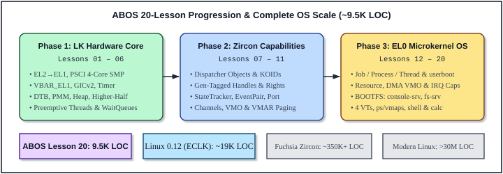

# 1 Overview

Before plunging into hardware register maps and line-by-line assembly and C annotations, it helps to step back and view the historical and architectural landscape from which **ABOS** emerged. Why did operating systems evolve from monolithic kernels toward second- and third-generation capability microkernels? How did Google Fuchsia's **Zircon** combine an embedded real-time kernel core (**LK**) with a capability object layer? And how did ABOS grow systematically across twenty incremental lessons (`Lesson 00` through `Lesson 20`) into the 9,526-line multi-server operating system dissected in this book?

This chapter answers those three questions and provides a complete roadmap to Parts I, II, and III of the text.

---

## 1.1 From UNIX and Early Microkernels to Fuchsia Zircon and ABOS

### 1.1.1 The Monolithic UNIX Heritage (1969–Present)

In 1969, Ken Thompson and Dennis Ritchie created **UNIX** at Bell Labs on a PDP-7 and shortly thereafter rewrote it in C on the PDP-11. UNIX unified files, devices, and pipes behind a remarkably clean abstraction—*"everything is a file descriptor"*—backed by a single privileged kernel binary containing process creation (`fork`/`exec`), memory management, the filesystem, block buffer caches, and character/terminal drivers.

That monolithic architecture powered four decades of computing triumphs, from **BSD** and commercial UNIX workstations to **Linux** (started by Linus Torvalds in 1991 on an Intel 80386 PC) and mobile platforms such as Android. When hardware had tens of kilobytes or a few megabytes of RAM and a single slow CPU core, placing filesystems and device drivers inside the kernel avoided expensive address-space switches.

Yet as hardware scaled to multi-gigahertz multi-core SoCs running dozens of untrusted peripherals, network protocols, and sandboxed applications, two structural weaknesses of classic monolithic kernels grew increasingly acute:

1. **Unbounded Privileged Attack Surface**: Device drivers and filesystems account for the vast majority of kernel code—and the vast majority of memory-safety vulnerabilities—yet execute in `EL1` (or x86 Ring 0) with unrestricted access to all physical RAM.
2. **Ambient Authority**: In classic POSIX systems, any process running under a given user ID inherits broad ambient authority over the global filesystem tree, process table, and `/dev` nodes, making least-privilege sandboxing complex bolt-on policy work (`chroot`, `seccomp`, `namespaces`, `SELinux`) rather than an intrinsic property of the kernel's object model.

### 1.1.2 First-, Second-, and Third-Generation Microkernels

To shrink the privileged kernel to a minimal, auditable core, researchers explored **microkernel** designs across three distinct generations:

- **First-Generation Microkernels (Late 1980s — Mach, Chorus, early MINIX)**: Systems like CMU's **Mach** moved filesystems, networking, and POSIX personalities into user-space servers. However, Mach's heavy, general-purpose virtual-memory copy-on-write IPC and coarse abstractions suffered severe TLB/cache footprints and context-switch overhead, giving early microkernels an undeserved reputation for being inherently slow.
- **Second-Generation Microkernels (Mid-1990s — Liedtke's L4, QNX)**: In 1995, Jochen Liedtke demonstrated with **L4** that IPC slowness was an implementation artifact of Mach, not a law of microkernels. By formulating the famous **minimality principle**—*a concept is tolerated inside the microkernel only if moving it outside the kernel, i.e., permitting competing implementations, would prevent the implementation of the system's required functionality*—L4 reduced IPC latency by more than an order of magnitude through lean, register-oriented message passing and tight architecture-specific engineering.
- **Third-Generation Capability Microkernels (2000s–Present — EROS/Coyotos, seL4, Fuchsia Zircon)**: Building on L4's performance lessons, third-generation microkernels integrated **object-capability security** directly into kernel naming and IPC. Every kernel resource (memory object, address space, thread, IPC endpoint, interrupt line) is accessed exclusively via unforgeable **capabilities** (handles) stored in kernel-protected per-process tables. **seL4** achieved formal mathematical verification in ~10,000 lines of C, while **Google Fuchsia's Zircon** engineered a practical, developer-friendly capability microkernel tailored for modern multi-core ARM64 and x86-64 devices.

### 1.1.3 Google Fuchsia's Zircon: The Two-Layer `LK + Dispatcher` Design

Unlike academic microkernels that require user space to manually manage raw hardware page frames (`Untyped` memory retyping in seL4), **Zircon** strikes a pragmatic engineering balance designed for rich, dynamic multi-process systems. Internally, Zircon is built in **two cleanly separated layers**:

1. **Bottom Layer — LK (Little Kernel)**: Originally created by Travis Geiselbrecht as a compact SMP embedded kernel, LK provides architecture bringup (`start.S`, `exceptions.S`), physical memory arenas (`PMM`), hardware page tables (`VmAspace`), preemptive kernel threads (`thread_t`), spinlocks, and blocking synchronization (`wait_queue_t`, `event_t`).
2. **Top Layer — Zircon Object & Capability Layer**: Built directly atop LK, every user-visible resource is a reference-counted **`Dispatcher`** object identified by a globally unique 64-bit **KOID** (`zx_koid_t`), tracked via per-process **Handle Tables** with fine-grained **Rights** (`zx_rights_t`), observed asynchronously via **`StateTracker` Signals** and **`Port`s**, and shared across isolated processes via **`Channel`s** (which transfer both bytes and handles!) and **`VMO`s / `VMAR`s** (zero-copy demand-paged shared memory).

### 1.1.4 The Birth of ABOS

Prior to ABOS, the author developed **AAOS**—a step-by-step monolithic Unix-style AArch64 teaching kernel where VirtIO-Blk, TAR filesystem parsing, and TTY console handling lived inside `EL1`. **ABOS** (*AArch64 Capability-Based Operating System*) was created as AAOS's microkernel counterpart: a ground-up, freestanding C11 and AArch64 assembly implementation of Zircon's exact `LK + Dispatcher` architecture on a 4-core QEMU `virt` Cortex-A53 machine.

By expressing Zircon's core ideas—`ab_object_t` dispatchers, generation-checked capability handles, `StateTracker` signal observers, `Port` event multiplexing, `Channel` capability transfer, `VMO`/`VMAR` lazy paging, `Resource`/`Interrupt` `EL0` device drivers, `userboot` + `BOOTFS` bootstrapping, 4 virtual terminals, and `ps`/`vmaps` introspection—in **9,526 lines of crystal-clear C and assembly**, ABOS makes modern capability microkernels completely accessible from first instruction to interactive shell.

---

## 1.2 Evolution Across ABOS Lessons 00–20

ABOS was developed incrementally across **21 self-contained lessons** (`lesson_00` through `lesson_20`), organized into **three architectural phases** that mirror how a real capability microkernel is brought up on new silicon:

- **Phase 1: Streamlined LK Hardware & Kernel Core (`Lessons 01–06`)** — Bare-metal `EL2 → EL1` drop, 4-core PSCI SMP bringup, `VBAR_EL1` trap frames, GICv2, ARM Generic Timer, DTB parsing, `PMM` page allocator, 512 KB kernel heap, higher-half `TTBR1_EL1` + per-process `TTBR0_EL1` MMU with ASIDs, preemptive SMP `thread_t` scheduling, and blocking `wait_queue_t` / `event_t` primitives.
- **Phase 2: Zircon Object, Capability & IPC Layer (`Lessons 07–11`)** — `ab_object_t` (`Dispatcher`), 64-bit KOIDs, generation-tagged per-process Handle Tables, capability Rights bitmasks, `EL0` transition & `SVC #0` syscalls, `StateTracker` signal observers, `Event` & `EventPair`, `Port` asynchronous packet queues, `Channel` message + handle transfer, and `VMO` / `VMAR` shared memory with lazy page-fault allocation.
- **Phase 3: User-Space Bootstrapping, `EL0` Drivers, Multi-VT Servers & `BOOTFS` (`Lessons 12–20`)** — `Job` / `Process` / `Thread` task lifecycle, `userboot` bootstrapping, `Resource` + physical MMIO `VMO` + contiguous DMA `VMO` + `Interrupt` objects, moving UART and VirtIO-Blk + TAR FS completely into `EL0`, standalone `calc` app, strict `kernel/` vs. `user/` layout, Zircon-style `ps` & `vmaps` diagnostics, 4 `Port`-multiplexed Virtual Terminals (`tty0..tty3`), hierarchical Makefiles with shared `user/link.ld`, and finally **Lesson 20**: standalone `EL0` system servers (`console-srv.bin`, `fs-srv.bin`, `shell.bin`) loaded from a DTB-discovered **`BOOTFS` (`-initrd bootfs.tar`) VMO** with automatic `initrd` page reclamation and `SYS_VMAR_UNMAP`.

Table 1-1 summarizes all 21 lessons in the ABOS curriculum, showing the exact progression of subsystems, source file counts, and lines of code culminating in Lesson 20:

| Lesson | Phase | Milestone Title | Key Subsystems & Mechanisms Introduced | Files | Total LOC |
| :--- | :--- | :--- | :--- | ---: | ---: |
| **00** | Prep | Architecture, Zircon Study Guide & Toolchain Setup | Monolithic vs. capability microkernel roadmap, `LK + Dispatcher` model, toolchain verification. | 1 | 43 |
| **01** | Phase 1 (LK Core) | Bare-Metal Boot, `EL2 → EL1` Transition & SMP `lk_main` | `start.S`, early PL011 spinlock-serialized `dprintf`, `PSCI_CPU_ON` (`HVC #0`) waking all 4 Cortex-A53 cores. | 7 | 656 |
| **02** | Phase 1 (LK Core) | Exception Vectors (`VBAR_EL1`), `iframe_t`, GICv2 & Generic Timer | 16-slot `VBAR_EL1` table, 288-byte `iframe_t` save/restore, `GICD`/`GICC` setup, 100 Hz PPI 30 timer ticks. | 14 | 1,034 |
| **03** | Phase 1 (LK Core) | Device Tree (`DTB`) Handoff, `PMM` Arena & Kernel Heap | Big-endian FDT parser (`dtb.c`), `vm_page_t[32768]` frame allocator (`pmm.c`), 512 KB `kmalloc`/`kfree` heap (`heap.c`). | 20 | 1,596 |
| **04** | Phase 1 (LK Core) | Higher-Half Kernel (`physmap` & `periphmap`) & `VmAspace` | `.idmap` trampoline to `0xFFFFFFFF80083000+`, `TTBR1_EL1` 1 GB blocks, `TTBR0_EL1` `L1→L2→L3` 4 KB tables & ASIDs. | 22 | 1,833 |
| **05** | Phase 1 (LK Core) | LK Kernel Threads (`thread_t`), Context Switch & Scheduler | 8 KB per-thread kernel stacks, `arm64_context_switch` (`switch.S`), fair 4-core SMP preemptive round-robin scheduler. | 25 | 2,209 |
| **06** | Phase 1 (LK Core) | LK Blocking Synchronization: `wait_queue_t` & `event_t` | Sleep-waiting queues with nanosecond deadlines (`wait.c`), `event_wait_deadline` and `event_signal` without busy-spinning. | 27 | 2,408 |
| **07** | Phase 2 (Zircon Caps) | Kernel Objects (`Dispatcher`), KOIDs, Handles, Rights & `EL0` | `ab_object_t`, 64-bit KOIDs, 64-slot gen-tagged Handle Table, `ab_rights_t` checks, `arm64_uspace_entry`, first `SVC #0` syscalls. | 32 | 3,118 |
| **08** | Phase 2 (Zircon Caps) | Object Signals, `StateTracker`, `WaitOne`, `Event` & `EventPair` | `ab_state_tracker_t` observer lists, `SYS_OBJECT_WAIT_ONE`, peered `EventPair` with automatic `AB_SIGNAL_PEER_CLOSED`. | 32 | 3,415 |
| **09** | Phase 2 (Zircon Caps) | Asynchronous Event Notification with `Port` Objects | `PortDispatcher` 32-packet ring queue, one-shot `SYS_OBJECT_WAIT_ASYNC`, single-thread `SYS_PORT_WAIT` event loops. | 32 | 3,723 |
| **10** | Phase 2 (Zircon Caps) | Message-Passing IPC: `Channel` & Capability Transfer | Peered `ChannelDispatcher`, 256-byte + 8-handle `ab_message_packet_t`, atomic cross-process handle move (`AB_RIGHT_TRANSFER`). | 32 | 4,219 |
| **11** | Phase 2 (Zircon Caps) | Shared Memory IPC: `VMO`, `VMAR` & Demand Paging | `VmObjectDispatcher`, `VmAddressRegionDispatcher` (`0x10000000..0x40000000`), lazy `EL0` translation-fault page commit, `EL0` fault isolation. | 32 | 4,605 |
| **12** | Phase 3 (EL0 OS) | Tasks (`Job`, `Process`, `Thread`) & `userboot` Bootstrapping | `JobDispatcher`, `SYS_PROCESS_CREATE`, `SYS_THREAD_CREATE`, `SYS_PROCESS_START`, `EL0` `userboot` with bootstrap `Channel`. | 32 | 4,887 |
| **13** | Phase 3 (EL0 OS) | User-Space Device Drivers (`Resource`, DMA `VMO` & `Interrupt`) | `ResourceDispatcher`, `SYS_VMO_CREATE_PHYSICAL`, `SYS_VMO_CREATE_CONTIG`, `InterruptDispatcher` GIC mask-and-wake forwarding. | 32 | 5,298 |
| **14** | Phase 3 (EL0 OS) | Complete Capability Microkernel OS (`EL0` UART, FS & Shell) | Multi-process `EL0` user space: `userboot` wires `console_srv`, `fs_srv` (VirtIO-Blk + TAR), and interactive `shell` over `Channel`s. | 33 | 5,730 |
| **15** | Phase 3 (EL0 OS) | Standalone Disk Application (`calc.bin`) & User C Runtime | `crt0.S` + `ulibc`, compiling standalone `calc.bin` into `disk.img`, loading via `FS_OP_OPEN_VMO` and spawning at `0x20000000`. | 35 | 6,081 |
| **16** | Phase 3 (EL0 OS) | Strict `EL1` (`kernel/`) vs. `EL0` (`user/`) Source Tree Separation | Clean physical directory partitioning (`include/`, `kernel/{core,mm,dev}`, `user/{ulibc,userboot,drivers,shell,apps}`, `image/`). | 45 | 6,591 |
| **17** | Phase 3 (EL0 OS) | Zircon-Style Task (`ps`) & Address-Space (`vmaps`) Diagnostics | `SYS_OBJECT_SET_NAME`, `SYS_JOB_GET_PS_INFO` (`Job → Process → Thread` tree, `PSS`, handle counts), `SYS_PROCESS_GET_MAPS` (`/A`, `/R`, `M`). | 45 | 7,397 |
| **18** | Phase 3 (EL0 OS) | 4 Virtual Terminals (`tty0..tty3`) with `Port` Multiplexing | Concurrent `abos-shell-0..3`, per-VT screen history & 512B RX rings, `ESC`/CSI/Ctrl hotkey parser with 25 ms `Port` timeout. | 45 | 7,745 |
| **19** | Phase 3 (EL0 OS) | Hierarchical Subdirectory Makefiles & Common `user/link.ld` | Shared `config.mk`, recursive per-module `Makefile`s, unified `user/link.ld` `@ 0x20000000`, `crt_env.c` `AB_PA_*` startup handle tags. | 57 | 7,985 |
| **20** | **Phase 3 (Capstone)** | **Standalone `EL0` System Servers via Zircon-Style `BOOTFS`** | **True microkernel image split (`kernel.img` = `EL1` + `userboot` only; `-initrd bootfs.tar` = standalone `console-srv.bin`, `fs-srv.bin`, `shell.bin`), DTB `initrd` reclamation, `34 SYS_VMAR_UNMAP`, 128 KB VirtIO DMA cache.** | **58** | **9,526** |

Notice how **Lesson 20** completes the microkernel architectural arc: in earlier lessons, `console_srv` and `fs_srv` were still compiled alongside `userboot` for convenience, whereas in Lesson 20 `kernel.img` contains **only** the `EL1` microkernel and the tiny `userboot` loader. All system servers (`console-srv.bin`, `fs-srv.bin`) and `shell.bin` are genuine standalone `EL0` binaries linked with `user/link.ld` at virtual address `0x20000000`, packaged into `image/bootfs.tar`, handed to the kernel via QEMU's `-initrd` and DTB `/chosen` node, wrapped in the `"bootfs.tar"` `VMO` (with the bootloader's physical `initrd` pages immediately reclaimed into the `PMM` free pool!), and unmapped via `SYS_VMAR_UNMAP` as soon as `userboot` finishes spawning them.

---

## 1.3 Guide to the Chapters of This Book

Following the time-tested blueprint of Dr. Zhao Jiong's *"A Heavily Commented Linux Kernel Source Code"*, this book is organized into **three parts** comprising **17 chapters and reference appendices**:

### Part I: Foundations and System Architecture (Chapters 1–5)

Part I equips the reader with every piece of hardware, compiler/linker, CPU architecture, and global software context needed so that no line in Part II ever feels mysterious:

- **Chapter 1 (`Overview`)** traces the evolution from monolithic UNIX to Zircon and ABOS, surveys Lessons 00–20, and maps out the book.
- **Chapter 2 (`QEMU virt Hardware Platform and System Structure`)** details the 4-core Cortex-A53 QEMU `virt` board, PSCI power control, the physical MMIO and 128 MB RAM map, Flattened Device Tree (`DTB`) and `initrd` `BOOTFS` handoff, and the register interfaces of GICv2, the ARM Generic Physical Timer, PrimeCell PL011 UART0, and Legacy VirtIO-MMIO Block DMA.
- **Chapter 3 (`Kernel Programming Language, Toolchain and Build Environment`)** covers GNU AArch64 assembler (`gas`) directives, freestanding C11 flags (including why `-mgeneral-regs-only` is vital in `EL1`), inline assembly constraints, the `AAPCS64` ABI, `ELF64` linker scripts (`linker.ld` vs. `user/link.ld`), `objcopy` flat binaries, POSIX USTAR archives, and the recursive `Makefile` build tree.
- **Chapter 4 (`ARMv8-A Privilege Levels, Virtual Memory and SMP Programming`)** examines `EL0..EL3` privilege transitions, system registers (`SCTLR_EL1`, `TCR_EL1`, `MAIR_EL1`, `ESR_EL1`, `FAR_EL1`), split `TTBR1_EL1` / `TTBR0_EL1` 4 KB page tables, hardware ASIDs, TLB/cache maintenance, the 16-slot `VBAR_EL1` exception vector table, demand paging, `EL0` fault isolation, exclusive `ldaxr`/`stxr`/`stlr` spinlocks, and ABOS's strict lock-ordering hierarchy.
- **Chapter 5 (`ABOS Microkernel Architecture`)** synthesizes the global design of ABOS Lesson 20: the two-layer `LK + Zircon` structure, inter-module dependencies, memory subsystems, IRQ forwarding, all 34 system calls, SMP scheduling, the capability object/handle/`StateTracker`/`Port`/`Channel` model, the three hardware stack regimes, `BOOTFS`/USTAR storage, the complete 58-file inventory, and an end-to-end trace of launching `calc.bin`.

### Part II: Complete Source Code Dissection (Chapters 6–16)

Part II presents **verbatim, line-numbered listings interleaved with detailed commentary** for all **58 files (9,526 lines)** of `lesson_20/`, ordered from hardware reset upward to user-space servers and applications:

- **Chapter 6 (`Build System, Linker Scripts, Image Packaging and Boot Trampoline`)** — Top-level `Makefile`, `config.mk`, `install_tools.sh`, `linker.ld`, `image/Makefile`, `image/make_bootfs.py`, `image/make_tar_disk.py`, and `kernel/core/start.S`.
- **Chapter 7 (`Kernel Initialization and Device Tree Handoff`)** — `kernel/Makefile`, `kernel/core/Makefile`, `kernel/core/main.c` (`lk_main`, `psci_cpu_on`, `arm64_secondary_entry`, `BOOTFS` VMO creation, and `userboot` launch), and `kernel/core/dtb.c`.
- **Chapter 8 (`Exception Vectors, Interrupt Controller, Generic Timer and Early DebugLog`)** — `kernel/core/exceptions.S`, `kernel/core/exceptions_c.c`, `kernel/core/uspace_entry.S`, `kernel/dev/Makefile`, `kernel/dev/gic.c`, `kernel/dev/timer.c`, and `kernel/dev/debuglog.c`.
- **Chapter 9 (`Preemptive SMP Thread Scheduler, Context Switch and Wait Queues`)** — `kernel/core/thread.c`, `kernel/core/switch.S`, and `kernel/core/wait.c`.
- **Chapter 10 (`Capability Object Model, Handles, Signals, Ports and Channel IPC`)** — First half of `kernel/core/object.c`: KOIDs, `ab_object_t` reference/handle counting, `StateTracker`, handle table encode/decode/lookup, `DebugLog`, `Event`, `EventPair`, `PortDispatcher`, and `ChannelDispatcher` capability transfer.
- **Chapter 11 (`Virtual Memory Objects, Address Regions, Tasks, Driver DDK and Diagnostics`)** — Second half of `kernel/core/object.c`: `VMO` & `VMAR` mapping/unmapping/demand paging, `Job`/`Process`/`Thread` dispatchers, `Resource` & `Interrupt` dispatchers, and `ps`/`vmaps` introspection engines.
- **Chapter 12 (`System Call Boundary and User Memory Copy Validation`)** — Complete annotation of `kernel/core/syscalls.c` (`copy_from_user`, `copy_to_user`, `ab_process_exit_current`, and all 34 syscall handlers).
- **Chapter 13 (`Physical Memory Arena, Kernel Heap and 3-Level MMU Page Tables`)** — `kernel/mm/Makefile`, `kernel/mm/pmm.c`, `kernel/mm/heap.c`, and `kernel/mm/mmu.c`.
- **Chapter 14 (`Shared Kernel, Capability and IPC Header Files`)** — All 14 header files in `include/` (`spinlock.h`, `pmm.h`, `mmu.h`, `heap.h`, `dtb.h`, `gic.h`, `timer.h`, `debuglog.h`, `exceptions.h`, `thread.h`, `wait.h`, `object.h`, `syscalls.h`, and `ipc_proto.h`).
- **Chapter 15 (`User-Space Linker Script, C Runtime, ulibc and userboot`)** — `user/Makefile`, `user/link.ld`, `user/ulibc/Makefile`, `crt0.S`, `crt_env.c`, `ulibc.h`, `ulibc.c`, `user/userboot/Makefile`, and `userboot.c`.
- **Chapter 16 (`Standalone EL0 System Servers, Interactive Shells and User Applications`)** — `user/drivers/Makefile`, `console_srv.c`, `fs_srv.c`, `user/shell/Makefile`, `shell.c`, `user/apps/Makefile`, and `calc.c`.

### Part III: Hands-On Debugging Laboratory and Appendices (Chapter 17 & Appendices)

- **Chapter 17 (`Building, Running and Debugging ABOS in QEMU and GDB`)** walks step-by-step through building ABOS, inspecting `ELF` sections and page tables in the QEMU monitor, attaching `gdb-multiarch` across the `.idmap → higher-half EL1 → EL0 @ 0x20000000` symbol boundaries, and running interactive capability/fault-isolation experiments.
- **Appendices** provide consolidated quick-reference tables for AArch64 instructions and system registers, all 34 ABOS system calls, capability rights and signals, and key global symbols.

### Suggested Reading Strategies

- **First Pass (Architectural Flow)**: Read Chapters 1–5 sequentially, then follow the runtime boot-to-shell spine through Chapters 6 (`start.S`), 7 (`main.c`), 8 (`exceptions.S`), 10–11 (`object.c`), 15 (`userboot.c`), and 16 (`console_srv.c`, `fs_srv.c`, `shell.c`).
- **Second Pass (Subsystem Mastery & GDB Experiments)**: Study every line of Chapters 6–16 alongside live `make run` and GDB sessions from Chapter 17, setting breakpoints at `_start`, `lk_main`, `syscall_dispatch`, `ab_channel_write`, and `0x20000000`.

---

## 1.4 Summary

Operating system design has evolved from single-address-space monolithic UNIX kernels to capability-based microkernels that isolate device drivers, filesystems, and user services inside unprivileged `EL0` processes connected by explicit capability handles. Modeling Google Fuchsia's two-layer **Zircon (`LK + Dispatcher`)** architecture in 9,526 lines of clean freestanding C11 and AArch64 assembly across 58 files, **ABOS Lesson 20** provides a complete, runnable, modern 4-core SMP capability microkernel OS whose entire source code can be mastered cover to cover. In Chapter 2, we examine the concrete virtual hardware platform on which ABOS executes: the 4-core ARMv8-A QEMU `virt` machine.
