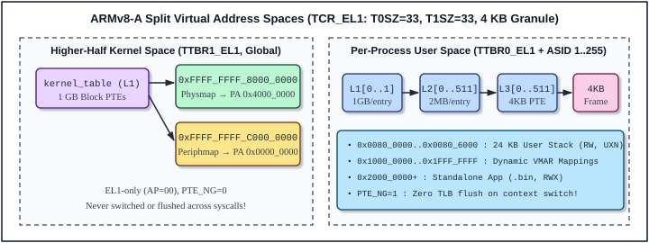
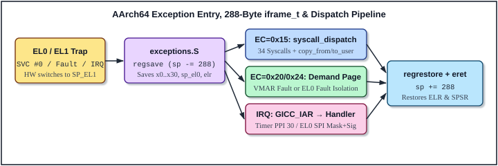

# 4 ARMv8-A Privilege Levels, Virtual Memory and SMP Programming

In Dr. Zhao Jiong's *"A Heavily Commented Linux Kernel Source Code"*, Chapter 4 famously demystified Intel 80386 Protected Mode—Global and Local Descriptor Tables (`GDT`/`LDT`), Task State Segments (`TSS`), Interrupt Gates (`IDT`), two-level `CR3` paging, and Ring 0 ↔ Ring 3 privilege transitions—because every line of `head.s`, `traps.c`, `sched.c`, and `memory.c` directly manipulated those hardware structures.

On modern 64-bit ARM (**ARMv8-A** in **AArch64** execution state), the architecture is far cleaner: x86's legacy segment descriptors and hardware `TSS` gates are completely gone, replaced by orthogonal **Exception Levels (`EL0–EL3`)**, dual virtual address space base registers (`TTBR0_EL1` and `TTBR1_EL1`), hardware **Address Space Identifiers (`ASID`s)**, a uniform 16-slot **Exception Vector Table (`VBAR_EL1`)**, and load-acquire / store-release atomic primitives designed from the ground up for weakly-ordered multi-core **Symmetric Multiprocessing (`SMP`)**.

This chapter explains every ARMv8-A architectural mechanism exercised by ABOS Lesson 20, linking each register bitfield and instruction sequence directly to the kernel source files you will read in Part II.

---

## 4.1 Core ARMv8-A System Registers and Instructions

In AArch64, control over privilege state, virtual memory translation, exception handling, caches, and timers is exposed through named **System Registers** rather than memory-mapped addresses or special I/O ports. General-purpose loads and stores (`ldr`/`str`) cannot touch system registers; instead, software uses two dedicated privileged instructions:

```asm
mrs     x0, sctlr_el1       /* Move to general Register from System register */
msr     sctlr_el1, x0       /* Move to System register from general Register */
```

Notice the **`_ELn` suffix** on every system register name (`_EL0`, `_EL1`, `_EL2`, `_EL3`): that suffix specifies the **minimum hardware Exception Level** permitted to access the register directly (unless explicitly delegated, as `CNTKCTL_EL1.EL0PCTEN` delegates `CNTPCT_EL0` reads to `EL0`). Attempting to execute `mrs x0, sctlr_el1` while in unprivileged `EL0` immediately triggers a synchronous illegal-execution trap into `EL1`!

Table 4-1 summarizes all core ARMv8-A system registers read or programmed across ABOS Lesson 20:

| System Register | Width | Role & Concrete Value / Usage in ABOS Lesson 20 |
| :--- | :--- | :--- |
| **`CurrentEL`** | 64-bit | Bits `[3:2]` report current Exception Level (`0..3`). Checked in `start.S:22` (`arch_boot_get_el()`). |
| **`DAIF`** | 64-bit | Interrupt mask bits `[9:6]`: `D`ebug (`9`), `A`sync SError (`8`), **`I`RQ (`7`)**, `F`IQ (`6`). `msr daifset, #2` masks IRQs; `msr daifclr, #2` enables IRQs (`spinlock.h:34-51`). |
| **`SP_EL0` / `SP_EL1`** | 64-bit | Banked stack pointers for user mode (`EL0`) and kernel mode (`EL1`). Saved/restored in `exceptions.S` and `uspace_entry.S`. |
| **`ELR_EL1`** | 64-bit | **Exception Link Register**: Holds preferred return `PC` upon exception entry; loaded into `PC` by `eret`. |
| **`SPSR_EL1`** | 64-bit | **Saved Program Status Register**: Captures `NZCV` flags, `DAIF` masks, and origin `EL`/`SP` mode (`M[3:0]`); restored into `PSTATE` by `eret`. |
| **`ESR_EL1`** | 64-bit | **Exception Syndrome Register**: Encodes Exception Class `EC = [31:26]` (`0x15`=`SVC`, `0x20`=Inst Abort, `0x24`=Data Abort) and `ISS = [24:0]` (`exceptions_c.c:23-24`). |
| **`FAR_EL1`** | 64-bit | **Fault Address Register**: Captures the exact 64-bit faulting virtual address on Instruction or Data Aborts (`exceptions_c.c:26`). |
| **`VBAR_EL1`** | 64-bit | **Vector Base Address Register**: Base VA (2 KB-aligned) of the 16-entry `EL1` exception vector table (`arm64_el1_exception_base` in `start.S:145`). |
| **`MAIR_EL1`** | 64-bit | **Memory Attribute Indirection Register**: Set to **`0x000000000000FF00`** (`Attr0 = 0x00` `Device-nGnRnE`, `Attr1 = 0xFF` `Normal Inner/Outer WBWA`). |
| **`TCR_EL1`** | 64-bit | **Translation Control Register**: Set to **`0x00000010B5213521`** (`T0SZ=33`, `T1SZ=33`, 4 KB granules, Inner-Shareable WBWA, 16-bit ASIDs enabled). |
| **`TTBR0_EL1`** | 64-bit | **Translation Table Base Register 0**: Per-process user L1 table PA `[47:12]` + 16-bit `ASID` `[63:48]` (`vmm_switch_aspace()` in `mmu.c:264`). |
| **`TTBR1_EL1`** | 64-bit | **Translation Table Base Register 1**: Global higher-half kernel L1 table PA (`kernel_table` in `start.S:105`); never switched on syscalls or context switches. |
| **`SCTLR_EL1`** | 64-bit | **System Control Register**: Read-modify-written in `start.S:114-118` to set **`M` (`1<<0`)**, **`C` (`1<<2`)**, and **`I` (`1<<12`)**, turning on the MMU, D-cache, and I-cache while preserving architectural `RES1` bits. |
| **`ID_AA64MMFR0_EL1`** | 64-bit | Memory Model Feature Register 0: Bits `[7:4]` (`ASIDBits`) == `0b0010` confirms 16-bit ASID support (`start.S:95-99`). |
| **`CPACR_EL1`** | 64-bit | Architectural Feature Access Control: Bits `[21:20]` (`FPEN = 0b11`) disable FP/SIMD traps (`start.S:45-46`). |
| **`MPIDR_EL1`** | 64-bit | Multiprocessor Affinity Register: Bits `[7:0]` (`Aff0`) identify CPU core `0, 1, 2, 3` (`arch_curr_cpu_num()`). |
| **`TPIDR_EL0` / `TPIDRRO_EL0`** | 64-bit | User Thread-Local Storage (`TLS`) pointer registers; preserved per thread across `arm64_context_switch` (`switch.S:14-16, 32-34`). (ARMv8 also provides `TPIDR_EL1` for kernel per-CPU state; ABOS indexes `current_threads[arch_curr_cpu_num()]` directly via `MPIDR_EL1`.) |
| **`MDSCR_EL1`** | 64-bit | Monitor Debug System Control Register: Saved/restored in `iframe_t` (`exceptions.S:31, 44`) and cleared on `EL0` entry (`uspace_entry.S:18`). |

### Decoding `MAIR_EL1` (`0xFF00`) and `TCR_EL1` (`0x10B5213521`)

Two system registers initialized in `kernel/core/start.S` govern every virtual memory access in ABOS:

1. **`MAIR_EL1 = 0x000000000000FF00`**:
   ARMv8 Stage-1 page table entries do not encode cacheability rules directly; instead, each PTE holds a 3-bit index (`AttrIndx[4:2]`) into an 8-slot byte table inside `MAIR_EL1`:
   - **Slot 0 (`MAIR_EL1[7:0] = 0x00`, `PTE_ATTR_DEVICE`)**: **Device-nGnRnE** (*non-Gathering, non-Reordering, no Early Write Acknowledgement*)—the strictest MMIO ordering mode, used for `GICD`, `GICC`, `PL011 UART`, and `VirtIO-MMIO` registers.
   - **Slot 1 (`MAIR_EL1[15:8] = 0xFF`, `PTE_ATTR_NORMAL`)**: **Normal Memory, Outer & Inner Write-Back Non-transient Read/Write-Allocate (`0b1111_1111`)**—full L1/L2 cache speed with hardware cache coherency across all 4 SMP cores, used for all RAM code, stacks, heap, and `VMO`s.

2. **`TCR_EL1 = 0x00000010B5213521`** (`0xB5213521 | (1ULL << 36)`):
   Every nibble of `0x10B5213521` configures the geometry of `TTBR0_EL1` and `TTBR1_EL1`:
   - **`T0SZ` (`[5:0] = 0x21 = 33`)**: User `TTBR0_EL1` virtual space spans `2⁶⁴⁻³³ = 2³¹ = 2 GB` (`0x00000000_00000000 .. 0x00000000_7FFFFFFF`).
   - **`IRGN0`/`ORGN0` (`[9:8]=0b01`, `[11:10]=0b01`) & `SH0` (`[13:12]=0b11`)**: Hardware page-table walks for `TTBR0` use Inner-Shareable Write-Back Write-Allocate caches.
   - **`TG0` (`[15:14] = 0b00`)**: **4 KB page granule** for `TTBR0_EL1`.
   - **`T1SZ` (`[21:16] = 0x21 = 33`)**: Kernel `TTBR1_EL1` higher-half virtual space spans the top `2³¹ = 2 GB` (`0xFFFFFFFF_80000000 .. 0xFFFFFFFF_FFFFFFFF`).
   - **`A1` (`[22] = 0`)**: Selects `TTBR0_EL1[63:48]` (not `TTBR1_EL1`) as the active hardware ASID source.
   - **`IRGN1`/`ORGN1` (`[25:24]=0b01`, `[27:26]=0b01`) & `SH1` (`[29:28]=0b11`)**: Hardware page-table walks for `TTBR1` are also Inner-Shareable WBWA cached.
   - **`TG1` (`[31:30] = 0b10`)**: **4 KB page granule** for `TTBR1_EL1`! *(Note a classic ARMv8 encoding subtlety: `4 KB` is encoded as `0b00` in `TG0` but as `0b10` in `TG1`, which is why the upper 16-bit halfword is `0xB521` while the lower halfword is `0x3521`!)*
   - **`IPS` (`[34:32] = 0b000`)**: 32-bit (`4 GB`) physical address range.
   - **`AS` (`[36] = 1`)**: Enables full 16-bit ASIDs (`[63:48]`).

---

## 4.2 Exception Levels (EL0–EL3) and Privilege Transitions

ARMv8-A defines four hierarchical **Exception Levels** (`EL0` least privileged through `EL3` most privileged) together with two stack-pointer selection suffixes at `EL1..EL3`:

- **`t` ("thread" stack, `PSTATE.SPSel = 0`)**: Uses `SP_EL0` as the active `sp` register (`EL0` *always* runs in **`EL0t`**).
- **`h` ("handler" stack, `PSTATE.SPSel = 1`)**: Uses the target level's own dedicated stack pointer `SP_ELx` (`EL1` kernel code in ABOS *always* runs in **`EL1h`**, using `SP_EL1` so a corrupt or unmapped user `SP_EL0` can never crash the kernel!).

A fundamental rule of ARMv8-A is that **privilege can never change silently**:
- Moving to a **higher (or equal) Exception Level** (`EL0t → EL1h`) happens *only* by taking a **synchronous exception** (`SVC #0`, page fault, illegal instruction) or an **asynchronous interrupt** (`IRQ`, `FIQ`, `SError`).
- Moving to a **lower (or equal) Exception Level** (`EL2h → EL1h` or `EL1h → EL0t`) happens *only* by executing the **`eret` (`Exception Return`)** instruction, which atomically copies `ELR_ELx → PC` and `SPSR_ELx → PSTATE`.

ABOS executes three privilege-transition patterns across its lifecycle:

### 1. Boot-Time Drop from `EL2` to `EL1h` (`kernel/core/start.S:21-42`)

If QEMU is started with `virtualization=on` (or on physical boards where U-Boot hands off in `EL2`), `_start` detects `CurrentEL == 2` and executes `.Ldrop_el2`:
1. Sets `CNTHCTL_EL2 |= 3` (`EL1PCTEN | EL1PCEN`) and `CNTVOFF_EL2 = 0` so `EL1` and `EL0` have unrestricted access to the physical counter and timer.
2. Writes `CPTR_EL2 = 0x33FF` (disabling `EL2` coprocessor/FP traps) and **`HCR_EL2 = (1 << 31)` (`RW = 1`)**, instructing the CPU that `EL1` executes in **64-bit AArch64** mode rather than 32-bit AArch32.
3. Programs **`SPSR_EL2 = 0x3C5`**: bits `[9:6] = 0b1111` (`D, A, I, F` all masked) and bits `[3:0] = 0b0101` (**`EL1h`**).
4. Loads the physical address of `.Lin_el1_pa` into `ELR_EL2` (`adr x0, .Lin_el1_pa`) and executes **`eret`**, landing cleanly in `EL1h`.

### 2. First Entry into Unprivileged `EL0t` (`kernel/core/uspace_entry.S:12-50`)

When a newly created user process (`userboot`, `console-srv`, `fs-srv`, `shell`, or `calc`) starts its initial thread, `user_thread_trampoline()` invokes `arm64_uspace_entry(arg0, arg1, entry_pc, user_sp, kstack_top)`:
1. Sets `SP_EL1` (`mov sp, x4`) to the empty top of the thread's 8 KB kernel stack (`kstack_top`), ready for future traps.
2. Sets `SP_EL0` (`msr sp_el0, x3`) to `0x00806000` (top of the process's 24 KB `EL0` user stack).
3. Sets `ELR_EL1` (`msr elr_el1, x2`) to `entry_pc` (`0x20000000` for standalone apps, or `userboot_entry` UVA).
4. Sets **`SPSR_EL1 = 0`**: `M[3:0] = 0b0000` (**`EL0t`**) and `DAIF = 0b0000` (**all hardware interrupts unmasked** while user space runs!).
5. Explicitly zeroes `x2..x30` (`mov xN, xzr`) while keeping `(arg0, arg1)` in `(x0, x1)` so **zero kernel pointers or secret values leak into `EL0`**, then executes **`eret`**.

### 3. Trapping from `EL0t` into `EL1h` and Returning (`exceptions.S`)

Whenever an `EL0t` thread executes `svc #0`, faults on a demand-paged `VMO`, or is interrupted by a timer/device `IRQ`, the Cortex-A53 hardware performs five atomic actions in a single cycle:
1. Saves the faulting instruction's `PC` (or `PC + 4` for `SVC #0`) into **`ELR_EL1`**.
2. Saves current `PSTATE` (`EL0t`, `NZCV` flags, unmasked `DAIF`) into **`SPSR_EL1`**.
3. Records the trap cause in **`ESR_EL1`** (and faulting VA in **`FAR_EL1`** for aborts).
4. Switches privilege to **`EL1h`**, masks `PSTATE.I = 1` (disabling further IRQs on entry), and switches `sp` from `SP_EL0` to the thread's **`SP_EL1`**.
5. Branches to `VBAR_EL1 + 0x400` (`EL0` Sync) or `VBAR_EL1 + 0x480` (`EL0` IRQ). When kernel processing completes, `regrestore` executes **`eret`**, reversing all five steps atomically!

---

## 4.3 4 KB Granule Page Tables, ASIDs and Cache/TLB Coherency

With `T0SZ = 33` and `T1SZ = 33` (`31` active virtual address bits = `2 GB` per half) and a **4 KB page granule**, ARMv8-A bypasses Level 0 and performs a **3-level page-table walk (`Level 1 → Level 2 → Level 3`)**. Hardware inspects bits `[63:31]` of every virtual address to choose the root table automatically:

- **`VA[63:31] == 0x00000000` (`0x00000000_00000000 .. 0x00000000_7FFFFFFF`)**: Walked via **`TTBR0_EL1`** (per-process user space).
- **`VA[63:31] == 0x1FFFFFFFF` (`0xFFFFFFFF_80000000 .. 0xFFFFFFFF_FFFFFFFF`)**: Walked via **`TTBR1_EL1`** (global kernel space).
- **Any other bit pattern in `[63:31]`**: Non-canonical "guard gap" → immediate **Address Translation Fault** without even consulting memory!



### 4.3.1 Virtual Address Bit Slicing (`L1 → L2 → L3`)

For any 31-bit offset within either `TTBR0_EL1` or `TTBR1_EL1`, the MMU slices `vaddr[30:0]` into three table indices plus a 12-bit byte offset (`mmu.c:147-149`):

```
 63                  31   30   29        21   20        12   11          0
+----------------------+------+--------------+--------------+--------------+
| All 0s (TTBR0: User) |  L1  |   L2 Index   |   L3 Index   | Page Offset  |
| All 1s (TTBR1: Kern) | [0..1|   [0..511]   |   [0..511]   |  [0..4095]   |
+----------------------+------+--------------+--------------+--------------+
                         1 bit     9 bits         9 bits        12 bits
                       (1 GB/e)   (2 MB/e)       (4 KB/e)      (4 KB page)
```

- **Kernel `TTBR1_EL1` (`kernel_table` in `start.S:64-73`)**: Terminates right at **Level 1** using two **1 GB Block Descriptors** (`bits [1:0] = 0b01`):
  - `kernel_table[0]` (`VA 0xFFFFFFFF_80000000 .. BFFFFFFF`) → `PA 0x40000000` (**Physmap**: Normal WBWA, Global `nG=0`, `EL1`-only).
  - `kernel_table[1]` (`VA 0xFFFFFFFF_C0000000 .. FFFFFFFF`) → `PA 0x00000000` (**Periphmap**: `Device-nGnRnE`, `PXN | UXN`, Global `nG=0`, `EL1`-only).
  Using 1 GB block mappings means the entire 128 MB kernel RAM physmap and MMIO periphmap consume just **two TLB entries** across the whole system and **never suffer kernel page faults**!
- **User `TTBR0_EL1` (`vm_aspace_t` in `kernel/mm/mmu.c`)**: Uses full **Level 1 Table → Level 2 Table → Level 3 4 KB Page Descriptors** (`bits [1:0] = 0b11` at every level), giving per-4 KB permission control (`READ`, `WRITE`, `EXECUTE`, `DEVICE`) and fine-grained `VMAR` mapping/unmapping.

### 4.3.2 64-Bit ARMv8 Stage-1 L3 Page Descriptor Bitfield

Every 64-bit `pte_t` written into an L3 table by `flags_to_pte()` (`include/mmu.h:40-53`, `kernel/mm/mmu.c:104-132`) has the exact architectural layout shown below:

```
 63    55  54   53  52  48 47                    12  11  10  9  8  7  6   5   4      2  1  0
+--------+-----+---+------+------------------------+----+---+----+-----+----+----------+----+
| Ign/SW | UXN |PXN| RES0 | Output PA [47:12] (4K) | nG |AF | SH | AP  | NS | AttrIndx |Type|
+--------+-----+---+------+------------------------+----+---+----+-----+----+----------+----+
           1b   1b              36 bits              1b  1b   2b   2b    1b    3 bits    2b
```

| Bit(s) | Macro in `mmu.h` | Meaning & Security Role in ABOS |
| :--- | :--- | :--- |
| **`[0]`** | `PTE_VALID` (`1<<0`) | `1` = Valid descriptor; `0` = Unmapped (triggers Translation Fault for demand paging or crash isolation!). |
| **`[1]`** | `PTE_TABLE` / `PTE_PAGE` (`1<<1`) | At L1/L2: `0` = 1GB/2MB Block, `1` = Next-level Table pointer. At L3: **must be `1`** (`0b11`) for a valid 4 KB page! |
| **`[4:2]`** | `PTE_ATTR_DEVICE` (`0<<2`) / `NORMAL` (`1<<2`) | Selects `MAIR_EL1` slot `0` (`Device-nGnRnE`) or slot `1` (`Normal WBWA`). |
| **`[7:6]`** | `PTE_AP_USER` (`1<<6`), `PTE_AP_RO` (`1<<7`) | Access Permissions: `00` = `EL1` RW only; `01` = `EL1/EL0` RW; `10` = `EL1` RO only; `11` = `EL1/EL0` RO. |
| **`[9:8]`** | `PTE_SH_INNER` (`3<<8`) | `0b11` = Inner Shareable across all 4 Cortex-A53 cores. |
| **`[10]`** | `PTE_AF` (`1<<10`) | Access Flag: Always set to `1` by ABOS so first access does not take a redundant Access Flag fault. |
| **`[11]`** | `PTE_NG` (`1<<11`) | **Non-Global**: `0` for `TTBR1` kernel mappings (shared across all ASIDs); **`1` for all `TTBR0` user mappings** (tagged in TLB with current `ASID`!). |
| **`[47:12]`** | `PTE_ADDR_MASK` | 4 KB-aligned physical frame address (`paddr & 0x0000FFFFFFFFF000ULL`). |
| **`[53]`** | `PTE_PXN` (`1<<53`) | **Privileged Execute Never**: **Always set to `1` on every user page (`mmu.c:116`)** (ARM's equivalent of x86 `SMEP`), preventing `EL1` from ever executing `EL0` memory! |
| **`[54]`** | `PTE_UXN` (`1<<54`) | **Unprivileged Execute Never**: Set to `1` on stacks, heaps, data, and MMIO (`W^X` / DEP protection); cleared (`0`) *only* when `MMU_FLAG_PERM_EXECUTE` is granted. |

### 4.3.3 Hardware ASIDs (`1..255`) and Zero-Flush Context Switching

Without **Address Space Identifiers (`ASID`s)**, switching `TTBR0_EL1` from Process A (`console-srv`) to Process B (`fs-srv`)—both of which link their code at `VA 0x20000000`!—would require flushing the entire TLB on every context switch, destroying IPC performance in a microkernel.

ABOS eliminates context-switch TLB flushes completely (`kernel/mm/mmu.c:50-75, 264-275`):
1. `ASID 0` is reserved for the all-zero `empty_ttbr0_l1` table loaded whenever a CPU runs a pure kernel or `idle` thread.
2. Each user process allocates a unique hardware `ASID` in `1..255` via `ab_alloc_asid()` and marks every user PTE with `PTE_NG = 1`.
3. `vmm_switch_aspace(next->aspace)` simply packs `(uint64_t)aspace->asid << 48 | aspace->ttbr0_phys` into `TTBR0_EL1` followed by `isb`—**zero `tlbi` instructions run during `sched_reschedule_locked()`!**
4. Inner-Shareable TLB invalidations (`dsb ishst` → `tlbi ...` → `dsb ish` → `isb`, broadcasting automatically across all 4 cores!) are issued **only** when modifying or tearing down mappings:
   - `tlbi vae1is, operand` (`tlb_flush_page`): Flushes a single `(ASID, VA >> 12)` page across all cores upon `vmm_map_page` or `vmm_unmap_page`.
   - `tlbi aside1is, operand` (`tlb_flush_asid`): Flushes all entries belonging to one `ASID` when `ab_alloc_asid` / `ab_free_asid` recycles a destroyed process's ASID.

### 4.3.4 Harvard I-Cache / D-Cache Coherency (`sync_icache_page`)

ARMv8-A implements a **modified Harvard cache hierarchy**: the L1 **Data Cache (`D-cache`)** and L1 **Instruction Cache (`I-cache`)** are **not hardware-coherent with each other**! When `ab_vmo_write()` copies `calc.bin`'s machine instructions into a physical frame via the kernel Physmap, those instruction bytes sit dirty inside the CPU's `D-cache` while the `I-cache` may still hold stale zeros or prior code at that physical address.

Therefore, whenever `vmm_map_page()` maps a page with `MMU_FLAG_PERM_EXECUTE`, it calls `sync_icache_page(paddr)` (`mmu.c:37-48`):
1. Loops over the 4 KB page in 64-byte cache-line steps executing **`dc cvau, kva`** (*Data Cache Clean by VA to Point of Unification*), pushing dirty `D-cache` lines out to unified L2/RAM.
2. Executes **`dsb ish`** to wait for all cache cleans to complete across the Inner-Shareable domain.
3. Executes **`ic ialluis`** (*Instruction Cache Invalidate All to PoU, Inner Shareable*), invalidating stale `I-cache` lines on **all 4 cores**, followed by **`dsb ish`** and **`isb`**.

---

## 4.4 Exception Vector Table, Trap Frames, Demand Paging and Fault Isolation

Unlike x86's array of 8-byte/16-byte pointer descriptors (`IDT`), ARMv8-A's `VBAR_EL1` points directly to a **2 KB (`0x800` byte) block of executable instructions** divided into **16 slots of 128 bytes (`0x80`, up to 32 instructions) each**, grouped by **4 exception origins × 4 exception types**:



Table 4-2 shows the complete 16-slot layout implemented in `kernel/core/exceptions.S` (lines 68–92):

| Offset | Exception Origin Group | Type | Label in `exceptions.S` | C Handler Dispatched |
| :--- | :--- | :--- | :--- | :--- |
| `0x000` | Current `EL1` with `SP_EL0` (`EL1t`, unused) | Synchronous | `.Lel1_sync` | `arm64_sync_exception(sp, 0, esr)` |
| `0x080` | Current `EL1` with `SP_EL0` (`EL1t`, unused) | `IRQ` | `.Lel1_irq` | `arm64_irq_exception(sp, 0)` |
| `0x100` | Current `EL1` with `SP_EL0` (`EL1t`, unused) | `FIQ` | `.Lel1_unhandled` | Kernel panic dump + `wfe` |
| `0x180` | Current `EL1` with `SP_EL0` (`EL1t`, unused) | `SError` | `.Lel1_unhandled` | Kernel panic dump + `wfe` |
| **`0x200`** | **Current `EL1` with `SP_EL1` (`EL1h` Kernel)** | **Synchronous** | **`.Lel1_sync`** | `arm64_sync_exception(sp, 0, esr)` |
| **`0x280`** | **Current `EL1` with `SP_EL1` (`EL1h` Kernel)** | **`IRQ`** | **`.Lel1_irq`** | `arm64_irq_exception(sp, 0)` |
| `0x300` | Current `EL1` with `SP_EL1` (`EL1h` Kernel) | `FIQ` | `.Lel1_unhandled` | Kernel panic dump + `wfe` |
| `0x380` | Current `EL1` with `SP_EL1` (`EL1h` Kernel) | `SError` | `.Lel1_unhandled` | Kernel panic dump + `wfe` |
| **`0x400`** | **Lower `EL0` using AArch64 (`EL0t` User)** | **Synchronous** | **`.Lel0_sync`** | `arm64_sync_exception(sp, LOWER_EL, esr)` |
| **`0x480`** | **Lower `EL0` using AArch64 (`EL0t` User)** | **`IRQ`** | **`.Lel0_irq`** | `arm64_irq_exception(sp, LOWER_EL)` |
| `0x500` | Lower `EL0` using AArch64 (`EL0t` User) | `FIQ` | `.Lel1_unhandled` | Kernel panic dump + `wfe` |
| `0x580` | Lower `EL0` using AArch64 (`EL0t` User) | `SError` | `.Lel1_unhandled` | Kernel panic dump + `wfe` |
| `0x600..0x780` | Lower `EL0` using AArch32 (4 slots) | Sync/IRQ/FIQ/SErr | `.Lel1_unhandled` | Kernel panic dump + `wfe` |

### 4.4.1 The 288-Byte `iframe_t` Trap Frame

On entry to `.Lel0_sync`, `.Lel0_irq`, `.Lel1_sync`, or `.Lel1_irq`, the `regsave` macro decrements `SP_EL1` by `288` bytes (`18 × 16`) and constructs an `iframe_t` (`include/exceptions.h`) directly on the interrupted thread's kernel stack:

```
SP_EL1 + 280 : pad       (xzr — maintains strict 16-byte stack alignment)
SP_EL1 + 272 : mdscr     (mdscr_el1)
SP_EL1 + 264 : spsr      (spsr_el1 — saved PSTATE)
SP_EL1 + 256 : elr       (elr_el1  — saved return PC)
SP_EL1 + 248 : usp       (sp_el0   — user stack pointer)
SP_EL1 + 240 : lr        (x30)
SP_EL1 + 000 : r[0..29]  (x0 .. x29; frame->r[8]=sys_num, frame->r[0]=arg0 / return val!)
```

Passing `mov x0, sp` hands C code a direct `iframe_t *` pointer: reading `frame->r[0..3]` and `frame->r[8]` reads the user's registers, and writing `frame->r[0] = (uint64_t)(int64_t)ret` deposits the syscall return value right into the slot that `regrestore` will pop back into `x0`!

### 4.4.2 Synchronous Dispatch: `SVC #0`, Lazy VMO Demand Paging, and Fault Isolation

Inside `arm64_sync_exception()` (`kernel/core/exceptions_c.c:22-68`), the kernel extracts `ec = (esr >> 26) & 0x3F` and `iss = esr & 0x1FFFFFF`:

1. **System Call (`ec == 0x15` from `LOWER_EL`)**:
   Observe lines 30–32 of `exceptions_c.c`:
   ```c
   arch_enable_ints();
   syscall_dispatch(iframe);
   arch_disable_ints();
   ```
   **Why does the kernel unmask interrupts during `syscall_dispatch`?** Because microkernel system calls such as `sys_port_wait`, `sys_object_wait_one`, `sys_interrupt_wait`, and `sys_nanosleep` *block* waiting for timer ticks or hardware SPIs! Re-enabling interrupts while in `EL1h` (which safely takes nested IRQs via vector `+0x280` `.Lel1_irq`) keeps the entire microkernel preemptible and responsive, then masks IRQs again right before `regrestore` touches `ELR_EL1` and `SPSR_EL1` (so a nested IRQ cannot overwrite `ELR_EL1` mid-restore!).
2. **Lazy VMO Demand Paging (`ec == 0x20` Instruction Abort or `ec == 0x24` Data Abort)**:
   When an anonymous `VMO` is created (`sys_vmo_create`) and mapped into a `VMAR` (`sys_vmar_map`), uncommitted pages initially have `paddrs[idx] == 0` and no L3 PTE installed. On the user thread's first touch, the MMU raises an L1/L2/L3 **Translation Fault** (`FSC = iss & 0x3F` in `0x05..0x07`, tested via `(fsc & 0x3CU) == 0x04U`). `arm64_sync_exception()` reads the faulting virtual address from **`FAR_EL1`**, extracts `is_write = (ec == 0x24) && ((iss >> 6) & 1)` (`ISS.WnR`), and calls `ab_process_handle_page_fault()`. If `FAR_EL1` falls inside an active `VMAR` mapping whose `vm_perms` permit the access, the kernel allocates a zeroed 4 KB frame on demand, installs the L3 PTE, and returns `0`—so `eret` **re-executes the exact faulting `EL0` instruction seamlessly**!
3. **`EL0` Fault Isolation (`exceptions_c.c:51-60`)**:
   If `ab_process_handle_page_fault()` fails (e.g., `NULL` pointer dereference at `0x0`, write to a read-only `"bootfs.tar"` mapping, or illegal instruction in `EL0`) and `ARM64_EXCEPTION_FLAG_LOWER_EL` is set, the kernel logs `[EXCEPTION] Terminating faulting EL0 process ...` and invokes **`ab_process_exit_current(-1)`**—cleanly reclaiming the crashed process's address space, handles, and threads while the kernel and all other `EL0` servers and shells continue running unharmed! Only an unhandled fault originating inside `EL1` itself (`LOWER_EL == 0`) triggers `[PANIC]`.

---

## 4.5 Multi-Core SMP Synchronization and Lock Ordering

On a 4-core ARMv8-A SMP processor, two pitfalls threaten naive kernel code: **weak memory ordering** (Cortex-A53/ARMv8 permits out-of-order visibility of loads and stores to different Normal memory addresses unless ordered by barriers or acquire/release instructions) and **concurrent race conditions / deadlocks** across CPUs and local interrupt handlers.

### 4.5.1 Exclusive Monitor Spinlocks (`ldaxr` / `stxr` / `stlr` + `wfe`)

`include/spinlock.h` implements `arch_spin_lock()` and `arch_spin_unlock()` using ARMv8.0-A's **Global Exclusive Monitor** and hardware event-wait power saving:

```c
static inline void arch_spin_lock(spin_lock_t *lock) {
    uint64_t val = (uint64_t)arch_curr_cpu_num() + 1; /* 1..4 = owning CPU + 1 */
    uint64_t temp;
    __asm__ volatile(
        "sevl\n"                        /* Set local event latch so first wfe doesn't sleep! */
        "1: wfe\n"                      /* Sleep in low-power state until exclusive line clears */
        "ldaxr %[temp], [%[lock]]\n"    /* Load-Acquire Exclusive: mark cache line + acquire barrier */
        "cbnz  %[temp], 1b\n"           /* Non-zero? Another CPU holds lock -> loop back to wfe */
        "stxr  %w[temp], %[val], [%[lock]]\n" /* Store-Exclusive: write cpu+1 if monitor intact */
        "cbnz  %w[temp], 1b\n"           /* temp != 0? Lost race to peer CPU -> retry! */
        : [temp] "=&r"(temp)
        : [lock] "r"(&lock->value), [val] "r"(val)
        : "cc", "memory");
}

static inline void arch_spin_unlock(spin_lock_t *lock) {
    __asm__ volatile("stlr xzr, [%0]" :: "r"(&lock->value) : "memory");
}
```

Three architectural subtleties make this 10-line spinlock rock-solid:
1. **Why `sevl` + `wfe` + `stlr` work together without explicit `sev`**: Clearing the Global Exclusive Monitor via `stlr xzr, [lock]` on the unlocking CPU **architecturally generates a wake-up event** to every peer CPU waiting in `wfe` on that cache line—saving bus bandwidth and host CPU power compared to tight `ldr` spin-polling! Priming the local event register with `sevl` (*Send Event Local*) ensures the very first `wfe` falls straight through without sleeping when the lock is uncontended.
2. **One-Way Acquire / Release Memory Ordering**: **`ldaxr`** (*Load-Acquire Exclusive*) guarantees no memory read or write *inside* the critical section can be hoisted before lock acquisition; **`stlr`** (*Store-Release*) guarantees every memory write *inside* the critical section is globally visible to all Inner-Shareable cores before `lock->value` becomes `0`.
3. **Why `spin_lock_irqsave` Masks Local IRQs**: Suppose CPU 0 acquires `st->lock` (or `sched_lock`) with IRQs enabled, and before releasing it, hardware SPI 33 or Timer PPI 30 fires on CPU 0! The IRQ handler on CPU 0 would call `state_tracker_update_signals()` (or `thread_timer_tick()`) and spin forever waiting for CPU 0 itself to release the lock! Wrapping every shared spinlock in `spin_lock_irqsave(&lock, &irqstate)` saves `DAIF` and masks `PSTATE.I` *before* acquiring the spinlock, eliminating same-CPU interrupt self-deadlocks completely.

### 4.5.2 ARMv8 Memory and Synchronization Barriers

| Instruction | Full Name | When ABOS Uses It |
| :--- | :--- | :--- |
| **`dmb ish`** | Data Memory Barrier (Inner Shareable) | Orders Normal memory accesses across all 4 cores without stalling non-memory pipeline execution. |
| **`dsb ishst` / `dsb ish`** | Data Synchronization Barrier | Stalls until all preceding stores (`ishst`) or all loads/stores/cache/TLB maintenance ops (`ish`) complete across all 4 cores (`mmu.c:20-23, 43-45`). |
| **`dsb sy`** | Full-System Data Sync Barrier | Orders Device MMIO writes (`GICD_CTLR` in `gic.c`, `avail->idx` before `QUEUE_NOTIFY` DMA doorbell in `fs_srv.c:248-251`). |
| **`isb`** | Instruction Synchronization Barrier | Flushes the CPU instruction fetch pipeline so preceding `MSR` changes (`SCTLR_EL1`, `VBAR_EL1`, `TTBR0_EL1`, `tlbi`, `ic`) take effect immediately on the very next instruction! |

### 4.5.3 ABOS Kernel Lock-Ordering Hierarchy (Deadlock-Free DAG)

When multiple spinlocks exist in an SMP kernel, deadlock (`CPU 0` holds Lock A waiting for Lock B while `CPU 1` holds Lock B waiting for Lock A) is prevented if and only if **every code path acquires nested locks in a strict partial order (a Directed Acyclic Graph)**. Across `object.c`, `syscalls.c`, `thread.c`, and `mmu.c`, ABOS enforces the following four-tier lock hierarchy:

```
Tier 1 (Top-Level Registry):
   g_job_lock (Job -> Process table)        g_peer_lock (acquired & released BEFORE endpoint locks!)
         |                                                (never held across peer->lock!)
         +--------------------+
         v                    v
Tier 2 (Per-Process / Endpoint Containers):
   proc->vmar_lock      proc->handle_lock      Channel / EventPair endpoint lock (self->lock / peer->lock)
         |                                                              |
         +--------------------+                                         v
         v                    v                                   Tier 3 (Signal & Port Routing):
Tier 3 (Backing Memory & Page Tables):                              obj->state_tracker.lock (st->lock)
   vmo->lock            aspace->lock                                    |
         \                    /                                   +-----+-----+
          v                  v                                    v           v
Tier 4 (Leaf Allocator, Scheduler & Hardware Locks — NEVER call upward!):
   pmm_lock      g_asid_lock      port->lock -> sched_lock      heap_lock      dlog_lock
```

Notice two crucial anti-deadlock patterns visible right in `kernel/core/object.c`:
1. **No `AB-BA` Peer Lock Deadlock on Channels/EventPairs**: If `ch0` locked `ch0->lock` then `ch1->lock` while `ch1` locked `ch1->lock` then `ch0->lock`, two threads writing simultaneously in opposite directions would deadlock! Instead, `ab_channel_write()` (`object.c:839-842`) briefly acquires `g_peer_lock`, increments `peer`'s `ref_count`, **releases `g_peer_lock`**, and then acquires *only* `peer->lock` (`peer->lock → st->lock → port->lock → sched_lock`). No code path ever holds two channel endpoint locks at the same time!
2. **Strict Leaf Locks**: `pmm_lock`, `g_asid_lock`, `sched_lock`, `heap_lock`, and `dlog_lock` sit at the bottom leaves of the DAG and never acquire object, VMAR, or handle locks.

---

## 4.6 Summary

ARMv8-A provides an exceptionally clean hardware foundation for a capability microkernel: `EL1h` and `EL0t` isolate kernel and user execution stacks (`SP_EL1` vs. `SP_EL0`); `TTBR1_EL1` 1 GB blocks keep the kernel permanently mapped in the higher half while `TTBR0_EL1` 3-level 4 KB tables with hardware `ASID`s (`1..255`) isolate user processes with zero context-switch TLB flushes; `VBAR_EL1` routes `SVC #0` syscalls, lazy `VMO` demand-page faults, `EL0` crash isolation, and hardware IRQs through a uniform 288-byte `iframe_t`; and `ldaxr`/`stxr`/`stlr` spinlocks paired with a strict 4-tier lock DAG synchronize all four Cortex-A53 cores without races or deadlocks. Chapter 5 now brings these hardware primitives together to present the complete software architecture of ABOS Lesson 20.
