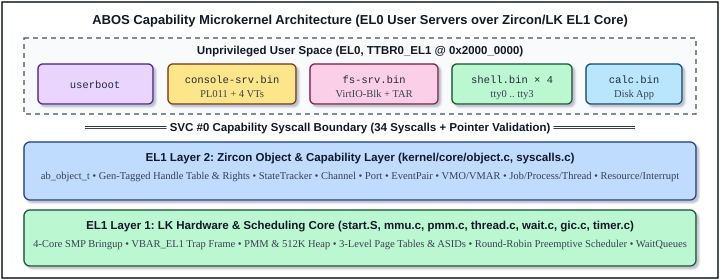
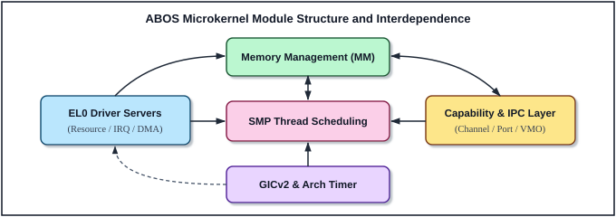
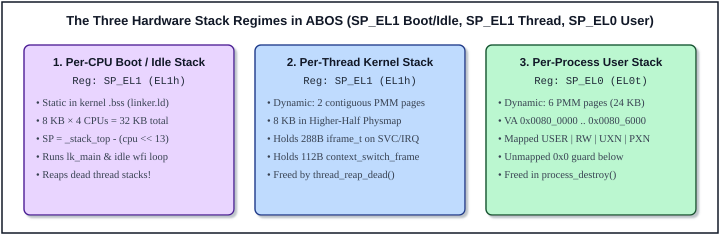

# 5 ABOS Microkernel Architecture

In Chapters 2, 3, and 4, we examined the three pillars beneath ABOS: the 4-core QEMU `virt` hardware board, the GNU AArch64 freestanding build environment, and the ARMv8-A privilege, virtual-memory, exception, and SMP synchronization mechanisms. In this chapter—the capstone of Part I—we assemble those pieces into the complete software architecture of **ABOS Lesson 20**.

Modeled directly after Chapter 5 of Dr. Zhao Jiong's *"A Heavily Commented Linux Kernel Source Code"*, this chapter provides a bird's-eye blueprint of the entire 9,526-line operating system: its two-layer `LK + Zircon` design, inter-module dependency structure, physical and virtual memory subsystems, user-space interrupt forwarding, all 34 capability system calls, preemptive SMP scheduling, the capability object and IPC engine, the three hardware stack regimes, the dual `BOOTFS` + VirtIO `USTAR` storage tiers, the complete 58-file source inventory, and an end-to-end trace of launching `calc.bin` from an interactive shell.

---

## 5.1 Two-Layer Microkernel Architecture: LK Core and Zircon Capability Layer

Following Google Fuchsia's **Zircon** kernel (`zx_and_lk.md`), ABOS is organized vertically into **two privileged `EL1` kernel layers** supporting an ecosystem of **isolated, unprivileged `EL0` user-space processes**:



1. **`EL1` Layer 1 — The LK (Little Kernel) Hardware & Scheduling Core**:
   Implemented across `kernel/core/{start.S, dtb.c, exceptions.S, exceptions_c.c, switch.S, uspace_entry.S, thread.c, wait.c}`, `kernel/mm/{pmm.c, heap.c, mmu.c}`, and `kernel/dev/{gic.c, timer.c, debuglog.c}`. Layer 1 knows **nothing** about capability handles, channels, or user processes as high-level objects; its sole job is to manage physical RAM frames, kernel heap blocks, `TTBR1`/`TTBR0` hardware page tables with `ASID`s, GICv2 interrupts, 100 Hz per-CPU timer ticks, preemptive `thread_t` context switches across all 4 Cortex-A53 cores, and blocking `wait_queue_t` / `event_t` synchronization.
2. **`EL1` Layer 2 — The Zircon Object & Capability Layer**:
   Implemented across `kernel/core/object.c` (2,030 lines) and `kernel/core/syscalls.c` (1,219 lines). Layer 2 wraps every system resource in a reference-counted **`ab_object_t`** (`Dispatcher`), enforces unforgeable generation-tagged **Handles** (`ab_handle_t`) and bitmask **Rights** (`ab_rights_t`) at the 34-syscall boundary, tracks object signals via **`StateTracker`**, multiplexes asynchronous events through **`Port`s**, transfers messages and capabilities across processes via **`Channel`s**, manages zero-copy shared memory via **`VMO`s** and **`VMAR`s**, and brokers hardware access to user-space drivers via **`Resource`** and **`Interrupt`** capabilities.
3. **Unprivileged `EL0` User Space (`user/`)**:
   Contains **zero** ambient kernel privilege. At boot, `lk_main()` spawns **`userboot`** (`PID 1` equivalent), handing it five bootstrap capabilities over a `Channel`. `userboot` maps the `"bootfs.tar"` `VMO` and spawns the standalone system servers—**`console-srv.bin`** (PL011 UART driver + 4 Virtual Terminals `tty0..tty3`), **`fs-srv.bin`** (VirtIO-Blk DMA driver + USTAR filesystem server), and **four concurrent `shell.bin` processes** (`abos-shell-0..3`)—which in turn dynamically load and spawn user applications such as **`calc.bin`** from the VirtIO disk.

---

## 5.2 Microkernel Module Structure and Interdependence

In a monolithic kernel like `Linux 0.12`, the Virtual File System, block device drivers, and character TTY drivers live inside the kernel and call directly into the kernel scheduler and buffer cache. In ABOS, device drivers and filesystems live in `EL0`, yet the core kernel subsystems exhibit an equally clear web of structural dependencies, illustrated in Figure 5-2:



Let us examine the five functional pillars in Figure 5-2 and why each arrow exists:

1. **SMP Thread Scheduling (`thread.c`, `switch.S`, `wait.c`) — The Central Hub**:
   Every other subsystem depends on the scheduler to block threads (`wait_queue_block`) when waiting for IPC messages, timer deadlines, or hardware interrupts, and to wake them (`wait_queue_wake_one` / `wake_all`) when events complete. Conversely, the scheduler depends on **Memory Management** (`pmm_alloc_contiguous` for 8 KB kernel stacks, `kzalloc` for `thread_t` structs, and `vmm_switch_aspace` to switch `TTBR0_EL1` + `ASID` during `sched_reschedule_locked()`).
2. **Memory Management (`pmm.c`, `heap.c`, `mmu.c`, plus `VMO`/`VMAR` in `object.c`)**:
   Supplies physical 4 KB frames to page tables, kernel stacks, `VMO` payloads, and contiguous DMA buffers; supplies `kmalloc`/`kzalloc` blocks for all kernel objects and in-flight `ab_message_packet_t` datagrams; and services lazy `EL0` translation faults.
3. **Capability & IPC Layer (`object.c`, `syscalls.c`)**:
   Depends bidirectionally on **Memory Management** (allocating `Dispatcher` structs from the heap and backing `VMO`/`VMAR` zero-copy shared memory with `PMM` frames and `mmu.c` PTEs) and calls into **SMP Thread Scheduling** whenever `StateTracker` wakes synchronous `WaitOne` or asynchronous `Port` waiters via `event_signal()`.
4. **`GICv2` & Architectural Timer (`gic.c`, `timer.c`, `exceptions.S`, `exceptions_c.c`)**:
   Drives **SMP Thread Scheduling** on every 10 ms `PPI 30` tick (`thread_timer_tick()` + `thread_preempt()`) and forwards external device `SPI`s (`33` for UART, `48+` for VirtIO-Blk) by masking the GIC line and signaling `InterruptDispatcher` objects for **`EL0` Driver Servers**.
5. **`EL0` Driver Servers (`console_srv.c`, `fs_srv.c`)**:
   Interact with hardware MMIO and DMA memory mapped via `Resource`-gated **Memory Management** (`sys_vmo_create_physical`, `sys_vmo_create_contiguous`), sleep on hardware interrupts via **SMP Thread Scheduling** (`sys_interrupt_wait` / `sys_port_wait`), and serve client shells via the **Capability & IPC Layer**.

---

## 5.3 Physical and Virtual Memory Management (`PMM`, `Heap`, `VmAspace`, `VMO`, `VMAR`)

ABOS manages memory across five cleanly layered abstractions:

### 1. Physical Memory Manager (`kernel/mm/pmm.c`)

The 128 MB DRAM arena (`0x40000000 .. 0x48000000`) is partitioned into `32,768` frames of `4,096` bytes (`PAGE_SIZE`), tracked by `static vm_page_t page_array[32768]`. Every frame carries an explicit Zircon-style state tag (`VM_PAGE_STATE_FREE`, `ALLOC`, `OBJECT`, `WIRED`, `HEAP`, `MMU`, `IPC`):
- **Single-frame allocation (`pmm_alloc_page`)** pops `free_list_head` in **`O(1)` constant time** and zeroes the 4 KB frame immediately via `paddr_to_physmap(pa)` so stale data never leaks between processes.
- **Contiguous multi-frame allocation (`pmm_alloc_contiguous`)** scans `page_array[]` for `count` adjacent `FREE` frames—used for 2-page (8 KB) kernel thread stacks, the 128-page (512 KB) kernel heap, and `fs-srv`'s 32-page (128 KB) VirtIO DMA arena.
- **Bootloader RAM reclamation (`pmm_free_wired_range`)** converts wired `-initrd` (`bootfs.tar`) physical frames into `FREE` frames as soon as `lk_main()` copies `bootfs.tar` into its `VMO`.

### 2. Kernel Heap Allocator (`kernel/mm/heap.c`)

`heap_init()` reserves **`HEAP_INITIAL_PAGES = 128` contiguous pages (`512 KB`)** in `VM_PAGE_STATE_HEAP` and manages them as a spinlock-protected (`heap_lock`), 16-byte-aligned singly-linked list of `heap_block_t` headers (`magic = 0xAB054EA9U`). `kmalloc()` / `kzalloc()` split oversized free blocks on allocation, while `kfree()` validates `HEAP_MAGIC` (catching heap corruption or double-free bugs immediately) and coalesces adjacent free blocks in a linear pass to prevent fragmentation as processes, channels, observers, and message packets come and go.

### 3. Hardware Address Spaces (`VmAspace` — `kernel/mm/mmu.c`)

Each user process owns a `vm_aspace_t` wrapping a 3-level (`L1 → L2 → L3`) `TTBR0_EL1` page table covering `0x00001000 .. 0x7FFFFFFF` (`USER_ASPACE_BASE .. +USER_ASPACE_SIZE`, leaving page `0x0` permanently unmapped to catch `NULL` dereferences) and a unique hardware `ASID` (`1..255`).

### 4. Virtual Memory Objects (`VMO` — `ab_vmo_dispatcher_t`)

A **VMO** represents a logical array of up to **`VMO_MAX_PAGES = 128` pages (`512 KB`)** decoupled from any single process's page table. ABOS supports three distinct VMO classes:

| VMO Class | Creation Syscall | Backing Pages | Typical Usage in ABOS Lesson 20 |
| :--- | :--- | :--- | :--- |
| **Anonymous RAM VMO** | `SYS_VMO_CREATE` | Committed eagerly by `sys_vmo_write` or lazily on `EL0` page fault (`VM_PAGE_STATE_OBJECT`). | `"bootfs.tar"`, executable `.bin` images, `FS_OP_OPEN_VMO` file payloads, shared memory buffers. |
| **Physical MMIO VMO** | `SYS_VMO_CREATE_PHYSICAL` (requires `Resource` cap) | Device physical frames (`is_physical = 1`); mapped with `PTE_ATTR_DEVICE \| PXN \| UXN`, never freed to PMM! | `"pl011-uart-mmio"` (`0x09000000`, 4 KB) in `console-srv`; `"virtio-blk-mmio"` (`0x0A000000`, 16 KB) in `fs-srv`. |
| **Contiguous DMA VMO** | `SYS_VMO_CREATE_CONTIG` (requires `Resource` cap) | `pmm_alloc_contiguous()` RAM frames; returns both `vmo_out` and physical base `paddr_out`. | `"virtio-blk-dma"` (`32` pages = `128 KB` contiguous DMA ring + 232-sector TAR cache) in `fs-srv`. |

### 5. Virtual Memory Address Regions (`VMAR` — `ab_vmar_dispatcher_t`)

Every user process receives a **Root VMAR** spanning **`0x10000000 .. 0x40000000` (`768 MB`)** with up to `MAX_VMAR_MAPPINGS = 16` active `ab_vmar_mapping_t` slots protected by `proc->vmar_lock`:
- **Fixed-Offset Mapping (`vmar_offset != 0`)**: Used when spawning any standalone `.bin` executable (`vmar_offset = 0x10000000` → `map_va = 0x10000000 + 0x10000000 = 0x20000000`, matching `user/link.ld`!).
- **Dynamic First-Fit Mapping (`vmar_offset == 0`)**: Scans `[0x10000000, 0x40000000)` with 4 KB guard gaps (`vmar_range_overlaps_locked`) to place `bootfs.tar`, `pl011-uart-mmio`, `virtio-blk-mmio`, `virtio-blk-dma`, or temporary `cat <file>` mappings automatically.
- **Unmapping (`34 SYS_VMAR_UNMAP`)**: `ab_vmar_unmap()` clears all L3 PTEs across the range, broadcasts `tlbi vae1is`, deactivates the `ab_vmar_mapping_t` slot so the virtual address range can be reused infinitely (e.g., running `cat motd.txt` hundreds of times in `shell`!), and calls `ab_object_release(&vmo->base)`.

---

## 5.4 Hardware Interrupt Routing and `EL0` Driver Forwarding

How can a device driver run in unprivileged `EL0` user space when hardware interrupts always trap into `EL1`? ABOS implements Zircon's exact **mask-signal-acknowledge** protocol (`exceptions_c.c:70-86` and `object.c:1684-1732`):

```
[Hardware Device (PL011 SPI 33 or VirtIO SPI 48+) Asserts Level-Sensitive IRQ Line]
       |
       v
1. EL1 Trap (.Lel0_irq / .Lel1_irq -> arm64_irq_exception):
   - Reads GICC_IAR -> obtains irq_num (e.g., 33).
   - Calls ab_interrupt_dispatch_hw_irq(33):
       (a) IMMEDIATELY masks IRQ 33 in GICD (gic_disable_interrupt(33))!
           (Without this mask, returning to EL0 while UART_DR is still non-empty
            would re-trigger IRQ 33 infinitely before console-srv executes 1 instruction!)
       (b) Signals intr->irq_event (waking synchronous sys_interrupt_wait in fs-srv)
           AND asserts AB_SIGNAL_SIGNALED on intr->base (queuing a Port packet for console-srv!).
   - Writes GICC_EOIR (gic_end_interrupt) and calls thread_preempt().
       |
       v
2. EL0 Driver Process (console-srv on Port OR fs-srv in sys_interrupt_wait) Wakes Up:
   - Services device MMIO registers directly in EL0 (drains UART_DR + writes UART_ICR,
     or writes VIRTIO_MMIO_INTERRUPT_ACK) so the device drops its physical interrupt wire.
   - Calls sys_interrupt_ack(irq_h) -> clears AB_SIGNAL_SIGNALED and unmasks IRQ 33 in GICD!
```

---

## 5.5 System Call Interface and User-Pointer Validation

User-space code invokes the microkernel exclusively through `user/ulibc/ulibc.c`'s `__ab_syscall4(num, a0, a1, a2, a3)`, which places the syscall number in **`x8`**, up to four 64-bit parameters in **`x0..x3`** (packing 5+-parameter calls into compact `*_args_t` structs in user memory), executes **`svc #0`**, and receives `ab_status_t` in **`x0`**.

### 5.5.1 Safe User Memory Copy (`copy_from_user` & `copy_to_user`)

A microkernel must never blindly dereference a user-supplied pointer in `EL1`: a buggy or malicious `EL0` program could pass `NULL`, a kernel address (`0xFFFFFFFF80083000`), an unmapped address, a read-only `VMO` address as an output buffer, or a `Device-nGnRnE` MMIO pointer! In `kernel/core/syscalls.c` (lines 13–118), **every** user buffer transfer goes through `copy_from_user()` and `copy_to_user()`, which walk page-by-page and enforce four checks via `resolve_user_page()`:

1. **Address-Space & Overflow Bounds**: Verifies `[uaddr, uaddr + len)` lies strictly within `[0x00001000, 0x80000000)` without 64-bit wraparound.
2. **Demand-Page Resolution**: If a page belongs to a valid lazy `VMAR` mapping not yet faulted in, triggers `ab_process_handle_page_fault()` transparently!
3. **PTE Permission Enforcement**: Requires `PTE_AP_USER`, and for `copy_to_user()` rejects `PTE_AP_RO` (`AB_ERR_ACCESS_DENIED`).
4. **Device MMIO Rejection**: Requires `(pte & (7ULL << 2)) == PTE_ATTR_NORMAL` and `pa` inside normal DRAM (`0x40000000 .. 0x80000000`), preventing user space from tricking the kernel into reading/writing device MMIO registers on its behalf, then copies safely via `paddr_to_physmap(pa)`.

### 5.5.2 Complete Table of All 34 ABOS System Calls

Table 5-1 catalogs all **34 system calls** defined in `include/syscalls.h` and dispatched in `kernel/core/syscalls.c`:

| # | Syscall Constant | Category | Required Handle & Rights | Functional Summary |
|---:|:---|:---|:---|:---|
| `1` | `SYS_HANDLE_CLOSE` | Handles | Any valid `ab_handle_t` | Removes handle from caller's table, increments slot `generation`, decrements `handle_count` & `ref_count`. |
| `2` | `SYS_HANDLE_DUPLICATE` | Handles | `AB_RIGHT_DUPLICATE` | Creates a second handle to the same object with equal (`AB_RIGHT_SAME_RIGHTS`) or attenuated rights. |
| `3` | `SYS_OBJECT_GET_INFO` | Introspect | `AB_RIGHT_INSPECT` | Returns `ab_handle_basic_info_t` (`koid`, `related_koid`, `type`, `rights`, `handle_count`). |
| `4` | `SYS_DEBUGLOG_WRITE` | DebugLog | `LOG` + `AB_RIGHT_WRITE` | Writes a formatted diagnostic line (up to 256 B) to the spinlock-serialized kernel debug log. |
| `5` | `SYS_PROCESS_EXIT` | Tasks | *(Current process)* | Tears down caller's `TTBR0`, unmaps `VMAR`s, closes all handles, asserts `TASK_TERMINATED`, exits thread. |
| `6` | `SYS_NANOSLEEP` | Time | *(None)* | Places calling thread into `THREAD_SLEEPING` for `delay_ns` nanoseconds via `thread_sleep_ns()`. |
| `7` | `SYS_EVENT_CREATE` | Signals | *(None)* | Allocates a solo `EventDispatcher` (`AB_OBJ_TYPE_EVENT`) and returns its handle. |
| `8` | `SYS_EVENTPAIR_CREATE` | Signals | *(None)* | Allocates two peered `EventPairDispatcher` endpoints (`related_koid` cross-linked) and returns `h0, h1`. |
| `9` | `SYS_OBJECT_SIGNAL` | Signals | `AB_RIGHT_SIGNAL` | Clears/sets `AB_USER_SIGNAL_0..3` (and `SIGNALED` on `Event`) on the target object's `StateTracker`. |
| `10` | `SYS_OBJECT_SIGNAL_PEER` | Signals | `EVENTPAIR`/`CHANNEL` + `SIGNAL_PEER` | Clears/sets `AB_USER_SIGNAL_0..3` on the entangled peer endpoint's `StateTracker`. |
| `11` | `SYS_OBJECT_WAIT_ONE` | Signals | `AB_RIGHT_WAIT` | Blocks until any signal in `watched_signals` is active on `handle` or `deadline_ns` expires. |
| `12` | `SYS_PORT_CREATE` | Ports | *(None)* | Creates a `PortDispatcher` with a 32-slot `ab_port_packet_t` ring buffer. |
| `13` | `SYS_PORT_QUEUE` | Ports | `PORT` + `AB_RIGHT_WRITE` | Manually enqueues a user `ab_port_packet_t` (`AB_PKT_TYPE_USER`) into a `Port`. |
| `14` | `SYS_PORT_WAIT` | Ports | `PORT` + `AB_RIGHT_READ` | Dequeues the next packet from a `Port`, blocking until one arrives or `deadline_ns` expires. |
| `15` | `SYS_OBJECT_WAIT_ASYNC` | Ports | `obj: WAIT`, `port: WRITE` | Registers a one-shot async observer on `obj` that posts `AB_PKT_TYPE_SIGNAL_ONE` (`key`) to `port`. |
| `16` | `SYS_CHANNEL_CREATE` | Channels | *(None)* | Creates two entangled `ChannelDispatcher` endpoints and installs `out0, out1` in caller's table. |
| `17` | `SYS_CHANNEL_WRITE` | Channels | `CHANNEL: WRITE`, `h[i]: TRANSFER` | Enqueues up to `256` bytes + `8` detached capability handles onto the peer channel's FIFO queue. |
| `18` | `SYS_CHANNEL_READ` | Channels | `CHANNEL` + `AB_RIGHT_READ` | Dequeues oldest `ab_message_packet_t` and installs transferred handles into receiver's handle table. |
| `19` | `SYS_VMO_CREATE` | VM | *(None)* | Creates an anonymous `VmObjectDispatcher` rounded up to 4 KB pages (up to `128` pages = `512 KB`). |
| `20` | `SYS_VMO_READ` | VM | `VMO` + `AB_RIGHT_READ` | Copies `[offset, offset+len)` from a `VMO`'s physical pages (reading zeros for uncommitted pages) to user buffer. |
| `21` | `SYS_VMO_WRITE` | VM | `VMO` + `AB_RIGHT_WRITE` | Commits backing pages as needed and copies `len` bytes from user buffer into the `VMO`. |
| `22` | `SYS_VMAR_MAP` | VM | `VMAR: MAP`, `VMO: MAP + R/W/X` | Maps a `VMO` slice into target `VMAR` (at `base_va + offset` or dynamic first-fit) and populates PTEs. |
| `23` | `SYS_PROCESS_CREATE` | Tasks | `JOB` + `MANAGE_PROCESS` | Allocates a child `ab_process_t` (with fresh `ASID` & `TTBR0`) and its Root `VMAR`, returning both handles. |
| `24` | `SYS_THREAD_CREATE` | Tasks | `PROCESS` + `MANAGE_THREAD` | Allocates an `ab_thread_dispatcher_t` bound to target process (`MAX_THREADS_PER_PROCESS = 8`). |
| `25` | `SYS_PROCESS_START` | Tasks | `PROC: WRITE`, `THR: WRITE`, `arg: TRANSFER` | Transfers bootstrap `arg_handle` into slot `0` of child process, spawns 8 KB kernel thread, enters `EL0` at `entry_pc`. |
| `26` | `SYS_VMO_CREATE_PHYSICAL` | Driver DDK | `RESOURCE` + `AB_RIGHT_WRITE` | Wraps device MMIO physical range `[paddr, paddr+size)` (`< 0x40000000`) in a `Device-nGnRnE` `VMO`. |
| `27` | `SYS_VMO_CREATE_CONTIG` | Driver DDK | `RESOURCE` + `AB_RIGHT_WRITE` | Allocates physically contiguous RAM frames in a `VMO` and returns both handle and physical `dma_pa`. |
| `28` | `SYS_INTERRUPT_CREATE` | Driver DDK | `RESOURCE` + `AB_RIGHT_READ` | Binds hardware SPI `irq_num` (`>= 32`) to an `InterruptDispatcher` and unmasks it at `GICD`. |
| `29` | `SYS_INTERRUPT_WAIT` | Driver DDK | `INTERRUPT` + `AB_RIGHT_WAIT` | Blocks caller on `intr->irq_event` until hardware `irq_num` fires. |
| `30` | `SYS_INTERRUPT_ACK` | Driver DDK | `INTERRUPT` + `AB_RIGHT_WRITE` | Clears `AB_SIGNAL_SIGNALED` on the interrupt object and re-enables (unmasks) `irq_num` at `GICD`. |
| `31` | `SYS_OBJECT_SET_NAME` | Introspect | `VMO`/`PROC`/`JOB` + `SET_PROPERTY` | Assigns a human-readable 31-char diagnostic name (e.g., `"bootfs.tar"`, `"virtio-blk-dma"`) visible in `ps`/`vmaps`. |
| `32` | `SYS_JOB_GET_PS_INFO` | Introspect | `JOB` + `AB_RIGHT_INSPECT` | Snapshots `Job → Process → Thread` tree, `ASID`s, `PSS`/`Private`/`Shared` KB, and per-type handle counts. |
| `33` | `SYS_PROCESS_GET_MAPS` | Introspect | `JOB` + `AB_RIGHT_INSPECT` | Snapshots target process's `VmAspace` (`/A`), Root `VMAR` (`/R`), and `VMO` mappings (`M`) with PA & committed pages. |
| `34` | `SYS_VMAR_UNMAP` | VM | `VMAR` + `AB_RIGHT_WRITE` | Unmaps `[addr, addr+len)` from target `VMAR`, flushes TLB (`tlbi vae1is`), and releases `VMO` reference. |

---

## 5.6 Timekeeping and Preemptive SMP Round-Robin Scheduling

### 1. Overflow-Safe Nanosecond Monotonic Clock (`kernel/dev/timer.c`)

At boot, CPU 0 reads `CNTFRQ_EL0` (`62,500,000 Hz` on QEMU `virt`) and arms every CPU's physical timer (`PPI 30`) at **`100 Hz` (`10 ms` quantum)**. Whenever kernel or user code queries `current_time_ns()` (`timer.c:44-51`), ABOS splits `pct / freq` into whole seconds and remainder ticks *before* multiplying by `1,000,000,000`:

```c
uint64_t secs = pct / timer_freq_hz;
uint64_t rem  = pct % timer_freq_hz;
return secs * 1000000000ULL + (rem * 1000000000ULL) / timer_freq_hz;
```

Splitting `secs` and `rem` guarantees `rem * 10⁹ < 6.25 × 10¹⁶ << 2⁶⁴`, preventing 64-bit integer overflow for centuries of uptime!

### 2. Fair 4-Core SMP Scheduler and Dead-Stack Reaping (`kernel/core/thread.c`)

ABOS maintains up to `MAX_THREADS = 64` dynamic `thread_t` slots in `thread_table[]` plus 4 per-CPU `idle_threads[0..3]`, protected by `sched_lock`:
- **Timer Tick Wakeup (`thread_timer_tick`)**: Every 10 ms on each CPU, checks `thread_table[]` for `THREAD_SLEEPING` or timed `THREAD_BLOCKED` threads whose `wake_time_ns <= now`, unlinks timed-out waiters from their `wait_queue_t` with `AB_ERR_TIMED_OUT`, transitions them to `THREAD_READY`, and sets `need_resched[cpu] = 1`.
- **Fair Round-Robin Selection (`sched_reschedule_locked`)**: Scans circularly starting at `(start_idx + 1) % MAX_THREADS` so one CPU-bound thread can never starve higher-numbered slots, respecting optional `pinned_cpu` affinity and falling back to `idle_threads[cpu]` (`wfi` power-saving loop) when no `THREAD_READY` work exists.
- **Safe Cross-CPU Stack Reclamation (`thread_reap_dead`)**: A dying thread (`thread_exit`) **cannot free its own 8 KB kernel stack while still executing on `SP_EL1`!** Instead, it marks `state = THREAD_DEATH` and switches away. Later, `thread_reap_dead()` (called from every CPU's `idle` loop and `thread_create()`) checks that a `THREAD_DEATH` + `detached` thread is **not still present in `current_threads[0..3]`** on any peer CPU before freeing its 2 physical stack frames and `thread_t` struct!

---

## 5.7 Capability Object Model, Signals, Ports and Channel IPC

### 1. Dual Reference Counting (`ref_count` vs. `handle_count`)

Every one of ABOS's 13 object types (`PROCESS`, `THREAD`, `VMO`, `CHANNEL`, `EVENT`, `EVENTPAIR`, `PORT`, `INTERRUPT`, `RESOURCE`, `LOG`, `JOB`, `VMAR`) begins with `ab_object_t` (`include/object.h:138-147`), stamped with a monotonically increasing 64-bit **`koid`** (starting at `1024`; `1` = `AB_KOID_KERNEL`) and **two distinct atomic counters**:

- **`handle_count`**: Number of open user-space handles (plus in-flight `Channel` message attachments) referencing this object. When `handle_count` transitions `1 → 0`, the kernel invokes **`obj->on_zero_handles(obj)`**—for example, detaching a `Channel` or `EventPair` from its peer and asserting **`AB_SIGNAL_PEER_CLOSED`** on the surviving peer even if a kernel pointer still holds a temporary `ref_count`!
- **`ref_count`**: Total lifetime references (every open handle + `VMAR` mappings + `Job`/parent pointers + temporary syscall references). Only when `ref_count` transitions `1 → 0` does `ab_object_release()` invoke **`obj->destroy(obj)`** and `kfree(obj)`.

### 2. Generation-Tagged Capability Handles (`make_handle_value`)

User space never sees `ab_object_t *` addresses. Instead, each `ab_process_t` owns a private 64-slot `handles[]` array (`object.h:149-155`), and `make_handle_value(slot, gen)` encodes a 32-bit `ab_handle_t` token:

```
 31      28  27      24  23                      8  7            0
+----------+-----------+--------------------------+--------------+
| 0x5 (4b) |  0x0 (4b) | 16-bit Generation Count  | Slot [0..63] |
+----------+-----------+--------------------------+--------------+
```

When a process closes slot `3` (`0x50000103`), `handle_close()` increments `entry->generation` (`1 → 2`). Even if a subsequent `sys_event_create()` immediately reuses slot `3`, its new handle is `0x50000203`—any stale `0x50000103` bug in user code immediately fails `decode_handle_value` generation matching with **`AB_ERR_BAD_HANDLE`**!

### 3. `StateTracker`, `Port` Multiplexing, and `Channel` Capability Transfer

- **`StateTracker` + `Port`**: Every `ab_object_t` embeds an `ab_state_tracker_t`. When signals change (`state_tracker_update_signals`), synchronous `WaitOne` observers wake via LK `event_signal(&obs->event)`, while asynchronous `Port` observers (`sys_object_wait_async`) automatically post an `ab_port_packet_t` into a 32-slot `PortDispatcher` ring buffer. For example, `console-srv` binds `uart_irq_h` (`key = 100`, backed by PL011's 16-byte hardware FIFO) and all 4 shell channels (`key = 0..3`, backed by 512-byte per-VT RX rings and 1 KB screen history buffers) onto **one single `Port`**, using a **25 ms `sys_port_wait` deadline** (`ESC_TIMEOUT_NS`) to disambiguate standalone `ESC` (`tty3` switch) from `Alt+0..3` / `CSI` escape sequences!
- **`Channel` Capability Transfer & `ab_proc_args_t`**: Writing handles into a `Channel` (`sys_channel_write`) atomically **moves** authority across isolated processes: `handle_take_for_transfer()` verifies `AB_RIGHT_TRANSFER`, clears the sender's slot (incrementing its `generation`!), and parks `(ab_object_t *, ab_rights_t)` inside `ab_message_packet_t` until `sys_channel_read()` installs fresh handles into the receiver's handle table (rolling back cleanly if the receiver's table is full). Standardizing startup capability wiring, `userboot` and `shell` send an `ab_proc_args_t` header (`magic = 0x41425041` `"ABPA"`, `handle_types[8]` tagged with `AB_PA_LOG`, `AB_PA_VMAR_ROOT`, `AB_PA_CONSOLE`, `AB_PA_FS`, `AB_PA_JOB_DEFAULT`, `AB_PA_RESOURCE`, `AB_PA_CHANNEL_SRV`) over each new child's bootstrap channel (`crt_env.c`).

---

## 5.8 How Stacks Work in ABOS

Tracking active stack pointers across boot, threads, traps, and user mode is essential when reading kernel code. ABOS employs **three distinct stack regimes**, shown side-by-side in Figure 5-3:



1. **Per-CPU Boot / Idle Stack (`SP_EL1`, `8 KB × 4 = 32 KB` static in `.bss`)**:
   Reserved between `_boot_stacks_bottom` and `_stack_top` in `linker.ld`. Initialized in `start.S:150-155` as `SP = _stack_top - (cpu_id << 13)`. Runs `lk_main()` on CPU 0 and `arm64_secondary_entry()` on CPUs 1–3, then permanently serves as each core's `idle_threads[cpu]` stack (`thread_become_idle()`), where `thread_reap_dead()` safely frees dead threads' dynamic stacks.
2. **Per-Thread Kernel Stack (`SP_EL1`, `8 KB = 2` contiguous PMM pages in Physmap)**:
   Allocated in `thread_create()` (`VM_PAGE_STATE_ALLOC`). Holds `context_switch_frame_t` (`112` bytes) while switched out in `switch.S`, and receives the `288`-byte `iframe_t` automatically whenever the CPU traps from `EL0t` into `EL1h` on `SVC #0`, a page fault, or an `IRQ`.
3. **Per-Process User Stack (`SP_EL0`, `24 KB = 6` PMM pages at `VA 0x00800000 .. 0x00806000`)**:
   Allocated lazily on thread startup in `user_thread_trampoline()` (`object.c:1509-1526`) and mapped `USER | READ | WRITE | PXN | UXN` (non-executable, with unmapped space below `0x00800000` to catch stack overflow!). Freed in `process_destroy()`.

---

## 5.9 `BOOTFS` RAM Disk and POSIX USTAR Disk Storage Model

ABOS Lesson 20 cleanly separates **boot-critical system servers** from **persistent disk files and user applications** across two POSIX `USTAR` storage tiers:

| Storage Tier | Build Artifact & QEMU Flag | How Discovered & Accessed | Files Packaged Inside |
| :--- | :--- | :--- | :--- |
| **1. `BOOTFS` Initial RAM Disk** | `image/bootfs.tar` (`-initrd image/bootfs.tar`) | Discovered by `dtb_parse()` (`/chosen` `linux,initrd-*`); copied by `lk_main` into `"bootfs.tar"` `VMO` (`initrd` PA pages immediately freed to `PMM`!); mapped RO by `userboot` to spawn servers, then unmapped (`SYS_VMAR_UNMAP`) & closed so VMO pages free too! | `console-srv.bin`, `fs-srv.bin`, `shell.bin` (all linked with `user/link.ld` `@ 0x20000000`). |
| **2. VirtIO Block Disk** | `image/disk.img` (`1 MB`, `-device virtio-blk-device`) | Driven in `EL0` by `fs-srv` using a `32`-page (`128 KB`) contiguous DMA VMO (`3` meta pages + `29` cache pages = **`116 KB` = `232` sectors** cached via DMA read); served over `Channel`s as `VMO`s (`FS_OP_OPEN_VMO`). | `motd.txt`, `zircon.txt`, `calc.bin` (linked with `user/link.ld` `@ 0x20000000`). |

---

## 5.10 Complete Directory Tree and 58-File Source Inventory

The entire ABOS Lesson 20 operating system resides in `lesson_20/` across **58 source and build files totaling 9,526 lines**:

```
lesson_20/ (58 files, 9,526 lines total)
├── Makefile, config.mk, install_tools.sh, linker.ld         (4 root build/link files)
├── image/                                                   (3 packaging files)
│   ├── Makefile, make_bootfs.py, make_tar_disk.py
├── include/                                                 (14 shared C header files)
│   ├── debuglog.h, dtb.h, exceptions.h, gic.h, heap.h, ipc_proto.h, mmu.h,
│   └── object.h, pmm.h, spinlock.h, syscalls.h, thread.h, timer.h, wait.h
├── kernel/                                                  (21 EL1 microkernel files)
│   ├── Makefile
│   ├── core/ (Makefile, start.S, dtb.c, exceptions.S, exceptions_c.c, uspace_entry.S,
│   │          switch.S, thread.c, wait.c, object.c, syscalls.c, main.c)
│   ├── dev/  (Makefile, debuglog.c, gic.c, timer.c)
│   └── mm/   (Makefile, pmm.c, heap.c, mmu.c)
└── user/                                                    (16 EL0 user-space files)
    ├── Makefile, link.ld
    ├── ulibc/    (Makefile, crt0.S, crt_env.c, ulibc.h, ulibc.c)
    ├── userboot/ (Makefile, userboot.c)
    ├── drivers/  (Makefile, console_srv.c, fs_srv.c)
    ├── shell/    (Makefile, shell.c)
    └── apps/     (Makefile, calc.c)
```

Table 5-2 inventories all 58 files with exact line counts and the Part II chapter where each file is annotated line by line:

| Subsystem Group | Files (Line Counts) | Files | Lines | Part II Chapter |
| :--- | :--- | ---: | ---: | :--- |
| **Root Build, Linker & Image Packagers** | `Makefile` (67), `config.mk` (64), `install_tools.sh` (69), `linker.ld` (71), `image/Makefile` (59), `image/make_bootfs.py` (19), `image/make_tar_disk.py` (39) | 7 | 388 | Chapter 6 |
| **Boot Trampoline, Init & DTB** | `kernel/core/start.S` (179), `kernel/Makefile` (19), `kernel/core/Makefile` (17), `kernel/core/main.c` (151), `kernel/core/dtb.c` (140) | 5 | 506 | Chapters 6–7 |
| **Exceptions, GICv2, Timer & DebugLog** | `kernel/core/exceptions.S` (130), `exceptions_c.c` (86), `uspace_entry.S` (50), `kernel/dev/Makefile` (16), `gic.c` (48), `timer.c` (51), `debuglog.c` (134) | 7 | 515 | Chapter 8 |
| **SMP Scheduler & Wait Queues** | `kernel/core/thread.c` (317), `kernel/core/switch.S` (42), `kernel/core/wait.c` (151) | 3 | 510 | Chapter 9 |
| **Zircon Object & Capability Engine** | `kernel/core/object.c` (2,030 — split across solo/IPC objects & VM/Task/DDK/Diagnostics) | 1 | 2,030 | Chapters 10–11 |
| **System Call Dispatch & User Copy** | `kernel/core/syscalls.c` (1,219) | 1 | 1,219 | Chapter 12 |
| **PMM, Kernel Heap & 3-Level MMU** | `kernel/mm/Makefile` (16), `kernel/mm/pmm.c` (229), `kernel/mm/heap.c` (131), `kernel/mm/mmu.c` (295) | 4 | 671 | Chapter 13 |
| **Shared Kernel & IPC Headers** | `debuglog.h` (23), `dtb.h` (35), `exceptions.h` (34), `gic.h` (32), `heap.h` (19), `ipc_proto.h` (58), `mmu.h` (84), `object.h` (590), `pmm.h` (48), `spinlock.h` (83), `syscalls.h` (53), `thread.h` (90), `timer.h` (21), `wait.h` (43) | 14 | 1,213 | Chapter 14 |
| **`EL0` C Runtime, `ulibc` & `userboot`** | `user/Makefile` (22), `user/link.ld` (54), `user/ulibc/Makefile` (20), `crt0.S` (44), `crt_env.c` (122), `ulibc.h` (125), `ulibc.c` (534), `user/userboot/Makefile` (16), `userboot.c` (214) | 9 | 1,151 | Chapter 15 |
| **Standalone `EL0` Servers, Shell & App** | `user/drivers/Makefile` (36), `console_srv.c` (401), `fs_srv.c` (304), `user/shell/Makefile` (32), `shell.c` (443), `user/apps/Makefile` (37), `calc.c` (70) | 7 | 1,323 | Chapter 16 |
| **Grand Total (`ABOS Lesson 20`)** | **Complete 4-Core AArch64 SMP Capability Microkernel OS** | **58** | **9,526** | **Chapters 6–16** |

---

## 5.11 End-to-End Walkthrough: Launching `calc.bin` from the Shell

To see every subsystem of ABOS Lesson 20 working in concert before we read the code line by line, let us trace what happens from the moment you type `calc` and press `Enter` at the `abos[tty0]$ ` prompt:

1. **`EL0` UART Interrupt & `Port` Delivery (`console-srv → abos-shell-0`)**:
   Pressing `Enter` asserts SPI `IRQ 33`. `arm64_irq_exception()` masks `IRQ 33` at `GICD` and posts a `Port` packet (`key = 100`) to `console-srv`. `console-srv` wakes from `sys_port_wait()`, drains `'c','a','l','c','\r'` from `UART_DR`, sends `"calc"` in a `CON_OP_READ_LINE` reply over `abos-shell-0`'s channel, and calls `sys_interrupt_ack(uart_irq_h)`.
2. **Fetching `calc.bin` as a `VMO` Capability (`abos-shell-0 ↔ fs-srv`)**:
   `abos-shell-0` (`shell.c:356-372`) writes an `FS_OP_OPEN_VMO` request for `"calc.bin"` onto `fs_ch` and blocks in `sys_object_wait_one(fs_ch, AB_SIGNAL_READABLE)`. `fs-srv` wakes on its `Port`, locates `"calc.bin"` inside its DMA-populated `tar_cache`, creates a fresh `VMO` (`sys_vmo_create`), copies `calc.bin`'s flat binary into it (`sys_vmo_write`), duplicates the handle with `READ | WRITE | MAP | EXECUTE | TRANSFER | INSPECT`, and **transfers the `VMO` handle** back to `abos-shell-0` via `sys_channel_write`!
3. **Creating the Child Process & Mapping `0x20000000` (`shell.c:374-396`)**:
   `abos-shell-0` calls `sys_process_create(job_h, "calc.bin", &calc_proc, &calc_vmar)`—allocating a new `ASID` and `TTBR0_EL1` L1 page table—and calls `sys_vmar_map(calc_vmar, 0x10000000, bin_vmo_h, 0, map_sz, READ | WRITE | EXECUTE, &entry_va)`. Inside `EL1`, `ab_vmar_map()` computes `0x10000000 + 0x10000000 = 0x20000000`, installs L3 PTEs in `calc.bin`'s page table, and executes `sync_icache_page()` (`dc cvau` + `ic ialluis`) so all 4 cores' I-caches see the freshly loaded instructions.
4. **Bootstrap Capability Wiring & Entering `EL0` (`shell.c:398-428` → `uspace_entry.S`)**:
   `abos-shell-0` creates a thread (`sys_thread_create`) and bootstrap channel (`p_ch`, `c_ch`), duplicates **only** its `DebugLog` (`AB_PA_LOG`) and `Console` (`AB_PA_CONSOLE`) handles into `p_ch` (granting `calc.bin` **zero** filesystem, job, or hardware `Resource` capabilities!), calls `sys_process_start(calc_proc, calc_thr, 0x20000000, 0, c_ch, 0)`, and sleeps on `sys_object_wait_one(calc_proc, AB_SIGNAL_TASK_TERMINATED)`. On a free Cortex-A53 core, `user_thread_trampoline()` switches `TTBR0_EL1` to `calc.bin`'s `ASID`, maps its 24 KB `EL0` stack at `0x00800000..0x00806000`, zeroes `x2..x30` in `arm64_uspace_entry()`, and executes **`eret`** into `EL0t` at `0x20000000` with `x0 = 0x50000100` (`c_ch`).
5. **`crt0.S` → `main()` → `sys_process_exit(0)` & Full Reclamation**:
   `_start` (`crt0.S`) zeroes `.bss`, calls `__ulibc_init(c_ch)` to unpack `AB_PA_LOG` and `AB_PA_CONSOLE`, and calls `main()` (`calc.c`), which exchanges `printf` / `u_gets` messages directly with `console-srv` on the active VT. When `main()` returns `0`, `crt0.S` invokes `sys_process_exit(0)`, tearing down `calc.bin`'s mappings and handles and asserting `AB_SIGNAL_TASK_TERMINATED`—waking `abos-shell-0`, which closes `calc_proc` (freeing its 24 KB stack, page tables, and `ASID`) and prints the next `abos[tty0]$ ` prompt with zero leaked bytes!

---

## 5.12 Summary

With Part I complete, no part of ABOS Lesson 20 remains a black box: we have seen how the two-layer `LK + Zircon` microkernel partitions hardware mechanics from capability policy, how physical frames, `VMO`s, `VMAR`s, `Port`s, `Channel`s, `Resource`s, `Interrupt`s, and the three stack regimes interlock across all 58 source files (`9,526` lines), and how user-space servers and applications execute from `BOOTFS` and VirtIO disk with complete capability isolation. Turn the page to **Part II (Chapter 6)**, where our line-by-line source code dissection begins at the very first build rule and reset instruction of ABOS!
