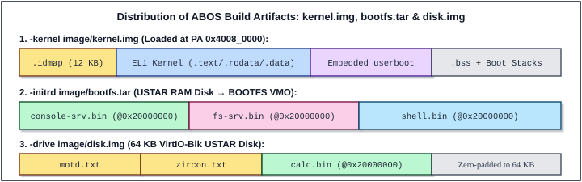

# 6 Booting System and Higher-Half Trampoline

Every operating system kernel faces an architectural bootstrap paradox on power-up: the kernel binary is compiled and linked to run at privileged virtual addresses in the upper half of the 64-bit address space, yet the ARMv8-A processor comes out of reset with its Memory Management Unit (MMU) disabled, fetching instructions strictly by physical address. Bridging this gap cleanly — across four symmetric multiprocessing (SMP) cores while preserving hardware discovery metadata passed by the platform bootloader — is the responsibility of ABOS's boot subsystem.

This chapter examines the three files that carry ABOS from the first instruction fetched at physical address `0x40080000` into Higher-Half C execution with a parsed hardware memory map:
1. **`linker.ld`** (*Program 6-1*): Partitions the kernel ELF into a 12 KB physical identity-mapped trampoline (`.idmap`) followed by Higher-Half sections (`.text`, `.rodata`, `.data`, `.bss`, and four 8 KB per-CPU boot stacks) whose physical Load Memory Addresses remain contiguous inside `image/kernel.img`.
2. **`kernel/core/start.S`** (*Program 6-2*): Drops from EL2 to EL1h if necessary, enables FP/SIMD, constructs dual 1 GB Level-1 bootstrap page tables (`idmap_table` and `kernel_table`), activates the MMU plus L1/L2 instruction and data caches on all CPUs, leaps across the 64-bit virtual address chasm to `high_kernel_entry`, installs `VBAR_EL1`, sets up per-CPU stacks, zeroes `.bss`, and branches to `lk_main()`.
3. **`kernel/core/dtb.c`** (*Program 6-3*): Walks the big-endian Flattened Device Tree (FDT) blob directly through the Higher-Half `Physmap` window to discover physical DRAM capacity and the physical coordinates of the `bootfs.tar` RAM disk before the physical memory allocator (`pmm.c`) initializes.

---

## 6.1 Main Functions

### Distribution of Build Artifacts and Boot Handoff

Before tracing the first assembly instruction, it is helpful to see what artifacts QEMU loads into memory when `make run` launches the 4-core Cortex-A53 virtual machine:

```bash
qemu-system-aarch64 -M virt -cpu cortex-a53 -smp 4 \
    -kernel image/kernel.img -initrd image/bootfs.tar \
    -nographic -serial mon:stdio \
    -drive file=image/disk.img,format=raw,if=none,id=hd0 \
    -device virtio-blk-device,drive=hd0
```



As illustrated in **Figure 6-1**, the ABOS build system (`lesson_20/Makefile` and `image/Makefile`) partitions the operating system into three cleanly decoupled binary artifacts, mirroring Google Zircon's separation between the microkernel, `BOOTFS`, and block-storage filesystems:

1. **`image/kernel.img` (Loaded via `-kernel` at PA `0x40080000`)**: Contains only the EL1 microkernel (`.idmap` trampoline + Higher-Half `.text`/`.rodata`/`.data`) and the tiny embedded `userboot` root loader. Uninitialized `.bss` arrays and the four 8 KB per-CPU boot stacks occupy the physical frames immediately above `.data` up to `_end`.
2. **`image/bootfs.tar` (Loaded via `-initrd`, typically at PA `0x44000000`)**: A standard POSIX USTAR archive packaging the standalone EL0 system servers (`console-srv.bin`, `fs-srv.bin`, and `shell.bin`, each linked at user VA `0x20000000`). QEMU places `bootfs.tar` into physical RAM and records its exact `[initrd_start, initrd_end)` physical range inside the `/chosen` node of the Flattened Device Tree.
3. **`image/disk.img` (Attached via `-drive` / `virtio-blk-device`)**: A 64 KB raw disk image containing user text files (`motd.txt`, `zircon.txt`) and on-demand EL0 applications (`calc.bin`). The microkernel never touches `disk.img` at all; once `userboot` spawns `fs-srv.bin` in EL0, `fs-srv` drives the VirtIO-Blk MMIO transport directly using DMA and Physical VMO capabilities.

When QEMU finishes placing `kernel.img`, `bootfs.tar`, and its dynamically generated Flattened Device Tree (DTB) into physical RAM (`[0x40000000 .. 0x48000000)`), it holds Secondary CPUs 1..3 powered off under PSCI control and starts **CPU 0** at `_start` (`PA 0x40080000`) with:
- MMU disabled (`SCTLR_EL1.M == 0`), caches disabled (`C == 0`, `I == 0`), interrupts masked (`DAIF = 0b1111`).
- General-purpose register **`x0`** holding `dtb_paddr`, the 64-bit physical address of the DTB header (`struct fdt_header`).

### The `.idmap` Physical Trampoline to Higher-Half VA Jump

Why can't `start.S` simply load `TTBR1_EL1` with `kernel_table`, set `SCTLR_EL1.M = 1`, and jump to `lk_main`? Consider what happens in the processor pipeline on the exact instruction that turns on the MMU:

```text
  PA / Low VA (TTBR0_EL1)                      Higher-Half VA (TTBR1_EL1)
  0x0000_0000_4008_0000                        0xFFFF_FFFF_8008_3000
  +-----------------------------+              +-----------------------------+
  | .idmap.text (_start)        |              | .text (high_kernel_entry,   |
  |   118: msr sctlr_el1, x0    |              |        lk_main, ...)        |
  |   119: isb                  |              +-----------------------------+
  |   122: ldr x0, =high_entry  |              | .rodata / .data / .bss      |
  |   123: br  x0  -------------+------------->| Per-CPU Boot Stacks         |
  +-----------------------------+              +-----------------------------+
```

When CPU 0 executes `msr sctlr_el1, x0` (line 118 of `start.S`) followed by `isb` (line 119), the Program Counter (`PC`) still holds a low address around `0x0000_0000_4008_01xx`. On the cycle after `isb`, the instruction fetch unit translates `0x0000_0000_4008_01xx` through **`TTBR0_EL1`** (because bit 63 of `PC` is `0`) to fetch `ldr x0, =high_kernel_entry` and `br x0`! If `TTBR0_EL1` did not contain an identity mapping (`VA == PA`) for `0x40000000..0x7FFFFFFF`, the CPU would immediately suffer a synchronous Instruction Abort while trying to fetch the branch instruction, double-faulting before `VBAR_EL1` is even installed.

ABOS solves this cleanly with two 4 KB Level-1 page tables in `.idmap.data`:

| Page Table | Hardware Register | Slot `[0]` Mapping | Slot `[1]` Mapping | `PTE_NG` (Bit 11) | Lifecycle |
| :--- | :--- | :--- | :--- | :--- | :--- |
| **`idmap_table`** | `TTBR0_EL1` (boot) | `VA 0x00000000` → `PA 0x00000000` (1 GB Device) | `VA 0x40000000` → `PA 0x40000000` (1 GB RAM) | **`1` (Non-Global, ASID 0)** | Temporary: replaced as soon as `vmm_switch_aspace()` runs |
| **`kernel_table`** | `TTBR1_EL1` (permanent) | `VA 0xFFFFFFFF80000000` → `PA 0x40000000` (`Physmap`) | `VA 0xFFFFFFFFC0000000` → `PA 0x00000000` (`Periphmap`) | **`0` (Global, all ASIDs)** | Permanent across entire uptime on all 4 CPUs |

Notice the asymmetric use of the ARMv8 **Non-Global (`nG`, bit 11)** attribute:
- **`idmap_table` sets `PTE_NG_BIT` (`nG = 1`)**: Any TLB entry cached while executing lines 119–123 in `.idmap.text` is tagged with `ASID = 0`. When `sched_reschedule_locked()` or `user_thread_trampoline()` later switches `TTBR0_EL1` to an EL0 process (`ASID = 1..255`), the hardware MMU ignores those `ASID 0` bootstrap TLB entries completely — even if no TLB flush is issued during context switches!
- **`kernel_table` omits `PTE_NG_BIT` (`nG = 0`)**: Higher-Half kernel `Physmap` (`0xFFFFFFFF80000000`, Normal WBWA RAM) and `Periphmap` (`0xFFFFFFFFC0000000`, Device-nGnRnE MMIO) entries are **Global** across all ASIDs, keeping kernel memory and interrupt controller registers hot in the TLB across every syscall and context switch while remaining inaccessible to EL0 (`AP[1] == 0`).

> [!IMPORTANT]
> **How to Read the Heavily Commented Source Listings (Chapters 6–13)**
>
> Following the exact convention of Dr. Zhao Jiong's *A Heavily Commented Linux Kernel Source Code*, every `Program X-Y` block in Part II reproduces **100% of the original, unmodified lines** of the corresponding file in `lesson_20/`:
> - **Numbered lines** (`   1 | ...`, `   2 | ...`) are the verbatim original source code, with exact 1-based line numbers for cross-referencing across chapters.
> - **Un-numbered lines** prefixed with `////` (in C files and `.ld` linker scripts) or `##` (in `.S` assembly files) are the **author's added commentary**, inserted immediately above the code block or statement they explain.

---

## 6.2 `linker.ld`

### 6.2.1 Functional Description

`lesson_20/linker.ld` controls how `aarch64-linux-gnu-ld` combines compiled kernel object files (`start.o`, `main.o`, `exceptions.o`, `thread.o`, `pmm.o`, `mmu.o`, `object.o`, `syscalls.o`, and the embedded `userboot.o`) into `kernel.elf`, from which `aarch64-linux-gnu-objcopy -O binary` extracts the flat loadable image `image/kernel.img`.

The linker script solves two structural problems simultaneously:
1. **Split VMA / Contiguous LMA Addressing**: Code inside `.idmap` must be linked at physical addresses (`0x40080000 .. 0x40082FFF`) because it executes before `SCTLR_EL1.M` is enabled, whereas all C functions and global variables in `.text`, `.rodata`, `.data`, and `.bss` must be linked at Higher-Half virtual addresses (`0xFFFFFFFF80083000+`). Using `.text : AT(ADDR(.idmap) + SIZEOF(.idmap))`, `linker.ld` shifts the Virtual Memory Address (VMA) up by `KERNEL_VA_OFF` (`0xFFFFFFFF40000000`) while keeping the physical Load Memory Address (LMA) contiguous at `0x40083000`.
2. **Page-Aligned Section Boundaries & Static SMP Boot Stacks**: Every section boundary (`_text_start`, `_text_end`, `_rodata_start`, `_rodata_end`, `_data_start`, `_data_end`, `_bss_start`, `_bss_end`, `_boot_stacks_bottom`, `_stack_top`, `_end`) is aligned to `4096` bytes (`PAGE_SIZE`). At the tail of `.bss`, `linker.ld` carves out `4 × 8192 = 32,768` bytes for the four per-CPU EL1 boot/idle stacks and exports `_end` so `pmm_init()` knows the exact physical ceiling of wired kernel memory.

| Section / Symbol Range | VMA (Virtual Address) | LMA (Physical Load Address) | Emitted in `kernel.img`? | Purpose |
| :--- | :--- | :--- | :---: | :--- |
| `.idmap` (`.idmap.text` + `.idmap.data`) | `0x00000000_40080000` | `0x40080000` (12 KB) | Yes | Physical entry `_start`, `idmap_table`, `kernel_table` |
| `.text` (`_text_start .. _text_end`) | `0xFFFFFFFF_80083000+` | `0x40083000+` | Yes | Higher-Half EL1 code + embedded `userboot` code |
| `.rodata` (`_rodata_start .. _rodata_end`) | Follows `_text_end` | Contiguous PA | Yes | Format strings, `const` tables, `userboot` rodata |
| `.data` (`_data_start .. _data_end`) | Follows `_rodata_end` | Contiguous PA | Yes | Non-zero initialized kernel globals |
| `.bss` (`_bss_start .. _bss_end`) | Follows `_data_end` | Contiguous PA (`NOLOAD`) | No | Zeroed by CPU 0 in `start.S` (`page_array`, tables) |
| Boot Stacks (`_boot_stacks_bottom .. _stack_top`) | Follows `_bss_end` | Contiguous PA (`NOLOAD`) | No | `4 × 8 KB` per-CPU EL1 boot & idle thread stacks |
| `_end` | Page-aligned end | `physmap_to_paddr(_end)` | No | First free physical frame candidate for `pmm_init()` |

### 6.2.2 Heavily Commented Source Code
#### Program 6-1: `lesson_20/linker.ld`

<!-- ECLK_CODE_LISTING file="lesson_20/linker.ld" start="1" end="71" total="71" -->
```ld
       //// linker.ld defines the complete virtual and physical memory layout of the EL1
       //// microkernel image (image/kernel.img). In ABOS Lesson 20, the kernel uses a
       //// classic Higher-Half split-address architecture modeled after Zircon and ARM64
       //// Linux:
       //// - QEMU's -kernel loader deposits the flat binary image into physical RAM at 0x40080000 with the MMU turned off.
       //// - The first 12 KB (.idmap) are linked at VMA == LMA == 0x40080000 so the CPU can fetch instructions and build bootstrap page tables using physical addresses.
       //// - Every subsequent section (.text, .rodata, .data, .bss, and per-CPU boot stacks) is linked at a Higher-Half Virtual Memory Address (VMA >= 0xFFFFFFFF80083000) translated via TTBR1_EL1, while its Load Memory Address (LMA) remains packed contiguously right behind .idmap in physical RAM.
   1 | /* =========================================================================
   2 |  * linker.ld - ABOS Lesson 04+ Higher-Half Kernel Linker Script
   3 |  * Physical load address: 0x40080000
   4 |  * Kernel virtual base  : 0xFFFFFFFF80080000 (PA + 0xFFFFFFFF40000000)
   5 |  * ========================================================================= */
   6 | 
       //// Declare the output ELF architecture as 64-bit ARM (aarch64) and designate
       //// _start (defined in kernel/core/start.S inside .idmap.text) as the ELF entry
       //// symbol. When inspecting kernel.elf with readelf -h or gdb, ENTRY(_start) sets
       //// e_entry = 0x40080000.
   7 | OUTPUT_ARCH(aarch64)
   8 | ENTRY(_start)
   9 | 
       //// Define the two foundational address constants of ABOS's Higher-Half memory
       //// map:
       //// - BASE_PA = 0x40000000 (1 GB): Base physical address of DRAM on the QEMU 'virt' machine.
       //// - KERNEL_VA_OFF = 0xFFFFFFFF40000000: Constant additive displacement between any physical RAM address in [0x40000000, 0x80000000) and its kernel Higher-Half Physmap virtual address. Because 64-bit unsigned addition wraps modulo 2^64:
       ////     0x0000000040000000 + 0xFFFFFFFF40000000 = 0xFFFFFFFF80000000
       ////   This choice makes paddr_to_physmap(pa) and physmap_to_paddr(va) in include/mmu.h single-instruction constant add/subtract operations with zero table lookups.
  10 | BASE_PA       = 0x40000000;
  11 | KERNEL_VA_OFF = 0xFFFFFFFF40000000;
  12 | 
  13 | SECTIONS
  14 | {
  15 |     /* Physical entry trampoline (.idmap) loaded at 0x40080000 */
       //// Set the initial location counter ('.') to physical address 0x40080000 (BASE_PA
       //// + 512 KB). Leaving the bottom 512 KB of DRAM [0x40000000 .. 0x40080000)
       //// untouched follows the standard ARM64 Linux/QEMU Image boot convention,
       //// reserving room at the start of RAM and aligning the kernel load base cleanly.
  16 |     . = 0x40080000;
  17 | 
       //// The .idmap output section houses the physical entry trampoline that bridges
       //// MMU-off execution to Higher-Half virtual execution:
       //// - KEEP(*(.idmap.text)) retains _start, EL2->EL1 drop logic, page-table construction, and SCTLR_EL1 MMU activation (~250 bytes of machine code). KEEP() prevents the linker from garbage-collecting bootstrap sections if --gc-sections is enabled.
       //// - KEEP(*(.idmap.data)) holds the 4-byte mmu_tables_ready synchronization flag, padded to a 4 KB page boundary, followed by two 4 KB Level-1 page tables: idmap_table (4096 B) and kernel_table (4096 B).
       //// - Altogether, SIZEOF(.idmap) = 4096 + 4096 + 4096 = 12288 bytes (0x3000 = 12 KB), occupying physical pages 0x40080000..0x40082FFF.
  18 |     .idmap : {
  19 |         KEEP(*(.idmap.text))
  20 |         KEEP(*(.idmap.data))
  21 |         . = ALIGN(4096);
  22 |     }
  23 | 
  24 |     /* Advance location counter to Higher-Half Virtual Address (TTBR1_EL1) */
       //// Leap the VMA location counter ('.') across the 64-bit canonical address gap
       //// into Higher-Half TTBR1_EL1 space!
       //// - VMA becomes 0xFFFFFFFF40000000 + 0x40080000 + 0x3000 = 0xFFFFFFFF80083000.
       //// - __code_start records the exact virtual start of the Higher-Half kernel code segment.
  25 |     . = KERNEL_VA_OFF + 0x40080000 + SIZEOF(.idmap);
  26 |     __code_start = .;
  27 | 
       //// Critical VMA-vs-LMA decoupling via the AT(...) attribute:
       //// - Without AT(...), advancing '.' to 0xFFFFFFFF80083000 would also advance the physical Load Memory Address (LMA), causing 'objcopy -O binary' to attempt writing a ~16-exabyte sparse file spanning 0x40083000 to 0xFFFFFFFF80083000!
       //// - AT(ADDR(.idmap) + SIZEOF(.idmap)) pins .text's LMA to 0x40083000 — immediately adjacent to .idmap in kernel.img and in physical RAM — while keeping all symbol addresses (_text_start, lk_main, high_kernel_entry, arm64_el1_exception_base) at 0xFFFFFFFF80083000+.
       //// - Every subsequent output section (.rodata, .data, .bss) omits AT() and therefore inherits this exact (VMA - LMA = KERNEL_VA_OFF) offset automatically under GNU ld rules.
       //// - ALIGN(4096) rounds _text_end up to a 4 KB page boundary so section boundaries align cleanly with hardware MMU pages.
  28 |     .text : AT(ADDR(.idmap) + SIZEOF(.idmap)) {
  29 |         _text_start = .;
  30 |         *(.text .text.*)
  31 |         . = ALIGN(4096);
  32 |         _text_end = .;
  33 |     }
  34 | 
       //// Read-only data section (.rodata): stores string literals (such as dprintf
       //// format strings), switch jump tables, and const lookup tables. Note that in
       //// ABOS, the tiny embedded 'userboot' bootstrap program
       //// (user/userboot/userboot.c) is also compiled into the kernel ELF so its code
       //// and read-only constants reside inside [_text_start, _rodata_end); when lk_main
       //// spawns userboot, user_thread_trampoline() maps physical frames [_text_start ..
       //// _rodata_end) read+execute into userboot's TTBR0_EL1 address space via
       //// USER_KVA_TO_UVA().
  35 |     .rodata : {
  36 |         _rodata_start = .;
  37 |         *(.rodata .rodata.*)
  38 |         . = ALIGN(4096);
  39 |         _rodata_end = .;
  40 |     }
  41 | 
       //// Initialized read-write data section (.data): holds global and static C
       //// variables with non-zero compile-time initializers, rounded up to a 4 KB page
       //// boundary at _data_end. This is the final section emitted as actual bytes into
       //// image/kernel.img by objcopy.
  42 |     .data : {
  43 |         _data_start = .;
  44 |         *(.data .data.*)
  45 |         . = ALIGN(4096);
  46 |         _data_end = .;
  47 |     }
  48 | 
       //// Uninitialized zero-filled data section (.bss): holds static kernel arrays and
       //// zero-initialized globals — most notably page_array[32768] (512 KB in pmm.c),
       //// empty_ttbr0_l1[512] (4 KB in mmu.c), thread_table, idle_threads, and
       //// g_irq_table.
       //// - *(COMMON) captures tentative C definitions if compiled without -fno-common.
       //// - Because both _bss_start (after page-aligned _data_end) and _bss_end (via ALIGN(4096)) are 4096-byte aligned, (_bss_end - _bss_start) is guaranteed to be an exact multiple of 16 bytes, allowing start.S to zero .bss safely with unrolled 16-byte 'stp xzr, xzr, [x10], #16' instructions without a byte-tail loop.
  49 |     .bss : {
  50 |         _bss_start = .;
  51 |         *(.bss .bss.*)
  52 |         *(COMMON)
  53 |         . = ALIGN(4096);
  54 |         _bss_end = .;
  55 |     }
  56 | 
  57 |     /* Per-CPU 8KB kernel stacks in Higher-Half VA */
       //// Reserve 32 KB (4 CPUs * 8192 bytes) of statically wired Higher-Half
       //// virtual/physical memory for the per-CPU EL1 boot and idle thread stacks:
       ////   +-----------------------------------------------+ <- _stack_top (CPU 0 initial SP)
       ////   | CPU 0 Boot / Idle Stack (8 KB = 2 pages)      |
       ////   +-----------------------------------------------+ <- _stack_top - 8192 (CPU 1 SP)
       ////   | CPU 1 Boot / Idle Stack (8 KB = 2 pages)      |
       ////   +-----------------------------------------------+ <- _stack_top - 16384 (CPU 2 SP)
       ////   | CPU 2 Boot / Idle Stack (8 KB = 2 pages)      |
       ////   +-----------------------------------------------+ <- _stack_top - 24576 (CPU 3 SP)
       ////   | CPU 3 Boot / Idle Stack (8 KB = 2 pages)      |
       ////   +-----------------------------------------------+ <- _boot_stacks_bottom
       //// Because ARM64 uses a Full-Descending stack, CPU k initializes SP = _stack_top
       //// - (k << 13). Note that these stacks are intentionally placed AFTER _bss_end so
       //// that CPU 0's .bss zeroing loop in start.S cannot clobber any stack frames.
  58 |     . = ALIGN(4096);
  59 |     _boot_stacks_bottom = .;
  60 |     . += 8192 * 4;
  61 |     _stack_top = .;
  62 | 
       //// _end marks the first page-aligned Higher-Half virtual address after the entire
       //// static kernel image (including .bss and all four boot stacks). In lk_main()
       //// (Program 7-1), physmap_to_paddr(_end) is passed as kernel_end_pa to
       //// pmm_init(), which marks every physical page below _end as VM_PAGE_STATE_WIRED
       //// so the physical page allocator never hands out kernel code, data, .bss, or
       //// boot stacks.
  63 |     . = ALIGN(4096);
  64 |     _end = .;
  65 | 
       //// Discard non-runtime ELF metadata sections (.comment compiler version strings,
       //// .note.gnu.build-id / .note.gnu.property, and DWARF C++ exception unwind tables
       //// .eh_frame*) to keep kernel.elf and kernel.img compact and deterministic.
  66 |     /DISCARD/ : {
  67 |         *(.comment)
  68 |         *(.note*)
  69 |         *(.eh_frame*)
  70 |     }
  71 | }
```
### 6.2.3 Technical Notes

1. **Why `KERNEL_VA_OFF` Is `0xFFFFFFFF40000000` Rather Than `0xFFFFFFFF80000000`**:
   On QEMU's ARM64 `virt` machine, the bottom 1 GB of physical address space (`0x00000000 .. 0x3FFFFFFF`) is occupied by boot flash, GICv2, PL011 UART, RTC, VirtIO MMIO transports, and PCIe windows; physical DRAM begins at `BASE_PA = 0x40000000`. Because `kernel_table[0]` maps virtual base `0xFFFFFFFF80000000` to physical base `0x40000000`, any physical RAM address `PA` has Higher-Half virtual address:
   `VA = 0xFFFFFFFF80000000 + (PA - 0x40000000) = PA + 0xFFFFFFFF40000000`
   Defining `KERNEL_VA_OFF = 0xFFFFFFFF40000000` in `linker.ld` and `KERNEL_PHYSMAP_OFFSET = 0xFFFFFFFF40000000ULL` in `include/mmu.h` unifies the kernel's linked image address space with its linear `Physmap` window — a key simplification compared to architectures that maintain separate `KERNEL_BASE` and `PHYSMAP_BASE` mappings.

2. **How GNU `ld` Propagates the VMA-to-LMA Offset Across Downstream Sections**:
   Notice that only `.text` (line 28) specifies an explicit `AT(ADDR(.idmap) + SIZEOF(.idmap))` clause, whereas `.rodata` (line 35), `.data` (line 42), and `.bss` (line 49) omit `AT(...)`. According to the GNU Linker specification for `SECTIONS`, whenever an output section omits `AT()` and no memory region change occurs, `ld` preserves the exact `(VMA - LMA)` difference of the preceding section as long as the VMA location counter advances monotonically. Consequently, `readelf -l kernel.elf` shows `VirtAddr = PhysAddr + 0xFFFFFFFF40000000` uniformly across `.text`, `.rodata`, `.data`, and `.bss`, allowing `objcopy -O binary` to emit a compact ~100 KB `kernel.img` with zero holes.

3. **Comparison with Production Zircon (`zircon/kernel/kernel.ld`)**:
   Production Zircon links the kernel as a relocatable PIE-like Higher-Half image (`KERNEL_ASPACE_BASE = 0xFFFF000000000000` on 48-bit ARM64) and applies dynamic KASLR slide relocations in `boot-mmu.cc` before entering `lk_main`. ABOS intentionally uses a fixed 2 GB `TTBR1_EL1` window (`0xFFFFFFFF80000000`, analogous to x86-64's `-mcmodel=kernel` top-2GB layout) so every symbol address in `objdump -d kernel.elf` matches runtime crash dumps (`ELR_EL1`, `FAR_EL1`) byte-for-byte during study and debugging.

---

## 6.3 `kernel/core/start.S`

### 6.3.1 Functional Description

`kernel/core/start.S` is the sole assembly bootstrap file of the microkernel. It executes in two distinct phases separated by a 64-bit indirect branch (`br x0` at line 123):

```text
  [Phase 1: .idmap.text @ PA 0x40080000, MMU Off -> Trampoline]
       |
       +-- Save x0 (dtb_paddr) -> x20
       +-- Check CurrentEL: if EL2, configure HCR_EL2/CNTHCTL_EL2/SPSR_EL2 & eret -> EL1h
       +-- Enable FP/SIMD (CPACR_EL1.FPEN = 0b11) + isb
       +-- Read MPIDR_EL1 & 0xFF (cpu_id):
       |     * CPU 0   : Write idmap_table[0..1] (nG=1) & kernel_table[0..1] (Global),
       |                 dsb ish -> mmu_tables_ready = 1 -> dsb ish + sev
       |     * CPU 1..3: Wait on mmu_tables_ready (wfe loop)
       +-- Program MAIR_EL1, TCR_EL1 (+ 16-bit ASID if supported), TTBR0_EL1, TTBR1_EL1
       +-- Flush local TLBs (tlbi vmalle1) & I-cache (ic iallu) + dsb ish + isb
       +-- Set SCTLR_EL1.{M, C, I} = 1 + isb  (MMU & caches now LIVE via idmap_table!)
       +-- ldr x0, =high_kernel_entry ; br x0
       |
       v
  [Phase 2: .text @ Higher-Half VA 0xFFFFFFFF80083xxx via TTBR1_EL1]
       |
       +-- Install VBAR_EL1 = arm64_el1_exception_base + isb
       +-- Set per-CPU 8 KB stack: SP = _stack_top - (cpu_id << 13)
       +-- Branch by cpu_id:
             * CPU 0   : Zero [_bss_start .. _bss_end) -> dsb ish -> lk_main(x20)
             * CPU 1..3: arm64_secondary_entry(cpu_id)
```

To understand lines 8–12 and 54–72 thoroughly, examine the exact 64-bit Stage-1 Level-1 Block Descriptor layout defined by the ARMv8-A Architecture Reference Manual (for `4 KB` granule, `T0SZ/T1SZ = 33`):

| Bits | Field | `PTE_DEVICE` (`0x0060000000000401`) | `PTE_RAM` (`0x0000000000000705`) | Architectural Meaning |
| :--- | :--- | :---: | :---: | :--- |
| `[0]` | `VALID` | `1` | `1` | Descriptor is valid |
| `[1]` | `TYPE` | `0` | `0` | `0` = 1 GB Block descriptor (`1` = Table pointer!) |
| `[4:2]` | `AttrIndx` | `0` (`Attr0`) | `1` (`Attr1`) | Indexes `MAIR_EL1`: `0` = Device-nGnRnE, `1` = Normal WBWA |
| `[7:6]` | `AP[2:1]` | `0b00` | `0b00` | EL1 Read/Write, EL0 No Access |
| `[9:8]` | `SH[1:0]` | `0b00` | `0b11` | Inner Shareable (`0b11`) for Normal SMP RAM |
| `[10]` | `AF` | `1` | `1` | Access Flag pre-set so hardware never raises AF faults |
| `[11]` | `nG` | `1` in `idmap`, `0` in `kernel` | `1` in `idmap`, `0` in `kernel` | `1` = ASID-tagged (`idmap_table`), `0` = Global (`kernel_table`) |
| `[47:30]` | `OutputAddr` | `0x00000000` | `0x40000000` | 1 GB-aligned physical block base address |
| `[53]` | `PXN` | `1` | `0` | Privileged Execute Never (forbids EL1 fetch from MMIO) |
| `[54]` | `UXN` | `1` | `0` | Unprivileged Execute Never (EL0 already blocked by `AP`) |

### 6.3.2 Heavily Commented Source Code
#### Program 6-2: `lesson_20/kernel/core/start.S`

<!-- ECLK_CODE_LISTING file="lesson_20/kernel/core/start.S" start="1" end="179" total="179" -->
```asm
       ## kernel/core/start.S is the assembly entry point of the ABOS microkernel. Every
       ## CPU core in the 4-core SMP cluster begins execution at _start:
       ## - CPU 0 enters _start directly from QEMU's built-in bootloader at power-on with x0 = physical address of the Flattened Device Tree (DTB).
       ## - CPUs 1..3 enter _start later when CPU 0 invokes psci_cpu_on(cpu, (uintptr_t)_start) via HVC #0 inside lk_main() (Chapter 7).
       ## In fewer than 180 lines, start.S normalizes the Exception Level to EL1h,
       ## enables FP/SIMD, builds the bootstrap 1 GB block page tables, activates the
       ## MMU + I/D caches on all cores, pivots execution across the 64-bit Higher-Half
       ## virtual address boundary, sets up VBAR_EL1 and per-CPU stacks, clears .bss,
       ## and hands off to C.
   1 | /* =========================================================================
   2 |  * start.S - ABOS Lesson 04: Physical Trampoline (.idmap) -> Higher-Half VA
   3 |  * References:
   4 |  *   - zircon_org/kernel/arch/arm64/start.S
   5 |  *   - AAOS/lesson_10/kernel/boot_pa.S
   6 |  * ========================================================================= */
   7 | 
       ## Hardware MMU configuration constants programmed into MAIR_EL1 and TCR_EL1:
       ## - MAIR_VALUE = 0x000000000000FF00 configures two Memory Attribute Indirection Register slots:
       ##   * Attr0 (bits [7:0]  = 0x00): Device-nGnRnE (non-Gathering, non-Reordering, no Early Write Acknowledgement) — mandatory for strongly ordered MMIO registers like PL011 UART, GICv2, and VirtIO-Blk so loads/stores are never speculated, merged, or reordered.
       ##   * Attr1 (bits [15:8] = 0xFF): Normal Memory, Inner & Outer Write-Back Non-Transient, Read-Allocate & Write-Allocate — full hardware cache performance with Inner-Shareable SMP cache coherence across CPUs 0..3.
       ## - TCR_VALUE = 0x00000000B5213521 configures Translation Control Register (EL1) symmetrically for both TTBR0_EL1 (low VAs) and TTBR1_EL1 (high VAs):
       ##   * T0SZ = 33 (bits [5:0]   = 0x21): 2^(64-33) = 2 GB TTBR0_EL1 range [0x00000000_00000000 .. 0x00000000_7FFFFFFF].
       ##   * IRGN0/ORGN0 = 0b01/0b01 (bits [9:8],[11:10]): Inner/Outer Write-Back Write-Allocate page-table walks.
       ##   * SH0 = 0b11 (bits [13:12]): Inner Shareable page-table walks.
       ##   * TG0 = 0b00 (bits [15:14]): 4 KB translation granule for TTBR0_EL1.
       ##   * T1SZ = 33 (bits [21:16] = 0x21): 2 GB TTBR1_EL1 range [0xFFFFFFFF_80000000 .. 0xFFFFFFFF_FFFFFFFF].
       ##   * A1 = 0 (bit 22): TTBR0_EL1 (not TTBR1_EL1) defines the active hardware ASID!
       ##   * IRGN1/ORGN1 = 0b01/0b01, SH1 = 0b11, TG1 = 0b10 (bits [31:30] = 4 KB granule for TTBR1_EL1; note ARMv8 encodes 4 KB differently in TG1=0b10 vs TG0=0b00!).
       ##   * IPS = 0b010 (bits [34:32]): 40-bit Intermediate Physical Address size (1 TB PA space).
   8 | .equ MAIR_VALUE, 0x000000000000FF00 /* Attr0=Device-nGnRnE, Attr1=Normal-WBWA */
   9 | .equ TCR_VALUE,  0x00000000B5213521 /* T0SZ=33, T1SZ=33 (2GB), 4KB granules, ISH WBWA */
       ## Bootstrap Level-1 Block Descriptor templates (each covering 1 GB = 2^30 bytes
       ## because with T0SZ=T1SZ=33 and 4 KB granules, translation begins directly at
       ## Level 1):
       ## - 0x401 = (1 << 10) | (1 << 0): sets AF (Access Flag, bit 10, preventing synchronous Access Flag faults on first touch) and VALID (bit 0 = 1), while leaving bit 1 = 0 (encoding an L1 Block descriptor rather than an L1 Table pointer!).
       ## - PTE_NG_BIT (bit 11): Non-Global flag. Placed on temporary TTBR0 idmap_table entries so their TLB entries are tagged with ASID 0 instead of becoming Global TLB entries that would pollute EL0 user address spaces (ASIDs 1..255).
       ## - PTE_DEVICE: selects AttrIdx 0 (0 << 2 = Device-nGnRnE) and sets both PXN (bit 53, Privileged Execute Never) and UXN (bit 54, Unprivileged Execute Never) so the CPU never speculatively fetches instructions from MMIO space!
       ## - PTE_RAM: selects AttrIdx 1 (1 << 2 = Normal WBWA) and SH = 0b11 (3 << 8 = Inner Shareable) for coherent SMP caching and executable kernel text.
  10 | .equ PTE_NG_BIT, (1 << 11)          /* Non-Global bit for temporary TTBR0 idmap entries */
  11 | .equ PTE_DEVICE, (0x401 | (0 << 2) | (1 << 53) | (1 << 54)) /* 1GB Block, Device, AF, PXN, UXN */
  12 | .equ PTE_RAM,    (0x401 | (1 << 2) | (3 << 8))              /* 1GB Block, Normal, AF, ISH */
  13 | 
       ## Place the bootstrap trampoline inside .idmap.text ("ax" = allocatable,
       ## executable), linked at physical address 0x40080000.
       ## On entry to _start on CPU 0, QEMU passes the physical address of the Flattened
       ## Device Tree (dtb_paddr) in x0 per the ARM64 boot protocol. Moving x0 into x20
       ## preserves it across the entire bootstrap sequence (x20 is untouched until line
       ## 169). On secondary CPUs 1..3 woken by PSCI_CPU_ON, x0 contains context_id (0),
       ## and x20 is unused because secondary cores branch to arm64_secondary_entry
       ## instead of lk_main.
  14 | .section .idmap.text, "ax"
  15 | .global _start
  16 | 
  17 | _start:
  18 |     /* Save DTB physical address in callee-saved x20 on CPU 0 */
  19 |     mov     x20, x0
  20 | 
       ## Check the current Exception Level via CurrentEL (bits [3:2] encode EL: 1 =
       ## EL1, 2 = EL2, 3 = EL3):
       ## - Standard QEMU '-M virt' without virtualization flags boots directly in EL1h (x0 == 1), taking the branch to .Lin_el1_pa.
       ## - If booted with '-M virt,virtualization=on' or on real hardware/U-Boot entering at Hypervisor mode (EL2, x0 == 2), ABOS gracefully drops from EL2 down to EL1h at .Ldrop_el2.
  21 |     /* Ensure we are in EL1h */
  22 |     mrs     x0, CurrentEL
  23 |     lsr     x0, x0, #2
  24 |     and     x0, x0, #3
  25 |     cmp     x0, #2
  26 |     b.eq    .Ldrop_el2
  27 |     b       .Lin_el1_pa
  28 | 
       ## EL2 -> EL1h privilege drop sequence (.Ldrop_el2):
       ## - CNTHCTL_EL2 |= 0b11 (EL1PCTEN | EL1PCEN): permits EL1 and EL0 (subject to CNTKCTL_EL1) to access the physical counter and physical timer registers without trapping back to EL2.
       ## - CNTVOFF_EL2 = 0: zeroes the virtual counter offset so physical and virtual time match.
       ## - CPTR_EL2 = 0x33FF: clears TFP (bit 10) while writing architectural RES1 bits so FP/SIMD instructions at EL1/EL0 do not trap to EL2.
       ## - HCR_EL2 = (1 << 31) (HCR_EL2.RW = 1): configures EL1 execution state as 64-bit AArch64 (rather than 32-bit AArch32).
       ## - SPSR_EL2 = 0x3C5 = (0b1111 << 6) | 0b0101: masks Debug (D), SError (A), IRQ (I), and FIQ (F) exceptions upon arrival in EL1, and selects mode 0b0101 = EL1h (EL1 using dedicated stack pointer SP_EL1).
       ## - ELR_EL2 = PC-relative physical address of .Lin_el1_pa; 'eret' atomically switches the processor into EL1h at .Lin_el1_pa.
  29 | .Ldrop_el2:
  30 |     mrs     x0, cnthctl_el2
  31 |     orr     x0, x0, #3
  32 |     msr     cnthctl_el2, x0
  33 |     msr     cntvoff_el2, xzr
  34 |     mov     x0, #0x33FF
  35 |     msr     cptr_el2, x0
  36 |     mov     x0, #(1 << 31)
  37 |     msr     hcr_el2, x0
  38 |     mov     x0, #0x3C5
  39 |     msr     spsr_el2, x0
  40 |     adr     x0, .Lin_el1_pa
  41 |     msr     elr_el2, x0
  42 |     eret
  43 | 
       ## Now guaranteed to be executing in EL1h with MMU off and interrupts masked:
       ## Enable Floating-Point and Advanced SIMD (NEON) access for both EL1 and EL0 by
       ## setting CPACR_EL1.FPEN (bits [21:20]) = 0b11, followed by an Instruction
       ## Synchronization Barrier (isb). Even though kernel C code avoids floating-point
       ## math, AArch64 GCC routinely emits 128-bit SIMD registers (q0..q31) for struct
       ## zeroing/copying and variadic function prologues (such as dprintf unless
       ## -mgeneral-regs-only is forced everywhere), and EL0 user binaries freely use
       ## FP/NEON.
  44 | .Lin_el1_pa:
  45 |     mov     x0, #(3 << 20)
  46 |     msr     cpacr_el1, x0
  47 |     isb
  48 | 
       ## Read MPIDR_EL1 (Multiprocessor Affinity Register) and mask Aff0 (bits [7:0])
       ## to obtain the hardware CPU index (0..3 on QEMU '-smp 4'):
       ## - CPU 0 (x9 == 0) falls through to construct the shared bootstrap page tables in .idmap.data.
       ## - Secondary CPUs 1..3 (x9 != 0) branch to .Lsecondary_wait_mmu so they never race against CPU 0 writing idmap_table and kernel_table.
  49 |     mrs     x9, mpidr_el1
  50 |     and     x9, x9, #0xFF
  51 |     cbnz    x9, .Lsecondary_wait_mmu
  52 | 
       ## CPU 0 populates idmap_table (loaded into TTBR0_EL1 during boot):
       ## Notice the mandatory use of PC-relative 'adr x0, idmap_table' rather than 'ldr
       ## x0, =idmap_table' (though idmap_table is in .idmap.data where VMA==LMA, 'adr'
       ## computes the physical address directly from the current physical PC):
       ## - idmap_table[0] maps VA [0x00000000 .. 0x3FFFFFFF] -> PA [0x00000000 .. 0x3FFFFFFF] (1 GB Device-nGnRnE, Non-Global).
       ## - idmap_table[1] maps VA [0x40000000 .. 0x7FFFFFFF] -> PA [0x40000000 .. 0x7FFFFFFF] (1 GB Normal WBWA RAM, Non-Global).
       ## Entry [1] is the life-raft that keeps physical PC 0x40080xxx valid for the two
       ## instructions between 'msr sctlr_el1' (line 118) and 'br x0' (line 123)!
  53 |     /* Primary CPU builds initial 1GB block page tables in .idmap.data */
  54 |     adr     x0, idmap_table
  55 |     /* idmap_table[0]: VA 0x00000000 -> PA 0x00000000 (Device, Non-Global) */
  56 |     ldr     x2, =(PTE_DEVICE | PTE_NG_BIT)
  57 |     str     x2, [x0, #0]
  58 |     /* idmap_table[1]: VA 0x40000000 -> PA 0x40000000 (RAM, Non-Global) */
  59 |     ldr     x1, =0x40000000
  60 |     ldr     x2, =(PTE_RAM | PTE_NG_BIT)
  61 |     orr     x2, x1, x2
  62 |     str     x2, [x0, #8]
  63 | 
       ## CPU 0 populates kernel_table (permanently installed in TTBR1_EL1 on every
       ## CPU):
       ## With T1SZ = 33, TTBR1_EL1 translates the top 2 GB of the 64-bit virtual
       ## address space [0xFFFFFFFF_80000000 .. 0xFFFFFFFF_FFFFFFFF], indexed by bit 30
       ## of the virtual address:
       ##   +-----------------+-------------------------------+-------------------------------+
       ##   | L1 Entry        | Higher-Half Virtual Range     | Physical Range & Attributes   |
       ##   +-----------------+-------------------------------+-------------------------------+
       ##   | kernel_table[0] | 0xFFFFFFFF_80000000 .. BFFFFFFF | PA 0x40000000 (1GB Normal RAM)|
       ##   | kernel_table[1] | 0xFFFFFFFF_C0000000 .. FFFFFFFF | PA 0x00000000 (1GB Device I/O)|
       ##   +-----------------+-------------------------------+-------------------------------+
       ## Crucially, PTE_NG_BIT is OMITTED here: kernel_table entries are Global (nG ==
       ## 0), so kernel Physmap and Periphmap TLB entries remain resident across all
       ## user-space ASID switches without ever needing a TLB reload!
  64 |     adr     x0, kernel_table
  65 |     /* kernel_table[0]: VA 0xFFFFFFFF80000000 -> PA 0x40000000 (Physmap RAM) */
  66 |     ldr     x1, =0x40000000
  67 |     ldr     x2, =PTE_RAM
  68 |     orr     x2, x1, x2
  69 |     str     x2, [x0, #0]
  70 |     /* kernel_table[1]: VA 0xFFFFFFFFC0000000 -> PA 0x00000000 (Periphmap MMIO) */
  71 |     ldr     x2, =PTE_DEVICE
  72 |     str     x2, [x0, #8]
  73 | 
       ## SMP memory-ordering handshake publishing the bootstrap page tables:
       ## 1. The first 'dsb ish' guarantees all four 64-bit PTE stores into idmap_table
       ## and kernel_table have drained from CPU 0's write buffer to the Inner-Shareable
       ## coherency domain BEFORE mmu_tables_ready becomes 1.
       ## 2. 'str w2, [x1]' sets mmu_tables_ready = 1.
       ## 3. The second 'dsb ish' + 'sev' (Send Event) wakes any secondary CPU waiting
       ## in 'wfe' at .Lsecondary_wait_mmu.
  74 |     dsb     ish
  75 |     adr     x1, mmu_tables_ready
  76 |     mov     w2, #1
  77 |     str     w2, [x1]
  78 |     dsb     ish
  79 |     sev
  80 |     b       .Lenable_mmu
  81 | 
       ## Secondary CPU synchronization gate (.Lsecondary_wait_mmu):
       ## If a platform boots all cores simultaneously at reset (spin-table style), CPUs
       ## 1..3 sleep here in low-power Wait-For-Event ('wfe') until CPU 0 sets
       ## mmu_tables_ready = 1. When CPUs 1..3 are woken later via PSCI_CPU_ON in
       ## lk_main(), mmu_tables_ready is already 1 in coherent RAM, so 'cbnz w2,
       ## .Lenable_mmu' succeeds on the first iteration.
  82 | .Lsecondary_wait_mmu:
  83 |     adr     x1, mmu_tables_ready
  84 | 1:  ldr     w2, [x1]
  85 |     cbnz    w2, .Lenable_mmu
  86 |     wfe
  87 |     b       1b
  88 | 
       ## Configure MAIR_EL1 and TCR_EL1 on the current CPU (.Lenable_mmu — executed by
       ## CPU 0 and every secondary CPU):
       ## Lines 95-100 inspect ID_AA64MMFR0_EL1.ASIDBits (bits [7:4]) via 'ubfx x1, x1,
       ## #4, #4':
       ## - Value 0b0000 indicates 8-bit hardware ASIDs; value 0b0010 (2) indicates 16-bit hardware ASIDs.
       ## - If 16-bit ASIDs are supported by the CPU core, bit 36 (TCR_EL1.AS) is ORed into TCR_EL1 so hardware recognizes the full 16-bit ASID field in TTBR0_EL1[63:48]. (ABOS's ASID allocator in mmu.c caps MAX_ASIDS at 256, making it seamlessly compatible with both 8-bit and 16-bit ARMv8 implementations.)
  89 | .Lenable_mmu:
  90 |     ldr     x0, =MAIR_VALUE
  91 |     msr     mair_el1, x0
  92 | 
  93 |     ldr     x0, =TCR_VALUE
  94 |     /* Enable 16-bit ASIDs (TCR_EL1.AS = bit 36) if supported by the CPU */
  95 |     mrs     x1, id_aa64mmfr0_el1
  96 |     ubfx    x1, x1, #4, #4
  97 |     cmp     x1, #2
  98 |     b.ne    1f
  99 |     orr     x0, x0, #(1 << 36)
 100 | 1:  msr     tcr_el1, x0
 101 | 
       ## Install both root page-table physical addresses and sanitize local TLB /
       ## I-cache state before turning on translation:
       ## - TTBR0_EL1 <- physical address of idmap_table (ASID = 0 in bits [63:48]).
       ## - TTBR1_EL1 <- physical address of kernel_table.
       ## - 'tlbi vmalle1' invalidates all unlocked Stage-1 EL1/EL0 TLB entries on the local core, and 'ic iallu' flushes the local instruction cache to PoU, followed by 'dsb ish' + 'isb' so no stale power-on entries survive.
 102 |     adr     x0, idmap_table
 103 |     msr     ttbr0_el1, x0
 104 |     adr     x0, kernel_table
 105 |     msr     ttbr1_el1, x0
 106 |     isb
 107 | 
 108 |     tlbi    vmalle1
 109 |     ic      iallu
 110 |     dsb     ish
 111 |     isb
 112 | 
       ## Activate the ARMv8 MMU, Data/Unified Cache, and Instruction Cache
       ## simultaneously!
       ## Reading SCTLR_EL1 first preserves architectural RES1 bits required by
       ## Cortex-A53/ARMv8-A, then sets:
       ## - Bit 0  (SCTLR_EL1.M): Enable Stage-1 EL1&0 MMU address translation.
       ## - Bit 2  (SCTLR_EL1.C): Enable EL1&0 data and unified caches.
       ## - Bit 12 (SCTLR_EL1.I): Enable EL1&0 instruction caches.
       ## The trailing 'isb' flushes the CPU pipeline and refetches the next instruction
       ## ('ldr x0, =high_kernel_entry') THROUGH the newly enabled MMU! Because PC is
       ## ~0x400801xx, the MMU translates that fetch via TTBR0_EL1 -> idmap_table[1] ->
       ## PA 0x400801xx without faulting.
 113 |     /* Enable MMU + Data Cache + Instruction Cache (preserving RES1 bits) */
 114 |     mrs     x0, sctlr_el1
 115 |     orr     x0, x0, #(1 << 0)   /* SCTLR_EL1.M: MMU enable */
 116 |     orr     x0, x0, #(1 << 2)   /* SCTLR_EL1.C: Data/unified cache enable */
 117 |     orr     x0, x0, #(1 << 12)  /* SCTLR_EL1.I: Instruction cache enable */
 118 |     msr     sctlr_el1, x0
 119 |     isb
 120 | 
       ## The Higher-Half Trampoline Jump:
       ## - 'ldr x0, =high_kernel_entry' loads the 64-bit linked VMA of high_kernel_entry (0xFFFFFFFF80083xxx, resolved by the linker in .text) from the literal pool at the end of .idmap.text.
       ## - 'br x0' performs an absolute indirect branch into the upper half of the 64-bit address space. From the very next cycle onward, instruction fetches have bits [63:31] = all 1s and are translated exclusively via TTBR1_EL1 (kernel_table)!
 121 |     /* Branch to Higher-Half virtual address of high_kernel_entry */
 122 |     ldr     x0, =high_kernel_entry
 123 |     br      x0
 124 | 
       ## The .idmap.data section (linked at physical addresses right after
       ## .idmap.text):
       ## - mmu_tables_ready: 32-bit synchronization flag initialized to 0 in the binary image.
       ## - .balign 4096: ARMv8 requires a 4 KB granule translation table to be aligned to its own size (4096 bytes) in physical memory so bits [11:0] of TTBR0_EL1 / TTBR1_EL1 are zero.
       ## - idmap_table and kernel_table: two 4096-byte (512 * 8-byte PTE) Level-1 tables zero-initialized in the image.
 125 | .section .idmap.data, "aw"
 126 | .balign 4
 127 | mmu_tables_ready:
 128 |     .word 0
 129 | 
 130 | .balign 4096
 131 | .global idmap_table
 132 | idmap_table:
 133 |     .space 4096
 134 | .global kernel_table
 135 | kernel_table:
 136 |     .space 4096
 137 | 
       ## high_kernel_entry: The first instructions executed in Higher-Half Virtual
       ## Address space (.section .text, VMA 0xFFFFFFFF80083xxx):
       ## First, install the EL1 Exception Vector Base Address Register (VBAR_EL1) with
       ## the 2 KB-aligned Higher-Half virtual address of arm64_el1_exception_base
       ## (defined in kernel/core/exceptions.S, Program 8-1), followed by 'isb' so any
       ## subsequent synchronous exception or IRQ vectors cleanly into Higher-Half
       ## kernel text.
 138 | /* =========================================================================
 139 |  * Higher-Half Kernel Entry (executes at 0xFFFFFFFF8008xxxx via TTBR1_EL1)
 140 |  * ========================================================================= */
 141 | .section .text
 142 | .global high_kernel_entry
 143 | high_kernel_entry:
 144 |     /* Install VBAR_EL1 at its Higher-Half Virtual Address */
 145 |     ldr     x0, =arm64_el1_exception_base
 146 |     msr     vbar_el1, x0
 147 |     isb
 148 | 
       ## Carve out a dedicated 8 KB (2^13 = 8192 bytes) Higher-Half kernel stack for
       ## the calling CPU:
       ## - Extract CPU ID k = MPIDR_EL1 & 0xFF into x9 (0, 1, 2, or 3).
       ## - Compute x10 = _stack_top - (x9 << 13):
       ##   * CPU 0 -> _stack_top
       ##   * CPU 1 -> _stack_top - 8 KB
       ##   * CPU 2 -> _stack_top - 16 KB
       ##   * CPU 3 -> _stack_top - 24 KB
       ## - Initialize SP (which aliases SP_EL1 because SPSR selected EL1h!) to x10.
       ## - Secondary CPUs (x9 != 0) immediately branch to .Lhigh_secondary on line 173 so they do NOT re-zero .bss!
 149 |     /* Set up per-CPU 8KB stack in Higher-Half VA */
 150 |     mrs     x9, mpidr_el1
 151 |     and     x9, x9, #0xFF
 152 |     ldr     x10, =_stack_top
 153 |     sub     x10, x10, x9, lsl #13
 154 |     mov     sp, x10
 155 | 
 156 |     cbnz    x9, .Lhigh_secondary
 157 | 
       ## CPU 0 zeroes the entire .bss section in Higher-Half virtual memory before any
       ## C code executes:
       ## - Loops from _bss_start (x10) to _bss_end (x11), storing 16 zero bytes per iteration via post-indexed 'stp xzr, xzr, [x10], #16'.
       ## - Because SCTLR_EL1.C (D-cache) is already enabled on Normal WBWA memory, this 512+ KB zeroing pass runs at full L1 cache bandwidth rather than uncached DRAM speed!
 158 |     /* CPU 0: Clear .bss in Higher-Half VA */
 159 |     ldr     x10, =_bss_start
 160 |     ldr     x11, =_bss_end
 161 | .Lbss_loop:
 162 |     cmp     x10, x11
 163 |     b.ge    .Lbss_done
 164 |     stp     xzr, xzr, [x10], #16
 165 |     b       .Lbss_loop
 166 | 
       ## Final C handoff on CPU 0:
       ## - 'dsb ish' ensures zeroed .bss globals are globally visible across the Inner-Shareable domain.
       ## - 'mov x0, x20' restores the DTB physical address saved at line 19 into AAPCS64 argument register 0.
       ## - 'bl lk_main' transfers control to kernel/core/main.c (Program 7-1).
 167 | .Lbss_done:
 168 |     dsb     ish
 169 |     mov     x0, x20             /* Pass DTB physical address in x0 */
 170 |     bl      lk_main
 171 |     b       .Lhalt
 172 | 
       ## Secondary CPU C handoff (.Lhigh_secondary) and terminal halt loop (.Lhalt):
       ## - CPUs 1..3 pass their hardware CPU index (x9 -> x0) into arm64_secondary_entry(uint32_t cpu_num) in kernel/core/main.c.
       ## - Neither lk_main() nor arm64_secondary_entry() ever returns (both end in thread_become_idle()), so .Lhalt is a defensive low-power WFE trap.
 173 | .Lhigh_secondary:
 174 |     mov     x0, x9
 175 |     bl      arm64_secondary_entry
 176 | 
 177 | .Lhalt:
 178 |     wfe
 179 |     b       .Lhalt
```
### 6.3.3 Technical Notes

1. **PC-Relative `adr` vs Literal-Pool `ldr x0, =sym` Before and At the Jump**:
   In AArch64 assembly, `adr Rd, label` encodes a signed 21-bit PC-relative offset (`PC ± 1 MB`), whereas `ldr Rd, =label` embeds the link-time 64-bit VMA of `label` in a literal pool and loads that absolute constant. Inside `.idmap.text`, `idmap_table`, `kernel_table`, and `mmu_tables_ready` reside within 12 KB of `_start`, so `adr` computes their true runtime physical addresses effortlessly. By contrast, at line 122 (`ldr x0, =high_kernel_entry`), `high_kernel_entry` lies ~16 exabytes away in virtual space (`0xFFFFFFFF80083xxx`), far beyond `adr`/`b` range — which is precisely why loading the 64-bit VMA from a literal pool into `x0` and executing `br x0` is the canonical ARM64 trampoline idiom.

2. **Why Secondary CPUs Reuse `_start` Cleanly via PSCI**:
   When `lk_main()` wakes CPUs 1, 2, and 3 via `psci_cpu_on(cpu, (uintptr_t)_start)` (Chapter 7), QEMU's PSCI emulator starts each secondary core at physical address `0x40080000` with its MMU and caches disabled — the exact same hardware reset state as CPU 0! Because `start.S` gates page-table writes (`cbnz x9, .Lsecondary_wait_mmu` on line 51) and `.bss` zeroing (`cbnz x9, .Lhigh_secondary` on line 156) on `MPIDR_EL1 & 0xFF == 0`, secondary cores share 100% of the EL2-drop, `CPACR_EL1`, `MAIR_EL1`/`TCR_EL1`/`TTBR1_EL1`/`SCTLR_EL1` activation, `VBAR_EL1`, and per-CPU stack calculation code without duplicating a separate secondary trampoline.

3. **Why `SCTLR_EL1.C` Must Only Be Enabled After Coherent `MAIR_EL1` + `SH = Inner Shareable` Setup**:
   In ARMv8-A SMP systems, hardware cache-coherency snooping (and exclusive monitor instructions `ldaxr`/`stxr` used by ABOS's `spin_lock_t` in `include/spinlock.h`!) ONLY operates on memory regions marked **Normal** and **Inner Shareable** (`SH = 0b11`) with the MMU and Data Cache (`SCTLR_EL1.M` and `SCTLR_EL1.C`) turned on. Attempting `ldaxr`/`stxr` before `start.S` enables the MMU + D-cache would trigger an architectural Alignment/Exclusive fault on real Cortex-A silicon — which is why `start.S` uses plain `ldr`/`str` + `dsb ish` + `wfe`/`sev` for `mmu_tables_ready` before `SCTLR_EL1` is enabled, and spinlocks (`dlog_lock`, `sched_lock`, `pmm_lock`) are only touched after entering `lk_main()`.

---

## 6.4 `kernel/core/dtb.c`

### 6.4.1 Functional Description

Once `start.S` transitions CPU 0 into Higher-Half virtual space and calls `lk_main(dtb_paddr)`, the kernel needs to discover how much physical DRAM exists on the machine and where QEMU placed the `bootfs.tar` RAM disk. On x86 PCs, early bootloaders provide E820/UEFI memory maps; on ARM64 platforms without UEFI ACPI tables, the universal hardware description mechanism is the **Flattened Device Tree (FDT)** blob (`dtb_paddr`).

`kernel/core/dtb.c` implements `dtb_parse(uint64_t dtb_paddr, boot_info_t *out_info)`. Because `start.S` already mapped the entire 1 GB physical RAM window `[0x40000000 .. 0x80000000)` at Higher-Half `Physmap` `[0xFFFFFFFF80000000 .. 0xFFFFFFFFBFFFFFFF)`, `dtb_parse()` converts `dtb_paddr` into a directly dereferenceable kernel virtual pointer via `paddr_to_physmap(dtb_paddr)` with zero dynamic page mapping or heap allocation!

```text
  Flattened Device Tree Traversal in dtb_parse()
  ==============================================
  Root "/" (node_depth = 1)
   |
   +-- "cpus" (node_depth = 2, ignored)
   |     +-- "cpu@0" .. "cpu@3" (node_depth = 3, ignored)
   |
   +-- "memory@40000000" (node_depth = 2 -> in_memory_node = 1)
   |     +-- FDT_PROP "reg" (16 bytes = 4 big-endian cells)
   |           => out_info->ram_base = 0x40000000
   |           => out_info->ram_size = 0x08000000 (128 MB, or -m <size> passed to QEMU)
   |
   +-- "chosen" (node_depth = 2 -> in_chosen_node = 1)
         +-- FDT_PROP "linux,initrd-start" => out_info->initrd_start (e.g. 0x44000000)
         +-- FDT_PROP "linux,initrd-end"   => out_info->initrd_end   (e.g. 0x44012800)
```

The output structure `boot_info_t` (defined in `include/dtb.h`) packages six fields for `lk_main()` and `pmm_init()`:

| Field | Type | Typical QEMU Value | Consumer in Kernel |
| :--- | :--- | :--- | :--- |
| `ram_base` | `uint64_t` | `0x40000000` | `pmm_init()` (`arena_base`) |
| `ram_size` | `uint64_t` | `0x08000000` (128 MB) | `pmm_init()` (`arena_num_pages = ram_size / 4096`) |
| `dtb_paddr` | `uint64_t` | `0x48000000` or `0x44000000` | `pmm_init()` (marked `VM_PAGE_STATE_WIRED`) |
| `dtb_size` | `uint32_t` | `~65,536`–`1,048,576` B | `pmm_init()` (`dtb_end` calculation) |
| `initrd_start` | `uint64_t` | `0x44000000` | `pmm_init()` (wired), `lk_main()` (copied to `bootfs_vmo`, then freed!) |
| `initrd_end` | `uint64_t` | `initrd_start + sizeof(bootfs.tar)` | `pmm_init()` & `lk_main()` (`bootfs_sz = initrd_end - initrd_start`) |

### 6.4.2 Heavily Commented Source Code
#### Program 6-3: `lesson_20/kernel/core/dtb.c`

<!-- ECLK_CODE_LISTING file="lesson_20/kernel/core/dtb.c" start="1" end="140" total="140" -->
```c
       //// kernel/core/dtb.c implements a self-contained, zero-allocation Flattened
       //// Device Tree (FDT / Devicetree v0.4) binary parser. Instead of hardcoding RAM
       //// size or initrd addresses, ABOS inspects the hardware DTB blob synthesized in
       //// RAM by QEMU '-M virt' and passed via x0 -> lk_main(dtb_paddr) to discover:
       //// 1. Physical DRAM base address and total byte capacity (/memory@40000000 ->
       //// 'reg').
       //// 2. Physical start and end addresses of the BOOTFS USTAR RAM disk (/chosen ->
       //// 'linux,initrd-start' and 'linux,initrd-end') loaded by QEMU's '-initrd
       //// image/bootfs.tar' flag.
       //// 3. The DTB's own physical footprint [dtb_paddr .. dtb_paddr + dtb_size) so
       //// pmm_init() can protect both the DTB and the initrd from physical page
       //// allocation!
   1 | /* =========================================================================
   2 |  * dtb.c - Flattened Device Tree Parser via Higher-Half Physmap
   3 |  * ========================================================================= */
   4 | #include "dtb.h"
   5 | #include "mmu.h"
   6 | #include "debuglog.h"
   7 | 
       //// Lexical token constants of the FDT Structure Block (Devicetree Specification
       //// v0.4, Section 5.4.1). Every token in the Structure Block is a 32-bit
       //// big-endian integer aligned on a 4-byte boundary:
       //// - FDT_BEGIN_NODE (0x1): Starts a child node; followed immediately by a NUL-terminated node name string padded with zeroes to a 4-byte boundary.
       //// - FDT_END_NODE   (0x2): Closes the current node scope (no payload).
       //// - FDT_PROP       (0x3): Defines a key-value property; followed by two big-endian uint32_t fields (len, nameoff) and 'len' raw value bytes padded to a 4-byte boundary.
       //// - FDT_NOP        (0x4): Padding no-op token ignored by parsers.
       //// - FDT_END        (0x9): Marks the end of the entire Structure Block.
   8 | #define FDT_BEGIN_NODE 0x00000001U
   9 | #define FDT_END_NODE   0x00000002U
  10 | #define FDT_PROP       0x00000003U
  11 | #define FDT_NOP        0x00000004U
  12 | #define FDT_END        0x00000009U
  13 | 
       //// be32_to_cpu(): Unconditional 32-bit big-endian to little-endian byte swap. By
       //// historical Open Firmware / PowerPC convention, every integer inside a
       //// Flattened Device Tree header, token stream, and cell array is stored in
       //// big-endian byte order, whereas AArch64 ABOS executes in little-endian mode
       //// (SCTLR_EL1.EE == 0, SCTLR_EL1.E0E == 0).
  14 | static uint32_t be32_to_cpu(uint32_t be) {
  15 |     return ((be & 0xFF000000U) >> 24) |
  16 |            ((be & 0x00FF0000U) >> 8)  |
  17 |            ((be & 0x0000FF00U) << 8)  |
  18 |            ((be & 0x000000FFU) << 24);
  19 | }
  20 | 
       //// Minimal freestanding string helpers (str_eq and str_starts_with) avoiding any
       //// dependency on libc <string.h> inside the microkernel:
       //// - str_eq() performs exact NUL-terminated string comparison for property names ("reg", "linux,initrd-start", "linux,initrd-end").
       //// - str_starts_with() performs prefix matching for node names! Prefix matching is essential because Devicetree node names carry '@<unit-address>' suffixes — for example, QEMU names the DRAM node "memory@40000000" rather than bare "memory".
  21 | static int str_eq(const char *a, const char *b) {
  22 |     while (*a && *b) {
  23 |         if (*a != *b) return 0;
  24 |         a++;
  25 |         b++;
  26 |     }
  27 |     return *a == *b;
  28 | }
  29 | 
  30 | static int str_starts_with(const char *s, const char *prefix) {
  31 |     while (*prefix) {
  32 |         if (*s++ != *prefix++) return 0;
  33 |     }
  34 |     return 1;
  35 | }
  36 | 
       //// align4(): Rounds a virtual address pointer up to the next 4-byte boundary ((p
       //// + 3) & ~3). Both node name strings after FDT_BEGIN_NODE and arbitrary-length
       //// byte payloads after FDT_PROP are 0-padded to 32-bit alignment in the FDT
       //// binary format.
  37 | static uintptr_t align4(uintptr_t p) {
  38 |     return (p + 3U) & ~((uintptr_t)3U);
  39 | }
  40 | 
       //// dtb_parse() initializes *out_info with conservative QEMU 'virt' defaults (128
       //// MB RAM at 0x40000000, no initrd) BEFORE touching memory. If a test harness
       //// boots kernel.img directly without supplying a valid DTB in x0, ABOS degrades
       //// gracefully rather than dereferencing a wild pointer.
  41 | int dtb_parse(uint64_t dtb_paddr, boot_info_t *out_info) {
  42 |     out_info->ram_base     = 0x40000000ULL;
  43 |     out_info->ram_size     = 0x08000000ULL;
  44 |     out_info->dtb_paddr    = dtb_paddr;
  45 |     out_info->dtb_size     = 0;
  46 |     out_info->initrd_start = 0;
  47 |     out_info->initrd_end   = 0;
  48 | 
       //// Guard check ensuring dtb_paddr falls inside the 1 GB physical RAM window
       //// [0x40000000 .. 0x80000000) covered by kernel_table[0] in start.S. Because only
       //// that 1 GB RAM window is mapped into the Higher-Half Physmap
       //// [0xFFFFFFFF80000000 .. 0xFFFFFFFFBFFFFFFF), any physical address outside
       //// [0x40000000, 0x80000000) would cause a synchronous EL1 Data Abort if converted
       //// via paddr_to_physmap() and dereferenced.
  49 |     if (dtb_paddr < 0x40000000ULL || dtb_paddr >= 0x80000000ULL) {
  50 |         dprintf(INFO, "[dtb] Using default 128MB RAM arena\n");
  51 |         return -1;
  52 |     }
  53 | 
       //// Translate dtb_paddr into its Higher-Half Physmap virtual address (PA +
       //// 0xFFFFFFFF40000000) and verify the 32-bit big-endian FDT magic number
       //// FDT_MAGIC (0xd00dfeed, defined in include/dtb.h).
  54 |     uintptr_t dtb_va = (uintptr_t)paddr_to_physmap(dtb_paddr);
  55 |     const struct fdt_header *hdr = (const struct fdt_header *)dtb_va;
  56 |     if (be32_to_cpu(hdr->magic) != FDT_MAGIC) {
  57 |         dprintf(INFO, "[dtb] Invalid FDT magic at PA %p\n", (void *)dtb_paddr);
  58 |         return -1;
  59 |     }
  60 | 
       //// Decode the geometry of the Structure Block and Strings Block from struct
       //// fdt_header:
       ////   +---------------------------+ <- dtb_va
       ////   | struct fdt_header (40 B)  |   magic = 0xd00dfeed, totalsize = dtb_size
       ////   +---------------------------+ <- dtb_va + off_mem_rsvmap
       ////   | Memory Reservation Block  |
       ////   +---------------------------+ <- struct_ptr = dtb_va + off_dt_struct
       ////   | Structure Block           |   size = size_dt_struct (tokens + node names + props)
       ////   +---------------------------+ <- strings_base = dtb_va + off_dt_strings
       ////   | Strings Block             |   size = size_dt_strings (deduplicated prop names)
       ////   +---------------------------+ <- dtb_va + totalsize
  61 |     out_info->dtb_size = be32_to_cpu(hdr->totalsize);
  62 |     uint32_t dt_strings_sz = be32_to_cpu(hdr->size_dt_strings);
  63 |     uintptr_t struct_ptr   = dtb_va + be32_to_cpu(hdr->off_dt_struct);
  64 |     uintptr_t struct_end   = struct_ptr + be32_to_cpu(hdr->size_dt_struct);
  65 |     uintptr_t strings_base = dtb_va + be32_to_cpu(hdr->off_dt_strings);
  66 | 
       //// Track lexical tree depth with three integer state variables (no recursion or
       //// heap allocation!):
       //// - Before scanning, node_depth == 0.
       //// - The root node '/' (empty name "") increments node_depth to 1.
       //// - Direct children of '/' — such as '/memory@40000000', '/chosen', '/cpus', and '/pl011@90000000' — sit at node_depth == 2. Restricting matches to node_depth == 2 ensures sub-nodes deeper in the tree (e.g., '/cpus/cpu@0') cannot shadow top-level '/memory' or '/chosen' properties.
  67 |     int node_depth     = 0;
  68 |     int in_memory_node = 0;
  69 |     int in_chosen_node = 0;
  70 | 
  71 |     while (struct_ptr + 4 <= struct_end) {
  72 |         uint32_t token = be32_to_cpu(*(const uint32_t *)struct_ptr);
  73 |         struct_ptr += 4;
  74 | 
       //// Handle FDT_BEGIN_NODE:
       //// 1. Increment node_depth.
       //// 2. Read the inline NUL-terminated node name at struct_ptr. If this node is a
       //// direct child of root (node_depth == 2), latch whether we have entered a
       //// 'memory*' or 'chosen*' subtree.
       //// 3. Scan forward bounded by struct_end to find the terminating '\0', then
       //// advance struct_ptr past the NUL byte and align up to 4 bytes via align4().
  75 |         if (token == FDT_BEGIN_NODE) {
  76 |             node_depth++;
  77 |             const char *name = (const char *)struct_ptr;
  78 |             if (node_depth == 2) {
  79 |                 in_memory_node = str_starts_with(name, "memory");
  80 |                 in_chosen_node = str_starts_with(name, "chosen");
  81 |             }
  82 |             uintptr_t len = 0;
  83 |             while (struct_ptr + len < struct_end && name[len] != '\0') len++;
  84 |             struct_ptr = align4(struct_ptr + len + 1);
       //// Handle FDT_PROP:
       //// Each property begins with an 8-byte header:
       //// - len: byte length of the property value payload (may be 0 for boolean properties).
       //// - nameoff: byte offset into the Strings Block where the NUL-terminated property key string lives.
       //// Lines 86 and 90 perform strict bounds checks against struct_end, and line 92
       //// verifies nameoff < dt_strings_sz so a malformed FDT blob cannot trick the
       //// kernel into out-of-bounds memory reads.
  85 |         } else if (token == FDT_PROP) {
  86 |             if (struct_ptr + 8 > struct_end) break;
  87 |             uint32_t len     = be32_to_cpu(*(const uint32_t *)struct_ptr);
  88 |             uint32_t nameoff = be32_to_cpu(*(const uint32_t *)(struct_ptr + 4));
  89 |             struct_ptr += 8;
  90 |             if (struct_ptr + len > struct_end) break;
  91 | 
  92 |             if (nameoff < dt_strings_sz && node_depth == 2) {
  93 |                 const uint32_t *cells = (const uint32_t *)struct_ptr;
  94 |                 const char *prop_name = (const char *)(strings_base + nameoff);
  95 | 
       //// Extract physical RAM geometry from '/memory@...' -> 'reg':
       //// On QEMU 'virt', the root node specifies #address-cells = <2> and #size-cells =
       //// <2>, so each entry in 'reg' consists of four 32-bit big-endian cells (16 bytes
       //// total):
       //// - cells[0..1]: 64-bit physical base address (0x00000000_40000000).
       //// - cells[2..3]: 64-bit byte size (e.g., 0x00000000_08000000 = 128 MB default QEMU RAM).
  96 |                 if (in_memory_node && str_eq(prop_name, "reg") && len >= 16) {
  97 |                     uint64_t base = ((uint64_t)be32_to_cpu(cells[0]) << 32) | be32_to_cpu(cells[1]);
  98 |                     uint64_t size = ((uint64_t)be32_to_cpu(cells[2]) << 32) | be32_to_cpu(cells[3]);
  99 |                     out_info->ram_base = base;
 100 |                     out_info->ram_size = size;
       //// Extract BOOTFS RAM disk physical boundaries from '/chosen' ->
       //// 'linux,initrd-start' and 'linux,initrd-end':
       //// When QEMU launches with '-initrd image/bootfs.tar', it loads bootfs.tar into
       //// physical RAM (typically at 0x44000000) and injects these two properties into
       //// the '/chosen' node. Notice the defensive support for both 8-byte (two 32-bit
       //// cells, standard on 64-bit QEMU) and 4-byte (single 32-bit cell, used by some
       //// older U-Boot/QEMU builds) integer property encodings!
 101 |                 } else if (in_chosen_node && str_eq(prop_name, "linux,initrd-start")) {
 102 |                     if (len >= 8) {
 103 |                         out_info->initrd_start = ((uint64_t)be32_to_cpu(cells[0]) << 32) | be32_to_cpu(cells[1]);
 104 |                     } else if (len == 4) {
 105 |                         out_info->initrd_start = (uint64_t)be32_to_cpu(cells[0]);
 106 |                     }
 107 |                 } else if (in_chosen_node && str_eq(prop_name, "linux,initrd-end")) {
 108 |                     if (len >= 8) {
 109 |                         out_info->initrd_end = ((uint64_t)be32_to_cpu(cells[0]) << 32) | be32_to_cpu(cells[1]);
 110 |                     } else if (len == 4) {
 111 |                         out_info->initrd_end = (uint64_t)be32_to_cpu(cells[0]);
 112 |                     }
 113 |                 }
 114 |             }
 115 |             struct_ptr = align4(struct_ptr + len);
       //// Handle closing and control tokens:
       //// - FDT_END_NODE: when exiting a depth-2 node, clear in_memory_node and in_chosen_node before decrementing node_depth.
       //// - FDT_NOP: skip and continue scanning.
       //// - FDT_END: clean termination of the Structure Block token stream.
 116 |         } else if (token == FDT_END_NODE) {
 117 |             if (node_depth == 2) {
 118 |                 in_memory_node = 0;
 119 |                 in_chosen_node = 0;
 120 |             }
 121 |             if (node_depth > 0) node_depth--;
 122 |         } else if (token == FDT_NOP) {
 123 |             continue;
 124 |         } else if (token == FDT_END) {
 125 |             break;
 126 |         }
 127 |     }
 128 | 
       //// Log the discovered physical memory arena and BOOTFS initrd coordinates over
       //// the early PL011 debug console. Returning 0 hands a populated boot_info_t back
       //// to lk_main(), which immediately feeds those physical ranges into pmm_init().
 129 |     dprintf(INFO, "[dtb] FDT at PA %p (VA %p, %u B): RAM %p .. %p (%lu MB)\n",
 130 |             (void *)dtb_paddr, (void *)dtb_va, out_info->dtb_size,
 131 |             (void *)out_info->ram_base,
 132 |             (void *)(out_info->ram_base + out_info->ram_size),
 133 |             out_info->ram_size / (1024 * 1024));
 134 |     if (out_info->initrd_end > out_info->initrd_start) {
 135 |         dprintf(INFO, "[dtb] Initrd (BOOTFS) at PA %p .. %p (%lu B)\n",
 136 |                 (void *)out_info->initrd_start, (void *)out_info->initrd_end,
 137 |                 out_info->initrd_end - out_info->initrd_start);
 138 |     }
 139 |     return 0;
 140 | }
```
### 6.4.3 Technical Notes

1. **Solving the Early Boot Memory Allocator Chicken-and-Egg Problem**:
   Notice why `dtb_parse()` is written as a non-recursive, stack-only single-pass scanner: at the moment `lk_main()` calls `dtb_parse()`, neither `pmm_init()` nor `heap_init()` (`kmalloc`) has run yet! If `pmm_init()` ran *before* `dtb_parse()`, `pmm_init()` would mark the physical pages holding the DTB and `bootfs.tar` as `VM_PAGE_STATE_FREE`, and `heap_init()` or `ab_vmo_dispatcher_create()` could immediately allocate and zero-fill (`zero_page_physmap`) the very pages containing `bootfs.tar` before `lk_main()` copied them! Running `dtb_parse()` first over the static 1 GB `Physmap` window breaks this circular dependency cleanly.

2. **Unaligned 32-Bit Reads vs Guaranteed 4-Byte FDT Alignment**:
   In `dtb.c`, `*(const uint32_t *)struct_ptr` (lines 72, 87, 88) and `cells[0..3]` (lines 97–111) read 32-bit integers directly from `struct_ptr`. Is this guaranteed never to fault for misalignment on ARM64? Yes, for two independent reasons:
   - The Devicetree Specification mandates that `off_dt_struct` and every token and property payload jump (enforced via `align4()` on lines 84 and 115) are 4-byte aligned relative to `dtb_paddr` (which QEMU aligns to at least 8 bytes / 2 MB).
   - Furthermore, `dtb_va` lies inside `kernel_table[0]`, which is mapped as **Normal WBWA** memory (`Attr1`), and ARMv8 Normal memory supports hardware unaligned accesses natively (unlike Device-nGnRnE memory, which faults on unaligned accesses).

3. **Zircon ZBI vs QEMU FDT `/chosen` Handoff**:
   In production Fuchsia/Zircon (`physboot`), the early boot shim parses the platform's Firmware/FDT/ACPI tables in physical mode and normalizes them into a uniform **Zircon Boot Image (ZBI)** container (`ZBI_TYPE_MEM_CONFIG` + `ZBI_TYPE_STORAGE_BOOTFS`), handing the ZBI VMO to `lk_main` and `userboot`. ABOS achieves the exact same architectural end-state — an immutable read-only `bootfs.tar` VMO delivered over a bootstrap Channel to `userboot` — while directly speaking QEMU's native `-kernel` + `-initrd` FDT `/chosen` protocol so standard `qemu-system-aarch64` can boot ABOS with zero custom firmware shims.

---

## 6.5 Summary

Chapter 6 traced ABOS from power-on reset to Higher-Half virtual memory readiness:
- **`linker.ld`** separates the 12 KB physical trampoline (`.idmap` at `0x40080000`) from the Higher-Half microkernel image (`0xFFFFFFFF80083000+`) using `AT(...)` so `kernel.img` remains physically contiguous while all C symbols live in `TTBR1_EL1` space.
- **`kernel/core/start.S`** normalizes execution to `EL1h`, enables FP/SIMD, builds Non-Global `idmap_table` (`TTBR0_EL1`) and Global `kernel_table` (`TTBR1_EL1` `Physmap` + `Periphmap`), turns on the MMU and caches across all CPUs, leaps into Higher-Half `.text`, configures `VBAR_EL1` and per-CPU 8 KB stacks, zeroes `.bss`, and dispatches CPU 0 to `lk_main(dtb_paddr)` and CPUs 1..3 to `arm64_secondary_entry()`.
- **`kernel/core/dtb.c`** parses the big-endian Flattened Device Tree via `paddr_to_physmap(dtb_paddr)` to extract DRAM bounds and the `bootfs.tar` initrd physical range into `boot_info_t`.

With virtual addressing active and hardware topology discovered, Chapter 7 follows CPU 0 into `lk_main()` (`kernel/core/main.c`) and the SMP-safe early console (`kernel/dev/debuglog.c`) to bring all four cores online and launch `userboot` in EL0 user space.
