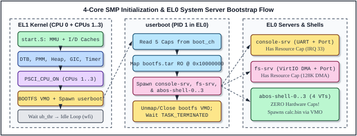

# 7 System Initialization (`lk_main` and Early Console)

Once `kernel/core/start.S` enables the ARMv8 MMU, activates the instruction and data caches, installs `VBAR_EL1`, sets up CPU 0's Higher-Half stack, and clears `.bss`, control transfers to C at `lk_main(uint64_t dtb_paddr)` in `kernel/core/main.c`. Like `init/main.c` (`start_kernel()`) in the Linux kernel — or `zircon/kernel/top/main.cc` (`lk_main()`) in Google's Zircon microkernel — this file is the grand junction where every subsystem of the microkernel comes to life in a deterministic, deadlock-free sequence.

Unlike a monolithic kernel, however, `lk_main()` does **not** mount block filesystems, initialize VirtIO storage queues, or run a command interpreter inside EL1. True to microkernel principles, ABOS's `lk_main()` brings up only the minimal hardware mechanisms (MMU, PMM, Heap, GICv2, 100 Hz Timer, and 4-core SMP scheduling), packages the `bootfs.tar` RAM disk into an immutable Virtual Memory Object (`bootfs_vmo`), synthesizes the root capability tree (`root_job`, `root_log`, `root_res`), and hands those capabilities across an IPC Channel to **`userboot`** — the first unprivileged EL0 process.

This chapter provides a complete line-by-line walkthrough of the two files that drive system initialization and early diagnostic output:
1. **`kernel/core/main.c`** (*Program 7-1*, 151 lines): Implements `psci_cpu_on()`, `arm64_secondary_entry()`, and `lk_main()`, orchestrating 4-core SMP bring-up, `bootfs.tar` VMO materialization + initrd physical page reclamation, and the capability handoff to `userboot`.
2. **`kernel/dev/debuglog.c`** (*Program 7-2*, 134 lines): Implements the Higher-Half `Periphmap` PL011 UART0 driver and the SMP/IRQ-safe `dprintf()` formatter used from line 1 of `lk_main()` through kernel panic diagnostics.

---

## 7.1 Main Functions

### Staged 4-Core SMP Initialization & EL0 Bootstrap Architecture



**Figure 7-1** captures the end-to-end handover from CPU 0's entry into `lk_main()` across the EL1→EL0 privilege boundary into `userboot` and the standalone system servers. Every initialization call in `lk_main()` is ordered to satisfy strict hardware and data-structure preconditions:

| Stage | Functions Invoked on CPU 0 (`lk_main`) | Precondition Satisfied / Architectural Effect |
| :---: | :--- | :--- |
| **1** | `dlog_init_early()`, `thread_init_early()` | `dlog_lock` and `current_threads[0..3]` (`idle_threads`) valid before first `dprintf()` |
| **2** | `mmu_init()`, `dtb_parse()`, `pmm_init()`, `heap_init()` | ASID 0 reserved; FDT scanned via `Physmap`; RAM arena wired/freed; 512 KB `kmalloc` heap ready |
| **3** | `gic_dist_init()`, `gic_cpu_init()`, `timer_init_percpu(100)` | Global GICv2 Distributor + CPU 0 interface + 100 Hz PPI 30 armed (`PSTATE.I` still masked!) |
| **4** | `psci_cpu_on(1..3, _start)` + `wfe` on `secondary_cpu_ready_count` | CPUs 1..3 run `start.S` → `arm64_secondary_entry()` → `thread_become_idle()` with IRQs live |
| **5** | `ab_{job,log,resource}_dispatcher_create()`, `bootfs_vmo` + `pmm_free_wired_range()` | Root capabilities minted; `bootfs.tar` copied into VMO; raw `-initrd` frames reclaimed to PMM |
| **6** | Spawn `userboot_proc`, `ab_channel_write(ch0, boot_h[5])`, `ab_process_start_user()` | 5 root capabilities queued on `ch1`; kernel drops local refs; `userboot-main` enters `READY` |
| **7** | `arch_enable_ints()`, wait for `ub_thr` `THREAD_DEATH`, `thread_become_idle()` | CPU 0 enables IRQs, schedules user threads alongside CPUs 1..3, and idles in `wfi` |

### PSCI Secondary CPU Wakeup and SMP Barrier Synchronization

On modern ARMv8 platforms (and QEMU `-M virt -smp 4`), secondary cores do not race blindly into bootloader code at power-on; instead, platform firmware holds CPUs 1..3 in a powered-off state until the primary OS kernel explicitly requests their activation via the **Power State Coordination Interface (PSCI)**.

In `main.c`, CPU 0 wakes each secondary core *only after* `pmm_init()`, `heap_init()`, and `gic_dist_init()` have completed on CPU 0. This ordering eliminates an entire class of early-boot races: by the time CPUs 1..3 reach `arm64_secondary_entry()`, the global GIC Distributor (`GICD_CTLR`), the physical page allocator, the kernel heap, and `idle_threads[1..3]` are already 100% initialized! Each secondary core initializes only its **banked per-CPU hardware** (`gic_cpu_init()` and `timer_init_percpu(100)`), increments `secondary_cpu_ready_count` with sequential consistency, broadcasts `sev`, and enters `thread_become_idle()`.

### `bootfs.tar` VMO Materialization and Zero-Waste Initrd Reclamation

In Lesson 20, the standalone EL0 binaries (`console-srv.bin`, `fs-srv.bin`, and `shell.bin`) are NOT linked into `kernel.img`. Instead, QEMU loads `image/bootfs.tar` into physical RAM via `-initrd`. `lk_main()` converts this raw bootloader memory image into a first-class capability-governed **Virtual Memory Object (`bootfs_vmo`)** in three steps:
1. During `pmm_init()`, the physical pages `[initrd_start, initrd_end)` are marked `VM_PAGE_STATE_WIRED` so neither `heap_init()` nor `ab_vmo_dispatcher_create()` can allocate over them.
2. `lk_main()` creates `bootfs_vmo`, names it `"bootfs.tar"`, and calls `ab_vmo_write(bootfs_vmo, paddr_to_physmap(initrd_start), 0, bootfs_sz)` to populate `VM_PAGE_STATE_OBJECT` pages managed by the VMO reference counter.
3. Immediately afterward (line 102), `lk_main()` calls `pmm_free_wired_range(boot_info.initrd_start, boot_info.initrd_end)`, returning every page of the raw bootloader initrd buffer back to `VM_PAGE_STATE_FREE`. Later, once `userboot` finishes spawning all system servers in EL0 and closes its `bootfs_h` handle (`userboot.c`), even `bootfs_vmo`'s own `OBJECT` pages are freed automatically!

---

## 7.2 `kernel/core/main.c`

### 7.2.1 Functional Description

`kernel/core/main.c` defines three functions (`psci_cpu_on`, `arm64_secondary_entry`, and `lk_main`) that bridge bare-metal kernel bring-up to capability-based user space.

Pay special attention to the **Bootstrap Capability Protocol** constructed in lines 106–139. Unlike UNIX `init` (which inherits open file descriptors `0, 1, 2` and ambient `uid == 0` root privileges), `userboot` starts in EL0 with **zero ambient authority** — its only connection to the outside world is a single handle (`ch1_h`) passed in register `x0`. Waiting inside `ch1_h`'s incoming message queue is a single 8-byte payload (`bootfs_sz_msg`) accompanied by **five transferred capability handles**:

| `boot_h` Index | Kernel Object | Handle Rights Granted to `userboot` | How `userboot` Uses / Delegates It |
| :---: | :--- | :--- | :--- |
| `boot_h[0]` | `root_job` (`AB_OBJ_TYPE_JOB`) | `AB_RIGHTS_DEFAULT_JOB` (includes `MANAGE_PROCESS`) | Spawns `console-srv`, `fs-srv`, `shell-0..3`; delegates to shells for `ps`/`vmaps`/`calc` |
| `boot_h[1]` | `root_log` (`AB_OBJ_TYPE_LOG`) | `AB_RIGHTS_DEFAULT_LOG` (`BASIC \| WRITE`) | Writes `[userboot]` logs; duplicates to `console-srv` and `fs-srv` |
| `boot_h[2]` | `root_res` (`AB_OBJ_TYPE_RESOURCE`) | `AB_RIGHTS_DEFAULT_RESOURCE` | Duplicated **only** to `console-srv` (UART MMIO/IRQ 33) and `fs-srv` (VirtIO MMIO/DMA); **withheld from shells!** |
| `boot_h[3]` | `ub_vmar` (`AB_OBJ_TYPE_VMAR`) | `AB_RIGHTS_DEFAULT_VMAR` | Maps `bootfs.tar` VMO read-only at `0x10000000` in `userboot`'s own address space, then unmaps it |
| `boot_h[4]` | `bootfs_vmo` (`AB_OBJ_TYPE_VMO`) | `AB_RIGHTS_BASIC \| READ \| MAP` (**no `WRITE`!**) | Parses USTAR headers in EL0 to extract `console-srv.bin`, `fs-srv.bin`, and `shell.bin`, then closes handle |

Equally important is the **reference-count hygiene** on lines 129–139 (`ab_object_release`). In ABOS's object model (Chapter 10), every `ab_object_t` tracks two atomic counters:
- `handle_count`: number of open user-space handles pointing to the object (or in-flight inside a Channel message packet).
- `ref_count`: total lifetime references (kernel C pointers + open/in-flight handles + parent/child links).

When `lk_main()` creates `root_job`, `bootfs_vmo`, `ch0`, `ch1`, etc., each `*_create()` call returns a pointer with `ref_count == 1, handle_count == 0`. Allocating a handle (`handle_alloc`) increments both to `ref_count == 2, handle_count == 1` (and `ab_channel_write` moves that handle reference into the queued `ab_message_packet_t` without dropping `ref_count` or `handle_count`). By calling `ab_object_release()` on lines 129–135 and 139, `lk_main()` drops its initial kernel C pointer reference (`ref_count` goes `2 -> 1`), transferring **100% of object lifetime ownership** to user space!

### 7.2.2 Heavily Commented Source Code
#### Program 7-1: `lesson_20/kernel/core/main.c`

<!-- ECLK_CODE_LISTING file="lesson_20/kernel/core/main.c" start="1" end="151" total="151" -->
```c
       //// kernel/core/main.c is the central initialization coordinator of the ABOS
       //// microkernel — directly analogous to zircon/kernel/top/main.cc (lk_main,
       //// inherited from Travis Geiselbrecht's Little Kernel) combined with
       //// zircon/kernel/lib/userabi/userboot.cc. Once start.S has enabled the
       //// Higher-Half MMU and zeroed .bss on CPU 0, lk_main() executes a strictly
       //// ordered bring-up sequence that transforms four bare ARMv8 cores into a
       //// capability-secure microkernel running standalone EL0 system servers.
   1 | /* =========================================================================
   2 |  * kernel/core/main.c - ABOS Lesson 20: Zircon-Style BOOTFS & Standalone Servers
   3 |  *
   4 |  * Initializes MMU, DTB, PMM, Heap, GICv2, Generic Timer, and Root Kernel
   5 |  * Objects (Job, Log, Resource, and BOOTFS VMO), then transitions to EL0
   6 |  * 'userboot' to load standalone console-srv.bin, fs-srv.bin, and shell.bin.
   7 |  * ========================================================================= */
       //// Include every subsystem interface touched during kernel bring-up: early UART
       //// logging, SMP spinlocks, trap handling, GICv2 + Generic Timer, DTB discovery,
       //// 3-tier memory management (PMM, Heap, MMU), preemptive threading/wait queues,
       //// Zircon-style Kernel Object Dispatchers, syscalls, and the userboot bootstrap
       //// protocol.
   8 | #include <stdint.h>
   9 | #include "debuglog.h"
  10 | #include "spinlock.h"
  11 | #include "exceptions.h"
  12 | #include "gic.h"
  13 | #include "timer.h"
  14 | #include "dtb.h"
  15 | #include "pmm.h"
  16 | #include "heap.h"
  17 | #include "mmu.h"
  18 | #include "thread.h"
  19 | #include "wait.h"
  20 | #include "object.h"
  21 | #include "syscalls.h"
  22 | #include "ipc_proto.h"
  23 | 
       //// Two external linker/assembly symbols with deliberately different address
       //// spaces, plus the SMP barrier counter:
       //// - _end[]: Exported at the end of linker.ld (line 64) at its Higher-Half VMA (0xFFFFFFFF801xxxxx). Passing physmap_to_paddr(_end) to pmm_init() tells the physical page allocator where static kernel memory + per-CPU boot stacks end in physical RAM.
       //// - _start(): Defined in start.S inside .idmap.text (VMA == LMA == 0x40080000). Because PSCI_CPU_ON starts secondary cores with their MMUs disabled, (uintptr_t)_start supplies the exact physical entry address 0x40080000!
       //// - secondary_cpu_ready_count: Atomically incremented by each secondary CPU (1, 2, 3) once its local GIC interface and 100 Hz timer are live.
  24 | extern char _end[];
  25 | extern void _start(void);
  26 | 
  27 | static volatile uint32_t secondary_cpu_ready_count = 0;
  28 | 
       //// psci_cpu_on(): Wakes a powered-off secondary Cortex-A53 core using ARM's Power
       //// State Coordination Interface (PSCI v0.2+, DEN0022D) over the SMC Calling
       //// Convention (SMCCC):
       //// - x0 = 0xC4000003UL: 64-bit Fast Call Function ID for PSCI_CPU_ON_SMC64 (bit 31 = 1 Fast Call, bit 30 = 1 64-bit convention, bits [29:24] = 4 Standard Secure Service, bits [15:0] = 0x0003 CPU_ON).
       //// - x1 = core_id: Target MPIDR affinity value (1, 2, or 3).
       //// - x2 = entry_point: Physical address (0x40080000 = _start) where the target core begins executing in EL1h/EL2 with MMU disabled.
       //// - x3 = 0: Opaque context_id placed into x0 of the waking core.
       //// - 'hvc #0' traps into QEMU's built-in virtual PSCI firmware handler (which operates at the hypervisor conduit when QEMU '-M virt' runs without EL3 secure world firmware) and returns 0 (PSCI_SUCCESS) in x0.
  29 | /* Issue PSCI_CPU_ON (0xC4000003) via HVC #0 to wake secondary cores */
  30 | static int psci_cpu_on(uint64_t core_id, uintptr_t entry_point) {
  31 |     register uint64_t x0 __asm__("x0") = 0xC4000003UL;
  32 |     register uint64_t x1 __asm__("x1") = core_id;
  33 |     register uint64_t x2 __asm__("x2") = (uint64_t)entry_point;
  34 |     register uint64_t x3 __asm__("x3") = 0;
  35 |     __asm__ volatile("hvc #0" : "+r"(x0), "+r"(x1), "+r"(x2), "+r"(x3) :: "memory");
  36 |     return (int)x0;
  37 | }
  38 | 
       //// arm64_secondary_entry(): C entry point for Secondary CPUs 1, 2, and 3 (invoked
       //// from .Lhigh_secondary in start.S after each core has enabled its MMU,
       //// installed VBAR_EL1, and switched to its dedicated 8 KB stack):
       //// 1. thread_secondary_cpu_init(): Binds current_threads[cpu_num] =
       //// &idle_threads[cpu_num].
       //// 2. gic_cpu_init(): Enables this core's banked GICv2 CPU Interface (GICC_PMR =
       //// 0xFF, GICC_CTLR = 1) at 0xFFFFFFFFC8010000.
       //// 3. timer_init_percpu(100): Programs this core's private ARMv8 physical timer
       //// for 100 Hz (10 ms) ticks and unmasks banked PPI 30 in GICD_ISENABLER[0].
       //// 4. Atomically increments secondary_cpu_ready_count (__ATOMIC_SEQ_CST) and
       //// executes 'sev' to wake CPU 0 out of its 'wfe' barrier loop on line 77.
       //// 5. Calls thread_become_idle(), which unmasks local IRQs ('msr daifclr, #2')
       //// and immediately makes this CPU eligible to pick up READY user/kernel threads
       //// from thread_table!
  39 | void arm64_secondary_entry(uint32_t cpu_num) {
  40 |     thread_secondary_cpu_init();
  41 |     gic_cpu_init();
  42 |     timer_init_percpu(100);
  43 |     dprintf(INFO, "[cpu %u] secondary scheduler active (EL%u)\n",
  44 |             cpu_num, arch_boot_get_el());
  45 |     __atomic_fetch_add(&secondary_cpu_ready_count, 1, __ATOMIC_SEQ_CST);
  46 |     __asm__ volatile("sev");
  47 |     thread_become_idle();
  48 | }
  49 | 
       //// lk_main(uint64_t dtb_paddr): Primary bootstrap sequence on CPU 0.
       //// Notice the ordering of lines 51-52 BEFORE the very first dprintf():
       //// - dlog_init_early() zeroes dlog_lock.value so spin_lock_irqsave(&dlog_lock, ...) inside dprintf() cannot hang on uninitialized state.
       //// - thread_init_early() populates idle_threads[0..3] and current_threads[0..3] so get_current_thread() is immediately valid on CPU 0.
  50 | void lk_main(uint64_t dtb_paddr) {
  51 |     dlog_init_early();
  52 |     thread_init_early();
  53 | 
  54 |     dprintf(INFO, "\n==================================================================\n");
  55 |     dprintf(INFO, "Welcome to ABOS (Zircon-Style Microkernel)\n");
  56 |     dprintf(INFO, "Lesson 20: Standalone EL0 System Servers via Zircon-Style BOOTFS\n");
  57 |     dprintf(INFO, "==================================================================\n");
  58 | 
       //// Stage 2 — Bring up the three-tier memory subsystem in strict dependency order:
       //// 1. mmu_init(): Reserves ASID 0 for kernel/idle threads and logs active
       //// SCTLR_EL1/TCR_EL1/TTBR1_EL1 registers.
       //// 2. dtb_parse(dtb_paddr, &boot_info): Walks the FDT via Physmap to learn RAM
       //// size, DTB bounds, and QEMU's '-initrd image/bootfs.tar' physical range
       //// [initrd_start, initrd_end).
       //// 3. pmm_init(...): Initializes page_array[] across physical RAM, marking
       //// [0x40000000 .. _end), the DTB, and the initrd as VM_PAGE_STATE_WIRED so none
       //// of them can be overwritten, and links all remaining frames onto the free list.
       //// 4. heap_init(): Allocates 128 contiguous pages (512 KB) from PMM to initialize
       //// kmalloc() / kzalloc() / kfree().
  59 |     mmu_init();
  60 |     boot_info_t boot_info;
  61 |     dtb_parse(dtb_paddr, &boot_info);
  62 |     pmm_init(boot_info.ram_base, boot_info.ram_size, physmap_to_paddr(_end),
  63 |              boot_info.dtb_paddr, boot_info.dtb_size,
  64 |              boot_info.initrd_start, boot_info.initrd_end);
  65 |     heap_init();
  66 | 
       //// Stage 3 — Initialize interrupt routing and timekeeping on CPU 0:
       //// - gic_dist_init() resets and enables the global GICv2 Distributor (run ONCE by CPU 0).
       //// - gic_cpu_init() enables CPU 0's local banked GIC CPU Interface.
       //// - timer_init_percpu(100) arms CPU 0's 100 Hz monotonic tick on PPI 30.
       //// Crucially, CPU 0's PSTATE.I bit is STILL masked (from start.S), so no timer
       //// IRQ actually vectors on CPU 0 until arch_enable_ints() at line 141 — allowing
       //// CPU 0 to finish constructing root objects and userboot without preemption
       //// races.
  67 |     gic_dist_init();
  68 |     gic_cpu_init();
  69 |     timer_init_percpu(100);
  70 | 
       //// Stage 4 — Symmetric Multiprocessing (SMP) bring-up of CPUs 1..3:
       //// CPU 0 loops over cpu = 1, 2, 3 issuing psci_cpu_on(cpu, (uintptr_t)_start),
       //// then waits in a low-power 'wfe' loop using an acquire-load (__ATOMIC_ACQUIRE)
       //// on secondary_cpu_ready_count until all 3 secondary cores have completed
       //// arm64_secondary_entry(). Pairing CPU 1..3's __ATOMIC_SEQ_CST increment + 'sev'
       //// (lines 45-46) with CPU 0's __ATOMIC_ACQUIRE load + 'wfe' guarantees zero lost
       //// wakeups and full memory visibility across all four cores.
  71 |     dprintf(INFO, "[smp] Booting secondary CPUs (1..%u) via PSCI_CPU_ON...\n",
  72 |             SMP_MAX_CPUS - 1);
  73 |     for (uint32_t cpu = 1; cpu < SMP_MAX_CPUS; cpu++) {
  74 |         psci_cpu_on(cpu, (uintptr_t)_start);
  75 |     }
  76 |     while (__atomic_load_n(&secondary_cpu_ready_count, __ATOMIC_ACQUIRE) < (SMP_MAX_CPUS - 1)) {
  77 |         __asm__ volatile("wfe");
  78 |     }
  79 |     dprintf(INFO, "[smp] All %u CPUs online and scheduling in EL1!\n", SMP_MAX_CPUS);
  80 | 
       //// Stage 5a — Mint the three sovereign Root Kernel Capabilities (modeled after
       //// Zircon's root JobDispatcher, DebugLogDispatcher, and root ResourceDispatcher):
       //// - root_job (koid=2): Top of the ABOS task tree; authorizes process creation and 'ps'/'vmaps' system introspection.
       //// - root_log (koid=3): Authorizes EL0 processes to write structured diagnostic lines via sys_debuglog_write.
       //// - root_res (koid=4): Sovereign hardware driver authority required by sys_vmo_create_physical, sys_vmo_create_contiguous (VirtIO DMA), and sys_interrupt_create (UART IRQ 33). Regular apps like shell.bin and calc.bin NEVER receive root_res!
  81 |     ab_object_t *root_job = NULL, *root_log = NULL, *root_res = NULL;
  82 |     ab_job_dispatcher_create(&root_job);
  83 |     ab_log_dispatcher_create(0, &root_log);
  84 |     ab_resource_dispatcher_create(0, &root_res);
  85 | 
       //// Stage 5b — Materialize the Zircon-style BOOTFS VMO and reclaim raw initrd RAM:
       //// 1. Verify QEMU supplied '-initrd image/bootfs.tar' (initrd_end >
       //// initrd_start); panic with an actionable message if missing.
       //// 2. Convert boot_info.initrd_start to its Higher-Half Physmap virtual address
       //// (bootfs_kva) and allocate a page-backed VMO (bootfs_vmo) of bootfs_sz bytes,
       //// naming it "bootfs.tar" for 'vmaps' diagnostics.
       //// 3. ab_vmo_write(bootfs_vmo, bootfs_kva, 0, bootfs_sz) allocates fresh
       //// VM_PAGE_STATE_OBJECT physical pages inside bootfs_vmo and copies the USTAR
       //// archive into them.
       //// 4. pmm_free_wired_range(boot_info.initrd_start, boot_info.initrd_end)
       //// immediately un-wires the bootloader's original initrd physical pages and
       //// returns them to the PMM FREE pool! Zero kilobytes of physical RAM are wasted
       //// holding duplicate copies of bootfs.tar.
  86 |     /* Create BOOTFS VMO from the QEMU -initrd RAM disk discovered via DTB */
  87 |     if (boot_info.initrd_end <= boot_info.initrd_start) {
  88 |         dprintf(CRITICAL, "[bootfs] PANIC: No BOOTFS initrd found in DTB! Pass -initrd image/bootfs.tar to QEMU.\n");
  89 |         for (;;) __asm__ volatile("wfe");
  90 |     }
  91 |     size_t bootfs_sz = (size_t)(boot_info.initrd_end - boot_info.initrd_start);
  92 |     const void *bootfs_kva = paddr_to_physmap(boot_info.initrd_start);
  93 |     ab_object_t *bootfs_vmo = NULL;
  94 |     if (ab_vmo_dispatcher_create(bootfs_sz, 0, &bootfs_vmo) != AB_OK || !bootfs_vmo) {
  95 |         dprintf(CRITICAL, "[bootfs] PANIC: Failed to create BOOTFS VMO (%lu bytes)!\n",
  96 |                 (unsigned long)bootfs_sz);
  97 |         for (;;) __asm__ volatile("wfe");
  98 |     }
  99 |     ab_object_set_name(bootfs_vmo, "bootfs.tar", 10);
 100 |     ab_vmo_write(bootfs_vmo, bootfs_kva, 0, bootfs_sz);
 101 |     /* Reclaim the bootloader initrd physical pages now that BOOTFS is in its VMO */
 102 |     pmm_free_wired_range(boot_info.initrd_start, boot_info.initrd_end);
 103 |     dprintf(INFO, "[bootfs] Created BOOTFS VMO (koid=%lu, %lu bytes from initrd PA %p) for userboot\n",
 104 |             bootfs_vmo->koid, (unsigned long)bootfs_sz, (void *)boot_info.initrd_start);
 105 | 
       //// Stage 6a — Construct the 'userboot' EL0 root bootstrap process (PID 1
       //// equivalent):
       //// - ab_process_create_kernel("userboot", ab_alloc_asid()) allocates userboot_proc along with its own 3-level TTBR0_EL1 address space (VmAspace) and hardware ASID 1.
       //// - ab_job_add_process() attaches userboot_proc under root_job so 'ps' displays the complete task hierarchy.
       //// - ab_vmar_dispatcher_create() creates userboot's root Virtual Memory Address Region [0x10000000 .. 0x40000000).
       //// - ab_thread_dispatcher_create() creates the initial ThreadDispatcher ("userboot-main").
       //// - ab_channel_dispatcher_create(&ch0, &ch1) creates the entangled bidirectional bootstrap IPC channel pair: kernel writes into ch0, and userboot reads from ch1!
 106 |     ab_process_t *userboot_proc = ab_process_create_kernel("userboot", ab_alloc_asid());
 107 |     ab_job_add_process((ab_job_dispatcher_t *)root_job, userboot_proc);
 108 |     ab_object_t *ub_vmar = NULL;
 109 |     ab_vmar_dispatcher_create(userboot_proc, &ub_vmar);
 110 |     ab_object_t *ub_thr = NULL;
 111 |     ab_thread_dispatcher_create(userboot_proc, "userboot-main", &ub_thr);
 112 | 
 113 |     ab_object_t *ch0 = NULL, *ch1 = NULL;
 114 |     ab_channel_dispatcher_create(&ch0, &ch1);
 115 | 
       //// Stage 6b — Enforce Principle of Least Privilege on handles minted into
       //// userboot_proc:
       //// Look closely at bootfs_ro_rights on line 116:
       ////   AB_RIGHTS_BASIC | AB_RIGHT_READ | AB_RIGHT_MAP  (AB_RIGHT_WRITE is intentionally OMITTED!)
       //// Even userboot — the first process in user space — receives only READ + MAP +
       //// DUPLICATE/TRANSFER rights to bootfs_vmo, making it architecturally impossible
       //// for any EL0 component to corrupt the shared system server binaries!
       //// Lines 118-123 install 6 handles into userboot_proc's handle table:
       //// - job_h, log_h, res_h, ub_vmar_h, bootfs_h: staged temporarily so ab_channel_write() can package them into the bootstrap channel message.
       //// - ch1_h: remains in userboot_proc's handle table and is passed directly to userboot_entry(ch1_h) in register x0!
 116 |     ab_rights_t bootfs_ro_rights = AB_RIGHTS_BASIC | AB_RIGHT_READ | AB_RIGHT_MAP;
 117 |     ab_handle_t job_h = 0, log_h = 0, res_h = 0, ub_vmar_h = 0, bootfs_h = 0, ch1_h = 0;
 118 |     handle_alloc(userboot_proc, root_job,   AB_RIGHTS_DEFAULT_JOB,      &job_h);
 119 |     handle_alloc(userboot_proc, root_log,   AB_RIGHTS_DEFAULT_LOG,      &log_h);
 120 |     handle_alloc(userboot_proc, root_res,   AB_RIGHTS_DEFAULT_RESOURCE, &res_h);
 121 |     handle_alloc(userboot_proc, ub_vmar,    AB_RIGHTS_DEFAULT_VMAR,     &ub_vmar_h);
 122 |     handle_alloc(userboot_proc, bootfs_vmo, bootfs_ro_rights,           &bootfs_h);
 123 |     handle_alloc(userboot_proc, ch1,        AB_RIGHTS_DEFAULT_CHANNEL,  &ch1_h);
 124 | 
       //// Stage 6c — Enqueue the 5-handle bootstrap message onto userboot's channel:
       //// Calling ab_channel_write(userboot_proc, ch0, &bootfs_sz_msg,
       //// sizeof(bootfs_sz_msg), boot_h, 5) performs a genuine capability transfer:
       //// - It atomically removes job_h, log_h, res_h, ub_vmar_h, and bootfs_h from userboot_proc's handle table (via handle_take_for_transfer) and parks their underlying Dispatcher pointers + rights masks inside an ab_message_packet_t queued on peer endpoint ch1, alongside the 8-byte bootfs_sz_msg payload.
       //// - When userboot starts in EL0 and invokes sys_channel_read(ch1_h, ...), those 5 capabilities are reinstalled cleanly into userboot's handle table in exact index order [0..4]!
 125 |     ab_handle_t boot_h[5] = { job_h, log_h, res_h, ub_vmar_h, bootfs_h };
 126 |     uint64_t bootfs_sz_msg = (uint64_t)bootfs_sz;
 127 |     ab_channel_write(userboot_proc, ch0, &bootfs_sz_msg, sizeof(bootfs_sz_msg), boot_h, 5);
 128 | 
       //// Drop all 7 temporary kernel-side C pointer references (ref_count--):
       //// When each Dispatcher was created on lines 82-114, its ref_count started at 1
       //// (for the kernel C pointer). Installing handles incremented ref_count (and
       //// handle_count) a second time. Releasing these 7 kernel pointers here ensures
       //// that once user-space processes eventually close their handles (for example,
       //// when userboot unmaps and closes bootfs_vmo after spawning console-srv, fs-srv,
       //// and shell!), ref_count drops to 0 and the kernel reclaims the underlying
       //// memory automatically!
       //// Notice also that releasing ch0 (which had 0 user handles) destroys endpoint
       //// ch0 and asserts AB_SIGNAL_PEER_CLOSED alongside AB_SIGNAL_READABLE on ch1 —
       //// matching Zircon's exact one-shot bootstrap channel semantics.
 129 |     ab_object_release(root_job);
 130 |     ab_object_release(root_log);
 131 |     ab_object_release(root_res);
 132 |     ab_object_release(ub_vmar);
 133 |     ab_object_release(bootfs_vmo);
 134 |     ab_object_release(ch0);
 135 |     ab_object_release(ch1);
 136 | 
       //// Launch userboot in EL0 user mode!
       //// - USER_KVA_TO_UVA(userboot_entry) subtracts 0xFFFFFFFF80000000 from userboot_entry's Higher-Half address, yielding its low TTBR0_EL1 virtual address (< 0x20000000).
       //// - Passing caller_proc = NULL tells ab_process_start_user() that ch1_h is already installed in userboot_proc's handle table (no cross-process handle move needed) and places ch1_h into userboot's initial x0 argument register.
       //// - Line 139 releases lk_main's local reference to userboot_proc (root_job and ub_thr still hold references while userboot runs).
 137 |     ab_process_start_user(NULL, userboot_proc, (ab_thread_dispatcher_t *)ub_thr,
 138 |                           USER_KVA_TO_UVA(userboot_entry), 0, ch1_h, 0);
 139 |     ab_object_release(&userboot_proc->base);
 140 | 
       //// Stage 7 — Enable interrupts on CPU 0 and supervise system lifecycle:
       //// - arch_enable_ints() clears PSTATE.I ('msr daifclr, #2'), allowing the 100 Hz timer tick and peripheral IRQs to run on CPU 0.
       //// - While userboot-main (ub_thr) remains alive (waiting in EL0 for shell/server termination), CPU 0 yields the scheduler and sleeps in low-power Wait-For-Interrupt ('wfi') whenever no READY threads need CPU 0.
       //// - If all shells exit / shut down and userboot terminates (kthread->state == THREAD_DEATH), CPU 0 releases ub_thr (detaching its kernel thread for reaping), prints the completion banner, and permanently joins CPUs 1..3 in thread_become_idle().
 141 |     arch_enable_ints();
 142 |     while (((ab_thread_dispatcher_t *)ub_thr)->kthread &&
 143 |            ((ab_thread_dispatcher_t *)ub_thr)->kthread->state != THREAD_DEATH) {
 144 |         thread_yield();
 145 |         __asm__ volatile("wfi");
 146 |     }
 147 |     ab_object_release(ub_thr);
 148 | 
 149 |     dprintf(INFO, "[lk_main] ABOS Lesson 20 complete!\n");
 150 |     thread_become_idle();
 151 | }
```
### 7.2.3 Technical Notes

1. **Why `psci_cpu_on()` Uses `hvc #0` Rather Than `smc #0` on QEMU `virt`**:
   According to ARM's PSCI and SMCCC specifications, an OS running in Non-Secure EL1 invokes PSCI services either via `smc #0` (Secure Monitor Call, trapping to EL3 Trusted Firmware-A when `secure=on` is present) or via `hvc #0` (Hypervisor Call, when booted under a hypervisor or QEMU's default `virt` machine where EL2/EL3 firmware is emulated directly by QEMU). If you inspect QEMU's generated FDT `/psci` node (`method = "hvc"`), QEMU configures `hvc #0` as the standard PSCI conduit whenever `-M virt` is invoked without `-M secure=on`. Notice also the explicit GCC register-asm bindings (`register uint64_t x0 __asm__("x0") = ...`) on lines 31–35: this guarantees the compiler places the four SMCCC arguments in `x0..x3` even at `-O0` or `-O2` without an external assembly stub.

2. **Why `userboot` Executes Embedded Code via `USER_KVA_TO_UVA(userboot_entry)`**:
   How does the very first EL0 process (`userboot`) get loaded without putting an ELF/USTAR loader inside the EL1 kernel? ABOS borrows Zircon's classic `userboot` bootstrap trick (`zircon/kernel/lib/userabi/userboot`):
   - `user/userboot/userboot.c` is compiled as position-independent/self-contained C code using only `svc #0` syscalls and linked into the kernel binary inside `[_text_start, _rodata_end)`.
   - Its kernel symbol `userboot_entry` has a Higher-Half VMA `0xFFFFFFFF8008xxxx`, which is unacceptable in EL0 (where only `TTBR0_EL1` addresses `< 0x80000000` are accessible).
   - `USER_KVA_TO_UVA(kva)` subtracts `0xFFFFFFFF80000000ULL`, yielding low user VA `0x0008xxxx`. Inside `user_thread_trampoline()` (`kernel/core/object.c` lines 1503–1510), when `td->user_entry < 0x20000000ULL` (true *only* for `userboot`; all standalone `.bin` servers link at `0x20000000`!), the kernel maps physical frames `[_text_start .. _rodata_end)` into `userboot`'s `VmAspace` with `USER | READ | EXECUTE` permissions (**never `WRITE`**!). Every subsequent process (`console-srv`, `fs-srv`, `shell`, `calc`) is loaded purely in EL0 by `userboot` or `shell` into fresh private VMOs at `0x20000000`, with zero kernel code mapped into their address spaces!

3. **Why CPU 0 Keeps Interrupts Masked Until Line 141 (`arch_enable_ints`)**:
   Observe that `timer_init_percpu(100)` runs on CPU 0 at line 69, yet `arch_enable_ints()` is deferred until line 141 — *after* `ab_process_start_user()` has placed `userboot-main` onto the scheduler run queue! Meanwhile, Secondary CPUs 1..3 already enabled their interrupts inside `thread_become_idle()` at line 47. Deferring `arch_enable_ints()` on CPU 0 guarantees that `lk_main()` executes deterministically on its boot stack without timer preemption while setting up root capabilities; in fact, on a 4-core machine, one of CPUs 1..3 often picks up `userboot-main` and begins executing EL0 `userboot` within microseconds of `thread_resume(kt)` inside `ab_process_start_user()` on line 137!

---

## 7.3 `kernel/dev/debuglog.c`

### 7.3.1 Functional Description

`kernel/dev/debuglog.c` provides ABOS's lowest-level text output engine. Because it relies solely on the static 1 GB Higher-Half `Periphmap` block descriptor installed by `start.S` (`kernel_table[1]`: `VA 0xFFFFFFFFC0000000 -> PA 0x00000000`), `debuglog.c` requires **no dynamic page tables, no PMM pages, no heap memory, and no interrupts**. It works identically at line 54 of `lk_main()`, inside `arm64_secondary_entry()` across 4 concurrent CPUs, inside demand-paging fault handlers, and inside terminal `[PANIC]` dumps when the kernel has halted.

```text
  Caller (CPU 0..3 in EL1 or sys_debuglog_write)
       |
       v
  dprintf(level, fmt, ...)
       |-- if (level > KERNEL_LOG_LEVEL) return;
       |-- spin_lock_irqsave(&dlog_lock, &state)   [Masks DAIF.I + acquires ticket/exclusives]
       |-- Parse %s, %c, %d/%ld, %u/%lu, %x/%lx, %p
       |     +-- print_int / print_uint (24-byte stack buffer, zero heap!)
       |           +-- uart_putc(c)
       |                 |-- if (c == '
') poll TXFF -> UART_DR = '
'
       |                 +-- poll (UART_FR & UART_FR_TXFF) -> UART_DR = c
       +-- spin_lock_irqrestore(&dlog_lock, state) [Releases lock + restores prior DAIF]
```

The hardware interface targets the ARM PrimeCell **PL011 UART0** controller wired at physical address `0x09000000` on QEMU's `virt` board:

| Macro | Virtual Address | Offset | Width | Hardware Role |
| :--- | :--- | :---: | :---: | :--- |
| `PL011_UART0_VA` | `0xFFFFFFFFC9000000` | — | — | Base VA (`KERNEL_PERIPHMAP_OFFSET + 0x09000000`) |
| `UART_DR` | `0xFFFFFFFFC9000000` | `+0x00` | 32-bit | Data Register (`bits[7:0]` = TX/RX byte) |
| `UART_FR` | `0xFFFFFFFFC9000018` | `+0x18` | 32-bit | Flag Register (`bit 5` = `TXFF`, Transmit FIFO Full) |

Note why `debuglog.c` does not need to program baud-rate divisors (`UARTIBRD`/`UARTFBRD`) or line control (`UARTLCR_H`) in `dlog_init_early()`: QEMU's `-M virt` machine initializes PL011 UART0 out of reset with TX and RX enabled in 8N1 FIFO mode, ready to accept writes to `UART_DR` immediately.

### 7.3.2 Heavily Commented Source Code
#### Program 7-2: `lesson_20/kernel/dev/debuglog.c`

<!-- ECLK_CODE_LISTING file="lesson_20/kernel/dev/debuglog.c" start="1" end="134" total="134" -->
```c
       //// kernel/dev/debuglog.c implements ABOS's early and runtime kernel diagnostic
       //// console over the ARM PrimeCell PL011 UART0 peripheral. It serves two callers
       //// throughout system lifetime:
       //// 1. EL1 kernel subsystems calling dprintf(level, fmt, ...) during boot, demand
       //// paging, fault isolation, or kernel panics.
       //// 2. EL0 user processes invoking sys_debuglog_write(log_handle, buf, len)
       //// (backed by a LogDispatcher capability) for atomic line logging.
   1 | /* =========================================================================
   2 |  * debuglog.c - Higher-Half Periphmap PL011 UART & Interrupt-Safe dprintf
   3 |  * ========================================================================= */
   4 | #include "debuglog.h"
   5 | #include "spinlock.h"
   6 | #include "mmu.h"
   7 | #include <stdarg.h>
   8 | 
       //// Map PL011 UART0 registers via the Higher-Half Periphmap window established by
       //// kernel_table[1] in start.S:
       //// - Physical address on QEMU 'virt': 0x09000000.
       //// - Virtual address: KERNEL_PERIPHMAP_OFFSET (0xFFFFFFFFC0000000) + 0x09000000 = 0xFFFFFFFFC9000000 (mapped as 1 GB Device-nGnRnE, PXN, UXN).
       //// - UART_DR (+0x00, Data Register): Writing bits [7:0] pushes one byte into the 16/32-byte hardware TX FIFO.
       //// - UART_FR (+0x18, Flag Register): Bit 5 (UART_FR_TXFF = 1 << 5) reads as 1 when the hardware Transmit FIFO is full and 0 when space is available.
       //// Note the mandatory 'volatile' qualifier so the C compiler never elides,
       //// caches, or reorders MMIO register reads/writes.
   9 | #define PL011_UART0_VA   (KERNEL_PERIPHMAP_OFFSET + 0x09000000ULL)
  10 | #define UART_DR          (*(volatile uint32_t *)(PL011_UART0_VA + 0x00))
  11 | #define UART_FR          (*(volatile uint32_t *)(PL011_UART0_VA + 0x18))
  12 | #define UART_FR_TXFF     (1U << 5)
  13 | 
       //// Global IRQ-safe spinlock serializing multi-core console output:
       //// Without dlog_lock, concurrent dprintf() calls from CPUs 0, 1, 2, and 3 during
       //// SMP bring-up or preemptive scheduling would interleave character-by-character
       //// on the serial port (e.g., '[cpu [cpu 1] 2] sec...'). dlog_init_early()
       //// explicitly resets dlog_lock.value = 0 at the top of lk_main().
  14 | static spin_lock_t dlog_lock = SPIN_LOCK_INITIAL_VALUE;
  15 | 
  16 | void dlog_init_early(void) {
  17 |     dlog_lock.value = 0;
  18 | }
  19 | 
       //// uart_putc(): Polled single-character transmit routine.
       //// - Standard UNIX/C strings end lines with LF ('\n', 0x0A), whereas raw serial terminals (including QEMU '-serial mon:stdio' in raw mode) require CRLF ('\r\n', 0x0D 0x0A) to return the cursor to column 0 before advancing down one row. Lines 21-24 automatically inject '\r' ahead of every '\n'.
       //// - Each byte write busy-waits on (UART_FR & UART_FR_TXFF) so no character is ever dropped even on slow physical baud rates.
  20 | void uart_putc(char c) {
  21 |     if (c == '\n') {
  22 |         while (UART_FR & UART_FR_TXFF) { }
  23 |         UART_DR = '\r';
  24 |     }
  25 |     while (UART_FR & UART_FR_TXFF) { }
  26 |     UART_DR = (uint32_t)c;
  27 | }
  28 | 
       //// uart_puts(): Emits a NUL-terminated C string sequentially through uart_putc().
       //// Note that callers requiring multi-CPU atomicity (such as dprintf and
       //// sys_debuglog_write) acquire dlog_lock around the entire message rather than
       //// per character.
  29 | void uart_puts(const char *s) {
  30 |     while (*s) {
  31 |         uart_putc(*s++);
  32 |     }
  33 | }
  34 | 
       //// print_uint(): Converts an unsigned 64-bit integer into ASCII in base 10 or
       //// base 16 with minimum field width and padding character, using zero heap
       //// memory:
       //// - Why 24 bytes for 'char buf[24]'? The maximum 64-bit unsigned value (UINT64_MAX = 18,446,744,073,709,551,615) requires 20 decimal digits (or 16 hex digits), fitting comfortably inside 24 stack bytes.
       //// - Modulo/division extracts digits least-significant-first into buf[0..i-1], appends 'pad' characters ('0' or ' ') up to 'width', and then flushes buf[--i] in reverse (most-significant-first) order.
  35 | static void print_uint(uint64_t val, int base, int width, char pad) {
  36 |     char buf[24];
  37 |     const char *digits = "0123456789abcdef";
  38 |     int i = 0;
  39 | 
  40 |     if (val == 0) {
  41 |         buf[i++] = '0';
  42 |     } else {
  43 |         while (val > 0) {
  44 |             buf[i++] = digits[val % (uint64_t)base];
  45 |             val /= (uint64_t)base;
  46 |         }
  47 |     }
  48 |     while (i < width) {
  49 |         buf[i++] = pad;
  50 |     }
  51 |     while (i > 0) {
  52 |         uart_putc(buf[--i]);
  53 |     }
  54 | }
  55 | 
       //// print_int(): Formats a signed 64-bit integer in base 10.
       //// Notice the subtle unsigned subtraction idiom on line 59:
       ////   0ULL - (uint64_t)val
       //// In C, writing '-val' when val == INT64_MIN (-9223372036854775808) triggers
       //// Undefined Behavior (signed integer overflow, because +9223372036854775808
       //// cannot be represented in int64_t!). Casting val to uint64_t and computing
       //// '0ULL - (uint64_t)val' performs well-defined modulo-2^64 arithmetic, yielding
       //// the exact unsigned magnitude 0x8000000000000000ULL (9223372036854775808)
       //// cleanly.
  56 | static void print_int(int64_t val) {
  57 |     if (val < 0) {
  58 |         uart_putc('-');
  59 |         print_uint(0ULL - (uint64_t)val, 10, 0, ' ');
  60 |     } else {
  61 |         print_uint((uint64_t)val, 10, 0, ' ');
  62 |     }
  63 | }
  64 | 
       //// dprintf(int level, const char *fmt, ...): Zircon-style leveled kernel printf.
       //// - Log levels in include/debuglog.h: CRITICAL (0), ALWAYS (0), INFO (1), SPEW (2). Any call with level > KERNEL_LOG_LEVEL returns immediately before touching va_start or acquiring dlog_lock.
       //// - CRITICAL SMP + IRQ INVARIANT (lines 72-73): dprintf() MUST use spin_lock_irqsave(&dlog_lock, &state) rather than bare arch_spin_lock(&dlog_lock)! Suppose CPU 0 held dlog_lock with interrupts enabled, and the 100 Hz timer IRQ or a synchronous exception fired on CPU 0 whose handler also called dprintf(): CPU 0 would spin forever waiting for itself to release dlog_lock! Masking local IRQs in DAIF before acquiring dlog_lock eliminates same-CPU re-entrancy deadlock completely.
  65 | void dprintf(int level, const char *fmt, ...) {
  66 |     if (level > KERNEL_LOG_LEVEL) {
  67 |         return;
  68 |     }
  69 |     va_list args;
  70 |     va_start(args, fmt);
  71 | 
  72 |     spin_lock_saved_state_t state;
  73 |     spin_lock_irqsave(&dlog_lock, &state);
  74 | 
       //// Format string parser loop:
       //// - Ordinary characters (fmt[0] != '%') stream straight to uart_putc().
       //// - After consuming '%', lines 82-86 check for an optional 'l' length modifier (is_long = 1), supporting both 32-bit (%d, %i, %u, %x) and 64-bit (%ld, %li, %lu, %lx) integer arguments seamlessly on LP64 AArch64 (where sizeof(long) == sizeof(uint64_t) == 8).
  75 |     while (*fmt) {
  76 |         if (*fmt != '%') {
  77 |             uart_putc(*fmt++);
  78 |             continue;
  79 |         }
  80 |         fmt++;
  81 | 
  82 |         int is_long = 0;
  83 |         if (*fmt == 'l') {
  84 |             is_long = 1;
  85 |             fmt++;
  86 |         }
  87 | 
       //// Format specifier dispatch table:
       //// - '%s': Prints string pointer, substituting "(null)" if the caller passed NULL so a debug print never triggers an EL1 Data Abort!
       //// - '%c': Extracts 'int' from va_arg (because C's default argument promotions widen char/short variadic arguments to 'int') before casting back to char.
       //// - '%d' / '%i': Signed decimal (int64_t if is_long, else 32-bit int sign-extended to int64_t).
       //// - '%u': Unsigned decimal (uint64_t if is_long, else 32-bit unsigned int).
       //// - '%x': Lowercase unpadded hexadecimal.
       //// - '%p': Pointer formatted canonically as "0x" followed by 16 zero-padded hex digits (e.g., 0xffffffff80083000), making kernel Higher-Half vs EL0 user addresses visually unmistakable in boot logs and crash dumps.
       //// - '%%' & default: Escaped literal percent or verbatim unknown '%<char>' passthrough.
  88 |         switch (*fmt) {
  89 |             case 's': {
  90 |                 const char *s = va_arg(args, const char *);
  91 |                 uart_puts(s ? s : "(null)");
  92 |                 break;
  93 |             }
  94 |             case 'c': {
  95 |                 char c = (char)va_arg(args, int);
  96 |                 uart_putc(c);
  97 |                 break;
  98 |             }
  99 |             case 'd':
 100 |             case 'i': {
 101 |                 int64_t v = is_long ? va_arg(args, int64_t) : va_arg(args, int);
 102 |                 print_int(v);
 103 |                 break;
 104 |             }
 105 |             case 'u': {
 106 |                 uint64_t v = is_long ? va_arg(args, uint64_t) : va_arg(args, unsigned int);
 107 |                 print_uint(v, 10, 0, ' ');
 108 |                 break;
 109 |             }
 110 |             case 'x': {
 111 |                 uint64_t v = is_long ? va_arg(args, uint64_t) : va_arg(args, unsigned int);
 112 |                 print_uint(v, 16, 0, ' ');
 113 |                 break;
 114 |             }
 115 |             case 'p': {
 116 |                 uint64_t v = (uint64_t)(uintptr_t)va_arg(args, void *);
 117 |                 uart_puts("0x");
 118 |                 print_uint(v, 16, 16, '0');
 119 |                 break;
 120 |             }
 121 |             case '%':
 122 |                 uart_putc('%');
 123 |                 break;
 124 |             default:
 125 |                 uart_putc('%');
 126 |                 uart_putc(*fmt);
 127 |                 break;
 128 |         }
 129 |         fmt++;
 130 |     }
 131 | 
       //// Release dlog_lock and restore the caller's exact prior interrupt mask (DAIF)
       //// via spin_lock_irqrestore(). Because spin_lock_irqsave saved DAIF rather than
       //// blindly re-enabling interrupts on unlock, calling dprintf() early in lk_main()
       //// (while interrupts are still intentionally masked!) leaves PSTATE.I masked on
       //// return.
 132 |     spin_lock_irqrestore(&dlog_lock, state);
 133 |     va_end(args);
 134 | }
```
### 7.3.3 Technical Notes

1. **Coexistence of EL1 `debuglog.c` and EL0 `console-srv` on PL011 UART0**:
   In Lesson 20, both the kernel (`debuglog.c`) and the user-space Console Server (`user/drivers/console_srv.c`, mapped via `sys_vmo_create_physical` at `PA 0x09000000`) access PL011 UART0. How do they coexist cleanly without corrupting hardware state?
   - **Receive path (RX + IRQ 33)** belongs **100% exclusively to EL0 `console-srv`**: the kernel never reads `UART_DR`, never touches `UARTIMSC` / `UARTICR`, and routes SPI 33 straight through `ab_interrupt_dispatch_hw_irq(33)` to `console-srv`'s `InterruptDispatcher`.
   - **Transmit path (TX)** uses stateless `UART_FR_TXFF` polling before writing `UART_DR`. Kernel `dprintf()` (and `sys_debuglog_write()`) emits atomic diagnostic lines under `dlog_lock` primarily during boot, page faults, or crash isolation, while interactive shell I/O flows over IPC channels through `console-srv`.

2. **Why `spin_lock_irqsave` Is Mandatory for Any Lock Reachable from Exception/IRQ Context**:
   `dlog_lock` illustrates one of the golden rules of SMP kernel programming (emphasized heavily in both Linux's `printk` design and Zircon's `SpinLock`): *any spinlock that might be acquired inside an interrupt or synchronous fault handler MUST always be acquired with local interrupts disabled (`spin_lock_irqsave`) everywhere it is taken in thread context*. In ABOS:
   - Normal syscall/thread paths call `dprintf(INFO, ...)` (for example, `ab_process_handle_page_fault` logging `[vmm-fault]`).
   - Synchronous fault paths (`arm64_sync_exception`) and panic paths call `dprintf(CRITICAL, ...)`.
   Because `spin_lock_irqsave` saves `DAIF` and executes `msr daifset, #2` *before* spinning on `ldaxr`/`stxr`, a timer interrupt can never preempt a CPU holding `dlog_lock`, bounding lock hold time and making same-CPU lock recursion impossible by construction (barring synchronous faults *inside* `dprintf` itself, which `debuglog.c` avoids by guarding `NULL` `%s` pointers and using bounded 24-byte stack buffers).

3. **Comparison with Production Zircon's Two-Stage `dlog` Ring Buffer**:
   On virtualized QEMU, writing to `UART_DR` traps to host memory/chardev I/O in nanoseconds, so polling `UART_FR_TXFF` under `dlog_lock` has negligible latency. On physical silicon running a 115,200-baud UART (~87 microseconds per byte, or ~7 milliseconds for an 80-character line!), holding an IRQ-disabled spinlock across polled UART transmission would delay timer and device interrupts for milliseconds. Production Zircon (`zircon/kernel/lib/debuglog`) solves this by decoupling formatting from UART hardware: `dprintf()` formats into a 128 KB lock-protected in-RAM ring buffer (`DLog`) in sub-microsecond time and signals a low-priority `dlog-notifier` thread (and user-space `svchost`/`archivist` readers via `zx_debuglog_read`), only falling back to direct polled `platform_pputc()` during early boot or `PANIC` bypass mode.

---

## 7.4 Summary

Chapter 7 examined how ABOS transitions from bare-metal single-core execution into a 4-core capability-driven microkernel:
- **`kernel/core/main.c`** (`lk_main`) brings up the early console, idle threads, MMU, FDT parser, PMM, Heap, GICv2, and 100 Hz Generic Timer; wakes Secondary CPUs 1..3 via `PSCI_CPU_ON` (`0xC4000003`); copies `bootfs.tar` into an immutable `bootfs_vmo` and immediately reclaims the bootloader's raw initrd frames via `pmm_free_wired_range()`; transfers the 5 root capabilities (`root_job`, `root_log`, `root_res`, `ub_vmar`, read-only `bootfs_vmo`) into `userboot`'s bootstrap channel; and launches `userboot` in EL0.
- **`kernel/dev/debuglog.c`** drives PL011 UART0 through the Higher-Half `Periphmap` (`0xFFFFFFFFC9000000`) and provides an allocation-free, `INT64_MIN`-safe, SMP/IRQ-serialized `dprintf()` engine.

Now that all four CPUs are online and `userboot` has been queued for execution, how does the hardware enter and exit EL1 on system calls, page faults, and 100 Hz timer interrupts, and how do the four CPUs context-switch and synchronize threads? Chapter 8 dissects the complete exception, interrupt, timer, context-switch, scheduler, and wait-queue machinery line by line.
