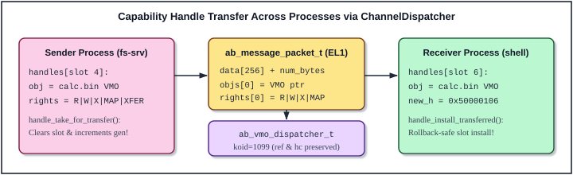

\
# 10 Capability Objects, IPC and Virtual Memory Dispatchers (object.c)

In a monolithic UNIX-derivative kernel, user-space processes interact with an ambient namespace of global integer identifiers: filesystem paths (`/dev/ttyAMA0`, `/proc/self/maps`), global process IDs (`pid_t` passed to `kill(2)` or `ptrace(2)`), System V IPC keys, and ambient superuser credentials (`uid == 0`). A capability-based microkernel modeled on Google's **Zircon** turns that model upside down. In ABOS, there is no root user, no kernel-resident VFS namespace, and no system call that accepts a bare `koid` to mutate or signal an object. Every kernel-managed resource—from an address space region (`VMAR`) or physical RAM container (`VMO`) to a bidirectional IPC conduit (`Channel`), asynchronous event multiplexer (`Port`), user-space interrupt line (`Interrupt`), or task container (`Job`, `Process`, `Thread`)—is an instance of a polymorphic **Dispatcher** object referenced exclusively through unforgeable, rights-attenuated capability handles (`ab_handle_t`).

The entire kernel object layer resides in a single, self-contained 2,030-line translation unit: `lesson_20/kernel/core/object.c` (paired with `lesson_20/include/object.h`). Together with the system call boundary in `syscalls.c` (Chapter 11), `object.c` is the architectural heart of the ABOS microkernel.

## 10.1 Main Functions and Object Subsystem Architecture



Before dissecting the 2,030 lines of `object.c`, four foundational design pillars govern every function in this file: C-based polymorphic inheritance via `ab_object_t`, dual atomic reference counting (`ref_count` vs `handle_count`), a deadlock-free global DAG lock hierarchy, and the taxonomy of all twelve `AB_OBJ_TYPE_*` dispatchers.

### 1. Polymorphic Dispatcher Inheritance in Freestanding C (`ab_object_t`)

Zircon's C++ kernel defines an abstract `Dispatcher` base class (`zircon_org/kernel/object/include/object/dispatcher.h`) subclassed by `SoloDispatcher<T>` (single-endpoint objects such as `EventDispatcher`, `VmObjectDispatcher`, `PortDispatcher`) and `PeeredDispatcher<T>` (entangled endpoint pairs such as `ChannelDispatcher` and `EventPairDispatcher`). ABOS expresses this exact hierarchy in clean ISO C11 without C++ RTTI or virtual method table bloat by placing `ab_object_t base` at **byte offset 0** of every concrete dispatcher structure:

```
+-------------------------------------------------------------------+  offset 0
| ab_object_t base                                                  |
|   koid (64-bit)         | related_koid (64-bit)                   |
|   type (ab_obj_type_t)  | ref_count (i32) | handle_count (i32)    |
|   state_tracker { lock, signals, head, tail }                     |
|   on_zero_handles(obj)  | destroy(obj)                            |
+-------------------------------------------------------------------+  sizeof(ab_object_t)
| Concrete Dispatcher Payload (e.g., ab_channel_dispatcher_t,       |
| ab_vmo_dispatcher_t, ab_process_t, ab_port_dispatcher_t, ...)     |
+-------------------------------------------------------------------+
```

Because C guarantees zero padding before the first member of a `struct`, a pointer to any concrete dispatcher (`ab_vmo_dispatcher_t *`, `ab_channel_dispatcher_t *`, `ab_process_t *`) is bit-identical to its `&disp->base` pointer (`ab_object_t *`), validated dynamically via `obj->type` inside `handle_lookup()`. Two lifecycle function pointers embedded in `ab_object_t` separate **capability visibility** from **memory reclamation**:

1. **`on_zero_handles(ab_object_t *obj)`**: Fired synchronously when the last open capability handle across all processes (and all in-transit channel packets) closes (`handle_count: 1 -> 0`). Peered objects (`EventPairDispatcher`, `ChannelDispatcher`) use this hook to sever their cross-endpoint cycle and assert `AB_SIGNAL_PEER_CLOSED` on the surviving peer; `ProcessDispatcher` uses it to reap unstarted embryonic processes from their parent `JobDispatcher`.
2. **`destroy(ab_object_t *obj)`**: Fired when the last kernel pointer reference drops (`ref_count: 1 -> 0`). Releases owned physical RAM pages (`vmo_destroy`), unmaps user page tables (`process_destroy`), drains unread IPC queues (`channel_destroy`), masks hardware GIC lines (`interrupt_destroy`), and frees the heap block (`kfree`). Dispatchers without external resources omit a custom destructor (`destroy = NULL`), falling back to `default_object_destroy()`.

### 2. Dual Reference Counting: `ref_count` vs `handle_count`

A classic pitfall in microkernel design is conflating *open user handles* with *live kernel pointers*. Suppose Thread A in a multi-threaded process blocks inside `sys_object_wait_one(h)` while Thread B in the same process concurrently calls `sys_handle_close(h)`. If closing `h` immediately freed the object, Thread A would wake up into freed heap memory; conversely, if Thread A incremented the handle count while waiting, a peered channel endpoint would fail to notify its peer with `AB_SIGNAL_PEER_CLOSED` when `h` was closed!

`object.c` resolves this cleanly with two orthogonal 32-bit atomic counters on every `ab_object_t`:

| Counter | Semantic Meaning | Incremented By | Decremented By | Zero-Transition Action |
| :--- | :--- | :--- | :--- | :--- |
| **`handle_count`** | Number of user-visible capability handles in process handle tables **plus** handles currently in transit inside `ab_message_packet_t` | `handle_alloc()` (`0 -> 1` or `N -> N+1`); conserved unchanged across `handle_take_for_transfer()` / `handle_install_transferred()` | `handle_close()`, `message_packet_destroy()`, `ab_process_start_user()` rollback | Fires `obj->on_zero_handles(obj)` when transitioning `1 -> 0` |
| **`ref_count`** | Total strong kernel C pointers (`fbl::RefPtr` equivalent): every counted handle holds 1 ref, **plus** transient syscall lookups, VMAR->VMO mappings, peer-to-peer links, Port observers, and Job->Process->Thread links | `ab_object_alloc()` (initial `1`), `handle_alloc()`, `handle_lookup()`, peer creation, `ab_vmar_map()`, `state_tracker_wait_async()`, task linking | `ab_object_release()` | Fires `obj->destroy(obj)` and frees kernel heap memory when transitioning `1 -> 0` |

Notice the structural invariant: `ref_count >= handle_count` holds at every quiescent point, because every active handle slot (or in-transit message packet slot) owns one counted reference in `ref_count` alongside its `1` in `handle_count`. As **Figure 10-1** illustrates, transferring a handle over a `ChannelDispatcher` detaches the handle from the sender's slot (bumping the slot's `generation` to prevent ABA reuse) and attaches the raw `ab_object_t *` to `ab_message_packet_t` while **preserving both `ref_count` and `handle_count` untouched** until the receiver installs it into a fresh slot via `handle_install_transferred()` (or drops the unread packet via `message_packet_destroy()`).

### 3. Global Directed Acyclic Graph (DAG) Spinlock Hierarchy

Because ABOS runs preemptively across 4 symmetric Cortex-A53 cores (`SMP_MAX_CPUS = 4`) and dispatches GICv2 interrupts directly into `StateTracker` and `PortDispatcher`, every spinlock in `object.c` is acquired via `spin_lock_irqsave()` (masking local `DAIF.I` before spinning on the ticket/atomic lock) and strictly obeys two non-intersecting lock-ordering DAGs:

```
  [Task, Capability & Virtual Memory DAG]
  g_job_lock
      +---> proc->handle_lock
      +---> proc->vmar_lock
                +---> vmo->lock      ---> pmm_lock
                +---> aspace->lock   ---> pmm_lock

  [Peered IPC, Signal & Asynchronous Port DAG]
  g_peer_lock   (never held across peer->lock or state_tracker.lock!)
  peer->lock (ab_channel_dispatcher_t)
      +---> state_tracker.lock (ab_state_tracker_t)
                +---> port->lock (ab_port_dispatcher_t)
                +---> sched_lock (via event_signal -> wait_queue)
```

Three defensive patterns in `object.c` keep these two DAGs strictly acyclic:
- **Acquire-Ref-and-Drop on `g_peer_lock`**: Neither `ab_eventpair_signal_peer()` nor `ab_channel_write()` holds `g_peer_lock` while locking `peer->lock` or `state_tracker.lock`. Instead, they acquire `g_peer_lock`, take a temporary strong reference (`ab_object_add_ref(&peer->base)`), immediately drop `g_peer_lock`, perform the signaling or packet queueing on `peer`, and call `ab_object_release(&peer->base)`.
- **Unlock-Before-Hook in `handle_close()`**: `proc->handle_lock` is released *before* decrementing `handle_count` and calling `on_zero_handles` or `ab_object_release`, allowing `process_destroy()` to close nested handles and `channel_on_zero_handles()` to acquire `g_peer_lock` without lock-order inversion.
- **Deferred Release Arrays (`to_release[]`)**: Both `ab_vmar_unmap()` and `job_destroy()` collect displaced object pointers into a stack-local `to_release[]` array while holding `vmar_lock` or `g_job_lock`, release the spinlock, and only then invoke `ab_object_release()` so destructors (`vmo_destroy`, `process_destroy`) run completely lock-free.

### 4. Summary of All Twelve Kernel Object Dispatchers

| Enum (`ab_obj_type_t`) | Concrete C Struct | Initial Signals | Default Capability Rights | `on_zero_handles` | `destroy` | Primary Role in ABOS |
| :--- | :--- | :--- | :--- | :--- | :--- | :--- |
| `AB_OBJ_TYPE_PROCESS` (`1`) | `ab_process_t` | `NONE` | `BASIC \| R \| W \| MANAGE_THREAD` | `process_on_zero_handles` | `process_destroy` | Per-process `TTBR0_EL1` ASID address space, 64-slot handle table, 16 VMAR mappings, thread list |
| `AB_OBJ_TYPE_THREAD` (`2`) | `ab_thread_dispatcher_t` | `NONE` | `BASIC \| R \| W` | `NULL` | `thread_dispatcher_destroy` | Bridges capability handle to scheduler `thread_t` (`kthread`) and EL0 entry frame |
| `AB_OBJ_TYPE_VMO` (`3`) | `ab_vmo_dispatcher_t` | `NONE` | `BASIC \| R \| W \| X \| MAP \| SET_PROP` | `NULL` | `vmo_destroy` | Sparse demand-paged RAM (`vmo-anon`), MMIO (`vmo-phys`), or DMA (`vmo-contig`) page container |
| `AB_OBJ_TYPE_CHANNEL` (`4`) | `ab_channel_dispatcher_t` | `WRITABLE` | `BASIC \| R \| W \| SIG \| SIG_PEER` | `channel_on_zero_handles` | `channel_destroy` | Bidirectional message + capability-handle transport (`256 B` + `8` handles/packet) |
| `AB_OBJ_TYPE_EVENT` (`5`) | `ab_event_dispatcher_t` | `NONE` | `BASIC \| SIGNAL` | `NULL` | `default_object_destroy` | Single-endpoint user-signaled synchronization primitive (`AB_SIGNAL_SIGNALED`, `USER_0..3`) |
| `AB_OBJ_TYPE_EVENTPAIR` (`6`) | `ab_eventpair_dispatcher_t` | `NONE` | `BASIC \| SIGNAL \| SIGNAL_PEER` | `eventpair_on_zero_handles` | `default_object_destroy` | Entangled two-endpoint peer signaling and automatic `PEER_CLOSED` lifetime notification |
| `AB_OBJ_TYPE_PORT` (`7`) | `ab_port_dispatcher_t` | `WRITABLE` | `XFER \| DUP \| R \| W \| INSPECT` | `NULL` | `port_destroy` | 32-slot asynchronous event packet ring buffer multiplexing `wait_async` observers & user packets |
| `AB_OBJ_TYPE_INTERRUPT` (`8`) | `ab_interrupt_dispatcher_t` | `NONE` | `BASIC \| R \| W \| SIGNAL` | `NULL` | `interrupt_destroy` | Routes masked hardware GICv2 SPIs/PPIs to EL0 device drivers (`wait` + `ack` handshake) |
| `AB_OBJ_TYPE_RESOURCE` (`9`) | `ab_resource_dispatcher_t` | `NONE` | `BASIC \| R \| W \| X` | `NULL` | `default_object_destroy` | Root DDK privilege token authorizing physical VMOs, contiguous DMA VMOs, and IRQ binding |
| `AB_OBJ_TYPE_LOG` (`10`) | `ab_log_dispatcher_t` | `WRITABLE` | `BASIC \| WRITE` | `log_on_zero_handles` | `default_object_destroy` | Capability-gated write channel to the kernel `debuglog` ring buffer and UART console |
| `AB_OBJ_TYPE_JOB` (`11`) | `ab_job_dispatcher_t` | `NONE` | `BASIC \| R \| W \| MANAGE_PROC \| MANAGE_THR` | `NULL` | `job_destroy` | Hierarchical container grouping up to 16 child processes for policy and `ps`/`vmaps` inspection |
| `AB_OBJ_TYPE_VMAR` (`12`) | `ab_vmar_dispatcher_t` | `NONE` | `BASIC \| R \| W \| MAP \| X` | `NULL` | `vmar_destroy` | Capability governing `[0x10000000, 0x40000000)` virtual address allocation in a target process |

## 10.2 Base Object Lifecycle, StateTracker and Synchronous Wait

### 10.2.1 Functional Description

Lines `1–185` establish the polymorphic object substrate shared by every dispatcher in the kernel: unique 64-bit Kernel Object ID (`ab_koid_t`) generation, heap allocation and initialization of `ab_object_t`, lock-free atomic reference counting (`ab_object_add_ref` / `ab_object_release`), and the **StateTracker** signal and observer engine (`state_tracker_update_signals`, `state_tracker_get_signals`, `state_tracker_wait_one`).

In Zircon, almost no kernel objects expose custom blocking read/write system calls; instead, objects maintain a 32-bit level-triggered **signal bitmask** (`AB_SIGNAL_READABLE`, `AB_SIGNAL_WRITABLE`, `AB_SIGNAL_PEER_CLOSED`, `AB_SIGNAL_SIGNALED` / `AB_SIGNAL_TASK_TERMINATED`, and `AB_USER_SIGNAL_0..3`) inside `ab_state_tracker_t`. Threads wait for boolean combinations of signals either **synchronously** (`state_tracker_wait_one`, which allocates an `ab_wait_observer_t` directly on the caller's kernel stack with zero heap traffic) or **asynchronously** (`state_tracker_wait_async` in Section 10.5, which attaches a one-shot heap observer that enqueues a packet into a `PortDispatcher` the instant any watched signal bit becomes `1`).

### 10.2.2 Heavily Commented Source Code

#### Program 10-1: `lesson_20/kernel/core/object.c` (Lines 1–185)

<!-- ECLK_CODE_LISTING file="lesson_20/kernel/core/object.c" start="1" end="185" total="2030" -->
```c
       //// File banner and core subsystem headers:
       //// - object.h   : Declarations for all 12 AB_OBJ_TYPE_* dispatchers, capability
       ////   rights, signal bitmasks, StateTracker observers, and diagnostic structs.
       //// - heap.h     : Kernel slab/freelist allocator (kzalloc / kfree) used to
       ////   allocate concrete dispatcher structs, async port observers, and IPC packets.
       //// - pmm.h      : Physical Memory Manager frame allocator for VMO and user stack
       ////   pages.
       //// - debuglog.h : Structured kernel diagnostic logging (dprintf with
       ////   SPEW/INFO/CRITICAL).
   1 | /* =========================================================================
   2 |  * object.c - Zircon Dispatcher, StateTracker, Event & EventPair
   3 |  * ========================================================================= */
   4 | #include "object.h"
   5 | #include "heap.h"
   6 | #include "pmm.h"
   7 | #include "debuglog.h"
   8 | 
       //// Three module-global synchronization primitives anchor the object subsystem:
       //// - global_koid_counter : Monotonically increasing 64-bit Kernel Object ID
       ////   generator. Starts at 1024ULL (matching Zircon's ZX_KOID_FIRST = 1024) so
       ////   architectural sentinel IDs—AB_KOID_INVALID (0) and AB_KOID_KERNEL (1)—never
       ////   collide with dynamically allocated dispatchers. A 64-bit counter never wraps
       ////   in system lifetime, guaranteeing that KOIDs are never recycled (eliminating
       ////   PID-reuse style races).
       //// - g_peer_lock : Serializes peer pointer inspection and mutual unlinking across
       ////   all entangled PeeredDispatcher pairs (EventPairDispatcher and
       ////   ChannelDispatcher). Using one global spinlock instead of locking ep0->lock
       ////   then ep1->lock prevents classic AB-BA deadlocks when both peers close
       ////   simultaneously on different CPUs!
       //// - g_job_lock  : Protects the global task tree (job->procs[], proc->parent_job,
       ////   proc->threads[], proc->thread_count) across process creation, exit, and
       ////   'ps'.
   9 | static volatile uint64_t global_koid_counter = 1024ULL;
  10 | static spin_lock_t g_peer_lock = SPIN_LOCK_INITIAL_VALUE;
  11 | static spin_lock_t g_job_lock  = SPIN_LOCK_INITIAL_VALUE;
  12 | 
       //// ab_koid_alloc() — Lock-free 64-bit KOID allocator. Uses GCC/Clang builtin
       //// __atomic_fetch_add with __ATOMIC_RELAXED memory ordering: uniqueness requires
       //// only a single global modification order on global_koid_counter itself, with no
       //// happens-before ordering needed relative to surrounding memory loads or stores.
       //// On ARMv8-A, __ATOMIC_RELAXED compiles to a lightweight ldadd / ldxr+stxr loop
       //// without expensive dmb ish full-system barriers.
  13 | ab_koid_t ab_koid_alloc(void) {
  14 |     return __atomic_fetch_add(&global_koid_counter, 1ULL, __ATOMIC_RELAXED);
  15 | }
  16 | 
       //// ab_obj_type_name() — Converts an ab_obj_type_t enumeration tag (0..12) into a
       //// static NUL-terminated string literal for kernel debug tracing
       //// (default_object_destroy, channel/VMO SPEW logs, and panic diagnostics).
  17 | const char *ab_obj_type_name(ab_obj_type_t type) {
  18 |     switch (type) {
  19 |         case AB_OBJ_TYPE_NONE:      return "NONE";
  20 |         case AB_OBJ_TYPE_PROCESS:   return "PROCESS";
  21 |         case AB_OBJ_TYPE_THREAD:    return "THREAD";
  22 |         case AB_OBJ_TYPE_VMO:       return "VMO";
  23 |         case AB_OBJ_TYPE_CHANNEL:   return "CHANNEL";
  24 |         case AB_OBJ_TYPE_EVENT:     return "EVENT";
  25 |         case AB_OBJ_TYPE_EVENTPAIR: return "EVENTPAIR";
  26 |         case AB_OBJ_TYPE_PORT:      return "PORT";
  27 |         case AB_OBJ_TYPE_INTERRUPT: return "INTERRUPT";
  28 |         case AB_OBJ_TYPE_RESOURCE:  return "RESOURCE";
  29 |         case AB_OBJ_TYPE_LOG:       return "LOG";
  30 |         case AB_OBJ_TYPE_JOB:       return "JOB";
  31 |         case AB_OBJ_TYPE_VMAR:      return "VMAR";
  32 |         default:                    return "UNKNOWN";
  33 |     }
  34 | }
  35 | 
       //// default_object_destroy() — Default virtual destructor installed on simple solo
       //// or peered dispatchers (LOG, EVENT, EVENTPAIR, RESOURCE) that own no external
       //// heap queues, physical RAM pages, or GIC IRQ lines beyond their single
       //// kzalloc() block.
  36 | static void default_object_destroy(ab_object_t *obj) {
  37 |     dprintf(SPEW, "[object] Destroying %s dispatcher (koid=%lu) at %p\n",
  38 |             ab_obj_type_name(obj->type), obj->koid, (void *)obj);
  39 |     kfree(obj);
  40 | }
  41 | 
       //// ab_object_alloc() — Polymorphic base constructor for all 12 kernel object
       //// types.
       //// Models Zircon's Dispatcher::Dispatcher() constructor in freestanding C:
       //// 1. Clamps struct_size to at least sizeof(ab_object_t) so buggy callers cannot
       ////    under-allocate the embedded base header.
       //// 2. Calls kzalloc(struct_size) so both the ab_object_t prefix and all concrete
       ////    derived fields start deterministically zeroed.
  42 | ab_object_t *ab_object_alloc(size_t struct_size, ab_obj_type_t type,
  43 |                              ab_signals_t initial_signals,
  44 |                              ab_obj_hook_t on_zero_handles, ab_obj_hook_t destroy) {
       //// Defensive floor: even if a caller passes struct_size == 0, ensure at least
       //// sizeof(ab_object_t) bytes are allocated so the base header is always complete.
  45 |     if (struct_size < sizeof(ab_object_t)) {
  46 |         struct_size = sizeof(ab_object_t);
  47 |     }
  48 |     ab_object_t *obj = (ab_object_t *)kzalloc(struct_size);
  49 |     if (!obj) return NULL;
  50 | 
       //// Initialize base identity, dual reference counts, StateTracker, and lifecycle
       //// hooks:
       ////   +-------------------+--------------------------------------------------------+
       ////   | Field             | Initial Value & Invariant                              |
       ////   +-------------------+--------------------------------------------------------+
       ////   | koid              | Fresh globally unique >= 1024 ID                       |
       ////   | related_koid      | AB_KOID_INVALID (0); set later for peers / child tasks |
       ////   | ref_count         | 1 (caller's creation reference; released or transferred)|
       ////   | handle_count      | 0 (no user handle exists until handle_alloc() runs)    |
       ////   | state_tracker     | Unlocked, initial_signals active, empty observer list  |
       ////   | on_zero_handles   | Optional hook fired on handle_count 1 -> 0             |
       ////   | destroy           | Custom destructor or default_object_destroy fallback   |
       ////   +-------------------+--------------------------------------------------------+
  51 |     obj->koid                  = ab_koid_alloc();
  52 |     obj->related_koid          = AB_KOID_INVALID;
  53 |     obj->type                  = type;
  54 |     obj->ref_count             = 1;
  55 |     obj->handle_count          = 0;
  56 |     obj->state_tracker.lock.value = 0;
  57 |     obj->state_tracker.signals = initial_signals;
  58 |     obj->state_tracker.head    = NULL;
  59 |     obj->state_tracker.tail    = NULL;
  60 |     obj->on_zero_handles       = on_zero_handles;
  61 |     obj->destroy               = destroy ? destroy : default_object_destroy;
  62 |     return obj;
  63 | }
  64 | 
       //// ab_object_add_ref() — Acquires an additional strong kernel pointer reference
       //// (fbl::RefPtr copy equivalent). __ATOMIC_RELAXED is memory-model safe here
       //// because the caller must already hold a live reference (ref_count >= 1) to pass
       //// 'obj'; increasing ref_count requires no cross-CPU visibility barrier.
  65 | void ab_object_add_ref(ab_object_t *obj) {
  66 |     if (!obj) return;
  67 |     __atomic_fetch_add(&obj->ref_count, 1, __ATOMIC_RELAXED);
  68 | }
  69 | 
       //// ab_object_release() — Drops a strong kernel pointer reference and invokes the
       //// polymorphic destructor when the final reference disappears (old == 1, i.e., 1
       //// -> 0).
       //// CRITICAL ARMv8-A MEMORY ORDERING (__ATOMIC_ACQ_REL):
       //// - RELEASE ensures every prior read/write to 'obj' on this CPU completes before
       ////   the reference count decrement becomes visible to other cores.
       //// - ACQUIRE ensures the core observing old == 1 synchronizes-with all earlier
       ////   releases on other cores before running obj->destroy(obj) and kfree(obj),
       ////   preventing weakly ordered speculative loads/stores from racing with object
       ////   destruction!
  70 | void ab_object_release(ab_object_t *obj) {
  71 |     if (!obj) return;
  72 |     int32_t old = __atomic_fetch_sub(&obj->ref_count, 1, __ATOMIC_ACQ_REL);
       //// When old == 1, this CPU just dropped the VERY LAST kernel reference (1 -> 0).
       //// No handle table, VMAR mapping, Port observer, peer link, or in-flight syscall
       //// can possibly reach 'obj' anymore, so invoking obj->destroy(obj) is race-free.
  73 |     if (old == 1) {
  74 |         if (obj->destroy) {
  75 |             obj->destroy(obj);
  76 |         }
  77 |     }
  78 | }
  79 | 
  80 | /* =========================================================================
  81 |  * StateTracker Implementation (models Zircon's StateTracker)
  82 |  * ========================================================================= */
       //// state_tracker_update_signals() — Atomically clears 'clear_mask' and asserts
       //// 'set_mask' on obj->state_tracker.signals, waking all matching synchronous and
       //// asynchronous observers. Models Zircon's StateTracker::UpdateState(). NOTE:
       //// Acquires st->lock via spin_lock_irqsave() because hardware IRQ handlers
       //// (ab_interrupt_dispatch_hw_irq) invoke state_tracker_update_signals() directly
       //// in EL1 interrupt context!
  83 | void state_tracker_update_signals(ab_object_t *obj,
  84 |                                   ab_signals_t clear_mask,
  85 |                                   ab_signals_t set_mask) {
  86 |     ab_state_tracker_t *st = &obj->state_tracker;
  87 |     spin_lock_saved_state_t irqstate;
  88 |     spin_lock_irqsave(&st->lock, &irqstate);
  89 | 
       //// Compute updated level-triggered signal bitmask: clear_mask is stripped first,
       //// then set_mask is OR-ed in. Only walk the doubly-linked observer list if at
       //// least one signal bit actually changed (new_sigs != old_sigs).
  90 |     ab_signals_t old_sigs = st->signals;
  91 |     ab_signals_t new_sigs = (old_sigs & ~clear_mask) | set_mask;
  92 |     st->signals = new_sigs;
  93 | 
  94 |     if (new_sigs != old_sigs) {
  95 |         ab_wait_observer_t *obs = st->head;
       //// Walk the observer list carefully: cache 'next = obs->next' BEFORE processing
       //// 'obs', because asynchronous Port observers are one-shot
       //// (ZX_WAIT_ASYNC_ONCE)—when matched, they unlink themselves from the
       //// doubly-linked list and kfree(obs) in-place!
  96 |         while (obs != NULL) {
  97 |             ab_wait_observer_t *next = obs->next;
  98 |             if (new_sigs & obs->watched_signals) {
       //// Branch 1: One-Shot Asynchronous Port Observer (obs->is_async_port &&
       //// obs->port_obj).
       //// Registered earlier by state_tracker_wait_async() (sys_object_wait_async):
       //// 1. Unlink 'obs' from st->head / st->tail so future signal transitions will not
       ////    flood the Port with duplicate packets (enforcing Zircon's one-shot
       ////    contract).
       //// 2. Materialize an ab_port_packet_t on the stack capturing the user's 64-bit
       ////    routing 'key', AB_PKT_TYPE_SIGNAL_ONE, watched trigger mask, full observed
       ////    new_sigs, nanosecond hardware timestamp, and source obj->koid.
       //// 3. Enqueue the packet into obs->port_obj (acquiring port->lock inside
       ////    st->lock, conforming to the DAG order state_tracker.lock -> port->lock),
       ////    drop the observer's reference on port_obj, and free the heap observer node.
  99 |                 if (obs->is_async_port && obs->port_obj) {
 100 |                     /* Unlink one-shot PortObserver and enqueue packet */
       //// Standard O(1) doubly-linked list removal from [st->head .. st->tail]: patch
       //// obs->prev->next (or st->head if removing the first element) and
       //// obs->next->prev (or st->tail if removing the last element).
 101 |                     if (obs->prev) obs->prev->next = obs->next;
 102 |                     else st->head = obs->next;
 103 |                     if (obs->next) obs->next->prev = obs->prev;
 104 |                     else st->tail = obs->prev;
 105 | 
 106 |                     ab_port_packet_t pkt;
 107 |                     pkt.key       = obs->key;
 108 |                     pkt.type      = AB_PKT_TYPE_SIGNAL_ONE;
 109 |                     pkt.status    = AB_OK;
 110 |                     pkt.trigger   = obs->watched_signals;
 111 |                     pkt.observed  = new_sigs;
 112 |                     pkt.timestamp = current_time_ns();
 113 |                     pkt.user_val  = obj->koid;
 114 | 
 115 |                     ab_port_queue(obs->port_obj, &pkt);
 116 |                     ab_object_release(obs->port_obj);
 117 |                     kfree(obs);
       //// Branch 2: Synchronous Thread Observer (registered by state_tracker_wait_one).
       //// Latch 'obs->wakeup_reasons = new_sigs' BEFORE signaling obs->event! Why latch?
       //// Suppose Core 1 sets AB_SIGNAL_READABLE (waking Core 0) and Core 2 immediately
       //// reads the packet and clears AB_SIGNAL_READABLE before Core 0 gets scheduled.
       //// Latching new_sigs in obs->wakeup_reasons guarantees Core 0 observes the exact
       //// signal snapshot that caused its wakeup rather than a stale post-race 0!
 118 |                 } else {
 119 |                     obs->wakeup_reasons = new_sigs;
 120 |                     event_signal(&obs->event);
 121 |                 }
 122 |             }
 123 |             obs = next;
 124 |         }
 125 |     }
 126 | 
 127 |     spin_lock_irqrestore(&st->lock, irqstate);
 128 | }
 129 | 
       //// state_tracker_get_signals() — Lock-free sequentially consistent snapshot of an
       //// object's current 32-bit signal word.
 130 | ab_signals_t state_tracker_get_signals(ab_object_t *obj) {
 131 |     return __atomic_load_n(&obj->state_tracker.signals, __ATOMIC_SEQ_CST);
 132 | }
 133 | 
       //// state_tracker_wait_one() — Synchronous level-triggered wait with absolute
       //// nanosecond deadline (backing sys_object_wait_one / zx_object_wait_one).
       //// ZERO-ALLOCATION DESIGN: 'obs' is allocated directly on the calling thread's 8
       //// KB EL1 kernel stack! Stack allocation is 100% safe because lines 171-177
       //// unconditionally re-acquire st->lock and unlink '&obs' before this stack frame
       //// can ever return.
 134 | ab_status_t state_tracker_wait_one(ab_object_t *obj,
 135 |                                    ab_signals_t watched_signals,
 136 |                                    ab_time_t deadline_ns,
 137 |                                    ab_signals_t *observed_out) {
 138 |     ab_state_tracker_t *st = &obj->state_tracker;
 139 |     ab_wait_observer_t obs;
 140 |     obs.prev            = NULL;
 141 |     obs.next            = NULL;
 142 |     obs.watched_signals = watched_signals;
 143 |     obs.wakeup_reasons  = 0;
 144 |     obs.is_async_port   = 0;
 145 |     obs.port_obj        = NULL;
 146 |     obs.key             = 0;
       //// Initialize obs.event as unsignaled (0) with flags = 0 (manual-reset, sticky).
       //// Manual-reset ensures that once state_tracker_update_signals() calls
       //// event_signal(), obs.event remains signaled until this stack frame returns.
 147 |     event_init(&obs.event, 0, 0);
 148 | 
 149 |     spin_lock_saved_state_t irqstate;
 150 |     spin_lock_irqsave(&st->lock, &irqstate);
 151 | 
       //// Fast path under st->lock: if any bit in watched_signals is ALREADY asserted in
       //// st->signals, return AB_OK immediately with the current signal word—bypassing
       //// wait-list insertion, event blocking, and scheduler context switching entirely.
 152 |     /* Fast path: watched signals are already active */
 153 |     if (st->signals & watched_signals) {
 154 |         ab_signals_t cur = st->signals;
 155 |         spin_lock_irqrestore(&st->lock, irqstate);
 156 |         if (observed_out) *observed_out = cur;
 157 |         return AB_OK;
 158 |     }
 159 | 
       //// Slow path: append stack-allocated '&obs' to the tail of st's doubly-linked
       //// list under st->lock, then release st->lock BEFORE blocking in
       //// event_wait_deadline().
       //// WHY THERE IS NO LOST-WAKEUP WINDOW BETWEEN LINE 167 AND LINE 169:
       //// Once '&obs' is linked under st->lock, any concurrent
       //// state_tracker_update_signals() that runs at line 168 will acquire st->lock,
       //// find '&obs', and call event_signal(), which sets obs.event.signaled = 1 under
       //// sched_lock. When line 169 then enters event_wait_deadline(), it checks
       //// obs.event.signaled == 1 under sched_lock and returns AB_OK immediately without
       //// sleeping!
 160 |     if (!st->tail) {
 161 |         st->head = st->tail = &obs;
 162 |     } else {
 163 |         obs.prev = st->tail;
 164 |         st->tail->next = &obs;
 165 |         st->tail = &obs;
 166 |     }
 167 |     spin_lock_irqrestore(&st->lock, irqstate);
 168 | 
 169 |     int rc = event_wait_deadline(&obs.event, deadline_ns);
 170 | 
       //// Whether woken by event_signal() (rc == 0) or by timer expiration (rc ==
       //// AB_ERR_TIMED_OUT), re-acquire st->lock to unlink '&obs' from st->head /
       //// st->tail before stack unwind. Prefer the latched obs.wakeup_reasons if
       //// signaled; otherwise report st->signals.
 171 |     spin_lock_irqsave(&st->lock, &irqstate);
 172 |     if (obs.prev) obs.prev->next = obs.next;
 173 |     else st->head = obs.next;
 174 |     if (obs.next) obs.next->prev = obs.prev;
 175 |     else st->tail = obs.prev;
 176 |     ab_signals_t final_sigs = obs.wakeup_reasons ? obs.wakeup_reasons : st->signals;
 177 |     spin_lock_irqrestore(&st->lock, irqstate);
 178 | 
 179 |     if (observed_out) *observed_out = final_sigs;
 180 |     return (rc == 0) ? AB_OK : AB_ERR_TIMED_OUT;
 181 | }
 182 | 
       //// Section transition banner introducing the per-process capability handle table
       //// and ProcessDispatcher lifecycle routines (analyzed in Program 10-2 below).
 183 | /* =========================================================================
 184 |  * Handle Table Implementation
 185 |  * ========================================================================= */
```

### 10.2.3 Technical Notes

1. **Level-Triggered vs Edge-Triggered Signals**: Zircon's `StateTracker` is strictly *level-triggered* with respect to current object state—for instance, `AB_SIGNAL_READABLE` on a `ChannelDispatcher` or `PortDispatcher` stays `1` for as long as `msg_count > 0` or `port->count > 0`, and drops back to `0` only when the queue drains completely. Checking `(st->signals & watched_signals)` inside `st->lock` before sleeping eliminates the classic edge-triggered race where a producer enqueues data micro-seconds before the consumer calls `wait`.
2. **One-Shot Asynchronous Observers (`ZX_WAIT_ASYNC_ONCE`)**: Notice the asymmetry inside `state_tracker_update_signals()` (lines `99–121`): synchronous observers remain linked until the sleeping thread unlinks itself upon wakeup (lines `172–175`), whereas asynchronous port observers (`obs->is_async_port == 1`) are unlinked and `kfree()`d *immediately* by the signaling thread. After processing a packet from `ab_port_wait()`, an event-loop server re-arms `state_tracker_wait_async()` when ready for the next notification, providing natural backpressure and preventing unbounded packet storms.
3. **Why `st->lock` Uses `spin_lock_irqsave`**: On line `1729` (Section 10.9), `ab_interrupt_dispatch_hw_irq()` invokes `state_tracker_update_signals()` directly inside `arm64_irq_exception()`. If a thread in `state_tracker_wait_one()` acquired `st->lock` without masking local IRQs (`DAIF.I`), a hardware interrupt arriving on that same CPU core while `st->lock` was held would spin forever trying to acquire `st->lock` in IRQ context. Using `spin_lock_irqsave()` across all `StateTracker` operations makes interrupt-to-object signaling deadlock-free on SMP.

## 10.3 Process Lifetime, Handle Encoding and Capability Table Operations

### 10.3.1 Functional Description

Lines `186–453` implement the capability security perimeter of ABOS: opaque 32-bit handle encoding (`make_handle_value` / `decode_handle_value`), `ProcessDispatcher` lifetime management (`ab_process_create_kernel`, `process_on_zero_handles`, `process_destroy`), and the five core capability table operations (`handle_alloc`, `handle_lookup`, `handle_close`, `handle_duplicate`, `handle_replace`).

Unlike UNIX file descriptors—which allocate the lowest sequential integer `0, 1, 2, ...` and therefore suffer from catastrophic use-after-close bugs whenever one thread closes `fd 4` and another thread concurrently opens a sensitive file into `fd 4`—ABOS encodes every `ab_handle_t` with a **4-bit magic tag (`0x5`)**, a **16-bit per-slot generation counter (`1..65535`)**, and an **8-bit table slot index (`0..63`)**. Closing a handle increments its slot's generation counter, permanently invalidating every stale copy of that integer in user registers or memory.

### 10.3.2 Heavily Commented Source Code

#### Program 10-2: `lesson_20/kernel/core/object.c` (Lines 186–453)

<!-- ECLK_CODE_LISTING file="lesson_20/kernel/core/object.c" start="186" end="453" total="2030" -->
```c
       //// make_handle_value() & decode_handle_value() — Opaque 32-bit capability
       //// encoding:
       ////   31    28 27    24 23                    8 7              0
       ////   +-------+--------+-----------------------+---------------+
       ////   |  0x5  |  0x0   |  16-bit generation    |  8-bit slot   |
       ////   +-------+--------+-----------------------+---------------+
       //// - Bits [31:28] = 0x5 : Fixed magic nibble. Guarantees AB_HANDLE_INVALID (0),
       ////   small POSIX-like integers (1, 2, 3), -1 (0xFFFFFFFF), and user virtual
       ////   addresses are instantly rejected as AB_ERR_BAD_HANDLE before touching
       ////   proc->handle_lock!
       //// - Bits [23:8]  = gen : Monotonic per-slot ABA counter (1..65535, skipping 0).
       //// - Bits [7:0]   = slot: Index into proc->handles[0 ..
       ////   MAX_HANDLES_PER_PROCESS-1] (64).
 186 | static ab_handle_t make_handle_value(uint32_t slot, uint32_t gen) {
 187 |     return (0x5U << 28) | ((gen & 0xFFFFU) << 8) | (slot & 0xFFU);
 188 | }
 189 | 
       //// decode_handle_value() — Rejects any 32-bit integer whose top nibble is not 0x5
       //// or whose low 8-bit slot index exceeds MAX_HANDLES_PER_PROCESS - 1 (63) BEFORE
       //// acquiring any spinlock.
 190 | static int decode_handle_value(ab_handle_t h, uint32_t *out_slot, uint32_t *out_gen) {
 191 |     if ((h >> 28) != 0x5U) return -1;
 192 |     uint32_t slot = h & 0xFFU;
 193 |     if (slot >= MAX_HANDLES_PER_PROCESS) return -1;
 194 |     *out_slot = slot;
 195 |     *out_gen  = (h >> 8) & 0xFFFFU;
 196 |     return 0;
 197 | }
 198 | 
       //// get_current_process() — Reads the executing CPU's current thread_t pointer
       //// (stored in TPIDR_EL1) and returns its associated ab_process_t * (or NULL for
       //// pure EL1 kernel threads such as idle/bootstrap threads).
 199 | ab_process_t *get_current_process(void) {
 200 |     thread_t *cur = get_current_thread();
 201 |     return cur ? (ab_process_t *)cur->process_obj : NULL;
 202 | }
 203 | 
       //// process_on_zero_handles() — Invoked when the last capability handle
       //// referencing an ab_process_t closes (handle_count: 1 -> 0).
       //// SUBTLE LIFETIME DISTINCTION:
       //// - Once a process has been started (has_started == 1) and is actively executing
       ////   in EL0 (!proc->exited), closing all parent handles to it MUST NOT kill the
       ////   process! For example, 'userboot' spawns 'console-srv' and 'fs-srv', closes
       ////   its handles to them, and exits—while those servers continue running under
       ////   root_job!
       //// - Conversely, if a process was created via sys_process_create (which adds a
       ////   strong ref in job->procs[]) and the caller closes proc_handle BEFORE calling
       ////   sys_process_start (!has_started), or if the process has ALREADY exited
       ////   (proc->exited), nobody will ever run or reap it unless we detach it from its
       ////   parent job right here via ab_job_remove_process(proc)!
 204 | static void process_on_zero_handles(ab_object_t *obj) {
 205 |     ab_process_t *proc = (ab_process_t *)obj;
 206 |     int has_started = 0;
 207 |     spin_lock_saved_state_t irqstate;
 208 |     spin_lock_irqsave(&g_job_lock, &irqstate);
       //// Inspect proc->threads[] under g_job_lock: a ThreadDispatcher only acquires a
       //// non-NULL 'kthread' pointer when ab_process_start_user() (or sys_thread_start)
       //// actually spawns execution.
 209 |     for (uint32_t t = 0; t < MAX_THREADS_PER_PROCESS; t++) {
 210 |         if (proc->threads[t] && proc->threads[t]->kthread != NULL) {
 211 |             has_started = 1;
 212 |             break;
 213 |         }
 214 |     }
 215 |     spin_lock_irqrestore(&g_job_lock, irqstate);
 216 | 
 217 |     /* If a process was never started and all handles to it closed, detach from job */
 218 |     if (!has_started || proc->exited) {
 219 |         ab_job_remove_process(proc);
 220 |     }
 221 | }
 222 | 
       //// process_destroy() — Final destructor for ab_process_t (ref_count: 1 -> 0).
       //// Only executes after: (a) all handles to the process are closed, (b) the
       //// process is detached from its parent JobDispatcher, AND (c) all child
       //// ThreadDispatchers have been destroyed. Tears down process state in four strict
       //// dependency stages:
 223 | static void process_destroy(ab_object_t *obj) {
 224 |     ab_process_t *proc = (ab_process_t *)obj;
 225 |     dprintf(SPEW, "[object] Destroying PROCESS '%s' (koid=%lu)\n",
 226 |             proc->name, proc->base.koid);
 227 | 
       //// Stage 1: Unmap all remaining dynamic VMAR mappings from the hardware page
       //// tables (vmm_unmap_page) and drop each mapping's reference to its backing VMO
       //// (ab_object_release). If an anonymous VMO is mapped nowhere else and has 0
       //// handles, this cascades into vmo_destroy() and frees its physical RAM frames!
 228 |     /* Unmap and release any remaining VMAR mappings */
 229 |     for (uint32_t i = 0; i < MAX_VMAR_MAPPINGS; i++) {
 230 |         if (proc->mappings[i].active) {
 231 |             if (proc->aspace) {
 232 |                 for (size_t off = 0; off < proc->mappings[i].size; off += PAGE_SIZE) {
 233 |                     vmm_unmap_page(proc->aspace, proc->mappings[i].base_va + off);
 234 |                 }
 235 |             }
 236 |             if (proc->mappings[i].vmo) {
 237 |                 ab_object_release(&proc->mappings[i].vmo->base);
 238 |                 proc->mappings[i].vmo = NULL;
 239 |             }
 240 |             proc->mappings[i].active = 0;
 241 |         }
 242 |     }
 243 | 
       //// Stage 2: Sweep all 64 capability slots in proc->handles[]. Reconstruct each
       //// valid handle integer via make_handle_value(slot, generation) and call
       //// handle_close(). Crucially, this triggers on_zero_handles() on any peered
       //// Channels or EventPairs owned solely by the dying process—notifying surviving
       //// servers/clients immediately with AB_SIGNAL_PEER_CLOSED rather than leaving
       //// them hung forever!
 244 |     /* Close any remaining open handles */
 245 |     for (uint32_t slot = 0; slot < MAX_HANDLES_PER_PROCESS; slot++) {
 246 |         if (proc->handles[slot].obj != NULL) {
 247 |             ab_handle_t h = make_handle_value(slot, proc->handles[slot].generation);
 248 |             handle_close(proc, h);
 249 |         }
 250 |     }
 251 | 
       //// Stage 3: Reclaim kernel-allocated EL0 user stack frames ([stack_va, stack_va +
       //// stack_size)). Because user_thread_trampoline() maps stack frames directly into
       //// proc->aspace without wrapping an ab_vmo_dispatcher_t, process_destroy() walks
       //// each 4 KB page via vmm_resolve_vaddr(), unmaps the L3 PTE, and returns the
       //// physical frame to PMM.
 252 |     /* Free EL0 user stack physical pages before tearing down page tables */
 253 |     if (proc->aspace && proc->stack_size > 0) {
 254 |         for (size_t off = 0; off < proc->stack_size; off += PAGE_SIZE) {
 255 |             paddr_t pa = 0;
 256 |             if (vmm_resolve_vaddr(proc->aspace, proc->stack_va + off, &pa, NULL) == 0 && pa != 0) {
 257 |                 vmm_unmap_page(proc->aspace, proc->stack_va + off);
 258 |                 pmm_free_page(pa);
 259 |             }
 260 |         }
 261 |         proc->stack_size = 0;
 262 |     }
 263 | 
       //// Stage 4: Destroy the ARMv8-A TTBR0_EL1 page table hierarchy
       //// (vmm_destroy_aspace frees L1/L2/L3 page table pages, invalidates ASID-tagged
       //// TLB entries, and returns the 16-bit hardware ASID to the ASID bitmap), then
       //// free the ab_process_t heap block.
 264 |     if (proc->aspace) {
 265 |         vmm_destroy_aspace(proc->aspace);
 266 |         proc->aspace = NULL;
 267 |     }
 268 | 
 269 |     kfree(proc);
 270 | }
 271 | 
       //// ab_process_create_kernel() — Allocates a new ProcessDispatcher bound to
       //// hardware MMU Address Space ID 'asid' (1..255). Notice the careful error-unwind
       //// hygiene on lines 277-280 and 291-295: if either ab_object_alloc() or
       //// vmm_create_user_aspace(asid) fails under memory pressure, 'asid' is returned
       //// to ab_free_asid() so hardware ASIDs never leak.
 272 | ab_process_t *ab_process_create_kernel(const char *name, uint16_t asid) {
 273 |     if (asid == 0) return NULL;
 274 |     ab_process_t *proc = (ab_process_t *)ab_object_alloc(
 275 |         sizeof(ab_process_t), AB_OBJ_TYPE_PROCESS, AB_SIGNAL_NONE,
 276 |         process_on_zero_handles, process_destroy);
 277 |     if (!proc) {
 278 |         ab_free_asid(asid);
 279 |         return NULL;
 280 |     }
 281 | 
       //// Copy up to 31 characters of 'name' into proc->name[] and force NUL termination
       //// at index <= 31 (freestanding kernel avoids libc strncpy's non-NUL-terminating
       //// pitfall).
 282 |     size_t i = 0;
 283 |     while (name && name[i] && i + 1 < sizeof(proc->name)) {
 284 |         proc->name[i] = name[i];
 285 |         i++;
 286 |     }
 287 |     proc->name[i] = '\0';
 288 | 
 289 |     proc->parent_job = NULL;
 290 |     proc->aspace = vmm_create_user_aspace(asid);
 291 |     if (!proc->aspace) {
 292 |         ab_free_asid(asid);
 293 |         ab_object_release(&proc->base);
 294 |         return NULL;
 295 |     }
       //// Initialize per-process handle_lock and vmar_lock spinlocks, and seed all 64
       //// handle table slots with obj = NULL and generation = 1 (so the very first
       //// handle allocated in slot 0 encodes as 0x50000100).
 296 |     proc->handle_lock.value = 0;
 297 |     proc->vmar_lock.value   = 0;
 298 |     for (int s = 0; s < MAX_HANDLES_PER_PROCESS; s++) {
 299 |         proc->handles[s].obj        = NULL;
 300 |         proc->handles[s].rights     = 0;
 301 |         proc->handles[s].generation = 1;
 302 |     }
 303 |     return proc;
 304 | }
 305 | 
       //// handle_alloc() — Installs 'obj' with capability bitmask 'rights' into the
       //// lowest free slot of 'proc->handles[]'.
       //// DUAL INCREMENT UNDER proc->handle_lock (lines 315-316):
       //// - ab_object_add_ref(obj) increments ref_count (representing this table slot's
       ////   pointer).
       //// - __atomic_fetch_add(&obj->handle_count, 1) increments handle_count
       ////   (representing one new user-visible capability handle).
 306 | ab_status_t handle_alloc(ab_process_t *proc, ab_object_t *obj, ab_rights_t rights,
 307 |                          ab_handle_t *out_handle) {
 308 |     if (!proc || !obj || !out_handle) return AB_ERR_INVALID_ARGS;
 309 | 
 310 |     spin_lock_saved_state_t irqstate;
 311 |     spin_lock_irqsave(&proc->handle_lock, &irqstate);
 312 | 
 313 |     for (uint32_t slot = 0; slot < MAX_HANDLES_PER_PROCESS; slot++) {
 314 |         if (proc->handles[slot].obj == NULL) {
 315 |             ab_object_add_ref(obj);
 316 |             __atomic_fetch_add(&obj->handle_count, 1, __ATOMIC_RELAXED);
 317 | 
       //// Reuse the slot's existing 'generation' counter (which was already incremented
       //// when the previous occupant of this slot was closed!) to form the opaque handle
       //// value.
 318 |             uint32_t gen = proc->handles[slot].generation;
 319 |             proc->handles[slot].obj    = obj;
 320 |             proc->handles[slot].rights = rights;
 321 |             *out_handle = make_handle_value(slot, gen);
 322 | 
 323 |             spin_lock_irqrestore(&proc->handle_lock, irqstate);
 324 |             return AB_OK;
 325 |         }
 326 |     }
 327 | 
 328 |     spin_lock_irqrestore(&proc->handle_lock, irqstate);
 329 |     return AB_ERR_NO_RESOURCES;
 330 | }
 331 | 
       //// handle_lookup() — The central capability security gatekeeper of the ABOS
       //// microkernel. Every system call operating on an ab_handle_t funnels through
       //// these 38 lines to enforce four sequential checks:
       //// 1. Non-NULL process and non-zero handle check (line 335).
       //// 2. Structural nibble (0x5) and bounds (slot < 64) decoding (line 338).
       //// 3. Under proc->handle_lock: live slot check AND ABA generation match
       ////    (entry->generation == gen, line 346) -> AB_ERR_BAD_HANDLE on mismatch.
       //// 4. Type safety (expected_type, where AB_OBJ_TYPE_NONE acts as a polymorphic
       ////    wildcard) -> AB_ERR_WRONG_TYPE, followed by capability rights check
       ////    ((rights & required_rights) == required_rights) -> AB_ERR_ACCESS_DENIED.
 332 | ab_status_t handle_lookup(ab_process_t *proc, ab_handle_t h, ab_obj_type_t expected_type,
 333 |                           ab_rights_t required_rights, ab_object_t **out_obj,
 334 |                           ab_rights_t *out_rights) {
 335 |     if (!proc || h == AB_HANDLE_INVALID) return AB_ERR_BAD_HANDLE;
 336 | 
 337 |     uint32_t slot = 0, gen = 0;
 338 |     if (decode_handle_value(h, &slot, &gen) < 0) {
 339 |         return AB_ERR_BAD_HANDLE;
 340 |     }
 341 | 
 342 |     spin_lock_saved_state_t irqstate;
 343 |     spin_lock_irqsave(&proc->handle_lock, &irqstate);
 344 | 
 345 |     ab_handle_entry_t *entry = &proc->handles[slot];
 346 |     if (!entry->obj || entry->generation != gen) {
 347 |         spin_lock_irqrestore(&proc->handle_lock, irqstate);
 348 |         return AB_ERR_BAD_HANDLE;
 349 |     }
 350 | 
 351 |     ab_object_t *obj = entry->obj;
 352 |     ab_rights_t rights = entry->rights;
 353 | 
       //// Type enforcement: passing expected_type == AB_OBJ_TYPE_NONE acts as a wildcard
       //// for generic object syscalls (wait_one, wait_async, duplicate, replace,
       //// get_info, set_name); type-specific syscalls pass e.g. AB_OBJ_TYPE_CHANNEL or
       //// AB_OBJ_TYPE_VMO.
 354 |     if (expected_type != AB_OBJ_TYPE_NONE && obj->type != expected_type) {
 355 |         spin_lock_irqrestore(&proc->handle_lock, irqstate);
 356 |         return AB_ERR_WRONG_TYPE;
 357 |     }
 358 | 
       //// Capability rights enforcement: bitwise subset test verifies that EVERY bit set
       //// in 'required_rights' is also present in the handle entry's 'rights' mask.
 359 |     if ((rights & required_rights) != required_rights) {
 360 |         spin_lock_irqrestore(&proc->handle_lock, irqstate);
 361 |         return AB_ERR_ACCESS_DENIED;
 362 |     }
 363 | 
       //// CRITICAL SMP LIFETIME GUARANTEE:
       //// ab_object_add_ref(obj) MUST execute BEFORE
       //// spin_lock_irqrestore(&proc->handle_lock)! If we dropped handle_lock first, a
       //// sibling thread on another CPU could call sys_handle_close(h) and free 'obj'
       //// before our caller even touched '*out_obj'. Every successful caller of
       //// handle_lookup() owns one transient ref_count reference and MUST call
       //// ab_object_release(obj) before returning from the syscall.
 364 |     ab_object_add_ref(obj);
 365 |     spin_lock_irqrestore(&proc->handle_lock, irqstate);
 366 | 
 367 |     if (out_obj)    *out_obj    = obj;
 368 |     if (out_rights) *out_rights = rights;
 369 |     return AB_OK;
 370 | }
 371 | 
       //// handle_close() — Revokes handle 'h' in 'proc' and advances the slot
       //// generation.
       //// Under proc->handle_lock (lines 381-395):
       //// - Validates slot occupancy and generation match.
       //// - Detaches entry->obj = NULL and zeroes entry->rights = 0.
       //// - Advances entry->generation modulo 65536, skipping 0 (wrap 0xFFFF -> 1) so
       ////   stale handle values in user space can never match this slot again for 65,534
       ////   reuses!
 372 | ab_status_t handle_close(ab_process_t *proc, ab_handle_t h) {
 373 |     if (!proc || h == AB_HANDLE_INVALID) return AB_ERR_BAD_HANDLE;
 374 | 
 375 |     uint32_t slot = 0, gen = 0;
 376 |     if (decode_handle_value(h, &slot, &gen) < 0) {
 377 |         return AB_ERR_BAD_HANDLE;
 378 |     }
 379 | 
 380 |     spin_lock_saved_state_t irqstate;
 381 |     spin_lock_irqsave(&proc->handle_lock, &irqstate);
 382 | 
 383 |     ab_handle_entry_t *entry = &proc->handles[slot];
 384 |     if (!entry->obj || entry->generation != gen) {
 385 |         spin_lock_irqrestore(&proc->handle_lock, irqstate);
 386 |         return AB_ERR_BAD_HANDLE;
 387 |     }
 388 | 
 389 |     ab_object_t *obj = entry->obj;
 390 |     entry->obj        = NULL;
 391 |     entry->rights     = 0;
       //// Increment the 16-bit slot generation counter and skip 0 on 16-bit wraparound
       //// so every live handle always carries a non-zero generation in bits [23:8].
 392 |     entry->generation = (entry->generation + 1) & 0xFFFFU;
 393 |     if (entry->generation == 0) entry->generation = 1;
 394 | 
 395 |     spin_lock_irqrestore(&proc->handle_lock, irqstate);
 396 | 
       //// LOCK-ORDERING INVARIANT: proc->handle_lock is already RELEASED at line 395
       //// before decrementing obj->handle_count and calling on_zero_handles() /
       //// ab_object_release()! Why? Because on_zero_handles() may acquire g_job_lock or
       //// g_peer_lock, and destroy() (for a ProcessDispatcher) recursively calls
       //// handle_close() on child handles! __ATOMIC_ACQ_REL ensures all handle-table
       //// mutations precede the 1 -> 0 transition.
 397 |     int32_t old_hc = __atomic_fetch_sub(&obj->handle_count, 1, __ATOMIC_ACQ_REL);
 398 |     if (old_hc == 1 && obj->on_zero_handles) {
 399 |         obj->on_zero_handles(obj);
 400 |     }
 401 |     ab_object_release(obj);
 402 |     return AB_OK;
 403 | }
 404 | 
       //// handle_duplicate() — Creates a second handle in 'proc' pointing to the same
       //// object with identical or strictly reduced capability rights (monotonic rights
       //// attenuation).
       //// - Requires AB_RIGHT_DUPLICATE on the source handle 'h' (line 411).
       //// - AB_RIGHT_SAME_RIGHTS (1U << 31) copies cur_rights verbatim.
       //// - Otherwise '(new_rights & ~cur_rights) != 0' rejects any attempt to forge a
       ////   right not already present in cur_rights with AB_ERR_INVALID_ARGS!
 405 | ab_status_t handle_duplicate(ab_process_t *proc, ab_handle_t h, ab_rights_t new_rights,
 406 |                              ab_handle_t *out_new_handle) {
 407 |     if (!out_new_handle) return AB_ERR_INVALID_ARGS;
 408 | 
 409 |     ab_object_t *obj = NULL;
 410 |     ab_rights_t cur_rights = 0;
 411 |     ab_status_t st = handle_lookup(proc, h, AB_OBJ_TYPE_NONE, AB_RIGHT_DUPLICATE,
 412 |                                    &obj, &cur_rights);
 413 |     if (st != AB_OK) return st;
 414 | 
 415 |     if (new_rights == AB_RIGHT_SAME_RIGHTS) {
 416 |         new_rights = cur_rights;
       //// Bitwise set-difference check: '(new_rights & ~cur_rights) != 0' is non-zero if
       //// and only if 'new_rights' requests at least one capability bit missing from
       //// 'cur_rights'.
 417 |     } else if ((new_rights & ~cur_rights) != 0) {
 418 |         ab_object_release(obj);
 419 |         return AB_ERR_INVALID_ARGS;
 420 |     }
 421 | 
 422 |     st = handle_alloc(proc, obj, new_rights, out_new_handle);
 423 |     ab_object_release(obj);
 424 |     return st;
 425 | }
 426 | 
       //// handle_replace() — Replaces handle 'h' in-place with a new handle carrying
       //// equal or attenuated rights, consuming 'h'.
       //// KEY DIFFERENCE FROM handle_duplicate():
       //// 1. Passes AB_RIGHT_NONE to handle_lookup() (line 433): even non-duplicable
       ////    exclusive capabilities (such as InterruptDispatcher or restricted Channel
       ////    endpoints lacking AB_RIGHT_DUPLICATE) can still drop privileges before
       ////    being transferred!
       //// 2. Allocates the new handle FIRST (line 444: handle_count transitions N ->
       ////    N+1) and closes 'h' SECOND (line 446: handle_count transitions N+1 -> N).
       ////    If we closed 'h' first when N == 1, handle_count would momentarily hit 0
       ////    and falsely fire on_zero_handles()—severing a live Channel or EventPair!
 427 | ab_status_t handle_replace(ab_process_t *proc, ab_handle_t h, ab_rights_t new_rights,
 428 |                            ab_handle_t *out_new_handle) {
 429 |     if (!out_new_handle) return AB_ERR_INVALID_ARGS;
 430 | 
 431 |     ab_object_t *obj = NULL;
 432 |     ab_rights_t cur_rights = 0;
 433 |     ab_status_t st = handle_lookup(proc, h, AB_OBJ_TYPE_NONE, AB_RIGHT_NONE,
 434 |                                    &obj, &cur_rights);
 435 |     if (st != AB_OK) return st;
 436 | 
 437 |     if (new_rights == AB_RIGHT_SAME_RIGHTS) {
 438 |         new_rights = cur_rights;
 439 |     } else if ((new_rights & ~cur_rights) != 0) {
 440 |         ab_object_release(obj);
 441 |         return AB_ERR_INVALID_ARGS;
 442 |     }
 443 | 
       //// Allocate the attenuated replacement handle BEFORE closing 'h': keeps
       //// handle_count >= 1 throughout (avoiding spurious on_zero_handles) and preserves
       //// 'h' if the table is full!
 444 |     st = handle_alloc(proc, obj, new_rights, out_new_handle);
 445 |     if (st == AB_OK) {
 446 |         handle_close(proc, h);
 447 |     }
 448 |     ab_object_release(obj);
 449 |     return st;
 450 | }
 451 | 
 452 | /* =========================================================================
 453 |  * Dispatchers: LogDispatcher, EventDispatcher, EventPairDispatcher
```

### 10.3.3 Technical Notes

1. **Capability Monotonicity (No Privilege Amplification)**: Together, `handle_lookup()`, `handle_duplicate()`, and `handle_replace()` enforce the fundamental security theorem of capability operating systems: a process's authority is bounded above by the transitive closure of capabilities explicitly handed to it. For example, in `kernel/core/main.c` (line `116`), `lk_main` creates `bootfs.tar` as a writable VMO, populates it from the QEMU initrd, and then allocates `userboot`'s handle with `bootfs_ro_rights = AB_RIGHTS_BASIC | AB_RIGHT_READ | AB_RIGHT_MAP` (stripping `AB_RIGHT_WRITE`). Neither `userboot` nor any server it spawns (`fs-srv`, `shell`) can ever regain `AB_RIGHT_WRITE` on the BOOTFS archive.
2. **Generation Counter Wrap-Around Safety**: With 16 generation bits skipping `0` (`65,535` distinct generations per slot), an attacker or buggy library holding a closed `ab_handle_t` would have to trigger exactly `65,535` sequential alloc/close cycles *on that exact same slot index* while keeping all lower slots busy to cause an accidental generation collision.
3. **Why `handle_replace` Allocates Before Closing**: Aside from preventing a spurious `1 -> 0` `on_zero_handles` transition, allocating the replacement slot before closing `h` makes `handle_replace()` atomic against table exhaustion (`AB_ERR_NO_RESOURCES`): if all 64 slots are already full, `handle_alloc()` fails cleanly without destroying the caller's original handle `h`! *(Note that this means `handle_replace` requires at least 1 free slot out of 64 during the brief overlap.)*

## 10.4 LogDispatcher, EventDispatcher and Peered EventPairDispatcher

### 10.4.1 Functional Description

Lines `454–548` implement the first three concrete kernel object types built atop `ab_object_t` and `StateTracker`:
1. **`LogDispatcher` (`AB_OBJ_TYPE_LOG`)**: Capability-gated sink for `sys_debuglog_write`, born with `AB_SIGNAL_WRITABLE` asserted.
2. **`EventDispatcher` (`AB_OBJ_TYPE_EVENT`)**: Single-endpoint (`SoloDispatcher`) user-controllable signal object supporting `AB_SIGNAL_SIGNALED` and `AB_USER_SIGNAL_0..3`.
3. **`EventPairDispatcher` (`AB_OBJ_TYPE_EVENTPAIR`)**: The archetype of Zircon's `PeeredDispatcher` pattern—two entangled endpoints (`ep0` and `ep1`) linked by mutual `peer` pointers and `related_koid` IDs, enabling cross-process peer signaling (`ab_eventpair_signal_peer`) and automatic `AB_SIGNAL_PEER_CLOSED` notification when either side closes all its handles (`eventpair_on_zero_handles`).

### 10.4.2 Heavily Commented Source Code

#### Program 10-3: `lesson_20/kernel/core/object.c` (Lines 454–548)

<!-- ECLK_CODE_LISTING file="lesson_20/kernel/core/object.c" start="454" end="548" total="2030" -->
```c
       //// LogDispatcher (AB_OBJ_TYPE_LOG) — Models Zircon's DebugLogDispatcher. Created
       //// with AB_SIGNAL_WRITABLE permanently asserted because kernel debuglog writes
       //// stream non-blockingly into the kernel log ring / PL011 UART. Registers
       //// log_on_zero_handles() for lifecycle diagnostics and uses
       //// default_object_destroy.
 454 |  * ========================================================================= */
 455 | static void log_on_zero_handles(ab_object_t *obj) {
 456 |     dprintf(INFO, "[kernel] LogDispatcher (koid=%lu) reached 0 open handles!\n", obj->koid);
 457 | }
 458 | 
       //// ab_log_dispatcher_create() — Allocates an ab_log_dispatcher_t initialized with
       //// AB_SIGNAL_WRITABLE and caller-supplied log 'flags'.
 459 | ab_status_t ab_log_dispatcher_create(uint32_t flags, ab_object_t **out_obj) {
 460 |     ab_log_dispatcher_t *log = (ab_log_dispatcher_t *)ab_object_alloc(
 461 |         sizeof(ab_log_dispatcher_t), AB_OBJ_TYPE_LOG, AB_SIGNAL_WRITABLE,
 462 |         log_on_zero_handles, NULL);
 463 |     if (!log) return AB_ERR_NO_MEMORY;
 464 |     log->flags = flags;
 465 |     *out_obj = &log->base;
 466 |     return AB_OK;
 467 | }
 468 | 
       //// ab_event_dispatcher_create() — Models Zircon's SoloDispatcher EventDispatcher.
       //// Starts with AB_SIGNAL_NONE and requires neither on_zero_handles nor a custom
       //// destructor: all synchronization state lives directly inside
       //// ev->base.state_tracker! User threads assert or clear signals via
       //// sys_object_signal (checked for AB_RIGHT_SIGNAL) and block via
       //// state_tracker_wait_one / state_tracker_wait_async.
 469 | ab_status_t ab_event_dispatcher_create(uint32_t options, ab_object_t **out_obj) {
 470 |     ab_event_dispatcher_t *ev = (ab_event_dispatcher_t *)ab_object_alloc(
 471 |         sizeof(ab_event_dispatcher_t), AB_OBJ_TYPE_EVENT, AB_SIGNAL_NONE,
 472 |         NULL, NULL);
 473 |     if (!ev) return AB_ERR_NO_MEMORY;
 474 |     ev->options = options;
 475 |     *out_obj = &ev->base;
 476 |     return AB_OK;
 477 | }
 478 | 
       //// eventpair_on_zero_handles() — Cycle-breaking peer teardown hook for EventPair.
       //// RACE-FREE SYMMETRIC UNLINKING UNDER g_peer_lock: When an EventPair is created
       //// (lines 517-520), ep0 and ep1 hold mutual ref_count references on each other
       //// (ep0->peer = ep1, ep1->peer = ep0). What happens if Core 0 closes the last
       //// handle to ep0 at the EXACT same cycle Core 1 closes the last handle to ep1?
       //// 1. Both cores enter eventpair_on_zero_handles() and race for g_peer_lock.
       //// 2. Suppose Core 0 wins g_peer_lock first: it sees peer == ep1 (non-NULL) and
       ////    clears BOTH pointers atomically (ep0->peer = NULL; ep1->peer = NULL;)
       ////    before unlocking.
       //// 3. Core 1 now acquires g_peer_lock, reads self->peer == NULL, unlocks, and
       ////    exits!
       //// 4. Core 0 alone asserts AB_SIGNAL_PEER_CLOSED on ep1 and drops BOTH peer
       ////    cross-refs (ab_object_release(&peer->base) and
       ////    ab_object_release(&self->base))!
       //// Thus the cyclic peer references are broken and released EXACTLY ONCE in all
       //// SMP interleavings—zero memory leaks and zero double-frees!
 479 | static void eventpair_on_zero_handles(ab_object_t *obj) {
 480 |     ab_eventpair_dispatcher_t *self = (ab_eventpair_dispatcher_t *)obj;
 481 |     spin_lock_saved_state_t irqstate;
 482 |     spin_lock_irqsave(&g_peer_lock, &irqstate);
 483 |     ab_eventpair_dispatcher_t *peer = self->peer;
 484 |     if (peer) {
 485 |         self->peer = NULL;
 486 |         peer->peer = NULL;
 487 |     }
 488 |     spin_lock_irqrestore(&g_peer_lock, irqstate);
 489 | 
       //// Now outside g_peer_lock: notify the surviving peer endpoint with
       //// AB_SIGNAL_PEER_CLOSED (waking any blocked waiters or Port observers) and drop
       //// both cross-endpoint references.
 490 |     if (peer) {
 491 |         dprintf(INFO, "[eventpair] Endpoint (koid=%lu) closed -> asserting AB_SIGNAL_PEER_CLOSED on peer (koid=%lu)\n",
 492 |                 self->base.koid, peer->base.koid);
 493 |         state_tracker_update_signals(&peer->base, 0, AB_SIGNAL_PEER_CLOSED);
 494 |         ab_object_release(&peer->base);
 495 |         ab_object_release(&self->base);
 496 |     }
 497 | }
 498 | 
       //// ab_eventpair_dispatcher_create() — Allocates an entangled pair of EventPair
       //// dispatchers (ep0, ep1).
       //// REFERENCE COUNT ACCOUNTING AT RETURN:
       //// - ab_object_alloc() sets ep0->base.ref_count = 1, ep1->base.ref_count = 1
       ////   (caller refs).
       //// - Lines 513-514 cross-wire related_koid so sys_object_get_info reveals which
       ////   two endpoints across two different processes form a mated pair.
       //// - Lines 519-520 add +1 peer reference to each endpoint (ref_count = 2 on
       ////   both). Once the caller installs ep0 and ep1 into handle slots (+1 ref each
       ////   -> 3) and releases its creation refs (-1 each -> 2), each endpoint rests at
       ////   ref_count = 2 (1 handle table ref + 1 peer ref) and handle_count = 1.
 499 | ab_status_t ab_eventpair_dispatcher_create(ab_object_t **out_obj0,
 500 |                                            ab_object_t **out_obj1) {
 501 |     ab_eventpair_dispatcher_t *ep0 = (ab_eventpair_dispatcher_t *)ab_object_alloc(
 502 |         sizeof(ab_eventpair_dispatcher_t), AB_OBJ_TYPE_EVENTPAIR, AB_SIGNAL_NONE,
 503 |         eventpair_on_zero_handles, NULL);
 504 |     ab_eventpair_dispatcher_t *ep1 = (ab_eventpair_dispatcher_t *)ab_object_alloc(
 505 |         sizeof(ab_eventpair_dispatcher_t), AB_OBJ_TYPE_EVENTPAIR, AB_SIGNAL_NONE,
 506 |         eventpair_on_zero_handles, NULL);
       //// Partial-allocation cleanup: if ep0 succeeded but ep1 ran out of heap memory,
       //// ab_object_release(&ep0->base) invokes default_object_destroy() to prevent a
       //// leak.
 507 |     if (!ep0 || !ep1) {
 508 |         if (ep0) ab_object_release(&ep0->base);
 509 |         if (ep1) ab_object_release(&ep1->base);
 510 |         return AB_ERR_NO_MEMORY;
 511 |     }
 512 | 
 513 |     ep0->base.related_koid = ep1->base.koid;
 514 |     ep1->base.related_koid = ep0->base.koid;
 515 |     ep0->peer_lock.value   = 0;
 516 |     ep1->peer_lock.value   = 0;
 517 |     ep0->peer              = ep1;
 518 |     ep1->peer              = ep0;
 519 |     ab_object_add_ref(&ep0->base);
 520 |     ab_object_add_ref(&ep1->base);
 521 | 
 522 |     *out_obj0 = &ep0->base;
 523 |     *out_obj1 = &ep1->base;
 524 |     return AB_OK;
 525 | }
 526 | 
       //// ab_eventpair_signal_peer() — Updates signals on the opposite endpoint of an
       //// EventPair (backing sys_object_signal_peer, which enforces
       //// AB_RIGHT_SIGNAL_PEER).
       //// LOCK-HIERARCHY DISCIPLINE:
       //// 1. Lock g_peer_lock, read peer = self->peer, and pin 'peer' in memory with
       ////    ab_object_add_ref(&peer->base) BEFORE dropping g_peer_lock (lines 532-537).
       //// 2. If peer was already closed (NULL), return AB_ERR_PEER_CLOSED immediately.
       //// 3. Call state_tracker_update_signals(&peer->base, ...) WITHOUT holding
       ////    g_peer_lock, then release the temporary reference via
       ////    ab_object_release(&peer->base).
 527 | ab_status_t ab_eventpair_signal_peer(ab_object_t *obj,
 528 |                                      ab_signals_t clear_mask,
 529 |                                      ab_signals_t set_mask) {
 530 |     ab_eventpair_dispatcher_t *self = (ab_eventpair_dispatcher_t *)obj;
 531 |     spin_lock_saved_state_t irqstate;
 532 |     spin_lock_irqsave(&g_peer_lock, &irqstate);
 533 |     ab_eventpair_dispatcher_t *peer = self->peer;
 534 |     if (peer) {
 535 |         ab_object_add_ref(&peer->base);
 536 |     }
 537 |     spin_lock_irqrestore(&g_peer_lock, irqstate);
 538 | 
 539 |     if (!peer) {
 540 |         return AB_ERR_PEER_CLOSED;
 541 |     }
 542 | 
       //// With g_peer_lock already dropped and 'peer' pinned via ref_count, safely
       //// acquire peer->base.state_tracker.lock inside state_tracker_update_signals(),
       //// then release 'peer'.
 543 |     state_tracker_update_signals(&peer->base, clear_mask, set_mask);
 544 |     ab_object_release(&peer->base);
 545 |     return AB_OK;
 546 | }
 547 | 
       //// Section transition banner introducing PortDispatcher and asynchronous signal
       //// observers (analyzed in Program 10-4).
 548 | /* =========================================================================
```

### 10.4.3 Technical Notes

1. **Why Cyclic `ref_count` Between Peers Is Safe**: In naive reference-counted systems, `ep0 -> ep1` and `ep1 -> ep0` would form an uncollectable reference cycle (`ref_count` stuck at `1` forever after handles close). Dual reference counting solves this cleanly because user handles are tracked separately in `handle_count`—which has *no* peer cycle! The moment either endpoint's `handle_count` hits `0`, `eventpair_on_zero_handles()` severs `ep0->peer` and `ep1->peer` and drops both peer `ref_count` increments.
2. **Lifetimes as Capabilities**: In Zircon and Fuchsia, `EventPair` is widely used not merely for signaling, but to tie the lifetime of a shared resource (such as a UI scenic view token or a leased session) to a client process: if the client crashes, `process_destroy()` closes its `EventPair` endpoint, automatically asserting `AB_SIGNAL_PEER_CLOSED` on the server's mated endpoint even if the crashed client never had a chance to send a goodbye message.

## 10.5 PortDispatcher and Asynchronous Signal Observers

### 10.5.1 Functional Description

Lines `549–682` implement `PortDispatcher` (`AB_OBJ_TYPE_PORT`) and `state_tracker_wait_async()`, which together form the scalable asynchronous event-multiplexing engine of ABOS (analogous to Zircon's `zx_port_create` / `zx_port_queue` / `zx_port_wait` / `zx_object_wait_async`, and playing the role of Linux `epoll` or BSD `kqueue` in microkernel system servers).

Whereas `state_tracker_wait_one()` blocks a thread on a *single* object, a multi-client system server such as `console-srv` or `fs-srv` must simultaneously monitor dozens of client `Channel` endpoints, `EventPair` lifelines, and hardware `Interrupt` objects without spawning one kernel thread per client. By binding each object to a single `PortDispatcher` with a caller-chosen 64-bit routing `key` via `state_tracker_wait_async()`, a single server loop calling `ab_port_wait()` wakes up with O(1) dispatch overhead whenever any watched signal fires—or when another thread injects a synthetic `AB_PKT_TYPE_USER` work item via `ab_port_queue()`.

### 10.5.2 Heavily Commented Source Code

#### Program 10-4: `lesson_20/kernel/core/object.c` (Lines 549–682)

<!-- ECLK_CODE_LISTING file="lesson_20/kernel/core/object.c" start="549" end="682" total="2030" -->
```c
       //// PortDispatcher (AB_OBJ_TYPE_PORT) — Asynchronous packet queue and observer
       //// sink. port_destroy() logs teardown at SPEW level and frees the
       //// ab_port_dispatcher_t block.
 549 |  * PortDispatcher & state_tracker_wait_async (Lesson 09)
 550 |  * ========================================================================= */
 551 | static void port_destroy(ab_object_t *obj) {
 552 |     dprintf(SPEW, "[object] Destroying PORT dispatcher (koid=%lu) at %p\n",
 553 |             obj->koid, (void *)obj);
 554 |     kfree(obj);
 555 | }
 556 | 
       //// ab_port_dispatcher_create() — Allocates a PortDispatcher containing an
       //// embedded 32-packet fixed circular buffer (packets[PORT_QUEUE_CAPACITY], head,
       //// tail, count). Starts with AB_SIGNAL_WRITABLE asserted.
 557 | ab_status_t ab_port_dispatcher_create(uint32_t options, ab_object_t **out_obj) {
 558 |     ab_port_dispatcher_t *port = (ab_port_dispatcher_t *)ab_object_alloc(
 559 |         sizeof(ab_port_dispatcher_t), AB_OBJ_TYPE_PORT, AB_SIGNAL_WRITABLE,
 560 |         NULL, port_destroy);
 561 |     if (!port) return AB_ERR_NO_MEMORY;
 562 | 
 563 |     port->options    = options;
 564 |     port->lock.value = 0;
 565 |     port->head       = 0;
 566 |     port->tail       = 0;
 567 |     port->count      = 0;
       //// THUNDERING-HERD PREVENTION (EVENT_FLAG_AUTOUNSIGNAL):
       //// port->readable_event is initialized with EVENT_FLAG_AUTOUNSIGNAL (unlike the
       //// manual-reset event inside state_tracker_wait_one). When a server runs a pool
       //// of worker threads all blocked in ab_port_wait() on the same Port, enqueueing
       //// one packet wakes EXACTLY ONE worker thread (wait_queue_wake_one_locked) and
       //// atomically consumes the signaled state, avoiding pointless SMP context-switch
       //// storms!
 568 |     event_init(&port->readable_event, 0, EVENT_FLAG_AUTOUNSIGNAL);
 569 | 
 570 |     *out_obj = &port->base;
 571 |     return AB_OK;
 572 | }
 573 | 
       //// ab_port_queue() — Enqueues an ab_port_packet_t (either a user-queued
       //// AB_PKT_TYPE_USER packet from sys_port_queue or a kernel-generated
       //// AB_PKT_TYPE_SIGNAL_ONE packet from state_tracker_update_signals /
       //// state_tracker_wait_async). IRQ-CONTEXT SAFE: Acquires port->lock via
       //// spin_lock_irqsave() because hardware IRQ delivery (InterruptDispatcher ->
       //// state_tracker_update_signals -> ab_port_queue) invokes this routine directly
       //// inside arm64_irq_exception()!
 574 | ab_status_t ab_port_queue(ab_object_t *port_obj, const ab_port_packet_t *pkt) {
 575 |     if (!port_obj || port_obj->type != AB_OBJ_TYPE_PORT || !pkt) {
 576 |         return AB_ERR_INVALID_ARGS;
 577 |     }
 578 |     ab_port_dispatcher_t *port = (ab_port_dispatcher_t *)port_obj;
 579 | 
 580 |     spin_lock_saved_state_t irqstate;
 581 |     spin_lock_irqsave(&port->lock, &irqstate);
 582 | 
       //// Bounded backpressure: if all 32 ring slots are occupied, unlock and return
       //// AB_ERR_NO_RESOURCES rather than growing unbounded kernel heap memory.
 583 |     if (port->count >= PORT_QUEUE_CAPACITY) {
 584 |         spin_lock_irqrestore(&port->lock, irqstate);
 585 |         return AB_ERR_NO_RESOURCES;
 586 |     }
 587 | 
       //// Copy the 48-byte ab_port_packet_t value into the circular ring slot at
       //// port->tail, advance tail modulo PORT_QUEUE_CAPACITY (32), increment count, and
       //// drop port->lock BEFORE calling state_tracker_update_signals() and
       //// event_signal().
 588 |     port->packets[port->tail] = *pkt;
 589 |     port->tail = (port->tail + 1) % PORT_QUEUE_CAPACITY;
 590 |     port->count++;
 591 | 
 592 |     spin_lock_irqrestore(&port->lock, irqstate);
 593 | 
       //// Assert AB_SIGNAL_READABLE on the Port's own StateTracker (making Ports
       //// themselves waitable objects!) and wake one sleeping reader blocked on
       //// port->readable_event.
 594 |     state_tracker_update_signals(&port->base, 0, AB_SIGNAL_READABLE);
 595 |     event_signal(&port->readable_event);
 596 |     return AB_OK;
 597 | }
 598 | 
       //// ab_port_wait() — Dequeues the oldest packet from the Port's FIFO ring buffer,
       //// or sleeps until a packet arrives or 'deadline_ns' expires (backing
       //// sys_port_wait).
 599 | ab_status_t ab_port_wait(ab_object_t *port_obj, ab_time_t deadline_ns,
 600 |                          ab_port_packet_t *out_pkt) {
 601 |     if (!port_obj || port_obj->type != AB_OBJ_TYPE_PORT || !out_pkt) {
 602 |         return AB_ERR_INVALID_ARGS;
 603 |     }
 604 |     ab_port_dispatcher_t *port = (ab_port_dispatcher_t *)port_obj;
 605 | 
       //// Spurious-wakeup-safe retry loop:
       //// 1. Acquire port->lock and check port->count > 0.
       //// 2. If non-empty: copy packets[head] to *out_pkt, advance head modulo 32,
       ////    decrement count, record whether the queue just transitioned 1 -> 0 (empty),
       ////    and unlock.
       //// 3. If 'empty' is true, clear AB_SIGNAL_READABLE on port->base outside
       ////    port->lock.
       //// 4. If port->count == 0: unlock port->lock and sleep on port->readable_event
       ////    until deadline_ns. Why loop back on wakeup instead of assuming a packet is
       ////    waiting? Because if Thread A dequeued a packet on the fast path (lines
       ////    610-620) before consuming readable_event, or if two threads raced with
       ////    ab_port_queue(), looping re-verifies port->count > 0 under port->lock
       ////    before touching packets[head]!
 606 |     for (;;) {
 607 |         spin_lock_saved_state_t irqstate;
 608 |         spin_lock_irqsave(&port->lock, &irqstate);
 609 | 
       //// FIFO ring buffer pop under port->lock: read packets[head], advance head modulo
       //// 32, decrement count, and check whether the ring just became empty (count ==
       //// 0).
 610 |         if (port->count > 0) {
 611 |             *out_pkt = port->packets[port->head];
 612 |             port->head = (port->head + 1) % PORT_QUEUE_CAPACITY;
 613 |             port->count--;
 614 |             int empty = (port->count == 0);
 615 |             spin_lock_irqrestore(&port->lock, irqstate);
 616 | 
 617 |             if (empty) {
 618 |                 state_tracker_update_signals(&port->base, AB_SIGNAL_READABLE, 0);
 619 |             }
 620 |             return AB_OK;
 621 |         }
 622 | 
 623 |         spin_lock_irqrestore(&port->lock, irqstate);
 624 | 
       //// Queue was empty: sleep on port->readable_event (with local IRQs re-enabled
       //// inside the scheduler context switch) until either a packet arrives or
       //// deadline_ns expires.
 625 |         int rc = event_wait_deadline(&port->readable_event, deadline_ns);
 626 |         if (rc != AB_OK) {
 627 |             return AB_ERR_TIMED_OUT;
 628 |         }
 629 |     }
 630 | }
 631 | 
       //// state_tracker_wait_async() — Registers a one-shot asynchronous Port observer
       //// on 'obj' watching 'watched_signals' tagged with caller context 'key' (backing
       //// sys_object_wait_async / zx_object_wait_async).
 632 | ab_status_t state_tracker_wait_async(ab_object_t *obj, ab_object_t *port_obj,
 633 |                                      uint64_t key, ab_signals_t watched_signals) {
 634 |     if (!obj || !port_obj || port_obj->type != AB_OBJ_TYPE_PORT) {
 635 |         return AB_ERR_INVALID_ARGS;
 636 |     }
 637 | 
 638 |     ab_state_tracker_t *st = &obj->state_tracker;
 639 |     spin_lock_saved_state_t irqstate;
 640 |     spin_lock_irqsave(&st->lock, &irqstate);
 641 | 
       //// IMMEDIATE-DELIVERY FAST PATH (lines 642-656):
       //// Under obj->state_tracker.lock: if any bit in watched_signals is ALREADY active
       //// on 'obj', we do NOT allocate an ab_wait_observer_t on the heap! Instead, we
       //// snapshot 'cur = st->signals', drop st->lock immediately, synthesize an
       //// AB_PKT_TYPE_SIGNAL_ONE packet on the stack, and enqueue it straight into
       //// port_obj via ab_port_queue(). This keeps steady-state event loops
       //// allocation-free whenever data is already ready!
 642 |     /* If signals are already active, immediately enqueue a packet on port */
 643 |     if (st->signals & watched_signals) {
 644 |         ab_signals_t cur = st->signals;
 645 |         spin_lock_irqrestore(&st->lock, irqstate);
 646 | 
 647 |         ab_port_packet_t pkt;
 648 |         pkt.key       = key;
 649 |         pkt.type      = AB_PKT_TYPE_SIGNAL_ONE;
 650 |         pkt.status    = AB_OK;
 651 |         pkt.trigger   = watched_signals;
 652 |         pkt.observed  = cur;
 653 |         pkt.timestamp = current_time_ns();
 654 |         pkt.user_val  = obj->koid;
 655 |         return ab_port_queue(port_obj, &pkt);
 656 |     }
 657 | 
       //// DEFERRED OBSERVER SLOW PATH (lines 658-679):
       //// Watched signals are currently 0, so allocate a one-shot ab_wait_observer_t
       //// from the kernel heap while holding st->lock (note: ABOS's heap spinlock sits
       //// safely below st->lock and performs no blocking I/O).
       //// CRITICAL LIFETIME PINNING (line 668):
       //// ab_object_add_ref(port_obj) pins the target PortDispatcher in kernel memory
       //// until the observer fires in state_tracker_update_signals() (line 116),
       //// preventing a dangling obs->port_obj pointer if user space closes its Port
       //// handle prematurely!
 658 |     ab_wait_observer_t *obs = (ab_wait_observer_t *)kzalloc(sizeof(ab_wait_observer_t));
 659 |     if (!obs) {
 660 |         spin_lock_irqrestore(&st->lock, irqstate);
 661 |         return AB_ERR_NO_MEMORY;
 662 |     }
 663 | 
 664 |     obs->watched_signals = watched_signals;
 665 |     obs->is_async_port   = 1;
 666 |     obs->port_obj        = port_obj;
 667 |     obs->key             = key;
 668 |     ab_object_add_ref(port_obj);
 669 | 
       //// Append the newly allocated async Port observer to the tail of
       //// obj->state_tracker's doubly-linked observer list while still holding st->lock.
 670 |     if (!st->tail) {
 671 |         st->head = st->tail = obs;
 672 |     } else {
 673 |         obs->prev = st->tail;
 674 |         st->tail->next = obs;
 675 |         st->tail = obs;
 676 |     }
 677 | 
 678 |     spin_lock_irqrestore(&st->lock, irqstate);
 679 |     return AB_OK;
 680 | }
 681 | 
       //// Section transition banner introducing capability handle transfer and Peered
       //// ChannelDispatcher IPC (analyzed in Program 10-5).
 682 | /* =========================================================================
```

### 10.5.3 Technical Notes

1. **Port Packet Structure (`ab_port_packet_t`)**: Every packet delivered by `ab_port_wait()` carries a uniform fixed-size metadata envelope (`object.h` lines `289–297`): `key` (typically a pointer to a per-client session struct in user space or an enum tag), `type` (`AB_PKT_TYPE_USER = 0` or `AB_PKT_TYPE_SIGNAL_ONE = 1`), `status` (`AB_OK`), `trigger` (the `watched_signals` mask requested in `wait_async`), `observed` (the complete 32-bit signal snapshot at trigger time), `timestamp` (ARM Generic Timer nanoseconds), and `user_val` (set to `obj->koid` on signal packets or arbitrary user payload on user packets).
2. **Bounded Kernel Memory Footprint**: By capping each port ring buffer at `PORT_QUEUE_CAPACITY = 32` inline packets (`1,536` bytes embedded directly inside `ab_port_dispatcher_t`) and returning `AB_ERR_NO_RESOURCES` when full, `ab_port_queue()` guarantees that a runaway user thread calling `sys_port_queue` in a tight loop cannot exhaust the kernel heap.

## 10.6 Capability Handle Transfer and Peered ChannelDispatcher

### 10.6.1 Functional Description

Lines `683–956` implement the centerpiece of microkernel IPC depicted earlier in **Figure 10-1**: cross-process capability transfer (`handle_take_for_transfer`, `handle_install_transferred`, `message_packet_destroy`) and the bidirectional `ChannelDispatcher` (`ab_channel_dispatcher_create`, `ab_channel_write`, `ab_channel_read`, `channel_on_zero_handles`, `channel_destroy`).

A Zircon `Channel` is fundamentally more powerful than a UNIX pipe or socketpair: each `ab_message_packet_t` carries up to **`CHANNEL_MAX_MSG_BYTES` (`256` bytes)** of inline payload *plus* up to **`CHANNEL_MAX_MSG_HANDLES` (`8` capabilities)** moved atomically out of the sender's handle table and materialized as brand-new `ab_handle_t` integers inside the receiver's handle table! In Lesson 20, `lk_main` bootstraps `userboot` by stuffing `{ root_job, root_log, root_res, ub_vmar, bootfs_vmo }` into a single channel message (`main.c` lines `125–127`), `fs-srv` serves executable files by sending read-execute VMO handles over a channel to `shell`, and `shell` hands newly spawned processes their stdio channel endpoints.

### 10.6.2 Heavily Commented Source Code

#### Program 10-5: `lesson_20/kernel/core/object.c` (Lines 683–956)

<!-- ECLK_CODE_LISTING file="lesson_20/kernel/core/object.c" start="683" end="956" total="2030" -->
```c
       //// handle_take_for_transfer() — Atomically detaches capability 'h' from 'proc' so
       //// it can travel inside an ab_message_packet_t (or across ab_process_start_user).
       //// Enforces three strict capability invariants under proc->handle_lock:
       //// 1. Valid live slot and matching ABA generation (lines 698-702).
       //// 2. Capability MUST possess AB_RIGHT_TRANSFER (lines 704-707); non-transferable
       ////    handles fail with AB_ERR_ACCESS_DENIED.
       //// 3. No Self-Transfer Rule (lines 709-713): 'entry->obj == channel_self' is
       ////    rejected with AB_ERR_NOT_SUPPORTED!
 683 |  * Lesson 10: Handle Transfer & ChannelDispatcher Implementation
 684 |  * ========================================================================= */
 685 | ab_status_t handle_take_for_transfer(ab_process_t *proc, ab_handle_t h,
 686 |                                      ab_object_t *channel_self,
 687 |                                      ab_object_t **out_obj, ab_rights_t *out_rights) {
 688 |     if (!proc || h == AB_HANDLE_INVALID) return AB_ERR_BAD_HANDLE;
 689 | 
 690 |     uint32_t slot = 0, gen = 0;
 691 |     if (decode_handle_value(h, &slot, &gen) < 0) {
 692 |         return AB_ERR_BAD_HANDLE;
 693 |     }
 694 | 
 695 |     spin_lock_saved_state_t irqstate;
 696 |     spin_lock_irqsave(&proc->handle_lock, &irqstate);
 697 | 
 698 |     ab_handle_entry_t *entry = &proc->handles[slot];
 699 |     if (!entry->obj || entry->generation != gen) {
 700 |         spin_lock_irqrestore(&proc->handle_lock, irqstate);
 701 |         return AB_ERR_BAD_HANDLE;
 702 |     }
 703 | 
       //// Capability transfer gate: a handle stripped of AB_RIGHT_TRANSFER can be used
       //// locally by its owner, but can NEVER be sent across a Channel or injected into
       //// a child process.
 704 |     if ((entry->rights & AB_RIGHT_TRANSFER) == 0) {
 705 |         spin_lock_irqrestore(&proc->handle_lock, irqstate);
 706 |         return AB_ERR_ACCESS_DENIED;
 707 |     }
 708 | 
       //// WHY ZIRCON FORBIDS SENDING A CHANNEL ENDPOINT OVER ITSELF:
       //// Suppose process P holds endpoints (ch0, ch1) of a channel. Sending ch1 over
       //// ch0 is completely legal (and standard!). However, if P were allowed to send
       //// ch0 over ch0 (queuing ch0 inside ch1->msg_head) and then sent ch1 over ch1
       //// (queuing ch1 inside ch0->msg_head), zero user handles would remain in any
       //// process table, yet BOTH ch0 and ch1 would have handle_count == 1 inside each
       //// other's unread queues—forming an immortal, unreachable kernel memory leak!
       //// Rejecting 'entry->obj == channel_self' prevents self-referential channel
       //// cycles at write time.
 709 |     /* Zircon rule: cannot transfer a channel handle over itself */
 710 |     if (entry->obj == channel_self) {
 711 |         spin_lock_irqrestore(&proc->handle_lock, irqstate);
 712 |         return AB_ERR_NOT_SUPPORTED;
 713 |     }
 714 | 
       //// IN-TRANSIT REFERENCE CONSERVATION (MOVE SEMANTICS):
       //// Notice what lines 716-723 DO and DO NOT touch:
       //// - They extract *out_obj and *out_rights, clear entry->obj = NULL, and bump
       ////   entry->generation (so 'h' is IMMEDIATELY invalid in the sender—capability
       ////   transfer in Zircon is a linear MOVE, never an implicit duplicate!).
       //// - They DO NOT decrement obj->ref_count or obj->handle_count! Both counts
       ////   transfer ownership intact from the sender's table slot to the in-flight
       ////   MessagePacket. Consequently, on_zero_handles() never fires prematurely while
       ////   a capability sits unread in a channel queue!
 715 |     /* Detach from sender table while keeping obj->ref_count & obj->handle_count intact */
 716 |     *out_obj    = entry->obj;
 717 |     *out_rights = entry->rights;
 718 | 
 719 |     entry->obj        = NULL;
 720 |     entry->rights     = 0;
 721 |     entry->generation = (entry->generation + 1) & 0xFFFFU;
 722 |     if (entry->generation == 0) entry->generation = 1;
 723 | 
 724 |     spin_lock_irqrestore(&proc->handle_lock, irqstate);
 725 |     return AB_OK;
 726 | }
 727 | 
       //// handle_install_transferred() — Installs an in-transit (obj, rights) capability
       //// into the lowest free slot of the receiving process's handle table. Mirrors
       //// handle_take_for_transfer(): adopts the already-counted ref_count and
       //// handle_count directly without incrementing either, and mints a fresh
       //// process-local ab_handle_t integer using the receiver slot's own generation
       //// counter.
 728 | ab_status_t handle_install_transferred(ab_process_t *proc, ab_object_t *obj,
 729 |                                        ab_rights_t rights, ab_handle_t *out_handle) {
 730 |     if (!proc || !obj || !out_handle) return AB_ERR_INVALID_ARGS;
 731 | 
 732 |     spin_lock_saved_state_t irqstate;
 733 |     spin_lock_irqsave(&proc->handle_lock, &irqstate);
 734 | 
       //// Scan receiver_proc->handles[0..63] for the lowest free slot and adopt the
       //// in-transit (obj, rights) pair without touching ref_count or handle_count.
 735 |     for (uint32_t slot = 0; slot < MAX_HANDLES_PER_PROCESS; slot++) {
 736 |         if (proc->handles[slot].obj == NULL) {
 737 |             /* Adopt the in-transit ref_count and handle_count directly */
 738 |             uint32_t gen = proc->handles[slot].generation;
 739 |             proc->handles[slot].obj    = obj;
 740 |             proc->handles[slot].rights = rights;
 741 |             *out_handle = make_handle_value(slot, gen);
 742 | 
 743 |             spin_lock_irqrestore(&proc->handle_lock, irqstate);
 744 |             return AB_OK;
 745 |         }
 746 |     }
 747 | 
 748 |     spin_lock_irqrestore(&proc->handle_lock, irqstate);
 749 |     return AB_ERR_NO_RESOURCES;
 750 | }
 751 | 
       //// message_packet_destroy() — Reclaims an ab_message_packet_t and cleanly closes
       //// any still-attached in-transit capabilities (pkt->objs[i] != NULL). Called on
       //// four distinct paths:
       //// 1. Normal completion of ab_channel_read() (all pkt->objs[i] were already set
       ////    to NULL after installation, so this simply kfree(pkt)s).
       //// 2. Partial failure mid-loop in ab_channel_write() (closes handles 0..i-1
       ////    already detached from the sender—implementing Zircon's
       ////    consume-handles-on-write-error rule).
       //// 3. Rollback mid-loop in ab_channel_read() when the receiver's handle table
       ////    overflows.
       //// 4. channel_destroy() when a channel is destroyed with unread messages still
       ////    queued!
       //// For each non-NULL obj, decrements handle_count (firing on_zero_handles on 1 ->
       //// 0) and calls ab_object_release(obj).
 752 | static void message_packet_destroy(ab_message_packet_t *pkt) {
 753 |     if (!pkt) return;
 754 |     for (uint32_t i = 0; i < pkt->num_handles; i++) {
 755 |         ab_object_t *obj = pkt->objs[i];
 756 |         if (obj) {
       //// Decrement handle_count with __ATOMIC_ACQ_REL for each unclaimed in-transit
       //// capability; if this was the last handle in existence (old_hc == 1), fire
       //// on_zero_handles(obj)!
 757 |             int32_t old_hc = __atomic_fetch_sub(&obj->handle_count, 1, __ATOMIC_ACQ_REL);
 758 |             if (old_hc == 1 && obj->on_zero_handles) {
 759 |                 obj->on_zero_handles(obj);
 760 |             }
 761 |             ab_object_release(obj);
 762 |         }
 763 |     }
 764 |     kfree(pkt);
 765 | }
 766 | 
       //// channel_destroy() — Final destructor for ab_channel_dispatcher_t (ref_count: 1
       //// -> 0). Drains the singly-linked FIFO queue ch->msg_head..msg_tail via
       //// message_packet_destroy(), ensuring unread packets and any nested capabilities
       //// inside them (even other channels!) are recursively closed and freed before
       //// kfree(ch).
 767 | static void channel_destroy(ab_object_t *obj) {
 768 |     ab_channel_dispatcher_t *ch = (ab_channel_dispatcher_t *)obj;
 769 |     ab_message_packet_t *pkt = ch->msg_head;
 770 |     while (pkt) {
 771 |         ab_message_packet_t *next = pkt->next;
 772 |         message_packet_destroy(pkt);
 773 |         pkt = next;
 774 |     }
 775 |     dprintf(SPEW, "[object] Destroying CHANNEL dispatcher (koid=%lu) at %p\n",
 776 |             obj->koid, (void *)obj);
 777 |     kfree(ch);
 778 | }
 779 | 
       //// channel_on_zero_handles() — Symmetric peer-unlinking hook for
       //// ChannelDispatcher. Uses the exact same g_peer_lock mutual-nulling protocol as
       //// eventpair_on_zero_handles(), with a critical signal update on line 792:
       //// state_tracker_update_signals(&peer->base, AB_SIGNAL_WRITABLE,
       //// AB_SIGNAL_PEER_CLOSED);
       //// 1. Clears AB_SIGNAL_WRITABLE on the surviving peer (since nobody can ever read
       ////    new messages written to 'self' again).
       //// 2. Asserts AB_SIGNAL_PEER_CLOSED to wake any thread or Port waiting on 'peer'.
       //// 3. Deliberately PRESERVES AB_SIGNAL_READABLE on 'peer'! If 'self' sent 3
       ////    messages and immediately exited, 'peer' remains BOTH READABLE and
       ////    PEER_CLOSED until all 3 queued messages have been drained by
       ////    ab_channel_read()!
 780 | static void channel_on_zero_handles(ab_object_t *obj) {
 781 |     ab_channel_dispatcher_t *self = (ab_channel_dispatcher_t *)obj;
 782 |     spin_lock_saved_state_t irqstate;
 783 |     spin_lock_irqsave(&g_peer_lock, &irqstate);
 784 |     ab_channel_dispatcher_t *peer = self->peer;
 785 |     if (peer) {
 786 |         self->peer = NULL;
 787 |         peer->peer = NULL;
 788 |     }
 789 |     spin_lock_irqrestore(&g_peer_lock, irqstate);
 790 | 
       //// Channel peer closure: clear AB_SIGNAL_WRITABLE and assert
       //// AB_SIGNAL_PEER_CLOSED on the surviving endpoint while leaving
       //// AB_SIGNAL_READABLE intact if unread packets remain.
 791 |     if (peer) {
 792 |         state_tracker_update_signals(&peer->base, AB_SIGNAL_WRITABLE, AB_SIGNAL_PEER_CLOSED);
 793 |         ab_object_release(&peer->base);
 794 |         ab_object_release(&self->base);
 795 |     }
 796 | }
 797 | 
       //// ab_channel_dispatcher_create() — Creates an entangled bidirectional channel
       //// pair (ch0, ch1), both born with AB_SIGNAL_WRITABLE asserted, cross-wired
       //// related_koid fields, and mutual peer references (ref_count = 2 each).
 798 | ab_status_t ab_channel_dispatcher_create(ab_object_t **out_obj0,
 799 |                                          ab_object_t **out_obj1) {
 800 |     ab_channel_dispatcher_t *ch0 = (ab_channel_dispatcher_t *)ab_object_alloc(
 801 |         sizeof(ab_channel_dispatcher_t), AB_OBJ_TYPE_CHANNEL, AB_SIGNAL_WRITABLE,
 802 |         channel_on_zero_handles, channel_destroy);
 803 |     ab_channel_dispatcher_t *ch1 = (ab_channel_dispatcher_t *)ab_object_alloc(
 804 |         sizeof(ab_channel_dispatcher_t), AB_OBJ_TYPE_CHANNEL, AB_SIGNAL_WRITABLE,
 805 |         channel_on_zero_handles, channel_destroy);
 806 |     if (!ch0 || !ch1) {
 807 |         if (ch0) ab_object_release(&ch0->base);
 808 |         if (ch1) ab_object_release(&ch1->base);
 809 |         return AB_ERR_NO_MEMORY;
 810 |     }
 811 | 
       //// Cross-link related_koid and peer pointers between ch0 and ch1, and increment
       //// ref_count on both endpoints to account for their mutual peer pointers.
 812 |     ch0->base.related_koid = ch1->base.koid;
 813 |     ch1->base.related_koid = ch0->base.koid;
 814 |     ch0->lock.value = 0;
 815 |     ch1->lock.value = 0;
 816 |     ch0->peer = ch1;
 817 |     ch1->peer = ch0;
 818 |     ab_object_add_ref(&ch0->base);
 819 |     ab_object_add_ref(&ch1->base);
 820 | 
 821 |     *out_obj0 = &ch0->base;
 822 |     *out_obj1 = &ch1->base;
 823 |     return AB_OK;
 824 | }
 825 | 
       //// ab_channel_write() — Non-blocking datagram + capability send to the opposite
       //// peer endpoint (backing sys_channel_write / zx_channel_write). Note that in
       //// Zircon, channel writes NEVER block: channels buffer variable-count packets in
       //// kernel heap (subject to payload limits 256 B / 8 handles per packet) so
       //// servers can never be deadlocked by a slow or malicious client refusing to
       //// read!
 826 | ab_status_t ab_channel_write(ab_process_t *sender_proc, ab_object_t *ch_obj,
 827 |                              const void *bytes, uint32_t num_bytes,
 828 |                              const ab_handle_t *handles, uint32_t num_handles) {
 829 |     if (!ch_obj || ch_obj->type != AB_OBJ_TYPE_CHANNEL) return AB_ERR_WRONG_TYPE;
       //// Enforce per-message inline limits: at most 256 payload bytes
       //// (CHANNEL_MAX_MSG_BYTES) and at most 8 attached capabilities
       //// (CHANNEL_MAX_MSG_HANDLES) per packet.
 830 |     if (num_bytes > CHANNEL_MAX_MSG_BYTES || num_handles > CHANNEL_MAX_MSG_HANDLES) {
 831 |         return AB_ERR_OUT_OF_RANGE;
 832 |     }
 833 |     if ((num_bytes > 0 && !bytes) || (num_handles > 0 && (!handles || !sender_proc))) {
 834 |         return AB_ERR_INVALID_ARGS;
 835 |     }
 836 | 
 837 |     ab_channel_dispatcher_t *self = (ab_channel_dispatcher_t *)ch_obj;
       //// Pin 'peer' under g_peer_lock via ab_object_add_ref(&peer->base) and drop
       //// g_peer_lock immediately. If peer == NULL, return AB_ERR_PEER_CLOSED (note: if
       //// handles were passed, a full Zircon implementation also closes handles on
       //// peer-closed; here validation occurs before handle detachment, and any failure
       //// during detachment cleans up via message_packet_destroy).
 838 |     spin_lock_saved_state_t irqstate;
 839 |     spin_lock_irqsave(&g_peer_lock, &irqstate);
 840 |     ab_channel_dispatcher_t *peer = self->peer;
 841 |     if (peer) ab_object_add_ref(&peer->base);
 842 |     spin_lock_irqrestore(&g_peer_lock, irqstate);
 843 | 
 844 |     if (!peer) return AB_ERR_PEER_CLOSED;
 845 | 
       //// Allocate ab_message_packet_t on the kernel heap and copy inline message bytes
       //// into pkt->data[0..num_bytes-1].
 846 |     ab_message_packet_t *pkt = (ab_message_packet_t *)kzalloc(sizeof(ab_message_packet_t));
 847 |     if (!pkt) {
 848 |         ab_object_release(&peer->base);
 849 |         return AB_ERR_NO_MEMORY;
 850 |     }
 851 | 
 852 |     pkt->num_bytes   = num_bytes;
 853 |     pkt->num_handles = 0;
 854 |     const uint8_t *src = (const uint8_t *)bytes;
 855 |     for (uint32_t i = 0; i < num_bytes; i++) {
 856 |         pkt->data[i] = src[i];
 857 |     }
 858 | 
       //// Detach handles[0..num_handles-1] one by one from sender_proc via
       //// handle_take_for_transfer(). Notice pkt->num_handles tracks the exact count
       //// detached so far: if handles[k] fails (e.g., lacks AB_RIGHT_TRANSFER or equals
       //// ch_obj), message_packet_destroy(pkt) at line 866 closes handles 0..k-1 cleanly
       //// and drops the temporary peer reference before returning the error code!
 859 |     /* Detach capabilities from sender process and attach to MessagePacket */
 860 |     for (uint32_t i = 0; i < num_handles; i++) {
 861 |         ab_object_t *transferred_obj = NULL;
 862 |         ab_rights_t  transferred_rights = 0;
 863 |         ab_status_t st = handle_take_for_transfer(sender_proc, handles[i], ch_obj,
 864 |                                                   &transferred_obj, &transferred_rights);
 865 |         if (st != AB_OK) {
 866 |             message_packet_destroy(pkt);
 867 |             ab_object_release(&peer->base);
 868 |             return st;
 869 |         }
 870 |         pkt->objs[i]   = transferred_obj;
 871 |         pkt->rights[i] = transferred_rights;
 872 |         pkt->num_handles++;
 873 |     }
 874 | 
       //// Append 'pkt' to peer's O(1) tail-pointer FIFO queue under peer->lock,
       //// increment peer->msg_count, and assert AB_SIGNAL_READABLE on peer->base (waking
       //// any blocked thread in state_tracker_wait_one or enqueuing an async packet into
       //// a bound Port!). Lock nesting: peer->lock -> peer->base.state_tracker.lock ->
       //// port->lock / sched_lock.
 875 |     spin_lock_irqsave(&peer->lock, &irqstate);
 876 |     if (!peer->msg_tail) {
 877 |         peer->msg_head = peer->msg_tail = pkt;
 878 |     } else {
 879 |         peer->msg_tail->next = pkt;
 880 |         peer->msg_tail = pkt;
 881 |     }
 882 |     peer->msg_count++;
 883 |     state_tracker_update_signals(&peer->base, 0, AB_SIGNAL_READABLE);
 884 |     spin_lock_irqrestore(&peer->lock, irqstate);
 885 | 
 886 |     ab_object_release(&peer->base);
 887 |     return AB_OK;
 888 | }
 889 | 
       //// ab_channel_read() — Non-blocking FIFO packet dequeue and capability
       //// installation into 'receiver_proc' (backing sys_channel_read /
       //// zx_channel_read).
 890 | ab_status_t ab_channel_read(ab_process_t *receiver_proc, ab_object_t *ch_obj,
 891 |                             void *bytes, ab_handle_t *handles,
 892 |                             uint32_t max_bytes, uint32_t max_handles,
 893 |                             uint32_t *actual_bytes, uint32_t *actual_handles) {
 894 |     if (!ch_obj || ch_obj->type != AB_OBJ_TYPE_CHANNEL) return AB_ERR_WRONG_TYPE;
 895 |     ab_channel_dispatcher_t *self = (ab_channel_dispatcher_t *)ch_obj;
 896 | 
 897 |     spin_lock_saved_state_t irqstate;
 898 |     spin_lock_irqsave(&self->lock, &irqstate);
 899 | 
       //// EMPTY-QUEUE DRAIN SEMANTICS (lines 900-907):
       //// Check self->msg_head FIRST under self->lock! Only when the incoming queue is
       //// completely empty (!pkt) do we inspect self->peer under g_peer_lock:
       //// - Peer still alive -> return AB_ERR_SHOULD_WAIT (caller should wait for
       ////   READABLE | PEER_CLOSED).
       //// - Peer already closed -> return AB_ERR_PEER_CLOSED (true end-of-stream).
       //// This ordering guarantees a short-lived worker process can write its response
       //// packet and immediately exit without its reply ever being lost to a premature
       //// PEER_CLOSED!
 900 |     ab_message_packet_t *pkt = self->msg_head;
 901 |     if (!pkt) {
 902 |         spin_lock_irqrestore(&self->lock, irqstate);
 903 |         spin_lock_irqsave(&g_peer_lock, &irqstate);
 904 |         int peer_closed = (self->peer == NULL);
 905 |         spin_lock_irqrestore(&g_peer_lock, irqstate);
 906 |         return peer_closed ? AB_ERR_PEER_CLOSED : AB_ERR_SHOULD_WAIT;
 907 |     }
 908 | 
       //// NON-DESTRUCTIVE SIZE PROBE (lines 909-915):
       //// Always report the front packet's exact dimensions (*actual_bytes,
       //// *actual_handles) BEFORE checking caller buffer capacities (max_bytes,
       //// max_handles). If either buffer is too small, leave 'pkt' untouched at
       //// self->msg_head and return AB_ERR_BUFFER_TOO_SMALL so user space can query
       //// message size with (max=0, max=0), allocate exact buffers, and call
       //// ab_channel_read() again!
 909 |     if (actual_bytes)   *actual_bytes   = pkt->num_bytes;
 910 |     if (actual_handles) *actual_handles = pkt->num_handles;
 911 | 
 912 |     if (pkt->num_bytes > max_bytes || pkt->num_handles > max_handles) {
 913 |         spin_lock_irqrestore(&self->lock, irqstate);
 914 |         return AB_ERR_BUFFER_TOO_SMALL;
 915 |     }
 916 | 
       //// Reject NULL output pointers when the front packet carries non-zero bytes or
       //// handles, keeping the packet queued at self->msg_head so no message or
       //// capability is lost.
 917 |     if ((pkt->num_bytes > 0 && !bytes) || (pkt->num_handles > 0 && (!handles || !receiver_proc))) {
 918 |         spin_lock_irqrestore(&self->lock, irqstate);
 919 |         return AB_ERR_INVALID_ARGS;
 920 |     }
 921 | 
       //// Unlink 'pkt' from self->msg_head. When the last queued message is popped
       //// (self->msg_count == 0), clear AB_SIGNAL_READABLE on self->base while still
       //// holding self->lock so signal state never drifts out of sync with msg_count!
 922 |     self->msg_head = pkt->next;
 923 |     if (!self->msg_head) self->msg_tail = NULL;
 924 |     self->msg_count--;
 925 |     if (self->msg_count == 0) {
 926 |         state_tracker_update_signals(&self->base, AB_SIGNAL_READABLE, 0);
 927 |     }
 928 |     spin_lock_irqrestore(&self->lock, irqstate);
 929 | 
       //// Payload copy runs OUTSIDE self->lock so concurrent writers on the peer
       //// endpoint do not contend while bytes are copied into the caller's destination
       //// buffer.
 930 |     uint8_t *dst = (uint8_t *)bytes;
 931 |     for (uint32_t i = 0; i < pkt->num_bytes; i++) {
 932 |         dst[i] = pkt->data[i];
 933 |     }
 934 | 
       //// TRANSACTIONAL ROLLBACK ON HANDLE INSTALLATION (lines 935-950):
       //// Install each in-transit capability into receiver_proc via
       //// handle_install_transferred(). What if receiver_proc only had 2 free slots in
       //// its 64-slot handle table, and the packet carried 3 handles?
       //// - Installations j = 0, 1 succeed; installation i = 2 fails with
       ////   AB_ERR_NO_RESOURCES.
       //// - Lines 941-944 revoke handles[0..1] from receiver_proc via handle_close() and
       ////   reset handles[j] = AB_HANDLE_INVALID.
       //// - For j = 0, 1, pkt->objs[j] was already set to NULL (line 949), so
       ////   message_packet_destroy(pkt) at line 945 closes ONLY the remaining
       ////   uninstalled pkt->objs[2] and frees 'pkt'! Every single ref_count and
       ////   handle_count balances!
 935 |     /* Install transferred capabilities into the receiver process's handle table */
 936 |     for (uint32_t i = 0; i < pkt->num_handles; i++) {
 937 |         ab_handle_t new_h = AB_HANDLE_INVALID;
 938 |         ab_status_t st = handle_install_transferred(receiver_proc, pkt->objs[i],
 939 |                                                     pkt->rights[i], &new_h);
 940 |         if (st != AB_OK) {
 941 |             for (uint32_t j = 0; j < i; j++) {
 942 |                 handle_close(receiver_proc, handles[j]);
 943 |                 handles[j] = AB_HANDLE_INVALID;
 944 |             }
 945 |             message_packet_destroy(pkt);
 946 |             return st;
 947 |         }
 948 |         handles[i]   = new_h;
 949 |         pkt->objs[i] = NULL; /* Ownership transferred to receiver handle table */
 950 |     }
 951 | 
 952 |     message_packet_destroy(pkt);
 953 |     return AB_OK;
 954 | }
 955 | 
       //// Section transition banner introducing VmObjectDispatcher (VMO),
       //// VmAddressRegionDispatcher (VMAR), and hardware Translation Fault demand paging
       //// (analyzed in Program 10-6).
 956 | /* =========================================================================
```

### 10.6.3 Technical Notes

1. **Why `ch0` Writes Into `ch1`'s Queue (Not Its Own)**: Notice that `ab_channel_dispatcher_t` stores *only an incoming queue* (`msg_head`, `msg_tail`, `msg_count`). When a sender calls `ab_channel_write(ch0, ...)`, `object.c` locks `peer->lock` (`ch1->lock`) and appends `pkt` directly onto `ch1->msg_head..msg_tail`. When the receiver calls `ab_channel_read(ch1, ...)`, it locks *only its own* `self->lock` (`ch1->lock`) without needing to touch `g_peer_lock` or `ch0` at all on the hot path!
2. **Process-Local Handle Renumbering**: As **Figure 10-1** highlights, handle integers have strictly local meaning per process. When `fs-srv` sends slot `4` (`0x50000104`, pointing to `calc.bin`'s VMO `koid=1099`) over a channel, `shell` might receive that exact same `ab_vmo_dispatcher_t *` installed into slot `6` (`0x50000106`). User-space RPC protocols (like Fuchsia's FIDL or ABOS's `ipc_proto.h`) serialize handle *indices* (`0..num_handles-1`) inside message bytes rather than raw `ab_handle_t` values, and rebind them from the `handles[]` array returned by `ab_channel_read()`.

## 10.7 VmObjectDispatcher (VMO), VmAddressRegionDispatcher (VMAR) and Demand Paging

### 10.7.1 Functional Description

Lines `957–1327` implement ABOS's capability-oriented virtual memory subsystem, separating **memory backing stores** (`VmObjectDispatcher`, `AB_OBJ_TYPE_VMO`) from **virtual address space layout** (`VmAddressRegionDispatcher`, `AB_OBJ_TYPE_VMAR`) and wiring them directly to the ARMv8-A exception handler via **lazy demand paging** (`ab_process_handle_page_fault`).

In traditional POSIX kernels, anonymous memory only exists while mapped into a process via `mmap(MAP_ANONYMOUS)` or `sbrk()`, and cross-process executable loading relies on `fork()` cloning the parent's entire address space COW-style before `execve()` throws it away. In ABOS (following Zircon):
- A **VMO** is a first-class, standalone capability holding an array of up to `VMO_MAX_PAGES` (`128` pages = `512 KB`) physical frame slots (`paddrs[]`). Anonymous VMOs commit physical RAM frames **lazily**: creating a `512 KB` VMO allocates zero RAM pages; reading uncommitted offsets returns synthetic zeroes; physical frames are allocated from the PMM and zero-filled only on first write (`ab_vmo_write`) or first EL0 page fault (`ab_process_handle_page_fault`).
- A **VMAR** represents the `[0x10000000, 0x40000000)` (`768 MB`) dynamic user virtual address window of a target process. Because a VMAR is itself a capability handle, a parent loader (`userboot` or `shell`) can map code, rodata, data, and stack VMOs into a *brand-new child process's* `TTBR0_EL1` address space via `ab_vmar_map()` **before the child has executed a single instruction**!

### 10.7.2 Heavily Commented Source Code

#### Program 10-6: `lesson_20/kernel/core/object.c` (Lines 957–1327)

<!-- ECLK_CODE_LISTING file="lesson_20/kernel/core/object.c" start="957" end="1327" total="2030" -->
```c
       //// VmObjectDispatcher (AB_OBJ_TYPE_VMO) & VmAddressRegionDispatcher
       //// (AB_OBJ_TYPE_VMAR). Redundant #include "pmm.h" (idempotent via header guard
       //// ABOS_PMM_H) emphasizes direct coupling with the Physical Memory Manager's
       //// page-frame allocator.
 957 |  * Lesson 11: VmObjectDispatcher (VMO) & VmAddressRegionDispatcher (VMAR)
 958 |  * ========================================================================= */
 959 | #include "pmm.h"
 960 | 
       //// vmo_destroy() — Final destructor for ab_vmo_dispatcher_t (ref_count: 1 -> 0).
       //// CRITICAL GUARD (if (!vmo->is_physical)):
       //// - Anonymous ('vmo-anon') and DMA contiguous ('vmo-contig') VMOs have
       ////   is_physical == 0: every non-zero entry in vmo->paddrs[i] is a genuine 4 KB
       ////   DRAM page allocated from the PMM freelist and MUST be returned via
       ////   pmm_free_page().
       //// - Hardware MMIO ('vmo-phys') VMOs created by ab_vmo_create_physical() (Section
       ////   10.9, e.g., PL011 UART registers at PA 0x09000000) have is_physical == 1:
       ////   their paddrs[] point to SoC peripheral bus addresses, NEVER RAM pages!
       ////   Feeding 0x09000000 into pmm_free_page() would corrupt the kernel PMM
       ////   freelist!
 961 | static void vmo_destroy(ab_object_t *obj) {
 962 |     ab_vmo_dispatcher_t *vmo = (ab_vmo_dispatcher_t *)obj;
 963 |     if (!vmo->is_physical) {
 964 |         for (uint32_t i = 0; i < vmo->num_pages; i++) {
 965 |             if (vmo->paddrs[i] != 0) {
 966 |                 pmm_free_page(vmo->paddrs[i]);
 967 |                 vmo->paddrs[i] = 0;
 968 |             }
 969 |         }
 970 |     }
 971 |     dprintf(SPEW, "[object] Destroying VMO dispatcher (koid=%lu, pages=%u) at %p\n",
 972 |             obj->koid, vmo->num_pages, (void *)obj);
 973 |     kfree(vmo);
 974 | }
 975 | 
       //// ab_vmo_dispatcher_create() — Creates a sparse, zero-initialized anonymous VMO
       //// (backing sys_vmo_create / zx_vmo_create).
       //// - Rounds size_bytes up to 4 KB PAGE_SIZE (clamping 0 -> 4096 bytes) and
       ////   enforces the inline table bound VMO_MAX_PAGES (128 * 4 KB = 512 KB).
       //// - LAZY PHYSICAL COMMITMENT: kzalloc() inside ab_object_alloc() zeroes all 128
       ////   entries of vmo->paddrs[] without calling pmm_alloc_page() once! Physical
       ////   frames are only allocated on demand when touched.
 976 | ab_status_t ab_vmo_dispatcher_create(size_t size_bytes, uint32_t options,
 977 |                                      ab_object_t **out_obj) {
 978 |     (void)options;
       //// Round size_bytes up to a multiple of PAGE_SIZE (4096), clamping a 0-byte
       //// request up to 1 page (4 KB), and enforce the 128-page (512 KB) per-VMO inline
       //// array cap.
 979 |     size_t aligned = (size_bytes + PAGE_SIZE - 1) & ~(PAGE_SIZE - 1);
 980 |     if (aligned == 0) aligned = PAGE_SIZE;
 981 |     uint32_t pages = (uint32_t)(aligned / PAGE_SIZE);
 982 |     if (pages > VMO_MAX_PAGES) return AB_ERR_OUT_OF_RANGE;
 983 | 
 984 |     ab_vmo_dispatcher_t *vmo = (ab_vmo_dispatcher_t *)ab_object_alloc(
 985 |         sizeof(ab_vmo_dispatcher_t), AB_OBJ_TYPE_VMO, AB_SIGNAL_NONE,
 986 |         NULL, vmo_destroy);
 987 |     if (!vmo) return AB_ERR_NO_MEMORY;
 988 | 
 989 |     vmo->lock.value  = 0;
 990 |     vmo->size_bytes  = aligned;
 991 |     vmo->num_pages   = pages;
 992 |     vmo->is_physical = 0;
 993 |     ab_object_set_name(&vmo->base, "vmo-anon", 8);
 994 |     *out_obj = &vmo->base;
 995 |     return AB_OK;
 996 | }
 997 | 
       //// ab_vmo_get_or_alloc_page() — Resolves page slot 'page_idx' of 'vmo' to its 4
       //// KB physical address '*out_pa', optionally committing a zeroed RAM frame if
       //// uncommitted.
       //// SECURITY INVARIANT (lines 1011-1012):
       //// Every newly allocated physical page frame is immediately scrubbed to
       //// all-zeroes via its higher-half direct-map alias paddr_to_physmap(pa) (PA +
       //// 0xFFFFFFFF40000000) BEFORE its address is stored in vmo->paddrs[page_idx] or
       //// mapped into any user TTBR0 page table—eliminating stale kernel/sibling-process
       //// data leaks!
 998 | ab_status_t ab_vmo_get_or_alloc_page(ab_vmo_dispatcher_t *vmo, uint32_t page_idx,
 999 |                                      int alloc_if_missing, paddr_t *out_pa) {
1000 |     if (!vmo || page_idx >= vmo->num_pages || !out_pa) return AB_ERR_OUT_OF_RANGE;
1001 | 
1002 |     spin_lock_saved_state_t irqstate;
1003 |     spin_lock_irqsave(&vmo->lock, &irqstate);
1004 | 
       //// On-demand physical commitment: only allocate a 4 KB RAM page from PMM when the
       //// slot is currently uncommitted (0), alloc_if_missing != 0, and
       //// !vmo->is_physical.
1005 |     if (vmo->paddrs[page_idx] == 0 && alloc_if_missing && !vmo->is_physical) {
1006 |         paddr_t pa = 0;
1007 |         if (pmm_alloc_page(VM_PAGE_STATE_OBJECT, &pa) == NULL) {
1008 |             spin_lock_irqrestore(&vmo->lock, irqstate);
1009 |             return AB_ERR_NO_MEMORY;
1010 |         }
1011 |         uint8_t *kva = (uint8_t *)paddr_to_physmap(pa);
1012 |         for (size_t b = 0; b < PAGE_SIZE; b++) kva[b] = 0;
1013 |         vmo->paddrs[page_idx] = pa;
1014 |     }
1015 | 
1016 |     *out_pa = vmo->paddrs[page_idx];
1017 |     spin_lock_irqrestore(&vmo->lock, irqstate);
1018 |     return (*out_pa != 0) ? AB_OK : AB_ERR_NOT_FOUND;
1019 | }
1020 | 
       //// ab_vmo_read() — Copies 'len' bytes starting at byte 'offset' out of 'vmo_obj'
       //// into buffer 'buf' without requiring the VMO to be mapped into any VMAR!
       //// - Line 1026 uses subtraction ('offset > size || len > size - offset') rather
       ////   than 'offset + len > size' to prevent 64-bit unsigned integer wraparound
       ////   attacks!
       //// - Line 1040 passes alloc_if_missing = 0: reading an uncommitted sparse VMO
       ////   page fills dst[] with 0s directly without wasting physical RAM frames!
1021 | ab_status_t ab_vmo_read(ab_object_t *vmo_obj, void *buf, uint64_t offset, size_t len) {
1022 |     if (!vmo_obj || vmo_obj->type != AB_OBJ_TYPE_VMO) return AB_ERR_INVALID_ARGS;
1023 |     if (len == 0) return AB_OK;
1024 |     if (!buf) return AB_ERR_INVALID_ARGS;
1025 |     ab_vmo_dispatcher_t *vmo = (ab_vmo_dispatcher_t *)vmo_obj;
1026 |     if (offset > vmo->size_bytes || len > vmo->size_bytes - offset) {
1027 |         return AB_ERR_OUT_OF_RANGE;
1028 |     }
1029 | 
1030 |     uint8_t *dst = (uint8_t *)buf;
1031 |     size_t done = 0;
       //// Page-straddling read loop: split [offset, offset + len) at 4 KB boundaries so
       //// reads spanning multiple committed and uncommitted pages work seamlessly.
1032 |     while (done < len) {
1033 |         uint64_t pos = offset + done;
1034 |         uint32_t pg  = (uint32_t)(pos / PAGE_SIZE);
1035 |         size_t   off = (size_t)(pos % PAGE_SIZE);
1036 |         size_t   chunk = PAGE_SIZE - off;
1037 |         if (chunk > len - done) chunk = len - done;
1038 | 
1039 |         paddr_t pa = 0;
1040 |         if (ab_vmo_get_or_alloc_page(vmo, pg, 0, &pa) == AB_OK && pa != 0) {
1041 |             const uint8_t *kva = (const uint8_t *)paddr_to_physmap(pa) + off;
1042 |             for (size_t b = 0; b < chunk; b++) dst[done + b] = kva[b];
1043 |         } else {
1044 |             for (size_t b = 0; b < chunk; b++) dst[done + b] = 0;
1045 |         }
1046 |         done += chunk;
1047 |     }
1048 |     return AB_OK;
1049 | }
1050 | 
       //// ab_vmo_write() — Copies 'len' bytes from 'buf' into 'vmo_obj' at 'offset',
       //// crossing 4 KB page boundaries seamlessly and committing physical RAM frames on
       //// demand (alloc_if_missing = 1 on line 1070). Used by lk_main to populate
       //// 'bootfs.tar' and by userboot/shell to load ELF/flat binary segments into child
       //// VMOs.
1051 | ab_status_t ab_vmo_write(ab_object_t *vmo_obj, const void *buf, uint64_t offset, size_t len) {
1052 |     if (!vmo_obj || vmo_obj->type != AB_OBJ_TYPE_VMO) return AB_ERR_INVALID_ARGS;
1053 |     if (len == 0) return AB_OK;
1054 |     if (!buf) return AB_ERR_INVALID_ARGS;
1055 |     ab_vmo_dispatcher_t *vmo = (ab_vmo_dispatcher_t *)vmo_obj;
1056 |     if (offset > vmo->size_bytes || len > vmo->size_bytes - offset) {
1057 |         return AB_ERR_OUT_OF_RANGE;
1058 |     }
1059 | 
1060 |     const uint8_t *src = (const uint8_t *)buf;
1061 |     size_t done = 0;
       //// Page-straddling write loop: commits missing backing pages on the fly
       //// (alloc_if_missing=1) and copies each sub-page chunk through the kernel's
       //// higher-half physmap window.
1062 |     while (done < len) {
1063 |         uint64_t pos = offset + done;
1064 |         uint32_t pg  = (uint32_t)(pos / PAGE_SIZE);
1065 |         size_t   off = (size_t)(pos % PAGE_SIZE);
1066 |         size_t   chunk = PAGE_SIZE - off;
1067 |         if (chunk > len - done) chunk = len - done;
1068 | 
1069 |         paddr_t pa = 0;
1070 |         ab_status_t st = ab_vmo_get_or_alloc_page(vmo, pg, 1, &pa);
1071 |         if (st != AB_OK) return st;
1072 |         uint8_t *kva = (uint8_t *)paddr_to_physmap(pa) + off;
1073 |         for (size_t b = 0; b < chunk; b++) kva[b] = src[done + b];
1074 |         done += chunk;
1075 |     }
1076 |     return AB_OK;
1077 | }
1078 | 
       //// vmar_destroy() & ab_vmar_dispatcher_create() — Lifecycle of a VMAR capability.
       //// Each ab_vmar_dispatcher_t holds a strong kernel reference on its owning
       //// ab_process_t (ab_object_add_ref(&proc->base) at line 1094, balanced by
       //// ab_object_release at line 1082) and governs the 768 MB user dynamic mapping
       //// window [0x10000000, 0x40000000).
1079 | static void vmar_destroy(ab_object_t *obj) {
1080 |     ab_vmar_dispatcher_t *vmar = (ab_vmar_dispatcher_t *)obj;
1081 |     if (vmar->proc) {
1082 |         ab_object_release(&vmar->proc->base);
1083 |         vmar->proc = NULL;
1084 |     }
1085 |     kfree(vmar);
1086 | }
1087 | 
       //// ab_vmar_dispatcher_create() — Creates a VMAR governing [0x10000000,
       //// 0x40000000) in 'proc' and pins 'proc' with ab_object_add_ref(&proc->base).
1088 | ab_status_t ab_vmar_dispatcher_create(ab_process_t *proc, ab_object_t **out_obj) {
1089 |     if (!proc || !out_obj) return AB_ERR_INVALID_ARGS;
1090 |     ab_vmar_dispatcher_t *vmar = (ab_vmar_dispatcher_t *)ab_object_alloc(
1091 |         sizeof(ab_vmar_dispatcher_t), AB_OBJ_TYPE_VMAR, AB_SIGNAL_NONE,
1092 |         NULL, vmar_destroy);
1093 |     if (!vmar) return AB_ERR_NO_MEMORY;
1094 |     ab_object_add_ref(&proc->base);
1095 |     vmar->proc    = proc;
1096 |     vmar->base_va = 0x10000000ULL;
1097 |     vmar->size    = 0x30000000ULL;
1098 |     if (proc->next_map_va == 0) {
1099 |         proc->next_map_va = vmar->base_va;
1100 |     }
1101 |     *out_obj = &vmar->base;
1102 |     return AB_OK;
1103 | }
1104 | 
       //// vm_perms_to_mmu_flags() — Translates abstract VMAR permission flags
       //// (AB_VM_PERM_READ, WRITE, EXECUTE) + VMO device status into ARMv8-A Stage-1
       //// page-table flags:
       //// - Always sets MMU_FLAG_PERM_USER (PTE_AP_USER, enabling EL0 access).
       //// - Sets MMU_FLAG_CACHE_DEVICE (MAIR AttrIdx 0 = Device-nGnRnE: non-Gathering,
       ////   non-Reordering, no-Early-Write-Acknowledgement) when mapping physical MMIO
       ////   VMOs (is_device == 1), versus Normal Inner-Shareable WBWA cacheable RAM when
       ////   0!
1105 | static uint32_t vm_perms_to_mmu_flags(uint32_t vm_perms, int is_device) {
1106 |     uint32_t flags = MMU_FLAG_PERM_USER;
1107 |     if (vm_perms & AB_VM_PERM_READ)    flags |= MMU_FLAG_PERM_READ;
1108 |     if (vm_perms & AB_VM_PERM_WRITE)   flags |= MMU_FLAG_PERM_WRITE;
1109 |     if (vm_perms & AB_VM_PERM_EXECUTE) flags |= MMU_FLAG_PERM_EXECUTE;
1110 |     if (is_device)                     flags |= MMU_FLAG_CACHE_DEVICE;
1111 |     return flags;
1112 | }
1113 | 
       //// vmar_range_overlaps_locked() — Half-open interval intersection test under
       //// proc->vmar_lock: [base, end) overlaps [m->base_va, m_end) iff base < m_end &&
       //// m->base_va < end.
1114 | static int vmar_range_overlaps_locked(ab_process_t *proc, vaddr_t base, size_t len) {
1115 |     vaddr_t end = base + len;
1116 |     for (uint32_t i = 0; i < MAX_VMAR_MAPPINGS; i++) {
1117 |         const ab_vmar_mapping_t *m = &proc->mappings[i];
1118 |         if (!m->active) continue;
1119 |         vaddr_t m_end = m->base_va + m->size;
1120 |         if (base < m_end && m->base_va < end) {
1121 |             return 1;
1122 |         }
1123 |     }
1124 |     return 0;
1125 | }
1126 | 
       //// ab_vmar_map() — Maps [vmo_offset, vmo_offset + aligned_len) of 'vmo_obj' into
       //// 'vmar_obj' (which belongs to target_proc = vmar->proc, NOT necessarily the
       //// calling process 'proc'!). Notice '(void)proc;' on line 1131: any process
       //// holding a writable/ mappable VMAR handle for 'target_proc' can populate
       //// 'target_proc's address space!
1127 | ab_status_t ab_vmar_map(ab_process_t *proc, ab_object_t *vmar_obj,
1128 |                         size_t vmar_offset, ab_object_t *vmo_obj,
1129 |                         uint64_t vmo_offset, size_t len, uint32_t vm_perms,
1130 |                         vaddr_t *out_va) {
1131 |     (void)proc;
1132 |     if (!vmar_obj || vmar_obj->type != AB_OBJ_TYPE_VMAR ||
1133 |         !vmo_obj  || vmo_obj->type  != AB_OBJ_TYPE_VMO  || !out_va || len == 0) {
1134 |         return AB_ERR_INVALID_ARGS;
1135 |     }
1136 |     if ((vmo_offset & (PAGE_SIZE - 1)) != 0) {
1137 |         return AB_ERR_INVALID_ARGS;
1138 |     }
1139 | 
       //// Resolve target_proc = vmar->proc and verify the target process has not already
       //// exited; validate 64-bit overflow-safe aligned_len and VMO slice bounds.
1140 |     ab_vmar_dispatcher_t *vmar = (ab_vmar_dispatcher_t *)vmar_obj;
1141 |     ab_process_t *target_proc  = vmar->proc;
1142 |     ab_vmo_dispatcher_t *vmo   = (ab_vmo_dispatcher_t *)vmo_obj;
1143 |     if (!target_proc || target_proc->exited) return AB_ERR_BAD_STATE;
1144 | 
1145 |     size_t aligned_len = (len + PAGE_SIZE - 1) & ~(PAGE_SIZE - 1);
1146 |     if (aligned_len < len) return AB_ERR_OUT_OF_RANGE;
1147 |     if (vmo_offset > vmo->size_bytes || aligned_len > vmo->size_bytes - vmo_offset) {
1148 |         return AB_ERR_OUT_OF_RANGE;
1149 |     }
1150 | 
       //// Acquire target_proc->vmar_lock and locate a free descriptor in
       //// target_proc->mappings[0 .. MAX_VMAR_MAPPINGS-1] (16 active VMAR mappings per
       //// process).
1151 |     spin_lock_saved_state_t irqstate;
1152 |     spin_lock_irqsave(&target_proc->vmar_lock, &irqstate);
1153 | 
1154 |     int slot = -1;
1155 |     for (int i = 0; i < (int)MAX_VMAR_MAPPINGS; i++) {
1156 |         if (!target_proc->mappings[i].active) {
1157 |             slot = i;
1158 |             break;
1159 |         }
1160 |     }
1161 |     if (slot < 0) {
1162 |         spin_lock_irqrestore(&target_proc->vmar_lock, irqstate);
1163 |         return AB_ERR_NO_RESOURCES;
1164 |     }
1165 | 
       //// TWO VIRTUAL ADDRESS PLACEMENT POLICIES:
       //// 1. Fixed-Offset Placement (vmar_offset != 0, lines 1168-1178): Places the
       ////    mapping at exact VA 'vmar->base_va + aligned_off', rejecting overlaps. For
       ////    example, standalone ABOS binaries (console-srv.bin, fs-srv.bin, shell.bin,
       ////    calc.bin) are linked at 0x20000000 -> loaded with vmar_offset = 0x10000000
       ////    (0x10000000 + 0x10000000 = 0x20000000)!
       //// 2. Automatic First-Fit Placement with Guard Pages (vmar_offset == 0, lines
       ////    1179-1203): Scans upward from 0x10000000; whenever candidate [cand, cand +
       ////    aligned_len) hits an existing mapping [m->base_va, m_end), bumps 'cand =
       ////    m_end + PAGE_SIZE'—leaving an unmapped 4 KB guard page between adjacent
       ////    mappings so out-of-bounds buffer overruns trigger an immediate Data Abort!
1166 |     vaddr_t map_va = 0;
1167 |     vaddr_t vmar_end = vmar->base_va + vmar->size;
1168 |     if (vmar_offset != 0) {
1169 |         size_t aligned_off = vmar_offset & ~(PAGE_SIZE - 1);
1170 |         if (aligned_off >= vmar->size || aligned_len > vmar->size - aligned_off) {
1171 |             spin_lock_irqrestore(&target_proc->vmar_lock, irqstate);
1172 |             return AB_ERR_OUT_OF_RANGE;
1173 |         }
1174 |         map_va = vmar->base_va + aligned_off;
1175 |         if (vmar_range_overlaps_locked(target_proc, map_va, aligned_len)) {
1176 |             spin_lock_irqrestore(&target_proc->vmar_lock, irqstate);
1177 |             return AB_ERR_INVALID_ARGS;
1178 |         }
1179 |     } else {
       //// First-fit virtual address allocator (when vmar_offset == 0): whenever
       //// candidate range [cand, cand + aligned_len) intersects an active mapping, jump
       //// past m_end + PAGE_SIZE to leave a 4 KB unmapped guard page between every pair
       //// of adjacent mappings!
1180 |         /* First-fit search across [vmar->base_va .. vmar_end) with 1-page guard gap */
1181 |         vaddr_t cand = vmar->base_va;
1182 |         for (;;) {
1183 |             if (cand >= vmar_end || aligned_len > vmar_end - cand) {
1184 |                 spin_lock_irqrestore(&target_proc->vmar_lock, irqstate);
1185 |                 return AB_ERR_NO_RESOURCES;
1186 |             }
1187 |             int bumped = 0;
1188 |             for (uint32_t i = 0; i < MAX_VMAR_MAPPINGS; i++) {
1189 |                 const ab_vmar_mapping_t *m = &target_proc->mappings[i];
1190 |                 if (!m->active) continue;
1191 |                 vaddr_t m_end = m->base_va + m->size;
1192 |                 if (cand < m_end && m->base_va < cand + aligned_len) {
1193 |                     cand = m_end + PAGE_SIZE;
1194 |                     bumped = 1;
1195 |                     break;
1196 |                 }
1197 |             }
1198 |             if (!bumped) {
1199 |                 map_va = cand;
1200 |                 break;
1201 |             }
1202 |         }
1203 |     }
1204 | 
       //// Pin the backing VMO (ab_object_add_ref(&vmo->base)) inside
       //// target_proc->mappings[slot]. Even if user space calls
       //// sys_handle_close(vmo_handle) on the very next line, the VMO and its physical
       //// pages remain alive until ab_vmar_unmap() or process_destroy()!
1205 |     ab_object_add_ref(&vmo->base);
1206 |     target_proc->mappings[slot].active     = 1;
1207 |     target_proc->mappings[slot].base_va    = map_va;
1208 |     target_proc->mappings[slot].size       = aligned_len;
1209 |     target_proc->mappings[slot].vmo_offset = (size_t)vmo_offset;
1210 |     target_proc->mappings[slot].vm_perms   = vm_perms;
1211 |     target_proc->mappings[slot].vmo        = vmo;
1212 | 
       //// HYBRID EAGER + LAZY PAGE TABLE POPULATION (lines 1213-1221):
       //// Walks the mapped VMO slice with alloc_if_missing = 0:
       //// - Pre-populated pages (e.g., code written earlier via ab_vmo_write, physical
       ////   MMIO frames, or contiguous DMA buffers) ALREADY have pa != 0 and are mapped
       ////   eagerly into target_proc->aspace via vmm_map_page()—zero page faults on
       ////   first execution!
       //// - Uncommitted anonymous pages have pa == 0 and are left UNMAPPED in TTBR0_EL1;
       ////   they will fault lazily into ab_process_handle_page_fault() only if/when EL0
       ////   touches them!
1213 |     /* Map any pages already committed in the VMO (uncommitted pages fault lazily!) */
1214 |     uint32_t mmu_flags = vm_perms_to_mmu_flags(vm_perms, vmo->is_physical);
1215 |     for (size_t off = 0; off < aligned_len; off += PAGE_SIZE) {
1216 |         uint32_t pg_idx = (uint32_t)((vmo_offset + off) / PAGE_SIZE);
1217 |         paddr_t pa = 0;
1218 |         if (ab_vmo_get_or_alloc_page(vmo, pg_idx, 0, &pa) == AB_OK && pa != 0) {
1219 |             vmm_map_page(target_proc->aspace, map_va + off, pa, mmu_flags);
1220 |         }
1221 |     }
1222 | 
1223 |     spin_lock_irqrestore(&target_proc->vmar_lock, irqstate);
1224 |     *out_va = map_va;
1225 |     return AB_OK;
1226 | }
1227 | 
       //// ab_vmar_unmap() — Tears down all active VMAR mappings contained within [addr,
       //// end) in target_proc's address space (backing sys_vmar_unmap / zx_vmar_unmap).
1228 | ab_status_t ab_vmar_unmap(ab_process_t *proc, ab_object_t *vmar_obj,
1229 |                           vaddr_t addr, size_t len) {
1230 |     (void)proc;
1231 |     if (!vmar_obj || vmar_obj->type != AB_OBJ_TYPE_VMAR || len == 0) {
1232 |         return AB_ERR_INVALID_ARGS;
1233 |     }
1234 |     if ((addr & (PAGE_SIZE - 1)) != 0) {
1235 |         return AB_ERR_INVALID_ARGS;
1236 |     }
1237 | 
1238 |     ab_vmar_dispatcher_t *vmar = (ab_vmar_dispatcher_t *)vmar_obj;
1239 |     ab_process_t *target_proc  = vmar->proc;
1240 |     if (!target_proc || target_proc->exited) return AB_ERR_BAD_STATE;
1241 | 
1242 |     size_t aligned_len = (len + PAGE_SIZE - 1) & ~(PAGE_SIZE - 1);
1243 |     if (aligned_len < len) return AB_ERR_OUT_OF_RANGE;
1244 |     if (addr < vmar->base_va || aligned_len > (vmar->base_va + vmar->size) - addr) {
1245 |         return AB_ERR_OUT_OF_RANGE;
1246 |     }
1247 |     vaddr_t end = addr + aligned_len;
1248 | 
       //// DEFERRED VMO RELEASE PATTERN (to_release[], lines 1249-1277):
       //// While holding target_proc->vmar_lock (IRQs masked!):
       //// - Unmaps hardware L3 PTEs and invalidates ASID-tagged TLB entries via
       ////   vmm_unmap_page().
       //// - Collects detached 'm->vmo' pointers into stack array
       ////   to_release[0..release_cnt-1].
       //// ONLY AFTER spin_lock_irqrestore(&target_proc->vmar_lock) at line 1270 do we
       //// invoke ab_object_release(&to_release[i]->base)! This keeps vmo_destroy()
       //// (which loops over up to 128 pmm_free_page() calls + kfree()) completely
       //// outside vmar_lock, minimizing IRQ-off latency and respecting strict lock
       //// modularity.
1249 |     ab_vmo_dispatcher_t *to_release[MAX_VMAR_MAPPINGS];
1250 |     uint32_t release_cnt = 0;
1251 | 
1252 |     spin_lock_saved_state_t irqstate;
1253 |     spin_lock_irqsave(&target_proc->vmar_lock, &irqstate);
1254 | 
1255 |     for (uint32_t i = 0; i < MAX_VMAR_MAPPINGS; i++) {
1256 |         ab_vmar_mapping_t *m = &target_proc->mappings[i];
1257 |         if (!m->active) continue;
       //// Unmap every active VMAR mapping wholly contained within [addr, end), queuing
       //// its backing VMO pointer into stack-local to_release[] for lock-free release
       //// below.
1258 |         if (m->base_va >= addr && m->base_va + m->size <= end) {
1259 |             for (size_t off = 0; off < m->size; off += PAGE_SIZE) {
1260 |                 vmm_unmap_page(target_proc->aspace, m->base_va + off);
1261 |             }
1262 |             if (m->vmo) {
1263 |                 to_release[release_cnt++] = m->vmo;
1264 |                 m->vmo = NULL;
1265 |             }
1266 |             m->active = 0;
1267 |         }
1268 |     }
1269 | 
1270 |     spin_lock_irqrestore(&target_proc->vmar_lock, irqstate);
1271 | 
       //// If no active mapping matched [addr, end), return AB_ERR_NOT_FOUND; otherwise
       //// drop the VMAR references on all unmapped VMOs now that target_proc->vmar_lock
       //// is released.
1272 |     if (release_cnt == 0) {
1273 |         return AB_ERR_NOT_FOUND;
1274 |     }
1275 |     for (uint32_t i = 0; i < release_cnt; i++) {
1276 |         ab_object_release(&to_release[i]->base);
1277 |     }
1278 |     return AB_OK;
1279 | }
1280 | 
       //// ab_process_handle_page_fault() — Hardware Translation Fault demand-paging
       //// engine! Invoked directly from arm64_sync_exception() (exceptions_c.c lines
       //// 37-47) when an EL0 Data Abort (EC=0x24) or Instruction Abort (EC=0x20) reports
       //// an L1/L2/L3 Stage-1 Translation Fault ((FSC & 0x3C) == 0x04) at Fault Address
       //// Register 'fault_va' (FAR_EL1). Returns 0 if resolved (allowing ERET to replay
       //// the faulting EL0 instruction!) or -1 if invalid/unauthorized (causing
       //// exceptions_c.c to terminate the faulting process).
1281 | int ab_process_handle_page_fault(ab_process_t *proc, vaddr_t fault_va,
1282 |                                  int is_write, int is_exec) {
1283 |     if (!proc || proc->exited) return -1;
1284 |     vaddr_t page_va = fault_va & ~(PAGE_SIZE - 1);
1285 | 
1286 |     spin_lock_saved_state_t irqstate;
1287 |     spin_lock_irqsave(&proc->vmar_lock, &irqstate);
1288 | 
       //// Search proc->mappings[] under proc->vmar_lock for an active mapping covering
       //// page_va, and strictly enforce W^X / capability-derived access permissions
       //// BEFORE allocating RAM:
       //// - Write fault on read-only mapping  -> return -1 (SIGSEGV-equivalent process
       ////   kill).
       //// - Instruction fetch on NX mapping   -> return -1 (blocks shellcode execution
       ////   on heap!).
       //// - Read fault on non-readable mapping-> return -1.
1289 |     for (uint32_t i = 0; i < MAX_VMAR_MAPPINGS; i++) {
1290 |         ab_vmar_mapping_t *m = &proc->mappings[i];
1291 |         if (!m->active || !m->vmo) continue;
1292 |         if (page_va >= m->base_va && page_va < m->base_va + m->size) {
1293 |             if (is_write && !(m->vm_perms & AB_VM_PERM_WRITE)) {
1294 |                 spin_lock_irqrestore(&proc->vmar_lock, irqstate);
1295 |                 return -1; /* Write to read-only VMAR mapping */
1296 |             }
1297 |             if (is_exec && !(m->vm_perms & AB_VM_PERM_EXECUTE)) {
1298 |                 spin_lock_irqrestore(&proc->vmar_lock, irqstate);
1299 |                 return -1; /* Execute on non-executable VMAR mapping */
1300 |             }
1301 |             if (!is_write && !is_exec && !(m->vm_perms & AB_VM_PERM_READ)) {
1302 |                 spin_lock_irqrestore(&proc->vmar_lock, irqstate);
1303 |                 return -1;
1304 |             }
       //// Translate faulting virtual page 'page_va' into VMO page index: pg_idx =
       //// (m->vmo_offset + (page_va - m->base_va)) / PAGE_SIZE Commit (or fetch, if
       //// another thread in a shared VMO already faulted this page!) a zeroed 4 KB
       //// physical frame via ab_vmo_get_or_alloc_page(..., alloc_if_missing = 1),
       //// install the Stage-1 L3 PTE via vmm_map_page(), drop vmar_lock, log the
       //// demand-paging event, and return 0 to resume EL0 seamlessly!
1305 |             size_t offset_in_vmar = page_va - m->base_va;
1306 |             uint32_t pg_idx = (uint32_t)((m->vmo_offset + offset_in_vmar) / PAGE_SIZE);
1307 |             paddr_t pa = 0;
1308 |             if (ab_vmo_get_or_alloc_page(m->vmo, pg_idx, 1, &pa) != AB_OK) {
1309 |                 spin_lock_irqrestore(&proc->vmar_lock, irqstate);
1310 |                 return -1;
1311 |             }
1312 |             uint32_t mmu_flags = vm_perms_to_mmu_flags(m->vm_perms, m->vmo->is_physical);
1313 |             vmm_map_page(proc->aspace, page_va, pa, mmu_flags);
1314 |             ab_koid_t vmo_koid = m->vmo->base.koid;
1315 |             spin_lock_irqrestore(&proc->vmar_lock, irqstate);
1316 | 
1317 |             dprintf(INFO, "[vmm-fault] Demand-paged VMO (koid=%lu, pg=%u -> PA 0x%lx) into proc '%s' at VA 0x%lx\n",
1318 |                     vmo_koid, pg_idx, pa, proc->name, page_va);
1319 |             return 0;
1320 |         }
1321 |     }
1322 | 
1323 |     spin_lock_irqrestore(&proc->vmar_lock, irqstate);
1324 |     return -1;
1325 | }
1326 | 
       //// Section transition banner introducing JobDispatcher, ThreadDispatcher, and EL0
       //// user process spawning (analyzed in Program 10-7).
1327 | /* =========================================================================
```

### 10.7.3 Technical Notes

1. **Shared Memory via Dual VMAR Mapping**: Observe what happens when Process A and Process B both map the *same* `ab_vmo_dispatcher_t` into their respective VMARs, and Process A faults on uncommitted page `0` first: `ab_process_handle_page_fault()` in Process A allocates physical frame `PA_0`, zeroes it, stores `vmo->paddrs[0] = PA_0`, and maps `PA_0` into Process A's `aspace`. Moments later, when Process B touches its own virtual address corresponding to VMO page `0`, `ab_vmo_get_or_alloc_page(m->vmo, 0, 1, &pa)` sees `vmo->paddrs[0] == PA_0 != 0` and maps **the exact same physical frame `PA_0`** into Process B's `aspace`! True coherent shared memory emerges naturally without a single special-case line of code.
2. **Why Permission Faults (`FSC = 0x0D..0x0F`) Bypass Demand Paging**: In `exceptions_c.c` (line `40`), `arm64_sync_exception` only forwards **Translation Faults** (`(fsc & 0x3CU) == 0x04U`, unmapped PTE) to `ab_process_handle_page_fault()`. If a page is *already* mapped read-only (`PTE_AP_RO`) in the hardware page tables and EL0 attempts a store, the Cortex-A53 MMU raises a **Permission Fault** (`FSC = 0x0F`), which immediately terminates the offending user process without even acquiring `vmar_lock`. And if EL0 attempts a store to an *uncommitted* page of a read-only VMAR mapping (generating a Translation Fault before any PTE exists), line `1293` catches `is_write && !(m->vm_perms & AB_VM_PERM_WRITE)` and rejects it identically!

## 10.8 JobDispatcher, ThreadDispatcher and User Process Spawning

### 10.8.1 Functional Description

Lines `1328–1593` implement Zircon's three-tier task hierarchy—**`JobDispatcher` -> `ProcessDispatcher` -> `ThreadDispatcher`**—together with the cross-ring EL1-to-EL0 process bootstrap engine (`user_thread_trampoline` and `ab_process_start_user`).

Replacing UNIX's implicit `fork()` + `execve()` inheritance with explicit capability construction gives user-space loaders (`userboot` and `shell`) total, race-free control over what a new process can see or touch:
1. Create an empty process + root VMAR inside a `JobDispatcher` (`sys_process_create`, requiring `AB_RIGHT_MANAGE_PROCESS` on the job handle).
2. Map code, rodata, data, and stack VMOs into the child's VMAR (`sys_vmar_map`).
3. Create an unstarted `ThreadDispatcher` inside the child (`sys_thread_create`, requiring `AB_RIGHT_MANAGE_THREAD`).
4. Launch EL0 execution at `(entry_pc, user_sp)` via `ab_process_start_user()` (`sys_process_start`), transferring **one single bootstrap handle `arg_handle`** (typically a `Channel` endpoint carrying all initial capabilities!) into the child's `x0` register!

### 10.8.2 Heavily Commented Source Code

#### Program 10-7: `lesson_20/kernel/core/object.c` (Lines 1328–1593)

<!-- ECLK_CODE_LISTING file="lesson_20/kernel/core/object.c" start="1328" end="1593" total="2030" -->
```c
       //// External linker symbols and higher-half-to-user virtual address translation:
       //// - _text_start / _rodata_end : Bound the kernel's read-execute code + rodata
       ////   image in higher-half virtual memory (starting at 0xFFFFFFFF80081000 per
       ////   linker.ld).
       //// - arm64_uspace_entry        : Assembly trampoline in uspace_entry.S that
       ////   programs SP_EL1, SP_EL0, ELR_EL1, SPSR_EL1=0, scrubs x2..x30 to zero, and
       ////   executes ERET.
       //// - USER_KVA_TO_UVA(kva)      : Subtracts 0xFFFFFFFF80000000ULL so
       ////   0xFFFFFFFF80081000 maps down to low user VA 0x00081000 solely for the
       ////   kernel-embedded 'userboot' task!
1328 |  * Lesson 12: JobDispatcher, ThreadDispatcher & User Process Spawning
1329 |  * ========================================================================= */
1330 | extern char _text_start[];
1331 | extern char _rodata_end[];
1332 | extern void arm64_uspace_entry(uintptr_t arg1, uintptr_t arg2, uintptr_t pc,
1333 |                                uintptr_t user_sp, vaddr_t kstack_top);
1334 | #define USER_KVA_TO_UVA(kva) ((vaddr_t)((uintptr_t)(kva) - 0xFFFFFFFF80000000ULL))
1335 | 
       //// job_destroy() — Final destructor for ab_job_dispatcher_t (ref_count: 1 -> 0).
       //// Uses the deferred-release pattern (to_release[MAX_PROCS_PER_JOB]): unlinks all
       //// child processes under g_job_lock, drops g_job_lock, and only then calls
       //// ab_object_release() on each child process so process_destroy() never executes
       //// inside g_job_lock.
1336 | static void job_destroy(ab_object_t *obj) {
1337 |     ab_job_dispatcher_t *job = (ab_job_dispatcher_t *)obj;
1338 |     ab_process_t *to_release[MAX_PROCS_PER_JOB];
1339 |     uint32_t release_cnt = 0;
1340 | 
1341 |     spin_lock_saved_state_t irqstate;
1342 |     spin_lock_irqsave(&g_job_lock, &irqstate);
       //// Detach every child process's parent_job back-pointer under g_job_lock and
       //// stash the pointers in to_release[] so ab_object_release() runs after unlocking
       //// g_job_lock.
1343 |     for (uint32_t i = 0; i < MAX_PROCS_PER_JOB; i++) {
1344 |         if (job->procs[i] != NULL) {
1345 |             job->procs[i]->parent_job = NULL;
1346 |             to_release[release_cnt++] = job->procs[i];
1347 |             job->procs[i] = NULL;
1348 |         }
1349 |     }
1350 |     job->child_count = 0;
1351 |     spin_lock_irqrestore(&g_job_lock, irqstate);
1352 | 
1353 |     for (uint32_t i = 0; i < release_cnt; i++) {
1354 |         ab_object_release(&to_release[i]->base);
1355 |     }
1356 |     kfree(job);
1357 | }
1358 | 
       //// ab_job_dispatcher_create() — Allocates a JobDispatcher (default name "root")
       //// capable of parenting up to MAX_PROCS_PER_JOB (16) concurrent child processes.
1359 | ab_status_t ab_job_dispatcher_create(ab_object_t **out_obj) {
1360 |     ab_job_dispatcher_t *job = (ab_job_dispatcher_t *)ab_object_alloc(
1361 |         sizeof(ab_job_dispatcher_t), AB_OBJ_TYPE_JOB, AB_SIGNAL_NONE,
1362 |         NULL, job_destroy);
1363 |     if (!job) return AB_ERR_NO_MEMORY;
1364 |     job->lock.value  = 0;
1365 |     job->child_count = 0;
1366 |     ab_object_set_name(&job->base, "root", 4);
1367 |     for (uint32_t i = 0; i < MAX_PROCS_PER_JOB; i++) {
1368 |         job->procs[i] = NULL;
1369 |     }
1370 |     *out_obj = &job->base;
1371 |     return AB_OK;
1372 | }
1373 | 
       //// ab_job_add_process() — Registers child 'proc' inside 'job->procs[]' under
       //// g_job_lock and records proc->base.related_koid = job->base.koid.
       //// EXITED-SLOT RECLAMATION (lines 1382-1399):
       //// Notice if (job->procs[i] == NULL || job->procs[i]->exited)! Whenever
       //// interactive 'shell' runs transient commands (e.g., running 'calc' 25 times in
       //// a session), slots occupied by already-exited processes are transparently
       //// recycled and their stale old_proc reference is released AFTER unlocking
       //// g_job_lock (lines 1397-1399), preventing MAX_PROCS_PER_JOB (16) table
       //// exhaustion!
1374 | void ab_job_add_process(ab_job_dispatcher_t *job, ab_process_t *proc) {
1375 |     if (!job || !proc) return;
1376 |     ab_process_t *old_proc = NULL;
1377 | 
1378 |     spin_lock_saved_state_t irqstate;
1379 |     spin_lock_irqsave(&g_job_lock, &irqstate);
1380 |     proc->base.related_koid = job->base.koid;
1381 |     for (uint32_t i = 0; i < MAX_PROCS_PER_JOB; i++) {
1382 |         if (job->procs[i] == NULL || job->procs[i]->exited) {
1383 |             if (job->procs[i] != NULL) {
1384 |                 job->procs[i]->parent_job = NULL;
1385 |                 old_proc = job->procs[i];
1386 |             } else {
1387 |                 job->child_count++;
1388 |             }
1389 |             ab_object_add_ref(&proc->base);
1390 |             proc->parent_job = job;
1391 |             job->procs[i] = proc;
1392 |             break;
1393 |         }
1394 |     }
1395 |     spin_lock_irqrestore(&g_job_lock, irqstate);
1396 | 
       //// If an exited process's slot in job->procs[] was recycled above, drop its old
       //// job reference outside g_job_lock so process_destroy() can run cleanly.
1397 |     if (old_proc) {
1398 |         ab_object_release(&old_proc->base);
1399 |     }
1400 | }
1401 | 
       //// ab_job_remove_process() — Detaches 'proc' from proc->parent_job under
       //// g_job_lock and drops the job's strong reference outside the spinlock.
1402 | void ab_job_remove_process(ab_process_t *proc) {
1403 |     if (!proc) return;
1404 |     int removed = 0;
1405 | 
1406 |     spin_lock_saved_state_t irqstate;
1407 |     spin_lock_irqsave(&g_job_lock, &irqstate);
1408 |     ab_job_dispatcher_t *job = proc->parent_job;
1409 |     if (job) {
1410 |         for (uint32_t i = 0; i < MAX_PROCS_PER_JOB; i++) {
1411 |             if (job->procs[i] == proc) {
1412 |                 job->procs[i] = NULL;
1413 |                 if (job->child_count > 0) job->child_count--;
1414 |                 removed = 1;
1415 |                 break;
1416 |             }
1417 |         }
1418 |         proc->parent_job = NULL;
1419 |     }
1420 |     spin_lock_irqrestore(&g_job_lock, irqstate);
1421 | 
1422 |     if (removed) {
1423 |         ab_object_release(&proc->base);
1424 |     }
1425 | }
1426 | 
       //// thread_dispatcher_destroy() — Final destructor for ab_thread_dispatcher_t.
       //// Bridges the high-level capability layer and low-level LK scheduler (thread.c):
       //// 1. Unregisters 'td' from proc->threads[] under g_job_lock.
       //// 2. Calls thread_detach(td->kthread) so the scheduler reaper can reclaim the
       ////    dead kernel thread's 8 KB EL1 stack and thread_t slot.
       //// 3. Releases td's strong reference on its owning ab_process_t (line
       ////    1450)—meaning a ProcessDispatcher can NEVER be freed while any of its
       ////    ThreadDispatchers still exist!
1427 | static void thread_dispatcher_destroy(ab_object_t *obj) {
1428 |     ab_thread_dispatcher_t *td = (ab_thread_dispatcher_t *)obj;
1429 |     ab_process_t *proc = td->proc;
1430 | 
1431 |     if (proc) {
1432 |         spin_lock_saved_state_t irqstate;
1433 |         spin_lock_irqsave(&g_job_lock, &irqstate);
1434 |         for (uint32_t t = 0; t < MAX_THREADS_PER_PROCESS; t++) {
1435 |             if (proc->threads[t] == td) {
1436 |                 proc->threads[t] = NULL;
1437 |                 break;
1438 |             }
1439 |         }
1440 |         spin_lock_irqrestore(&g_job_lock, irqstate);
1441 |     }
1442 | 
       //// Hand off the underlying scheduler thread_t to the reaper via thread_detach(),
       //// then release the ThreadDispatcher's strong reference on its parent
       //// ProcessDispatcher.
1443 |     if (td->kthread) {
1444 |         thread_detach(td->kthread);
1445 |         td->kthread = NULL;
1446 |     }
1447 | 
1448 |     if (proc) {
1449 |         td->proc = NULL;
1450 |         ab_object_release(&proc->base);
1451 |     }
1452 | 
1453 |     kfree(td);
1454 | }
1455 | 
       //// ab_thread_dispatcher_create() — Creates an unstarted ThreadDispatcher bound to
       //// 'proc' (recording td->base.related_koid = proc->base.koid and pinning
       //// &proc->base). At this stage td->kthread is still NULL; no scheduler thread
       //// exists until ab_process_start_user() (or sys_thread_start) launches execution!
1456 | ab_status_t ab_thread_dispatcher_create(ab_process_t *proc, const char *name,
1457 |                                         ab_object_t **out_obj) {
1458 |     if (!proc || !out_obj) return AB_ERR_INVALID_ARGS;
1459 |     ab_thread_dispatcher_t *td = (ab_thread_dispatcher_t *)ab_object_alloc(
1460 |         sizeof(ab_thread_dispatcher_t), AB_OBJ_TYPE_THREAD, AB_SIGNAL_NONE,
1461 |         NULL, thread_dispatcher_destroy);
1462 |     if (!td) return AB_ERR_NO_MEMORY;
1463 | 
1464 |     size_t i = 0;
1465 |     while (name && name[i] && i + 1 < sizeof(td->name)) {
1466 |         td->name[i] = name[i];
1467 |         i++;
1468 |     }
1469 |     td->name[i] = '\0';
1470 | 
1471 |     td->base.related_koid = proc->base.koid;
1472 |     ab_object_add_ref(&proc->base);
1473 |     td->proc = proc;
1474 | 
       //// Register 'td' in the first empty slot of proc->threads[0..7] under g_job_lock
       //// and maintain proc->thread_count as the high-water slot bound for diagnostics
       //// scans.
1475 |     spin_lock_saved_state_t irqstate;
1476 |     spin_lock_irqsave(&g_job_lock, &irqstate);
1477 |     for (uint32_t slot = 0; slot < MAX_THREADS_PER_PROCESS; slot++) {
1478 |         if (proc->threads[slot] == NULL) {
1479 |             proc->threads[slot] = td;
1480 |             if (slot + 1 > proc->thread_count) {
1481 |                 proc->thread_count = slot + 1;
1482 |             }
1483 |             break;
1484 |         }
1485 |     }
1486 |     spin_lock_irqrestore(&g_job_lock, irqstate);
1487 | 
1488 |     *out_obj = &td->base;
1489 |     return AB_OK;
1490 | }
1491 | 
       //// user_thread_trampoline() — First C function executed in EL1 by every newly
       //// spawned user thread after context-switching onto its fresh 8 KB kernel stack!
       //// 1. Binds cur->process_obj, cur->thread_obj, and cur->aspace on the underlying
       ////    scheduler thread_t.
       //// 2. Calls vmm_switch_aspace(proc->aspace) to program TTBR0_EL1 with the
       ////    process's L1 page table physical address + 16-bit hardware ASID and issue
       ////    ISB!
1492 | static int user_thread_trampoline(void *arg) {
1493 |     ab_thread_dispatcher_t *td = (ab_thread_dispatcher_t *)arg;
1494 |     ab_process_t *proc = td->proc;
1495 |     thread_t *cur = get_current_thread();
1496 | 
1497 |     cur->process_obj = proc;
1498 |     cur->thread_obj  = td;
1499 |     cur->aspace      = proc->aspace;
1500 |     vmm_switch_aspace(proc->aspace);
1501 | 
       //// STRICT ADDRESS-SPACE ISOLATION BETWEEN 'userboot' AND STANDALONE SERVERS:
       //// - 'userboot' is compiled directly into the kernel binary for bootstrap
       ////   convenience, so its entry PC (USER_KVA_TO_UVA(userboot_entry)) sits near
       ////   0x0008xxxx (< 0x20000000).
       ////   Lines 1504-1509 map ONLY [_text_start, _rodata_end) with USER | READ | EXECUTE—
       //// never kernel .data, .bss, heap, or stacks!
       //// - Standalone BOOTFS servers and apps (console-srv, fs-srv, shell, calc) link
       ////   at 0x20000000 (td->user_entry >= 0x20000000ULL), so this if block is SKIPPED
       ////   completely: zero kernel pages are mapped into their TTBR0_EL1 page tables!
1502 |     /* Only map kernel-embedded EL0 code/rodata for 'userboot' (< 0x20000000) */
1503 |     if (td->user_entry < 0x20000000ULL) {
1504 |         for (uintptr_t kva = (uintptr_t)_text_start; kva < (uintptr_t)_rodata_end; kva += PAGE_SIZE) {
1505 |             paddr_t pa = physmap_to_paddr((const void *)kva);
1506 |             vaddr_t uva = USER_KVA_TO_UVA(kva);
1507 |             vmm_map_page(proc->aspace, uva, pa,
1508 |                          MMU_FLAG_PERM_USER | MMU_FLAG_PERM_READ | MMU_FLAG_PERM_EXECUTE);
1509 |         }
1510 |     }
1511 | 
       //// DEFAULT EL0 USER STACK PROVISIONING (when td->user_sp == 0):
       //// Allocates 6 physical 4 KB pages (24 KB) zeroed via physmap and mapped at fixed
       //// UVA [0x00800000, 0x00806000) with USER | READ | WRITE (non-executable UXN = 1,
       //// enforcing strict W^X on the user stack!). Sets td->user_sp to the top of the
       //// descending stack (0x00806000) and records stack metadata on 'proc' for
       //// 'ps'/'vmaps' and teardown.
1512 |     if (td->user_sp == 0) {
1513 |         vaddr_t user_stack_va = 0x00800000ULL;
1514 |         size_t stack_pages = 6U; /* 24KB EL0 user stack */
1515 |         for (size_t spg = 0; spg < stack_pages; spg++) {
1516 |             paddr_t stack_pa = 0;
1517 |             if (!pmm_alloc_page(VM_PAGE_STATE_OBJECT, &stack_pa)) {
1518 |                 dprintf(CRITICAL, "[process '%s'] Out of memory allocating EL0 stack!\n", proc->name);
1519 |                 break;
1520 |             }
1521 |             uint8_t *skva = (uint8_t *)paddr_to_physmap(stack_pa);
1522 |             for (size_t b = 0; b < PAGE_SIZE; b++) skva[b] = 0;
1523 |             vmm_map_page(proc->aspace, user_stack_va + spg * PAGE_SIZE, stack_pa,
1524 |                          MMU_FLAG_PERM_USER | MMU_FLAG_PERM_READ | MMU_FLAG_PERM_WRITE);
1525 |         }
1526 |         td->user_sp          = user_stack_va + stack_pages * PAGE_SIZE;
1527 |         proc->stack_va       = user_stack_va;
1528 |         proc->stack_size     = stack_pages * PAGE_SIZE;
1529 |         proc->stack_vmo_koid = ab_koid_alloc();
1530 |     }
1531 | 
       //// Compute 16-byte-aligned top of this thread's 8 KB EL1 kernel stack
       //// (kstack_top, required by ARMv8-A SP alignment hardware check!) and drop into
       //// EL0 via arm64_uspace_entry(x0=arg0, x1=arg1, elr=user_entry, sp_el0=user_sp,
       //// sp_el1=kstack_top). arm64_uspace_entry never returns—future syscalls/IRQs trap
       //// onto kstack_top!
1532 |     vaddr_t kstack_top = (cur->stack_base + cur->stack_size) & ~15ULL;
1533 |     arm64_uspace_entry(td->arg0, td->arg1, td->user_entry, td->user_sp, kstack_top);
1534 |     return 0;
1535 | }
1536 | 
       //// ab_process_start_user() — Ignites initial EL0 execution in 'target_proc' on
       //// 'uthr' (backing both lk_main's userboot launch and user-space
       //// sys_process_start!). Validates that 'uthr' belongs to 'target_proc', the
       //// process hasn't exited, and 'uthr' has not already been started (uthr->kthread
       //// != NULL -> AB_ERR_BAD_STATE).
1537 | ab_status_t ab_process_start_user(ab_process_t *caller_proc,
1538 |                                   ab_process_t *target_proc,
1539 |                                   ab_thread_dispatcher_t *uthr,
1540 |                                   uintptr_t entry_pc, uintptr_t user_sp,
1541 |                                   ab_handle_t arg_handle, uint64_t arg2) {
1542 |     if (!target_proc || !uthr || uthr->proc != target_proc) {
1543 |         return AB_ERR_INVALID_ARGS;
1544 |     }
1545 |     if (target_proc->exited || uthr->kthread != NULL) {
1546 |         return AB_ERR_BAD_STATE;
1547 |     }
1548 | 
       //// BOOTSTRAP CAPABILITY INJECTION (arg_handle -> child x0, lines 1549-1569):
       //// - When called from EL0 user space (caller_proc != NULL): atomically detaches
       ////   arg_handle from caller_proc (passing channel_self = NULL so a Channel
       ////   endpoint CAN be transferred!) and installs it into target_proc as
       ////   child_arg_h. Notice lines 1559-1566: if target_proc handle installation
       ////   fails, handle_count (with on_zero_handles) and ref_count are cleanly
       ////   unwound!
       //// - When called from lk_main (caller_proc == NULL, main.c line 137): lk_main
       ////   already allocated ch1_h directly inside userboot_proc, so arg_handle is
       ////   passed through directly into uthr->arg0 (x0)!
1549 |     ab_handle_t child_arg_h = AB_HANDLE_INVALID;
1550 |     if (arg_handle != AB_HANDLE_INVALID && caller_proc != NULL) {
1551 |         ab_object_t *transferred_obj = NULL;
1552 |         ab_rights_t  transferred_rights = 0;
1553 |         ab_status_t st = handle_take_for_transfer(caller_proc, arg_handle, NULL,
1554 |                                                   &transferred_obj, &transferred_rights);
1555 |         if (st != AB_OK) return st;
1556 | 
1557 |         st = handle_install_transferred(target_proc, transferred_obj,
1558 |                                         transferred_rights, &child_arg_h);
       //// Error unwind: if handle_take_for_transfer() succeeded in detaching arg_handle
       //// from caller_proc, but target_proc's handle table was full, decrement
       //// handle_count (firing on_zero_handles if needed) and release transferred_obj so
       //// nothing leaks!
1559 |         if (st != AB_OK) {
1560 |             int32_t old_hc = __atomic_fetch_sub(&transferred_obj->handle_count, 1, __ATOMIC_ACQ_REL);
1561 |             if (old_hc == 1 && transferred_obj->on_zero_handles) {
1562 |                 transferred_obj->on_zero_handles(transferred_obj);
1563 |             }
1564 |             ab_object_release(transferred_obj);
1565 |             return st;
1566 |         }
1567 |     } else {
1568 |         child_arg_h = arg_handle;
1569 |     }
1570 | 
       //// Populate EL0 entry context on uthr, spawn the backing scheduler thread_t (kt),
       //// roll back child_arg_h on OOM, pin &uthr->base (ab_object_add_ref held by the
       //// running thread until exit), and enqueue kt onto the SMP runqueue via
       //// thread_resume(kt)!
1571 |     uthr->user_entry = entry_pc;
1572 |     uthr->user_sp    = user_sp;
1573 |     uthr->arg0       = (uint64_t)child_arg_h;
1574 |     uthr->arg1       = arg2;
1575 | 
       //// Spawn the EL1 scheduler thread running user_thread_trampoline(uthr). If
       //// thread_create() fails, revoke child_arg_h from target_proc; otherwise wire
       //// thread pointers, take a running-thread reference on uthr, and mark kt runnable
       //// via thread_resume(kt)!
1576 |     thread_t *kt = thread_create(uthr->name, user_thread_trampoline, uthr);
1577 |     if (!kt) {
1578 |         if (caller_proc != NULL && child_arg_h != AB_HANDLE_INVALID) {
1579 |             handle_close(target_proc, child_arg_h);
1580 |         }
1581 |         return AB_ERR_NO_MEMORY;
1582 |     }
1583 |     kt->process_obj = target_proc;
1584 |     kt->thread_obj  = uthr;
1585 |     kt->aspace      = target_proc->aspace;
1586 |     kt->detached    = 0; /* Owned by uthr until thread_dispatcher_destroy */
1587 |     ab_object_add_ref(&uthr->base);
1588 |     uthr->kthread = kt;
1589 |     thread_resume(kt);
1590 |     return AB_OK;
1591 | }
1592 | 
       //// Section transition banner introducing user-space device driver (DDK)
       //// capabilities:
       //// ResourceDispatcher, physical/contiguous VMOs, and InterruptDispatcher (Program
       //// 10-8).
1593 | /* =========================================================================
```

### 10.8.3 Technical Notes

1. **User Virtual Address Map Overview**: Combining `ab_vmar_dispatcher_create()`, `ab_vmar_map()`, and `user_thread_trampoline()` yields a clean, non-overlapping 2 GB `TTBR0_EL1` user virtual address layout (`USER_ASPACE_BASE = 0x1000` .. `0x80000000`):
   - `0x00000000 – 0x00000FFF`: Unmapped page-zero guard (catches `NULL` dereferences immediately).
   - `0x00081000 – _rodata_end`: Mapped `R|X` **only** in `userboot` (`user_entry < 0x20000000`).
   - `0x00800000 – 0x00805FFF`: 24 KB (`6 * 4 KB`) kernel-provisioned EL0 stack (`R|W`, `UXN`).
   - `0x10000000 – 0x3FFFFFFF`: 768 MB `vmar-dynamic` window (`0x10000000+` for automatic guard-paged VMO mappings; `0x20000000+` for standalone ELF/flat executables).
2. **Why `kt->detached = 0`**: Notice line `1586` explicitly sets `kt->detached = 0` on the scheduler `thread_t`. That keeps the `thread_t` struct alive in `THREAD_DEATH` state so `ab_job_get_ps_info()` and `thread_dispatcher_destroy()` can safely inspect `td->kthread->state` until `thread_dispatcher_destroy()` calls `thread_detach(td->kthread)` (line `1444`).

## 10.9 Driver DDK Objects: ResourceDispatcher, Physical/Contiguous VMOs and InterruptDispatcher

### 10.9.1 Functional Description

Lines `1594–1734` answer a defining question of microkernel engineering: *how does an unprivileged EL0 server such as `console-srv` drive hardware MMIO registers (ARM PL011 UART at `0x09000000`), allocate physically contiguous DMA rings, and service hardware GICv2 interrupts (IRQ `33`) without running inside the kernel and without opening a POSIX `/dev/mem` security hole?*

ABOS implements Zircon's **Driver Development Kit (DDK)** capability quartet:
1. **`ResourceDispatcher` (`ab_resource_dispatcher_create`)**: Unforgeable root authority token minted once at boot (`lk_main`) and delegated only to trusted driver hosts. All three hardware-binding syscalls (`sys_vmo_create_physical`, `sys_vmo_create_contiguous`, `sys_interrupt_create`) demand a valid `AB_OBJ_TYPE_RESOURCE` handle before calling into `object.c`.
2. **Physical MMIO VMO (`ab_vmo_create_physical`)**: Wraps a fixed bus physical address range `[base_pa, base_pa + aligned)` in an `ab_vmo_dispatcher_t` tagged `is_physical = 1` (`Device-nGnRnE` uncached MMIO attributes, never freed to PMM).
3. **Contiguous DMA VMO (`ab_vmo_create_contiguous`)**: Allocates physically contiguous, zeroed DRAM pages (`pmm_alloc_contiguous`) and returns both the VMO capability and its physical base address `*out_paddr` for programming bus-master DMA descriptors.
4. **`InterruptDispatcher` (`ab_interrupt_dispatcher_create`, `ab_interrupt_wait`, `ab_interrupt_ack`, `ab_interrupt_dispatch_hw_irq`)**: Converts asynchronous GICv2 hardware interrupts into mask-until-acknowledged user-space capability events!

### 10.9.2 Heavily Commented Source Code

#### Program 10-8: `lesson_20/kernel/core/object.c` (Lines 1594–1734)

<!-- ECLK_CODE_LISTING file="lesson_20/kernel/core/object.c" start="1594" end="1734" total="2030" -->
```c
       //// Driver DDK Subsystem (gic.h provides gic_enable_interrupt /
       //// gic_disable_interrupt). g_irq_table[MAX_GIC_IRQS] maps hardware GIC interrupt
       //// IDs 0..127 (covering ARM PPIs 16..31 and QEMU virt SPIs 32..127, such as PL011
       //// UART0 IRQ 33 and VirtIO MMIO transports 48..79) to their bound
       //// ab_interrupt_dispatcher_t instances.
1594 |  * Lesson 13: ResourceDispatcher, Physical/Contiguous VMOs & InterruptDispatcher
1595 |  * ========================================================================= */
1596 | #include "gic.h"
1597 | 
1598 | #define MAX_GIC_IRQS 128
1599 | static ab_interrupt_dispatcher_t *g_irq_table[MAX_GIC_IRQS];
1600 | 
       //// ab_resource_dispatcher_create() — Creates a ResourceDispatcher
       //// (AB_OBJ_TYPE_RESOURCE) encoding privilege domain kind. Acts purely as an
       //// unforgeable capability seal: only processes holding a handle to this object
       //// can mint physical VMOs, contiguous DMA VMOs, or hardware InterruptDispatchers
       //// via syscalls.c.
1601 | ab_status_t ab_resource_dispatcher_create(uint32_t kind, ab_object_t **out_obj) {
1602 |     ab_resource_dispatcher_t *res = (ab_resource_dispatcher_t *)ab_object_alloc(
1603 |         sizeof(ab_resource_dispatcher_t), AB_OBJ_TYPE_RESOURCE, AB_SIGNAL_NONE,
1604 |         NULL, NULL);
1605 |     if (!res) return AB_ERR_NO_MEMORY;
1606 |     res->kind = kind;
1607 |     *out_obj = &res->base;
1608 |     return AB_OK;
1609 | }
1610 | 
       //// ab_vmo_create_physical() — Wraps SoC MMIO register frames [base_pa, base_pa +
       //// aligned) into a VmObjectDispatcher named "vmo-phys" (backing
       //// sys_vmo_create_physical).
       //// TWO EFFECTS OF vmo->is_physical = 1 (line 1626):
       //// 1. ab_vmar_map() -> vm_perms_to_mmu_flags() sets MMU_FLAG_CACHE_DEVICE
       ////    (PTE_ATTR_DEVICE = Device-nGnRnE), preventing the Cortex-A53 data cache or
       ////    store buffer from caching, merging, or reordering peripheral register
       ////    reads/writes!
       //// 2. vmo_destroy() skips pmm_free_page() so peripheral bus addresses never
       ////    pollute the RAM frame allocator!
1611 | ab_status_t ab_vmo_create_physical(paddr_t paddr, size_t size_bytes,
1612 |                                    ab_object_t **out_obj) {
1613 |     size_t aligned = (size_bytes + PAGE_SIZE - 1) & ~(PAGE_SIZE - 1);
1614 |     if (aligned == 0) aligned = PAGE_SIZE;
1615 |     uint32_t pages = (uint32_t)(aligned / PAGE_SIZE);
1616 |     if (pages > VMO_MAX_PAGES) return AB_ERR_OUT_OF_RANGE;
1617 | 
1618 |     ab_vmo_dispatcher_t *vmo = (ab_vmo_dispatcher_t *)ab_object_alloc(
1619 |         sizeof(ab_vmo_dispatcher_t), AB_OBJ_TYPE_VMO, AB_SIGNAL_NONE,
1620 |         NULL, vmo_destroy);
1621 |     if (!vmo) return AB_ERR_NO_MEMORY;
1622 | 
1623 |     vmo->lock.value  = 0;
1624 |     vmo->size_bytes  = aligned;
1625 |     vmo->num_pages   = pages;
1626 |     vmo->is_physical = 1;
1627 |     ab_object_set_name(&vmo->base, "vmo-phys", 8);
       //// Align physical base address down to 4 KB and populate paddrs[0..pages-1] with
       //// fixed contiguous peripheral bus addresses (e.g., 0x09000000 for PL011 UART0).
1628 |     paddr_t base_pa  = paddr & ~(PAGE_SIZE - 1);
1629 |     for (uint32_t i = 0; i < pages; i++) {
1630 |         vmo->paddrs[i] = base_pa + (paddr_t)i * PAGE_SIZE;
1631 |     }
1632 |     *out_obj = &vmo->base;
1633 |     return AB_OK;
1634 | }
1635 | 
       //// ab_vmo_create_contiguous() — Allocates pages physically contiguous 4 KB DRAM
       //// frames via pmm_alloc_contiguous(), scrubs every byte to zero via
       //// paddr_to_physmap(base_pa), and wraps them in a VmObjectDispatcher named
       //// "vmo-contig" (is_physical = 0, so normal Inner-Shareable WBWA cacheability
       //// applies and vmo_destroy() frees all frames back to PMM when closed!). Also
       //// returns *out_paddr = base_pa for DMA ring setup.
1636 | ab_status_t ab_vmo_create_contiguous(size_t size_bytes, ab_object_t **out_obj,
1637 |                                      paddr_t *out_paddr) {
1638 |     size_t aligned = (size_bytes + PAGE_SIZE - 1) & ~(PAGE_SIZE - 1);
1639 |     if (aligned == 0) aligned = PAGE_SIZE;
1640 |     uint32_t pages = (uint32_t)(aligned / PAGE_SIZE);
1641 |     if (pages > VMO_MAX_PAGES) return AB_ERR_OUT_OF_RANGE;
1642 | 
1643 |     paddr_t base_pa = 0;
1644 |     if (pmm_alloc_contiguous(pages, VM_PAGE_STATE_OBJECT, &base_pa) == NULL) {
1645 |         return AB_ERR_NO_MEMORY;
1646 |     }
1647 | 
1648 |     uint8_t *kva = (uint8_t *)paddr_to_physmap(base_pa);
1649 |     for (size_t b = 0; b < aligned; b++) kva[b] = 0;
1650 | 
       //// Clean OOM rollback: if ab_object_alloc() fails after pmm_alloc_contiguous()
       //// succeeded, lines 1655-1657 return every physical page back to pmm_free_page().
1651 |     ab_vmo_dispatcher_t *vmo = (ab_vmo_dispatcher_t *)ab_object_alloc(
1652 |         sizeof(ab_vmo_dispatcher_t), AB_OBJ_TYPE_VMO, AB_SIGNAL_NONE,
1653 |         NULL, vmo_destroy);
1654 |     if (!vmo) {
1655 |         for (uint32_t i = 0; i < pages; i++) {
1656 |             pmm_free_page(base_pa + (paddr_t)i * PAGE_SIZE);
1657 |         }
1658 |         return AB_ERR_NO_MEMORY;
1659 |     }
1660 | 
       //// Mark 'vmo-contig' with is_physical = 0 (since these ARE genuine PMM RAM frames
       //// that must be mapped Normal-WBWA and freed on vmo_destroy!) and return
       //// *out_paddr = base_pa.
1661 |     vmo->lock.value  = 0;
1662 |     vmo->size_bytes  = aligned;
1663 |     vmo->num_pages   = pages;
1664 |     vmo->is_physical = 0;
1665 |     ab_object_set_name(&vmo->base, "vmo-contig", 10);
1666 |     for (uint32_t i = 0; i < pages; i++) {
1667 |         vmo->paddrs[i] = base_pa + (paddr_t)i * PAGE_SIZE;
1668 |     }
1669 | 
1670 |     *out_obj = &vmo->base;
1671 |     if (out_paddr) *out_paddr = base_pa;
1672 |     return AB_OK;
1673 | }
1674 | 
       //// interrupt_destroy() — Final destructor for ab_interrupt_dispatcher_t. Masks
       //// intr->irq_num at the GICv2 Distributor (GICD_ICENABLERn) and clears
       //// g_irq_table[intr->irq_num] = NULL BEFORE kfree(intr) so a stray hardware
       //// interrupt can never dereference a freed dispatcher!
1675 | static void interrupt_destroy(ab_object_t *obj) {
1676 |     ab_interrupt_dispatcher_t *intr = (ab_interrupt_dispatcher_t *)obj;
1677 |     if (intr->irq_num < MAX_GIC_IRQS) {
1678 |         gic_disable_interrupt(intr->irq_num);
1679 |         g_irq_table[intr->irq_num] = NULL;
1680 |     }
1681 |     kfree(intr);
1682 | }
1683 | 
       //// ab_interrupt_dispatcher_create() — Binds hardware GIC line irq_num (0..127) to
       //// a new InterruptDispatcher, initializes intr->irq_event with
       //// EVENT_FLAG_AUTOUNSIGNAL, installs g_irq_table[irq_num] = intr, and unmasks the
       //// line at the GIC Distributor!
1684 | ab_status_t ab_interrupt_dispatcher_create(uint32_t irq_num, ab_object_t **out_obj) {
1685 |     if (irq_num >= MAX_GIC_IRQS) return AB_ERR_OUT_OF_RANGE;
1686 | 
1687 |     ab_interrupt_dispatcher_t *intr = (ab_interrupt_dispatcher_t *)ab_object_alloc(
1688 |         sizeof(ab_interrupt_dispatcher_t), AB_OBJ_TYPE_INTERRUPT, AB_SIGNAL_NONE,
1689 |         NULL, interrupt_destroy);
1690 |     if (!intr) return AB_ERR_NO_MEMORY;
1691 | 
1692 |     intr->irq_num       = irq_num;
1693 |     intr->trigger_count = 0;
1694 |     event_init(&intr->irq_event, 0, EVENT_FLAG_AUTOUNSIGNAL);
1695 | 
       //// Publish 'intr' in g_irq_table[irq_num] BEFORE enabling the interrupt line at
       //// the GIC Distributor so an immediate pending hardware IRQ finds a fully
       //// initialized dispatcher.
1696 |     g_irq_table[irq_num] = intr;
1697 |     gic_enable_interrupt(irq_num);
1698 | 
1699 |     *out_obj = &intr->base;
1700 |     return AB_OK;
1701 | }
1702 | 
       //// ab_interrupt_wait() & ab_interrupt_ack() — Synchronous wait and re-arm
       //// primitives
       //// for EL0 user-space device drivers (sys_interrupt_wait / sys_interrupt_ack):
       //// - ab_interrupt_wait() blocks the driver thread on intr->irq_event until an IRQ
       ////   fires.
       //// - ab_interrupt_ack() clears AB_SIGNAL_SIGNALED on the InterruptDispatcher's
       ////   StateTracker and re-enables intr->irq_num at the GIC Distributor once the
       ////   EL0 driver has cleared the device's hardware interrupt status register!
1703 | ab_status_t ab_interrupt_wait(ab_object_t *intr_obj) {
1704 |     if (!intr_obj || intr_obj->type != AB_OBJ_TYPE_INTERRUPT) {
1705 |         return AB_ERR_WRONG_TYPE;
1706 |     }
1707 |     ab_interrupt_dispatcher_t *intr = (ab_interrupt_dispatcher_t *)intr_obj;
1708 |     return (event_wait(&intr->irq_event) == 0) ? AB_OK : AB_ERR_TIMED_OUT;
1709 | }
1710 | 
       //// ab_interrupt_ack() — Clears AB_SIGNAL_SIGNALED and unmasks intr->irq_num at
       //// the GIC Distributor so the next hardware interrupt edge/level can be
       //// delivered.
1711 | ab_status_t ab_interrupt_ack(ab_object_t *intr_obj) {
1712 |     if (!intr_obj || intr_obj->type != AB_OBJ_TYPE_INTERRUPT) {
1713 |         return AB_ERR_WRONG_TYPE;
1714 |     }
1715 |     ab_interrupt_dispatcher_t *intr = (ab_interrupt_dispatcher_t *)intr_obj;
1716 |     state_tracker_update_signals(&intr->base, AB_SIGNAL_SIGNALED, 0);
1717 |     gic_enable_interrupt(intr->irq_num);
1718 |     return AB_OK;
1719 | }
1720 | 
       //// ab_interrupt_dispatch_hw_irq() — Top-half GICv2 IRQ router called directly
       //// from arm64_irq_exception() (exceptions_c.c line 81) in EL1 interrupt context!
       //// WHY LINE 1727 (gic_disable_interrupt(irq_num)) IS MANDATORY TO PREVENT
       //// LIVELOCK:
       ////   [Hardware PL011 UART asserts level-high IRQ 33]
       ////         |
       ////         v
       ////   [EL1 arm64_irq_exception -> ab_interrupt_dispatch_hw_irq(33)]
       ////         |-- 1. gic_disable_interrupt(33)   <-- Masks IRQ 33 at GIC Distributor!
       ////         |-- 2. state_tracker_update_signals(AB_SIGNAL_SIGNALED) -> wakes Port!
       ////         |-- 3. event_signal(&intr->irq_event)                   -> wakes waiter!
       ////         v
       ////   [EL1 gic_end_interrupt(iar) + ERET back to EL0 'console-srv']
       ////         |-- 4. EL0 'console-srv' reads UARTDR / writes UARTICR (deasserts wire!)
       ////         |-- 5. EL0 'console-srv' calls sys_interrupt_ack -> gic_enable_interrupt(33)!
       //// Because UART/VirtIO interrupts are LEVEL-TRIGGERED, the hardware wire stays
       //// asserted until step 4 runs in EL0! Without step 1 masking IRQ 33 at the GIC
       //// Distributor, the instant ERET returned to EL0, the CPU would re-trap into
       //// arm64_irq_exception before executing a single EL0 instruction—an infinite
       //// interrupt storm!
1721 | int ab_interrupt_dispatch_hw_irq(uint32_t irq_num) {
1722 |     if (irq_num >= MAX_GIC_IRQS) return -1;
1723 |     ab_interrupt_dispatcher_t *intr = g_irq_table[irq_num];
1724 |     if (!intr) return -1;
1725 | 
1726 |     /* Mask IRQ at GIC until the EL0 user-space driver acknowledges it! */
1727 |     gic_disable_interrupt(irq_num);
1728 |     intr->trigger_count++;
1729 |     state_tracker_update_signals(&intr->base, 0, AB_SIGNAL_SIGNALED);
1730 |     event_signal(&intr->irq_event);
1731 |     return 0;
1732 | }
1733 | 
       //// Section transition banner introducing the task and virtual address space
       //// diagnostics engine (ps and vmaps, analyzed in Program 10-9).
1734 | /* =========================================================================
```

### 10.9.3 Technical Notes

1. **Dual Wakeup Support on `InterruptDispatcher`**: Notice lines `1729–1730` in `ab_interrupt_dispatch_hw_irq()` update *both* `intr->base` (`state_tracker_update_signals` setting `AB_SIGNAL_SIGNALED`) *and* `intr->irq_event` (`event_signal`). Consequently, a simple single-source driver can loop on blocking `sys_interrupt_wait()` + `sys_interrupt_ack()`, while an event-driven multi-client server (`console-srv`, which simultaneously listens to client IPC channels *and* UART RX IRQ `33` on a single `PortDispatcher`!) can bind the `InterruptDispatcher` handle to its Port via `sys_object_wait_async(..., AB_SIGNAL_SIGNALED)` and acknowledge via `sys_interrupt_ack()`!
2. **Interrupt Latency and Determinism**: Notice how tiny the EL1 top-half `ab_interrupt_dispatch_hw_irq()` is: an array lookup, one MMIO write to `GICD_ICENABLER`, a counter increment, and waking the `StateTracker` / `event_t`, followed immediately by `thread_preempt()` in `exceptions_c.c` (line `85`) which switches directly into the woken EL0 driver thread!

## 10.10 Task and Address-Space Introspection Engine (ps and vmaps)

### 10.10.1 Functional Description

Lines `1735–2030` conclude `object.c` with ABOS's capability-gated kernel introspection engine, modeling Zircon's `kernel/object/diagnostics.cpp` (`ZX_INFO_JOB_PROCESSES`, `ZX_INFO_TASK_STATS`, `ZX_INFO_PROCESS_MAPS`) to power the interactive EL0 shell utilities **`ps`** and **`vmaps`**.

In Linux, `ps` and `pmap` scrape hundreds of synthetic text files under `/proc/<pid>/status`, `/proc/<pid>/fd/`, and `/proc/<pid>/smaps`, requiring string formatting inside the kernel and string parsing in user space. In Zircon and ABOS, there is no `/proc` pseudo-filesystem: instead, a process holding an authorized `JobDispatcher` handle queries structured binary arrays (`ab_task_info_entry_t[]` via `ab_job_get_ps_info()`, and `ab_info_maps_t[]` via `ab_job_get_process_maps()`) in a single atomic pass.

### 10.10.2 Heavily Commented Source Code

#### Program 10-9: `lesson_20/kernel/core/object.c` (Lines 1735–2030)

<!-- ECLK_CODE_LISTING file="lesson_20/kernel/core/object.c" start="1735" end="2030" total="2030" -->
```c
       //// Diagnostics & Introspection Subsystem (ps and vmaps backend). k_copy_str()
       //// copies bounded NUL-terminated strings into fixed-width diagnostic fields
       //// without relying on hosted <string.h> strncpy.
1735 |  * Lesson 17: Zircon-Style Task & Address Space Diagnostics ('ps' & 'vmaps')
1736 |  * References:
1737 |  *   - zircon_org/kernel/object/diagnostics.cpp (DumpProcessList, GetVmAspaceMaps)
1738 |  *   - zircon_org/kernel/syscalls/object.cpp (ZX_INFO_JOB_PROCESSES, ZX_INFO_PROCESS_MAPS)
1739 |  * ========================================================================= */
1740 | static void k_copy_str(char *dst, const char *src, size_t max_len) {
1741 |     size_t i = 0;
1742 |     while (src && src[i] && i + 1 < max_len) {
1743 |         dst[i] = src[i];
1744 |         i++;
1745 |     }
1746 |     dst[i] = '\0';
1747 | }
1748 | 
       //// ab_object_set_name() — Polymorphic handler for naming kernel objects (backing
       //// sys_object_set_property / Zircon's ZX_PROP_NAME). Supports the four named
       //// dispatcher classes (VMO, PROCESS, THREAD, JOB), truncating cleanly to 31
       //// characters + NUL (char name[32]). Naming VMOs (such as "bootfs.tar",
       //// "vmo-anon", "vmo-phys", or ELF binary names) makes vmaps output immediately
       //// human-interpretable!
1749 | ab_status_t ab_object_set_name(ab_object_t *obj, const char *name, size_t len) {
1750 |     if (!obj || !name) return AB_ERR_INVALID_ARGS;
1751 |     char *dst = NULL;
1752 |     if (obj->type == AB_OBJ_TYPE_VMO) {
1753 |         dst = ((ab_vmo_dispatcher_t *)obj)->name;
1754 |     } else if (obj->type == AB_OBJ_TYPE_PROCESS) {
1755 |         dst = ((ab_process_t *)obj)->name;
1756 |     } else if (obj->type == AB_OBJ_TYPE_THREAD) {
1757 |         dst = ((ab_thread_dispatcher_t *)obj)->name;
1758 |     } else if (obj->type == AB_OBJ_TYPE_JOB) {
1759 |         dst = ((ab_job_dispatcher_t *)obj)->name;
1760 |     } else {
1761 |         return AB_ERR_NOT_SUPPORTED;
1762 |     }
1763 | 
       //// Copy up to min(len, 31) non-NUL bytes into the target dispatcher's name[32]
       //// buffer and append a trailing NUL byte.
1764 |     size_t max_copy = (len < 31) ? len : 31;
1765 |     size_t i = 0;
1766 |     while (i < max_copy && name[i] != '\0') {
1767 |         dst[i] = name[i];
1768 |         i++;
1769 |     }
1770 |     dst[i] = '\0';
1771 |     return AB_OK;
1772 | }
1773 | 
       //// kthread_state_to_str() — Translates scheduler thread_state_t enum values into
       //// compact status labels ("new", "ready", "running", "blocked", "sleeping",
       //// "dead") displayed in the STATE column of ps.
1774 | static const char *kthread_state_to_str(thread_state_t st) {
1775 |     switch (st) {
1776 |         case THREAD_INITIAL:  return "new";
1777 |         case THREAD_READY:    return "ready";
1778 |         case THREAD_RUNNING:  return "running";
1779 |         case THREAD_BLOCKED:  return "blocked";
1780 |         case THREAD_SLEEPING: return "sleeping";
1781 |         case THREAD_DEATH:    return "dead";
1782 |         default:              return "???";
1783 |     }
1784 | }
1785 | 
       //// vmo_count_committed_pages() — Counts how many 4 KB page slots inside [offset,
       //// offset + len) of vmo actually hold committed physical frames (paddrs[pg] !=
       //// 0). Crucial for honest memory accounting: if a process maps a 256 KB sparse
       //// VMO but has only faulted in 2 pages (8 KB), vmo_count_committed_pages()
       //// reports 2 rather than inflating PRIVATE memory to 64 pages!
1786 | static size_t vmo_count_committed_pages(ab_vmo_dispatcher_t *vmo, size_t offset, size_t len) {
1787 |     if (!vmo) return 0;
1788 |     size_t committed = 0;
1789 |     for (size_t off = 0; off < len; off += PAGE_SIZE) {
1790 |         uint32_t pg = (uint32_t)((offset + off) / PAGE_SIZE);
1791 |         if (pg < vmo->num_pages && vmo->paddrs[pg] != 0) {
1792 |             committed++;
1793 |         }
1794 |     }
1795 |     return committed;
1796 | }
1797 | 
       //// ab_job_get_ps_info() — Walks job_obj under g_job_lock and emits a pre-order
       //// flattened task hierarchy into out_entries[0 .. max_entries-1]:
       ////   Depth 0 ('j') : Root JobDispatcher (accumulates total private & PSS bytes)
       ////     Depth 1 ('p') : Active ProcessDispatcher (ASID, memory stats, handle histogram)
       ////       Depth 2 ('t') : Child ThreadDispatcher (kernel stack bytes, live thread state)
1798 | ab_status_t ab_job_get_ps_info(ab_object_t *job_obj, ab_task_info_entry_t *out_entries,
1799 |                                uint32_t max_entries, uint32_t *actual_out) {
1800 |     if (!job_obj || job_obj->type != AB_OBJ_TYPE_JOB || !out_entries || !actual_out) {
1801 |         return AB_ERR_INVALID_ARGS;
1802 |     }
1803 | 
1804 |     ab_job_dispatcher_t *job = (ab_job_dispatcher_t *)job_obj;
1805 |     size_t shared_code_bytes = (size_t)((uintptr_t)_rodata_end - (uintptr_t)_text_start);
1806 | 
1807 |     spin_lock_saved_state_t irqstate;
1808 |     spin_lock_irqsave(&g_job_lock, &irqstate);
1809 | 
       //// Count active (non-exited) child processes in job->procs[] under g_job_lock
       //// (clamping 0 -> 1 defensively to avoid any divide-by-zero if proportional
       //// scaling is extended).
1810 |     uint32_t active_procs = 0;
1811 |     for (uint32_t i = 0; i < MAX_PROCS_PER_JOB; i++) {
1812 |         if (job->procs[i] && !job->procs[i]->exited) {
1813 |             active_procs++;
1814 |         }
1815 |     }
1816 |     if (active_procs == 0) active_procs = 1;
1817 | 
       //// Emit Depth-0 root job record (out_entries[0], type = 'j', depth = 0). Notice
       //// lines 1867-1868 will accumulate each active child process's private_bytes and
       //// pss_bytes directly into out_entries[0]!
1818 |     uint32_t count = 0;
1819 |     if (count < max_entries) {
1820 |         ab_task_info_entry_t *je = &out_entries[count++];
1821 |         for (size_t b = 0; b < sizeof(*je); b++) ((uint8_t *)je)[b] = 0;
1822 |         je->type        = 'j';
1823 |         je->depth       = 0;
1824 |         je->koid        = job->base.koid;
1825 |         je->parent_koid = 0;
1826 |         k_copy_str(je->name, job->name, sizeof(je->name));
1827 |         k_copy_str(je->state, "active", sizeof(je->state));
1828 |     }
1829 | 
       //// Iterate all active (!proc->exited) child processes of job, emitting a Depth-1
       //// process record (type = 'p', depth = 1) annotated with hardware MMU asid.
1830 |     for (uint32_t i = 0; i < MAX_PROCS_PER_JOB; i++) {
1831 |         ab_process_t *proc = job->procs[i];
1832 |         if (!proc || proc->exited) continue;
1833 |         if (count >= max_entries) break;
1834 | 
1835 |         ab_task_info_entry_t *pe = &out_entries[count++];
1836 |         for (size_t b = 0; b < sizeof(*pe); b++) ((uint8_t *)pe)[b] = 0;
1837 |         pe->type        = 'p';
1838 |         pe->depth       = 1;
1839 |         pe->asid        = proc->aspace ? proc->aspace->asid : 0;
1840 |         pe->koid        = proc->base.koid;
1841 |         pe->parent_koid = job->base.koid;
1842 |         k_copy_str(pe->name, proc->name, sizeof(pe->name));
1843 |         k_copy_str(pe->state, "active", sizeof(pe->state));
1844 | 
       //// MEMORY FOOTPRINT ACCOUNTING (PRIVATE, SHARED, PSS):
       //// - priv_bytes starts with the process's dedicated EL0 stack (proc->stack_size)
       ////   and adds committed VMO bytes across all active VMAR mappings
       ////   (proc->vmar_lock nested legally inside g_job_lock: g_job_lock ->
       ////   proc->vmar_lock!).
       //// - sh_bytes accounts for the shared embedded code/rodata region if is_embedded
       ////   (userboot), and pss_bytes combines private + shared bytes.
1845 |         /* Compute private, shared, and PSS memory usage (models Zircon's VmCounter) */
1846 |         int is_embedded = (proc->thread_count > 0 && proc->threads[0] &&
1847 |                            proc->threads[0]->user_entry < 0x20000000ULL);
1848 |         size_t priv_bytes = proc->stack_size;
1849 |         size_t sh_bytes   = is_embedded ? shared_code_bytes : 0;
1850 |         size_t scaled_sh  = sh_bytes;
1851 | 
       //// Acquire proc->vmar_lock (valid DAG order: g_job_lock -> proc->vmar_lock) and
       //// sum only ACTUALLY COMMITTED physical bytes across all active VMO mappings.
1852 |         spin_lock_saved_state_t v_irq;
1853 |         spin_lock_irqsave(&proc->vmar_lock, &v_irq);
1854 |         for (uint32_t m_idx = 0; m_idx < MAX_VMAR_MAPPINGS; m_idx++) {
1855 |             ab_vmar_mapping_t *m = &proc->mappings[m_idx];
1856 |             if (!m->active || !m->vmo) continue;
1857 |             size_t comm_bytes = vmo_count_committed_pages(m->vmo, m->vmo_offset, m->size) * PAGE_SIZE;
1858 |             priv_bytes += comm_bytes;
1859 |         }
1860 |         spin_lock_irqrestore(&proc->vmar_lock, v_irq);
1861 | 
1862 |         pe->private_bytes = priv_bytes;
1863 |         pe->shared_bytes  = sh_bytes;
1864 |         pe->pss_bytes     = priv_bytes + scaled_sh;
1865 | 
       //// Roll up each active process's private_bytes and pss_bytes into the Depth-0
       //// root job summary row (out_entries[0]), mirroring Zircon's ps.c job-tree
       //// aggregation.
1866 |         /* Accumulate into root job totals (models Zircon's ps.c job_stack) */
1867 |         out_entries[0].private_bytes += pe->private_bytes;
1868 |         out_entries[0].pss_bytes     += pe->pss_bytes;
1869 | 
       //// CAPABILITY HANDLE HISTOGRAM (BuildHandleStats equivalent, lines 1870-1882):
       //// Acquires proc->handle_lock (nested legally inside g_job_lock: g_job_lock ->
       //// proc->handle_lock) and tallies both pe->total_handles and the per-type
       //// breakdown pe->handle_counts[hobj->type] across all 12 AB_OBJ_TYPE_*
       //// categories—allowing ps to spot capability leaks (#ch, #vo, #vm, #ev, #po, #ir)
       //// live!
1870 |         /* Count handles by type (models Zircon's BuildHandleStats in diagnostics.cpp) */
1871 |         spin_lock_saved_state_t h_irq;
1872 |         spin_lock_irqsave(&proc->handle_lock, &h_irq);
1873 |         for (uint32_t s = 0; s < MAX_HANDLES_PER_PROCESS; s++) {
1874 |             ab_object_t *hobj = proc->handles[s].obj;
1875 |             if (hobj != NULL) {
1876 |                 pe->total_handles++;
1877 |                 if ((uint32_t)hobj->type < AB_OBJ_TYPE_COUNT) {
1878 |                     pe->handle_counts[hobj->type]++;
1879 |                 }
1880 |             }
1881 |         }
1882 |         spin_lock_irqrestore(&proc->handle_lock, h_irq);
1883 | 
       //// Emit Depth-2 thread records (type = 't', depth = 2) for every ThreadDispatcher
       //// attached to proc, reporting its 8 KB EL1 stack in private_bytes and live
       //// scheduler state (running / blocked / ready / sleeping).
1884 |         /* Emit child threads of this process */
1885 |         for (uint32_t t = 0; t < proc->thread_count; t++) {
1886 |             ab_thread_dispatcher_t *td = proc->threads[t];
1887 |             if (!td || count >= max_entries) continue;
1888 | 
1889 |             ab_task_info_entry_t *te = &out_entries[count++];
1890 |             for (size_t b = 0; b < sizeof(*te); b++) ((uint8_t *)te)[b] = 0;
1891 |             te->type          = 't';
1892 |             te->depth         = 2;
1893 |             te->koid          = td->base.koid;
1894 |             te->parent_koid   = proc->base.koid;
1895 |             te->private_bytes = td->kthread ? td->kthread->stack_size : 0;
1896 |             k_copy_str(te->name, td->name, sizeof(te->name));
1897 |             if (td->kthread) {
1898 |                 k_copy_str(te->state, kthread_state_to_str(td->kthread->state), sizeof(te->state));
1899 |             } else {
1900 |                 k_copy_str(te->state, "new", sizeof(te->state));
1901 |             }
1902 |         }
1903 |     }
1904 | 
1905 |     spin_lock_irqrestore(&g_job_lock, irqstate);
1906 |     *actual_out = count;
1907 |     return AB_OK;
1908 | }
1909 | 
       //// add_map_entry() — Helper populating a single ab_info_maps_t hierarchy node
       //// (modeling Zircon's zx_info_maps_t), zero-initializing padding bytes before
       //// copying fields so no uninitialized kernel stack bytes can ever leak to user
       //// space!
1910 | static void add_map_entry(ab_info_maps_t *out_maps, uint32_t max_maps, uint32_t *idx,
1911 |                           const char *name, vaddr_t base, size_t size,
1912 |                           size_t depth, ab_info_maps_type_t type,
1913 |                           uint32_t mmu_flags, ab_koid_t vmo_koid,
1914 |                           uint64_t vmo_offset, size_t committed_pages, paddr_t first_paddr) {
1915 |     if (*idx >= max_maps) return;
1916 |     ab_info_maps_t *e = &out_maps[(*idx)++];
1917 |     for (size_t b = 0; b < sizeof(*e); b++) ((uint8_t *)e)[b] = 0;
1918 |     k_copy_str(e->name, name, sizeof(e->name));
1919 |     e->base                    = base;
1920 |     e->size                    = size;
1921 |     e->depth                   = depth;
1922 |     e->type                    = type;
1923 |     e->mapping.mmu_flags       = mmu_flags;
1924 |     e->mapping.vmo_koid        = vmo_koid;
1925 |     e->mapping.vmo_offset      = vmo_offset;
1926 |     e->mapping.committed_pages = committed_pages;
1927 |     e->mapping.first_paddr     = first_paddr;
1928 | }
1929 | 
       //// ab_job_get_process_maps() — Emits the 4-level Zircon vmaps virtual address
       //// hierarchy for target_proc_koid (0 = calling process, else looked up in
       //// job->procs[]). Notice lines 1942 and 1950: acquires a transient reference
       //// ab_object_add_ref(&target->base) BEFORE dropping g_job_lock so target cannot
       //// be destroyed while we inspect its address space, balanced by
       //// ab_object_release(&target->base) on line 2027!
1930 | ab_status_t ab_job_get_process_maps(ab_object_t *job_obj, ab_koid_t target_proc_koid,
1931 |                                     ab_info_maps_t *out_maps, uint32_t max_maps,
1932 |                                     uint32_t *actual_out) {
1933 |     if (!job_obj || job_obj->type != AB_OBJ_TYPE_JOB || !out_maps || !actual_out) {
1934 |         return AB_ERR_INVALID_ARGS;
1935 |     }
1936 | 
1937 |     ab_job_dispatcher_t *job = (ab_job_dispatcher_t *)job_obj;
1938 |     ab_process_t *target = NULL;
1939 | 
       //// Target resolution: target_proc_koid == 0 selects the caller's own process;
       //// otherwise search job->procs[] under g_job_lock and pin 'target' with
       //// ab_object_add_ref()!
1940 |     if (target_proc_koid == 0) {
1941 |         target = get_current_process();
1942 |         if (target) ab_object_add_ref(&target->base);
1943 |     } else {
1944 |         spin_lock_saved_state_t irqstate;
1945 |         spin_lock_irqsave(&g_job_lock, &irqstate);
1946 |         for (uint32_t i = 0; i < MAX_PROCS_PER_JOB; i++) {
1947 |             if (job->procs[i] && !job->procs[i]->exited &&
1948 |                 job->procs[i]->base.koid == target_proc_koid) {
1949 |                 target = job->procs[i];
1950 |                 ab_object_add_ref(&target->base);
1951 |                 break;
1952 |             }
1953 |         }
1954 |         spin_lock_irqrestore(&g_job_lock, irqstate);
1955 |     }
1956 | 
1957 |     if (!target || target->exited) {
1958 |         if (target) ab_object_release(&target->base);
1959 |         return AB_ERR_NOT_FOUND;
1960 |     }
1961 | 
1962 |     uint32_t count = 0;
1963 |     size_t code_size = (size_t)((uintptr_t)_rodata_end - (uintptr_t)_text_start);
1964 | 
       //// Emit the 4-level (depth = 0..3) Zircon-style address space tree:
       //// - Depth 0 (AB_INFO_MAPS_TYPE_ASPACE, /A in vmaps): Full 2 GB TTBR0_EL1
       ////   VmAspace [0x1000, 0x80000000) named after target->name.
       //// - Depth 1 (AB_INFO_MAPS_TYPE_VMAR, /R in vmaps): "root" VMAR spanning the
       ////   lower 1 GB [0x1000, 0x40000000).
1965 |     /* 1. Depth 0: Process VmAspace ('/A' in Zircon vmaps) */
1966 |     add_map_entry(out_maps, max_maps, &count,
1967 |                   target->name, USER_ASPACE_BASE, USER_ASPACE_SIZE,
1968 |                   0, AB_INFO_MAPS_TYPE_ASPACE, 0, 0, 0, 0, 0);
1969 | 
1970 |     /* 2. Depth 1: Root VMAR ('/R' in Zircon vmaps) */
1971 |     add_map_entry(out_maps, max_maps, &count,
1972 |                   "root", USER_ASPACE_BASE, 0x000000003FFFF000ULL,
1973 |                   1, AB_INFO_MAPS_TYPE_VMAR, 0, 0, 0, 0, 0);
1974 | 
       //// - Depth 2 (AB_INFO_MAPS_TYPE_MAPPING): If target is kernel-embedded userboot
       ////   (user_entry < 0x20000000), emit "userboot-rodata" (R|X, AB_KOID_KERNEL,
       //// physical base physmap_to_paddr(_text_start)).
1975 |     /* 3. Depth 2: Embedded userboot .text + .rodata mapping ('M', only for userboot) */
1976 |     spin_lock_saved_state_t j_irq;
1977 |     spin_lock_irqsave(&g_job_lock, &j_irq);
1978 |     int is_embedded = (target->thread_count > 0 && target->threads[0] &&
1979 |                        target->threads[0]->user_entry < 0x20000000ULL);
1980 |     spin_lock_irqrestore(&g_job_lock, j_irq);
1981 | 
1982 |     if (is_embedded) {
1983 |         add_map_entry(out_maps, max_maps, &count,
1984 |                       "userboot-rodata", USER_KVA_TO_UVA(_text_start), code_size,
1985 |                       2, AB_INFO_MAPS_TYPE_MAPPING,
1986 |                       AB_VM_PERM_READ | AB_VM_PERM_EXECUTE,
1987 |                       AB_KOID_KERNEL, 0, code_size / PAGE_SIZE,
1988 |                       physmap_to_paddr(_text_start));
1989 |     }
1990 | 
       //// - Depth 2 (AB_INFO_MAPS_TYPE_MAPPING): If target has a kernel-provisioned EL0
       ////   stack (stack_size > 0), query its first physical frame via
       ////   vmm_resolve_vaddr()
       ////   and emit "user-stack" (R|W, target->stack_vmo_koid).
1991 |     /* 4. Depth 2: Process User Stack mapping ('M') */
1992 |     if (target->stack_size > 0 && target->aspace) {
1993 |         paddr_t stack_pa = 0;
1994 |         vmm_resolve_vaddr(target->aspace, target->stack_va, &stack_pa, NULL);
1995 |         add_map_entry(out_maps, max_maps, &count,
1996 |                       "user-stack", target->stack_va, target->stack_size,
1997 |                       2, AB_INFO_MAPS_TYPE_MAPPING,
1998 |                       AB_VM_PERM_READ | AB_VM_PERM_WRITE,
1999 |                       target->stack_vmo_koid, 0, target->stack_size / PAGE_SIZE,
2000 |                       stack_pa);
2001 |     }
2002 | 
       //// - Depth 2 (AB_INFO_MAPS_TYPE_VMAR): Emit "vmar-dynamic" [0x10000000,
       ////   0x40000000).
       //// - Depth 3 (AB_INFO_MAPS_TYPE_MAPPING): Under target->vmar_lock, emit one leaf
       ////   mapping record for every active ab_vmar_mapping_t, including its VMO's
       ////   human-readable name, virtual range, vm_perms, vmo_koid, vmo_offset, live
       ////   committed_pages count, and first_paddr!
2003 |     /* 5. Depth 2: Dynamic VMAR Region (0x10000000..0x40000000) & its VMO mappings */
2004 |     add_map_entry(out_maps, max_maps, &count,
2005 |                   "vmar-dynamic", 0x10000000ULL, 0x30000000ULL,
2006 |                   2, AB_INFO_MAPS_TYPE_VMAR, 0, 0, 0, 0, 0);
2007 | 
       //// Under target->vmar_lock, emit Depth-3 leaf AB_INFO_MAPS_TYPE_MAPPING records
       //// for each active VMO mapping, reporting live committed_pages and the physical
       //// address of its first page (0 if still demand-page uncommitted).
2008 |     spin_lock_saved_state_t v_irq;
2009 |     spin_lock_irqsave(&target->vmar_lock, &v_irq);
2010 |     for (uint32_t i = 0; i < MAX_VMAR_MAPPINGS; i++) {
2011 |         ab_vmar_mapping_t *m = &target->mappings[i];
2012 |         if (!m->active || !m->vmo) continue;
2013 | 
2014 |         size_t comm_pages = vmo_count_committed_pages(m->vmo, m->vmo_offset, m->size);
2015 |         uint32_t first_pg = (uint32_t)(m->vmo_offset / PAGE_SIZE);
2016 |         paddr_t first_pa  = (first_pg < m->vmo->num_pages) ? m->vmo->paddrs[first_pg] : 0;
2017 | 
2018 |         add_map_entry(out_maps, max_maps, &count,
2019 |                       m->vmo->name[0] ? m->vmo->name : "vmo",
2020 |                       m->base_va, m->size,
2021 |                       3, AB_INFO_MAPS_TYPE_MAPPING,
2022 |                       m->vm_perms, m->vmo->base.koid,
2023 |                       m->vmo_offset, comm_pages, first_pa);
2024 |     }
2025 |     spin_lock_irqrestore(&target->vmar_lock, v_irq);
2026 | 
2027 |     ab_object_release(&target->base);
2028 |     *actual_out = count;
2029 |     return AB_OK;
2030 | }
       //// End of lesson_20/kernel/core/object.c (all 2,030 lines). Drop the temporary
       //// strong reference on target, report *actual_out = count, and return AB_OK.
```

### 10.10.3 Technical Notes

1. **Zero Kernel Heap Allocation During Introspection**: Neither `ab_job_get_ps_info()` nor `ab_job_get_process_maps()` calls `kmalloc`/`kzalloc`. Both stream fixed-size binary records directly into caller-supplied buffers bounded by `max_entries` / `max_maps`, making diagnostic introspection safe and deterministic even when troubleshooting low-memory conditions!
2. **Preventing Kernel Stack Information Leaks**: Notice lines `1821`, `1836`, `1890`, and `1917` explicitly zero every byte of each `ab_task_info_entry_t` and `ab_info_maps_t` struct (`for (size_t b = 0; b < sizeof(*e); b++) ... = 0;`) before populating fields. Because C compilers insert alignment padding between struct fields (such as between `uint16_t asid` and `ab_koid_t koid`), field-by-field assignment alone would leave uninitialized EL1 stack bytes in padding holes when copied out to EL0 user space!

---

## 10.11 Summary

In just 2,030 lines of freestanding C, `lesson_20/kernel/core/object.c` realizes the complete object-capability architecture of a Zircon-class microkernel:

1. **Unified Polymorphic Object Model (Section 10.2)**: Every kernel resource inherits `ab_object_t` at offset `0`, pairing globally unique 64-bit KOIDs with dual atomic reference counters (`handle_count` driving `on_zero_handles` and `ref_count` driving `destroy`) and an IRQ-safe `StateTracker` supporting zero-allocation synchronous waits (`state_tracker_wait_one`) and one-shot asynchronous Port observers.
2. **ABA-Safe Capability Table & Monotonic Rights (Section 10.3)**: Per-process 64-slot handle tables encode a magic nibble (`0x5`) and a 16-bit generation counter into every `ab_handle_t`, while `handle_lookup()`, `handle_duplicate()`, and `handle_replace()` enforce type safety, SMP reference pinning, and strictly non-increasing capability rights.
3. **Peered Signaling, Ports & Capability-Carrying Channels (Sections 10.4–10.6)**: `EventPairDispatcher` and `ChannelDispatcher` break cyclic peer references cleanly under `g_peer_lock`, while `ab_channel_write()` and `ab_channel_read()` transfer up to 8 capabilities per packet across process boundaries with conservation of in-transit counts and full rollback on table overflow, multiplexed at O(1) cost through `PortDispatcher`.
4. **Decoupled VMO/VMAR Virtual Memory & Demand Paging (Section 10.7)**: Sparse anonymous VMOs (`vmo-anon`) delay physical frame allocation until `ab_vmo_write()` or hardware Translation Faults (`ab_process_handle_page_fault()`), while `VmAddressRegionDispatcher` supports both fixed-offset ELF loading and guard-paged first-fit placement across process boundaries.
5. **Capability Process Spawning, User-Space DDK & Live Diagnostics (Sections 10.8–10.10)**: `JobDispatcher`, `ProcessDispatcher`, and `ThreadDispatcher` spawn isolated EL0 processes via `ab_process_start_user()` without `fork()`, `ResourceDispatcher` + physical/contiguous VMOs + mask-until-ack `InterruptDispatcher` empower unprivileged EL0 device drivers (`console-srv`), and `ab_job_get_ps_info()` / `ab_job_get_process_maps()` expose rich task, handle, and page-commitment telemetry to `ps` and `vmaps`.

In **Chapter 11** (`syscalls.c`), we will cross the `SVC #0` system call boundary to see how EL0 user pointers and capability handles are validated and marshaled into every dispatcher routine studied in this chapter.
